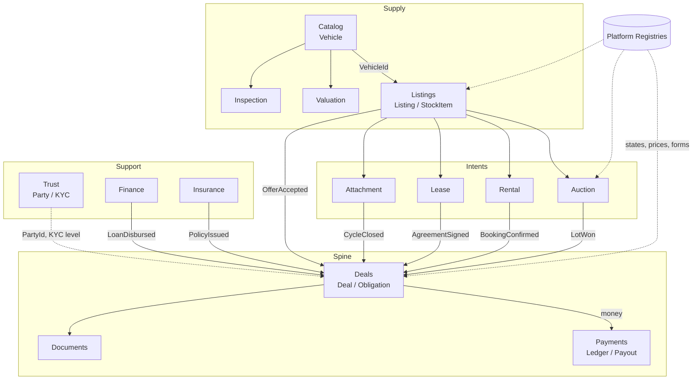

# AutoHub — Canonical Domain Model

> Derives from `00-north-star.md`. Where this document and the north star disagree, the north star
> wins. Where this document and any module spec disagree, **this document wins** — module specs
> refine, they do not redefine.
>
> This is the file you read before writing a migration, an aggregate, or an event.

---

## 0. How to read this document

| Section | Answers |
|---|---|
| §1 | Why one Vehicle / many Listings / one Deal actually holds — proved intent by intent |
| §2 | Bounded contexts, who owns which aggregate, how they talk |
| §3 | The registry contract the domain depends on (states, prices, taxonomy) |
| §4 | Identity — the hardest problem in this product, solved |
| §5–§13 | Every aggregate root, entity, value object, invariant, table, column |
| §14 | Domain event catalogue with ordering guarantees |
| §15 | Double-entry ledger + five worked journal sets |
| §16 | EAV without schema change, and how it stays queryable |
| §17 | Concurrency: optimistic default, where pessimistic is mandatory |
| §18 | Failure modes, integration outages, race conditions |
| §19 | Error code register |
| §20 | Cross-module assumptions other docs must honour |

**Conventions in force** (from north star §5, restated only as a reading aid, not re-decided):
`snake_case` plural tables · `id uuid v7` · `timestamptz` UTC · money is `bigint` **paise** paired
with a currency code · every table carries `created_at, created_by, updated_at, updated_by,
deleted_at, row_version`.

---

## 1. The core insight, proved

### 1.1 The claim

```
        ┌──────────────────────────────────────────────────────────────┐
        │  VEHICLE — a physical object with a lifetime identity        │
        │  It does not know it is for sale. It does not have a price.  │
        └───────────────────────────┬──────────────────────────────────┘
                                    │  0..n over time, 0..k concurrently
        ┌───────────────────────────▼──────────────────────────────────┐
        │  LISTING — an *offer to transact*, carrying an INTENT         │
        │  SALE · AUCTION · RENTAL · LEASE · ATTACHMENT · EXCHANGE      │
        │  Intent decides: what is transferred, for how long, to whom,  │
        │  under which workflow, priced by which registry rule.         │
        └───────────────────────────┬──────────────────────────────────┘
                                    │  0..n
        ┌───────────────────────────▼──────────────────────────────────┐
        │  DEAL — the settlement spine. Parties, assets, lines,         │
        │  schedule, money, tax, documents, obligations, ledger.        │
        │  Every intent settles here. There is exactly one settlement   │
        │  engine in this product.                                      │
        └──────────────────────────────────────────────────────────────┘
```

A `Listing` is an **offer**; a `Deal` is a **contract**. Nothing else in the platform is allowed to
move money.

### 1.2 The proof — six intents, one spine

The spine holds only if every intent can be expressed as `(assets, parties, lines, schedule,
obligations)` without a new settlement engine. It can:

| | SALE | AUCTION | RENTAL | LEASE | ATTACHMENT | EXCHANGE |
|---|---|---|---|---|---|---|
| **What transfers** | Title | Title | Possession (short) | Possession (long) | Earning capacity | Title × 2 |
| **Assets on deal** | 1 | 1 | 1 | 1 | 1 | 2 (`PRIMARY` + `TRADE_IN`) |
| **Price discovery** | Posted / negotiated | Ascending bid + reserve | Rate card × duration | Amortised schedule | Revenue share % | Two valuations, net cash |
| **`settlement_mode`** | `ONE_SHOT` | `ONE_SHOT` | `ONE_SHOT_PLUS_VARIABLE` | `RECURRING` | `RECURRING_REVERSE` | `ONE_SHOT` |
| **Money direction** | Buyer → Seller | Buyer → Seller | Renter → Owner | Lessee → Lessor | **Fleet → Owner** | Net, either direction |
| **Deposit** | Token (adjustable) | EMD (adjustable/forfeitable) | Security (refundable) | Security + advance EMIs | Security | Token |
| **Recurring lines** | none | none | none | `LEASE_RENT` × term | `ATTACHMENT_PAYOUT` × cycles | none |
| **Variable lines** | none | none | late fee, fuel, damage, toll | excess-km, maintenance | trip-based incentives, penalties | none |
| **Platform revenue** | Seller commission + buyer service fee | Buyer premium + seller commission | Commission on fare | Origination + servicing fee | Commission on payout | Commission on both legs |
| **Terminal success** | RC transferred + payout released | Lot delivered + settled | Vehicle returned + deposit settled | Term completed / buyout | Contract completed | Both RCs transferred |
| **Registry-critical guard** | encumbrance clear | dealer KYC + EMD | plate class permits self-drive | lessor is RC owner | commercial permit + fitness | both legs clear |

Three things this table proves:

1. **`Deal.vehicle_id` is wrong.** EXCHANGE needs two assets. So the model is `deal_assets`
   (`deal_id, vehicle_id, asset_role, direction, agreed_value_minor`). We keep
   `deals.primary_vehicle_id` as a denormalised index column only, never as the truth.
2. **Money direction is not a property of the code path, it is a property of the ledger posting.**
   ATTACHMENT pays the vehicle owner; SALE pays the seller; both are `Cr party_payable`. The double-
   entry ledger absorbs direction for free. A "payment service" with a `chargeCustomer()` method
   would not.
3. **Recurrence is a schedule, not a subclass.** `deal_lines` × `deal_schedule_entries` expresses
   a 36-month lease and a 3-day rental with the same two tables. `LeaseAgreement` and
   `RentalAgreement` exist as *terms* aggregates — the legal shape — and delegate all money to Deal.

### 1.3 What is deliberately NOT on the spine

| Not a Deal | Why | Where it lives |
|---|---|---|
| Test drive booking | No consideration, no obligation transfer | `Bookings` — may *emit* a Deal on conversion |
| Valuation | An opinion about a vehicle, not an offer | `Valuation` |
| Inspection | A fact about a vehicle; billable, so it raises a **service Deal** with `intent=SERVICE` | `Inspection` + `Deals` |
| Loan / Insurance policy | Contract between customer and a regulated third party. Platform earns a **referral**, which is its own service Deal | `Finance` / `Insurance`, settled as `intent=REFERRAL` |

Note the pattern: anything the platform *bills for* becomes a Deal, even when the underlying
contract is not ours. That is what keeps one commission engine and one GST engine.

---

## 2. Bounded contexts and the context map

### 2.1 Ownership table

An aggregate has exactly one owning module. That module owns its tables, its migrations, and the
right to write them. Everyone else reads through `Contracts` or reacts to events.

| Module | Aggregate roots owned | Schema |
|---|---|---|
| `Identity` | `User`, `Session`, `Organisation` | `identity` |
| `Catalog` | **`Vehicle`**, `VehicleModelRef` (taxonomy projection) | `catalog` |
| `Trust` | `Party`, `KycCase`, `RiskProfile`, `Blacklist` | `trust` |
| `Listings` | **`Listing`**, `StockItem` (dealer inventory), `RequirementPost` | `listings` |
| `Auction` | **`Auction`**, **`Lot`**, `BidderRegistration` | `auction` |
| `Rental` | `RentalAgreement`, `FleetVehicle`, `AvailabilityCalendar` | `rental` |
| `Lease` | `LeaseAgreement`, `LeaseSchedule` | `lease` |
| `Attachment` | `AttachmentContract`, `AttachmentCycle` | `attachment` |
| `Valuation` | `Valuation` | `valuation` |
| `Inspection` | `Inspection`, `InspectionReport` | `inspection` |
| `Deals` | **`Deal`**, `DealParty`, `DealLine`, `Obligation` | `deals` |
| `Payments` | `PaymentIntent`, `Settlement`, `Payout`, **`LedgerAccount`**, **`JournalEntry`** | `payments` |
| `Finance` | `LoanApplication`, `LenderOffer` | `finance` |
| `Insurance` | `InsuranceQuote`, `PolicyRef`, `ClaimRef` | `insurance` |
| `Documents` | `Document`, `DocumentTemplate`, `SignatureRequest` | `documents` |
| `Bookings` | `Booking` (test drive, inspection slot, pickup) | `bookings` |
| `Chat` | `Conversation`, `Message`, `Offer` (negotiation) | `chat` |
| `Notifications` | `NotificationRequest`, `DeliveryAttempt` | `notify` |
| `Reviews` | `Review`, `Rating` | `reviews` |
| `Analytics` | read-only projections; owns no aggregate | `analytics` |
| `Platform` | the ten registries | `registry` |

`Bid` is deliberately **not** an aggregate root — see §8.3. `LedgerEntry` is deliberately not an
aggregate root — `JournalEntry` is, because balance is an invariant of the *entry set*.

### 2.2 The map



### 2.3 Relationship patterns

| Upstream → Downstream | Pattern | Enforcement |
|---|---|---|
| `Platform` → everything | **Shared kernel** (read-only) | Registry client in `Platform`; no module may write registry tables |
| `Catalog` → `Listings`, `Auction`, `Rental` | **Customer–supplier**; Catalog owns Vehicle | Downstream stores only `vehicle_id` + a *denormalised snapshot* `vehicle_snapshot jsonb` taken at listing time |
| `Deals` → `Payments` | **Conformist**; Payments is generic | Deals speaks `PostingRequest`, never SQL against `payments.*` |
| `Trust` → `Deals` | **Anti-corruption layer** | Deals reads `IPartyDirectory.GetSettlementProfile(partyId)` — never the KYC document store |
| `Finance`/`Insurance` → external | **ACL per integration** | Integration registry chooses adapter; domain sees `LenderOffer`, never a bank's DTO |

**The vehicle snapshot rule.** A Listing must render correctly forever, even after the Vehicle is
corrected, merged, or the owner exercises DPDP erasure. So every Listing/Lot/Agreement stores
`vehicle_snapshot jsonb` (make, model, variant, year, km, fuel, plate class, masked reg) captured
at publish and refreshed on `VehicleCorrected`. Live reads use the snapshot; the join to Catalog is
for detail pages and admin only. This kills the N+1 and the cross-module transaction in one move.

---

## 3. The registry contract the domain depends on

The domain does not define statuses or prices. It defines the *shape it needs* from the registries.
Registry internals are specified in the registry doc; these are the columns the domain reads.

### 3.1 Workflow registry (Registry #3) — the only source of state

```
registry.workflow_definitions(id, entity_type, key, version, is_active,
                              effective_from, scope_json, created_at…)
registry.workflow_states(id, definition_id, state_key, label_key, category,
                         is_initial, is_terminal, sort_order, ui_token,
                         caps_json)
registry.workflow_transitions(id, definition_id, from_state_key, to_state_key,
                              event_key, guard_expr, effect_json,
                              required_permission, sla_seconds, priority)
```

Every stateful aggregate carries exactly these five columns — never an enum:

```sql
workflow_definition_id uuid   not null,
workflow_version       int    not null,
state_key              text   not null,   -- registry data, opaque to code
state_category         text   not null,   -- projected from workflow_states.category
state_entered_at       timestamptz not null,
```

**The category rule (important).** `state_key` is business data and code may *never* branch on it.
`state_category` is a closed technical vocabulary the registry assigns to each state, and it is the
only thing application code, DB constraints and indexes may depend on:

```
DRAFT · PENDING · ACTIVE · ON_HOLD · TERMINAL_SUCCESS · TERMINAL_FAILURE · TERMINAL_CANCELLED
```

Finer-grained behaviour uses **capability flags** on the state row (`caps_json`), also registry data:

```json
{ "allows_edit": false, "publicly_visible": true, "blocks_new_deal": true,
  "permits_payout": false, "permits_bid": true, "counts_as_inventory": true,
  "requires_reason_code": true }
```

Sample rows for `entity_type = 'LISTING'`, definition `LISTING.SALE.C2C@4`:

| state_key | category | publicly_visible | allows_edit | blocks_new_deal |
|---|---|---|---|---|
| `DRAFT` | DRAFT | false | true | false |
| `AWAITING_MEDIA` | DRAFT | false | true | false |
| `PENDING_MODERATION` | PENDING | false | false | false |
| `LIVE` | ACTIVE | true | true | false |
| `RESERVED` | ACTIVE | true | false | **true** |
| `LEGAL_HOLD` | ON_HOLD | false | false | true |
| `SOLD` | TERMINAL_SUCCESS | false | false | true |
| `EXPIRED` | TERMINAL_FAILURE | false | false | false |
| `WITHDRAWN` | TERMINAL_CANCELLED | false | false | false |

Insert `LEGAL_HOLD` between `LIVE` and payout in a different definition version and **no code
changes** — that is the north star's stated acceptance test, and this is the mechanism.

State history is universal, one table, owned by `Platform`:

```sql
registry.workflow_state_history(
  id uuid pk, entity_type text, entity_id uuid,
  definition_id uuid, from_state_key text null, to_state_key text not null,
  event_key text, actor_party_id uuid null, actor_kind text,
  reason_code text null, note text null, correlation_id uuid,
  occurred_at timestamptz not null)
```
Index: `(entity_type, entity_id, occurred_at desc)`. This is what `WorkflowTimeline`
(01-design-system §6) renders — for any entity, with no per-module code.

### 3.2 Pricing & commission registry (Registry #4) — the only source of rupees

```
registry.pricing_rules(id, code, intent_key, scope_json, basis, value_bps,
                       flat_amount_minor, min_amount_minor, max_amount_minor,
                       payer_role, payee_account_code, tax_treatment_key,
                       rounding_key, priority, version, effective_from, effective_to)
registry.pricing_slabs(rule_id, from_minor, to_minor, value_bps, flat_minor)
registry.tax_treatments(key, hsn_sac, gst_rate_bps, cess_rate_bps,
                        place_of_supply_rule, reverse_charge, deemed_supplier_section,
                        tds_section, tds_rate_bps, tcs_section, tcs_rate_bps,
                        threshold_minor, effective_from)
```

Worked sample rows:

| code | intent | scope_json | basis | value_bps | max_minor | payer_role | tax_treatment_key |
|---|---|---|---|---|---|---|---|
| `COMM.SALE.C2C` | SALE | `{"channel":"C2C"}` | PERCENT | 200 | 1500000 | SELLER | `SVC_18_INTRA` |
| `COMM.AUCTION.BUYER` | AUCTION | `{"city":"PUNE"}` | PERCENT | 150 | — | BUYER | `SVC_18_INTER` |
| `COMM.AUCTION.BUYER` | AUCTION | `{}` | PERCENT | 200 | — | BUYER | `SVC_18_INTER` |
| `FEE.RENTAL.LATE` | RENTAL | `{"category":"CAR"}` | PER_UNIT | — | — | RENTER | `PAX_TRANSPORT_ECO` |
| `HOLDBACK.SALE.RC` | SALE | `{}` | FLAT | — | — | — | `NONE` |

Two rows for `COMM.AUCTION.BUYER` with different `scope_json` and `priority` is exactly the north
star's "change auction commission to 1.5% in Pune only" — resolution is most-specific-scope wins,
tie-broken by `priority` then `effective_from desc`.

**Rule:** every rupee that appears on a `deal_line` carries `pricing_rule_id` + `pricing_version`.
An invoice must be reproducible from the registry snapshot it was priced with, forever, even after
the rule changes. We therefore **freeze** the resolved rule into `deal_lines.pricing_snapshot jsonb`
at line creation. Registries are versioned; deals are immutable once priced.

### 3.3 Taxonomy registry (Registry #1) — the source of every option list

Domain-relevant taxonomy trees (each a row set, never an enum):
`vehicle_category` · `make` · `model` · `variant` · `fuel_type` · `body_type` · `transmission` ·
`plate_class` · `intent_key` · `party_kind` · `party_role` · `identifier_type` ·
`attribute_definition` · `document_type` · `reason_code` · `asset_role` · `line_type` ·
`encumbrance_type` · `settlement_mode`.

`intent_key` rows drive §1.2 as data:

```
intent_key | settlement_mode          | asset_cardinality | requires_possession_transfer | default_workflow_key
SALE       | ONE_SHOT                 | 1                 | true                         | DEAL.SALE
AUCTION    | ONE_SHOT                 | 1                 | true                         | DEAL.AUCTION
RENTAL     | ONE_SHOT_PLUS_VARIABLE   | 1                 | true (temporary)             | DEAL.RENTAL
LEASE      | RECURRING                | 1                 | true (temporary)             | DEAL.LEASE
ATTACHMENT | RECURRING_REVERSE        | 1                 | false                        | DEAL.ATTACHMENT
EXCHANGE   | ONE_SHOT                 | 2                 | true                         | DEAL.EXCHANGE
SERVICE    | ONE_SHOT                 | 0..1              | false                        | DEAL.SERVICE
REFERRAL   | ONE_SHOT                 | 0..1              | false                        | DEAL.REFERRAL
```

Adding "spare parts" in v2 = one row here + a workflow definition + a pricing rule. No new module.

---

## 4. Identity — one physical vehicle, four appearances

### 4.1 The problem, stated precisely

The same Swift can appear as: a C2C seller's sell-flow submission, a dealer's stock item bought
from that seller, an auction lot when the dealer wholesales it, and a fleet asset when a rental
operator buys it at auction. Four modules, four workflows, four sets of photos — **one physical
object**, and the platform is worthless if it cannot say so (price history, ownership chain,
odometer-rollback detection, fraud rings all depend on it).

And the obvious key is poisoned:

> **A registration number is not unique over time, and not stable over a vehicle's life.**

| Reality | Consequence |
|---|---|
| Interstate transfer: `KA01MJ4455` → re-registered `MH12QR7788` | Same car, two reg numbers, sequential in time |
| RTO re-issues a series after ~15 years / after scrappage | Two different cars, same reg number, disjoint in time |
| BH-series conversion (`22BH1234AA`) for transferable-job owners | Reg number changes without sale |
| Temporary numbers (`MH01TC…`, `TR`) before permanent allotment | A car legitimately has two live-ish numbers for ≤30 days |
| Cloned plates (endemic) | Two *physical* cars claiming one reg number **at the same time** — this is fraud, not a merge |
| Trade certificate / dealer plates (`MH01TC`) | Number belongs to the dealer, not the car |

So: **the chassis/VIN is the spine, the registration number is a time-bounded alias.**

### 4.2 The tables

```sql
catalog.vehicles (
  id                    uuid    primary key,            -- uuid v7, the ONLY stable handle
  canonical_status      text    not null,               -- state_category-style: CANONICAL | MERGED | QUARANTINED
  merged_into_id        uuid    null references catalog.vehicles(id),
  category_key          text    not null,               -- taxonomy
  make_key              text    null,
  model_key             text    null,
  variant_key           text    null,
  manufacture_year      smallint null,
  manufacture_month     smallint null,
  first_registration_at date    null,
  plate_class_key       text    null,                   -- taxonomy: WHITE_PRIVATE, YELLOW_COMMERCIAL, …
  attributes            jsonb   not null default '{}',  -- EAV projection, §16
  identity_confidence   smallint not null default 0,    -- 0..100, §4.4
  row_version           bigint  not null,
  … audit columns …
);

catalog.vehicle_identifiers (
  id                 uuid primary key,
  vehicle_id         uuid not null references catalog.vehicles(id),
  identifier_type    text not null,          -- taxonomy: VIN | CHASSIS | ENGINE | REG_NUMBER |
                                             -- HSRP_PIN | FASTAG_ID | PERMIT_NO | RC_NO
  value_raw          text not null,          -- exactly as supplied/OCR'd
  value_normalized   text not null,          -- see §4.3
  value_masked       text not null,          -- last-5 form, what VAHAN returns publicly
  validity           tstzrange not null,     -- [issued, revoked) — '[2019-04-02, )' for open
  source_key         text not null,          -- VAHAN | DIGILOCKER | RC_OCR | INSPECTOR | SELLER | DEALER
  verified_at        timestamptz null,
  verification_ref   text null,              -- VAHAN txn id / DigiLocker URI
  confidence         smallint not null,      -- 0..100 from source precedence + OCR score
  is_primary         boolean not null default false,
  row_version        bigint not null,
  … audit …
);
```

**Constraints that do the actual work** (requires `btree_gist`):

```sql
-- 1. A VIN/chassis, once verified, is globally unique for all time.
CREATE UNIQUE INDEX ux_vehid_immutable
  ON catalog.vehicle_identifiers (identifier_type, value_normalized)
  WHERE identifier_type IN ('VIN','CHASSIS') AND verified_at IS NOT NULL AND deleted_at IS NULL;

-- 2. A registration number is unique only *within a time window*.
ALTER TABLE catalog.vehicle_identifiers
  ADD CONSTRAINT ex_reg_no_temporal
  EXCLUDE USING gist (
      value_normalized WITH =,
      identifier_type  WITH =,
      validity         WITH &&
  ) WHERE (identifier_type = 'REG_NUMBER' AND deleted_at IS NULL);

-- 3. Exactly one primary identifier per (vehicle, type).
CREATE UNIQUE INDEX ux_vehid_primary
  ON catalog.vehicle_identifiers (vehicle_id, identifier_type)
  WHERE is_primary AND deleted_at IS NULL;

-- 4. Fast alias lookup, including historical.
CREATE INDEX ix_vehid_lookup
  ON catalog.vehicle_identifiers (identifier_type, value_normalized, lower(validity) DESC);
```

Constraint 2 is the whole answer to "reg number is not globally unique." `MH12QR7788` valid
`[2009-01-01, 2024-06-30)` on vehicle A and `[2025-02-11, ∞)` on vehicle B coexist happily. Two
*overlapping* claims are rejected at the database — and that rejection is precisely the clone-plate
signal, which we catch and route (§18.4) rather than swallow.

### 4.3 Normalisation (deterministic, versioned, in `SharedKernel`)

```
normalize_reg(raw):
  upper → strip [^A-Z0-9] → expand known OCR confusions only when format demands
  (O↔0 and I↔1 in numeric positions, S↔5 in numeric positions)
  classify format:
    STANDARD    ^([A-Z]{2})(\d{1,2})([A-Z]{0,3})(\d{4})$      MH01AB1234
    BH_SERIES   ^(\d{2})(BH)(\d{4})([A-Z]{1,2})$              22BH1234AA
    TEMPORARY   ^([A-Z]{2})(\d{1,2})(TC|TR|T)(\d{3,4})$
    DEFENCE     ^(\d{2})([A-Z])(\d{6})([A-Z])$
    DIPLOMATIC  ^(\d{1,3})(CD|CC|UN)(\d{1,4})$
  emit: normalized, format, state_code, rto_code, series, serial
normalize_vin(raw):
  upper → strip non-alnum → reject I,O,Q → length must be 17 for VIN, else store as CHASSIS
  compute ISO-3779 check digit; store `check_digit_ok` — DO NOT reject on failure
```

> **India reality:** many Indian OEMs' VINs fail the ISO check digit, and pre-2000 vehicles have
> non-17-char chassis numbers. Check-digit failure lowers `confidence`; it never blocks ingestion.
> VAHAN's public endpoint returns only the **last 5 characters** of chassis and engine — so
> `value_masked` is a first-class column, not a display concern, and matching must work on it.

Normalisation is versioned (`normalizer_version` on the row). Changing the normaliser triggers a
re-normalisation job and a re-run of dedupe candidates; it never silently changes stored values.

### 4.4 Deduplication — the resolution ladder

Ingestion never writes a Vehicle directly. It writes a `catalog.vehicle_ingest_requests` row and
runs `ResolveVehicleIdentity`:

| Tier | Match key | Confidence | Action |
|---|---|---|---|
| **T0** | Verified VIN or full chassis exact | 100 | Attach to existing vehicle |
| **T1** | Masked chassis (last 5) **+** masked engine (last 5) **+** make + model + manufacture year | 92 | Attach; flag `NEEDS_FULL_CHASSIS` |
| **T2** | Active `REG_NUMBER` whose `validity` contains *now* **+** first-registration date within ±31d **+** make/model | 85 | Attach |
| **T3** | Active `REG_NUMBER` only | 60 | **Do not attach.** Create provisional vehicle, queue `IdentityReview` |
| **T4** | Fuzzy: model + year + km within band + city + seller phone | 30 | Never attaches. Analytics signal only |

Rules:
- Attach threshold is a registry value (`registry.feature_flags['identity.attach_min_confidence']`),
  currently 85 — not a constant in code.
- **T2 with a make/model mismatch is an alarm, not a miss.** It emits
  `vehicle.identity.conflict_detected` → Trust module → possible clone plate.
- A provisional vehicle (`canonical_status = QUARANTINED`) may hold a Listing but **may not reach a
  Deal state whose `caps_json.permits_payout` is true.** Payout requires T0/T1 identity.

**Merging** is explicit, evidenced and reversible:

```sql
catalog.vehicle_merges (
  id uuid pk, surviving_vehicle_id uuid, merged_vehicle_id uuid,
  tier text, evidence jsonb, decided_by uuid, decided_at timestamptz,
  reversible_until timestamptz,          -- decided_at + 30 days
  reversed_at timestamptz null, reversal_reason text null)
```

On merge: loser gets `canonical_status='MERGED'`, `merged_into_id=survivor`; identifiers repoint
(preserving `validity`); a `VehicleMerged` event lets Listings/Auction/Rental repoint their
`vehicle_id` **asynchronously**. Reads resolve through a helper that follows `merged_into_id` at
most 3 hops (a cycle is a bug — enforced by a trigger that rejects a merge creating a cycle).

### 4.5 The four appearances, resolved

```
                       catalog.vehicles.id = 019321f4-…-a7  (one row, forever)
                                    │
   ┌────────────────┬───────────────┼────────────────┬─────────────────────┐
   │                │               │                │                     │
listings.listings  listings.       auction.lots    rental.fleet_vehicles  deals.deal_assets
 intent=SALE       stock_items      lot_no=A-114    fleet_id=…             (n rows over time)
 seller=Party P1   dealer=Party D2  seller=D2       owner=Party F3
 SOLD 2025-03      IN_STOCK         SOLD 2025-06    ACTIVE 2025-07
```

- **C2C seller** — `listings.listings.vehicle_id`, `seller_party_id = P1`.
- **Dealer inventory** — `listings.stock_items.vehicle_id` created by the `DealCompleted` handler.
  Dealer inventory is *not* a Listing; a stock item may have zero, one or many listings over time
  (list → unsold → auction → relist).
- **Auction lot** — `auction.lots.listing_id` → listing → vehicle. Lots never store `vehicle_id`
  directly; they store the snapshot.
- **Rental fleet** — `rental.fleet_vehicles.vehicle_id`, unique partial index
  `(vehicle_id) WHERE state_category = 'ACTIVE'` — a car cannot be in two active fleets.

**Cross-intent exclusivity** is registry data, not an `if`:

```
registry.listing_intent_exclusions(intent_a, intent_b, mode)
SALE       ↔ AUCTION     HARD     -- cannot coexist
RENTAL     ↔ ATTACHMENT  HARD     -- cannot be commercially deployed twice
SALE       ↔ RENTAL      WARN     -- allowed; disclose "available till sold"
LEASE      ↔ *           HARD     -- a leased vehicle is committed
```

Enforced by a deferred constraint trigger over
`unique (vehicle_id, intent_key) where state_category='ACTIVE'` plus an exclusion check against the
registry table. Both live in the DB so a rogue write path cannot bypass them.

---

## 5. Shared kernel value objects

| VO | Shape | Invariants |
|---|---|---|
| `Money` | `long AmountMinor`, `string CurrencyCode(3)` | Never float. Arithmetic only between same currency (`money.currency_mismatch`). `Allocate(ratios)` uses largest-remainder so splits lose zero paise. |
| `Percentage` | `int Bps` | Basis points only. `2%` is `200`. Never `0.02m`. |
| `RegistrationNumber` | `Raw, Normalized, Format, StateCode, RtoCode, Series, Serial` | Constructed only via the normaliser; `Format` from a closed technical set |
| `Vin` | `Value(17)`, `CheckDigitOk`, `Wmi(3)`, `Vds(6)`, `Vis(8)` | No I/O/Q |
| `OdometerReading` | `long Value`, `UnitKey`, `ReadAt`, `SourceKey` | Monotonic per vehicle unless `rollback_flagged` (§18.5) |
| `DateRangeUtc` | `tstzrange` | Half-open `[from, to)` always |
| `GeoPoint` | `lat, lon, pincode, city_key, state_key` | Pincode must exist in Geography registry |
| `PartyRef` | `PartyId`, `PartyKindKey`, `DisplayNameSnapshot` | Snapshot is for documents; never for authorisation |
| `TaxContext` | `SupplierGstin, RecipientGstin, PlaceOfSupplyStateCode, IsReverseCharge, IsDeemedSupplier` | Drives CGST/SGST vs IGST split |
| `AuditStamp` | `Actor, ActorKind, At, Ip, UserAgent, CorrelationId` | Written by an EF interceptor, never by hand |

`Money.Allocate` matters more than it looks. Splitting ₹1,00,000 three ways as `33333.33 ×3` loses a
paisa; ledger imbalance follows; reconciliation breaks. Implementation: floor each share, distribute
the remainder one minor unit at a time by descending fractional part, tie-broken by index.

**Money is never formatted in the domain.** `₹8.4L` / `₹1.2Cr` rendering is `MoneyValue`'s job
(01-design-system §6). The API returns `{ "amountMinor": 840000000, "currency": "INR" }`.

---

## 6. Party — one identity, many commercial faces

`User` (Identity module) is *who logs in*. `Party` (Trust module) is *who transacts*. They are not
the same: a dealership has one Party and five Users; a person can be a Customer Party and a
proprietor of a Dealer Party.

```sql
trust.parties (
  id uuid pk,
  party_kind_key   text not null,     -- taxonomy: CUSTOMER | DEALER | FLEET | BROKER |
                                      -- LENDER | INSURER | INSPECTION_AGENCY | PLATFORM
  legal_name       text not null,
  display_name     text not null,
  primary_msisdn   text null,         -- E.164, encrypted at rest
  primary_email    text null,         -- encrypted at rest
  home_state_key   text null,
  gstin            text null,         -- 15 char; validated checksum
  pan_last4        text null,         -- full PAN in the vault, never in this table
  kyc_level        smallint not null default 0,   -- 0 none · 1 phone · 2 Aadhaar/DigiLocker · 3 full biz
  settlement_profile_id uuid null,
  workflow_definition_id uuid not null, state_key text not null, state_category text not null,
  row_version bigint not null, … audit …
);

trust.party_relations (parent_party_id, child_party_id, relation_key, valid_from, valid_to)
trust.party_roles     (party_id, role_key, scope_kind, scope_id, granted_at, revoked_at)
```

| Party kind | Distinguishing invariants |
|---|---|
| `CUSTOMER` | May sell without GSTIN. Cannot bid in dealer auctions. TDS 194-O applies above threshold. |
| `DEALER` | GSTIN **required** before any state with `caps_json.permits_payout`. Trade certificate optional. Subject to TCS 206C(1F) as seller. |
| `FLEET` | Requires at least one commercial permit document. Can hold `FleetVehicle` and `AttachmentContract`. |
| `BROKER` | Never a `DealParty` with money direction; earns only via `intent=REFERRAL` deals. Hard invariant: a Broker cannot be `BUYER` and `SELLER` on the same Deal. |
| `PLATFORM` | Exactly one row, seeded. Owns platform-side ledger accounts. |

**Invariant P1:** a Party may not be both `BUYER` and `SELLER` on the same Deal
(`deal.self_dealing`), except when `intent_key = 'EXCHANGE'` where the same party is `SELLER` of the
trade-in and `BUYER` of the primary — expressed as a per-intent registry allowance, not an `if`.

**Invariant P2:** money never moves to a Party whose `settlement_profile` is unverified
(penny-drop / VPA validation done, `verified_at not null`). Enforced in Payments, not in Deals.

**DPDP Act 2023.** `parties` is the only home of direct identifiers. Erasure = crypto-shred the
per-party data key + tombstone the row; ledger and invoices keep `party_id` (a surrogate) and the
legally-required fields under the "compliance with law" basis (Income-tax record retention). The
Deal keeps `PartyRef.DisplayNameSnapshot` on issued invoices because a GST invoice cannot be
retro-anonymised — this is a documented, deliberate exception with a retention clock, not an
oversight.

---

## 7. Vehicle, Listing, and the intent split

### 7.1 Vehicle aggregate

Root `Vehicle` (§4.2) plus these entities, all inside the aggregate boundary:

| Entity | Table | Notes |
|---|---|---|
| `VehicleIdentifier` | `catalog.vehicle_identifiers` | §4.2 |
| `VehicleAttributeValue` | `catalog.vehicle_attribute_values` | §16 |
| `VehicleOwnershipRecord` | `catalog.vehicle_ownership_records` | `owner_party_id null` allowed (pre-platform owners), `owner_serial` = RC "no. of owners" |
| `VehicleEncumbrance` | `catalog.vehicle_encumbrances` | `type_key ∈ HYPOTHECATION, LEASE, LIEN, COURT_ATTACHMENT`; `financier_name`, `hp_endorsed_on`, `noc_ref`, `form35_document_id`, `released_on` |
| `VehicleDocumentRef` | `catalog.vehicle_document_refs` | pointer into Documents: RC, insurance, PUC, fitness, permit, NOC (Form 28), Form 29/30 |
| `VehicleComplianceSnapshot` | `catalog.vehicle_compliance` | `insurance_valid_till, puc_valid_till, fitness_valid_till, permit_valid_till, road_tax_paid_till, rc_status (ACTIVE/SUSPENDED/SCRAPPED/BLACKLISTED), last_vahan_sync_at` |
| `VehicleChallan` | `catalog.vehicle_challans` | `challan_no, issued_on, amount_minor, offence_code, status_key, source (VAHAN/PARIVAHAN/state portal), synced_at` |

**Invariant V1:** a Deal that transfers title cannot reach a `permits_payout` state while an
un-released `HYPOTHECATION` encumbrance exists without a linked `noc_ref` **and** `form35_document_id`.
The *guard* lives in the workflow registry (`guard_expr: encumbrance.clear_or_noc(deal)`); the
*predicate* is domain code. That split is how we keep guards configurable without putting business
logic in a string.

**Invariant V2:** `manufacture_year <= first_registration_year <= current_year`. Violations
downgrade `identity_confidence` and raise `vehicle.data.implausible`.

**Invariant V3:** a vehicle whose `rc_status ∈ (SCRAPPED, BLACKLISTED)` cannot back an ACTIVE
listing of any intent. Checked on VAHAN sync; existing listings are transitioned via the workflow
registry's `event_key = 'RTO_ADVERSE'`.

### 7.2 Listing aggregate

```sql
listings.listings (
  id uuid pk,
  vehicle_id uuid not null,
  intent_key text not null,                 -- taxonomy
  seller_party_id uuid not null,
  channel_key text not null,                -- C2C | DEALER | FLEET | OEM
  title text not null,                      -- generated from taxonomy + attributes, editable
  ask_price_minor bigint null,              -- SALE/EXCHANGE
  reserve_price_minor bigint null,          -- AUCTION (encrypted; visible to seller + auctioneer)
  rate_card_id uuid null,                   -- RENTAL/LEASE/ATTACHMENT
  currency_code char(3) not null default 'INR',
  is_negotiable boolean not null default true,
  location geography(Point,4326) not null, pincode text not null, city_key text not null,
  vehicle_snapshot jsonb not null,
  attributes_override jsonb not null default '{}',
  media_set_id uuid null,
  valuation_id uuid null, inspection_id uuid null,
  workflow_definition_id uuid, workflow_version int, state_key text, state_category text,
  state_entered_at timestamptz, published_at timestamptz null, expires_at timestamptz null,
  quality_score smallint null,              -- completeness + media + inspection, drives ranking
  row_version bigint not null, … audit …
);
```

Entities inside: `ListingMedia`, `ListingPriceHistory`, `ListingBoost` (paid promotion → a
`SERVICE` deal), `ListingViewCounter` (write-behind from Redis; never in the aggregate transaction).

**Invariant L1:** `intent_key` is immutable after first publish. Changing intent = new listing,
linked by `superseded_by_listing_id`. This keeps price history and analytics honest.

**Invariant L2:** publishing requires the intent's required-document set (registry) to be present
and non-expired. Rental self-drive requires `plate_class_key ∈ {BLACK_SELF_DRIVE, YELLOW_COMMERCIAL}`
plus a valid rent-a-cab permit — a white private plate cannot legally be self-drive rented, and this
is a registry row (`registry.intent_requirements`), not code.

**Invariant L3:** `reserve_price_minor` is never returned by any read model to a bidder. Column-level
RLS + a projection that physically omits it.

### 7.3 Intent-specific terms

Rather than six listing subtypes, the intent-specific *terms* live in one satellite table per
intent, keyed 1:1 by `listing_id`. This keeps the hot `listings` table narrow and lets a new intent
add a table without touching the core.

| Table | Key columns |
|---|---|
| `listings.terms_sale` | `token_amount_minor, holdback_policy_key, rc_transfer_responsibility, delivery_mode_key` |
| `listings.terms_auction` | `auction_id, lot_no, increment_rule_id, buy_now_price_minor, extension_policy_key` |
| `listings.terms_rental` | `min_hours, max_days, base_rate_card_id, km_included_per_day, extra_km_rate_minor, with_driver, deposit_minor, fuel_policy_key` |
| `listings.terms_lease` | `tenure_months, monthly_rent_minor, down_payment_minor, residual_value_minor, km_cap_per_year, lease_kind (OPERATING/FINANCE), buyout_option` |
| `listings.terms_attachment` | `aggregator_party_id, revenue_share_bps, min_trips_per_month, guarantee_amount_minor, cycle_key (WEEKLY/MONTHLY), driver_supplied_by` |
| `listings.terms_exchange` | `accepted_category_keys[], max_top_up_minor, valuation_policy_key` |

---

## 8. Auction, Lot, Bid

### 8.1 Aggregates

```sql
auction.auctions (
  id uuid pk, code text unique, title text, auction_kind_key text,   -- LIVE | TIMED | SEALED | OBO
  city_key text, starts_at timestamptz, ends_at timestamptz,
  registration_closes_at timestamptz, emd_amount_minor bigint,
  visibility_key text,                                               -- PUBLIC | DEALER_ONLY | INVITE
  workflow_* …, row_version bigint);

auction.lots (
  id uuid pk, auction_id uuid, listing_id uuid, lot_no text,
  seller_party_id uuid, vehicle_snapshot jsonb,
  reserve_price_minor bigint,          -- encrypted, RLS-guarded
  start_price_minor bigint not null,
  current_bid_minor bigint null,
  current_bid_id uuid null,
  current_winner_party_id uuid null,
  bid_count int not null default 0,
  scheduled_end_at timestamptz not null,
  effective_end_at timestamptz not null,   -- moves on auto-extension
  extension_count smallint not null default 0,
  workflow_* …, row_version bigint);

auction.bids (
  id uuid pk, lot_id uuid not null, bidder_party_id uuid not null,
  amount_minor bigint not null, bid_kind_key text not null,  -- MANUAL | PROXY | AUTO_INCREMENT
  proxy_max_minor bigint null,
  sequence_no bigint not null,          -- monotonic per lot, assigned inside the lot lock
  placed_at timestamptz not null,
  client_placed_at timestamptz null,    -- for latency forensics only, never authoritative
  idempotency_key text not null,
  outcome_key text not null,            -- ACCEPTED | REJECTED_LOW | REJECTED_CLOSED | OUTBID | WON
  reject_reason_code text null,
  row_version bigint not null);
```

### 8.2 Auction invariants

| # | Invariant | Failure code |
|---|---|---|
| A1 | `amount_minor >= current_bid_minor + increment(current_bid_minor)` where increment comes from `registry.bid_increment_rules` slabs | `bid.below_increment` |
| A2 | Bidder must have an ACTIVE `BidderRegistration` with EMD in a `permits_bid` state | `bid.not_registered` |
| A3 | Seller (or any related party per `party_relations`) cannot bid on own lot | `bid.self_bidding` |
| A4 | Bid at `t` where `t >= effective_end_at` is rejected — clock is **server** clock, always | `bid.lot_closed` |
| A5 | A bid inside the anti-snipe window extends `effective_end_at` by the registry's window, capped by `max_extensions` | — |
| A6 | `current_bid_minor` is monotonically increasing per lot, forever | `bid.stale_state` |
| A7 | Reserve not met ⇒ lot moves to a state whose `caps_json.permits_payout` is false; seller gets a "sell below reserve?" offer, which is a **new** transition, not a retro bid | — |
| A8 | Winning bid creates exactly one Deal. Duplicate `LotWon` handling is idempotent on `(lot_id)` | `deal.duplicate_for_lot` |

Anti-snipe is registry data:

```
registry.auction_extension_policies
key                | window_seconds | extend_by_seconds | max_extensions
STANDARD_2MIN      | 120            | 120               | 20
HOT_LOT_5MIN       | 300            | 180               | 40
NO_EXTENSION       | 0              | 0                 | 0
```

### 8.3 Why `Bid` is not an aggregate root

The invariant "this bid beats the current highest" is an invariant **of the lot**, not of the bid.
Making `Bid` a root would make A1/A6 unenforceable without distributed coordination. So:
**`Lot` is the aggregate root; `Bid` is an entity inside it**, and bid placement takes a row lock on
the lot (§17.3). The bid table is physically separate (it is huge and append-only) but logically
inside the boundary — no code outside the Auction module may insert into it.

---

## 9. Rental, Lease, Attachment

These three are where "one spine" is either true or a lie. They are true because each owns only
**terms and operational state**, and delegates every rupee to `Deal`.

### 9.1 RentalAgreement

```sql
rental.rental_agreements (
  id uuid pk, deal_id uuid not null unique, listing_id uuid, fleet_vehicle_id uuid,
  renter_party_id uuid, owner_party_id uuid,
  pickup_at timestamptz, dropoff_at timestamptz, actual_pickup_at, actual_dropoff_at,
  pickup_location_id uuid, dropoff_location_id uuid,
  odo_out bigint, odo_in bigint, fuel_out_pct smallint, fuel_in_pct smallint,
  km_included int, with_driver boolean, driver_party_id uuid null,
  deposit_minor bigint, deposit_state_key text,
  workflow_* …, row_version bigint);

rental.availability_blocks (
  id uuid pk, fleet_vehicle_id uuid not null,
  period tstzrange not null, block_kind_key text not null,  -- BOOKED | MAINTENANCE | HOLD
  deal_id uuid null,
  EXCLUDE USING gist (fleet_vehicle_id WITH =, period WITH &&)
     WHERE (block_kind_key <> 'RELEASED'));
```

The exclusion constraint is the double-booking fix — **not** a lock, not a check-then-insert. Two
concurrent bookings for overlapping windows: one commits, one gets `23P01 exclusion_violation`,
which we translate to `rental.slot_taken`. No race window exists.

**Hold semantics:** a `HOLD` block is inserted with `period` = requested window and a
`registry.feature_flags['rental.hold_ttl_seconds']` TTL; a janitor releases expired holds. The hold
is inserted in the *same transaction* as the `PaymentIntent` creation.

Variable settlement on return produces `deal_lines` of type `LATE_FEE`, `EXCESS_KM`, `FUEL_RECOVERY`,
`DAMAGE`, `TOLL_RECOVERY`, `CHALLAN_RECOVERY` — every one of them priced by a registry rule, and
every one of them adjustable against `SECURITY_DEPOSIT_HELD` before any refund is computed.

> **Challan recovery is India-specific and non-optional.** E-challans arrive days after the trip.
> `catalog.vehicle_challans` sync creates a `CHALLAN_RECOVERY` obligation on the deal whose rental
> period contains `issued_on`. Deposit already refunded ⇒ obligation becomes a receivable on the
> renter with a registry-driven dunning workflow. `deposit_release_delay_hours` (registry, default
> 72) exists precisely for this.

### 9.2 LeaseAgreement

```sql
lease.lease_agreements (
  id uuid pk, deal_id uuid unique, lessor_party_id, lessee_party_id, vehicle_id,
  lease_kind_key text,                -- OPERATING | FINANCE
  tenure_months smallint, start_on date, end_on date,
  monthly_rent_minor bigint, down_payment_minor bigint, residual_value_minor bigint,
  km_cap_total int, excess_km_rate_minor bigint,
  buyout_option boolean, buyout_price_minor bigint null,
  hypothecation_required boolean, rc_holder_party_id uuid,
  workflow_*, row_version);
lease.lease_schedule_entries (id, agreement_id, period_no, due_on, principal_minor,
                              finance_charge_minor, rent_minor, state_key, deal_line_id)
```

**Invariant LE1:** `rc_holder_party_id` must equal `lessor_party_id` for an OPERATING lease — the
RC stays with the lessor with the lessee endorsed. For FINANCE lease the RC is in the lessee's name
with the lessor's hypothecation. Wrong RC holder blocks the transition whose guard is
`lease.rc_holder_matches_kind`.

**Invariant LE2:** schedule entries are generated once, at signing, from the registry's amortisation
policy, and frozen. Rate changes create a `LeaseAmendment` with a new schedule from a future period —
they never mutate history.

### 9.3 AttachmentContract (taxi attachment centre)

The inverted-direction case, and therefore the best proof of the spine.

```sql
attachment.attachment_contracts (
  id uuid pk, deal_id uuid unique,
  owner_party_id uuid, aggregator_party_id uuid, vehicle_id uuid,
  driver_supplied_by_key text,            -- OWNER | AGGREGATOR | PLATFORM_POOL
  revenue_share_bps int, min_guarantee_minor bigint null,
  cycle_key text,                          -- WEEKLY | FORTNIGHTLY | MONTHLY
  starts_on date, ends_on date null, notice_days smallint,
  permit_document_id uuid not null, fitness_valid_till date not null,
  commercial_insurance_document_id uuid not null,
  workflow_*, row_version);

attachment.attachment_cycles (
  id uuid pk, contract_id uuid, cycle_no int, period tstzrange,
  gross_earnings_minor bigint, trips_count int,
  deductions jsonb,                        -- fuel, maintenance, penalty, challan
  net_payable_minor bigint, deal_id uuid,  -- one settlement deal per cycle
  workflow_*, UNIQUE (contract_id, cycle_no));
```

**Invariant AT1:** attachment requires `plate_class_key = YELLOW_COMMERCIAL`, a valid contract-carriage
or all-India tourist permit, a valid fitness certificate, and a commercial (not private) insurance
policy. Four registry-listed requirements; the workflow guard is `attachment.compliance_complete`.

**Invariant AT2:** each cycle produces exactly one settlement Deal with
`settlement_mode = RECURRING_REVERSE`. Money flows aggregator → platform escrow → owner, minus
platform commission. The ledger postings are structurally identical to a SALE payout — that is the
point.

---

## 10. Valuation and Inspection

```sql
valuation.valuations (
  id uuid pk, vehicle_id uuid null, request_fingerprint text not null,
  inputs jsonb not null,                     -- what the user actually gave us
  model_key text not null, model_version text not null,   -- integration registry
  point_estimate_minor bigint, low_minor bigint, high_minor bigint,
  confidence smallint, as_of date not null, valid_till date not null,
  explanation jsonb,                         -- top factors, for the UI
  fallback_used boolean not null default false,
  workflow_*, row_version);
```

**Invariant VA1:** a valuation is only ever displayed with its `as_of` date (01-design-system §7:
"a valuation without 'as of today' is a rumor"). The API refuses to return a valuation past
`valid_till`; it returns `valuation.expired` and the UI offers a re-run.

**Invariant VA2:** `request_fingerprint` = hash of normalised inputs + model_version. Identical
requests inside the registry TTL return the cached valuation — the homepage plate input must be
free and instant, so it must not hit the model twice for the same car.

```sql
inspection.inspections (
  id uuid pk, vehicle_id uuid, deal_id uuid null, listing_id uuid null,
  scheme_key text not null, scheme_version int not null,   -- form-schema registry #2
  inspector_party_id uuid, scheduled_at, started_at, completed_at,
  location geography(Point,4326), device_id text, offline_captured boolean,
  responses jsonb not null,                 -- schema-validated answers
  scores jsonb not null,                    -- per-section, computed by rules engine
  overall_grade_key text,                   -- taxonomy: A | B | C | D
  report_document_id uuid null,
  workflow_*, row_version);
```

**Invariant IN1:** the inspection checklist is a Form Schema Registry document; the score is a Rules
Registry expression. Neither is in code. Grading thresholds change per city and per campaign.

**Invariant IN2:** inspections are captured offline (inspectors stand in basements). The client
holds a signed schema + a local queue; sync is idempotent on `(inspection_id, client_revision)` and
resolves conflicts last-writer-wins per *field*, with the full conflict recorded. `offline_captured`
and `device_id` are evidence when a report is disputed.

---

## 11. Deal — the settlement spine

### 11.1 Tables

```sql
deals.deals (
  id uuid pk,
  deal_no text unique not null,               -- human handle, registry-formatted (AH-SAL-25-000123)
  intent_key text not null,
  settlement_mode_key text not null,          -- from taxonomy (§3.3)
  source_kind_key text not null,              -- LISTING | LOT | BOOKING | CONTRACT_CYCLE | REFERRAL
  source_id uuid not null,
  primary_vehicle_id uuid null,               -- denormalised index only
  currency_code char(3) not null default 'INR',
  gross_amount_minor bigint not null default 0,
  tax_amount_minor  bigint not null default 0,
  net_platform_revenue_minor bigint not null default 0,
  city_key text, place_of_supply_state_key text,
  workflow_definition_id uuid, workflow_version int,
  state_key text, state_category text, state_entered_at timestamptz,
  closed_at timestamptz null, close_reason_code text null,
  correlation_id uuid not null,
  row_version bigint not null, … audit …);

deals.deal_parties (
  deal_id uuid, party_id uuid, role_key text,      -- taxonomy: BUYER|SELLER|LESSOR|LESSEE|RENTER|
                                                   -- OWNER|OPERATOR|PLATFORM|FINANCIER|INSURER|
                                                   -- INSPECTOR|LOGISTICS|BROKER|AGGREGATOR
  settlement_profile_id uuid null,
  tax_context jsonb not null,                      -- gstin, state, RCM flags — frozen at deal open
  PRIMARY KEY (deal_id, party_id, role_key));

deals.deal_assets (
  deal_id uuid, vehicle_id uuid, asset_role_key text,   -- PRIMARY | TRADE_IN | ACCESSORY
  direction_key text,                                    -- IN | OUT (relative to the buyer)
  agreed_value_minor bigint, valuation_id uuid null,
  PRIMARY KEY (deal_id, vehicle_id, asset_role_key));

deals.deal_lines (
  id uuid pk, deal_id uuid, line_no int,
  line_type_key text not null,        -- VEHICLE_PRICE | COMMISSION | BUYER_PREMIUM | SERVICE_FEE |
                                      -- RENT | LATE_FEE | EXCESS_KM | FUEL_RECOVERY | DAMAGE |
                                      -- DEPOSIT | HOLDBACK | DISCOUNT | REFERRAL_FEE | ADJUSTMENT
  payer_role_key text, payee_role_key text,
  quantity numeric(12,3) not null default 1,
  unit_amount_minor bigint not null,
  taxable_amount_minor bigint not null,
  tax_treatment_key text not null,
  cgst_minor bigint, sgst_minor bigint, igst_minor bigint, cess_minor bigint,
  total_minor bigint not null,
  pricing_rule_id uuid null, pricing_version int null,
  pricing_snapshot jsonb not null,     -- frozen rule, reproducible forever
  schedule_entry_id uuid null,         -- non-null for RECURRING modes
  reversal_of_line_id uuid null,
  UNIQUE (deal_id, line_no));

deals.deal_schedule_entries (id, deal_id, period_no, due_on, amount_minor, state_key, invoice_id)
deals.obligations (
  id uuid pk, deal_id uuid, obligation_type_key text,   -- RC_TRANSFER | NOC | DELIVERY | DOC_UPLOAD |
                                                        -- INSURANCE_TRANSFER | CHALLAN_CLEARANCE |
                                                        -- HP_TERMINATION | KEY_HANDOVER
  responsible_party_id uuid, due_at timestamptz,
  evidence_document_id uuid null, external_ref text null,
  workflow_*, blocks_payout boolean not null);
```

### 11.2 Deal invariants

| # | Invariant | Code |
|---|---|---|
| D1 | `sum(deal_lines.total_minor where payer=BUYER) = sum(ledger debits to buyer)` — reconciled nightly | `deal.line_ledger_mismatch` |
| D2 | A Deal in a state with `caps_json.permits_payout = false` cannot originate a `Payout` | `payout.state_not_permitted` |
| D3 | Every open `Obligation` with `blocks_payout = true` blocks payout, holdback release included | `deal.obligation_open` |
| D4 | `deal_assets` count must satisfy the intent's `asset_cardinality` | `deal.asset_cardinality` |
| D5 | Lines are append-only after invoicing. Corrections are **reversal lines** (`reversal_of_line_id`) plus a GST credit note | `deal.line_immutable` |
| D6 | `tax_context` is frozen at deal open; a party changing GSTIN later does not re-tax an issued invoice | — |
| D7 | Terminal state ⇒ deposit accounts for this deal must be zero | `deal.deposit_not_settled` |

### 11.3 The SALE happy path, with the India-specific obligations

```
LEAD ─ offer accepted ─▶ DEAL_OPENED
     ─ token paid ─────▶ TOKEN_RECEIVED
     ─ inspection ok ──▶ VERIFIED
     ─ full funds ─────▶ FUNDS_IN_ESCROW
     ─ HP NOC + Form35 ▶ ENCUMBRANCE_CLEARED     ← blocked by V1
     ─ handover ───────▶ POSSESSION_TRANSFERRED
     ─ Form 29/30 filed▶ RC_TRANSFER_INITIATED   ← obligation, blocks holdback
     ─ VAHAN confirms ─▶ RC_TRANSFER_COMPLETED
     ─ payout ─────────▶ SETTLED (TERMINAL_SUCCESS)
```

Every arrow is a `workflow_transitions` row with a guard and an effect. Inserting the north star's
example `LEGAL_HOLD` between `FUNDS_IN_ESCROW` and `POSSESSION_TRANSFERRED` is two registry inserts.

Interstate sale adds `NOC (Form 28)` from the origin RTO and re-registration in the destination
state — a second obligation with a 30–60 day SLA. The holdback (§15.1) exists to make that SLA
enforceable with money rather than with phone calls.

---

## 12. Documents

`Document` is a first-class aggregate because signatures, retention and DPDP demand it.

```sql
documents.documents (
  id uuid pk, document_type_key text, owner_party_id uuid null,
  subject_kind text, subject_id uuid,                 -- VEHICLE | DEAL | PARTY | INSPECTION
  storage_key text not null, content_sha256 text not null,
  mime text, bytes bigint, page_count int null,
  source_key text,                                    -- UPLOAD | DIGILOCKER | GENERATED | VAHAN
  extracted jsonb null,                               -- OCR result, schema per document_type
  valid_from date null, valid_till date null,
  retention_policy_key text not null, purge_after date null,
  is_pii boolean not null, encryption_key_id uuid not null,
  workflow_*, row_version);
```

**Invariant DO1:** `content_sha256` is unique per `(owner_party_id, document_type_key)` — the same
RC uploaded twice is one document with two references.

**Invariant DO2:** DigiLocker-sourced documents are `verified` without OCR review; uploaded ones
enter a verification workflow. The distinction is a `source_key` row property, and the trust weight
it carries is in the Integration registry.

---

## 13. Aggregate boundary rules

1. **One aggregate per transaction.** Enforced by an `AggregateWriteGuard` in the persistence layer
   that fails the save if two different roots are dirty.
2. **Documented exception:** `Deals` + `Payments` postings commit together. Reason: a deal state
   change that implies money must not be able to half-happen, and both live in the same Postgres
   instance. This exception is explicit, single, and reviewed.
3. **Cross-aggregate consistency is eventual, via outbox.** A listing becoming `SOLD` when a deal
   settles is a handler, not a foreign key.
4. **References across aggregates are IDs, never object references.** EF navigation properties
   across module boundaries are a build error (enforced by an architecture test using
   NetArchTest).
5. **Soft delete everywhere except the ledger.** Ledger rows are append-only; corrections are
   reversing journals. `deleted_at` on a ledger table is a bug and a check constraint rejects it.

---

## 14. Domain event catalogue

### 14.1 Conventions

- Name: `autohub.<module>.<aggregate>.<past_tense_event>.v<N>`
- Envelope: `event_id (uuid v7)`, `event_name`, `version`, `occurred_at`, `aggregate_id`,
  `aggregate_version`, `partition_key`, `correlation_id`, `causation_id`, `actor`, `tenant`, `payload`.
- Transport: outbox table → in-process dispatcher today, MassTransit tomorrow (north star §3).
- **Ordering:** guaranteed **per `partition_key`** (usually the aggregate id) via a monotonic
  `outbox.sequence_no bigint` and a single-threaded-per-partition dispatcher. **No global ordering.**
  Consumers must be idempotent on `event_id` and must tolerate re-delivery (at-least-once).
- Payloads carry IDs and immutable facts. They do **not** carry mutable projections — a consumer
  that needs current state calls the owning module's contract.
- Version bumps are additive-only; a breaking change is a new `vN+1` published **in parallel** for
  one release cycle.

### 14.2 The catalogue

| Event | Producer | Payload (beyond envelope) | Consumers | Ordering |
|---|---|---|---|---|
| `catalog.vehicle.created.v1` | Catalog | vehicle_id, category_key, identity_confidence | Search, Analytics | per vehicle |
| `catalog.vehicle.identity_resolved.v1` | Catalog | vehicle_id, tier, matched_identifier, confidence | Listings, Trust | per vehicle |
| `catalog.vehicle.identity_conflict_detected.v1` | Catalog | reg_number_normalized, vehicle_ids[], conflict_kind | **Trust (clone-plate case)**, Ops | per reg number |
| `catalog.vehicle.merged.v1` | Catalog | surviving_id, merged_id, tier | Listings, Auction, Rental, Deals, Search | per surviving vehicle |
| `catalog.vehicle.attributes_changed.v1` | Catalog | vehicle_id, changed_keys[], source_key | Search (reindex), Listings (snapshot refresh) | per vehicle |
| `catalog.vehicle.compliance_synced.v1` | Catalog | vehicle_id, rc_status, insurance_valid_till, challan_count, challan_total_minor | Listings, Deals, Rental | per vehicle |
| `catalog.vehicle.encumbrance_changed.v1` | Catalog | vehicle_id, type_key, is_open | Deals (guard), Finance | per vehicle |
| `trust.party.kyc_level_changed.v1` | Trust | party_id, old_level, new_level | Listings, Auction, Payments | per party |
| `trust.party.blacklisted.v1` | Trust | party_id, reason_code, scope | **everything** | per party |
| `listings.listing.published.v1` | Listings | listing_id, vehicle_id, intent_key, price_minor, city_key | Search, Notifications, Analytics | per listing |
| `listings.listing.price_changed.v1` | Listings | listing_id, old_minor, new_minor | Search, Notifications (watchers) | per listing |
| `listings.listing.state_changed.v1` | Listings | listing_id, from, to, category | Search, Analytics | per listing |
| `listings.listing.reserved.v1` | Listings | listing_id, deal_id, hold_expires_at | Search (de-index), Chat | per listing |
| `auction.auction.opened.v1` | Auction | auction_id, lot_count | Notifications, Search | per auction |
| `auction.lot.bid_placed.v1` | Auction | lot_id, bid_id, amount_minor, bidder_party_id, sequence_no, effective_end_at | Notifications (outbid), Analytics, live socket fan-out | **strict per lot** |
| `auction.lot.extended.v1` | Auction | lot_id, new_end_at, extension_count | live socket, Notifications | per lot |
| `auction.lot.closed.v1` | Auction | lot_id, outcome, winning_bid_id, reserve_met | Deals, Notifications | per lot |
| `auction.lot.won.v1` | Auction | lot_id, winner_party_id, amount_minor, listing_id | **Deals (creates deal)** | per lot |
| `deals.deal.opened.v1` | Deals | deal_id, intent_key, parties[], assets[] | Payments, Documents, Notifications | per deal |
| `deals.deal.priced.v1` | Deals | deal_id, lines[], gross_minor, tax_minor | Payments, Analytics | per deal |
| `deals.deal.state_changed.v1` | Deals | deal_id, from, to, category, reason_code | everything downstream | per deal |
| `deals.obligation.raised.v1` | Deals | deal_id, obligation_id, type_key, due_at | Notifications, Ops | per deal |
| `deals.obligation.fulfilled.v1` | Deals | deal_id, obligation_id, evidence_document_id | Payments (holdback release) | per deal |
| `deals.deal.settled.v1` | Deals | deal_id, net_platform_revenue_minor | Analytics, Reviews (invite), Listings (stock item) | per deal |
| `payments.payment.captured.v1` | Payments | payment_intent_id, deal_id, amount_minor, method_key, pg_ref | Deals | per payment intent |
| `payments.payment.failed.v1` | Payments | payment_intent_id, failure_code, is_retryable | Deals, Notifications | per payment intent |
| `payments.refund.completed.v1` | Payments | refund_id, deal_id, amount_minor | Deals, Notifications | per deal |
| `payments.payout.initiated.v1` | Payments | payout_id, party_id, amount_minor, utr null | Notifications | per payout |
| `payments.payout.settled.v1` | Payments | payout_id, utr, settled_at | Deals, Notifications | per payout |
| `payments.payout.reversed.v1` | Payments | payout_id, reason_code | Deals, Ops | per payout |
| `payments.journal.posted.v1` | Payments | journal_id, deal_id, entries[] | Analytics, Reconciliation | per journal |
| `rental.booking.confirmed.v1` | Rental | agreement_id, deal_id, period, fleet_vehicle_id | Deals, Notifications | per fleet vehicle |
| `rental.vehicle.returned.v1` | Rental | agreement_id, odo_in, fuel_in_pct, damages[] | Deals (variable lines) | per agreement |
| `rental.deposit.settled.v1` | Rental | agreement_id, adjusted_minor, refunded_minor | Payments | per agreement |
| `lease.agreement.signed.v1` | Lease | agreement_id, deal_id, schedule_hash | Deals, Documents | per agreement |
| `lease.installment.due.v1` | Lease | agreement_id, period_no, amount_minor | Payments, Notifications | per agreement |
| `attachment.cycle.closed.v1` | Attachment | contract_id, cycle_no, gross_minor, net_payable_minor | Deals | per contract |
| `valuation.valuation.completed.v1` | Valuation | valuation_id, vehicle_id null, point_minor, band | Listings, Analytics | per fingerprint |
| `inspection.inspection.completed.v1` | Inspection | inspection_id, vehicle_id, grade_key, report_document_id | Listings, Deals, Search | per inspection |
| `finance.loan.disbursed.v1` | Finance | application_id, lender_party_id, amount_minor, deal_id null | **Deals (referral deal)** | per application |
| `insurance.policy.issued.v1` | Insurance | quote_id, policy_ref, premium_minor | Deals (referral), Catalog (compliance) | per quote |
| `documents.document.verified.v1` | Documents | document_id, subject_kind, subject_id | Deals, Catalog, Trust | per document |

### 14.3 Ordering hazards we accept and mitigate

| Hazard | Mitigation |
|---|---|
| `payment.captured` arrives before `deal.opened` is committed (webhook beats our own write) | Webhook handler parks unknown references in `payments.orphan_webhooks` and replays on `deal.opened`; never 4xx to the gateway |
| `lot.won` delivered twice | Deal creation is idempotent on `(source_kind_key, source_id)` unique index |
| `vehicle.merged` races an in-flight listing publish | Publish resolves `merged_into_id` at commit time; a listing pointing at a MERGED vehicle is auto-repointed by the handler and re-emits `listing.state_changed` |
| Cross-aggregate ordering (`deal.settled` before `payout.settled`) | Never assumed. Consumers that need both wait on a state, not on an event sequence |

---

## 15. The double-entry ledger

### 15.1 Principles

1. **The ledger is the truth.** `deals.gross_amount_minor` is a cache of the ledger, not the reverse.
2. **Append-only.** No updates, no deletes. A mistake is a reversing journal with
   `reversal_of_journal_id` and a `reason_code`.
3. **Every journal balances**: `sum(debit) = sum(credit)`, enforced by a deferred constraint trigger
   on commit, not by application discipline.
4. **Party-scoped accounts.** `SELLER_PAYABLE` is not one account; it is one account *per party*,
   materialised lazily from a template.
5. **The escrow account is a mirror.** Under RBI's Payment Aggregator directions AutoHub does not
   hold customer money — the PA's escrow account does, settling to us on T+1. `1000 ESCROW_BANK` in
   our books mirrors the PA balance and is reconciled daily. A break is an incident, not a variance.
6. **Referral and subscription income never touches escrow** — it is our own revenue and lands in
   `1020 PLATFORM_BANK`. Mixing them would be an RBI compliance breach, so the chart of accounts
   makes it structurally impossible: no journal template posts referral income against escrow.

### 15.2 Tables

```sql
payments.ledger_account_templates (
  code text pk, name_key text, account_type text,      -- ASSET|LIABILITY|INCOME|EXPENSE|EQUITY
  normal_balance char(2),                               -- DR | CR
  is_party_scoped boolean, is_deal_scoped boolean,
  requires_currency boolean, allow_negative boolean,
  effective_from date, effective_to date);

payments.ledger_accounts (
  id uuid pk, template_code text not null,
  party_id uuid null, deal_id uuid null, currency_code char(3) not null,
  UNIQUE (template_code, coalesce(party_id,'0'::uuid), coalesce(deal_id,'0'::uuid), currency_code));

payments.journal_entries (
  id uuid pk, journal_no bigint generated always as identity,
  deal_id uuid null, event_ref text not null,          -- idempotency: what caused this
  template_key text not null,                           -- registry: which posting template
  posted_at timestamptz not null, value_date date not null,
  narrative_key text, reversal_of_journal_id uuid null,
  correlation_id uuid, created_by uuid,
  UNIQUE (event_ref));                                  -- the idempotency guarantee

payments.ledger_entries (
  id uuid pk, journal_id uuid not null, line_no smallint not null,
  account_id uuid not null, direction char(2) not null,  -- DR | CR
  amount_minor bigint not null CHECK (amount_minor > 0),
  currency_code char(3) not null,
  deal_line_id uuid null, external_ref text null,
  UNIQUE (journal_id, line_no));

payments.account_balances (                             -- projection, rebuilt from entries
  account_id uuid pk, balance_minor bigint, as_of_entry_id uuid, updated_at timestamptz);
```

Balancing trigger:

```sql
CREATE CONSTRAINT TRIGGER trg_journal_balanced
AFTER INSERT ON payments.ledger_entries
DEFERRABLE INITIALLY DEFERRED
FOR EACH ROW EXECUTE FUNCTION payments.assert_journal_balanced();
-- raises 'ledger.unbalanced' if SUM(DR) <> SUM(CR) for the journal at commit
```

### 15.3 Chart of accounts

| Code | Name | Type | Normal | Scope |
|---|---|---|---|---|
| `1000` | Escrow bank (PA escrow mirror) | ASSET | DR | currency |
| `1010` | PG receivable (captured, unsettled) | ASSET | DR | currency |
| `1020` | Platform bank (own current a/c) | ASSET | DR | currency |
| `1100` | Buyer receivable | ASSET | DR | party |
| `1200` | Referral receivable | ASSET | DR | party |
| `1300` | GST input — CGST / `1301` SGST / `1302` IGST | ASSET | DR | — |
| `1400` | TDS receivable (deducted by others from us) | ASSET | DR | — |
| `2000` | Customer advance | LIABILITY | CR | party |
| `2001` | Unearned rental/lease revenue | LIABILITY | CR | party |
| `2010` | Party payable (seller / partner / owner) | LIABILITY | CR | party |
| `2020` | Security deposit held | LIABILITY | CR | party |
| `2025` | EMD held | LIABILITY | CR | party |
| `2030` | Payout pending | LIABILITY | CR | currency |
| `2035` | Holdback held | LIABILITY | CR | party |
| `2040` | GST output — `2041` CGST / `2042` SGST / `2043` IGST / `2044` Cess | LIABILITY | CR | — |
| `2055` | TCS collected on behalf of seller (206C(1F)) | LIABILITY | CR | party |
| `2060` | TDS payable — 194-O | LIABILITY | CR | — |
| `2061` | TDS payable — 194H / 194J | LIABILITY | CR | — |
| `2070` | Refund payable | LIABILITY | CR | party |
| `4000` | Commission income | INCOME | CR | — |
| `4001` | Buyer premium income | INCOME | CR | — |
| `4010` | Listing / boost income | INCOME | CR | — |
| `4020` | Service income (inspection, RC assist) | INCOME | CR | — |
| `4030` | Referral income (finance / insurance) | INCOME | CR | — |
| `4040` | Late fee & penalty income | INCOME | CR | — |
| `4050` | Forfeited EMD / cancellation income | INCOME | CR | — |
| `5000` | Payment gateway expense | EXPENSE | DR | — |
| `5010` | Refund expense (goodwill) | EXPENSE | DR | — |
| `5030` | Channel partner expense | EXPENSE | DR | party |
| `5040` | Bad debt | EXPENSE | DR | — |

Posting **templates** (which accounts, which direction, driven by which deal line type) are registry
rows in `registry.journal_templates` — adding a new fee type must not require a code change.

### 15.4 Worked journals

> Amounts shown in rupees for readability. **Stored in paise as `bigint`.** ₹6,50,000 = `65000000`.

#### (a) C2C sale with escrow — ₹6,50,000

Seller `S` (individual, Maharashtra), Buyer `B` (Maharashtra). Commission 2% capped ₹15,000 →
₹13,000 + 18% GST. Buyer pays a ₹4,720 RC-transfer + inspection package (₹4,000 + ₹720 GST).
TDS u/s 194-O @1% on gross (gross > the ₹5,00,000 individual exemption). Holdback ₹25,000 until
RC transfer confirmed on VAHAN.

| # | Trigger | Dr | Cr | ₹ |
|---|---|---|---|---|
| J1 | `payment.captured` (NEFT to PA virtual account, MDR nil) | `1000` Escrow | | 6,54,720 |
| | | | `2000` Customer advance:B | 6,54,720 |
| J2 | Service package invoiced (intra-state → CGST+SGST) | `2000` Advance:B | | 4,720 |
| | | | `4020` Service income | 4,000 |
| | | | `2041` CGST output | 360 |
| | | | `2042` SGST output | 360 |
| J3 | `POSSESSION_TRANSFERRED` — seller entitlement recognised | `2000` Advance:B | | 6,50,000 |
| | | | `2010` Payable:S | 6,50,000 |
| J4 | Commission invoiced to S | `2010` Payable:S | | 15,340 |
| | | | `4000` Commission income | 13,000 |
| | | | `2041` CGST output | 1,170 |
| | | | `2042` SGST output | 1,170 |
| J5 | TDS 194-O withheld @1% of ₹6,50,000 | `2010` Payable:S | | 6,500 |
| | | | `2060` TDS 194-O payable | 6,500 |
| J6 | Holdback reclass (`HOLDBACK.SALE.RC`) | `2010` Payable:S | | 25,000 |
| | | | `2035` Holdback held:S | 25,000 |
| J7 | Payout initiated (₹6,50,000 − 15,340 − 6,500 − 25,000) | `2010` Payable:S | | 6,03,160 |
| | | | `2030` Payout pending | 6,03,160 |
| J8 | Bank debit confirmed + NEFT fee ₹5 + GST ₹0.90 | `2030` Payout pending | | 6,03,160 |
| | | `5000` PG expense | | 5.00 |
| | | `1300` GST input CGST/SGST | | 0.90 |
| | | | `1000` Escrow | 6,03,165.90 |
| J9 | `obligation.fulfilled` RC_TRANSFER (VAHAN) → holdback release, then settle | `2035` Holdback:S | | 25,000 |
| | | | `2030` Payout pending | 25,000 |
| J10 | Holdback paid | `2030` Payout pending | | 25,000 |
| | | | `1000` Escrow | 25,000 |

**Trial balance check.** Escrow = 6,54,720 − 6,03,165.90 − 25,000 = **26,554.10**. GST input asset
0.90. Assets = 26,555.00. Liabilities = GST output (360+360+1,170+1,170) 3,060 + TDS 6,500 = 9,560.
Equity = income 17,000 − expense 5.00 = 16,995. **9,560 + 16,995 = 26,555.00 ✓**

> Note on TCS 206C(1F): 1% TCS on motor vehicles above ₹10,00,000 is a **seller** obligation and
> applies to sellers subject to tax audit — not to a one-off individual C2C seller. The rule sits in
> `registry.tax_treatments` with `threshold_minor = 100000000` and a guard on `party_kind_key`, so
> the same code path produces (b) below correctly without an `if`.

#### (b) Auction win — hammer ₹12,40,000, dealer→dealer, interstate

EMD ₹25,000 paid at registration. Buyer premium 2% = ₹24,800 + IGST ₹4,464. Seller commission 1% =
₹12,400 + IGST ₹2,232. TCS 206C(1F) 1% = ₹12,400 collected from buyer for the seller's account.

| # | Trigger | Dr | Cr | ₹ |
|---|---|---|---|---|
| J1 | EMD received (pre-auction) | `1000` Escrow | | 25,000 |
| | | | `2025` EMD held:B | 25,000 |
| J2 | `lot.won` — hammer fall, buyer invoice raised | `1100` Receivable:B | | 12,69,264 |
| | | | `2010` Payable:S | 12,40,000 |
| | | | `4001` Buyer premium income | 24,800 |
| | | | `2043` IGST output | 4,464 |
| J3 | TCS billed to buyer on seller's behalf | `1100` Receivable:B | | 12,400 |
| | | | `2055` TCS collected for:S | 12,400 |
| J4 | Seller commission invoiced | `2010` Payable:S | | 14,632 |
| | | | `4000` Commission income | 12,400 |
| | | | `2043` IGST output | 2,232 |
| J5 | EMD adjusted against receivable | `2025` EMD held:B | | 25,000 |
| | | | `1100` Receivable:B | 25,000 |
| J6 | Balance received by RTGS (12,81,664 − 25,000) | `1000` Escrow | | 12,56,664 |
| | | | `1100` Receivable:B | 12,56,664 |
| J7 | Payout to seller incl. TCS forwarded | `2010` Payable:S | | 12,25,368 |
| | | `2055` TCS collected for:S | | 12,400 |
| | | | `2030` Payout pending | 12,37,768 |
| J8 | Bank debit confirmed | `2030` Payout pending | | 12,37,768 |
| | | | `1000` Escrow | 12,37,768 |

**Check.** Escrow = 25,000 + 12,56,664 − 12,37,768 = **43,896** = income (24,800 + 12,400 = 37,200) +
IGST (4,464 + 2,232 = 6,696) ✓

If the buyer defaults: EMD is forfeited by a transition whose effect posts
`Dr 2025 EMD held:B / Cr 4050 Forfeited EMD income` + GST as per the registry's treatment for
forfeiture (a supply of "agreeing to tolerate an act", SAC 999794, 18%) — and the lot returns to a
re-offer state. Forfeiture percentage is a pricing-registry row, never a constant.

#### (c) Rental with security deposit and late fee — 3 days, with driver

Fare ₹2,500/day × 3 = ₹7,500. Platform is the **deemed supplier under GST §9(5)** for passenger
transport by motorcab through an ECO → GST is AutoHub's liability at 5% without ITC, and the fleet
partner does not charge GST. Deposit ₹5,000 (not consideration → no GST until applied).
Late return 4 h × ₹300 = ₹1,200. Fuel shortfall ₹800. Platform commission 15% of fare + 18% GST.

| # | Trigger | Dr | Cr | ₹ |
|---|---|---|---|---|
| J1 | Booking confirmed, UPI collection (fare 7,875 incl GST + deposit 5,000) | `1000` Escrow | | 12,875 |
| | | | `2020` Deposit held:R | 5,000 |
| | | | `2001` Unearned rental:R | 7,875 |
| J2 | Trip completed — revenue recognised, ECO GST @5% | `2001` Unearned rental:R | | 7,875 |
| | | | `2041` CGST output | 187.50 |
| | | | `2042` SGST output | 187.50 |
| | | | `2010` Payable:F (fleet) | 7,500 |
| J3 | Platform commission 15% + 18% GST | `2010` Payable:F | | 1,327.50 |
| | | | `4000` Commission income | 1,125.00 |
| | | | `2041` CGST output | 101.25 |
| | | | `2042` SGST output | 101.25 |
| J4 | Return inspection → late fee 1,200 + fuel 800, GST 5% = 100, adjusted from deposit | `2020` Deposit held:R | | 2,100 |
| | | | `2041` CGST output | 50 |
| | | | `2042` SGST output | 50 |
| | | | `2010` Payable:F | 2,000 |
| J5 | Deposit balance refundable after 72 h challan window | `2020` Deposit held:R | | 2,900 |
| | | | `2070` Refund payable:R | 2,900 |
| J6 | Refund paid | `2070` Refund payable:R | | 2,900 |
| | | | `1000` Escrow | 2,900 |
| J7 | Partner payout (7,500 − 1,327.50 + 2,000) | `2010` Payable:F | | 8,172.50 |
| | | | `2030` Payout pending → `1000` Escrow | 8,172.50 |

**Check.** Escrow = 12,875 − 2,900 − 8,172.50 = **1,802.50** = GST output 677.50 + commission income
1,125 ✓

> If a challan for the rental window arrives on day 5 (deposit already refunded), the sync raises a
> `CHALLAN_RECOVERY` obligation and posts `Dr 1100 Receivable:R / Cr 2010 Payable:F` — a receivable,
> with dunning. This is why `deposit_release_delay_hours` exists and why it is a registry value.
> Self-drive rental (no driver) is **not** §9(5) — it is a transfer of right to use goods, taxed at
> the same rate as the goods (28% + cess for most cars). Same journals, different
> `tax_treatment_key`. Zero code difference.

#### (d) Refund — buyer cancels after token, cancellation fee applies

Token ₹5,000 collected. Cancellation fee 20% = ₹1,000 + ₹180 GST.

| # | Trigger | Dr | Cr | ₹ |
|---|---|---|---|---|
| J1 | Token collected | `1000` Escrow | | 5,000 |
| | | | `2000` Advance:B | 5,000 |
| J2 | Cancellation fee recognised (tolerating an act, 18%) | `2000` Advance:B | | 1,180 |
| | | | `4050` Cancellation income | 1,000 |
| | | | `2041`/`2042` GST output | 180 |
| J3 | Refund payable created | `2000` Advance:B | | 3,820 |
| | | | `2070` Refund payable:B | 3,820 |
| J4 | Refund settled by PA | `2070` Refund payable:B | | 3,820 |
| | | | `1000` Escrow | 3,820 |
| J5 | *Ops waives the fee (goodwill)* — GST **credit note** against the original IRN | `4050` Cancellation income | | 1,000 |
| | | `2041`/`2042` GST output | | 180 |
| | | | `2070` Refund payable:B | 1,180 |

Rules the code must obey: (i) a refund never exceeds the sum of captured payments for that deal
(`refund.exceeds_captured`); (ii) a GST credit note must reference the original invoice IRN and be
issued before 30 November following the end of that financial year — after that the reversal is an
expense (`5010`), not a tax adjustment. That cutoff is a registry date, evaluated by the rules
engine.

#### (e) Loan referral payout

Loan ₹5,00,000 disbursed by Lender `L` (Karnataka; AutoHub in Maharashtra → IGST). Referral fee
1.5% = ₹7,500 + IGST ₹1,350. Referring dealer `D` earns 30% of net = ₹2,250 + GST ₹405. TDS 194H @2%
on ₹2,250 = ₹45.

| # | Trigger | Dr | Cr | ₹ |
|---|---|---|---|---|
| J1 | `finance.loan.disbursed` → referral deal priced, invoice to L | `1200` Referral receivable:L | | 8,850 |
| | | | `4030` Referral income | 7,500 |
| | | | `2043` IGST output | 1,350 |
| J2 | Lender pays into **platform bank** (never escrow) | `1020` Platform bank | | 8,850 |
| | | | `1200` Referral receivable:L | 8,850 |
| J3 | Dealer share accrued on D's invoice | `5030` Channel partner expense | | 2,250 |
| | | `1300`/`1301` GST input | | 405 |
| | | | `2010` Payable:D | 2,655 |
| J4 | TDS 194H @2% withheld | `2010` Payable:D | | 45 |
| | | | `2061` TDS 194H payable | 45 |
| J5 | Dealer paid ₹2,610 | `2010` Payable:D | | 2,610 |
| | | | `1020` Platform bank | 2,610 |

**Check.** Platform bank = 8,850 − 2,610 = 6,240. Assets 6,240 + GST input 405 = 6,645.
Liabilities = IGST output 1,350 + TDS 45 = 1,395. Equity = 7,500 − 2,250 = 5,250.
1,395 + 5,250 = **6,645 ✓**

### 15.5 Reconciliation

```sql
payments.reconciliation_runs (id, source_key, statement_date, opening_minor, closing_minor,
                              matched_count, break_count, state_key)
payments.reconciliation_breaks (id, run_id, break_code, our_ref, their_ref,
                                our_amount_minor, their_amount_minor, aging_days, state_key)
```

Break codes: `MISSING_IN_LEDGER`, `MISSING_AT_PG`, `AMOUNT_MISMATCH`, `DATE_MISMATCH`,
`DUPLICATE_CAPTURE`, `UNEXPECTED_REVERSAL`, `FEE_VARIANCE`. Escrow mirror breaks older than
`registry.thresholds['recon.escrow_break_hours']` page on-call. **A break is never auto-written-off;**
write-off is a human transition with a reason code and a reversing journal.

---

## 16. EAV — attributes without schema change

### 16.1 The requirement

The north star's acceptance test: *"a new vehicle category, with its own attributes, its own sell
form, its own commission slab, goes live without a deployment."* Adding `boom_length` to
Construction Equipment must therefore be a taxonomy insert, and `boom_length between 12 and 18`
must be a facet on search the same day.

### 16.2 The three-layer design

```
  registry.attribute_definitions        ← the schema (Registry #1)
            │
            ▼
  catalog.vehicle_attribute_values      ← the TRUTH: one row per (vehicle, attribute, source)
            │  trigger / interceptor
            ▼
  catalog.vehicles.attributes (jsonb)   ← the PROJECTION: winning value per attribute, GIN-indexed
            │  outbox → indexer
            ▼
  OpenSearch vehicles-v{n}              ← the QUERY SURFACE: facets, ranges, geo, typo tolerance
```

```sql
registry.attribute_definitions (
  key text pk,                       -- 'boom_length'
  applies_to_scope jsonb,            -- {"category_key":["CONSTRUCTION_EQUIPMENT"]}
  data_type text,                    -- INT | DECIMAL | TEXT | BOOL | DATE | ENUM | ENUM_MULTI | RANGE
  unit_key text null,                -- 'metre' — Geography/UoM master data
  enum_set_key text null,            -- points at a taxonomy tree for ENUM types
  cardinality text,                  -- SINGLE | MULTI
  validation jsonb,                  -- {"min":0,"max":60,"step":0.5}
  is_required boolean, is_facetable boolean, is_searchable boolean,
  is_hot boolean,                    -- promotes to a generated column (see below)
  display_group_key text, sort_order int,
  version int, effective_from timestamptz);

catalog.vehicle_attribute_values (
  id uuid pk, vehicle_id uuid not null, attribute_key text not null,
  value_text text null, value_num numeric(18,4) null, value_bool boolean null,
  value_date date null, value_json jsonb null,
  unit_key text null, source_key text not null, confidence smallint not null,
  observed_at timestamptz not null, superseded_at timestamptz null,
  UNIQUE (vehicle_id, attribute_key, source_key) WHERE superseded_at IS NULL);
```

### 16.3 Conflict resolution — provenance is the point

VAHAN says the fuel type is CNG; the seller says Petrol; the inspector photographed a CNG kit. Three
rows, one winner, all three kept. Precedence is registry data:

```
registry.attribute_source_precedence(source_key, weight)
RTO_VAHAN 100 · DIGILOCKER_RC 98 · INSPECTION 90 · OEM_VIN_DECODE 80
DEALER 60 · SELLER_DECLARED 40 · ML_INFERRED 20
```

Winner = highest `weight × confidence`, tie-broken by `observed_at desc`. The projection stores the
winner; the UI can always show "seller says X, RTO says Y" — which is a genuine trust feature, and it
is free because we never overwrote anything.

### 16.4 Keeping it queryable

Three mechanisms, applied by cost:

1. **JSONB + GIN** on `catalog.vehicles.attributes` using `jsonb_path_ops` — handles containment
   (`attributes @> '{"fuel_type":"CNG"}'`) at good speed for admin and internal queries.
2. **Generated columns for hot attributes.** Attributes flagged `is_hot` get a real column and a real
   btree/BRIN index, added by a *generated migration* the admin triggers from the registry UI:
   ```sql
   ALTER TABLE catalog.vehicles
     ADD COLUMN attr_km_driven bigint
     GENERATED ALWAYS AS ((attributes->>'km_driven')::bigint) STORED;
   CREATE INDEX ix_vehicles_km ON catalog.vehicles (attr_km_driven);
   ```
   This is the one place where a registry change produces DDL. It is gated: proposed by the registry,
   reviewed, applied by the migration runner, and reversible. Roughly 12–15 attributes are hot
   (km, year, price band, owners, fuel, transmission, body, city, seat count).
3. **OpenSearch is the real faceted surface.** Dynamic templates map
   `attr_num_*` → `double`, `attr_kw_*` → `keyword`, `attr_txt_*` → `text` + India-tuned analyzer,
   `attr_dt_*` → `date`. A new attribute needs **no mapping change** — the naming convention carries
   the type. Facet definitions (which attributes appear as filters, in what order, with what buckets)
   are registry rows consumed by both the indexer and the UI.

**Consistency contract:** the normalised table is transactional truth. The JSONB projection is
updated in the *same transaction* by an EF interceptor (so it can never drift). OpenSearch is
eventually consistent via outbox, target p99 < 5 s, and search results carry `indexed_at` so the UI
can say "updated just now" rather than lie.

**Anti-pattern we reject:** one wide `vehicles` table with 300 nullable columns, or a
`vehicle_cars` / `vehicle_trucks` table-per-category. Both make the north star's acceptance test
impossible.

---

## 17. Concurrency

### 17.1 Default: optimistic

Every aggregate table has `row_version bigint`, bumped by a `BEFORE UPDATE` trigger, mapped as an EF
Core concurrency token. A conflict raises `DbUpdateConcurrencyException` → API returns **409** with
`concurrency.stale_write` and the current `row_version`. Clients re-read and retry; we do not
auto-merge.

Why `row_version` and not `xmin`: the north star mandates the column, it survives logical
replication, and it is readable in an audit trail.

### 17.2 Where optimistic is not enough

| Scenario | Why optimistic fails | Mechanism |
|---|---|---|
| **Auction bid placement** | 40 dealers bidding in the last 5 s; optimistic retry storms produce unfair ordering and wrong `sequence_no` | `SELECT … FROM auction.lots WHERE id = $1 FOR UPDATE` inside a short transaction, fronted by a Redis lock for fast rejection |
| **Listing reservation → Deal creation** | Two buyers accept the same offer simultaneously; both would create a Deal | `SELECT … FROM listings.listings WHERE id = $1 FOR UPDATE` + partial unique index on active deals per listing |
| **Payout batch selection** | Two workers pick the same payable | `FOR UPDATE SKIP LOCKED` over `payments.payouts WHERE state_category='PENDING'` |
| **Outbox dispatch** | Duplicate publishing | `FOR UPDATE SKIP LOCKED` with a partition-affinity clause |
| **Ledger posting for one deal** | Interleaved journals could break a per-deal balance assertion | `pg_advisory_xact_lock(hashtextextended('deal:'||deal_id, 0))` — cheap, no row contention |
| **Vehicle merge** | Two ops merging A→B and B→A concurrently would cycle | Advisory lock on both vehicle ids, taken in sorted order (deadlock-free) |
| **Rental slot booking** | Classic double-booking | **No lock.** GiST exclusion constraint (§9.1) — the database resolves it |
| **Sequence numbers (deal_no, lot_no, invoice_no)** | Gaps are fine; duplicates are not | Postgres sequence + a registry-driven formatter; invoice numbering per GST series uses a dedicated locked counter row because GST requires *consecutive* numbering |

### 17.3 Bid placement — the exact sequence

```
1  Redis:  SET lock:lot:{id} {token} NX PX 3000              -- fast path, ~1ms
           on failure → retry twice with 20ms jitter → 409 bid.contended
2  Redis:  read cached {current_bid, effective_end_at, increment_rule}
           reject obviously-losing bids here (~95% of rejects, zero DB load)
3  BEGIN;
4  SELECT … FROM auction.lots WHERE id=$1 FOR UPDATE;         -- authoritative
5  re-validate A1..A4 against the LOCKED row (Redis may be stale)
6  INSERT INTO auction.bids (…, sequence_no = lot.bid_count + 1);
7  UPDATE auction.lots SET current_bid_minor, current_bid_id, current_winner_party_id,
          bid_count = bid_count + 1,
          effective_end_at = CASE WHEN now() >= effective_end_at - window
                                  AND extension_count < max
                             THEN now() + extend_by ELSE effective_end_at END,
          extension_count = …;
8  INSERT INTO outbox (auction.lot.bid_placed.v1, partition_key = lot_id);
9  COMMIT;
10 Redis:  write-through the new lot state; release lock (Lua CAS on token)
11 fan-out to WebSocket subscribers from the outbox consumer, ordered by sequence_no
```

Non-obvious decisions:
- **The server clock is the only clock.** Client timestamps are recorded for forensics and never used
  for A4. Devices in Tier-2 cities are routinely minutes off.
- **Redis is a cache, never the authority.** If Redis is down, step 1–2 are skipped and step 4 still
  guarantees correctness — auctions get slower, not wrong.
- **Idempotency** on `(lot_id, idempotency_key)` unique index: a retried bid from a flaky 4G
  connection returns the original result, it does not place a second bid.
- **Proxy bids** are resolved inside the same lock: after inserting the manual bid, the engine
  replays outstanding proxies in `(amount desc, sequence_no asc)` order and may insert additional
  `AUTO_INCREMENT` bids in the same transaction. Doing this outside the lock is the classic bug.

### 17.4 Race conditions we explicitly handle

| Race | Outcome without care | Our answer |
|---|---|---|
| Two bids, same millisecond, same amount | Ambiguous winner | `sequence_no` assigned under lock; equal amounts are impossible (A1 requires strict increment) |
| Snipe at `effective_end_at − 50 ms` with 300 ms network latency | Bidder feels cheated | Extension is evaluated *after* the lock using server receipt time; the accepted bid always extends |
| PG webhook arrives before our create-order commit | Payment orphaned | `payments.orphan_webhooks` park + replay; always 200 to the gateway |
| Payout initiated twice (worker crash after PA call, before commit) | Double payment | Idempotency key = `payout_id` sent to the PA; on restart we **query** the PA before retrying, never blind-retry |
| Deal settles while a refund is in flight | Negative escrow | Refunds take the per-deal advisory lock; settlement checks `open_refunds = 0` as a guard |
| Vehicle merged mid-auction | Lot points at a dead vehicle | Lots hold snapshots; merge handler repoints asynchronously; auction never blocks |
| Listing sold while a rental booking confirms | Car sold and rented | Cross-intent exclusivity constraint (§4.5) makes the second commit fail with `listing.intent_conflict` |
| Concurrent deposit adjustment and refund | Deposit over-drawn | `2020` account has `allow_negative = false`; the balance trigger rejects the second posting |

---

## 18. Failure modes

### 18.1 Integration outages — degrade, never lie

| Integration | Down behaviour | Domain effect |
|---|---|---|
| **VAHAN / PARIVAHAN** (routinely flaky) | Serve cached `vehicle_compliance` with `last_vahan_sync_at`; UI shows "as of \<date\>". Queue re-sync with exponential backoff | Listing may publish with `identity_confidence` capped at T3; **payout stays blocked** until an RC verification exists |
| **DigiLocker** | Fall back to manual RC upload + OCR + human verification queue | `kyc_level` capped at 1; auction bidding (needs level 2) blocked with a clear message |
| **Payment gateway** | Integration registry fallback chain (Razorpay → Cashfree). New intents route to the fallback; **in-flight intents never switch gateways** | Deal parks in a `PAYMENT_PENDING` state with a registry-driven TTL, then auto-cancels and releases the listing hold |
| **Payout rail (IMPS/NEFT)** | Payouts queue in `2030` and retry on the next window; UTR reconciliation catches partial success | `payout.settled` may lag by hours; deals do not regress |
| **OpenSearch** | Search falls back to a Postgres query on hot generated columns, with a reduced facet set | Users see fewer filters, never zero results |
| **Valuation model** | Fallback to a depreciation-curve model from the registry; `fallback_used = true` and the band widens | UI must label it as an estimate; never present a fallback as a model price |
| **SMS/WhatsApp** | Channel fallback chain in the Notification registry; OTP falls back SMS → WhatsApp → voice | Login stays possible; a total outage triggers the `otp.all_channels_down` incident |
| **e-Invoice IRP (NIC)** | Invoice generated and **held** in `PENDING_IRN`; retried for 30 days (the legal window) | Deal can settle; the invoice is not "final" until IRN is stamped. Never fake an IRN |

### 18.2 Money-specific failure rules

- A payout is never retried without first querying the rail for the prior attempt's status.
- A capture webhook with an amount different from the intent amount is **never** auto-accepted;
  it creates a `AMOUNT_MISMATCH` break and parks the deal.
- Partial captures are supported only where the intent's pricing rule allows partial payment; else
  the excess becomes a `2070 Refund payable` immediately.
- Escrow can never go negative — `1000` has `allow_negative = false`, and the balance trigger will
  abort the transaction. Better a failed payout than an unfunded one.

### 18.3 Data-quality failure modes

| Signal | Handling |
|---|---|
| Odometer lower than a previously recorded reading | `odometer.rollback_suspected` on the vehicle; the listing gets a visible disclosure badge, not a silent block. Both readings are retained with sources |
| VIN check digit fails | `confidence −20`, `NEEDS_MANUAL_VERIFY` task; never a hard reject |
| Same chassis listed by two different sellers concurrently | `vehicle.identity.conflict_detected` → Trust; both listings suspended pending evidence (RC in whose name?) |
| Overlapping active REG_NUMBER (constraint 2 violation) | Not an error to swallow — a clone-plate case. Ingestion writes a `trust.clone_plate_cases` row and notifies both parties' RTO-of-record |
| Insurance/PUC/fitness expired mid-listing | Nightly compliance job fires the registry transition `COMPLIANCE_LAPSED`; rental and attachment listings are hard-suspended (legal exposure), sale listings get a disclosure |

### 18.4 What we do NOT do

- We do not delete a Vehicle. Ever. `canonical_status` and merges only.
- We do not mutate a posted ledger entry. Ever.
- We do not let a module reach into another module's tables to "fix" data. A correction is a command
  on the owning module or it does not happen.
- We do not swallow an exclusion-constraint violation as "already exists". Each one has a distinct
  business meaning and a distinct error code.

---

## 19. Error code register (domain layer)

Stable machine codes per north star §5. Returned in RFC 9457 `type` / `code`.

| Code | HTTP | Meaning |
|---|---|---|
| `vehicle.not_found` | 404 | — |
| `vehicle.merged` | 409 | Use `merged_into_id` |
| `vehicle.identity_ambiguous` | 409 | Below attach threshold; manual review queued |
| `vehicle.identity_conflict` | 409 | Overlapping active registration — clone-plate case |
| `vehicle.encumbrance_open` | 422 | HP not released and no NOC/Form 35 |
| `vehicle.rc_adverse` | 422 | RC scrapped / blacklisted / suspended |
| `listing.intent_immutable` | 422 | L1 |
| `listing.intent_conflict` | 409 | Cross-intent exclusivity |
| `listing.requirements_incomplete` | 422 | Missing docs/attributes for the intent |
| `listing.not_publishable` | 422 | Workflow guard failed; `details` names the guard |
| `bid.below_increment` | 422 | A1 |
| `bid.not_registered` | 403 | A2 |
| `bid.self_bidding` | 403 | A3 |
| `bid.lot_closed` | 409 | A4 |
| `bid.contended` | 409 | Lock not acquired; retry |
| `deal.self_dealing` | 422 | P1 |
| `deal.asset_cardinality` | 422 | D4 |
| `deal.obligation_open` | 409 | D3 |
| `deal.line_immutable` | 409 | D5 |
| `deal.duplicate_for_source` | 409 | Idempotent deal creation |
| `rental.slot_taken` | 409 | Exclusion constraint |
| `payout.state_not_permitted` | 409 | D2 |
| `payout.profile_unverified` | 422 | P2 |
| `refund.exceeds_captured` | 422 | — |
| `ledger.unbalanced` | 500 | Never reaches a user; pages on-call |
| `ledger.negative_balance` | 409 | `allow_negative = false` account |
| `money.currency_mismatch` | 500 | Programming error |
| `concurrency.stale_write` | 409 | Optimistic lock |
| `workflow.transition_not_allowed` | 409 | No matching transition row |
| `workflow.guard_failed` | 422 | `details.guard` names it |
| `registry.rule_not_found` | 500 | Pricing/workflow lookup miss — a config incident |

---

## 20. Cross-module assumptions (other docs must honour these)

1. **Registry schemas.** §3 defines the columns the domain reads from Workflow (`state_key`,
   `state_category`, `caps_json`), Pricing (`pricing_rules`, `pricing_slabs`, `tax_treatments`), and
   Taxonomy (`intent_key` with `settlement_mode`, `asset_cardinality`). The registry spec may add
   columns; it may not rename or remove these.
2. **`state_category` is a closed technical vocabulary** — `DRAFT, PENDING, ACTIVE, ON_HOLD,
   TERMINAL_SUCCESS, TERMINAL_FAILURE, TERMINAL_CANCELLED` — and it is the only state concept
   application code and DB constraints may branch on. Capability flags carry everything finer.
3. **`Deal` is the only aggregate permitted to originate a ledger posting.** No module writes to
   `payments.*` directly; all of them raise deal lines.
4. **Every stateful table carries the five workflow columns** (§3.1) and writes
   `registry.workflow_state_history`. `WorkflowTimeline` in `packages/ui` reads only that table.
5. **Every priced line freezes `pricing_snapshot`.** Invoices must be reproducible after any registry
   change.
6. **`vehicle_snapshot jsonb` is mandatory** on Listing, Lot, RentalAgreement, LeaseAgreement,
   AttachmentContract and DealAsset. Live read paths use the snapshot; Catalog is not on the hot path.
7. **Search contract:** OpenSearch fields follow `attr_num_* / attr_kw_* / attr_txt_* / attr_dt_*`.
   The search module must not require a mapping change to support a new attribute.
8. **Plate classes are taxonomy rows** with a `ui_class` column mapping to the three visual classes
   `PlateBlock` renders today (01-design-system §5). New plate classes ship as data, mapping to the
   nearest existing visual.
9. **Money crosses the API as `{ amountMinor, currency }`.** No formatted strings, no decimals.
   Lakh/crore rendering is `MoneyValue`'s job only.
10. **Idempotency keys** are required on: payment intent creation, bid placement, payout initiation,
    deal creation from an event, and refund initiation. The API doc must make the header mandatory
    for these endpoints, not optional.
11. **Trust owns `Party`; Identity owns `User`.** Authorisation decisions use `party_roles` +
    RBAC registry scope, never `party_kind_key`.
12. **DPDP erasure is crypto-shredding at the `trust.parties` layer.** Ledger, invoices and
    workflow history retain surrogate `party_id` under the legal-obligation basis. No module may
    implement its own "delete user" path.
