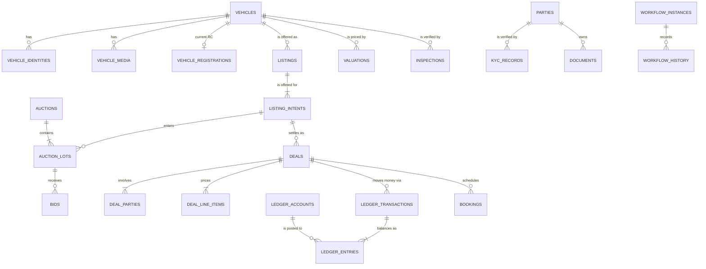

# AutoHub — Physical Data Model (PostgreSQL 16)

> Derived from `00-north-star.md`. The stack is settled there; this file does not re-open it.
> Everything here is **implementation-ready DDL**. If a statement here contradicts the north star,
> the north star wins and this file is the bug.

**The rule this document exists to enforce:** a status, a percentage, a label, an option list, or a
fee is *never* a PostgreSQL `ENUM`, never a `CHECK (status IN (...))`, and never a C# enum. It is a
row. Business meaning lives in `platform.*`; business *facts* live in module schemas.

---

## 0. How to read this document

| Section | What it gives you |
|---|---|
| 1 | Schema-per-module layout and the DB-level enforcement of module isolation |
| 2 | Global conventions: keys, audit columns, domains, triggers, constraint naming |
| 3 | **Full DDL — `platform` schema, all ten registries** |
| 4 | **Full DDL — core transactional tables** |
| 5 | Indexing strategy per access pattern |
| 6 | Partitioning plan |
| 7 | Outbox, idempotency, and the CDC path |
| 8 | Migrations, seeds, registry versioning and rollback |
| 9 | Retention, archival, DPDP Act 2023 erasure |
| 10 | Failure modes, race conditions, and integrity guards |
| 11 | Constraint-name → API error-code map |

DDL is shown in dependency order. `CREATE INDEX` statements are grouped in §5 rather than inline,
so the table definitions stay readable — in the actual migrations they ship in the same file.

---

## 1. Schema-per-module layout

One PostgreSQL **schema per module**, matching `backend/src/Modules/*` one-for-one.

```
platform      the ten registries + engines (workflow instances, outbox, audit, i18n, geo)
identity      parties, users, organisations, sessions, devices
catalog       vehicles, identities, RC snapshots, media, dedupe
listings      listings, listing_intents, pricing, availability
auction       auctions, lots, bids, proxy bids, deposits
rental        rental agreements, handovers, damage claims
lease         lease contracts, schedules, residual value
attachment    taxi-attachment centre: fleet demand, driver-vehicle attachments
valuation     valuations, model runs, comparables
inspection    inspections, checklist responses, defects, grades
deals         deals, deal_parties, line items, agreements
finance       loan applications, offers, disbursals, bureau pulls
insurance     quotes, policies, claims, renewals
payments      ledger, payment intents, escrow, payouts, invoices, refunds
chat          conversations, messages, attachments, moderation
booking       test drives, inspection slots, pickups, deliveries
documents     documents, versions, OCR extractions, e-sign envelopes
notification  outbox, messages, delivery receipts, DLT registrations
review        reviews, ratings, disputes
trust         KYC, blacklists, fraud signals, consent artifacts, erasure requests
analytics     search_events, funnel_events, rollups, ML model registry
archive       cold partitions detached from hot tables (§9)
```

### Why schemas, not `listing_` table prefixes

This is not cosmetic. Five things become possible that prefixes cannot give us:

1. **The module isolation rule becomes a database grant, not a code review.**
   The north star says a module may touch only its own tables and other modules' *Contracts*.
   With schemas we can actually enforce it:

   ```sql
   CREATE ROLE ah_listings_rw;
   GRANT USAGE ON SCHEMA listings TO ah_listings_rw;
   GRANT SELECT, INSERT, UPDATE ON ALL TABLES IN SCHEMA listings TO ah_listings_rw;
   GRANT USAGE ON SCHEMA platform TO ah_listings_rw;
   GRANT SELECT ON ALL TABLES IN SCHEMA platform TO ah_listings_rw;   -- registries are read-only to modules
   -- cross-module read = an explicitly granted contract view, nothing else
   GRANT SELECT ON catalog.v_vehicle_summary TO ah_listings_rw;
   ```

   A developer who writes `SELECT * FROM deals.deals` inside the Listings module gets
   `42501 permission denied` in integration tests. With prefixes they get a green build and a
   coupling nobody notices until extraction day.

2. **Extraction to a service is `pg_dump -n auction` plus a connection string.** Prefix-based
   layouts require grep-and-pray. The north star's promise ("a build-file change, not a rewrite")
   is only true if the data can leave as cleanly as the code.

3. **Name collisions stop being a design constraint.** `documents.documents`, `chat.messages`,
   `notification.messages`, `deals.parties`, `auction.parties` all coexist. Every module gets to
   call its table `items`, `events`, `status_history` without inventing a prefix dialect.

4. **`search_path = ''` + fully-qualified names removes an entire class of production accident.**
   Every migration and every EF Core mapping qualifies the schema. No object is ever resolved by
   ambient state; no `pg_temp` shadowing attack; no "which `orders` did that hit?" incident.

5. **Operations get per-module granularity for free** — size and bloat dashboards grouped by
   `schemaname`, per-schema retention jobs, per-schema `lock_timeout` policy in migrations, and a
   blast radius you can name in an incident review.

Cost of the choice: cross-schema foreign keys (free in PostgreSQL — the planner does not care),
and slightly more verbose DDL. Both are acceptable.

**EF Core wiring:** each module's `DbContext` sets `HasDefaultSchema("listings")` and maps *only*
its own entities plus read-only keyless entities over granted contract views. There is no
`AutoHubDbContext` that knows every table. `AutoHub.Persistence` owns the connection, interceptors,
outbox and migration runner — not the entity map.

### Contract views (the only legal cross-module read surface)

| View | Owner schema | Consumers | Purpose |
|---|---|---|---|
| `catalog.v_vehicle_summary` | catalog | listings, auction, deals, insurance, finance | make/model/variant/year/km/plate, no PII |
| `listings.v_listing_public` | listings | auction, deals, chat, analytics | live listing header + current intent prices |
| `identity.v_party_public` | identity | everything | display name, city, verified badges — never phone/email |
| `platform.v_active_workflow_state` | platform | everything | `(entity_type, entity_id, state_code, entered_at, sla_due_at)` |
| `payments.v_deal_balance` | payments | deals | net receivable/payable per deal from the ledger |

Views are `SECURITY INVOKER` (PG 16 default) and carry `WITH (security_barrier = true)` where they
filter PII.

---

## 2. Global conventions

### 2.1 Extensions

```sql
CREATE EXTENSION IF NOT EXISTS pgcrypto;      -- gen_random_bytes, digest, PGP for provider secrets
CREATE EXTENSION IF NOT EXISTS pg_trgm;       -- fuzzy make/model/plate search in admin
CREATE EXTENSION IF NOT EXISTS btree_gin;     -- composite GIN: (city_id, attributes)
CREATE EXTENSION IF NOT EXISTS btree_gist;    -- EXCLUDE constraints on bookings
CREATE EXTENSION IF NOT EXISTS citext;        -- case-insensitive email
CREATE EXTENSION IF NOT EXISTS ltree;         -- category trees
CREATE EXTENSION IF NOT EXISTS postgis;       -- service-area polygons, pickup radius
CREATE EXTENSION IF NOT EXISTS pg_stat_statements;
CREATE EXTENSION IF NOT EXISTS pg_partman;    -- partition maintenance (§6)
```

PostGIS is for *authoritative* geometry (service-area polygons, "is this pincode inside the Pune
delivery zone"). Faceted geo **search** stays in OpenSearch. We do not run listing search from
PostGIS; we run correctness from it.

### 2.2 Keys — UUID v7 everywhere

PostgreSQL 16 has no native `uuidv7()` (that lands in 18). We ship our own and swap the body on
upgrade without touching a single column type:

```sql
CREATE OR REPLACE FUNCTION platform.uuid_generate_v7()
RETURNS uuid
LANGUAGE plpgsql
PARALLEL SAFE
AS $$
DECLARE
    ts_ms   bytea;
    v       bytea;
BEGIN
    -- 48-bit big-endian unix milliseconds
    ts_ms := substring(int8send((extract(epoch FROM clock_timestamp()) * 1000)::bigint) FROM 3);
    v := ts_ms || gen_random_bytes(10);
    v := set_byte(v, 6, (get_byte(v, 6) & 15)  | 112);  -- version 7
    v := set_byte(v, 8, (get_byte(v, 8) & 63)  | 128);  -- RFC 4122 variant
    RETURN encode(v, 'hex')::uuid;
END;
$$;
```

Why v7 and not `bigserial` or v4:

- **Time-sortable** → B-tree inserts land on the right-hand edge; no index fragmentation, no
  random-IO write amplification that UUID v4 causes on a 200M-row `ledger_entries`.
- **Client-generatable** → the API can mint the id before the INSERT, which is what makes the
  outbox write and the aggregate write a single round-trip and makes idempotent retries trivial.
- **Non-enumerable** → a sequential integer in `/api/v1/listings/48213` tells a competitor exactly
  how many listings we have and lets them scrape the corpus. Public refs are separate (§2.4).
- **Merge-safe** → dealer bulk uploads and offline Flutter inspection capture generate ids on the
  device and sync later without a coordination round-trip.

The application (`AutoHub.SharedKernel.Ids`) generates v7 in C#; the column `DEFAULT` exists as a
safety net for SQL-side seeds and backfills only.

### 2.3 Domains — format invariants only

Domains encode *technical* invariants (charset, sign, precision). They never encode business
vocabulary.

```sql
CREATE DOMAIN platform.code_key       AS text      CHECK (VALUE ~ '^[a-z][a-z0-9_.]{1,79}$');
CREATE DOMAIN platform.amount_paise   AS bigint;                      -- signed: ledger needs it
CREATE DOMAIN platform.money_paise    AS bigint    CHECK (VALUE >= 0);
CREATE DOMAIN platform.currency_code  AS char(3)   CHECK (VALUE ~ '^[A-Z]{3}$');
CREATE DOMAIN platform.rate_percent   AS numeric(9,6) CHECK (VALUE >= 0 AND VALUE <= 100);
CREATE DOMAIN platform.basis_points   AS integer   CHECK (VALUE >= 0 AND VALUE <= 1000000);
CREATE DOMAIN platform.phone_e164     AS text      CHECK (VALUE ~ '^\+[1-9][0-9]{7,14}$');
CREATE DOMAIN platform.email_addr     AS citext    CHECK (VALUE ~ '^[^@\s]+@[^@\s]+\.[^@\s]+$');
CREATE DOMAIN platform.locale_code    AS text      CHECK (VALUE ~ '^[a-z]{2}(-[A-Z]{2})?$');
CREATE DOMAIN platform.pincode        AS char(6)   CHECK (VALUE ~ '^[1-9][0-9]{5}$');
CREATE DOMAIN platform.gstin          AS text      CHECK (VALUE ~ '^[0-9]{2}[A-Z]{5}[0-9]{4}[A-Z][1-9A-Z]Z[0-9A-Z]$');
CREATE DOMAIN platform.sha256_hex     AS char(64)  CHECK (VALUE ~ '^[a-f0-9]{64}$');
CREATE DOMAIN platform.jsonb_object   AS jsonb     CHECK (jsonb_typeof(VALUE) = 'object');
```

**Money is always `paise` as `bigint`**, always paired with `currency_code`. No `numeric` for money,
no `float` ever. `₹8,40,000` is stored as `84000000`. Lakh/crore formatting happens in
`MoneyValue` at the edge, never in SQL, never in the domain layer.

Note what is *absent*: no `CREATE TYPE listing_status AS ENUM`. Adding a workflow state must never
require `ALTER TYPE`, because `ALTER TYPE ... ADD VALUE` cannot run inside a transaction block and
therefore cannot be part of an atomic migration — and more importantly because it is a deploy.
States are rows in `platform.workflow_states`.

### 2.4 Standard columns on every table

```sql
    id            uuid        NOT NULL DEFAULT platform.uuid_generate_v7(),
    created_at    timestamptz NOT NULL DEFAULT now(),
    created_by    uuid,                       -- identity.users.id; NULL = system/migration
    updated_at    timestamptz NOT NULL DEFAULT now(),
    updated_by    uuid,
    deleted_at    timestamptz,                -- soft delete; NULL = live
    deleted_by    uuid,
    row_version   bigint      NOT NULL DEFAULT 1
```

- **`row_version`, not `xmin`.** Npgsql can map `xmin` as a concurrency token, but `xmin` is a
  32-bit value subject to wraparound/freeze, is not stable across `VACUUM FREEZE`, and cannot be
  handed to a mobile client as an ETag. `row_version` is ours, monotonic, and safe to expose.
- **Soft delete is a partial-index concern, not a query concern.** Every unique constraint on a
  soft-deletable table is a partial unique index `WHERE deleted_at IS NULL`. EF Core applies a
  global query filter; raw SQL in reports must be explicit.
- Tables that are **append-only by design** (`platform.audit_log`, `payments.ledger_entries`,
  `auction.bids`, `platform.workflow_history`, `analytics.search_events`) carry **no**
  `updated_*`, `deleted_*`, or `row_version` columns. Immutability is the point; giving them
  mutation columns invites mutation. They are protected by a `BEFORE UPDATE OR DELETE` trigger that
  raises `55006`.

### 2.5 Session context + triggers

The application sets three GUCs per transaction (via an Npgsql `DbConnectionInterceptor`):

```sql
SET LOCAL app.actor_id      = '018f...';   -- identity.users.id, or NULL for system
SET LOCAL app.correlation_id= '018f...';   -- request id, flows into audit + outbox
SET LOCAL app.actor_ip      = '49.36.x.x';
```

```sql
CREATE OR REPLACE FUNCTION platform.tg_touch_row()
RETURNS trigger LANGUAGE plpgsql AS $$
BEGIN
    IF TG_OP = 'INSERT' THEN
        NEW.created_at  := COALESCE(NEW.created_at, now());
        NEW.created_by  := COALESCE(NEW.created_by, NULLIF(current_setting('app.actor_id', true),'')::uuid);
        NEW.updated_at  := NEW.created_at;
        NEW.updated_by  := NEW.created_by;
        NEW.row_version := 1;
    ELSE
        IF NEW.row_version <> OLD.row_version THEN
            RAISE EXCEPTION 'row_version is managed by the database'
                USING ERRCODE = '55006';
        END IF;
        NEW.updated_at  := now();
        NEW.updated_by  := COALESCE(NULLIF(current_setting('app.actor_id', true),'')::uuid, NEW.updated_by);
        NEW.row_version := OLD.row_version + 1;
    END IF;
    RETURN NEW;
END;
$$;

CREATE OR REPLACE FUNCTION platform.tg_append_only()
RETURNS trigger LANGUAGE plpgsql AS $$
BEGIN
    RAISE EXCEPTION '% is append-only', TG_TABLE_SCHEMA || '.' || TG_TABLE_NAME
        USING ERRCODE = '55006', HINT = 'Post a compensating row instead of mutating.';
END;
$$;
```

Optimistic concurrency is checked in the `WHERE` clause by the application
(`UPDATE ... WHERE id = $1 AND row_version = $2`), and a zero-row result maps to
`409 Conflict` / `common.stale_write`.

### 2.6 Naming conventions (constraint names are load-bearing)

| Object | Pattern | Example |
|---|---|---|
| Primary key | `pk_<table>` | `pk_listings` |
| Foreign key | `fk_<table>__<ref_table>` | `fk_listing_intents__listings` |
| Unique index | `uq_<table>__<cols>` | `uq_listings__public_ref` |
| Index | `ix_<table>__<cols>[__<qualifier>]` | `ix_listings__city_state__live` |
| Check | `ck_<table>__<rule>` | `ck_bids__amount_positive` |
| Exclusion | `ex_<table>__<rule>` | `ex_bookings__resource_overlap` |
| Trigger | `tg_<table>__<action>` | `tg_listings__touch` |
| Partition | `<table>_p<YYYYMM>` | `bids_p202607` |

The API's exception middleware maps `23505`/`23514`/`23P01` violations to stable machine codes by
**constraint name** (§11). That means renaming a constraint is an API-breaking change, and is
treated as one.

### 2.7 Polymorphic references

`workflow_instances`, `entity_attribute_values`, `documents`, `notification` subscriptions and
`review` all point at "some entity". PostgreSQL cannot foreign-key that. Our position:

- `entity_type` is **not** a free string — it is `platform.code_key` FK'd to `platform.entity_types`,
  which stores `schema_name` and `table_name`.
- `entity_id` has **no** FK. Instead, `platform.fn_orphan_scan()` runs nightly, generating
  `SELECT ... WHERE NOT EXISTS` per registered entity type from `platform.entity_types`, and writes
  breaches to `platform.integrity_findings` with severity. A breach pages if it involves
  `payments` or `deals`.
- Deletes are soft everywhere that matters, so genuine orphaning requires a hard delete, which
  requires the `db_admin` role, which is audited.

This is a deliberate trade: one nightly job in exchange for not having 40 nullable typed FK columns
on `documents`.

---

## 3. `platform` — the ten registries

### 3.0 Registry map

| # | Registry | Tables | Redis cache key | Epoch row |
|---|---|---|---|---|
| 1 | Taxonomy | `categories, makes, models, generations, variants, attribute_definitions, attribute_options, entity_attribute_values, units, plate_formats` | `reg:tax:{category}:{epoch}` | `taxonomy` |
| 2 | Form Schema | `form_definitions, form_versions, form_bindings, form_assignments` | `reg:form:{code}:{epoch}` | `form` |
| 3 | Workflow | `workflow_definitions, workflow_states, workflow_transitions, workflow_instances, workflow_history, workflow_timers` | `reg:wf:{entity_type}:{epoch}` | `workflow` |
| 4 | Pricing & Commission | `rule_sets, rules, fee_components, fee_slabs, tax_rules` | `reg:fee:{module}:{epoch}` | `pricing` |
| 5 | RBAC | `permissions, roles, role_permissions, user_role_assignments, user_permission_grants, scope_types` | `reg:rbac:{user_id}:{epoch}` | `rbac` |
| 6 | Feature & Module | `modules, feature_flags, flag_rules` | `reg:flag:{epoch}` | `feature` |
| 7 | Notification | `notification_events, notification_templates, notification_subscriptions, notification_channels` | `reg:notif:{event}:{locale}:{epoch}` | `notification` |
| 8 | Integration | `capabilities, integration_providers, provider_credentials, provider_routes, provider_health` | `reg:intg:{capability}:{epoch}` | `integration` |
| 9 | Localization | `locales, i18n_keys, i18n_resources` | `reg:i18n:{ns}:{locale}:{epoch}` | `localization` |
| 10 | Geography | `countries, states, cities, rto_offices, pincodes, service_areas, calendar_days` | `reg:geo:{scope}:{epoch}` | `geography` |

Epochs live in one tiny table; every registry write bumps it in the same transaction, and every
cache key embeds it. Cache invalidation therefore needs no fan-out message and cannot be
half-applied — a rolled-back registry write rolls back its epoch bump.

```sql
CREATE TABLE platform.registry_epochs (
    registry_code   platform.code_key PRIMARY KEY,
    epoch           bigint      NOT NULL DEFAULT 1,
    updated_at      timestamptz NOT NULL DEFAULT now(),
    updated_by      uuid
);

CREATE OR REPLACE FUNCTION platform.tg_bump_epoch()
RETURNS trigger LANGUAGE plpgsql AS $$
BEGIN
    UPDATE platform.registry_epochs
       SET epoch = epoch + 1, updated_at = now(),
           updated_by = NULLIF(current_setting('app.actor_id', true),'')::uuid
     WHERE registry_code = TG_ARGV[0];
    PERFORM pg_notify('registry_changed', TG_ARGV[0]);   -- optional fast path for warm caches
    RETURN NULL;
END;
$$;
-- attached AFTER INSERT OR UPDATE OR DELETE ... FOR EACH STATEMENT on every registry table
```

### 3.1 Vocabulary vs. behaviour — the two lookup shapes

Small code lists come in two flavours and we treat them differently:

- **Behaviour tables** — the code drives engine logic and carries columns
  (`intent_types.settlement_mode`, `document_types.requires_verification`,
  `account_kinds.normal_balance`). These get their own table and real FKs.
- **Vocabulary** — reason codes, severities, grades, cancellation causes, channels. Dozens of tiny
  lists, no behaviour. One generic pair, referenced by **composite FK** so integrity survives:

```sql
CREATE TABLE platform.code_sets (
    code          platform.code_key PRIMARY KEY,
    name          text NOT NULL,
    description   text,
    is_extensible boolean NOT NULL DEFAULT true,   -- false = only migrations may add values
    created_at timestamptz NOT NULL DEFAULT now()
);

CREATE TABLE platform.codes (
    set_code    platform.code_key NOT NULL REFERENCES platform.code_sets(code),
    code        platform.code_key NOT NULL,
    i18n_key    text        NOT NULL,
    sort_order  smallint    NOT NULL DEFAULT 100,
    is_active   boolean     NOT NULL DEFAULT true,
    ui          jsonb       NOT NULL DEFAULT '{}',   -- {"tone":"flag","icon":"alert"} → design tokens
    metadata    jsonb       NOT NULL DEFAULT '{}',
    created_at  timestamptz NOT NULL DEFAULT now(),
    updated_at  timestamptz NOT NULL DEFAULT now(),
    row_version bigint      NOT NULL DEFAULT 1,
    CONSTRAINT pk_codes PRIMARY KEY (set_code, code)
);
```

Usage pattern on a consuming table — a pinned discriminator column makes the composite FK work
without a generated column:

```sql
    cancel_reason_set  platform.code_key NOT NULL DEFAULT 'deal_cancel_reason'
        CONSTRAINT ck_deals__cancel_reason_set CHECK (cancel_reason_set = 'deal_cancel_reason'),
    cancel_reason_code platform.code_key,
    CONSTRAINT fk_deals__cancel_reason
        FOREIGN KEY (cancel_reason_set, cancel_reason_code)
        REFERENCES platform.codes(set_code, code)
```

`ui.tone` maps directly onto the design system's four status colours
(`flag`/`caution`/`clear`/`info`) so `StatusPill` never hardcodes a colour for a state.

```sql
CREATE TABLE platform.entity_types (
    code         platform.code_key PRIMARY KEY,     -- 'listing', 'deal', 'auction_lot', 'kyc_record'
    schema_name  text NOT NULL,
    table_name   text NOT NULL,
    module_code  platform.code_key NOT NULL,
    i18n_key     text NOT NULL,
    supports_workflow  boolean NOT NULL DEFAULT false,
    supports_documents boolean NOT NULL DEFAULT false,
    supports_eav       boolean NOT NULL DEFAULT false,
    public_ref_prefix  text,                        -- 'LST', 'DEAL', 'AUC'
    CONSTRAINT uq_entity_types__table UNIQUE (schema_name, table_name)
);
```

---

### 3.2 Registry 1 — Taxonomy

```sql
CREATE TABLE platform.units (
    code        platform.code_key PRIMARY KEY,     -- 'km', 'cc', 'bhp', 'kwh', 'seat', 'inr'
    symbol      text NOT NULL,
    i18n_key    text NOT NULL,
    dimension   platform.code_key NOT NULL,        -- 'distance','volume','power','energy','count'
    base_factor numeric(20,10) NOT NULL DEFAULT 1  -- to the dimension's base unit
);

CREATE TABLE platform.categories (
    id           uuid PRIMARY KEY DEFAULT platform.uuid_generate_v7(),
    parent_id    uuid REFERENCES platform.categories(id),
    code         platform.code_key NOT NULL,
    slug         text NOT NULL,
    path         ltree NOT NULL,                    -- 'vehicle.four_wheeler.suv'
    depth        smallint NOT NULL,
    i18n_key     text NOT NULL,
    icon_key     text,
    is_leaf      boolean NOT NULL DEFAULT false,
    is_active    boolean NOT NULL DEFAULT true,
    sort_order   smallint NOT NULL DEFAULT 100,
    -- which transaction shapes this category may participate in (registry-driven, not code)
    allowed_intent_codes platform.code_key[] NOT NULL DEFAULT '{}',
    default_form_code    platform.code_key,          -- resolves via form_assignments
    metadata     jsonb NOT NULL DEFAULT '{}',
    created_at timestamptz NOT NULL DEFAULT now(), created_by uuid,
    updated_at timestamptz NOT NULL DEFAULT now(), updated_by uuid,
    deleted_at timestamptz, deleted_by uuid,
    row_version bigint NOT NULL DEFAULT 1,
    CONSTRAINT ck_categories__depth CHECK (depth = nlevel(path) - 1),
    CONSTRAINT ck_categories__no_self_parent CHECK (parent_id IS NULL OR parent_id <> id)
);

CREATE TABLE platform.makes (
    id           uuid PRIMARY KEY DEFAULT platform.uuid_generate_v7(),
    code         platform.code_key NOT NULL,        -- 'maruti_suzuki', 'tata', 'mahindra'
    name         text NOT NULL,
    display_name text NOT NULL,
    country_code char(2) REFERENCES platform.countries(code),
    logo_media_key text,
    is_active    boolean NOT NULL DEFAULT true,
    popularity_rank smallint,                       -- drives default ordering in the sell flow
    aliases      text[] NOT NULL DEFAULT '{}',      -- 'MSIL','Maruti' → dedupe + VAHAN normalisation
    metadata     jsonb NOT NULL DEFAULT '{}',
    created_at timestamptz NOT NULL DEFAULT now(), created_by uuid,
    updated_at timestamptz NOT NULL DEFAULT now(), updated_by uuid,
    deleted_at timestamptz, deleted_by uuid,
    row_version bigint NOT NULL DEFAULT 1
);

CREATE TABLE platform.make_categories (          -- Mahindra sells cars AND tractors
    make_id     uuid NOT NULL REFERENCES platform.makes(id) ON DELETE CASCADE,
    category_id uuid NOT NULL REFERENCES platform.categories(id) ON DELETE CASCADE,
    CONSTRAINT pk_make_categories PRIMARY KEY (make_id, category_id)
);

CREATE TABLE platform.models (
    id           uuid PRIMARY KEY DEFAULT platform.uuid_generate_v7(),
    make_id      uuid NOT NULL REFERENCES platform.makes(id),
    category_id  uuid NOT NULL REFERENCES platform.categories(id),
    code         platform.code_key NOT NULL,
    name         text NOT NULL,
    body_option_id uuid REFERENCES platform.attribute_options(id) DEFERRABLE INITIALLY DEFERRED,
    production_from date,
    production_to   date,
    is_active    boolean NOT NULL DEFAULT true,
    popularity_rank smallint,
    aliases      text[] NOT NULL DEFAULT '{}',
    metadata     jsonb NOT NULL DEFAULT '{}',
    created_at timestamptz NOT NULL DEFAULT now(), created_by uuid,
    updated_at timestamptz NOT NULL DEFAULT now(), updated_by uuid,
    deleted_at timestamptz, deleted_by uuid,
    row_version bigint NOT NULL DEFAULT 1,
    CONSTRAINT ck_models__production_range CHECK (production_to IS NULL OR production_to >= production_from)
);

CREATE TABLE platform.generations (
    id           uuid PRIMARY KEY DEFAULT platform.uuid_generate_v7(),
    model_id     uuid NOT NULL REFERENCES platform.models(id) ON DELETE CASCADE,
    code         platform.code_key NOT NULL,
    name         text NOT NULL,                     -- 'Swift 3rd gen (2018 facelift)'
    start_year   smallint NOT NULL,
    end_year     smallint,
    facelift_of_id uuid REFERENCES platform.generations(id),
    is_active    boolean NOT NULL DEFAULT true,
    metadata     jsonb NOT NULL DEFAULT '{}',
    created_at timestamptz NOT NULL DEFAULT now(), created_by uuid,
    updated_at timestamptz NOT NULL DEFAULT now(), updated_by uuid,
    deleted_at timestamptz, deleted_by uuid,
    row_version bigint NOT NULL DEFAULT 1,
    CONSTRAINT ck_generations__years CHECK (end_year IS NULL OR end_year >= start_year),
    CONSTRAINT ck_generations__year_sane CHECK (start_year BETWEEN 1900 AND 2100)
);

CREATE TABLE platform.variants (
    id            uuid PRIMARY KEY DEFAULT platform.uuid_generate_v7(),
    model_id      uuid NOT NULL REFERENCES platform.models(id),
    generation_id uuid REFERENCES platform.generations(id),
    code          platform.code_key NOT NULL,
    name          text NOT NULL,                    -- 'VXi AMT Dual Tone'
    trim_level    text,
    -- the four attributes every Indian buyer filters on get real columns, not EAV
    fuel_option_id         uuid REFERENCES platform.attribute_options(id),
    transmission_option_id uuid REFERENCES platform.attribute_options(id),
    drivetrain_option_id   uuid REFERENCES platform.attribute_options(id),
    engine_cc     integer CHECK (engine_cc IS NULL OR engine_cc BETWEEN 20 AND 30000),
    power_bhp     numeric(7,2),
    torque_nm     numeric(7,2),
    seating_capacity smallint CHECK (seating_capacity IS NULL OR seating_capacity BETWEEN 1 AND 120),
    battery_kwh   numeric(7,2),                     -- EV
    range_km      integer,                          -- EV, ARAI-certified
    mileage_kmpl  numeric(5,2),
    gvw_kg        integer,                          -- commercial: gross vehicle weight
    ex_showroom_price_paise platform.money_paise,   -- indicative new price, city-independent
    launch_date   date,
    discontinued_date date,
    is_active     boolean NOT NULL DEFAULT true,
    spec          jsonb NOT NULL DEFAULT '{}',      -- long tail: 400+ OEM spec fields
    created_at timestamptz NOT NULL DEFAULT now(), created_by uuid,
    updated_at timestamptz NOT NULL DEFAULT now(), updated_by uuid,
    deleted_at timestamptz, deleted_by uuid,
    row_version bigint NOT NULL DEFAULT 1
);
```

**Judgment call:** `fuel`, `transmission`, `engine_cc`, `seating_capacity` and price are promoted to
columns on `variants` even though they are conceptually attributes. They appear in every query plan,
every facet, and every valuation feature vector. Forcing them through EAV would cost a join per
facet for zero flexibility gain — no business person is going to delete "fuel type".

```sql
CREATE TABLE platform.attribute_definitions (
    id            uuid PRIMARY KEY DEFAULT platform.uuid_generate_v7(),
    entity_type   platform.code_key NOT NULL REFERENCES platform.entity_types(code),
    category_id   uuid REFERENCES platform.categories(id),   -- NULL = applies to all categories
    code          platform.code_key NOT NULL,                -- 'boom_length', 'refrigeration_unit'
    i18n_key      text NOT NULL,
    help_i18n_key text,
    data_type     platform.code_key NOT NULL,   -- FK below: string|integer|decimal|boolean|date|enum|multi_enum|money|geo|media
    input_control platform.code_key NOT NULL,   -- text|number|select|multiselect|radio|toggle|date|slider|photo_slot
    unit_code     platform.code_key REFERENCES platform.units(code),
    is_required   boolean NOT NULL DEFAULT false,
    is_filterable boolean NOT NULL DEFAULT false,   -- appears in search facets
    is_facet      boolean NOT NULL DEFAULT false,   -- gets an aggregation bucket in OpenSearch
    is_searchable boolean NOT NULL DEFAULT false,   -- full-text indexed
    is_comparable boolean NOT NULL DEFAULT false,   -- appears in the compare table
    is_pii        boolean NOT NULL DEFAULT false,   -- feeds platform.pii_registry (§9)
    validation    jsonb NOT NULL DEFAULT '{}',      -- {"min":0,"max":500000,"pattern":"..."}
    default_value jsonb,
    applies_when  jsonb,                            -- JsonLogic over sibling attributes
    display_group platform.code_key,                -- 'engine', 'body', 'documents'
    sort_order    smallint NOT NULL DEFAULT 100,
    opensearch_field text,                          -- explicit mapping name; NULL = derived
    is_active     boolean NOT NULL DEFAULT true,
    created_at timestamptz NOT NULL DEFAULT now(), created_by uuid,
    updated_at timestamptz NOT NULL DEFAULT now(), updated_by uuid,
    deleted_at timestamptz, deleted_by uuid,
    row_version bigint NOT NULL DEFAULT 1,
    data_type_set  platform.code_key NOT NULL DEFAULT 'attribute_data_type'
        CONSTRAINT ck_attrdef__dt_set CHECK (data_type_set = 'attribute_data_type'),
    CONSTRAINT fk_attribute_definitions__data_type
        FOREIGN KEY (data_type_set, data_type) REFERENCES platform.codes(set_code, code)
);

CREATE TABLE platform.attribute_options (
    id            uuid PRIMARY KEY DEFAULT platform.uuid_generate_v7(),
    attribute_definition_id uuid NOT NULL REFERENCES platform.attribute_definitions(id) ON DELETE CASCADE,
    parent_option_id uuid REFERENCES platform.attribute_options(id),  -- dependent selects
    code          platform.code_key NOT NULL,
    value         jsonb NOT NULL,                   -- typed value, matches parent data_type
    i18n_key      text NOT NULL,
    sort_order    smallint NOT NULL DEFAULT 100,
    is_active     boolean NOT NULL DEFAULT true,
    ui            jsonb NOT NULL DEFAULT '{}',
    created_at timestamptz NOT NULL DEFAULT now(), created_by uuid,
    updated_at timestamptz NOT NULL DEFAULT now(), updated_by uuid,
    deleted_at timestamptz, deleted_by uuid,
    row_version bigint NOT NULL DEFAULT 1
);

-- Typed, indexed PROJECTION of the canonical jsonb on the owning row. Maintained by trigger
-- in the same transaction. Read by admin reporting, data-quality scans and attribute-level audit.
CREATE TABLE platform.entity_attribute_values (
    entity_type   platform.code_key NOT NULL REFERENCES platform.entity_types(code),
    entity_id     uuid NOT NULL,
    attribute_definition_id uuid NOT NULL REFERENCES platform.attribute_definitions(id),
    value         jsonb NOT NULL,
    value_text    text    GENERATED ALWAYS AS (CASE WHEN jsonb_typeof(value)='string'  THEN value #>> '{}' END) STORED,
    value_num     numeric GENERATED ALWAYS AS (CASE WHEN jsonb_typeof(value)='number'  THEN (value #>> '{}')::numeric END) STORED,
    value_bool    boolean GENERATED ALWAYS AS (CASE WHEN jsonb_typeof(value)='boolean' THEN (value #>> '{}')::boolean END) STORED,
    source_code   platform.code_key NOT NULL DEFAULT 'user',   -- user|vahan|ocr|inspection|ml|admin
    confidence    numeric(4,3),
    recorded_at   timestamptz NOT NULL DEFAULT now(),
    CONSTRAINT pk_entity_attribute_values PRIMARY KEY (entity_type, entity_id, attribute_definition_id)
);
```

**The EAV decision, stated plainly.** The canonical store for dynamic attributes is a single
`attributes jsonb` column on the owning row (`catalog.vehicles.attributes`,
`listings.listings.attributes`). Reasons: one atomic row update instead of N row churn; no join to
render a vehicle; GIN gives us containment queries; and OpenSearch — not PostgreSQL — serves
faceted search anyway. `entity_attribute_values` is a **derived projection**, written by
`platform.tg_project_eav()` on the owning table, and is safe to rebuild from the jsonb at any time.
If the two ever disagree, the jsonb wins and the projection is rebuilt. We never write the
projection directly.

```sql
-- India-specific: plate formats are DATA, so a new series (BH, EV green, Rajdoot vintage) is a row.
CREATE TABLE platform.plate_formats (
    code           platform.code_key PRIMARY KEY,   -- 'standard','bh_series','military','vintage','ev_green'
    i18n_key       text NOT NULL,
    regex          text NOT NULL,                   -- '^[A-Z]{2}[0-9]{1,2}[A-Z]{0,3}[0-9]{4}$'
    normaliser     text NOT NULL DEFAULT 'strip_non_alnum_upper',
    sample         text NOT NULL,                   -- 'MH01AB1234'
    plate_class    platform.code_key NOT NULL,      -- 'private','commercial','ev','diplomatic'
    plate_bg_token text NOT NULL,                   -- design-system token for PlateBlock fill
    plate_fg_token text NOT NULL,
    priority       smallint NOT NULL DEFAULT 100,   -- match order
    is_active      boolean NOT NULL DEFAULT true,
    effective_from date NOT NULL DEFAULT CURRENT_DATE,
    effective_to   date
);
```

`PlateBlock` in `packages/ui` gets its colour from `plate_bg_token`/`plate_fg_token` — yellow
commercial plates, green EV stripe, white private. The renderer never contains a `switch`.

---

### 3.3 Registry 2 — Form Schema

```sql
CREATE TABLE platform.form_definitions (
    id           uuid PRIMARY KEY DEFAULT platform.uuid_generate_v7(),
    code         platform.code_key NOT NULL,        -- 'sell_flow','dealer_onboarding','inspection_4w'
    name         text NOT NULL,
    entity_type  platform.code_key NOT NULL REFERENCES platform.entity_types(code),
    purpose      platform.code_key NOT NULL,        -- 'create','update','kyc','checklist','claim'
    module_code  platform.code_key NOT NULL,
    is_active    boolean NOT NULL DEFAULT true,
    supports_partial_save boolean NOT NULL DEFAULT true,
    supports_offline      boolean NOT NULL DEFAULT false,   -- Flutter inspector app
    created_at timestamptz NOT NULL DEFAULT now(), created_by uuid,
    updated_at timestamptz NOT NULL DEFAULT now(), updated_by uuid,
    deleted_at timestamptz, deleted_by uuid,
    row_version bigint NOT NULL DEFAULT 1
);

CREATE TABLE platform.form_versions (
    id                 uuid PRIMARY KEY DEFAULT platform.uuid_generate_v7(),
    form_definition_id uuid NOT NULL REFERENCES platform.form_definitions(id) ON DELETE CASCADE,
    version            integer NOT NULL,
    parent_version_id  uuid REFERENCES platform.form_versions(id),
    schema             jsonb NOT NULL,     -- JSON Schema 2020-12 → Zod on client, FluentValidation on server
    ui_schema          jsonb NOT NULL DEFAULT '{}',  -- control hints, order, conditional display
    layout             jsonb NOT NULL DEFAULT '{}',  -- steps/sections/columns; drives SchemaForm
    checksum           platform.sha256_hex NOT NULL,
    status_code        platform.code_key NOT NULL DEFAULT 'draft',  -- draft|in_review|published|retired
    effective_from     timestamptz,
    effective_to       timestamptz,
    published_at       timestamptz,
    published_by       uuid,
    change_set_id      uuid REFERENCES platform.registry_change_sets(id),
    notes              text,
    created_at timestamptz NOT NULL DEFAULT now(), created_by uuid,
    updated_at timestamptz NOT NULL DEFAULT now(), updated_by uuid,
    row_version bigint NOT NULL DEFAULT 1,
    CONSTRAINT uq_form_versions__def_version UNIQUE (form_definition_id, version),
    CONSTRAINT ck_form_versions__published CHECK (
        status_code <> 'published' OR (published_at IS NOT NULL AND effective_from IS NOT NULL)),
    CONSTRAINT ck_form_versions__effective CHECK (effective_to IS NULL OR effective_to > effective_from)
);

-- Where does each form field actually land? Never inferred from the field name.
CREATE TABLE platform.form_bindings (
    id               uuid PRIMARY KEY DEFAULT platform.uuid_generate_v7(),
    form_version_id  uuid NOT NULL REFERENCES platform.form_versions(id) ON DELETE CASCADE,
    json_pointer     text NOT NULL,                 -- '/vehicle/odometer_km'
    target_kind      platform.code_key NOT NULL,    -- 'column' | 'attribute' | 'document' | 'transient'
    target_schema    text,                          -- for 'column'
    target_table     text,
    target_column    text,
    attribute_definition_id uuid REFERENCES platform.attribute_definitions(id),
    document_type_code platform.code_key,
    transform        text,                          -- 'upper','strip_non_alnum','paise_from_rupees'
    is_write_once    boolean NOT NULL DEFAULT false,
    CONSTRAINT uq_form_bindings__ptr UNIQUE (form_version_id, json_pointer),
    CONSTRAINT ck_form_bindings__target CHECK (
        (target_kind = 'column'    AND target_table IS NOT NULL AND target_column IS NOT NULL)
     OR (target_kind = 'attribute' AND attribute_definition_id IS NOT NULL)
     OR (target_kind = 'document'  AND document_type_code IS NOT NULL)
     OR (target_kind = 'transient')
    )
);

-- Which form version does THIS user, in THIS city, for THIS category actually get?
CREATE TABLE platform.form_assignments (
    id                 uuid PRIMARY KEY DEFAULT platform.uuid_generate_v7(),
    form_definition_id uuid NOT NULL REFERENCES platform.form_definitions(id) ON DELETE CASCADE,
    form_version_id    uuid REFERENCES platform.form_versions(id),   -- NULL = latest published
    category_id        uuid REFERENCES platform.categories(id),
    city_id            uuid REFERENCES platform.cities(id),
    party_kind_code    platform.code_key,                            -- 'individual','dealer','fleet'
    channel_code       platform.code_key,                            -- 'web','android','ios','admin','api'
    audience           jsonb,                                        -- JsonLogic escape hatch
    priority           smallint NOT NULL DEFAULT 100,                -- lowest wins
    is_active          boolean NOT NULL DEFAULT true,
    effective_from     timestamptz NOT NULL DEFAULT now(),
    effective_to       timestamptz,
    created_at timestamptz NOT NULL DEFAULT now(), created_by uuid,
    updated_at timestamptz NOT NULL DEFAULT now(), updated_by uuid,
    row_version bigint NOT NULL DEFAULT 1
);
```

**Version pinning rule:** every in-flight submission stores `form_version_id` on the owning row
(`listings.form_version_id`, `inspection.checklist_form_version_id`). Publishing v8 of the sell
flow does not invalidate a half-finished v7 draft, does not fail its validation, and does not
silently change what the user agreed to. Drafts older than the retention window (`90 days`) are
expired by job, not by migration.

---

### 3.4 Registry 3 — Workflow

Every state machine in AutoHub — listing, deal, auction lot, booking, KYC, loan application,
insurance claim, payout, dispute — is rows in these six tables. There is exactly one engine.

```sql
CREATE TABLE platform.workflow_state_kinds (        -- engine semantics, not business vocabulary
    code        platform.code_key PRIMARY KEY,      -- 'initial','active','waiting','terminal_success','terminal_failure'
    is_terminal boolean NOT NULL,
    i18n_key    text NOT NULL
);

CREATE TABLE platform.workflow_definitions (
    id            uuid PRIMARY KEY DEFAULT platform.uuid_generate_v7(),
    code          platform.code_key NOT NULL,       -- 'listing','deal','auction_lot','kyc'
    entity_type   platform.code_key NOT NULL REFERENCES platform.entity_types(code),
    name          text NOT NULL,
    version       integer NOT NULL DEFAULT 1,
    scope         jsonb NOT NULL DEFAULT '{}',      -- {"city_id":"...","category_id":"..."} variant machines
    initial_state_id uuid,                          -- FK added after workflow_states (circular)
    config        jsonb NOT NULL DEFAULT '{}',      -- {"history_retention_months":84,"lock_mode":"row"}
    status_code   platform.code_key NOT NULL DEFAULT 'draft',   -- draft|published|retired
    published_at  timestamptz,
    effective_from timestamptz,
    effective_to   timestamptz,
    change_set_id uuid REFERENCES platform.registry_change_sets(id),
    created_at timestamptz NOT NULL DEFAULT now(), created_by uuid,
    updated_at timestamptz NOT NULL DEFAULT now(), updated_by uuid,
    deleted_at timestamptz, deleted_by uuid,
    row_version bigint NOT NULL DEFAULT 1,
    CONSTRAINT uq_workflow_definitions__code_version UNIQUE (code, version)
);

CREATE TABLE platform.workflow_states (
    id             uuid PRIMARY KEY DEFAULT platform.uuid_generate_v7(),
    workflow_definition_id uuid NOT NULL REFERENCES platform.workflow_definitions(id) ON DELETE CASCADE,
    code           platform.code_key NOT NULL,      -- 'pending_approval','live','sold','legal_hold'
    i18n_key       text NOT NULL,
    kind_code      platform.code_key NOT NULL REFERENCES platform.workflow_state_kinds(code),
    sort_order     smallint NOT NULL DEFAULT 100,
    -- semantic flags the rest of the platform keys off, so nothing greps a state string
    is_publicly_visible boolean NOT NULL DEFAULT false,  -- listing shows in search
    is_editable         boolean NOT NULL DEFAULT true,   -- owner may still edit the entity
    holds_resource      boolean NOT NULL DEFAULT false,  -- booking blocks a slot (§4 EXCLUDE)
    holds_funds         boolean NOT NULL DEFAULT false,  -- escrow may not release
    counts_as_open      boolean NOT NULL DEFAULT true,   -- dashboards / SLA
    blocks_deletion     boolean NOT NULL DEFAULT false,
    sla_minutes    integer,                              -- NULL = no SLA
    sla_breach_transition_code platform.code_key,        -- auto-fire on breach
    entry_effects  jsonb NOT NULL DEFAULT '[]',   -- [{"type":"emit","event":"listing.published"}]
    exit_effects   jsonb NOT NULL DEFAULT '[]',
    ui             jsonb NOT NULL DEFAULT '{}',   -- {"tone":"clear","pill":"LIVE"} → StatusPill
    created_at timestamptz NOT NULL DEFAULT now(), created_by uuid,
    updated_at timestamptz NOT NULL DEFAULT now(), updated_by uuid,
    row_version bigint NOT NULL DEFAULT 1,
    CONSTRAINT uq_workflow_states__def_code UNIQUE (workflow_definition_id, code)
);

ALTER TABLE platform.workflow_definitions
    ADD CONSTRAINT fk_workflow_definitions__initial_state
    FOREIGN KEY (initial_state_id) REFERENCES platform.workflow_states(id) DEFERRABLE INITIALLY DEFERRED;

CREATE TABLE platform.workflow_transitions (
    id             uuid PRIMARY KEY DEFAULT platform.uuid_generate_v7(),
    workflow_definition_id uuid NOT NULL REFERENCES platform.workflow_definitions(id) ON DELETE CASCADE,
    code           platform.code_key NOT NULL,      -- 'submit','approve','reject','place_on_legal_hold'
    i18n_key       text NOT NULL,
    from_state_id  uuid REFERENCES platform.workflow_states(id),   -- NULL = from ANY state
    to_state_id    uuid NOT NULL REFERENCES platform.workflow_states(id),
    trigger_type   platform.code_key NOT NULL,      -- 'manual','event','timer','api','system'
    trigger_event_code platform.code_key,           -- for trigger_type='event'
    required_permission_code platform.code_key REFERENCES platform.permissions(code),
    guard_rule_set_id uuid REFERENCES platform.rule_sets(id),      -- must evaluate true
    confirm_form_version_id uuid REFERENCES platform.form_versions(id),  -- reason/comment capture
    effects        jsonb NOT NULL DEFAULT '[]',
    -- [{"type":"emit","event":"deal.cancelled"},
    --  {"type":"notify","event_code":"deal.cancelled.buyer"},
    --  {"type":"ledger","txn_kind":"escrow_refund"},
    --  {"type":"invoke","command":"payments.release_escrow"}]
    is_automatic   boolean NOT NULL DEFAULT false,
    is_reversible  boolean NOT NULL DEFAULT false,
    priority       smallint NOT NULL DEFAULT 100,
    requires_reason boolean NOT NULL DEFAULT false,
    reason_set_code platform.code_key REFERENCES platform.code_sets(code),
    idempotency_scope platform.code_key NOT NULL DEFAULT 'instance',  -- 'instance'|'actor'|'none'
    created_at timestamptz NOT NULL DEFAULT now(), created_by uuid,
    updated_at timestamptz NOT NULL DEFAULT now(), updated_by uuid,
    row_version bigint NOT NULL DEFAULT 1,
    CONSTRAINT uq_workflow_transitions__def_code UNIQUE (workflow_definition_id, code, from_state_id),
    CONSTRAINT ck_workflow_transitions__no_self CHECK (from_state_id IS NULL OR from_state_id <> to_state_id)
);

CREATE TABLE platform.workflow_instances (
    id             uuid PRIMARY KEY DEFAULT platform.uuid_generate_v7(),
    workflow_definition_id uuid NOT NULL REFERENCES platform.workflow_definitions(id),
    entity_type    platform.code_key NOT NULL REFERENCES platform.entity_types(code),
    entity_id      uuid NOT NULL,
    current_state_id uuid NOT NULL REFERENCES platform.workflow_states(id),
    current_state_code platform.code_key NOT NULL,   -- denormalised for cheap reads/joins
    entered_state_at timestamptz NOT NULL DEFAULT now(),
    sla_due_at     timestamptz,
    is_locked      boolean NOT NULL DEFAULT false,   -- legal hold / dispute freeze
    locked_reason_code platform.code_key,
    context        jsonb NOT NULL DEFAULT '{}',      -- machine-local scratch (retry counts, refs)
    transition_count integer NOT NULL DEFAULT 0,
    created_at timestamptz NOT NULL DEFAULT now(), created_by uuid,
    updated_at timestamptz NOT NULL DEFAULT now(), updated_by uuid,
    row_version bigint NOT NULL DEFAULT 1,
    CONSTRAINT uq_workflow_instances__entity UNIQUE (entity_type, entity_id, workflow_definition_id)
);

CREATE TABLE platform.workflow_history (
    id             uuid NOT NULL DEFAULT platform.uuid_generate_v7(),
    occurred_at    timestamptz NOT NULL DEFAULT now(),
    workflow_instance_id uuid NOT NULL,
    entity_type    platform.code_key NOT NULL,
    entity_id      uuid NOT NULL,
    transition_id  uuid,
    transition_code platform.code_key,
    from_state_code platform.code_key,
    to_state_code  platform.code_key NOT NULL,
    actor_id       uuid,
    actor_kind     platform.code_key NOT NULL DEFAULT 'user',  -- user|system|timer|integration
    actor_ip       inet,
    reason_code    platform.code_key,
    comment        text,
    context_delta  jsonb NOT NULL DEFAULT '{}',
    correlation_id uuid,
    duration_in_previous_ms bigint,
    CONSTRAINT pk_workflow_history PRIMARY KEY (id, occurred_at)
) PARTITION BY RANGE (occurred_at);

CREATE TABLE platform.workflow_timers (
    id             uuid PRIMARY KEY DEFAULT platform.uuid_generate_v7(),
    workflow_instance_id uuid NOT NULL REFERENCES platform.workflow_instances(id) ON DELETE CASCADE,
    transition_id  uuid NOT NULL REFERENCES platform.workflow_transitions(id),
    fire_at        timestamptz NOT NULL,
    status_code    platform.code_key NOT NULL DEFAULT 'pending',   -- pending|fired|cancelled|failed
    attempts       smallint NOT NULL DEFAULT 0,
    last_error     text,
    locked_by      text,
    locked_until   timestamptz,
    created_at timestamptz NOT NULL DEFAULT now(),
    updated_at timestamptz NOT NULL DEFAULT now(),
    row_version bigint NOT NULL DEFAULT 1
);
```

**Rules the engine enforces (not the schema):**

- `workflow_instances.current_state_code` is denormalised onto the entity row too
  (`listings.state_code`, `deals.state_code`). Both writes happen in the *same transaction* as the
  history insert and the outbox insert. There is no eventual consistency inside a state change.
- A transition writes: instance UPDATE → `workflow_history` INSERT → `platform.outbox_messages`
  INSERT → entity row UPDATE. One transaction, four writes, all or nothing.
- `from_state_id IS NULL` means "from any state" — that is how a `place_on_legal_hold` transition
  is added later without editing every existing state.
- `workflow_definitions.version` is pinned per instance. A published v2 machine applies to new
  instances only; existing instances finish on v1. This is why deals opened last month do not
  suddenly acquire a new mandatory approval step.

**Example rows** (listing machine, abbreviated — this is what "state is data" actually looks like):

| state `code` | `kind_code` | `is_publicly_visible` | `is_editable` | `sla_minutes` | `ui.tone` |
|---|---|---|---|---|---|
| `draft` | initial | false | true | – | info |
| `pending_media` | active | false | true | 2880 | caution |
| `pending_approval` | waiting | false | false | 240 | caution |
| `live` | active | true | true | – | clear |
| `paused_by_seller` | waiting | false | true | – | info |
| `under_offer` | active | true | false | – | info |
| `sold` | terminal_success | false | false | – | clear |
| `rejected` | terminal_failure | false | true | – | flag |
| `expired` | terminal_failure | false | true | – | flag |
| `legal_hold` | waiting | false | false | – | flag |

| transition `code` | from | to | `required_permission_code` | `is_automatic` |
|---|---|---|---|---|
| `submit` | draft | pending_approval | `listing.submit` | false |
| `approve` | pending_approval | live | `listing.approve` | false |
| `reject` | pending_approval | rejected | `listing.approve` | false |
| `auto_expire` | live | expired | – | true (timer, 60d) |
| `place_on_legal_hold` | *any* | legal_hold | `listing.legal_hold` | false |

---

### 3.5 Registry 4 — Pricing, Commission and Tax

Every rupee AutoHub earns is a row here. Zero percentages in code.

```sql
CREATE TABLE platform.rule_sets (
    id           uuid PRIMARY KEY DEFAULT platform.uuid_generate_v7(),
    code         platform.code_key NOT NULL,
    domain       platform.code_key NOT NULL,   -- 'pricing','guard','eligibility','routing','scoring'
    name         text NOT NULL,
    description  text,
    input_schema jsonb NOT NULL DEFAULT '{}',  -- documents the evaluation context
    version      integer NOT NULL DEFAULT 1,
    status_code  platform.code_key NOT NULL DEFAULT 'draft',
    effective_from timestamptz NOT NULL DEFAULT now(),
    effective_to   timestamptz,
    change_set_id uuid REFERENCES platform.registry_change_sets(id),
    created_at timestamptz NOT NULL DEFAULT now(), created_by uuid,
    updated_at timestamptz NOT NULL DEFAULT now(), updated_by uuid,
    deleted_at timestamptz, deleted_by uuid,
    row_version bigint NOT NULL DEFAULT 1,
    CONSTRAINT uq_rule_sets__code_version UNIQUE (code, version)
);

CREATE TABLE platform.rules (
    id           uuid PRIMARY KEY DEFAULT platform.uuid_generate_v7(),
    rule_set_id  uuid NOT NULL REFERENCES platform.rule_sets(id) ON DELETE CASCADE,
    code         platform.code_key NOT NULL,
    priority     smallint NOT NULL DEFAULT 100,     -- ascending; first match wins if stop_on_match
    condition    jsonb NOT NULL,                    -- JsonLogic: {"and":[{">":[{"var":"amount_paise"},1000000000]}]}
    outcome      jsonb NOT NULL,                    -- {"rate_percent":1.5} | {"deny":"kyc.required"}
    stop_on_match boolean NOT NULL DEFAULT true,
    explain_i18n_key text,                          -- surfaced in the fee breakdown UI
    is_active    boolean NOT NULL DEFAULT true,
    effective_from timestamptz NOT NULL DEFAULT now(),
    effective_to   timestamptz,
    created_at timestamptz NOT NULL DEFAULT now(), created_by uuid,
    updated_at timestamptz NOT NULL DEFAULT now(), updated_by uuid,
    row_version bigint NOT NULL DEFAULT 1,
    CONSTRAINT uq_rules__set_code UNIQUE (rule_set_id, code)
);

CREATE TABLE platform.fee_components (
    id            uuid PRIMARY KEY DEFAULT platform.uuid_generate_v7(),
    code          platform.code_key NOT NULL,       -- 'auction_buyer_premium','listing_boost','rc_transfer_assist'
    i18n_key      text NOT NULL,
    module_code   platform.code_key NOT NULL,
    intent_type_code platform.code_key REFERENCES platform.intent_types(code),
    calc_method   platform.code_key NOT NULL,       -- 'flat','percent','slab_percent','slab_flat','per_unit','formula'
    basis         platform.code_key NOT NULL,       -- 'deal_gross','hammer_price','rent_per_day','loan_amount','flat'
    rate_percent  platform.rate_percent,
    flat_amount_paise platform.money_paise,
    per_unit_amount_paise platform.money_paise,
    unit_code     platform.code_key REFERENCES platform.units(code),
    min_amount_paise platform.money_paise,
    max_amount_paise platform.money_paise,          -- cap; ₹25,000 cap on a 2% commission
    rounding_mode platform.code_key NOT NULL DEFAULT 'half_up',
    rounding_to_paise integer NOT NULL DEFAULT 100, -- round to the nearest rupee by default
    payer_role_code platform.code_key NOT NULL REFERENCES platform.party_roles(code),
    payee_role_code platform.code_key NOT NULL REFERENCES platform.party_roles(code),
    gl_account_code platform.code_key NOT NULL,     -- maps to payments.ledger_accounts.account_code
    tax_rule_id   uuid REFERENCES platform.tax_rules(id),
    is_refundable boolean NOT NULL DEFAULT false,
    is_inclusive_of_tax boolean NOT NULL DEFAULT false,
    -- fast-path scoping (indexed); NULL = "any"
    scope_city_id     uuid REFERENCES platform.cities(id),
    scope_state_id    uuid REFERENCES platform.states(id),
    scope_category_id uuid REFERENCES platform.categories(id),
    scope_party_tier  platform.code_key,
    -- long-tail scoping
    applies_when  jsonb,                            -- JsonLogic over the fee context
    rule_set_id   uuid REFERENCES platform.rule_sets(id),
    priority      smallint NOT NULL DEFAULT 100,
    is_active     boolean NOT NULL DEFAULT true,
    effective_from timestamptz NOT NULL DEFAULT now(),
    effective_to   timestamptz,
    change_set_id uuid REFERENCES platform.registry_change_sets(id),
    created_at timestamptz NOT NULL DEFAULT now(), created_by uuid,
    updated_at timestamptz NOT NULL DEFAULT now(), updated_by uuid,
    deleted_at timestamptz, deleted_by uuid,
    row_version bigint NOT NULL DEFAULT 1,
    CONSTRAINT ck_fee_components__method CHECK (
        (calc_method = 'flat'        AND flat_amount_paise IS NOT NULL)
     OR (calc_method = 'percent'     AND rate_percent IS NOT NULL)
     OR (calc_method IN ('slab_percent','slab_flat','formula'))
     OR (calc_method = 'per_unit'    AND per_unit_amount_paise IS NOT NULL AND unit_code IS NOT NULL)
    ),
    CONSTRAINT ck_fee_components__cap CHECK (max_amount_paise IS NULL OR min_amount_paise IS NULL
                                          OR max_amount_paise >= min_amount_paise)
);

CREATE TABLE platform.fee_slabs (
    id           uuid PRIMARY KEY DEFAULT platform.uuid_generate_v7(),
    fee_component_id uuid NOT NULL REFERENCES platform.fee_components(id) ON DELETE CASCADE,
    from_amount_paise platform.money_paise NOT NULL,
    to_amount_paise   platform.money_paise,          -- NULL = open-ended top slab
    rate_percent      platform.rate_percent,
    flat_amount_paise platform.money_paise,
    is_marginal       boolean NOT NULL DEFAULT false, -- true = income-tax style; false = flat-by-band
    sort_order        smallint NOT NULL DEFAULT 100,
    CONSTRAINT ck_fee_slabs__range CHECK (to_amount_paise IS NULL OR to_amount_paise > from_amount_paise),
    CONSTRAINT ex_fee_slabs__overlap EXCLUDE USING gist (
        fee_component_id WITH =,
        int8range(from_amount_paise, COALESCE(to_amount_paise, 9223372036854775807)) WITH &&
    )
);

CREATE TABLE platform.tax_rules (
    id            uuid PRIMARY KEY DEFAULT platform.uuid_generate_v7(),
    code          platform.code_key NOT NULL,       -- 'gst_services_18','tcs_206c1f_motor_vehicle'
    tax_type      platform.code_key NOT NULL,       -- 'gst','tcs','tds','cess','stamp_duty'
    i18n_key      text NOT NULL,
    hsn_sac_code  text,                             -- '998714' for maintenance/repair services
    cgst_rate     platform.rate_percent NOT NULL DEFAULT 0,
    sgst_rate     platform.rate_percent NOT NULL DEFAULT 0,
    igst_rate     platform.rate_percent NOT NULL DEFAULT 0,
    ugst_rate     platform.rate_percent NOT NULL DEFAULT 0,
    cess_rate     platform.rate_percent NOT NULL DEFAULT 0,
    withholding_rate platform.rate_percent NOT NULL DEFAULT 0,     -- TCS / TDS
    threshold_amount_paise platform.money_paise,    -- TCS 206C(1F): applies above ₹10,00,000
    threshold_basis platform.code_key,              -- 'per_transaction' | 'per_fy_per_buyer'
    place_of_supply_rule platform.code_key NOT NULL DEFAULT 'recipient_state',
    is_reverse_charge boolean NOT NULL DEFAULT false,
    applies_to_registered_only boolean NOT NULL DEFAULT false,
    statutory_ref text,                             -- 'Sec 206C(1F), Income-tax Act 1961'
    effective_from date NOT NULL,
    effective_to   date,
    change_set_id uuid REFERENCES platform.registry_change_sets(id),
    created_at timestamptz NOT NULL DEFAULT now(), created_by uuid,
    updated_at timestamptz NOT NULL DEFAULT now(), updated_by uuid,
    row_version bigint NOT NULL DEFAULT 1,
    CONSTRAINT ck_tax_rules__effective CHECK (effective_to IS NULL OR effective_to > effective_from),
    CONSTRAINT ck_tax_rules__gst_split CHECK (
        (igst_rate = 0) OR (cgst_rate = 0 AND sgst_rate = 0)   -- IGST xor CGST+SGST, never both
    )
);
```

**Tax rows are never UPDATEd.** A GST rate change is a new row with `effective_from`, and the old
row gets `effective_to`. A 2024 invoice must still reproduce the 2024 rate on a 2027 audit or a
2027 dispute. `platform.tg_bump_epoch` fires, caches roll, history stays intact. The engine always
resolves rates as `WHERE effective_from <= :as_of AND (effective_to IS NULL OR effective_to > :as_of)`
where `:as_of` is the **document date**, not `now()`.

**Seed rows (real numbers, India):**

| `code` | method | basis | rate/flat | scope | payer | tax rule |
|---|---|---|---|---|---|---|
| `auction_buyer_premium` | slab_percent | hammer_price | 2.0% ≤₹5L, 1.5% >₹5L, cap ₹25,000 | – | buyer_dealer | gst_services_18 |
| `auction_buyer_premium` (Pune) | percent | hammer_price | 1.5% | `scope_city_id = Pune` prio 50 | buyer_dealer | gst_services_18 |
| `auction_seller_commission` | percent | hammer_price | 1.0%, min ₹2,000 | – | seller | gst_services_18 |
| `c2c_success_fee` | flat | flat | ₹1,999 | – | seller | gst_services_18 |
| `listing_boost_7d` | flat | flat | ₹499 | – | seller | gst_services_18 |
| `rc_transfer_assist` | flat | flat | ₹1,499 | – | buyer | gst_services_18 |
| `inspection_fee_4w` | flat | flat | ₹999 | `scope_category_id = four_wheeler` | requester | gst_services_18 |
| `rental_platform_fee` | percent | rent_total | 12% | – | host | gst_services_18 |
| `finance_referral` | percent | loan_amount | 1.25% | – | lender | gst_services_18 |
| `insurance_referral` | percent | premium | 15% | – | insurer | gst_services_18 |

| tax `code` | type | rates | threshold | note |
|---|---|---|---|---|
| `gst_services_18` | gst | 9/9 or 18 IGST | – | SAC 998599, platform services |
| `gst_goods_used_vehicle_18` | gst | 9/9 or 18 IGST | – | margin scheme, dealer-sold used vehicles |
| `gst_goods_used_vehicle_12` | gst | 6/6 or 12 IGST | – | sub-1200cc petrol / sub-1500cc diesel |
| `tcs_206c1f_motor_vehicle` | tcs | 1% withholding | ₹10,00,000 per transaction | collected by seller on sale value |
| `tds_194o_ecommerce` | tds | 0.1% withholding | ₹5,00,000 per FY per seller | platform deducts on participant payouts |

Place of supply: `recipient_state` for B2B services (dealer's GSTIN state), `supplier_state` for
B2C where the recipient is unregistered. `platform.states.gst_state_code` supplies the numeric
code that decides IGST vs CGST+SGST — that comparison happens in the pricing engine, driven by
`tax_rules.place_of_supply_rule`, never in an `if`.

---

### 3.6 Registry 5 — RBAC (with scope)

```sql
CREATE TABLE platform.scope_types (
    code        platform.code_key PRIMARY KEY,      -- 'global','country','state','city','branch','dealer','fleet','self'
    i18n_key    text NOT NULL,
    resolver    text NOT NULL,                      -- 'platform.cities','identity.organizations', 'self'
    parent_code platform.code_key REFERENCES platform.scope_types(code),
    sort_order  smallint NOT NULL DEFAULT 100
);

CREATE TABLE platform.permissions (
    code         platform.code_key PRIMARY KEY,     -- 'listing.approve','auction.lot.close','payout.release'
    module_code  platform.code_key NOT NULL,
    resource     platform.code_key NOT NULL,        -- 'listing','auction_lot','payout'
    action       platform.code_key NOT NULL,        -- 'read','create','update','approve','release'
    i18n_key     text NOT NULL,
    description  text,
    is_scoped    boolean NOT NULL DEFAULT true,     -- false = only meaningful at global scope
    risk_level   smallint NOT NULL DEFAULT 1,       -- 1..5; ≥4 forces step-up auth + audit reason
    requires_reason boolean NOT NULL DEFAULT false,
    requires_second_approver boolean NOT NULL DEFAULT false,   -- maker-checker on payouts
    created_at timestamptz NOT NULL DEFAULT now(),
    CONSTRAINT uq_permissions__resource_action UNIQUE (resource, action)
);

CREATE TABLE platform.roles (
    id           uuid PRIMARY KEY DEFAULT platform.uuid_generate_v7(),
    code         platform.code_key NOT NULL,        -- 'regional_auction_moderator','dealer_sales_exec'
    i18n_key     text NOT NULL,
    scope_type_code platform.code_key NOT NULL REFERENCES platform.scope_types(code),
    party_kind_code platform.code_key,              -- 'staff','dealer','fleet','partner','customer'
    parent_role_id uuid REFERENCES platform.roles(id),   -- inherits permissions
    is_system    boolean NOT NULL DEFAULT false,    -- cannot be edited/deleted from admin UI
    is_assignable boolean NOT NULL DEFAULT true,
    max_assignees integer,                          -- e.g. exactly 2 super admins
    is_active    boolean NOT NULL DEFAULT true,
    created_at timestamptz NOT NULL DEFAULT now(), created_by uuid,
    updated_at timestamptz NOT NULL DEFAULT now(), updated_by uuid,
    deleted_at timestamptz, deleted_by uuid,
    row_version bigint NOT NULL DEFAULT 1
);

CREATE TABLE platform.role_permissions (
    role_id      uuid NOT NULL REFERENCES platform.roles(id) ON DELETE CASCADE,
    permission_code platform.code_key NOT NULL REFERENCES platform.permissions(code),
    effect       platform.code_key NOT NULL DEFAULT 'allow',   -- 'allow' | 'deny'  (deny always wins)
    row_filter   jsonb,        -- {"city_id":{"var":"scope.city_id"}} → appended to the query
    field_mask   text[],       -- columns this role may NOT read: '{phone_e164,email}'
    amount_limit_paise platform.money_paise,   -- 'may approve payouts up to ₹5,00,000'
    created_at timestamptz NOT NULL DEFAULT now(), created_by uuid,
    CONSTRAINT pk_role_permissions PRIMARY KEY (role_id, permission_code, effect)
);

CREATE TABLE platform.user_role_assignments (
    id           uuid PRIMARY KEY DEFAULT platform.uuid_generate_v7(),
    user_id      uuid NOT NULL,                     -- identity.users.id (cross-schema, no FK by design)
    role_id      uuid NOT NULL REFERENCES platform.roles(id),
    scope_type_code platform.code_key NOT NULL REFERENCES platform.scope_types(code),
    scope_id     uuid,                              -- city_id / org_id / branch_id; NULL for 'global'
    granted_by   uuid,
    granted_at   timestamptz NOT NULL DEFAULT now(),
    expires_at   timestamptz,                       -- temporary elevation
    reason       text,
    revoked_at   timestamptz,
    revoked_by   uuid,
    revoke_reason_code platform.code_key,
    created_at timestamptz NOT NULL DEFAULT now(), created_by uuid,
    updated_at timestamptz NOT NULL DEFAULT now(), updated_by uuid,
    row_version bigint NOT NULL DEFAULT 1,
    CONSTRAINT ck_user_role_assignments__scope CHECK (
        (scope_type_code = 'global' AND scope_id IS NULL) OR
        (scope_type_code <> 'global' AND scope_id IS NOT NULL))
);

-- break-glass: a single permission to a single user, always time-boxed, always reasoned
CREATE TABLE platform.user_permission_grants (
    id           uuid PRIMARY KEY DEFAULT platform.uuid_generate_v7(),
    user_id      uuid NOT NULL,
    permission_code platform.code_key NOT NULL REFERENCES platform.permissions(code),
    scope_type_code platform.code_key NOT NULL REFERENCES platform.scope_types(code),
    scope_id     uuid,
    effect       platform.code_key NOT NULL DEFAULT 'allow',
    granted_by   uuid NOT NULL,
    approved_by  uuid,                              -- second approver for risk_level >= 4
    reason       text NOT NULL,
    expires_at   timestamptz NOT NULL,
    created_at timestamptz NOT NULL DEFAULT now(),
    CONSTRAINT ck_user_permission_grants__ttl CHECK (expires_at > created_at)
);
```

**Resolution order** (implemented in `AutoHub.Platform.Rbac`, cached at `reg:rbac:{user}:{epoch}`):

```
1. collect role assignments where revoked_at IS NULL AND (expires_at IS NULL OR expires_at > now())
2. expand parent_role_id chains (cycle-guarded, max depth 5)
3. union role_permissions + user_permission_grants
4. any effect='deny' at a matching-or-wider scope  →  DENY, stop
5. narrowest matching scope wins for row_filter and amount_limit_paise
6. field_mask is the UNION of all masks that apply (most restrictive read)
```

"Regional Auction Moderator — West" is: one `roles` row (`scope_type_code='state'`), five
`user_role_assignments` rows (MH, GJ, GA, MP, RJ), zero code.

---

### 3.7 Registry 6 — Feature & Module

```sql
CREATE TABLE platform.modules (
    code          platform.code_key PRIMARY KEY,    -- 'auction','lease','attachment'
    i18n_key      text NOT NULL,
    is_enabled    boolean NOT NULL DEFAULT false,
    depends_on    platform.code_key[] NOT NULL DEFAULT '{}',
    route_prefix  text,                             -- '/api/v1/auction'
    nav_group     platform.code_key,
    min_app_version jsonb NOT NULL DEFAULT '{}',    -- {"android":"2.4.0","ios":"2.4.0"}
    sort_order    smallint NOT NULL DEFAULT 100,
    created_at timestamptz NOT NULL DEFAULT now(), created_by uuid,
    updated_at timestamptz NOT NULL DEFAULT now(), updated_by uuid,
    row_version bigint NOT NULL DEFAULT 1
);

CREATE TABLE platform.feature_flags (
    id            uuid PRIMARY KEY DEFAULT platform.uuid_generate_v7(),
    module_code   platform.code_key NOT NULL REFERENCES platform.modules(code),
    code          platform.code_key NOT NULL,       -- 'auction.proxy_bidding','sell.instant_offer'
    i18n_key      text NOT NULL,
    description   text NOT NULL,
    variant_type  platform.code_key NOT NULL DEFAULT 'boolean',  -- boolean|string|number|json
    variant_schema jsonb NOT NULL DEFAULT '{}',
    default_variant jsonb NOT NULL DEFAULT 'false',
    is_kill_switch boolean NOT NULL DEFAULT false,  -- true = ops may flip without approval
    is_permanent  boolean NOT NULL DEFAULT false,   -- false = flagged for cleanup after 90 days
    owner_user_id uuid,
    expires_at    timestamptz,                      -- temporary flags must declare a death date
    created_at timestamptz NOT NULL DEFAULT now(), created_by uuid,
    updated_at timestamptz NOT NULL DEFAULT now(), updated_by uuid,
    row_version bigint NOT NULL DEFAULT 1,
    CONSTRAINT uq_feature_flags__code UNIQUE (code),
    CONSTRAINT ck_feature_flags__expiry CHECK (is_permanent OR expires_at IS NOT NULL)
);

CREATE TABLE platform.flag_rules (
    id            uuid PRIMARY KEY DEFAULT platform.uuid_generate_v7(),
    feature_flag_id uuid NOT NULL REFERENCES platform.feature_flags(id) ON DELETE CASCADE,
    priority      smallint NOT NULL DEFAULT 100,
    audience      jsonb NOT NULL DEFAULT '{}',      -- JsonLogic over {user, city, party_kind, app_version}
    scope_city_id uuid REFERENCES platform.cities(id),
    party_kind_code platform.code_key,
    variant       jsonb NOT NULL,
    rollout_percent numeric(5,2) NOT NULL DEFAULT 100 CHECK (rollout_percent BETWEEN 0 AND 100),
    bucket_by     platform.code_key NOT NULL DEFAULT 'user_id',   -- stable hashing key
    is_active     boolean NOT NULL DEFAULT true,
    effective_from timestamptz NOT NULL DEFAULT now(),
    effective_to   timestamptz,
    created_at timestamptz NOT NULL DEFAULT now(), created_by uuid,
    updated_at timestamptz NOT NULL DEFAULT now(), updated_by uuid,
    row_version bigint NOT NULL DEFAULT 1
);
```

"Launch Lease in Bengaluru only, to dealers only" = one `flag_rules` row:
`scope_city_id = Bengaluru, party_kind_code = 'dealer', variant = true, rollout_percent = 100`.
Bucketing uses `hash(bucket_by_value || flag_code)` so a 10% rollout is stable across sessions and
across web/Android/iOS — the same user does not flip in and out of the feature between devices.

---

### 3.8 Registry 7 — Notification

```sql
CREATE TABLE platform.notification_channels (
    code          platform.code_key PRIMARY KEY,    -- 'sms','whatsapp','push','email','in_app','rcs','voice'
    i18n_key      text NOT NULL,
    capability_code platform.code_key NOT NULL REFERENCES platform.capabilities(code),
    is_active     boolean NOT NULL DEFAULT true,
    supports_rich boolean NOT NULL DEFAULT false,
    requires_optin boolean NOT NULL DEFAULT false,  -- WhatsApp: yes. Transactional SMS: no.
    max_body_length integer,
    cost_per_message_paise platform.money_paise,
    priority      smallint NOT NULL DEFAULT 100,    -- fallback ladder position
    quiet_hours_enforced boolean NOT NULL DEFAULT true
);

CREATE TABLE platform.notification_events (
    code          platform.code_key PRIMARY KEY,    -- 'auction.outbid','deal.escrow_funded','listing.approved'
    module_code   platform.code_key NOT NULL REFERENCES platform.modules(code),
    i18n_key      text NOT NULL,
    payload_schema jsonb NOT NULL DEFAULT '{}',     -- JSON Schema — templates may only use these vars
    default_channel_codes platform.code_key[] NOT NULL DEFAULT '{}',
    recipient_resolver platform.code_key NOT NULL,  -- 'deal.buyer','lot.watchers','role:auction_moderator'
    is_transactional boolean NOT NULL DEFAULT true, -- true = ignores marketing opt-out (TRAI/DPDP)
    overrides_quiet_hours boolean NOT NULL DEFAULT false,  -- outbid alerts during a live auction: yes
    is_user_muteable boolean NOT NULL DEFAULT true,
    throttle      jsonb NOT NULL DEFAULT '{}',      -- {"max":3,"per_minutes":10,"key":"lot_id"}
    dedupe_window_seconds integer NOT NULL DEFAULT 0,
    priority      smallint NOT NULL DEFAULT 100,
    is_active     boolean NOT NULL DEFAULT true,
    created_at timestamptz NOT NULL DEFAULT now(), created_by uuid,
    updated_at timestamptz NOT NULL DEFAULT now(), updated_by uuid,
    row_version bigint NOT NULL DEFAULT 1
);

CREATE TABLE platform.notification_templates (
    id            uuid PRIMARY KEY DEFAULT platform.uuid_generate_v7(),
    event_code    platform.code_key NOT NULL REFERENCES platform.notification_events(code) ON DELETE CASCADE,
    channel_code  platform.code_key NOT NULL REFERENCES platform.notification_channels(code),
    locale_code   platform.locale_code NOT NULL REFERENCES platform.locales(code),
    version       integer NOT NULL DEFAULT 1,
    subject_template text,                          -- email/push title
    body_template text NOT NULL,                    -- Scriban/Handlebars over payload_schema vars
    action_url_template text,                       -- deep link: 'autohub://auction/lot/{{lot_id}}'
    -- India regulatory: TRAI DLT for SMS, Meta template registry for WhatsApp
    dlt_entity_id text,                             -- Principal Entity ID on the DLT portal
    dlt_template_id text,                           -- registered content template id
    sender_id     text,                             -- 6-char header, e.g. 'AUTOHB'
    dlt_category  platform.code_key,                -- 'transactional','service_implicit','service_explicit','promotional'
    provider_template_name text,                    -- WhatsApp template name
    provider_template_lang text,
    whatsapp_category platform.code_key,            -- 'utility','authentication','marketing'
    variables     jsonb NOT NULL DEFAULT '[]',      -- ordered var list; DLT requires positional binding
    status_code   platform.code_key NOT NULL DEFAULT 'draft',  -- draft|submitted|approved|rejected|retired
    approved_at   timestamptz,
    approved_ref  text,                             -- DLT/Meta approval reference
    effective_from timestamptz,
    effective_to   timestamptz,
    change_set_id uuid REFERENCES platform.registry_change_sets(id),
    created_at timestamptz NOT NULL DEFAULT now(), created_by uuid,
    updated_at timestamptz NOT NULL DEFAULT now(), updated_by uuid,
    deleted_at timestamptz, deleted_by uuid,
    row_version bigint NOT NULL DEFAULT 1,
    CONSTRAINT ck_notification_templates__dlt CHECK (
        channel_code <> 'sms' OR status_code <> 'approved'
        OR (dlt_entity_id IS NOT NULL AND dlt_template_id IS NOT NULL AND sender_id IS NOT NULL))
);

CREATE TABLE platform.notification_subscriptions (
    id            uuid PRIMARY KEY DEFAULT platform.uuid_generate_v7(),
    user_id       uuid NOT NULL,
    event_code    platform.code_key REFERENCES platform.notification_events(code),  -- NULL = all events
    channel_code  platform.code_key NOT NULL REFERENCES platform.notification_channels(code),
    is_enabled    boolean NOT NULL DEFAULT true,
    quiet_hours   jsonb NOT NULL DEFAULT '{}',      -- {"from":"22:00","to":"08:00","tz":"Asia/Kolkata"}
    consent_artifact_id uuid,                       -- trust.consents.id — DPDP proof of opt-in
    consent_at    timestamptz,
    withdrawn_at  timestamptz,
    created_at timestamptz NOT NULL DEFAULT now(), created_by uuid,
    updated_at timestamptz NOT NULL DEFAULT now(), updated_by uuid,
    row_version bigint NOT NULL DEFAULT 1,
    CONSTRAINT uq_notification_subscriptions__user_event_channel
        UNIQUE (user_id, event_code, channel_code)
);
```

Resolution: `event × channel × locale`, falling back
`ta-IN → ta → en-IN → en` via `platform.locales.fallback_code`. "Change the WhatsApp bid-outbid
message in Marathi" touches exactly one row: `(auction.outbid, whatsapp, mr-IN)`. Since WhatsApp
requires Meta-approved templates, changing the body moves `status_code` back to `submitted` and the
sender falls back to the previous `version` until re-approval — the outbox never sends an
unapproved template, it demotes to the next channel in the ladder (`push → sms`).

**Runtime tables live in the `notification` schema, not here** — registry vs. traffic:
`notification.outbox` (partitioned daily), `notification.messages`, `notification.delivery_receipts`.

---

### 3.9 Registry 8 — Integration

```sql
CREATE TABLE platform.capabilities (
    code          platform.code_key PRIMARY KEY,
    -- 'payment.upi','payment.card','payment.netbanking','payout.imps','escrow',
    -- 'kyc.pan','kyc.aadhaar_okyc','kyc.digilocker','kyc.bank_penny_drop','kyc.gstin',
    -- 'vahan.rc','vahan.challan','vahan.blacklist','ocr.rc','ocr.odometer',
    -- 'sms','whatsapp','push','email','maps.geocode','maps.distance',
    -- 'valuation.model','bureau.cibil','einvoice.irp','esign.aadhaar','storage.object'
    i18n_key      text NOT NULL,
    request_schema  jsonb NOT NULL DEFAULT '{}',
    response_schema jsonb NOT NULL DEFAULT '{}',    -- the canonical shape every adapter maps to
    is_critical   boolean NOT NULL DEFAULT false,   -- true = platform degrades if all providers down
    default_timeout_ms integer NOT NULL DEFAULT 5000,
    is_idempotent boolean NOT NULL DEFAULT true     -- safe to retry blind?
);

CREATE TABLE platform.integration_providers (
    id            uuid PRIMARY KEY DEFAULT platform.uuid_generate_v7(),
    code          platform.code_key NOT NULL,       -- 'razorpay','cashfree','karza','signzy','msg91','gupshup'
    name          text NOT NULL,
    adapter_key   text NOT NULL,                    -- DI key resolving the C# adapter class
    base_url      text NOT NULL,
    auth_type     platform.code_key NOT NULL,       -- 'api_key','oauth2','hmac','mtls','basic'
    environment   platform.code_key NOT NULL DEFAULT 'production',   -- 'sandbox'|'production'
    config        jsonb NOT NULL DEFAULT '{}',      -- non-secret knobs
    config_schema jsonb NOT NULL DEFAULT '{}',
    webhook_path  text,                             -- '/api/v1/webhooks/razorpay'
    webhook_signing_scheme platform.code_key,
    is_active     boolean NOT NULL DEFAULT true,
    onboarded_at  date,
    contract_ref  text,
    created_at timestamptz NOT NULL DEFAULT now(), created_by uuid,
    updated_at timestamptz NOT NULL DEFAULT now(), updated_by uuid,
    deleted_at timestamptz, deleted_by uuid,
    row_version bigint NOT NULL DEFAULT 1,
    CONSTRAINT uq_integration_providers__code_env UNIQUE (code, environment)
);

CREATE TABLE platform.provider_credentials (
    id            uuid PRIMARY KEY DEFAULT platform.uuid_generate_v7(),
    provider_id   uuid NOT NULL REFERENCES platform.integration_providers(id) ON DELETE CASCADE,
    key_name      platform.code_key NOT NULL,       -- 'key_id','key_secret','webhook_secret'
    secret_ref    text NOT NULL,                    -- vault/KMS path — THE preferred storage
    encrypted_value bytea,                          -- pgp_sym_encrypt fallback for self-hosted
    encryption_key_id text,
    key_version   integer NOT NULL DEFAULT 1,
    is_active     boolean NOT NULL DEFAULT true,
    rotates_at    date,
    last_rotated_at timestamptz,
    created_at timestamptz NOT NULL DEFAULT now(), created_by uuid,
    updated_at timestamptz NOT NULL DEFAULT now(), updated_by uuid,
    CONSTRAINT uq_provider_credentials__key UNIQUE (provider_id, key_name, key_version),
    CONSTRAINT ck_provider_credentials__one_store CHECK (
        (secret_ref IS NOT NULL) <> (encrypted_value IS NOT NULL))
);
REVOKE ALL ON platform.provider_credentials FROM PUBLIC;   -- only ah_platform_admin may SELECT

CREATE TABLE platform.provider_routes (
    id            uuid PRIMARY KEY DEFAULT platform.uuid_generate_v7(),
    capability_code platform.code_key NOT NULL REFERENCES platform.capabilities(code),
    provider_id   uuid NOT NULL REFERENCES platform.integration_providers(id),
    role          platform.code_key NOT NULL,       -- 'primary','fallback','canary','shadow'
    priority      smallint NOT NULL DEFAULT 100,    -- ascending failover order
    weight        smallint NOT NULL DEFAULT 100,    -- weighted split within a role
    scope_city_id uuid REFERENCES platform.cities(id),
    scope_state_id uuid REFERENCES platform.states(id),
    applies_when  jsonb,                            -- {"<=":[{"var":"amount_paise"},50000000]}
    timeout_ms    integer NOT NULL DEFAULT 5000,
    retry_policy  jsonb NOT NULL DEFAULT '{"max_attempts":2,"backoff":"exponential","base_ms":200,"jitter":true}',
    circuit_breaker jsonb NOT NULL DEFAULT '{"failure_threshold":5,"window_seconds":60,"open_seconds":30,"half_open_probes":2}',
    rate_limit    jsonb NOT NULL DEFAULT '{}',      -- {"rps":20,"burst":40}
    cost_per_call_paise platform.money_paise,
    is_active     boolean NOT NULL DEFAULT true,
    effective_from timestamptz NOT NULL DEFAULT now(),
    effective_to   timestamptz,
    change_set_id uuid REFERENCES platform.registry_change_sets(id),
    created_at timestamptz NOT NULL DEFAULT now(), created_by uuid,
    updated_at timestamptz NOT NULL DEFAULT now(), updated_by uuid,
    row_version bigint NOT NULL DEFAULT 1,
    CONSTRAINT uq_provider_routes__cap_provider_role_scope
        UNIQUE (capability_code, provider_id, role, scope_city_id)
);

CREATE TABLE platform.provider_health (
    provider_id   uuid NOT NULL REFERENCES platform.integration_providers(id) ON DELETE CASCADE,
    capability_code platform.code_key NOT NULL REFERENCES platform.capabilities(code),
    window_start  timestamptz NOT NULL,             -- 1-minute buckets
    calls         integer NOT NULL DEFAULT 0,
    successes     integer NOT NULL DEFAULT 0,
    failures      integer NOT NULL DEFAULT 0,
    timeouts      integer NOT NULL DEFAULT 0,
    p50_ms        integer,
    p95_ms        integer,
    circuit_state platform.code_key NOT NULL DEFAULT 'closed',   -- closed|open|half_open
    CONSTRAINT pk_provider_health PRIMARY KEY (provider_id, capability_code, window_start)
);
```

**"Swap Razorpay → Cashfree, keep Razorpay as fallback"** is two UPDATEs on `provider_routes`:
Cashfree `role='primary', priority=10`, Razorpay `role='fallback', priority=20`. No deploy, no
config file, no restart — the route cache invalidates on the epoch bump.

**Circuit state is authoritative in Redis, mirrored here.** The DB copy exists so the admin console
and the on-call engineer can see, historically, that VAHAN was open from 14:02 to 14:31. Live
breaker decisions never read PostgreSQL — that would put the DB in the hot path of every outbound
call.

**What happens when an integration is down** (per capability, driven by `capabilities.is_critical`):

| Capability | All providers down | Data effect |
|---|---|---|
| `vahan.rc` | Sell flow falls back to the manual-entry form version; `vehicle_registrations.source_code='manual'`, `verification_state_code='unverified'` | Listing may still go live; a badge is withheld, and a `vahan.reconcile` outbox message is queued for retry |
| `payment.upi` | Route demotes to `payment.netbanking`/card; if all payment routes open, the deal transition `fund_escrow` is *blocked* by its guard rule and the UI shows the retry state | No partial ledger rows — escrow credit only posts on a confirmed webhook |
| `kyc.pan` | KYC record parks in `pending_provider`; a timer transition retries every 15 min for 24 h, then `manual_review` | No listing/bid restriction changes; guards read KYC *state*, not provider availability |
| `sms` | Ladder → `whatsapp` → `push` → `in_app`; OTP falls back to voice OTP | `notification.messages.channel_code` records what actually delivered |
| `einvoice.irp` | Invoice is generated with `irn IS NULL`, `einvoice_status='pending'`; a retry job runs until the statutory 30-day IRN window | Invoice is legally incomplete until IRN — payouts are *not* blocked on it |
| `storage.object` | Uploads fail fast with `media.upload_unavailable`; the sell flow saves the draft without media | `listings` stays in `pending_media` |

---

### 3.10 Registry 9 — Localization

```sql
CREATE TABLE platform.locales (
    code          platform.locale_code PRIMARY KEY, -- 'en-IN','hi-IN','mr-IN','ta-IN','te-IN','bn-IN','kn-IN','gu-IN'
    name          text NOT NULL,
    native_name   text NOT NULL,                    -- 'मराठी'
    direction     char(3) NOT NULL DEFAULT 'ltr',
    fallback_code platform.locale_code REFERENCES platform.locales(code),
    plural_rule   text NOT NULL DEFAULT 'one,other',
    number_system platform.code_key NOT NULL DEFAULT 'indian',  -- lakh/crore grouping 2,2,3
    currency_code platform.currency_code NOT NULL DEFAULT 'INR',
    date_format   text NOT NULL DEFAULT 'dd/MM/yyyy',
    is_active     boolean NOT NULL DEFAULT false,
    completion_percent numeric(5,2) NOT NULL DEFAULT 0,   -- maintained by job; gates activation
    sort_order    smallint NOT NULL DEFAULT 100
);

CREATE TABLE platform.i18n_keys (
    namespace     platform.code_key NOT NULL,       -- 'listing','auction','common','error','workflow'
    key           text NOT NULL,
    description   text,
    placeholders  jsonb NOT NULL DEFAULT '[]',      -- [{"name":"amount","type":"money"}]
    max_length    integer,                          -- e.g. a StatusPill label must fit 14 chars
    context_note  text,
    screenshot_ref text,
    is_deprecated boolean NOT NULL DEFAULT false,
    created_at timestamptz NOT NULL DEFAULT now(),
    CONSTRAINT pk_i18n_keys PRIMARY KEY (namespace, key)
);

CREATE TABLE platform.i18n_resources (
    id            uuid PRIMARY KEY DEFAULT platform.uuid_generate_v7(),
    namespace     platform.code_key NOT NULL,
    key           text NOT NULL,
    locale_code   platform.locale_code NOT NULL REFERENCES platform.locales(code),
    value         text NOT NULL,
    plural_forms  jsonb,                            -- {"one":"1 बोली","other":"{{count}} बोलियाँ"}
    status_code   platform.code_key NOT NULL DEFAULT 'draft',  -- draft|machine|reviewed|approved
    source_hash   platform.sha256_hex,              -- hash of the en-IN source when translated
    is_stale      boolean GENERATED ALWAYS AS (false) STORED,  -- recomputed by job vs source_hash
    translated_by uuid,
    reviewed_by   uuid,
    version       integer NOT NULL DEFAULT 1,
    created_at timestamptz NOT NULL DEFAULT now(), created_by uuid,
    updated_at timestamptz NOT NULL DEFAULT now(), updated_by uuid,
    row_version bigint NOT NULL DEFAULT 1,
    CONSTRAINT fk_i18n_resources__key FOREIGN KEY (namespace, key)
        REFERENCES platform.i18n_keys(namespace, key) ON DELETE CASCADE,
    CONSTRAINT uq_i18n_resources__ns_key_locale UNIQUE (namespace, key, locale_code)
);
```

Every `i18n_key` referenced elsewhere (`workflow_states.i18n_key`, `codes.i18n_key`,
`attribute_definitions.i18n_key`) is a `namespace.key` string validated by a nightly job against
`platform.i18n_keys`; missing keys land in `platform.integrity_findings` before a user sees a raw
key on screen. Shipping Tamil = inserting `ta-IN` rows and flipping `locales.is_active` once
`completion_percent >= 95`.

---

### 3.11 Registry 10 — Geography & Master Data

```sql
CREATE TABLE platform.countries (
    code          char(2) PRIMARY KEY,              -- 'IN'
    code3         char(3) NOT NULL,
    name          text NOT NULL,
    dial_code     text NOT NULL,                    -- '+91'
    currency_code platform.currency_code NOT NULL,
    default_locale platform.locale_code NOT NULL,
    tax_regime    platform.code_key NOT NULL DEFAULT 'gst_in',
    is_active     boolean NOT NULL DEFAULT false
);

CREATE TABLE platform.states (
    id            uuid PRIMARY KEY DEFAULT platform.uuid_generate_v7(),
    country_code  char(2) NOT NULL REFERENCES platform.countries(code),
    code          text NOT NULL,                    -- 'MH'
    name          text NOT NULL,
    gst_state_code char(2) NOT NULL,                -- '27' — decides IGST vs CGST+SGST
    rto_prefix    text NOT NULL,                    -- 'MH'
    is_union_territory boolean NOT NULL DEFAULT false,
    road_tax_rule_set_id uuid REFERENCES platform.rule_sets(id),   -- re-registration cost estimates
    is_serviceable boolean NOT NULL DEFAULT false,
    CONSTRAINT uq_states__country_code UNIQUE (country_code, code),
    CONSTRAINT uq_states__gst_code UNIQUE (country_code, gst_state_code)
);

CREATE TABLE platform.cities (
    id            uuid PRIMARY KEY DEFAULT platform.uuid_generate_v7(),
    state_id      uuid NOT NULL REFERENCES platform.states(id),
    name          text NOT NULL,
    slug          text NOT NULL,
    aliases       text[] NOT NULL DEFAULT '{}',     -- 'Bangalore' → Bengaluru
    tier          smallint NOT NULL DEFAULT 2 CHECK (tier BETWEEN 1 AND 4),
    centroid      geography(Point,4326) NOT NULL,
    timezone      text NOT NULL DEFAULT 'Asia/Kolkata',
    is_serviceable boolean NOT NULL DEFAULT false,
    launched_at   date,
    population    integer,
    created_at timestamptz NOT NULL DEFAULT now(), created_by uuid,
    updated_at timestamptz NOT NULL DEFAULT now(), updated_by uuid,
    deleted_at timestamptz, deleted_by uuid,
    row_version bigint NOT NULL DEFAULT 1,
    CONSTRAINT uq_cities__state_slug UNIQUE (state_id, slug)
);

CREATE TABLE platform.rto_offices (
    id            uuid PRIMARY KEY DEFAULT platform.uuid_generate_v7(),
    state_id      uuid NOT NULL REFERENCES platform.states(id),
    city_id       uuid REFERENCES platform.cities(id),
    code          text NOT NULL,                    -- 'MH01' (Mumbai Central), 'KA51' (Bengaluru East)
    name          text NOT NULL,                    -- 'RTO Mumbai (Tardeo)'
    office_type   platform.code_key NOT NULL DEFAULT 'rto',   -- 'rto','arto','dto','zonal'
    address       jsonb NOT NULL DEFAULT '{}',
    location      geography(Point,4326),
    vahan_code    text,                             -- code used by the VAHAN/PARIVAHAN API
    jurisdiction  jsonb NOT NULL DEFAULT '{}',      -- pincode ranges, talukas
    is_active     boolean NOT NULL DEFAULT true,
    CONSTRAINT uq_rto_offices__code UNIQUE (state_id, code)
);

CREATE TABLE platform.pincodes (
    pincode       platform.pincode PRIMARY KEY,
    city_id       uuid NOT NULL REFERENCES platform.cities(id),
    state_id      uuid NOT NULL REFERENCES platform.states(id),
    district      text,
    taluka        text,
    location      geography(Point,4326),
    is_serviceable boolean NOT NULL DEFAULT false,
    cod_allowed   boolean NOT NULL DEFAULT true,
    delivery_sla_days smallint
);

CREATE TABLE platform.service_areas (
    id            uuid PRIMARY KEY DEFAULT platform.uuid_generate_v7(),
    module_code   platform.code_key NOT NULL REFERENCES platform.modules(code),
    code          platform.code_key NOT NULL,
    name          text NOT NULL,
    city_id       uuid NOT NULL REFERENCES platform.cities(id),
    boundary      geography(MultiPolygon,4326),     -- authoritative "do we serve this address"
    pincodes      platform.pincode[] NOT NULL DEFAULT '{}',   -- cheap pre-filter
    operating_hours jsonb NOT NULL DEFAULT '{}',    -- {"mon":[["09:00","19:00"]], ...} in city tz
    capacity      jsonb NOT NULL DEFAULT '{}',      -- {"slots_per_hour":4,"inspectors":6}
    lead_time_minutes integer NOT NULL DEFAULT 120,
    partner_org_id uuid,                            -- identity.organizations.id
    is_active     boolean NOT NULL DEFAULT true,
    effective_from date NOT NULL DEFAULT CURRENT_DATE,
    effective_to   date,
    created_at timestamptz NOT NULL DEFAULT now(), created_by uuid,
    updated_at timestamptz NOT NULL DEFAULT now(), updated_by uuid,
    row_version bigint NOT NULL DEFAULT 1,
    CONSTRAINT uq_service_areas__module_code UNIQUE (module_code, code)
);

-- SLA clocks must not tick through Diwali or a Maharashtra-only bandh
CREATE TABLE platform.calendar_days (
    calendar_date date NOT NULL,
    scope_type    platform.code_key NOT NULL DEFAULT 'country',  -- 'country','state','city'
    scope_id      uuid,                                          -- NULL for country
    is_working_day boolean NOT NULL DEFAULT true,
    holiday_name  text,
    CONSTRAINT pk_calendar_days PRIMARY KEY (calendar_date, scope_type, scope_id)
);
```

"Open a new service city" = insert `cities` (or flip `is_serviceable`), insert `service_areas`
rows per module, flip `pincodes.is_serviceable` for its pincodes. Search, booking slots, delivery
estimates and the city picker all follow. Nothing is deployed.

---

### 3.12 Registry change management (versioning + rollback)

```sql
CREATE TABLE platform.registry_change_sets (
    id            uuid PRIMARY KEY DEFAULT platform.uuid_generate_v7(),
    code          text NOT NULL,                    -- '2026-07-29-pune-auction-commission'
    title         text NOT NULL,
    description   text,
    registry_codes platform.code_key[] NOT NULL,
    status_code   platform.code_key NOT NULL DEFAULT 'draft',
    -- draft → in_review → approved → applied → rolled_back
    risk_level    smallint NOT NULL DEFAULT 1,
    author_id     uuid NOT NULL,
    reviewed_by   uuid,
    approved_by   uuid,
    scheduled_for timestamptz,
    applied_at    timestamptz,
    applied_by    uuid,
    rolled_back_at timestamptz,
    rolled_back_by uuid,
    rollback_reason text,
    diff          jsonb NOT NULL DEFAULT '[]',      -- computed before/after, shown in the approval UI
    environment   platform.code_key NOT NULL DEFAULT 'production',
    created_at timestamptz NOT NULL DEFAULT now(),
    updated_at timestamptz NOT NULL DEFAULT now(),
    row_version bigint NOT NULL DEFAULT 1,
    CONSTRAINT uq_registry_change_sets__code_env UNIQUE (code, environment)
);

CREATE TABLE platform.registry_entity_versions (
    id            uuid PRIMARY KEY DEFAULT platform.uuid_generate_v7(),
    change_set_id uuid NOT NULL REFERENCES platform.registry_change_sets(id) ON DELETE CASCADE,
    schema_name   text NOT NULL,
    table_name    text NOT NULL,
    entity_id     uuid NOT NULL,
    operation     char(1) NOT NULL CHECK (operation IN ('I','U','D')),
    before_row    jsonb,
    after_row     jsonb,
    applied_at    timestamptz NOT NULL DEFAULT now(),
    CONSTRAINT ck_registry_entity_versions__payload CHECK (
        (operation = 'I' AND before_row IS NULL AND after_row IS NOT NULL) OR
        (operation = 'U' AND before_row IS NOT NULL AND after_row IS NOT NULL) OR
        (operation = 'D' AND before_row IS NOT NULL AND after_row IS NULL))
);
```

Three rollback mechanisms, chosen by what the data means:

| Registry | Mechanism | Why |
|---|---|---|
| Pricing, Tax, Fees | **Temporal** — never UPDATE; close the old row, insert a new one | A past invoice must be reproducible on audit. Deleting a rate is evidence destruction. |
| Forms, Workflows | **Versioned artifacts** — new `version` row; instances pin the version they started on | An in-flight deal must not gain a new mandatory step mid-flight. |
| Taxonomy, RBAC, Flags, i18n, Geo, Integration | **Change-set snapshot** — `registry_entity_versions` holds before/after | Cheap, generic, and reversible in one transaction. |

Rollback of a change set is `platform.fn_rollback_change_set(:id)`: iterate versions in reverse,
apply the inverse operation, set `rolled_back_at`, bump every affected registry epoch — all inside
one transaction. If any affected row's `row_version` has moved since the change set was applied, the
function aborts with `55000 registry.rollback_conflict` rather than silently clobbering a newer
edit. That conflict is a human decision, not a machine one.

---

## 4. Core transactional tables

### 4.0 The spine, and the behaviour tables it leans on



Behaviour lookups referenced above (they live in `platform` because every module reads them):

```sql
CREATE TABLE platform.intent_types (
    code            platform.code_key PRIMARY KEY,   -- 'sale','auction','rental','lease','attachment','exchange'
    i18n_key        text NOT NULL,
    module_code     platform.code_key NOT NULL REFERENCES platform.modules(code),
    workflow_code   platform.code_key NOT NULL,      -- which workflow_definitions.code drives it
    deal_workflow_code platform.code_key NOT NULL,
    price_basis     platform.code_key NOT NULL,      -- 'fixed','bid','per_day','per_month','per_km','revenue_share'
    requires_inspection boolean NOT NULL DEFAULT false,
    requires_kyc_level  smallint NOT NULL DEFAULT 0,
    requires_escrow boolean NOT NULL DEFAULT false,
    transfers_ownership boolean NOT NULL DEFAULT false,   -- drives RC-transfer + TCS applicability
    default_fee_component_codes platform.code_key[] NOT NULL DEFAULT '{}',
    default_form_code platform.code_key,
    is_active       boolean NOT NULL DEFAULT true,
    sort_order      smallint NOT NULL DEFAULT 100
);

CREATE TABLE platform.party_roles (
    code            platform.code_key PRIMARY KEY,   -- 'seller','buyer','host','renter','lessor','lessee',
                                                     -- 'bidder','platform','lender','insurer','inspector','agent','fleet_operator','driver'
    i18n_key        text NOT NULL,
    is_money_receiver boolean NOT NULL DEFAULT false,
    is_money_payer  boolean NOT NULL DEFAULT false,
    requires_kyc    boolean NOT NULL DEFAULT false,
    requires_agreement boolean NOT NULL DEFAULT false
);

CREATE TABLE platform.document_types (
    code            platform.code_key PRIMARY KEY,   -- 'rc','insurance_policy','puc','fitness','permit',
                                                     -- 'noc','form_29','form_30','form_35','pan','aadhaar_masked',
                                                     -- 'gst_certificate','bank_statement','sale_agreement','delivery_note'
    i18n_key        text NOT NULL,
    owner_entity_type platform.code_key NOT NULL REFERENCES platform.entity_types(code),
    requires_verification boolean NOT NULL DEFAULT false,
    verification_capability platform.code_key REFERENCES platform.capabilities(code),  -- ocr.rc etc.
    has_expiry      boolean NOT NULL DEFAULT false,
    expiry_warn_days smallint,
    is_pii          boolean NOT NULL DEFAULT false,
    is_mandatory_for_intent platform.code_key[] NOT NULL DEFAULT '{}',
    retention_months smallint NOT NULL DEFAULT 96,
    max_size_bytes  integer NOT NULL DEFAULT 10485760,
    allowed_mime_types text[] NOT NULL DEFAULT '{image/jpeg,image/png,application/pdf}'
);

CREATE TABLE platform.account_kinds (
    code            platform.code_key PRIMARY KEY,   -- 'asset','liability','income','expense','equity'
    normal_balance  char(1) NOT NULL CHECK (normal_balance IN ('D','C')),
    i18n_key        text NOT NULL
);
```

`intent_types.transfers_ownership` is the single flag that decides whether a deal triggers an RC
transfer workflow, a Form 29/30 document requirement, and TCS 206C(1F) evaluation. A rental deal
has it `false`; a sale and a lease-end buyout have it `true`. No module contains
`if (intent == "sale")`.

---

### 4.1 `identity` — parties and users

```sql
CREATE TABLE identity.parties (
    id            uuid PRIMARY KEY DEFAULT platform.uuid_generate_v7(),
    party_kind    platform.code_key NOT NULL,       -- 'individual','organization'
    display_name  text NOT NULL,
    home_city_id  uuid REFERENCES platform.cities(id),
    locale_code   platform.locale_code NOT NULL DEFAULT 'en-IN',
    trust_score   numeric(5,2),
    is_verified   boolean NOT NULL DEFAULT false,
    created_at timestamptz NOT NULL DEFAULT now(), created_by uuid,
    updated_at timestamptz NOT NULL DEFAULT now(), updated_by uuid,
    deleted_at timestamptz, deleted_by uuid,
    row_version bigint NOT NULL DEFAULT 1
);

CREATE TABLE identity.users (
    id            uuid PRIMARY KEY DEFAULT platform.uuid_generate_v7(),
    party_id      uuid NOT NULL REFERENCES identity.parties(id),
    phone_e164    platform.phone_e164,              -- India is phone-first; this is the login handle
    phone_verified_at timestamptz,
    email         platform.email_addr,
    email_verified_at timestamptz,
    password_hash text,                             -- optional: OTP is the primary factor
    password_algo platform.code_key,                -- 'argon2id'
    password_updated_at timestamptz,
    mfa           jsonb NOT NULL DEFAULT '{}',
    status_code   platform.code_key NOT NULL DEFAULT 'active',  -- FK to workflow_states of 'user' machine
    workflow_instance_id uuid,
    failed_attempts smallint NOT NULL DEFAULT 0,
    locked_until  timestamptz,
    last_login_at timestamptz,
    last_login_ip inet,
    referral_code text,
    referred_by_user_id uuid REFERENCES identity.users(id),
    pii_erased_at timestamptz,                      -- DPDP §12 erasure marker (§9)
    created_at timestamptz NOT NULL DEFAULT now(), created_by uuid,
    updated_at timestamptz NOT NULL DEFAULT now(), updated_by uuid,
    deleted_at timestamptz, deleted_by uuid,
    row_version bigint NOT NULL DEFAULT 1,
    CONSTRAINT ck_users__has_handle CHECK (phone_e164 IS NOT NULL OR email IS NOT NULL)
);

CREATE TABLE identity.organizations (
    id            uuid PRIMARY KEY DEFAULT platform.uuid_generate_v7(),
    party_id      uuid NOT NULL REFERENCES identity.parties(id),
    org_type      platform.code_key NOT NULL,       -- 'dealer','fleet','oem','nbfc','bank','insurer','workshop','rto_agent'
    legal_name    text NOT NULL,
    trade_name    text,
    gstin         platform.gstin,
    pan_hash      platform.sha256_hex,              -- never the raw PAN
    pan_last4     char(4),
    cin           text,
    udyam_number  text,
    incorporation_date date,
    tier_code     platform.code_key,                -- drives pricing scope_party_tier
    home_city_id  uuid REFERENCES platform.cities(id),
    registered_address jsonb NOT NULL DEFAULT '{}',
    billing_state_id uuid REFERENCES platform.states(id),   -- place of supply for GST
    status_code   platform.code_key NOT NULL DEFAULT 'pending_kyc',
    workflow_instance_id uuid,
    settlement_account_id uuid,                     -- payments.ledger_accounts.id
    created_at timestamptz NOT NULL DEFAULT now(), created_by uuid,
    updated_at timestamptz NOT NULL DEFAULT now(), updated_by uuid,
    deleted_at timestamptz, deleted_by uuid,
    row_version bigint NOT NULL DEFAULT 1
);
```

---

### 4.2 `catalog` — the canonical vehicle

```sql
CREATE TABLE catalog.vehicles (
    id            uuid PRIMARY KEY DEFAULT platform.uuid_generate_v7(),
    public_ref    text NOT NULL,                    -- 'VEH-7K2M9Q' — never expose the uuid
    category_id   uuid NOT NULL REFERENCES platform.categories(id),
    make_id       uuid REFERENCES platform.makes(id),
    model_id      uuid REFERENCES platform.models(id),
    generation_id uuid REFERENCES platform.generations(id),
    variant_id    uuid REFERENCES platform.variants(id),
    -- free-text fallback when the taxonomy has no row yet (rare makes, imports, modified vehicles)
    make_text     text,
    model_text    text,
    variant_text  text,
    manufacture_year  smallint NOT NULL,
    manufacture_month smallint CHECK (manufacture_month BETWEEN 1 AND 12),
    registration_year smallint,
    color_option_id   uuid REFERENCES platform.attribute_options(id),
    fuel_option_id    uuid REFERENCES platform.attribute_options(id),
    transmission_option_id uuid REFERENCES platform.attribute_options(id),
    body_option_id    uuid REFERENCES platform.attribute_options(id),
    engine_cc     integer,
    seating_capacity smallint,
    odometer_km   integer CHECK (odometer_km IS NULL OR odometer_km BETWEEN 0 AND 3000000),
    odometer_source platform.code_key,              -- 'seller','inspection','ocr','service_record'
    odometer_recorded_at timestamptz,
    owner_serial  smallint CHECK (owner_serial IS NULL OR owner_serial BETWEEN 1 AND 30),  -- "2nd owner"
    is_commercial boolean NOT NULL DEFAULT false,
    plate_format_code platform.code_key REFERENCES platform.plate_formats(code),
    home_rto_office_id uuid REFERENCES platform.rto_offices(id),
    home_city_id  uuid REFERENCES platform.cities(id),
    -- dynamic, category-specific attributes — canonical store
    attributes    platform.jsonb_object NOT NULL DEFAULT '{}',
    primary_media_id uuid,
    provenance_score numeric(5,2),                  -- how much of this record is machine-verified
    dedupe_hash   platform.sha256_hex,              -- sha256(reg_norm | vin_norm | engine_norm)
    merged_into_vehicle_id uuid REFERENCES catalog.vehicles(id),   -- duplicate resolution
    created_by_party_id uuid REFERENCES identity.parties(id),
    created_at timestamptz NOT NULL DEFAULT now(), created_by uuid,
    updated_at timestamptz NOT NULL DEFAULT now(), updated_by uuid,
    deleted_at timestamptz, deleted_by uuid,
    row_version bigint NOT NULL DEFAULT 1,
    CONSTRAINT ck_vehicles__year CHECK (manufacture_year BETWEEN 1900 AND EXTRACT(YEAR FROM now())::int + 1),
    CONSTRAINT ck_vehicles__taxonomy_or_text CHECK (model_id IS NOT NULL OR model_text IS NOT NULL),
    CONSTRAINT ck_vehicles__no_self_merge CHECK (merged_into_vehicle_id IS NULL OR merged_into_vehicle_id <> id)
);

CREATE TABLE catalog.vehicle_identities (
    id            uuid PRIMARY KEY DEFAULT platform.uuid_generate_v7(),
    vehicle_id    uuid NOT NULL REFERENCES catalog.vehicles(id) ON DELETE CASCADE,
    identity_type platform.code_key NOT NULL,       -- 'registration','vin','engine_number','hsrp_serial','permit','bh_series'
    value_raw     text NOT NULL,
    value_norm    text GENERATED ALWAYS AS (upper(regexp_replace(value_raw, '[^A-Za-z0-9]', '', 'g'))) STORED,
    issuing_rto_office_id uuid REFERENCES platform.rto_offices(id),
    issued_on     date,
    valid_upto    date,
    is_current    boolean NOT NULL DEFAULT true,    -- false after re-registration in a new state
    superseded_by_id uuid REFERENCES catalog.vehicle_identities(id),
    verification_state platform.code_key NOT NULL DEFAULT 'unverified',  -- unverified|pending|verified|mismatch|failed
    verified_source platform.code_key,              -- 'vahan','ocr','inspector','manual'
    verified_at   timestamptz,
    evidence_document_id uuid,
    masked_display text,                            -- 'MH01••1234' for pre-purchase public display
    created_at timestamptz NOT NULL DEFAULT now(), created_by uuid,
    updated_at timestamptz NOT NULL DEFAULT now(), updated_by uuid,
    deleted_at timestamptz, deleted_by uuid,
    row_version bigint NOT NULL DEFAULT 1,
    CONSTRAINT ck_vehicle_identities__vin_len CHECK (
        identity_type <> 'vin' OR length(value_norm) BETWEEN 11 AND 17)
);
```

Multi-row identities, not columns on `vehicles`, because an Indian vehicle legitimately changes
registration number (MH→KA re-registration) while keeping its chassis and engine number. The old
number stays queryable — it is how a buyer's challan history and a fraud investigator's trail work.

**The plate is a public identifier and a privacy risk at once.** `value_raw` is readable only to
the owner, verified buyers in an active deal, and staff with `vehicle.identity.read`. Public
surfaces render `masked_display`. `PlateBlock` at `xs` in a search result shows the masked form;
in the dealer's own inventory it shows the full plate. Same component, different data, enforced by
`role_permissions.field_mask`.

```sql
-- The RC snapshot: what VAHAN/PARIVAHAN says, as of when it said it.
CREATE TABLE catalog.vehicle_registrations (
    id            uuid PRIMARY KEY DEFAULT platform.uuid_generate_v7(),
    vehicle_id    uuid NOT NULL REFERENCES catalog.vehicles(id) ON DELETE CASCADE,
    registration_number_norm text NOT NULL,
    rto_office_id uuid REFERENCES platform.rto_offices(id),
    registration_date date,
    owner_name_masked text,                         -- 'RAJ** KU***' — never the full name publicly
    owner_serial  smallint,
    fuel_norm     text,
    vehicle_class text,                             -- 'LMV', 'MCWG', 'HGV'
    -- statutory validity, all India-real
    fitness_valid_upto   date,                      -- commercial vehicles
    tax_paid_upto        date,
    insurance_policy_no_masked text,
    insurance_valid_upto date,
    insurance_company    text,
    puc_valid_upto       date,
    permit_type          platform.code_key,
    permit_valid_upto    date,
    national_permit_upto date,
    -- hypothecation: a financed vehicle cannot transfer without Form 35 + bank NOC
    is_hypothecated      boolean NOT NULL DEFAULT false,
    hypothecated_to      text,
    hypothecation_removed_on date,
    -- VAHAN negative flags
    is_blacklisted       boolean NOT NULL DEFAULT false,
    blacklist_reason     text,
    is_rc_suspended      boolean NOT NULL DEFAULT false,
    is_scrapped          boolean NOT NULL DEFAULT false,
    noc_issued_to_state_id uuid REFERENCES platform.states(id),
    -- provenance of this snapshot
    source_code   platform.code_key NOT NULL,       -- 'vahan','ocr','manual','dealer_feed'
    provider_id   uuid REFERENCES platform.integration_providers(id),
    raw_payload   jsonb,                            -- redacted; PII stripped before storage
    fetched_at    timestamptz NOT NULL DEFAULT now(),
    is_current    boolean NOT NULL DEFAULT true,
    created_at timestamptz NOT NULL DEFAULT now(), created_by uuid,
    updated_at timestamptz NOT NULL DEFAULT now(), updated_by uuid,
    row_version bigint NOT NULL DEFAULT 1
);

CREATE TABLE catalog.vehicle_challans (
    id            uuid PRIMARY KEY DEFAULT platform.uuid_generate_v7(),
    vehicle_id    uuid NOT NULL REFERENCES catalog.vehicles(id) ON DELETE CASCADE,
    challan_number text NOT NULL,
    challan_date  date,
    offence_text  text,
    amount_paise  platform.money_paise NOT NULL DEFAULT 0,
    status_code   platform.code_key NOT NULL,       -- 'pending','disposed','in_court'
    state_id      uuid REFERENCES platform.states(id),
    source_code   platform.code_key NOT NULL DEFAULT 'parivahan',
    fetched_at    timestamptz NOT NULL DEFAULT now(),
    created_at timestamptz NOT NULL DEFAULT now(),
    CONSTRAINT uq_vehicle_challans__number UNIQUE (vehicle_id, challan_number)
);

CREATE TABLE catalog.vehicle_media (
    id            uuid PRIMARY KEY DEFAULT platform.uuid_generate_v7(),
    vehicle_id    uuid NOT NULL REFERENCES catalog.vehicles(id) ON DELETE CASCADE,
    listing_id    uuid,                             -- NULL = belongs to the vehicle, survives relisting
    media_kind    platform.code_key NOT NULL,       -- 'photo','video','360','document_scan','audio_note'
    slot_code     platform.code_key,                -- 'front_left','odometer','engine_bay','tyre_fl','vin_plate'
    storage_key   text NOT NULL,                    -- S3/R2 object key
    bucket        text NOT NULL,
    cdn_path      text,
    mime_type     text NOT NULL,
    size_bytes    bigint NOT NULL CHECK (size_bytes > 0),
    width_px      integer,
    height_px     integer,
    aspect_ratio  numeric(6,4) GENERATED ALWAYS AS (
                      CASE WHEN height_px > 0 THEN width_px::numeric / height_px END) STORED,
    duration_ms   integer,
    blurhash      text,                             -- zero-CLS placeholder (design system §8)
    checksum_sha256 platform.sha256_hex NOT NULL,
    sort_order    smallint NOT NULL DEFAULT 100,
    is_primary    boolean NOT NULL DEFAULT false,
    -- privacy + trust pipeline
    exif_stripped boolean NOT NULL DEFAULT false,
    plate_masked  boolean NOT NULL DEFAULT false,
    face_blurred  boolean NOT NULL DEFAULT false,
    moderation_state platform.code_key NOT NULL DEFAULT 'pending',  -- pending|approved|rejected|quarantined
    moderation_scores jsonb NOT NULL DEFAULT '{}',
    ai_labels     jsonb NOT NULL DEFAULT '{}',      -- {"damage":["bumper_dent"],"angle":"front_left"}
    captured_at   timestamptz,
    captured_geo  geography(Point,4326),            -- inspection photos must be at the vehicle
    uploaded_by_party_id uuid REFERENCES identity.parties(id),
    created_at timestamptz NOT NULL DEFAULT now(), created_by uuid,
    updated_at timestamptz NOT NULL DEFAULT now(), updated_by uuid,
    deleted_at timestamptz, deleted_by uuid,
    row_version bigint NOT NULL DEFAULT 1,
    CONSTRAINT ck_vehicle_media__checksum_unique_per_vehicle UNIQUE (vehicle_id, checksum_sha256)
);
```

`checksum_sha256` unique per vehicle kills the most common dealer trick: uploading the same six
photos across forty listings. Cross-vehicle reuse is caught by a separate index on the checksum
alone and raises a `trust.fraud_signals` row rather than a hard error — sometimes it is genuinely
the same car relisted.

---

### 4.3 `listings` — the offer

```sql
CREATE TABLE listings.listings (
    id            uuid PRIMARY KEY DEFAULT platform.uuid_generate_v7(),
    public_ref    text NOT NULL,                    -- 'LST-9F3K2Q'
    vehicle_id    uuid NOT NULL REFERENCES catalog.vehicles(id),
    seller_party_id uuid NOT NULL REFERENCES identity.parties(id),
    seller_org_id uuid REFERENCES identity.organizations(id),
    category_id   uuid NOT NULL REFERENCES platform.categories(id),
    title         text NOT NULL,
    description   text,
    city_id       uuid NOT NULL REFERENCES platform.cities(id),
    pincode       platform.pincode REFERENCES platform.pincodes(pincode),
    location      geography(Point,4326),            -- fuzzed to ~500m for public display
    attributes    platform.jsonb_object NOT NULL DEFAULT '{}',
    form_version_id uuid NOT NULL REFERENCES platform.form_versions(id),
    workflow_instance_id uuid NOT NULL REFERENCES platform.workflow_instances(id),
    state_code    platform.code_key NOT NULL,       -- denormalised; written in the same txn
    is_publicly_visible boolean NOT NULL DEFAULT false,  -- mirrors workflow_states flag
    visibility_code platform.code_key NOT NULL DEFAULT 'public',  -- public|dealers_only|private_link|hidden
    published_at  timestamptz,
    expires_at    timestamptz,
    last_bumped_at timestamptz,
    boost_rank    smallint NOT NULL DEFAULT 0,
    quality_score numeric(5,2),                     -- completeness × media × verification
    completeness_percent smallint,
    verification_badges platform.code_key[] NOT NULL DEFAULT '{}',  -- 'rc_verified','inspected','single_owner'
    source_channel platform.code_key NOT NULL DEFAULT 'web',        -- web|android|ios|dealer_bulk|api|crm
    search_indexed_at timestamptz,
    search_doc_version bigint NOT NULL DEFAULT 0,
    created_at timestamptz NOT NULL DEFAULT now(), created_by uuid,
    updated_at timestamptz NOT NULL DEFAULT now(), updated_by uuid,
    deleted_at timestamptz, deleted_by uuid,
    row_version bigint NOT NULL DEFAULT 1
);

CREATE TABLE listings.listing_intents (
    id            uuid PRIMARY KEY DEFAULT platform.uuid_generate_v7(),
    listing_id    uuid NOT NULL REFERENCES listings.listings(id) ON DELETE CASCADE,
    intent_type_code platform.code_key NOT NULL REFERENCES platform.intent_types(code),
    workflow_instance_id uuid NOT NULL REFERENCES platform.workflow_instances(id),
    state_code    platform.code_key NOT NULL,
    currency_code platform.currency_code NOT NULL DEFAULT 'INR',
    -- sale / auction
    ask_price_paise      platform.money_paise,
    reserve_price_paise  platform.money_paise,      -- hidden from bidders
    is_negotiable        boolean NOT NULL DEFAULT true,
    accepts_exchange     boolean NOT NULL DEFAULT false,
    -- rental / lease / attachment
    rate_basis_code      platform.code_key,         -- 'per_day','per_week','per_month','per_km','revenue_share'
    rate_amount_paise    platform.money_paise,
    security_deposit_paise platform.money_paise,
    included_km_per_period integer,
    extra_km_rate_paise  platform.money_paise,
    min_term_units       smallint,
    max_term_units       smallint,
    term_unit_code       platform.code_key,
    revenue_share_bps    platform.basis_points,     -- taxi attachment
    -- availability
    available_from date,
    available_to   date,
    is_exclusive   boolean NOT NULL DEFAULT false,  -- true = other intents auto-pause on deal open
    -- commercial config resolved at publish time and pinned
    fee_component_codes platform.code_key[] NOT NULL DEFAULT '{}',
    terms         platform.jsonb_object NOT NULL DEFAULT '{}',
    form_version_id uuid REFERENCES platform.form_versions(id),
    priority      smallint NOT NULL DEFAULT 100,
    created_at timestamptz NOT NULL DEFAULT now(), created_by uuid,
    updated_at timestamptz NOT NULL DEFAULT now(), updated_by uuid,
    deleted_at timestamptz, deleted_by uuid,
    row_version bigint NOT NULL DEFAULT 1,
    CONSTRAINT ck_listing_intents__price_present CHECK (
        ask_price_paise IS NOT NULL OR rate_amount_paise IS NOT NULL
        OR reserve_price_paise IS NOT NULL OR revenue_share_bps IS NOT NULL),
    CONSTRAINT ck_listing_intents__term CHECK (
        max_term_units IS NULL OR min_term_units IS NULL OR max_term_units >= min_term_units),
    CONSTRAINT ck_listing_intents__reserve CHECK (
        reserve_price_paise IS NULL OR ask_price_paise IS NULL OR reserve_price_paise <= ask_price_paise)
);
```

One listing, many intents, is the whole architecture in one table. A fleet operator lists a Bolero
as `sale` (₹6.4L) **and** `rental` (₹2,200/day) **and** `attachment` (18% revenue share)
simultaneously. Each intent carries its own workflow instance, so `rental` can be `live` while
`sale` is `under_offer`. When a sale deal opens and `is_exclusive` is true, the sale intent's
workflow fires `pause_siblings` and the other intents move to `paused_by_system` — a registry
transition, not a code path.

Counters (`view_count`, `enquiry_count`, `shortlist_count`) are deliberately **not** on this table.
A hot listing would rewrite the row thousands of times a day, bloating it and invalidating every
cached read. They live in `analytics.listing_counters`, updated by a batched rollup.

---

### 4.4 `deals` — the settlement spine

```sql
CREATE TABLE deals.deals (
    id            uuid PRIMARY KEY DEFAULT platform.uuid_generate_v7(),
    public_ref    text NOT NULL,                    -- 'DEAL-2607-8K3Q'
    intent_type_code platform.code_key NOT NULL REFERENCES platform.intent_types(code),
    listing_id    uuid REFERENCES listings.listings(id),
    listing_intent_id uuid REFERENCES listings.listing_intents(id),
    vehicle_id    uuid NOT NULL REFERENCES catalog.vehicles(id),
    auction_lot_id uuid,                            -- set for auction-originated deals
    workflow_instance_id uuid NOT NULL REFERENCES platform.workflow_instances(id),
    state_code    platform.code_key NOT NULL,
    currency_code platform.currency_code NOT NULL DEFAULT 'INR',
    -- money summary; the LEDGER is the truth, these are derived and reconciled nightly
    gross_amount_paise    platform.money_paise NOT NULL DEFAULT 0,   -- vehicle price / rent total
    platform_fee_paise    platform.money_paise NOT NULL DEFAULT 0,
    tax_amount_paise      platform.money_paise NOT NULL DEFAULT 0,
    withholding_paise     platform.money_paise NOT NULL DEFAULT 0,   -- TCS/TDS
    discount_paise        platform.money_paise NOT NULL DEFAULT 0,
    net_payable_paise     platform.amount_paise NOT NULL DEFAULT 0,
    seller_payout_paise   platform.money_paise NOT NULL DEFAULT 0,
    -- escrow
    requires_escrow boolean NOT NULL DEFAULT false,
    escrow_account_id uuid,                         -- payments.ledger_accounts.id
    escrow_funded_at timestamptz,
    escrow_released_at timestamptz,
    funds_held    boolean NOT NULL DEFAULT false,   -- mirrors workflow_states.holds_funds
    -- India transaction reality
    requires_rc_transfer boolean NOT NULL DEFAULT false,
    rc_transfer_state platform.code_key,            -- own sub-workflow, tracked in documents/deals
    hypothecation_cleared boolean,
    tcs_applicable boolean NOT NULL DEFAULT false,
    place_of_supply_state_id uuid REFERENCES platform.states(id),
    -- context
    city_id       uuid REFERENCES platform.cities(id),
    source_channel platform.code_key NOT NULL DEFAULT 'web',
    opened_at     timestamptz NOT NULL DEFAULT now(),
    expected_close_at timestamptz,
    closed_at     timestamptz,
    cancel_reason_set platform.code_key NOT NULL DEFAULT 'deal_cancel_reason'
        CONSTRAINT ck_deals__cancel_set CHECK (cancel_reason_set = 'deal_cancel_reason'),
    cancel_reason_code platform.code_key,
    idempotency_key text,
    created_at timestamptz NOT NULL DEFAULT now(), created_by uuid,
    updated_at timestamptz NOT NULL DEFAULT now(), updated_by uuid,
    deleted_at timestamptz, deleted_by uuid,
    row_version bigint NOT NULL DEFAULT 1,
    CONSTRAINT fk_deals__cancel_reason FOREIGN KEY (cancel_reason_set, cancel_reason_code)
        REFERENCES platform.codes(set_code, code),
    CONSTRAINT ck_deals__closed CHECK (closed_at IS NULL OR closed_at >= opened_at)
);

CREATE TABLE deals.deal_parties (
    id            uuid PRIMARY KEY DEFAULT platform.uuid_generate_v7(),
    deal_id       uuid NOT NULL REFERENCES deals.deals(id) ON DELETE CASCADE,
    party_id      uuid NOT NULL REFERENCES identity.parties(id),
    party_role_code platform.code_key NOT NULL REFERENCES platform.party_roles(code),
    org_id        uuid REFERENCES identity.organizations(id),
    share_bps     platform.basis_points,            -- split payouts (co-owners, sub-brokers)
    is_primary    boolean NOT NULL DEFAULT false,
    kyc_record_id uuid,                             -- trust.kyc_records.id, pinned at deal open
    kyc_level_at_join smallint,
    settlement_account_id uuid,                     -- payments.ledger_accounts.id
    gstin         platform.gstin,                   -- snapshot: invoices must not follow later edits
    billing_state_id uuid REFERENCES platform.states(id),
    legal_name_snapshot text,
    address_snapshot jsonb,
    agreement_document_id uuid,
    signed_at     timestamptz,
    esign_ref     text,                             -- Aadhaar eSign / NeSL transaction id
    consent_artifact_id uuid,
    joined_at     timestamptz NOT NULL DEFAULT now(),
    left_at       timestamptz,
    created_at timestamptz NOT NULL DEFAULT now(), created_by uuid,
    updated_at timestamptz NOT NULL DEFAULT now(), updated_by uuid,
    row_version bigint NOT NULL DEFAULT 1
);

CREATE TABLE deals.deal_line_items (
    id            uuid PRIMARY KEY DEFAULT platform.uuid_generate_v7(),
    deal_id       uuid NOT NULL REFERENCES deals.deals(id) ON DELETE CASCADE,
    line_no       smallint NOT NULL,
    line_kind     platform.code_key NOT NULL,       -- 'principal','fee','tax','withholding','discount','adjustment'
    fee_component_id uuid REFERENCES platform.fee_components(id),
    fee_component_code platform.code_key,           -- snapshot of the code at pricing time
    description   text NOT NULL,
    quantity      numeric(12,3) NOT NULL DEFAULT 1,
    unit_amount_paise platform.amount_paise NOT NULL,
    amount_paise  platform.amount_paise NOT NULL,
    -- tax breakdown, snapshotted from the tax rule that applied ON THIS DATE
    tax_rule_id   uuid REFERENCES platform.tax_rules(id),
    hsn_sac_code  text,
    taxable_value_paise platform.amount_paise NOT NULL DEFAULT 0,
    cgst_paise    platform.amount_paise NOT NULL DEFAULT 0,
    sgst_paise    platform.amount_paise NOT NULL DEFAULT 0,
    igst_paise    platform.amount_paise NOT NULL DEFAULT 0,
    cess_paise    platform.amount_paise NOT NULL DEFAULT 0,
    payer_party_id uuid REFERENCES identity.parties(id),
    payee_party_id uuid REFERENCES identity.parties(id),
    ledger_transaction_id uuid,
    invoice_id    uuid,
    pricing_trace jsonb NOT NULL DEFAULT '{}',      -- which rules fired, in order, with inputs
    created_at timestamptz NOT NULL DEFAULT now(), created_by uuid,
    updated_at timestamptz NOT NULL DEFAULT now(), updated_by uuid,
    row_version bigint NOT NULL DEFAULT 1,
    CONSTRAINT uq_deal_line_items__line_no UNIQUE (deal_id, line_no),
    CONSTRAINT ck_deal_line_items__gst_split CHECK (
        igst_paise = 0 OR (cgst_paise = 0 AND sgst_paise = 0))
);
```

`pricing_trace` is not a nicety. When a dealer disputes a ₹18,400 commission, support opens the
line item and sees exactly which `fee_components` row, which `fee_slabs` band and which
`rules` row produced it, with the input context. Without it every fee dispute becomes an
engineering ticket.

Every line item snapshots `fee_component_code`, `tax_rule_id`, `gstin`, `legal_name_snapshot` and
`address_snapshot`. A dealer changing their registered address in 2027 must not mutate a 2026
invoice.

---

### 4.5 `payments` — double-entry ledger, escrow, invoices

```sql
CREATE TABLE payments.ledger_accounts (
    id            uuid PRIMARY KEY DEFAULT platform.uuid_generate_v7(),
    account_code  platform.code_key NOT NULL,       -- 'user_wallet','escrow_holding','commission_income',
                                                    -- 'gst_payable','tcs_payable','pg_receivable','nodal_bank'
    account_kind_code platform.code_key NOT NULL REFERENCES platform.account_kinds(code),
    parent_account_id uuid REFERENCES payments.ledger_accounts(id),
    owner_type    platform.code_key NOT NULL DEFAULT 'platform',  -- 'platform','party','deal','provider'
    owner_id      uuid,                             -- party_id / deal_id / provider_id; NULL for platform
    currency_code platform.currency_code NOT NULL DEFAULT 'INR',
    is_control    boolean NOT NULL DEFAULT false,   -- rollup account, no direct postings
    allows_negative boolean NOT NULL DEFAULT false,
    -- RBI: which real-world regulated account backs this ledger account
    external_kind platform.code_key,                -- 'nodal','escrow','current','pg_settlement','none'
    external_ref  text,                             -- masked bank account / PG account id
    ifsc          text,
    -- cached balance; authoritative value is SUM(ledger_entries)
    balance_paise platform.amount_paise NOT NULL DEFAULT 0,
    balance_as_of timestamptz NOT NULL DEFAULT now(),
    balance_entry_seq bigint NOT NULL DEFAULT 0,
    is_frozen     boolean NOT NULL DEFAULT false,
    frozen_reason_code platform.code_key,
    created_at timestamptz NOT NULL DEFAULT now(), created_by uuid,
    updated_at timestamptz NOT NULL DEFAULT now(), updated_by uuid,
    deleted_at timestamptz, deleted_by uuid,
    row_version bigint NOT NULL DEFAULT 1,
    CONSTRAINT uq_ledger_accounts__owner_code UNIQUE (owner_type, owner_id, account_code, currency_code)
);

CREATE TABLE payments.ledger_transactions (
    id            uuid PRIMARY KEY DEFAULT platform.uuid_generate_v7(),
    txn_ref       text NOT NULL,                    -- 'TXN-2607-4M8P'
    txn_kind      platform.code_key NOT NULL,       -- 'escrow_fund','escrow_release','commission_charge',
                                                    -- 'payout','refund','chargeback','wallet_topup','adjustment'
    occurred_at   timestamptz NOT NULL DEFAULT now(),
    value_date    date NOT NULL DEFAULT CURRENT_DATE,   -- accounting date; may differ from occurred_at
    deal_id       uuid REFERENCES deals.deals(id),
    payment_intent_id uuid,
    payout_id     uuid,
    invoice_id    uuid,
    description   text NOT NULL,
    source_event_id uuid,                           -- outbox message that caused it
    idempotency_key text NOT NULL,
    reverses_transaction_id uuid REFERENCES payments.ledger_transactions(id),
    is_reversed   boolean NOT NULL DEFAULT false,
    posted_at     timestamptz NOT NULL DEFAULT now(),
    posted_by     uuid,
    metadata      jsonb NOT NULL DEFAULT '{}',
    CONSTRAINT uq_ledger_transactions__idempotency UNIQUE (idempotency_key),
    CONSTRAINT ck_ledger_transactions__no_self_reverse CHECK (
        reverses_transaction_id IS NULL OR reverses_transaction_id <> id)
);

CREATE TABLE payments.ledger_entries (
    id            uuid NOT NULL DEFAULT platform.uuid_generate_v7(),
    posted_at     timestamptz NOT NULL DEFAULT now(),
    transaction_id uuid NOT NULL,
    account_id    uuid NOT NULL,
    direction     char(1) NOT NULL CHECK (direction IN ('D','C')),
    amount_paise  platform.money_paise NOT NULL CHECK (amount_paise > 0),
    currency_code platform.currency_code NOT NULL DEFAULT 'INR',
    entry_seq     bigint NOT NULL,                  -- global monotonic, from a sequence
    deal_id       uuid,
    party_id      uuid,
    memo          text,
    metadata      jsonb NOT NULL DEFAULT '{}',
    CONSTRAINT pk_ledger_entries PRIMARY KEY (id, posted_at)
) PARTITION BY RANGE (posted_at);

CREATE SEQUENCE payments.ledger_entry_seq AS bigint;
ALTER TABLE payments.ledger_entries ALTER COLUMN entry_seq SET DEFAULT nextval('payments.ledger_entry_seq');
CREATE TRIGGER tg_ledger_entries__append_only
    BEFORE UPDATE OR DELETE ON payments.ledger_entries
    FOR EACH ROW EXECUTE FUNCTION platform.tg_append_only();
```

**Balance enforcement is a deferred constraint trigger, not application discipline:**

```sql
CREATE OR REPLACE FUNCTION payments.tg_assert_transaction_balanced()
RETURNS trigger LANGUAGE plpgsql AS $$
DECLARE
    imbalance bigint;
    entry_count int;
BEGIN
    SELECT COALESCE(SUM(CASE WHEN direction='D' THEN amount_paise ELSE -amount_paise END), 0),
           count(*)
      INTO imbalance, entry_count
      FROM payments.ledger_entries
     WHERE transaction_id = NEW.transaction_id;

    IF entry_count < 2 THEN
        RAISE EXCEPTION 'ledger transaction % has % entries; double-entry requires >= 2',
            NEW.transaction_id, entry_count USING ERRCODE = '23514';
    END IF;
    IF imbalance <> 0 THEN
        RAISE EXCEPTION 'ledger transaction % is unbalanced by % paise',
            NEW.transaction_id, imbalance USING ERRCODE = '23514';
    END IF;
    RETURN NULL;
END;
$$;

CREATE CONSTRAINT TRIGGER tg_ledger_entries__balanced
    AFTER INSERT ON payments.ledger_entries
    DEFERRABLE INITIALLY DEFERRED
    FOR EACH ROW EXECUTE FUNCTION payments.tg_assert_transaction_balanced();
```

Deferred to commit, so a transaction may insert its debit and credit legs in any order, but
**cannot commit unbalanced.** A bug that would otherwise silently create ₹40,000 out of nothing
becomes a failed transaction and a stack trace.

**Worked example — a ₹6,40,000 C2C sale with escrow, ₹1,999 success fee, 18% GST:**

| Txn kind | Account (Dr) | Account (Cr) | Paise |
|---|---|---|---|
| `escrow_fund` | `pg_receivable` (asset) | `escrow_holding/deal:X` (liability) | 64,00,00,000 |
| `escrow_fund` settle | `nodal_bank` (asset) | `pg_receivable` (asset) | 64,00,00,000 |
| `commission_charge` | `escrow_holding/deal:X` | `commission_income` | 1,69,407 |
| `commission_charge` | `escrow_holding/deal:X` | `gst_payable` | 30,492 |
| `payout` | `escrow_holding/deal:X` | `seller_payable/party:S` | 63,98,00,101 |
| `payout` executed | `seller_payable/party:S` | `nodal_bank` | 63,98,00,101 |

(₹1,999 inclusive of 18% GST → taxable ₹1,694.07, GST ₹304.92. `fee_components.is_inclusive_of_tax`
decides which way the gross-up runs; the pricing engine, not the ledger, does that arithmetic.)

**RBI nodal reality:** funds in `nodal_bank` are not AutoHub's money. The nodal account must settle
to the beneficiary within the payment-aggregator timeline (T+1 for the standard cycle), so
`escrow_holding` balances older than the configured window raise
`payments.settlement_overdue` alerts. `ledger_accounts.external_kind` distinguishes a genuine
escrow (tri-party, with an escrow agent) from a nodal pass-through — different regulatory clocks,
different reconciliation reports.

```sql
CREATE TABLE payments.payment_intents (
    id            uuid PRIMARY KEY DEFAULT platform.uuid_generate_v7(),
    public_ref    text NOT NULL,
    deal_id       uuid REFERENCES deals.deals(id),
    payer_party_id uuid NOT NULL REFERENCES identity.parties(id),
    purpose_code  platform.code_key NOT NULL,       -- 'escrow_fund','deposit','booking_fee','boost','emd'
    amount_paise  platform.money_paise NOT NULL CHECK (amount_paise > 0),
    currency_code platform.currency_code NOT NULL DEFAULT 'INR',
    method_code   platform.code_key,                -- 'upi','upi_mandate','card','netbanking','wallet','neft'
    provider_id   uuid REFERENCES platform.integration_providers(id),
    provider_order_id text,
    provider_payment_id text,
    vpa_masked    text,                             -- 'raj****@okhdfcbank'
    workflow_instance_id uuid REFERENCES platform.workflow_instances(id),
    state_code    platform.code_key NOT NULL,       -- created|attempted|authorized|captured|failed|expired|refunded
    failure_code  platform.code_key,
    failure_message text,
    idempotency_key text NOT NULL,
    expires_at    timestamptz,
    authorized_at timestamptz,
    captured_at   timestamptz,
    ledger_transaction_id uuid REFERENCES payments.ledger_transactions(id),
    webhook_verified_at timestamptz,
    reconciled_at timestamptz,
    metadata      jsonb NOT NULL DEFAULT '{}',
    created_at timestamptz NOT NULL DEFAULT now(), created_by uuid,
    updated_at timestamptz NOT NULL DEFAULT now(), updated_by uuid,
    row_version bigint NOT NULL DEFAULT 1,
    CONSTRAINT uq_payment_intents__idempotency UNIQUE (idempotency_key)
);

CREATE TABLE payments.invoices (
    id            uuid PRIMARY KEY DEFAULT platform.uuid_generate_v7(),
    invoice_number text NOT NULL,                   -- 'AH/26-27/MH/000418' — statutory serial, gapless
    series_code   platform.code_key NOT NULL,       -- per state per FY, from platform.codes
    financial_year text NOT NULL,                   -- '2026-27'
    document_type platform.code_key NOT NULL,       -- 'tax_invoice','credit_note','debit_note','bill_of_supply'
    deal_id       uuid REFERENCES deals.deals(id),
    supplier_party_id uuid NOT NULL REFERENCES identity.parties(id),
    supplier_gstin platform.gstin,
    recipient_party_id uuid NOT NULL REFERENCES identity.parties(id),
    recipient_gstin platform.gstin,
    place_of_supply_state_id uuid NOT NULL REFERENCES platform.states(id),
    is_reverse_charge boolean NOT NULL DEFAULT false,
    invoice_date  date NOT NULL,
    taxable_value_paise platform.amount_paise NOT NULL,
    cgst_paise    platform.amount_paise NOT NULL DEFAULT 0,
    sgst_paise    platform.amount_paise NOT NULL DEFAULT 0,
    igst_paise    platform.amount_paise NOT NULL DEFAULT 0,
    cess_paise    platform.amount_paise NOT NULL DEFAULT 0,
    total_paise   platform.amount_paise NOT NULL,
    -- e-invoicing (mandatory above the turnover threshold)
    irn           char(64),
    ack_number    text,
    ack_date      timestamptz,
    signed_qr     text,
    einvoice_status platform.code_key NOT NULL DEFAULT 'not_applicable', -- not_applicable|pending|generated|cancelled|failed
    einvoice_error text,
    eway_bill_number text,
    document_id   uuid,                             -- rendered PDF in documents.documents
    cancelled_at  timestamptz,
    cancel_reason_code platform.code_key,
    created_at timestamptz NOT NULL DEFAULT now(), created_by uuid,
    updated_at timestamptz NOT NULL DEFAULT now(), updated_by uuid,
    row_version bigint NOT NULL DEFAULT 1,
    CONSTRAINT uq_invoices__number UNIQUE (series_code, financial_year, invoice_number),
    CONSTRAINT ck_invoices__total CHECK (
        total_paise = taxable_value_paise + cgst_paise + sgst_paise + igst_paise + cess_paise),
    CONSTRAINT ck_invoices__irn CHECK (einvoice_status <> 'generated' OR irn IS NOT NULL)
);
```

Invoice numbers must be **gapless per series per financial year** under GST. They come from a
per-series PostgreSQL sequence claimed inside the same transaction that inserts the invoice — never
from `max(number)+1` (race) and never from a UUID. If the transaction rolls back, the number is
burned; a burned number is recorded in `payments.invoice_number_gaps` with the reason, because an
auditor will ask.

---

### 4.6 `auction`

```sql
CREATE TABLE auction.auctions (
    id            uuid PRIMARY KEY DEFAULT platform.uuid_generate_v7(),
    public_ref    text NOT NULL,                    -- 'AUC-2607-MUM-03'
    auction_type_code platform.code_key NOT NULL,   -- 'live_ascending','sealed_bid','dutch','proxy_only'
    title         text NOT NULL,
    organizer_org_id uuid REFERENCES identity.organizations(id),
    city_id       uuid REFERENCES platform.cities(id),
    workflow_instance_id uuid NOT NULL REFERENCES platform.workflow_instances(id),
    state_code    platform.code_key NOT NULL,
    visibility_code platform.code_key NOT NULL DEFAULT 'dealers_only',
    catalog_published_at timestamptz,
    registration_closes_at timestamptz,
    starts_at     timestamptz NOT NULL,
    ends_at       timestamptz NOT NULL,
    -- anti-sniping, configured per auction from the registry defaults
    extension_window_seconds integer NOT NULL DEFAULT 120,
    extension_increment_seconds integer NOT NULL DEFAULT 120,
    max_extensions smallint NOT NULL DEFAULT 10,
    -- participation
    deposit_required_paise platform.money_paise NOT NULL DEFAULT 0,   -- EMD
    min_kyc_level smallint NOT NULL DEFAULT 2,
    eligibility_rule_set_id uuid REFERENCES platform.rule_sets(id),
    fee_component_codes platform.code_key[] NOT NULL DEFAULT '{}',
    currency_code platform.currency_code NOT NULL DEFAULT 'INR',
    lot_count     integer NOT NULL DEFAULT 0,
    created_at timestamptz NOT NULL DEFAULT now(), created_by uuid,
    updated_at timestamptz NOT NULL DEFAULT now(), updated_by uuid,
    deleted_at timestamptz, deleted_by uuid,
    row_version bigint NOT NULL DEFAULT 1,
    CONSTRAINT ck_auctions__window CHECK (ends_at > starts_at)
);

CREATE TABLE auction.auction_lots (
    id            uuid PRIMARY KEY DEFAULT platform.uuid_generate_v7(),
    auction_id    uuid NOT NULL REFERENCES auction.auctions(id) ON DELETE CASCADE,
    lot_number    integer NOT NULL,
    listing_id    uuid REFERENCES listings.listings(id),
    listing_intent_id uuid REFERENCES listings.listing_intents(id),
    vehicle_id    uuid NOT NULL REFERENCES catalog.vehicles(id),
    seller_party_id uuid NOT NULL REFERENCES identity.parties(id),
    inspection_id uuid,
    workflow_instance_id uuid NOT NULL REFERENCES platform.workflow_instances(id),
    state_code    platform.code_key NOT NULL,       -- catalogued|open|extended|closing|sold|unsold|withdrawn|reoffered
    currency_code platform.currency_code NOT NULL DEFAULT 'INR',
    start_price_paise   platform.money_paise NOT NULL,
    reserve_price_paise platform.money_paise,       -- never sent to a bidder client
    reserve_met   boolean NOT NULL DEFAULT false,
    increment_rule_set_id uuid REFERENCES platform.rule_sets(id),  -- bid step by price band
    -- live state, updated by compare-and-set (§10)
    current_bid_paise   platform.money_paise,
    current_bid_id      uuid,
    current_bidder_party_id uuid REFERENCES identity.parties(id),
    bid_count     integer NOT NULL DEFAULT 0,
    distinct_bidder_count integer NOT NULL DEFAULT 0,
    opens_at      timestamptz NOT NULL,
    closes_at     timestamptz NOT NULL,
    extension_count smallint NOT NULL DEFAULT 0,
    closed_at     timestamptz,
    winner_party_id uuid REFERENCES identity.parties(id),
    hammer_price_paise platform.money_paise,
    deal_id       uuid REFERENCES deals.deals(id),
    unsold_reason_code platform.code_key,
    created_at timestamptz NOT NULL DEFAULT now(), created_by uuid,
    updated_at timestamptz NOT NULL DEFAULT now(), updated_by uuid,
    deleted_at timestamptz, deleted_by uuid,
    row_version bigint NOT NULL DEFAULT 1,
    CONSTRAINT uq_auction_lots__number UNIQUE (auction_id, lot_number),
    CONSTRAINT ck_auction_lots__window CHECK (closes_at > opens_at),
    CONSTRAINT ck_auction_lots__reserve CHECK (
        reserve_price_paise IS NULL OR reserve_price_paise >= start_price_paise)
);

CREATE TABLE auction.bids (
    id            uuid NOT NULL DEFAULT platform.uuid_generate_v7(),
    placed_at     timestamptz NOT NULL DEFAULT clock_timestamp(),
    lot_id        uuid NOT NULL,
    auction_id    uuid NOT NULL,
    bidder_party_id uuid NOT NULL,
    bidder_user_id uuid,
    amount_paise  platform.money_paise NOT NULL CHECK (amount_paise > 0),
    currency_code platform.currency_code NOT NULL DEFAULT 'INR',
    bid_kind      platform.code_key NOT NULL DEFAULT 'manual',   -- manual|proxy_auto|floor|admin_correction
    proxy_bid_id  uuid,
    server_seq    bigint NOT NULL,                  -- authoritative ordering, from a sequence
    client_seq    integer,                          -- client's own counter, for duplicate detection
    idempotency_key text NOT NULL,
    is_winning_at_placement boolean NOT NULL DEFAULT false,
    is_valid      boolean NOT NULL DEFAULT true,
    invalid_reason_code platform.code_key,          -- 'below_increment','lot_closed','bidder_suspended','self_bid'
    source_channel platform.code_key NOT NULL DEFAULT 'web',
    ip_hash       platform.sha256_hex,              -- hashed, not stored raw (DPDP minimisation)
    device_id_hash platform.sha256_hex,
    latency_ms    integer,
    CONSTRAINT pk_bids PRIMARY KEY (id, placed_at)
) PARTITION BY RANGE (placed_at);

CREATE SEQUENCE auction.bid_server_seq AS bigint;
CREATE TRIGGER tg_bids__append_only
    BEFORE UPDATE OR DELETE ON auction.bids
    FOR EACH ROW EXECUTE FUNCTION platform.tg_append_only();

CREATE TABLE auction.proxy_bids (
    id            uuid PRIMARY KEY DEFAULT platform.uuid_generate_v7(),
    lot_id        uuid NOT NULL REFERENCES auction.auction_lots(id) ON DELETE CASCADE,
    bidder_party_id uuid NOT NULL REFERENCES identity.parties(id),
    max_amount_paise platform.money_paise NOT NULL CHECK (max_amount_paise > 0),
    is_active     boolean NOT NULL DEFAULT true,
    placed_at     timestamptz NOT NULL DEFAULT now(),
    exhausted_at  timestamptz,
    cancelled_at  timestamptz,
    created_at timestamptz NOT NULL DEFAULT now(), created_by uuid,
    updated_at timestamptz NOT NULL DEFAULT now(), updated_by uuid,
    row_version bigint NOT NULL DEFAULT 1
);

CREATE TABLE auction.lot_deposits (              -- EMD, refundable, ledger-backed
    id            uuid PRIMARY KEY DEFAULT platform.uuid_generate_v7(),
    auction_id    uuid NOT NULL REFERENCES auction.auctions(id),
    lot_id        uuid REFERENCES auction.auction_lots(id),
    party_id      uuid NOT NULL REFERENCES identity.parties(id),
    amount_paise  platform.money_paise NOT NULL,
    payment_intent_id uuid REFERENCES payments.payment_intents(id),
    ledger_transaction_id uuid REFERENCES payments.ledger_transactions(id),
    state_code    platform.code_key NOT NULL,       -- pending|held|applied|refunded|forfeited
    forfeited_reason_code platform.code_key,
    released_at   timestamptz,
    created_at timestamptz NOT NULL DEFAULT now(), created_by uuid,
    updated_at timestamptz NOT NULL DEFAULT now(), updated_by uuid,
    row_version bigint NOT NULL DEFAULT 1,
    CONSTRAINT uq_lot_deposits__party UNIQUE (auction_id, party_id, lot_id)
);
```

`bids` is append-only and never carries a status column — an "invalid" bid is recorded with
`is_valid = false` at insert time and never mutated afterwards. Bid *retraction* is a compensating
row (`bid_kind = 'admin_correction'`), so the audit trail of a disputed auction is complete.
`reserve_price_paise` never leaves the server: the API projects `reserve_met` only.

---

### 4.7 `booking` — slots that cannot double-book

```sql
CREATE TABLE booking.bookings (
    id            uuid PRIMARY KEY DEFAULT platform.uuid_generate_v7(),
    public_ref    text NOT NULL,                    -- 'BKG-2607-1D9X'
    booking_type_code platform.code_key NOT NULL,   -- 'test_drive','inspection','pickup','delivery',
                                                    -- 'rental_handover','rental_return','doorstep_kyc'
    subject_entity_type platform.code_key NOT NULL REFERENCES platform.entity_types(code),
    subject_entity_id uuid NOT NULL,                -- listing / deal / vehicle / inspection
    requester_party_id uuid NOT NULL REFERENCES identity.parties(id),
    provider_party_id  uuid REFERENCES identity.parties(id),   -- inspector / dealer / driver
    -- the thing that can be double-booked: an inspector, a bay, a demo car
    resource_kind platform.code_key,                -- 'inspector','vehicle','bay','driver'
    resource_id   uuid,
    service_area_id uuid REFERENCES platform.service_areas(id),
    city_id       uuid NOT NULL REFERENCES platform.cities(id),
    slot_start    timestamptz NOT NULL,
    slot_end      timestamptz NOT NULL,
    timezone      text NOT NULL DEFAULT 'Asia/Kolkata',
    address       jsonb NOT NULL DEFAULT '{}',
    location      geography(Point,4326),
    workflow_instance_id uuid NOT NULL REFERENCES platform.workflow_instances(id),
    state_code    platform.code_key NOT NULL,
    holds_resource boolean NOT NULL DEFAULT true,   -- mirrors workflow_states.holds_resource
    -- completion proof
    otp_hash      platform.sha256_hex,              -- never the OTP itself
    otp_expires_at timestamptz,
    otp_attempts  smallint NOT NULL DEFAULT 0,
    checked_in_at timestamptz,
    checked_in_geo geography(Point,4326),
    completed_at  timestamptz,
    reschedule_count smallint NOT NULL DEFAULT 0,
    rescheduled_from_id uuid REFERENCES booking.bookings(id),
    cancel_reason_set platform.code_key NOT NULL DEFAULT 'booking_cancel_reason'
        CONSTRAINT ck_bookings__cancel_set CHECK (cancel_reason_set = 'booking_cancel_reason'),
    cancel_reason_code platform.code_key,
    fee_paise     platform.money_paise NOT NULL DEFAULT 0,
    payment_intent_id uuid REFERENCES payments.payment_intents(id),
    no_show_by    platform.code_key,                -- 'requester','provider'
    created_at timestamptz NOT NULL DEFAULT now(), created_by uuid,
    updated_at timestamptz NOT NULL DEFAULT now(), updated_by uuid,
    deleted_at timestamptz, deleted_by uuid,
    row_version bigint NOT NULL DEFAULT 1,
    CONSTRAINT ck_bookings__slot CHECK (slot_end > slot_start),
    CONSTRAINT fk_bookings__cancel_reason FOREIGN KEY (cancel_reason_set, cancel_reason_code)
        REFERENCES platform.codes(set_code, code),
    -- the double-booking guard: database-enforced, registry-driven
    CONSTRAINT ex_bookings__resource_overlap EXCLUDE USING gist (
        resource_kind WITH =,
        resource_id   WITH =,
        tstzrange(slot_start, slot_end, '[)') WITH &&
    ) WHERE (holds_resource AND deleted_at IS NULL AND resource_id IS NOT NULL)
);
```

This is the pattern worth copying. The exclusion constraint does not enumerate states — it keys off
`holds_resource`, which is a *column on the workflow state row*. Adding a new state
`awaiting_inspector_confirmation` that should still block the slot means setting
`holds_resource = true` on that registry row. The constraint needs no migration, and two concurrent
requests for the same inspector at 11:00 cannot both succeed — one gets `23P01`, which the API maps
to `booking.slot_taken`.

---

### 4.8 `inspection`

```sql
CREATE TABLE inspection.inspections (
    id            uuid PRIMARY KEY DEFAULT platform.uuid_generate_v7(),
    public_ref    text NOT NULL,                    -- 'INS-2607-6H2K'
    vehicle_id    uuid NOT NULL REFERENCES catalog.vehicles(id),
    listing_id    uuid REFERENCES listings.listings(id),
    deal_id       uuid REFERENCES deals.deals(id),
    booking_id    uuid REFERENCES booking.bookings(id),
    inspection_type_code platform.code_key NOT NULL,  -- 'pre_listing','pre_purchase','auction_grade','return_condition'
    inspector_party_id uuid REFERENCES identity.parties(id),
    inspector_org_id uuid REFERENCES identity.organizations(id),
    checklist_form_version_id uuid NOT NULL REFERENCES platform.form_versions(id),
    workflow_instance_id uuid NOT NULL REFERENCES platform.workflow_instances(id),
    state_code    platform.code_key NOT NULL,
    scheduled_at  timestamptz,
    started_at    timestamptz,
    completed_at  timestamptz,
    location      geography(Point,4326),
    geo_verified  boolean NOT NULL DEFAULT false,   -- captured within N metres of the booking address
    odometer_km   integer,
    odometer_media_id uuid,                         -- the photo that proves it
    -- scoring: weights come from the rule set, never from code
    scoring_rule_set_id uuid REFERENCES platform.rule_sets(id),
    overall_score numeric(5,2) CHECK (overall_score IS NULL OR overall_score BETWEEN 0 AND 100),
    grade_set     platform.code_key NOT NULL DEFAULT 'inspection_grade'
        CONSTRAINT ck_inspections__grade_set CHECK (grade_set = 'inspection_grade'),
    grade_code    platform.code_key,                -- '5_star','4_star', or 'A','B','C' per auction house
    estimated_repair_paise platform.money_paise,
    responses     platform.jsonb_object NOT NULL DEFAULT '{}',  -- keyed by form json_pointer
    ai_findings   jsonb NOT NULL DEFAULT '{}',      -- damage detection output, advisory only
    ai_human_delta jsonb NOT NULL DEFAULT '{}',     -- where the inspector overrode the model
    report_document_id uuid,
    device_meta   jsonb NOT NULL DEFAULT '{}',      -- app version, model, offline duration
    captured_offline boolean NOT NULL DEFAULT false,
    synced_at     timestamptz,
    expires_at    timestamptz,                      -- an inspection is a fact with a shelf life
    created_at timestamptz NOT NULL DEFAULT now(), created_by uuid,
    updated_at timestamptz NOT NULL DEFAULT now(), updated_by uuid,
    deleted_at timestamptz, deleted_by uuid,
    row_version bigint NOT NULL DEFAULT 1,
    CONSTRAINT fk_inspections__grade FOREIGN KEY (grade_set, grade_code)
        REFERENCES platform.codes(set_code, code)
);

CREATE TABLE inspection.inspection_items (
    id            uuid PRIMARY KEY DEFAULT platform.uuid_generate_v7(),
    inspection_id uuid NOT NULL REFERENCES inspection.inspections(id) ON DELETE CASCADE,
    section_code  platform.code_key NOT NULL,       -- 'exterior','engine','electricals','documents','tyres'
    item_code     platform.code_key NOT NULL,       -- 'bonnet','front_bumper','battery','rc_original'
    attribute_definition_id uuid REFERENCES platform.attribute_definitions(id),
    condition_set platform.code_key NOT NULL DEFAULT 'inspection_condition'
        CONSTRAINT ck_inspection_items__cond_set CHECK (condition_set = 'inspection_condition'),
    condition_code platform.code_key,               -- 'ok','scratched','dented','repainted','replaced','not_working'
    severity_set  platform.code_key NOT NULL DEFAULT 'inspection_severity'
        CONSTRAINT ck_inspection_items__sev_set CHECK (severity_set = 'inspection_severity'),
    severity_code platform.code_key,                -- 'cosmetic','minor','major','critical'
    value         jsonb,
    weight        numeric(6,3),                     -- snapshot from the scoring rule set
    score_contribution numeric(6,3),
    repair_cost_estimate_paise platform.money_paise,
    media_ids     uuid[] NOT NULL DEFAULT '{}',
    remark        text,
    is_dealbreaker boolean NOT NULL DEFAULT false,  -- e.g. chassis welded, flood damage
    created_at timestamptz NOT NULL DEFAULT now(), created_by uuid,
    updated_at timestamptz NOT NULL DEFAULT now(), updated_by uuid,
    row_version bigint NOT NULL DEFAULT 1,
    CONSTRAINT uq_inspection_items__item UNIQUE (inspection_id, section_code, item_code),
    CONSTRAINT fk_inspection_items__condition FOREIGN KEY (condition_set, condition_code)
        REFERENCES platform.codes(set_code, code),
    CONSTRAINT fk_inspection_items__severity FOREIGN KEY (severity_set, severity_code)
        REFERENCES platform.codes(set_code, code)
);
```

The checklist itself is a form version; the *results* are rows. That means adding "check for flood
damage under the carpet" to the 4-wheeler checklist is a new form version plus one
`attribute_definitions` row — the Flutter inspector app renders it without a release, and the
score recalculates from the rule set.

---

### 4.9 `valuation`

```sql
CREATE TABLE valuation.valuations (
    id            uuid PRIMARY KEY DEFAULT platform.uuid_generate_v7(),
    public_ref    text NOT NULL,                    -- 'VAL-2607-3T7B'
    vehicle_id    uuid REFERENCES catalog.vehicles(id),
    -- the homepage plate input creates a valuation BEFORE a vehicle or a user exists
    registration_number_norm text,
    requested_by_party_id uuid REFERENCES identity.parties(id),
    anonymous_session_id text,
    purpose_code  platform.code_key NOT NULL,       -- 'seller_estimate','auction_floor','loan_ltv','insurance_idv','trade_in'
    method_code   platform.code_key NOT NULL,       -- 'ml_model','comparable','rule_table','manual_expert'
    model_key     text,                             -- analytics.ml_models.key
    model_version text,
    rule_set_id   uuid REFERENCES platform.rule_sets(id),
    inputs        platform.jsonb_object NOT NULL DEFAULT '{}',   -- the exact feature vector used
    city_id       uuid REFERENCES platform.cities(id),
    currency_code platform.currency_code NOT NULL DEFAULT 'INR',
    base_value_paise platform.money_paise NOT NULL,
    low_value_paise  platform.money_paise NOT NULL,
    high_value_paise platform.money_paise NOT NULL,
    trade_in_value_paise platform.money_paise,      -- what a dealer would actually pay
    confidence    numeric(4,3) CHECK (confidence IS NULL OR confidence BETWEEN 0 AND 1),
    adjustments   jsonb NOT NULL DEFAULT '[]',      -- [{"factor":"owner_serial","delta_paise":-3500000}]
    comparable_listing_ids uuid[] NOT NULL DEFAULT '{}',
    valid_until   timestamptz NOT NULL,             -- "a valuation without 'as of today' is a rumor"
    superseded_by_id uuid REFERENCES valuation.valuations(id),
    source_channel platform.code_key NOT NULL DEFAULT 'web',
    created_at timestamptz NOT NULL DEFAULT now(), created_by uuid,
    updated_at timestamptz NOT NULL DEFAULT now(), updated_by uuid,
    deleted_at timestamptz, deleted_by uuid,
    row_version bigint NOT NULL DEFAULT 1,
    CONSTRAINT ck_valuations__band CHECK (low_value_paise <= base_value_paise
                                      AND base_value_paise <= high_value_paise),
    CONSTRAINT ck_valuations__subject CHECK (vehicle_id IS NOT NULL OR registration_number_norm IS NOT NULL)
);
```

Valuations are **immutable**: a re-valuation inserts a new row and sets `superseded_by_id` on the
old one. A dealer who screenshots "₹8.4L as of 12 July" must be able to have that exact record
produced six months later, with the model version and feature vector that generated it. `inputs`
plus `model_version` makes every number reproducible — which is also what makes the pricing model
defensible in a dispute.

The homepage hero (design system §5) writes a row with `anonymous_session_id` and no user. When the
visitor later signs up, `requested_by_party_id` backfills from the session. No phone number needed
to get a number on screen — the design promise and the schema agree.

---

### 4.10 `documents`

```sql
CREATE TABLE documents.documents (
    id            uuid PRIMARY KEY DEFAULT platform.uuid_generate_v7(),
    owner_entity_type platform.code_key NOT NULL REFERENCES platform.entity_types(code),
    owner_entity_id uuid NOT NULL,
    doc_type_code platform.code_key NOT NULL REFERENCES platform.document_types(code),
    title         text,
    storage_key   text NOT NULL,
    bucket        text NOT NULL,
    mime_type     text NOT NULL,
    size_bytes    bigint NOT NULL CHECK (size_bytes > 0),
    page_count    smallint,
    checksum_sha256 platform.sha256_hex NOT NULL,
    version       integer NOT NULL DEFAULT 1,
    supersedes_id uuid REFERENCES documents.documents(id),
    -- provenance
    source_code   platform.code_key NOT NULL,       -- 'upload','digilocker','vahan','partner_api','generated'
    digilocker_uri text,                            -- issued-document URI: the document is verifiable
    issued_by     text,
    issued_on     date,
    expires_on    date,
    -- extraction + verification
    ocr_state     platform.code_key NOT NULL DEFAULT 'pending',   -- pending|done|failed|not_applicable
    ocr_provider_id uuid REFERENCES platform.integration_providers(id),
    extracted     jsonb NOT NULL DEFAULT '{}',      -- typed fields pulled from the doc
    extraction_confidence numeric(4,3),
    verification_state platform.code_key NOT NULL DEFAULT 'unverified',  -- unverified|auto_verified|manually_verified|mismatch|rejected
    verified_by   uuid,
    verified_at   timestamptz,
    mismatch_fields text[],
    -- privacy + lifecycle
    is_sensitive  boolean NOT NULL DEFAULT false,
    encryption_key_id text,                         -- per-object envelope key
    access_policy platform.code_key NOT NULL DEFAULT 'owner_and_staff',
    retention_policy_code platform.code_key,
    legal_hold    boolean NOT NULL DEFAULT false,
    purge_after   date,
    purged_at     timestamptz,
    created_at timestamptz NOT NULL DEFAULT now(), created_by uuid,
    updated_at timestamptz NOT NULL DEFAULT now(), updated_by uuid,
    deleted_at timestamptz, deleted_by uuid,
    row_version bigint NOT NULL DEFAULT 1,
    CONSTRAINT uq_documents__owner_type_version UNIQUE (owner_entity_type, owner_entity_id, doc_type_code, version),
    CONSTRAINT ck_documents__expiry CHECK (expires_on IS NULL OR issued_on IS NULL OR expires_on > issued_on)
);
```

A DigiLocker-issued RC (`source_code='digilocker'`, `digilocker_uri` present) is
`auto_verified` on arrival — it is cryptographically issued by the RTO. A camera photo of the same
RC is `unverified` until OCR extraction matches `catalog.vehicle_registrations`. The distinction is
data, and the trust badge on the listing reads it.

`purge_after` is computed at insert from `document_types.retention_months`, and the purge job
refuses to act while `legal_hold` is true. Object-store deletion and the row's `purged_at` stamp
happen in the same job, with the row retained as a tombstone — we must be able to prove what we
deleted and when.

---

### 4.11 `trust` — KYC and consent

```sql
CREATE TABLE trust.kyc_records (
    id            uuid PRIMARY KEY DEFAULT platform.uuid_generate_v7(),
    party_id      uuid NOT NULL REFERENCES identity.parties(id),
    subject_kind  platform.code_key NOT NULL,       -- 'individual','business','director','authorised_signatory'
    kyc_level     smallint NOT NULL DEFAULT 0,      -- 0 none, 1 phone, 2 PAN, 3 full KYC, 4 in-person
    workflow_instance_id uuid REFERENCES platform.workflow_instances(id),
    state_code    platform.code_key NOT NULL,       -- pending|in_progress|verified|rejected|expired|manual_review
    -- identity artefacts. NOTE: the Aadhaar NUMBER is never stored.
    pan_hash      platform.sha256_hex,
    pan_last4     char(4),
    pan_name      text,
    pan_name_match_score numeric(4,3),
    pan_status    platform.code_key,                -- 'valid','invalid','inoperative'
    aadhaar_ref_id text,                            -- UIDAI reference id from the OKYC response
    aadhaar_last4 char(4),
    aadhaar_verified_via platform.code_key,         -- 'okyc_xml','digilocker','offline_ekyc'
    dob_year      smallint,                         -- year only — minimisation
    gender_code   platform.code_key,
    address_masked jsonb NOT NULL DEFAULT '{}',
    gstin         platform.gstin,
    cin           text,
    bank_account_hash platform.sha256_hex,
    bank_ifsc     text,
    penny_drop_name text,
    penny_drop_match_score numeric(4,3),
    -- biometrics / liveness (scores only, never the images)
    liveness_score numeric(4,3),
    face_match_score numeric(4,3),
    selfie_document_id uuid,
    -- risk
    risk_score    numeric(5,2),
    risk_band_code platform.code_key,               -- 'low','medium','high','blocked'
    pep_match     boolean NOT NULL DEFAULT false,
    sanctions_match boolean NOT NULL DEFAULT false,
    provider_id   uuid REFERENCES platform.integration_providers(id),
    provider_ref  text,
    consent_artifact_id uuid,
    verified_at   timestamptz,
    expires_at    timestamptz,                      -- periodic re-KYC
    rejected_reason_set platform.code_key NOT NULL DEFAULT 'kyc_reject_reason'
        CONSTRAINT ck_kyc__reject_set CHECK (rejected_reason_set = 'kyc_reject_reason'),
    rejected_reason_code platform.code_key,
    created_at timestamptz NOT NULL DEFAULT now(), created_by uuid,
    updated_at timestamptz NOT NULL DEFAULT now(), updated_by uuid,
    deleted_at timestamptz, deleted_by uuid,
    row_version bigint NOT NULL DEFAULT 1,
    CONSTRAINT fk_kyc_records__reject_reason FOREIGN KEY (rejected_reason_set, rejected_reason_code)
        REFERENCES platform.codes(set_code, code),
    CONSTRAINT ck_kyc_records__level CHECK (kyc_level BETWEEN 0 AND 4)
);

CREATE TABLE trust.kyc_checks (
    id            uuid PRIMARY KEY DEFAULT platform.uuid_generate_v7(),
    kyc_record_id uuid NOT NULL REFERENCES trust.kyc_records(id) ON DELETE CASCADE,
    check_code    platform.code_key NOT NULL,       -- 'pan_validate','aadhaar_okyc','penny_drop','gstin_verify','cibil_pull'
    capability_code platform.code_key NOT NULL REFERENCES platform.capabilities(code),
    provider_id   uuid REFERENCES platform.integration_providers(id),
    provider_route_id uuid REFERENCES platform.provider_routes(id),
    request_hash  platform.sha256_hex NOT NULL,     -- request is hashed, never stored
    response_redacted jsonb NOT NULL DEFAULT '{}',  -- PII fields stripped before persistence
    result_code   platform.code_key NOT NULL,       -- 'pass','fail','inconclusive','provider_error'
    score         numeric(5,2),
    latency_ms    integer,
    cost_paise    platform.money_paise,
    attempt_no    smallint NOT NULL DEFAULT 1,
    performed_at  timestamptz NOT NULL DEFAULT now(),
    CONSTRAINT uq_kyc_checks__attempt UNIQUE (kyc_record_id, check_code, attempt_no)
);

CREATE TABLE trust.consents (                       -- DPDP Act 2023 §6: consent must be provable
    id            uuid PRIMARY KEY DEFAULT platform.uuid_generate_v7(),
    data_principal_party_id uuid NOT NULL REFERENCES identity.parties(id),
    purpose_code  platform.code_key NOT NULL,       -- 'kyc','marketing_whatsapp','credit_bureau_pull','location'
    purpose_text_i18n_key text NOT NULL,
    policy_version text NOT NULL,
    granted       boolean NOT NULL,
    granted_at    timestamptz NOT NULL DEFAULT now(),
    withdrawn_at  timestamptz,
    channel_code  platform.code_key NOT NULL,       -- where consent was captured
    evidence      jsonb NOT NULL DEFAULT '{}',      -- {"ip_hash":"..","ua_hash":"..","screen":"kyc_step_2"}
    expires_at    timestamptz,
    created_at timestamptz NOT NULL DEFAULT now()
);

CREATE TABLE trust.erasure_requests (               -- DPDP §12 right to erasure
    id            uuid PRIMARY KEY DEFAULT platform.uuid_generate_v7(),
    party_id      uuid NOT NULL REFERENCES identity.parties(id),
    requested_at  timestamptz NOT NULL DEFAULT now(),
    verified_at   timestamptz,                      -- identity of the requester confirmed
    workflow_instance_id uuid REFERENCES platform.workflow_instances(id),
    state_code    platform.code_key NOT NULL,
    scope         platform.code_key NOT NULL DEFAULT 'full',   -- 'full','marketing_only','specific_tables'
    blocked_by    jsonb NOT NULL DEFAULT '[]',      -- [{"table":"payments.invoices","legal_basis":"GST s.36"}]
    executed_at   timestamptz,
    execution_report jsonb NOT NULL DEFAULT '{}',   -- table → rows erased / anonymised / retained
    due_at        timestamptz,
    created_at timestamptz NOT NULL DEFAULT now(), created_by uuid,
    updated_at timestamptz NOT NULL DEFAULT now(), updated_by uuid,
    row_version bigint NOT NULL DEFAULT 1
);
```

**Aadhaar rule, encoded in the schema:** there is no column that can hold a 12-digit Aadhaar number.
Only `aadhaar_ref_id` (the UIDAI reference from an OKYC response), `aadhaar_last4`, and the
verification method. An engineer would have to add a column and pass migration review to break
this. Similarly PAN is stored as `pan_hash` (SHA-256 with a per-environment pepper, used for
duplicate detection) plus `pan_last4` for display — never in the clear.

---

## 5. Indexing strategy

Rule: **every index is justified by a named query.** Unjustified indexes are deleted at review.
Every index below is written `CREATE INDEX CONCURRENTLY` in production migrations.

### 5.1 Registry tables (small, hot, cached)

```sql
CREATE UNIQUE INDEX uq_categories__code       ON platform.categories (code) WHERE deleted_at IS NULL;
CREATE INDEX ix_categories__path              ON platform.categories USING gist (path);
CREATE INDEX ix_categories__parent_active     ON platform.categories (parent_id, sort_order) WHERE is_active AND deleted_at IS NULL;

CREATE UNIQUE INDEX uq_makes__code            ON platform.makes (code) WHERE deleted_at IS NULL;
CREATE INDEX ix_makes__aliases                ON platform.makes USING gin (aliases);
CREATE UNIQUE INDEX uq_models__make_code      ON platform.models (make_id, code) WHERE deleted_at IS NULL;
CREATE INDEX ix_models__name_trgm             ON platform.models USING gin (name gin_trgm_ops);
CREATE UNIQUE INDEX uq_variants__model_code   ON platform.variants (model_id, code) WHERE deleted_at IS NULL;
CREATE INDEX ix_variants__model_active        ON platform.variants (model_id, generation_id) WHERE is_active AND deleted_at IS NULL;

CREATE UNIQUE INDEX uq_attrdef__entity_cat_code
    ON platform.attribute_definitions (entity_type, COALESCE(category_id,'00000000-0000-0000-0000-000000000000'::uuid), code)
    WHERE deleted_at IS NULL;
CREATE INDEX ix_attrdef__filterable ON platform.attribute_definitions (category_id, sort_order)
    WHERE is_filterable AND is_active AND deleted_at IS NULL;
CREATE UNIQUE INDEX uq_attropt__def_code ON platform.attribute_options (attribute_definition_id, code) WHERE deleted_at IS NULL;

CREATE INDEX ix_eav__attr_num  ON platform.entity_attribute_values (attribute_definition_id, value_num)
    WHERE value_num IS NOT NULL;
CREATE INDEX ix_eav__attr_text ON platform.entity_attribute_values (attribute_definition_id, value_text)
    WHERE value_text IS NOT NULL;
CREATE INDEX ix_eav__value_gin ON platform.entity_attribute_values USING gin (value jsonb_path_ops);

CREATE UNIQUE INDEX uq_form_defs__code   ON platform.form_definitions (code) WHERE deleted_at IS NULL;
CREATE INDEX ix_form_versions__published ON platform.form_versions (form_definition_id, effective_from DESC)
    WHERE status_code = 'published';
CREATE INDEX ix_form_assignments__lookup ON platform.form_assignments
    (form_definition_id, priority, category_id, city_id, party_kind_code, channel_code)
    WHERE is_active;

CREATE UNIQUE INDEX uq_wf_instances__entity ON platform.workflow_instances (entity_type, entity_id, workflow_definition_id);
CREATE INDEX ix_wf_instances__sla   ON platform.workflow_instances (sla_due_at)
    WHERE sla_due_at IS NOT NULL AND NOT is_locked;
CREATE INDEX ix_wf_instances__state ON platform.workflow_instances (entity_type, current_state_code, entered_state_at DESC);
CREATE INDEX ix_wf_timers__due      ON platform.workflow_timers (fire_at)
    WHERE status_code = 'pending';

CREATE INDEX ix_fee_components__resolve ON platform.fee_components
    (module_code, intent_type_code, priority)
    INCLUDE (scope_city_id, scope_category_id, scope_party_tier)
    WHERE is_active AND deleted_at IS NULL;
CREATE INDEX ix_fee_components__effective ON platform.fee_components (effective_from, effective_to)
    WHERE is_active AND deleted_at IS NULL;
CREATE INDEX ix_tax_rules__resolve ON platform.tax_rules (tax_type, effective_from DESC, effective_to);

CREATE INDEX ix_user_role_assignments__user ON platform.user_role_assignments (user_id)
    WHERE revoked_at IS NULL;
CREATE INDEX ix_user_role_assignments__scope ON platform.user_role_assignments (role_id, scope_type_code, scope_id)
    WHERE revoked_at IS NULL;
CREATE INDEX ix_user_permission_grants__live ON platform.user_permission_grants (user_id, permission_code)
    WHERE expires_at > now();     -- NOTE: not immutable → maintained as a plain index, filtered in query

CREATE INDEX ix_flag_rules__flag ON platform.flag_rules (feature_flag_id, priority) WHERE is_active;

CREATE UNIQUE INDEX uq_notif_templates__event_channel_locale_ver
    ON platform.notification_templates (event_code, channel_code, locale_code, version)
    WHERE deleted_at IS NULL;
CREATE INDEX ix_notif_templates__active ON platform.notification_templates (event_code, channel_code, locale_code)
    WHERE status_code = 'approved' AND deleted_at IS NULL;

CREATE INDEX ix_provider_routes__resolve ON platform.provider_routes (capability_code, role, priority)
    WHERE is_active;
CREATE INDEX ix_provider_health__recent  ON platform.provider_health (provider_id, window_start DESC);

CREATE INDEX ix_i18n_resources__bundle ON platform.i18n_resources (locale_code, namespace)
    INCLUDE (key, value);        -- one index scan builds an entire locale bundle

CREATE INDEX ix_cities__serviceable ON platform.cities (state_id, name) WHERE is_serviceable AND deleted_at IS NULL;
CREATE INDEX ix_cities__centroid    ON platform.cities USING gist (centroid);
CREATE INDEX ix_pincodes__city      ON platform.pincodes (city_id) WHERE is_serviceable;
CREATE INDEX ix_service_areas__geom ON platform.service_areas USING gist (boundary) WHERE is_active;
CREATE INDEX ix_service_areas__pins ON platform.service_areas USING gin (pincodes) WHERE is_active;
```

> The `WHERE expires_at > now()` case above is a deliberate teaching note: `now()` is not immutable,
> so PostgreSQL rejects it in a partial index predicate. The index is created without the predicate
> and the filter stays in the query. Any index predicate must be immutable — a rule that catches
> people once per project.

### 5.2 Catalog and listings — the search-adjacent path

```sql
CREATE UNIQUE INDEX uq_vehicles__public_ref ON catalog.vehicles (public_ref);
CREATE INDEX ix_vehicles__taxonomy   ON catalog.vehicles (make_id, model_id, variant_id, manufacture_year)
    WHERE deleted_at IS NULL AND merged_into_vehicle_id IS NULL;
CREATE INDEX ix_vehicles__attributes ON catalog.vehicles USING gin (attributes jsonb_path_ops);
CREATE INDEX ix_vehicles__dedupe     ON catalog.vehicles (dedupe_hash) WHERE dedupe_hash IS NOT NULL AND deleted_at IS NULL;
CREATE INDEX ix_vehicles__owner      ON catalog.vehicles (created_by_party_id, created_at DESC) WHERE deleted_at IS NULL;

CREATE UNIQUE INDEX uq_vehicle_identities__current_reg
    ON catalog.vehicle_identities (value_norm)
    WHERE identity_type = 'registration' AND is_current AND deleted_at IS NULL;
CREATE UNIQUE INDEX uq_vehicle_identities__vin
    ON catalog.vehicle_identities (value_norm)
    WHERE identity_type = 'vin' AND is_current AND deleted_at IS NULL;
CREATE INDEX ix_vehicle_identities__vehicle ON catalog.vehicle_identities (vehicle_id, identity_type)
    WHERE deleted_at IS NULL;
CREATE INDEX ix_vehicle_identities__norm_trgm ON catalog.vehicle_identities USING gin (value_norm gin_trgm_ops);

CREATE UNIQUE INDEX uq_vehicle_registrations__current
    ON catalog.vehicle_registrations (vehicle_id) WHERE is_current;
CREATE INDEX ix_vehicle_registrations__expiring ON catalog.vehicle_registrations (insurance_valid_upto)
    WHERE is_current AND insurance_valid_upto IS NOT NULL;

CREATE INDEX ix_vehicle_media__vehicle_order ON catalog.vehicle_media (vehicle_id, sort_order)
    WHERE deleted_at IS NULL AND moderation_state = 'approved';
CREATE INDEX ix_vehicle_media__checksum_global ON catalog.vehicle_media (checksum_sha256);
CREATE INDEX ix_vehicle_media__moderation_queue ON catalog.vehicle_media (created_at)
    WHERE moderation_state = 'pending' AND deleted_at IS NULL;

CREATE UNIQUE INDEX uq_listings__public_ref ON listings.listings (public_ref);
-- THE hot index: live listings in a city, newest first
CREATE INDEX ix_listings__city_live ON listings.listings (city_id, published_at DESC)
    WHERE is_publicly_visible AND deleted_at IS NULL;
CREATE INDEX ix_listings__seller ON listings.listings (seller_party_id, state_code, updated_at DESC)
    WHERE deleted_at IS NULL;
CREATE INDEX ix_listings__org_inventory ON listings.listings (seller_org_id, state_code, updated_at DESC)
    WHERE seller_org_id IS NOT NULL AND deleted_at IS NULL;
CREATE INDEX ix_listings__attributes ON listings.listings USING gin (attributes jsonb_path_ops);
CREATE INDEX ix_listings__city_attrs ON listings.listings USING gin (city_id, attributes jsonb_path_ops)
    WHERE is_publicly_visible AND deleted_at IS NULL;      -- btree_gin composite
CREATE INDEX ix_listings__reindex_queue ON listings.listings (search_doc_version)
    WHERE search_indexed_at IS NULL OR search_doc_version > 0;
CREATE INDEX ix_listings__expiring ON listings.listings (expires_at)
    WHERE expires_at IS NOT NULL AND is_publicly_visible;
CREATE INDEX ix_listings__location ON listings.listings USING gist (location)
    WHERE is_publicly_visible AND deleted_at IS NULL;
CREATE INDEX ix_listings__vehicle ON listings.listings (vehicle_id, created_at DESC) WHERE deleted_at IS NULL;

CREATE UNIQUE INDEX uq_listing_intents__listing_type
    ON listings.listing_intents (listing_id, intent_type_code) WHERE deleted_at IS NULL;
CREATE INDEX ix_listing_intents__type_state_price
    ON listings.listing_intents (intent_type_code, state_code, ask_price_paise)
    WHERE deleted_at IS NULL;
```

**The `ix_listings__city_live` partial index is the single most valuable index in the system.**
Only a few percent of listing rows are publicly visible at any moment (drafts, sold, expired
dominate the table within a year). A partial index over that slice stays in RAM long after the
table has left it.

**On GIN and JSONB:** `jsonb_path_ops` over `jsonb_ops` — roughly a third of the size, and it
supports the only operator we actually use in SQL (`@>` containment, e.g.
`attributes @> '{"is_accidental": false}'`). We do not need key-existence (`?`) queries in
PostgreSQL because faceting lives in OpenSearch. Set `fastupdate = off` on the listings GIN index:
the pending-list makes writes cheap but read latency spiky, and listing reads are the product.

### 5.3 Transactional tables

```sql
CREATE UNIQUE INDEX uq_deals__public_ref ON deals.deals (public_ref);
CREATE INDEX ix_deals__state_opened ON deals.deals (state_code, opened_at DESC) WHERE deleted_at IS NULL;
CREATE INDEX ix_deals__listing      ON deals.deals (listing_id) WHERE deleted_at IS NULL;
CREATE INDEX ix_deals__vehicle      ON deals.deals (vehicle_id, opened_at DESC);
CREATE INDEX ix_deals__escrow_open  ON deals.deals (escrow_funded_at)
    WHERE funds_held AND escrow_released_at IS NULL;   -- the RBI settlement-clock report
CREATE INDEX ix_deal_parties__party ON deals.deal_parties (party_id, party_role_code);
CREATE UNIQUE INDEX uq_deal_parties__role_primary
    ON deals.deal_parties (deal_id, party_role_code) WHERE is_primary;
CREATE INDEX ix_deal_line_items__deal ON deals.deal_line_items (deal_id, line_no);

CREATE INDEX ix_ledger_accounts__owner ON payments.ledger_accounts (owner_type, owner_id) WHERE deleted_at IS NULL;
CREATE INDEX ix_ledger_txn__deal   ON payments.ledger_transactions (deal_id, occurred_at DESC);
CREATE INDEX ix_ledger_txn__kind   ON payments.ledger_transactions (txn_kind, occurred_at DESC);
-- on ledger_entries (per partition, created automatically by the partition template):
--   ix_ledger_entries__account_posted  (account_id, posted_at DESC) INCLUDE (direction, amount_paise)
--   ix_ledger_entries__txn             (transaction_id)
--   ix_ledger_entries__posted_brin     USING brin (posted_at) WITH (pages_per_range = 32, autosummarize = on)
--   ix_ledger_entries__deal            (deal_id) WHERE deal_id IS NOT NULL

CREATE INDEX ix_auction_lots__auction_state ON auction.auction_lots (auction_id, state_code, lot_number);
CREATE INDEX ix_auction_lots__closing ON auction.auction_lots (closes_at)
    WHERE state_code IN ('open','extended');   -- see note below
CREATE INDEX ix_auctions__live ON auction.auctions (starts_at, ends_at) WHERE deleted_at IS NULL;
-- on bids (per partition):
--   ix_bids__lot_amount   (lot_id, amount_paise DESC, server_seq DESC) WHERE is_valid
--   ix_bids__lot_seq      (lot_id, server_seq DESC)
--   ix_bids__bidder       (bidder_party_id, placed_at DESC)
--   ix_bids__placed_brin  USING brin (placed_at)
--   uq_bids__idempotency  UNIQUE (idempotency_key, placed_at)

CREATE INDEX ix_bookings__resource_slot ON booking.bookings (resource_kind, resource_id, slot_start)
    WHERE holds_resource AND deleted_at IS NULL;
CREATE INDEX ix_bookings__requester ON booking.bookings (requester_party_id, slot_start DESC) WHERE deleted_at IS NULL;
CREATE INDEX ix_bookings__provider_day ON booking.bookings (provider_party_id, slot_start)
    WHERE holds_resource AND deleted_at IS NULL;
CREATE INDEX ix_bookings__subject ON booking.bookings (subject_entity_type, subject_entity_id);

CREATE INDEX ix_inspections__vehicle ON inspection.inspections (vehicle_id, completed_at DESC) WHERE deleted_at IS NULL;
CREATE INDEX ix_inspections__inspector_open ON inspection.inspections (inspector_party_id, scheduled_at)
    WHERE completed_at IS NULL AND deleted_at IS NULL;
CREATE INDEX ix_inspection_items__inspection ON inspection.inspection_items (inspection_id, section_code);

CREATE INDEX ix_valuations__vehicle ON valuation.valuations (vehicle_id, created_at DESC) WHERE deleted_at IS NULL;
CREATE INDEX ix_valuations__reg ON valuation.valuations (registration_number_norm, created_at DESC)
    WHERE registration_number_norm IS NOT NULL;
CREATE INDEX ix_valuations__session ON valuation.valuations (anonymous_session_id)
    WHERE anonymous_session_id IS NOT NULL;

CREATE INDEX ix_documents__owner ON documents.documents (owner_entity_type, owner_entity_id, doc_type_code)
    WHERE deleted_at IS NULL;
CREATE INDEX ix_documents__expiring ON documents.documents (expires_on)
    WHERE expires_on IS NOT NULL AND deleted_at IS NULL;
CREATE INDEX ix_documents__purge ON documents.documents (purge_after)
    WHERE purged_at IS NULL AND NOT legal_hold;
CREATE INDEX ix_documents__verification_queue ON documents.documents (created_at)
    WHERE verification_state = 'unverified' AND deleted_at IS NULL;

CREATE INDEX ix_kyc_records__party ON trust.kyc_records (party_id, kyc_level DESC) WHERE deleted_at IS NULL;
CREATE INDEX ix_kyc_records__pan_hash ON trust.kyc_records (pan_hash) WHERE pan_hash IS NOT NULL;
CREATE INDEX ix_kyc_records__expiring ON trust.kyc_records (expires_at)
    WHERE state_code = 'verified' AND expires_at IS NOT NULL;
CREATE INDEX ix_consents__party_purpose ON trust.consents (data_principal_party_id, purpose_code, granted_at DESC);
```

> `ix_auction_lots__closing` uses a literal state list, which is exactly what this document bans.
> The resolution: the index predicate is generated from
> `SELECT code FROM platform.workflow_states WHERE workflow_definition_id = :lot_wf AND counts_as_open`
> by the migration generator, and a CI check fails the build if the index predicate and the registry
> disagree. Index predicates are the one place PostgreSQL forces a literal on us; we make the
> literal *derived* rather than authored.

### 5.4 Index budget

| Table | Indexes | Write amplification accepted because |
|---|---|---|
| `listings.listings` | 9 | reads outnumber writes ~2000:1 |
| `catalog.vehicles` | 5 | write once, read forever |
| `auction.bids` | 5/partition | bursty writes, but a lot's leaderboard must be instant |
| `payments.ledger_entries` | 4/partition | append-only; BRIN keeps the time index near-free |
| `platform.audit_log` | 3/partition | write-heavy, read-rare — BRIN + one composite only |
| `platform.outbox_messages` | 2/partition | one partial poll index is the entire point |

---

## 6. Partitioning plan

Five tables carry essentially all the row volume. Everything else stays unpartitioned — partitioning
a 200k-row table buys nothing and costs planning time on every query.

| Table | Strategy | Interval | Pre-create | Retain hot | Then | Est. rows/yr @ scale |
|---|---|---|---|---|---|---|
| `auction.bids` | RANGE (`placed_at`) | monthly | 3 months ahead | 6 months | detach → `archive`, compress | 40–120 M |
| `payments.ledger_entries` | RANGE (`posted_at`) | monthly | 3 months ahead | 24 months | detach → `archive`, **never drop** | 30–80 M |
| `platform.audit_log` | RANGE (`occurred_at`) | monthly | 3 months ahead | 12 months | detach → `archive` | 150–400 M |
| `platform.outbox_messages` | RANGE (`occurred_at`) | **daily** | 7 days ahead | 7 days | **drop** | 200–600 M |
| `analytics.search_events` | RANGE (`occurred_at`) | daily | 7 days ahead | 90 days | roll up, then drop | 500 M–2 B |
| `platform.workflow_history` | RANGE (`occurred_at`) | monthly | 3 months ahead | 24 months | detach → `archive` | 60–150 M |
| `notification.messages` | RANGE (`created_at`) | monthly | 3 months ahead | 12 months | detach → `archive` | 100–300 M |
| `chat.messages` | RANGE (`created_at`) | monthly | 3 months ahead | 18 months | detach → `archive` | 50–200 M |

### 6.1 Why these intervals

- **Outbox is daily and dropped, never deleted.** A `DELETE FROM outbox WHERE published_at IS NOT NULL`
  on a high-churn table is the classic way to produce a bloated heap, a runaway autovacuum, and a
  transaction-ID wraparound scare at 03:00. `DROP TABLE outbox_p20260722` is O(1) and returns disk
  to the filesystem immediately.
- **Bids are monthly, not per-auction.** Hash-by-lot would spread writes evenly but makes archival
  impossible and turns "show me last quarter's bidding" into a 64-partition scan. Auctions are
  short-lived (hours), so a lot's entire bid history lives inside one, at most two, partitions —
  partition pruning does the work anyway.
- **Ledger entries are monthly and never dropped.** Companies Act 2013 §128 requires books of
  account for 8 years; GST §36 requires 72 months from the annual-return due date; income-tax
  reassessment reaches back 6–10 years. Archive partitions move to cheaper storage; they do not
  disappear.
- **Search events are daily because the retention is short and the rollup is nightly.** Dropping
  yesterday-minus-90 is a single DDL statement in the maintenance window.

### 6.2 Mechanics

```sql
-- template applied to each new partition by pg_partman
CREATE TABLE auction.bids_template (LIKE auction.bids);
CREATE INDEX ON auction.bids_template (lot_id, amount_paise DESC, server_seq DESC);
CREATE INDEX ON auction.bids_template (lot_id, server_seq DESC);
CREATE INDEX ON auction.bids_template (bidder_party_id, placed_at DESC);
CREATE INDEX ON auction.bids_template USING brin (placed_at) WITH (pages_per_range = 32, autosummarize = on);
CREATE UNIQUE INDEX ON auction.bids_template (idempotency_key);

SELECT partman.create_parent(
    p_parent_table   => 'auction.bids',
    p_control        => 'placed_at',
    p_interval       => '1 month',
    p_premake        => 3,
    p_template_table => 'auction.bids_template'
);
UPDATE partman.part_config
   SET retention = '6 months',
       retention_keep_table = true,        -- detach, do not drop
       retention_schema = 'archive'
 WHERE parent_table = 'auction.bids';
```

Every partitioned parent also gets a **DEFAULT partition** — but only as a tripwire:

```sql
CREATE TABLE auction.bids_default PARTITION OF auction.bids DEFAULT;
```

A row landing in `_default` means partition maintenance failed. A monitor alerts on
`count(*) > 0` in any `_default`, because the failure mode without one is far worse: inserts start
erroring and bids get rejected mid-auction. The default partition converts a hard outage into a
paging alert. (Cleanup requires detaching the default before adding the missed partition — the
runbook covers it.)

### 6.3 Consequences you must design around

1. **Primary keys must include the partition key.** `pk_bids` is `(id, placed_at)`, not `(id)`.
   Application code and EF Core mappings therefore always carry the timestamp when addressing a bid.
2. **No foreign keys point *at* partitioned tables.** `deals.deal_line_items.ledger_transaction_id`
   references the non-partitioned `ledger_transactions`, never `ledger_entries`. Nothing FKs to
   `bids`; `auction_lots.current_bid_id` is a deliberate soft reference validated by the nightly
   integrity scan.
3. **Unique constraints are per-partition unless they include the key.** `uq_bids__idempotency` is
   unique within a month. That is sufficient — idempotency keys are scoped to a request window of
   minutes — and it is stated explicitly so nobody assumes global uniqueness.
4. **`ANALYZE` the parent after bulk load.** Partitioned parents do not inherit child statistics
   automatically for all plan shapes.

---

## 7. Outbox, idempotency, and audit

### 7.1 The outbox

```sql
CREATE TABLE platform.outbox_messages (
    id             uuid NOT NULL DEFAULT platform.uuid_generate_v7(),
    occurred_at    timestamptz NOT NULL DEFAULT now(),
    aggregate_type platform.code_key NOT NULL,      -- 'listing','deal','auction_lot'
    aggregate_id   uuid NOT NULL,
    event_type     platform.code_key NOT NULL,      -- 'listing.published','deal.escrow_funded'
    event_version  smallint NOT NULL DEFAULT 1,
    payload        platform.jsonb_object NOT NULL,
    headers        jsonb NOT NULL DEFAULT '{}',
    partition_key  text NOT NULL,                   -- ordering scope: usually aggregate_id::text
    correlation_id uuid,
    causation_id   uuid,
    trace_id       text,
    actor_id       uuid,
    -- dispatch state
    published_at   timestamptz,
    attempts       smallint NOT NULL DEFAULT 0,
    next_attempt_at timestamptz NOT NULL DEFAULT now(),
    locked_by      text,
    locked_until   timestamptz,
    last_error     text,
    dead_lettered_at timestamptz,
    CONSTRAINT pk_outbox_messages PRIMARY KEY (id, occurred_at)
) PARTITION BY RANGE (occurred_at);

-- the ONLY index that matters on the hot path
CREATE INDEX ix_outbox__pending ON platform.outbox_messages (next_attempt_at, id)
    WHERE published_at IS NULL AND dead_lettered_at IS NULL;
CREATE INDEX ix_outbox__aggregate ON platform.outbox_messages (aggregate_type, aggregate_id, occurred_at);
```

Polling claim, run every 200 ms by N dispatcher instances:

```sql
WITH claimed AS (
    SELECT id, occurred_at
      FROM platform.outbox_messages
     WHERE published_at IS NULL
       AND dead_lettered_at IS NULL
       AND next_attempt_at <= now()
       AND (locked_until IS NULL OR locked_until < now())
     ORDER BY occurred_at
     LIMIT 200
     FOR UPDATE SKIP LOCKED
)
UPDATE platform.outbox_messages o
   SET locked_by = :worker_id,
       locked_until = now() + interval '30 seconds',
       attempts = o.attempts + 1
  FROM claimed c
 WHERE o.id = c.id AND o.occurred_at = c.occurred_at
RETURNING o.*;
```

`FOR UPDATE SKIP LOCKED` is what makes horizontal dispatcher scaling safe without a distributed
lock. Delivery is **at-least-once**; every consumer is idempotent by `(event_type, id)` recorded in
its own `*_processed_events` table. Ordering is guaranteed only within a `partition_key`, and the
bus (RabbitMQ/MassTransit) is configured with that key as the routing partition — a deal's events
never overtake each other; two different deals may interleave freely.

Retry ladder: `attempts` → `next_attempt_at = now() + least(2^attempts, 300) seconds` with jitter;
after 12 attempts the message is dead-lettered (`dead_lettered_at`), alerting on-call. Dead-letter
rows are replayable by clearing `dead_lettered_at` and `locked_until` — never by re-inserting,
which would change the id and break consumer idempotency.

**CDC path (later, without a rewrite):** `wal_level = logical` from day one, and
`CREATE PUBLICATION autohub_outbox FOR TABLE platform.outbox_messages;`. When traffic justifies it,
Debezium replaces the poller with zero schema change and zero application change — the writers were
never talking to the poller.

### 7.2 Idempotency

```sql
CREATE TABLE platform.idempotency_keys (
    key            text NOT NULL,
    scope          platform.code_key NOT NULL,      -- endpoint code, e.g. 'auction.place_bid'
    actor_id       uuid,
    request_hash   platform.sha256_hex NOT NULL,    -- body hash: same key + different body = 422
    response_status smallint,
    response_body  jsonb,
    entity_id      uuid,
    state          platform.code_key NOT NULL DEFAULT 'in_flight',  -- in_flight|completed|failed
    created_at     timestamptz NOT NULL DEFAULT now(),
    completed_at   timestamptz,
    expires_at     timestamptz NOT NULL DEFAULT now() + interval '24 hours',
    CONSTRAINT pk_idempotency_keys PRIMARY KEY (scope, key)
);
CREATE INDEX ix_idempotency_keys__expiry ON platform.idempotency_keys (expires_at);
```

Flow: `INSERT ... ON CONFLICT DO NOTHING`. Zero rows inserted means a replay — if `state='completed'`
we return the stored response verbatim; if `state='in_flight'` we return `409 common.in_flight`
so the client retries rather than double-charges. A stored `request_hash` mismatch returns
`422 common.idempotency_key_reuse`, which is the honest answer when a client reuses a key with a
different body.

### 7.3 Audit log

```sql
CREATE TABLE platform.audit_log (
    id             uuid NOT NULL DEFAULT platform.uuid_generate_v7(),
    occurred_at    timestamptz NOT NULL DEFAULT now(),
    actor_id       uuid,
    actor_kind     platform.code_key NOT NULL DEFAULT 'user',
    actor_ip       inet,
    actor_user_agent text,
    action_code    platform.code_key NOT NULL,      -- 'listing.approve','payout.release','registry.change_set.apply'
    entity_type    platform.code_key NOT NULL,
    entity_id      uuid,
    schema_name    text,
    table_name     text,
    before_row     jsonb,
    after_row      jsonb,
    changed_fields text[],
    reason_code    platform.code_key,
    reason_text    text,
    correlation_id uuid,
    request_id     text,
    result_code    platform.code_key NOT NULL DEFAULT 'success',
    risk_level     smallint NOT NULL DEFAULT 1,
    CONSTRAINT pk_audit_log PRIMARY KEY (id, occurred_at)
) PARTITION BY RANGE (occurred_at);

CREATE INDEX ix_audit_log__entity ON platform.audit_log (entity_type, entity_id, occurred_at DESC);
CREATE INDEX ix_audit_log__actor  ON platform.audit_log (actor_id, occurred_at DESC);
CREATE INDEX ix_audit_log__brin   ON platform.audit_log USING brin (occurred_at) WITH (pages_per_range = 64);
CREATE TRIGGER tg_audit_log__append_only BEFORE UPDATE OR DELETE ON platform.audit_log
    FOR EACH ROW EXECUTE FUNCTION platform.tg_append_only();
```

Attached by a generic trigger to: every `platform.*` registry table, `payments.*`, `deals.*`,
`trust.*`, `identity.users`, `identity.organizations`, and any table where
`platform.permissions.risk_level >= 3` governs a write. `before_row`/`after_row` are
`to_jsonb(OLD)`/`to_jsonb(NEW)` with columns listed in `platform.pii_registry` replaced by
`'[redacted]'` — the audit log must be readable by compliance without becoming a second PII store.

`changed_fields` is computed at write time so the common query ("who changed the reserve price?")
is `WHERE 'reserve_price_paise' = ANY(changed_fields)` against an index, not a JSONB diff at read
time.

### 7.4 Search events (analytics)

```sql
CREATE TABLE analytics.search_events (
    id             uuid NOT NULL DEFAULT platform.uuid_generate_v7(),
    occurred_at    timestamptz NOT NULL DEFAULT now(),
    session_id     text NOT NULL,
    user_id        uuid,
    query_text     text,
    filters        jsonb NOT NULL DEFAULT '{}',
    city_id        uuid,
    result_count   integer NOT NULL DEFAULT 0,
    page_number    smallint NOT NULL DEFAULT 1,
    clicked_listing_ids uuid[] NOT NULL DEFAULT '{}',
    latency_ms     integer,
    source_channel platform.code_key NOT NULL DEFAULT 'web',
    experiment_variants jsonb NOT NULL DEFAULT '{}',
    ip_hash        platform.sha256_hex,
    CONSTRAINT pk_search_events PRIMARY KEY (id, occurred_at)
) PARTITION BY RANGE (occurred_at);

CREATE INDEX ix_search_events__brin  ON analytics.search_events USING brin (occurred_at);
CREATE INDEX ix_search_events__query ON analytics.search_events USING gin (query_text gin_trgm_ops)
    WHERE query_text IS NOT NULL;
CREATE INDEX ix_search_events__zero  ON analytics.search_events (city_id, occurred_at)
    WHERE result_count = 0;    -- the "what are people looking for that we don't have" report
```

Zero-result searches are a supply signal, not a bug report. That partial index feeds the dealer
requirement board directly.

---

## 8. Migrations and seeding

### 8.1 Two tracks, one runner

| Track | Owns | Tool | Lives in |
|---|---|---|---|
| **Schema** | tables, columns, constraints, indexes, partitions, triggers, functions, grants | EF Core migrations, with `migrationBuilder.Sql()` for anything EF cannot model | `AutoHub.Persistence/Migrations/` |
| **Data** | registry rows: taxonomy, forms, workflows, fees, permissions, templates, geo | idempotent change-set files applied by the seeder | `infra/seed/` |

EF Core migrations own the shape because the north star puts migrations in `AutoHub.Persistence`.
But EF cannot express `PARTITION BY`, `EXCLUDE USING gist`, partial indexes with `INCLUDE`,
constraint triggers, or `CREATE INDEX CONCURRENTLY`. Those live as embedded `.sql` files under
`Migrations/Sql/` invoked from the migration — versioned together, reviewed together, applied in the
same ordered stream. There is exactly one migration history table
(`platform.__ef_migrations_history`), so there is never a question of which track ran.

### 8.2 Zero-downtime rules (enforced by a migration linter in CI)

```
1. Never rename a column or table in place.
   Expand → backfill → dual-write → switch reads → contract, across ≥2 deploys.
2. Never add a NOT NULL column with no default to a large table.
   Add nullable → backfill in batches → add CHECK NOT VALID → VALIDATE → SET NOT NULL.
3. Never CREATE INDEX without CONCURRENTLY on a table > 100k rows.
   (suppressTransaction: true — it cannot run inside a transaction block.)
4. Always SET lock_timeout = '3s' and statement_timeout = '30s' before any ALTER TABLE.
   A blocked ALTER behind a long read will queue every subsequent query on that table.
   Failing fast and retrying beats a five-minute outage.
5. Add CHECK constraints as NOT VALID first, VALIDATE CONSTRAINT in a second statement.
   VALIDATE takes only SHARE UPDATE EXCLUSIVE; adding validated takes ACCESS EXCLUSIVE.
6. Foreign keys: ADD CONSTRAINT ... NOT VALID, then VALIDATE. Same reason.
7. Backfills run in batches of ≤5,000 rows with a commit between, never one statement.
8. Every migration declares a down path or is explicitly marked irreversible with a reason.
```

The linter parses the generated SQL and fails the build on violations. It has caught more
production incidents than any code review.

### 8.3 Seed strategy — three tiers

| Tier | Content | Runs in | Idempotent by |
|---|---|---|---|
| **baseline** | `entity_types`, `code_sets`/`codes`, `scope_types`, `permissions`, system roles, `account_kinds`, `capabilities`, `workflow_state_kinds`, `locales`, `countries` | every environment, every deploy | natural key upsert |
| **reference** | India geo (36 states/UTs, ~1,200 RTO offices, ~19,000 pincodes), vehicle taxonomy (makes/models/variants), GST/TCS tax rules, plate formats, default workflows, default forms, notification templates | every environment, versioned change sets | change-set code |
| **demo** | sample dealers, listings, auctions, bids | local + staging only; **refuses to run when `platform.countries` has real traffic or `ASPNETCORE_ENVIRONMENT=Production`** | truncate-and-load |

Seed files are declarative YAML/JSON keyed by natural key, not by uuid — a taxonomy row must have
the same `code` in dev, staging and prod, and may have a different id:

```yaml
# infra/seed/reference/2026-07-29-pune-auction-commission.yaml
change_set:
  code: 2026-07-29-pune-auction-commission
  title: Auction buyer premium reduced to 1.5% in Pune
  registries: [pricing]
  risk_level: 2
upserts:
  - table: platform.fee_components
    natural_key: [code, scope_city_id, effective_from]
    rows:
      - code: auction_buyer_premium
        module_code: auction
        calc_method: percent
        basis: hammer_price
        rate_percent: 1.5
        scope_city_ref: { table: platform.cities, by: { state_code: MH, slug: pune } }
        payer_role_code: buyer
        payee_role_code: platform
        gl_account_code: commission_income
        tax_rule_ref: { table: platform.tax_rules, by: { code: gst_services_18 } }
        priority: 50
        effective_from: 2026-08-01T00:00:00Z
```

The seeder resolves `*_ref` blocks to ids, computes the before/after diff, writes
`platform.registry_change_sets` + `platform.registry_entity_versions`, applies the upserts, and
bumps the affected epochs — all in one transaction. Re-running is a no-op. The same file is the
approval artifact, the audit record and the rollback source.

### 8.4 Rollback ladder

| What broke | Action | Time to recover |
|---|---|---|
| A registry change (wrong fee, bad form) | `SELECT platform.fn_rollback_change_set(:id)` | seconds, no deploy |
| A published form/workflow version | Set `status_code='retired'`; assignments fall back to the previous published version | seconds |
| A schema migration, forward-compatible | Deploy previous app version; schema is expand-only so old code still runs | minutes |
| A schema migration, destructive | PITR restore to the pre-migration LSN | this is why rule 1 exists |

Because every schema migration is expand-only until the contract step, **rolling back the
application never requires rolling back the database.** That property is worth more than any
individual `Down()` method.

---

## 9. Retention, archival, and DPDP Act 2023

### 9.1 The PII registry drives everything

```sql
CREATE TABLE platform.pii_registry (
    schema_name    text NOT NULL,
    table_name     text NOT NULL,
    column_name    text NOT NULL,
    pii_class      platform.code_key NOT NULL,   -- 'direct_identifier','contact','financial','biometric','location','sensitive'
    erasure_action platform.code_key NOT NULL,   -- 'delete_row','null_out','pseudonymise','tokenise','retain'
    legal_basis    text,                         -- why 'retain' is lawful
    retention_months smallint,
    is_exportable  boolean NOT NULL DEFAULT true, -- included in a DPDP data-access request
    redact_in_audit boolean NOT NULL DEFAULT true,
    CONSTRAINT pk_pii_registry PRIMARY KEY (schema_name, table_name, column_name)
);
```

Nothing about erasure is hand-written per table. The erasure executor reads this registry, so a new
column carrying PII becomes compliant by adding a row — and CI fails if a column named
`*_phone`, `*_email`, `*_name`, `*_address`, `*_pan`, `*_aadhaar` exists without one.

### 9.2 Erasure vs. legal retention — the actual resolution

A DPDP §12 erasure request does **not** mean "delete everything". It means erase what we hold
without a lawful basis to keep. The executor produces a per-table verdict:

| Data | Action on erasure | Legal basis for retaining |
|---|---|---|
| `identity.users.phone_e164`, `email`, `password_hash` | `null_out`, `pii_erased_at = now()` | – |
| `identity.parties.display_name` | `pseudonymise` → `'Deleted user 8f3k'` | referential integrity of transaction records |
| `trust.kyc_records` (raw artefacts, selfie doc) | `delete_row` + object purge | – |
| `trust.kyc_records.pan_hash`, `verified_at`, `risk_band_code` | `retain` | PMLA record-keeping: 5 years from transaction end |
| `payments.ledger_entries`, `ledger_transactions` | `retain` (party_id pseudonymised at the account level) | Companies Act §128: 8 years |
| `payments.invoices` | `retain` in full incl. name + GSTIN | CGST §36: 72 months from annual return due date; a tax invoice cannot be altered |
| `deals.deals`, `deal_line_items` | `retain`, parties pseudonymised | contract + limitation period (3 years) + tax linkage |
| `listings.*`, `catalog.vehicle_media` (seller photos) | `delete_row` unless attached to a closed deal | – |
| `catalog.vehicles`, `vehicle_identities` | `retain` — a vehicle's provenance is not the seller's personal data; `created_by_party_id` nulled | vehicle history integrity for future buyers |
| `chat.messages` | `pseudonymise` sender, retain body if the deal is in dispute; else `delete_row` | dispute evidence |
| `platform.audit_log` | `retain` (already redacted per `pii_registry`) | IT Act / audit obligation, 7 years |
| `analytics.search_events` | `delete_row` where `user_id` matches; keep aggregates | – |
| `notification.messages` | `null_out` recipient address, retain delivery metadata | TRAI/DLT dispute records, 6 months |

`trust.erasure_requests.blocked_by` records every `retain` verdict with its basis, and the response
to the data principal quotes it. "We deleted what we could and here is precisely why we kept the
rest" is both the lawful answer and the honest one.

Statutory clock: DPDP requires responding within the period prescribed by the Rules;
`erasure_requests.due_at` is set from `platform.rule_sets` (`dpdp_response_sla`) so the SLA is a
registry row, adjustable when the Rules are notified, without a deploy.

### 9.3 Retention matrix (non-PII driven)

| Table | Hot | Archive | Purge | Driver |
|---|---|---|---|---|
| `payments.ledger_entries` / `ledger_transactions` | 24 mo | 8 yr+ | never | Companies Act §128 |
| `payments.invoices` | 24 mo | 8 yr | never | CGST §36 |
| `deals.*` | 24 mo | 8 yr | after 8 yr | tax + limitation |
| `auction.bids` | 6 mo | 3 yr | after 3 yr | dispute window + ML training |
| `platform.audit_log` | 12 mo | 7 yr | after 7 yr | audit obligation |
| `platform.workflow_history` | 24 mo | 7 yr | after 7 yr | mirrors audit |
| `platform.outbox_messages` | 7 d | – | drop partition | operational only |
| `analytics.search_events` | 90 d | rolled up | drop partition | analytics |
| `notification.messages` | 12 mo | 3 yr | after 3 yr | DLT dispute |
| `documents.documents` | per `document_types.retention_months` (default 96) | – | job, blocked by `legal_hold` | doc-type specific |
| `trust.kyc_records` | active | 5 yr post-relationship | after 5 yr | PMLA |
| `chat.messages` | 18 mo | 3 yr | after 3 yr | dispute |
| `catalog.vehicle_media` | while listing live | 2 yr post-sale | then S3 lifecycle delete | storage cost |

Archival is `ALTER TABLE ... DETACH PARTITION CONCURRENTLY` then `ALTER TABLE ... SET SCHEMA archive`.
Archive partitions are `ALTER TABLE ... SET (fillfactor = 100)` and moved to a cheaper tablespace.
They remain queryable — a subpoena or a GST audit needs SQL, not a tape restore.

`legal_hold` on `documents.documents` and `is_locked` on `platform.workflow_instances` both block
every purge job. A deal under dispute freezes its entire object graph, and the freeze is a row, not
a code branch.

---

## 10. Failure modes, race conditions, and the guards that survive them

### 10.1 Two bids at the same millisecond

The scenario: a lot at ₹5,40,000, two dealers both submit ₹5,50,000 within 30 ms of each other,
one over a websocket from Mumbai and one over 4G from Nagpur.

```
Redis (authoritative for liveness)          PostgreSQL (authoritative for record)
─────────────────────────────────           ──────────────────────────────────────
1. LUA script on key lot:{id}:state
   - checks lot open, amount > current + increment
   - CAS current_bid, returns new server_seq
   - rejects the loser atomically  ────────► 2. winner INSERT into auction.bids
                                                (server_seq from Redis, mirrored to
                                                 auction.bid_server_seq)
                                             3. UPDATE auction_lots
                                                SET current_bid_paise = :amt, ...
                                                WHERE id = :lot
                                                  AND current_bid_paise < :amt   ◄── CAS again
                                             4. outbox: auction.bid_placed / auction.outbid
```

Two independent compare-and-sets. Redis decides fast enough for a live auction UI; PostgreSQL's
`WHERE current_bid_paise < :amt` is the durable arbiter. If step 3 affects zero rows — Redis and
PostgreSQL disagreed, which happens after a Redis failover — the bid is written with
`is_valid = false, invalid_reason_code = 'lost_race'` and the bidder is told immediately. We never
silently accept a bid we cannot defend.

**Anti-sniping** runs on the same path: if `now() > closes_at - extension_window_seconds` and
`extension_count < max_extensions`, the same statement bumps `closes_at` and `extension_count`. It
is one atomic UPDATE, so two simultaneous late bids cannot double-extend.

**Redis is down entirely:** the module degrades to PostgreSQL-only bidding — a per-lot advisory lock
(`pg_advisory_xact_lock(hashtextextended('lot:'||lot_id, 0))`) serialises bids on that lot. Latency
goes from ~8 ms to ~40 ms. The auction continues. This is why the durable CAS exists even though
Redis "should" prevent the conflict.

### 10.2 Escrow double-credit on webhook replay

Razorpay retries webhooks. A naive handler credits escrow twice.

Guard chain: `payments.payment_intents.provider_payment_id` is uniquely indexed;
`ledger_transactions.idempotency_key` is `sha256(provider || provider_payment_id || 'escrow_fund')`
and uniquely constrained. The second webhook hits `23505` on that unique constraint, the handler
catches it, returns `200 OK`, and logs a replay. **The ledger cannot double-credit even if every
other layer fails**, because uniqueness is enforced by the storage engine, not by an `if`.

Webhook signature failures never touch the ledger; they land in
`payments.webhook_events` with `signature_valid = false` for investigation.

### 10.3 Workflow transition applied twice

Two admin tabs, both clicking "Approve".

`platform.workflow_instances.row_version` is the guard:
`UPDATE ... WHERE id = :id AND row_version = :expected`. Zero rows → `409 workflow.stale_state`.
The second tab is told the entity already moved, and by whom, from `workflow_history`. The transition's
side effects (outbox emission, ledger posting, notification) are inside the same transaction, so a
lost race produces no partial effects at all.

`workflow_transitions.idempotency_scope = 'instance'` additionally makes a retried API call with the
same `Idempotency-Key` return the original response instead of attempting the transition again.

### 10.4 VAHAN says one thing, the seller says another

`catalog.vehicle_registrations` stores what VAHAN said and when. `catalog.vehicle_identities`
stores what was claimed. When they differ, `verification_state = 'mismatch'` — not `'failed'`,
because VAHAN data is frequently stale (an RC transferred last week often still shows the previous
owner). A mismatch:

- withholds the `rc_verified` badge (`listings.verification_badges` array, not a boolean);
- raises a `trust.fraud_signals` row with the specific field(s);
- routes the listing to a workflow state whose `is_publicly_visible = false` **only if** the
  mismatched field is in the registry's high-risk set (chassis number, owner serial, blacklist flag).
  A model-name mismatch does not block a listing. That distinction is a rule set, not code.

### 10.5 Partition maintenance missed a month

`pg_partman` runs on a schedule; schedules fail. Without a default partition, every INSERT into
`auction.bids` starts erroring `no partition of relation found` — mid-auction, which is the worst
possible moment. With the default partition, writes succeed, a monitor fires on
`count(*) > 0 in *_default`, and the fix is offline. Cost: rows in the default must later be moved
into the correct partition, which requires detaching the default first. That runbook is written and
rehearsed.

### 10.6 The cached-balance drift

`ledger_accounts.balance_paise` is a cache. It can drift if a process updates it outside a
transaction that posts entries. The nightly reconciler recomputes
`SUM(CASE direction WHEN 'D' ... END)` per account from `ledger_entries` and compares. Any
non-zero delta writes `platform.integrity_findings` at severity `critical` and pages. The
authoritative number for any report, payout or invoice is always the `SUM`, never the cache — the
cache exists only for the dashboard tile.

### 10.7 Duplicate vehicles

Two dealers list the same car. `catalog.vehicles.dedupe_hash` catches exact identity matches
(registration or VIN). Near-duplicates (same model, same city, same media checksums, different
seller) are caught by the media-checksum index and scored by a job, producing a review task, never
an automatic merge. Merges set `merged_into_vehicle_id` and repoint listings — the losing row is
never deleted, because a buyer may hold a link to it.

### 10.8 Integration outage checklist

Already tabulated in §3.9. The schema-level property that makes it survivable: **no module reads
provider availability to make a business decision.** Guards read entity *state*
(`kyc_records.state_code`, `deals.state_code`), and state only changes when a provider actually
answers. An outage therefore stalls progress; it never produces a wrong state.

### 10.9 Time and money edge cases worth naming

| Edge case | Handling |
|---|---|
| Auction closing at 23:59:59 IST on 31 March (FY boundary) | `invoices.financial_year` derives from `invoice_date` in IST, not UTC. A UTC-derived FY would misfile ~5.5 hours of March invoices into the next year. |
| Rounding a 1.5% commission on ₹5,43,333 | `fee_components.rounding_mode` + `rounding_to_paise`. Rounding differences post to a `rounding_adjustment` ledger account so the transaction still balances to the paise. |
| A deal spanning a GST rate change | `deal_line_items.tax_rule_id` pins the rule resolved at *line creation*, using the document date. Re-pricing after a rate change creates a new line and a credit note, never an in-place edit. |
| Leap second / DST | `timestamptz` throughout; India has no DST, but rental agreements with NRI lessors do. Display formatting uses `cities.timezone`. |
| ₹ amounts exceeding `int` | Everything is `bigint` paise. `bigint` maxes at ~₹9.2 × 10^16 — comfortably beyond a fleet transaction. |
| Odometer rollback fraud | `catalog.vehicles.odometer_recorded_at` + inspection odometer readings form a monotonic series; a decrease raises a fraud signal automatically. |

---

## 11. Constraint name → API error code

The exception middleware maps PostgreSQL SQLSTATE + constraint name to a stable machine code
(north star §5: "every error has a stable machine code"). This table is the contract; renaming a
constraint is an API-breaking change.

| SQLSTATE | Constraint | HTTP | Error code | Message intent (voice per design system §7) |
|---|---|---|---|---|
| 23505 | `uq_listings__public_ref` | 409 | `listing.duplicate_ref` | internal retry; never surfaced |
| 23505 | `uq_listing_intents__listing_type` | 409 | `listing.intent_exists` | This listing is already offered for rent. Edit the existing offer. |
| 23505 | `uq_vehicle_identities__current_reg` | 409 | `vehicle.registration_in_use` | This registration number is already on AutoHub. |
| 23505 | `uq_vehicle_media__checksum...` | 409 | `media.duplicate_photo` | This photo is already on this vehicle. |
| 23505 | `uq_ledger_transactions__idempotency` | 200 | *(replay — return stored result)* | – |
| 23505 | `uq_payment_intents__idempotency` | 200 | *(replay)* | – |
| 23505 | `uq_bids__idempotency` | 200 | *(replay — return the original bid)* | – |
| 23505 | `uq_invoices__number` | 500 | `invoice.serial_conflict` | pages on-call; a gapless series must never collide |
| 23P01 | `ex_bookings__resource_overlap` | 409 | `booking.slot_taken` | That slot was just taken. Pick another time. |
| 23P01 | `ex_fee_slabs__overlap` | 422 | `pricing.slab_overlap` | Slabs overlap between ₹5L and ₹6L. |
| 23514 | `ck_listing_intents__reserve` | 422 | `listing.reserve_above_ask` | Reserve can't be higher than the asking price. |
| 23514 | `ck_deals__closed` | 500 | `deal.invalid_timeline` | internal |
| 23514 | *(ledger balance trigger)* | 500 | `ledger.unbalanced` | pages on-call immediately |
| 23514 | `ck_invoices__total` | 500 | `invoice.total_mismatch` | pages on-call |
| 23514 | `ck_invoices__irn` | 422 | `invoice.irn_missing` | – |
| 23503 | any `fk_*__codes` | 422 | `common.invalid_code` | names the offending field |
| 55006 | append-only trigger | 500 | `common.immutable_record` | pages on-call — someone tried to mutate history |
| 55000 | `registry.rollback_conflict` | 409 | `registry.rollback_conflict` | This change set was edited after it was applied. Review the diff. |
| 40001 | serialization failure | 409 | `common.retry` | client retries with the same Idempotency-Key |
| 42501 | permission denied | 500 | `common.module_boundary` | a module touched another module's schema — fails CI, never ships |

---

## 12. What other documents must honour

These are the cross-cutting commitments this schema makes. Module specs must not contradict them.

1. **No business enum types exist.** Any spec that says "status is one of X, Y, Z" must instead say
   "seeded as `workflow_states` rows of the `<code>` machine", and list the semantic flags
   (`is_publicly_visible`, `holds_resource`, `holds_funds`, `counts_as_open`) each state sets.
2. **`platform.intent_types` is the extension point.** A new transaction shape (spare parts, driver
   marketplace) adds an `intent_types` row, a workflow definition, a form, and fee components —
   plus a `listing_intents` shape. It does not add a table named `parts_listings`.
3. **The ledger is the truth.** Any module that reports money reads `payments.ledger_entries` or
   `payments.v_deal_balance`. `deals.deals.*_paise` columns are derived and reconciled nightly; no
   module may treat them as authoritative.
4. **Money is `bigint` paise + `currency_code`, everywhere, including API contracts and events.**
   Formatting to `₹8.4L` happens only in `MoneyValue`.
5. **Every entity that has a lifecycle has a `workflow_instance_id` and a denormalised
   `state_code`**, written in the same transaction. Module specs must not invent a second status
   column.
6. **Every write endpoint takes `Idempotency-Key`** and is backed by `platform.idempotency_keys`.
7. **Polymorphic owners use `platform.entity_types` codes**, never free strings, and never a new
   nullable FK column per owner type.
8. **PII columns must be registered in `platform.pii_registry`** in the same migration that adds
   them. CI enforces it.
9. **Aadhaar numbers are unstorable by construction.** Any spec requiring "Aadhaar verification"
   means OKYC/DigiLocker with a reference id.
10. **Search is OpenSearch; correctness is PostgreSQL.** Specs must not propose serving faceted
    search from `attributes` GIN indexes — those exist for admin, integrity checks and reindexing.
11. **Cache keys embed the registry epoch.** No module may cache a registry read without it.
12. **Constraint names are API surface** (§11). Renaming one requires an error-code migration note.

### Open items deliberately left to their own documents

| Item | Owning doc |
|---|---|
| OpenSearch index mapping generated from `attribute_definitions` | search/module spec |
| Redis key layout, TTLs, and the auction LUA scripts | auction module spec |
| `rental`, `lease`, `attachment`, `finance`, `insurance`, `chat`, `review` full DDL | their module specs, following §2 conventions and the §4 patterns |
| Read replicas, connection pooling (PgBouncer transaction mode + `SET LOCAL` implications) | infrastructure doc |
| Row-Level Security for dealer-scoped access (deferred; RBAC row filters cover it today) | ADR |


