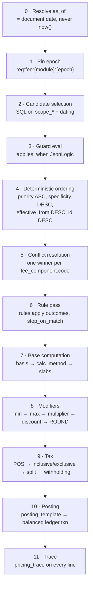

# 06 — Revenue and Pricing Engine

> **Registry #4 (Pricing & Commission) is the subject of this document.** Every rupee AutoHub earns
> is a row in `platform.fee_components`, priced by `platform.rules`, taxed by `platform.tax_rules`,
> and posted to `payments.ledger_entries` by a template in `platform.posting_templates`.
>
> There is no percentage, no slab boundary, no GST rate, no coupon, no clawback window and no
> journal entry anywhere in C#. A finance analyst with `platform.registry.publish` can launch a new
> revenue stream, in one city, for one dealer tier, at a new rate, on a future date — and never
> open a pull request.

Anchors: `00-north-star.md` (Prime Directive, stack, money-in-paise, double-entry floor),
`01-design-system.md` (`MoneyValue`, lakh/crore), `03-data-model-erd.md` §3.5 and §4.5 (the tables
this engine drives), `04-api-contract.md` §9.9/§9.10 (quote and payment surfaces).

---

## 1. The commercial object model

```
                            ┌──────────────────────────────────────┐
                            │  platform.rule_sets  (domain='pricing')│
                            │  input_schema = the FeeContext shape  │
                            └───────────────┬──────────────────────┘
                                            │ 1..n
                            ┌───────────────▼──────────────────────┐
                            │  platform.rules                      │
                            │  condition (JsonLogic) → outcome     │
                            │  priority, stop_on_match, dating     │
                            └───────────────┬──────────────────────┘
                                            │ modifies / selects
   ┌────────────────────────────────────────▼──────────────────────────────────────┐
   │  platform.fee_components   ← THE REVENUE ATOM. One row = one earnable rupee.  │
   │  calc_method · basis · rate/flat/per_unit · min · max · rounding              │
   │  payer_role · payee_role · gl_account_code · tax_rule_id · scope_* · dating   │
   └──────┬────────────────────────────────────────┬───────────────────────────────┘
          │ 0..n                                   │ 1
   ┌──────▼───────────────┐               ┌────────▼──────────────────┐
   │ platform.fee_slabs   │               │ platform.tax_rules        │
   │ [from, to) · rate    │               │ GST split · POS rule      │
   │ is_marginal          │               │ RCM · TCS/TDS · threshold │
   └──────────────────────┘               └────────┬──────────────────┘
                                                   │
   ┌───────────────────────────────────────────────▼───────────────────────────────┐
   │  deals.deal_line_items  — the priced result, with pricing_trace               │
   │  line_kind ∈ principal | fee | tax | withholding | discount | adjustment      │
   └──────┬────────────────────────────────────────────────────────────────────────┘
          │ posted by
   ┌──────▼───────────────────────────┐      ┌────────────────────────────────────┐
   │ platform.posting_templates       │─────▶│ payments.ledger_transactions       │
   │ platform.posting_legs            │      │ payments.ledger_entries (D/C, ==0)  │
   │ account_selector · amount_selector│     └────────────────────────────────────┘
   └───────────────────────────────────┘
                                                          │
                                              ┌───────────▼──────────────┐
                                              │ payments.invoices        │
                                              │ tax_invoice / credit_note│
                                              │ IRN · signed QR          │
                                              └──────────────────────────┘
```

Read that chain in one sentence: **a rule set decides which fee components apply, each fee component
computes an amount, a tax rule splits that amount into taxable value and statutory heads, a posting
template turns the split into balanced debits and credits, and an invoice renders the result.**
Four registry tables and two posting tables. Nothing else earns money.

### 1.1 The two tables this document adds to Registry #4

The ERD defines `rule_sets`, `rules`, `fee_components`, `fee_slabs`, `tax_rules`. Two things are
missing before "no hardcoded journal entry" is true, and this document owns them.

```sql
-- Which ledger accounts a priced line hits, and in what direction. Data, not a C# switch.
CREATE TABLE platform.posting_templates (
    id            uuid PRIMARY KEY DEFAULT platform.uuid_generate_v7(),
    code          platform.code_key NOT NULL,        -- 'fee_charge_from_escrow','fee_charge_on_credit'
    txn_kind      platform.code_key NOT NULL,        -- payments.ledger_transactions.txn_kind
    module_code   platform.code_key NOT NULL,
    trigger_event platform.code_key NOT NULL,        -- outbox event: 'deal.priced','policy.issued'
    applies_when  jsonb,                             -- JsonLogic over the PostingContext
    reverses_template_code platform.code_key,        -- used by credit note / clawback / chargeback
    priority      smallint NOT NULL DEFAULT 100,
    is_active     boolean NOT NULL DEFAULT true,
    effective_from timestamptz NOT NULL DEFAULT now(),
    effective_to   timestamptz,
    change_set_id uuid REFERENCES platform.registry_change_sets(id),
    created_at timestamptz NOT NULL DEFAULT now(), created_by uuid,
    updated_at timestamptz NOT NULL DEFAULT now(), updated_by uuid,
    row_version bigint NOT NULL DEFAULT 1,
    CONSTRAINT uq_posting_templates__code UNIQUE (code)
);

CREATE TABLE platform.posting_legs (
    id            uuid PRIMARY KEY DEFAULT platform.uuid_generate_v7(),
    posting_template_id uuid NOT NULL REFERENCES platform.posting_templates(id) ON DELETE CASCADE,
    leg_no        smallint NOT NULL,
    direction     char(1) NOT NULL CHECK (direction IN ('D','C')),
    account_selector jsonb NOT NULL,   -- {"account_code":"escrow_holding","owner_type":"deal",
                                       --  "owner_ref":"ctx.deal_id"}
    amount_selector  text NOT NULL,    -- 'line.taxable_value_paise' | 'line.cgst_paise'
                                       -- | 'line.amount_paise' | 'sum(lines[kind=fee].amount_paise)'
    condition     jsonb,               -- leg posts only when true (CGST leg: intra-state only)
    memo_i18n_key text NOT NULL,
    CONSTRAINT uq_posting_legs__no UNIQUE (posting_template_id, leg_no)
);
```

Adding the 16th revenue stream is therefore: **1 `fee_components` row + 0..n `fee_slabs` rows +
1 `tax_rules` reference + 1 `posting_templates` row with 3–5 `posting_legs`.** Zero code, zero
migration, zero deploy. That is the acceptance test for this entire document.

### 1.2 Columns this document adds to `platform.fee_components`

Five columns the ERD does not yet carry, each of which otherwise becomes an `if` in code:

| Column | Type | Kills the hardcoding of |
|---|---|---|
| `invoice_policy` | `code_key` | `per_transaction` \| `consolidated_daily` \| `monthly_statement` \| `self_billed`. Rule 46 CGST exempts sub-₹200 B2C invoices — the ₹199 listing fee must not mint 3,080 tax invoices a month |
| `revenue_recognition_policy` | `code_key` | `immediate` \| `ratable_monthly` \| `on_milestone` \| `on_delivery`. Ind AS 115. Tax timing ≠ revenue timing, and both are data |
| `clawback_policy` | `jsonb` | `{"window_days":180,"basis":"pro_rata_unearned","expected_rate_bps":600}` — finance/insurance/lease referral reversals |
| `quantity_source` | `code_key` | `declared` \| `measured` \| `booked`. Ad impressions bill on `measured`, subscriptions on `declared` |
| `is_credit_eligible` | `boolean` | Whether dealer promo credit may settle this line. A credit is a payment method, not a discount (§5.4) |

`platform.gst_registrations` is also this document's: `(id, legal_entity_id, state_id, gstin,
is_active, effective_from, effective_to)`. Which GSTIN supplies a given transaction is a lookup, not
a constant, and it is the input that decides IGST vs CGST+SGST (§4.2).

---

## 2. The rule: exact JSON shape and condition grammar

### 2.1 A rule, verbatim

A `platform.rules` row as the admin API returns it. This is the Pune auction override from the ERD
seed, fully expanded.

```jsonc
{
  "id": "0193f4a2-9c11-7c3e-8b60-2a5f0d1e77aa",
  "rule_set_id": "0193f4a2-8000-7000-8000-000000000004",   // rule_set.code = 'pricing.auction.v7'
  "code": "auction_buyer_premium_pune_festive",
  "priority": 40,                       // ASCENDING. Lower number = evaluated and applied first.
  "stop_on_match": true,
  "effective_from": "2026-10-15T00:00:00+05:30",
  "effective_to":   "2026-11-16T00:00:00+05:30",
  "is_active": true,
  "explain_i18n_key": "pricing.explain.auction_pune_festive",

  "condition": {
    "and": [
      { "==":     [ { "var": "ctx.module" }, "auction" ] },
      { "city_in":[ { "var": "geo.city_code" }, ["PUN", "PCMC"] ] },
      { "tier_at_least": [ { "var": "payer.tier_code" }, "gold" ] },
      { "between_paise": [ { "var": "amount.hammer_price_paise" }, 30000000, 150000000 ] },
      { "!": { "has_tag": [ { "var": "vehicle.tags" }, "salvage" ] } }
    ]
  },

  "outcome": {
    "target_fee_component_code": "auction_buyer_premium",
    "set": { "rate_percent": 1.25, "max_amount_paise": 2000000 },
    "explain": { "label_i18n_key": "pricing.label.festive_rate", "badge": "FESTIVE" }
  }
}
```

Everything a business person would change — the cities, the tier floor, the price band, the rate,
the cap, the window, the badge shown in the fee breakdown — is inside that one JSON document.

### 2.2 The FeeContext — the only variables a condition may reference

`rule_sets.input_schema` declares this as JSON Schema; the publish pipeline rejects any condition
referencing a `var` not in the schema, so a typo (`payer.teir_code`) fails at **publish** time, not
silently at runtime as "no match".

| Namespace | Vars | Notes |
|---|---|---|
| `ctx` | `module`, `intent_type`, `event`, `as_of` (date), `currency`, `channel`, `deal_id`, `registry_epoch` | `channel` ∈ `web \| android \| ios \| dealer_portal \| api \| ops_console` |
| `geo` | `city_code`, `state_code`, `gst_state_code`, `pincode`, `rto_code`, `is_serviceable` | From Registry #10. Never a literal city string |
| `vehicle` | `category_path` (ltree text), `make_code`, `model_code`, `fuel_code`, `age_years`, `odometer_km`, `plate_class`, `is_ev`, `is_commercial`, `tags[]` | `category_path` supports `path_under` for subtree matching |
| `payer` / `payee` | `party_id`, `type`, `tier_code`, `tier_rank`, `is_gst_registered`, `gst_state_code`, `entity_form`, `segment_codes[]`, `entitlements[]`, `kyc_level`, `account_age_days`, `lifetime_deals`, `lifetime_gmv_paise`, `lifetime_listings` | `entity_form` ∈ `individual \| proprietorship \| partnership \| llp \| body_corporate \| huf \| government` — drives RCM |
| `amount` | `basis_paise`, `deal_gross_paise`, `hammer_price_paise`, `rent_total_paise`, `loan_amount_paise`, `premium_paise`, `lease_contract_value_paise`, `owner_net_payout_paise`, `quantity`, `unit_code` | **Every money var carries the `_paise` suffix. A var without it is not money and cannot be compared to a money literal.** See §2.4 |
| `payment` | `method_code`, `instrument_family`, `is_tokenised`, `mandate_id` | Enables method-based pricing (UPI cheaper than card) |
| `campaign` | `codes[]`, `attribution_source`, `referrer_party_id` | Coupons and referrals enter here, nowhere else |
| `subscription` | `plan_code`, `term_months`, `is_renewal`, `seats` | |

### 2.3 The operator whitelist

JsonLogic, restricted. Anything not listed is a publish-time validation failure
(`422 platform.pricing.unsupported_operator`).

| Class | Operators |
|---|---|
| Logic | `and`, `or`, `!`, `if` |
| Comparison | `==`, `!=`, `<`, `<=`, `>`, `>=` |
| Membership | `in`, `in_set` (resolves a `platform.code_sets` code), `has_tag` |
| Custom — geography | `city_in`, `state_in`, `pincode_in_service_area` |
| Custom — taxonomy | `path_under` (ltree `<@`), `category_in` |
| Custom — ordered codes | `tier_at_least`, `tier_below` (compare `platform.codes.sort_order`, never string order) |
| Custom — money | `between_paise` (`[lo, hi)`), `gte_paise`, `lt_paise` |
| Custom — time | `date_between`, `day_of_week_in`, `is_holiday` (Registry #10 `calendar_days`) |
| Var | `var`, `missing`, `missing_some` |

**Deliberately banned:** arithmetic (`+ - * /`), `map/reduce/filter`, regex, `cat`, any operator that
can construct a value. A condition **selects**; it never **computes**. Consequences: conditions are
statically analysable (we can prove two rules overlap), indexable, and impossible to make
non-deterministic. Computation lives in `fee_components` and `fee_slabs`, where it is typed.

Budget: ≤ 64 AST nodes, ≤ 8 levels deep, evaluation < 50 µs. Compiled once to a
`System.Linq.Expressions` tree keyed `rule.id:row_version`, cached in-process for the epoch's life.

### 2.4 The unit-safety rule (and a correction to an existing doc)

Money literals in conditions must be **paise integers** and may only be compared to `_paise` vars.
The validator enforces this by type, because the alternative is the most expensive class of bug in
a pricing engine.

> **Correction other docs must honour.** `04-api-contract.md` §9.9 shows a TCS 206C(1F) line firing
> on `vehicle_price_minor: 84000000` (₹8,40,000) with `condition: "sale_value >= 1000000"`. Read in
> paise, ₹10,000 is the threshold; read in rupees, the sale is ₹8.4 L and **below** the ₹10,00,000
> statutory threshold, so TCS must not fire at all. The threshold is
> `tax_rules.threshold_amount_paise = 100000000`. Any example that charges TCS on a sub-₹10 L sale
> is a unit-mixing bug — which is exactly why bare numerics are banned and `_paise` is mandatory.
> Worked example §6.5 uses a ₹12,50,000 sale so TCS legitimately applies.

### 2.5 Outcome shapes

| Outcome | Shape | Effect |
|---|---|---|
| Override | `{"target_fee_component_code":"x","set":{"rate_percent":1.25}}` | Replaces named fields on the winning component |
| Emit | `{"emit_fee_component_code":"late_fee_dealer"}` | Adds a component that scope alone would not select |
| Suppress | `{"target_fee_component_code":"x","suppress":true}` | Waiver. First-listing-free, membership benefit |
| Discount | `{"discount":{"code":"NEW500","kind":"flat","amount_paise":50000,"applies_to":["listing_boost_7d"]}}` | Emits a negative `line_kind='discount'` line |
| Multiplier | `{"target_fee_component_code":"x","multiplier_bps":8000}` | 80% of computed → 20% off. Composes with `stacking_policy` |
| Tax override | `{"target_fee_component_code":"x","tax_rule_code":"gst_services_5_no_itc"}` | Sec 9(5) ECO flip, RCM flip |
| Deny | `{"deny":"pricing.dealer_not_eligible"}` | Hard stop → `409` with that machine code |
| Require | `{"require":["buyer_pan","seller_gstin"]}` | → `422 payments.tcs.pan_missing` before payment |

---

## 3. Evaluation semantics

### 3.1 The pipeline



Steps 0–9 are **pure**. The pricing engine makes **zero network calls** — no VAHAN, no bureau, no
payment gateway, no OpenSearch. Everything it needs is either in the FeeContext (assembled by the
caller) or in the epoch-pinned registry snapshot in Redis. This is a hard invariant: a quote must be
computable when every integration in `Registry #8` is down, because the alternative is a marketplace
that cannot quote a price during a Razorpay outage.

### 3.2 Candidate selection

```sql
SELECT fc.*
  FROM platform.fee_components fc
 WHERE fc.is_active
   AND fc.deleted_at IS NULL
   AND fc.module_code = :module
   AND (fc.intent_type_code IS NULL OR fc.intent_type_code = :intent_type)
   AND (fc.scope_city_id    IS NULL OR fc.scope_city_id    = :city_id)
   AND (fc.scope_state_id   IS NULL OR fc.scope_state_id   = :state_id)
   AND (fc.scope_category_id IS NULL OR fc.scope_category_id = ANY(:category_ancestor_ids))
   AND (fc.scope_party_tier IS NULL OR fc.scope_party_tier = :payer_tier)
   AND fc.effective_from <= :as_of
   AND (fc.effective_to IS NULL OR fc.effective_to > :as_of);
```

`scope_category_id` matches against the **ancestor set** of the vehicle's category, so a rule scoped
to `vehicle.four_wheeler` covers `vehicle.four_wheeler.suv` without enumeration. In steady state this
query never runs — the whole module's component set is one Redis hash under
`reg:fee:{module}:{epoch}` (a few hundred rows, ~180 KB), and selection is an in-memory filter.
The SQL exists for cache-miss warmup and for the `/simulate` replay harness.

### 3.3 Ordering — priority first, specificity second

```
specificity =  1000 · (scope_city_id      IS NOT NULL)
            +   600 · (scope_state_id     IS NOT NULL)
            +   400 · (scope_category_id  IS NOT NULL)
            +   300 · (scope_party_tier   IS NOT NULL)
            +   200 · (intent_type_code   IS NOT NULL)
            +   100 · (applies_when       IS NOT NULL)

order key   = (priority ASC, specificity DESC, effective_from DESC, id DESC)
```

**Why priority beats specificity.** Most rule engines make the narrowest rule win, full stop. That
has no escape hatch: once a Pune-scoped row exists, ops cannot ship a nationwide festive override
without deleting the Pune row and remembering to restore it. Making `priority` the primary key of
the ordering gives them a one-row override, and because everything defaults to `priority = 100`,
specificity still decides in the overwhelmingly common case. The ERD's seed — Pune buyer premium at
`priority = 50` **and** `scope_city_id` set — is belt-and-braces and remains correct under this rule.

`id DESC` on a UUID v7 primary key means "the most recently created row wins the last tie." The
ordering is therefore a **total order**: two evaluations of the same context against the same epoch
cannot produce different winners. Determinism is not best-effort; it is provable.

### 3.4 Conflict resolution

- `fee_components` are grouped by `code`. **Exactly one row per code wins.** Different codes stack —
  a buyer premium and a seller commission are different codes and both apply.
- Within a `rule_set`, `rules` are walked in order; `stop_on_match = true` ends the pass for that
  `target_fee_component_code`. A rule with `stop_on_match = false` applies its outcome and evaluation
  continues, which is how a stack of multipliers (loyalty × festive × payment-method) composes.
- **Ambiguity is a publish-time error, not a runtime coin-flip.** The publish validator computes,
  for every pair of rows sharing a `code`, whether their `(priority, specificity)` keys are equal and
  their scope predicates can be simultaneously satisfiable. If so →
  `422 platform.pricing.ambiguous_rule` with both row ids. You cannot ship a race.

### 3.5 Effective dating and `as_of`

`as_of` is the **document date**, never `now()`:

| Surface | `as_of` |
|---|---|
| `GET /platform/pricing/preview` | `now()` (it is an estimate and says so) |
| `POST /deals/quotes` | `now()`, then **frozen** on the quote |
| Deal pricing at `deal.priced` transition | the quote's `as_of` if the quote is still valid, else `now()` and a fresh quote |
| Invoice generation | `invoices.invoice_date` |
| Credit note | the **original invoice's** date — a reversal must reproduce the original rates |
| Recompute / audit replay | the stored `as_of` on the line item |

A GST rate change on 22 Sep 2025 must not retroactively repay a 20 Sep invoice, and a 2027 audit of
a 2026 invoice must reproduce 2026 rates exactly. `tax_rules` and `fee_components` are **temporal**:
never `UPDATE`, always close-and-insert. `deal_line_items` snapshot `fee_component_code`,
`tax_rule_id`, `gstin`, `legal_name_snapshot` and `address_snapshot`, so a dealer changing their
registered address in 2027 cannot mutate a 2026 invoice.

**Time of supply on a rate change (CGST §14).** When the rate changes between supply, invoice and
payment, §14 picks the rate by which two of the three fall after the change. This is a decision
table, so it is `rules` rows in the `pricing.time_of_supply.v1` rule set, not an `if`-ladder:

| Supply | Invoice | Payment | Rate |
|---|---|---|---|
| before | after | after | **new** |
| before | before | after | old |
| before | after | before | old |
| after | before | before | **old** |
| after | after | before | new |
| after | before | after | new |

### 3.6 Currency

INR only in v1, but `currency_code` is carried on every amount and every ledger entry, and the engine
**refuses** to add two amounts with different codes (`422 platform.pricing.currency_mismatch`). There
is no implicit conversion and no FX table. Adding a second currency later means adding a rate source
and a rounding policy — not unpicking a system that assumed one currency existed.

### 3.7 Rounding — and exactly who eats it

Seven rules, applied in this order. All amounts are `bigint` paise; there is no `decimal` and no
`double` anywhere in the path.

| # | Rule |
|---|---|
| **R1** | Round **once**, at the end of the fee-amount computation (after slabs, min, max, multipliers, discounts), **before** tax. Intermediate values keep full integer precision. |
| **R2** | `rounding_to_paise` (default `100` = nearest rupee) and `rounding_mode` ∈ `half_up \| half_even \| up \| down \| none` come from the `fee_components` row. **Inbound commission** (finance, insurance — where a counterparty's statement is the source of truth) uses `rounding_to_paise = 1`. |
| **R3** | Tax is computed on the **rounded** taxable value and is itself carried to the paise. Tax is never rounded to the rupee at the line level; GSTR-1 wants paise. |
| **R4** | **Inclusive gross-up:** `taxable = round_half_up(gross × 100 ÷ (100 + rate)); tax = gross − taxable`. The identity `taxable + tax == gross` is **inviolable**. Where `tax` differs from `round(taxable × rate)` it does so by at most 1 paisa, and the *taxable* figure is what is reported. |
| **R5** | **CGST/SGST split of an odd paisa:** `cgst = ceil(tax ÷ 2); sgst = tax − cgst`. Deterministic, always sums, never off by one. |
| **R6** | **Invoice total** is rounded to the nearest rupee (CGST §170 practice) with the residual (≤ ₹0.50) posted to `rounding_adjustment`. The taxable value and the tax heads on the invoice and in GSTR-1 are **not** altered. |
| **R7** | **Multi-party splits** by `deal_parties.share_bps` use the **largest-remainder** method; the residual paise go to the party with `is_primary = true`. |

Slab boundaries are `[from, to)` — `from` inclusive, `to` exclusive, enforced by the ERD's
`int8range` exclusion constraint. Stating this is not pedantry: an off-by-one at a slab edge is the
single most common fee dispute in a marketplace, and "₹5,00,000 exactly" must land in the lower band
by definition, in writing, once.

**Who eats the rounding:**

| Rounding site | Magnitude | Absorbed by | GL account |
|---|---|---|---|
| Fee amount → nearest ₹ | ≤ ₹0.50 | The customer — it *is* the price, shown pre-commit | — |
| Inclusive gross-up residual | ≤ 1 paisa | The tax line (identity wins) | `cgst_payable` / `igst_payable` |
| CGST/SGST odd-paisa split | 1 paisa | CGST | `cgst_payable` |
| Invoice total → nearest ₹ | ≤ ₹0.50 | **The platform** | `rounding_adjustment` |
| Multi-party payout split | ≤ (n−1) paise | Primary party | — |
| Slab boundary | 0 | — | — |

The platform eats the only rounding that is genuinely arbitrary. The customer never pays a paisa they
weren't quoted, and the exchequer never receives a paisa less than the computed tax.

### 3.8 Idempotent recomputation

```
quote_hash = sha256( canonical_json(FeeContext ⊖ volatile_fields) ‖ registry_epoch ‖ as_of_date )
```

`canonical_json` = RFC 8785 JCS (sorted keys, no insignificant whitespace, integers only for money).
`volatile_fields` = `ctx.request_id`, `ctx.trace_id`, timestamps below day granularity.

- Same hash → the engine returns the stored result **byte-for-byte** from `pricing.quotes`, without
  re-evaluating. A recompute that produces a different result for an identical hash is a **P1 bug**
  and is caught by an assertion in staging and a nightly replay job in production.
- `POST /deals/quotes` and `POST /platform/pricing/preview` honour `Idempotency-Key`.
- Deal pricing carries the `quote_id`. If the pinned `pricing_registry_version` no longer matches the
  live epoch **and** a re-evaluation produces a different total, the transition fails with
  `409 platform.pricing.plan_expired` and the UI re-quotes with an explicit before/after diff. It
  does not silently re-price. A dealer who saw ₹9,587 must never be charged ₹11,240 without a click.
- If re-evaluation produces the **same** total under a new epoch, the transition proceeds and the new
  epoch is recorded. Ops changing an unrelated city must not invalidate live quotes nationwide.

```sql
-- owned by this document
CREATE TABLE pricing.quotes (
    id            uuid PRIMARY KEY DEFAULT platform.uuid_generate_v7(),
    public_ref    text NOT NULL,                     -- 'QT-2607-8KX2'
    quote_hash    platform.sha256_hex NOT NULL,
    module_code   platform.code_key NOT NULL,
    intent_type_code platform.code_key NOT NULL,
    subject_type  platform.code_key NOT NULL,        -- 'listing','auction_lot','booking','policy'
    subject_id    uuid,
    requested_by  uuid,
    context       jsonb NOT NULL,                    -- the full FeeContext, canonicalised
    lines         jsonb NOT NULL,                    -- computed lines, identical shape to §9.9
    totals        jsonb NOT NULL,
    as_of         date NOT NULL,
    registry_epoch bigint NOT NULL,
    valid_until   timestamptz NOT NULL,              -- from rule set 'pricing.quote_ttl.v1'
    accepted_deal_id uuid REFERENCES deals.deals(id),
    created_at timestamptz NOT NULL DEFAULT now(), created_by uuid,
    CONSTRAINT uq_quotes__hash_epoch UNIQUE (quote_hash, registry_epoch)
);
CREATE INDEX ix_quotes__subject ON pricing.quotes (subject_type, subject_id, created_at DESC);
```

Quote TTL is itself a registry row (`pricing.quote_ttl.v1`): 15 minutes for auctions (prices move),
24 hours for C2C, 7 days for lease and insurance (the counterparty is slow).

### 3.9 `pricing_trace` — the dispute-killer

Every `deal_line_items` row carries the full derivation. Support resolves a fee dispute without an
engineering ticket.

```jsonc
{
  "engine_version": "pricing/2.4.0",
  "registry_epoch": 231,
  "as_of": "2026-07-29",
  "quote_id": "0193f5…",
  "component": { "id":"0193c1…", "code":"auction_buyer_premium", "row_version": 7,
                 "specificity": 1300, "priority": 40, "beat": ["0193c0… (spec 0, prio 100)"] },
  "basis":     { "name":"hammer_price", "value_paise": 65000000 },
  "steps": [
    {"step":"slab",       "slab_id":"0193c2…","band":"[50000000, null)","rate_percent":1.50,
     "is_marginal":false, "out_paise": 975000},
    {"step":"rule",       "rule_id":"0193f4…","code":"tier_platinum_auction",
     "condition_result":true,"set":{"rate_percent":1.25},"out_paise": 812500},
    {"step":"min",        "min_paise": 200000, "binding": false, "out_paise": 812500},
    {"step":"max",        "max_paise": 2500000,"binding": false, "out_paise": 812500},
    {"step":"round",      "mode":"half_up","to_paise":100,        "out_paise": 812500},
    {"step":"tax",        "tax_rule_id":"0193b0…","code":"gst_services_18",
     "pos_state":"27","supplier_state":"27","split":"intra",
     "inclusive":false,"cgst_paise":73125,"sgst_paise":73125}
  ],
  "final": { "taxable_value_paise": 812500, "tax_paise": 146250, "total_paise": 958750 }
}
```

`beat` naming the rows that lost is deliberate. Half of all pricing escalations are "why did the old
rate not apply", and the answer is in the trace, not in a re-read of the registry.

### 3.10 Error codes (extends `04-api-contract.md` §3)

| Code | HTTP | When |
|---|---|---|
| `platform.pricing.no_matching_rule` | 500 | No component matched, not even the catch-all. Configuration bug — **pages on-call**. Never defaults to zero, never to a constant |
| `platform.pricing.plan_expired` | 409 | Quote pinned to a superseded epoch **and** the total changed |
| `platform.pricing.ambiguous_rule` | 422 | Publish-time: two rows tie on `(priority, specificity)` with satisfiable overlap |
| `platform.pricing.unsupported_operator` | 422 | Condition uses an operator outside the whitelist |
| `platform.pricing.unknown_var` | 422 | Condition references a var absent from `input_schema` |
| `platform.pricing.unit_mismatch` | 422 | Money literal compared to a non-`_paise` var |
| `platform.pricing.currency_mismatch` | 422 | Cross-currency arithmetic attempted |
| `platform.pricing.negative_total` | 409 | Discounts exceed fees; the guard is `total >= 0` per payer per deal |
| `platform.pricing.budget_exhausted` | 409 | Coupon budget consumed between validate and redeem |
| `platform.pricing.slab_gap` | 422 | Publish-time: slabs leave an uncovered band |
| `payments.tcs.pan_missing` | 422 | `require:["buyer_pan"]` unsatisfied on a ≥ ₹10 L sale |
| `platform.pricing.posting_template_missing` | 500 | A priced line has no posting template. Pages on-call |

**Fail closed, always.** There is no "default 2%". A catch-all `fee_components` row per module at
`priority = 32767` with the widest scope guarantees `no_matching_rule` never fires in practice, and
when it does fire it means someone deleted the catch-all — which is a page, not a silent ₹0.

---

## 4. Tax

### 4.1 GST treatment per stream

AutoHub Pvt Ltd holds GSTINs in **MH (principal), KA, DL** at launch. Everything below is a
`platform.tax_rules` row referenced by `fee_components.tax_rule_id`.

| # | Stream | `fee_component` code | SAC | GST | POS rule | RCM | Notes |
|---|---|---|---|---|---|---|---|
| 1 | Listing fee | `listing_fee_c2c` | 998599 | 18% | `recipient_state` | – | < ₹200 B2C → Rule 46 consolidated daily invoice |
| 2 | Premium listing | `listing_boost_7d` | 998599 | 18% | `recipient_state` | – | Tax-inclusive to consumers, split shown on invoice |
| 3 | Dealer subscription | `dealer_subscription_*` | 998599 | 18% | `recipient_state` | – | Exclusive (B2B norm). Time of supply = invoice/payment, earlier |
| 4 | Auction commission | `auction_buyer_premium`, `auction_seller_commission` | 998599 | 18% | `recipient_state` | – | Plus **GST TCS §52 @ 0.5%** on the underlying vehicle supply |
| 5 | Buy/sell commission | `platform_buyer_fee`, `c2c_success_fee`, `rc_transfer_assist` | 998599 | 18% | `recipient_state` | – | GST TCS §52 only where the seller is registered |
| 6 | Rental commission | `rental_host_commission`, `rental_renter_service_fee` | 998599 | 18% | `recipient_state` | **Conditional** | Notification 13/2017 entry 15: non-body-corporate lessor → body-corporate lessee charging 5% ⇒ RCM on the *rental*, not on our commission |
| 7 | Lease commission | `lease_origination_commission` | 998599 | 18% | `recipient_state` | – | Operating lease = service. **Financial lease/HP = deemed supply of goods** at vehicle rate + cess — different `intent_type`, different tax rule |
| 8 | Taxi attachment | `attach_onboarding_fee`, `attach_mgmt_commission` | 998599 | 18% | `recipient_state` | – | **§9(5) fork:** if AutoHub ever books the ride it becomes the ECO and pays 5% no-ITC on the fare. `intent_types.eco_9_5_applicable` flips the tax rule |
| 9 | Loan referral | `finance_referral` | 998599 | 18% | `recipient_state` | – | Lender-paid only (RBI Digital Lending). TDS 194H 2% |
| 10 | Insurance referral | `insurance_commission_motor_od`, `_tp` | 998599 | 18% | `recipient_state` | – | Requires IRDAI corporate-agent or broker registration. TDS **194D 10%** (domestic company) |
| 11 | Featured dealer | `featured_dealer_city_month` | 998365 | 18% | `recipient_state` | – | Online advertising space |
| 12 | Ad banners | `ad_banner_cpm`, `ad_banner_cpd` | 998365 | 18% | `recipient_state` | – | IGST where we hold no GSTIN in the advertiser's state |
| 13 | Inspection | `inspection_fee_4w`, `inspection_fee_doorstep_4w` | 998346 | 18% | `recipient_state` | – | Technical testing & analysis |
| 14 | Valuation report | `valuation_report_certified` | 998399 | 18% | `recipient_state` | – | Free estimate tier = `{"suppress":true}` rule |
| 15 | Premium membership | `membership_autohub_plus_annual` | 998599 | 18% | `recipient_state` | – | GST at sale; revenue ratable over 12 months |
| — | Late/no-show/forfeit | `*_late_fee`, `inspection_no_show_fee`, `auction_emd_forfeiture` | 999794 | 18% | `recipient_state` | – | "Agreeing to tolerate an act". **Damage recovery is *not* a supply** (Circular 178/10/2022) — no GST |

### 4.2 Place of supply — the algorithm, not the vibe

All AutoHub supplies are services under **IGST §12(2)**: POS = the recipient's registered location
(B2B) or their address on record (B2C), falling back to the supplier's location where no address
exists. Insurance intermediary services follow the same §12(2) path to the insurer's registered
state. No special rule (immovable property, passenger transport, on-board) applies to any of the 15
streams — worth saying once so nobody re-litigates it per module.

```
supplier_state := gst_registrations WHERE state = geo.state_code AND is_active AND effective
                  ELSE principal_place_of_business_state          -- MH
recipient_state := payer.is_gst_registered ? payer.gst_state_code
                 : (address_on_record ? billing_state : supplier_state)

split := (supplier_state == recipient_state) ? INTRA : INTER
INTRA → cgst_rate, sgst_rate       INTER → igst_rate
```

Consequence worth internalising: **a Bengaluru dealer buys from our KA GSTIN and pays CGST+SGST; a
Chennai consumer buying a valuation report from our MH GSTIN pays IGST.** Same product, same price,
different tax heads, different GSTR-1 tables — and the only thing that changed is a
`gst_registrations` row. Opening a TN GSTIN is a registry insert, not a release.

### 4.3 Inclusive vs exclusive — the standing policy

- **Consumer-facing streams are tax-inclusive.** The price on the screen is the price debited. A
  ₹499 boost costs ₹499. Anything else is a dark pattern and reads as one on a 360 px screen.
- **B2B streams (subscription, featured dealer, ads, referral) are tax-exclusive.** That is how
  Indian B2B quotes, and the dealer needs the split visible to claim ITC.
- Both produce the identical invoice structure — taxable value, tax heads, total. Inclusive/exclusive
  is a *gross-up direction* (`fee_components.is_inclusive_of_tax`), not a different tax outcome.

> **Correction other docs must honour.** `03-data-model-erd.md` §4.5 states ₹1,999 inclusive of 18%
> → "taxable ₹1,694.07, GST ₹304.92", which sums to ₹1,998.99 — a paisa short. Under R4,
> `taxable = round_half_up(199900 × 100 ÷ 118) = 169407` and `tax = 199900 − 169407 = 30493`, i.e.
> **₹1,694.07 + ₹304.93 = ₹1,999.00 exactly**. The identity always wins over the rate multiplication.

### 4.4 Reverse charge

Modelled as `tax_rules.is_reverse_charge = true` plus a rule on `payee.entity_form` /
`payer.entity_form`. Where RCM applies, the supplier's invoice shows "Tax payable under reverse
charge", carries no tax in the total, and the **recipient's** ledger posts the liability and the
matching ITC.

| Trigger | Section | Rate | Where it bites AutoHub |
|---|---|---|---|
| Renting of a passenger motor vehicle (fuel included) by a non-body-corporate to a body corporate, supplier charging 5% | §9(3), Notf. 13/2017 entry 15 | 5% | Corporate rentals where the host is a proprietor |
| Goods Transport Agency | §9(3) | 5% (no ITC) / 12% | Vehicle logistics on delivered deals |
| Legal services from an advocate | §9(3) | 18% | Recovery litigation, RTO disputes |
| Sponsorship | §9(3) | 18% | Dealer-meet sponsorships |
| Import of services | §5(3) IGST | 18% | Foreign valuation-ML SaaS, cloud, analytics |
| ECO liability for passenger transport by radio-taxi/motorcab | **§9(5)** | 5% no ITC | **Only if AutoHub books rides.** Not triggered by attachment-management alone |

§9(5) deserves its own sentence: it is not reverse charge on us as a recipient, it is the ECO paying
GST on a supply it merely facilitated, with no ITC. If Attachment ever becomes a booking product the
economics change materially, and that flip is one `intent_types` flag plus one `tax_rules` row.

### 4.5 TDS and TCS — who withholds what from whom

| Statute | Withholder | On | Rate | Threshold | Our account |
|---|---|---|---|---|---|
| **Income-tax TCS §206C(1F)** | The **seller** (a dealer meeting the turnover test) | Motor vehicle sale consideration | 1% | **> ₹10,00,000 per vehicle** | `tcs_collected_for_seller` (liability, pass-through) |
| **GST TCS §52** | AutoHub as ECO | Net taxable value of supplies made through us **where we collect the consideration** and the supplier is registered | **0.5%** (0.25 CGST + 0.25 SGST; 0.5% IGST) since 10-Jul-2024 | none | `gst_tcs_payable` → GSTR-8 by the 10th |
| **TDS §194-O** | AutoHub as ECO | Gross amount paid to a resident e-commerce participant | **0.1%** since 01-Oct-2024 | ₹5,00,000/FY for individual/HUF **with PAN**; nil otherwise | `tds_194o_payable` |
| **TDS §194H** | Lender / lessor paying us | Our commission, **excluding GST shown separately** (Circular 23/2017) | 2% | ₹20,000/FY | `tds_receivable_194h` (asset) |
| **TDS §194D** | Insurer paying us | Insurance commission | **10%** (domestic company) | ₹20,000/FY | `tds_receivable_194d` (asset) |
| **TDS §194C** | AutoHub / advertiser | Contractor payments (inspection partners, logistics) and ad contracts | 1% individual/HUF, 2% others | ₹30,000 single / ₹1,00,000 aggregate FY | `tds_194c_payable` / `tds_receivable_194c` |
| **§206AA / §206CC** | — | No PAN → 20% or twice the rate, whichever higher | — | — | Blocks the transition; `require:["pan"]` |

Three interactions that are routinely got wrong and are therefore encoded as rules, not comments:

1. **§194-O(3) crowds out other TDS** on the same transaction. Where 194-O applies to a payment to a
   participant, 194H/194J do not also apply to it. One `rules` row, `stop_on_match = true`.
2. **§206C(1F) is the seller's obligation, not the marketplace's.** AutoHub never deposits TCS under
   another entity's TAN. Where we collect it in escrow we hold it as agent in
   `tcs_collected_for_seller` and release it in the payout for the seller to deposit. A C2C sale
   between two individuals attracts **no** 206C(1F) at all, because neither is a "seller" under the
   section's turnover test — an important and frequently mis-implemented case.
3. **§194-O bites on gross, and gross is large.** At ₹64 Cr/month of auction GMV, 0.1% is ~₹6.4 L/month
   of TDS to deposit by the 7th. It comes out of the **seller's payout**, never out of our revenue,
   and it is a cash-timing item, not a cost.

### 4.6 Invoices, credit notes, e-invoicing

- **Numbering** is gapless per `series_code` per financial year, claimed from a per-series Postgres
  sequence inside the inserting transaction. Never `max()+1`. A rolled-back transaction burns a
  number, and the burn is recorded in `payments.invoice_number_gaps` with a reason, because an
  auditor will ask.
- **Series** is `AH/{FY}/{state}/{nnnnnn}` — separate series per GSTIN, because GSTR-1 is filed per
  GSTIN. `AH/26-27/MH/000418`.
- **Reversals are credit notes, never deletions and never negative invoices.** The credit note
  references the original invoice, reproduces the original `as_of` rates, and posts the exact reverse
  legs via `posting_templates.reverses_template_code`.
- **The credit-note window is statutory:** 30 November following the end of the financial year, or the
  date of the annual return, whichever is earlier. After that the GST cannot be recovered. A
  cancellation past the window still refunds the customer their gross, but the tax component is
  written off to `gst_written_off_expense`. A nightly job flags open disputes on invoices older than
  1 October so finance can close them inside the window.
- **e-invoicing (IRN)**: applicable above the notified turnover threshold, for B2B and exports.
  B2C lines are out of scope. When the IRP is down the invoice is created with `irn IS NULL`,
  `einvoice_status = 'pending'`, and a retry job runs against the 30-day statutory window with an
  alarm at day 20. **The IRN never blocks a payout** — it blocks the *legal completeness of the
  document*, and those are different clocks.
- **Self-billing** is used for finance and insurance referral: the counterparty issues a monthly
  statement, we reconcile it against our `deal_line_items`, and we raise the tax invoice against the
  **reconciled** figure. Never against our own count — that is how disputes become receivable
  write-offs.

---

## 5. Promotions — a promotion is a rule

### 5.1 The one rule that keeps this clean

> A promotion changes **which pricing rules match** or **emits a discount line**. It never mutates a
> fee amount, never short-circuits the engine, and never lives in a module. If a promotion needs
> code, the promotion is designed wrong.

The GST reason this is non-negotiable: under **CGST §15(3)(a)**, a discount is deductible from the
taxable value only if it is given at or before the time of supply **and shown on the invoice**. A
post-supply discount needs a linked credit note and ITC reversal by the recipient — operationally
awful at consumer scale. Therefore **every AutoHub promotion is a pre-supply, invoice-visible
discount line**, and the tax is computed on the post-discount value. Silently reducing a fee would
produce a correct total and an incorrect invoice.

### 5.2 The coupon table (owned by this document)

```sql
CREATE TABLE promo.coupons (
    id            uuid PRIMARY KEY DEFAULT platform.uuid_generate_v7(),
    code          text NOT NULL,                     -- 'MONSOON500' — case-insensitive unique
    campaign_code platform.code_key NOT NULL,
    rule_set_id   uuid NOT NULL REFERENCES platform.rule_sets(id),   -- eligibility + outcome
    kind          platform.code_key NOT NULL,        -- 'discount','credit_grant','fee_waiver'
    stacking_policy platform.code_key NOT NULL DEFAULT 'best_of',
                                                     -- 'exclusive'|'best_of'|'stack_additive'|'stack_multiplicative'
    budget_paise      platform.money_paise,          -- NULL = unbudgeted
    consumed_paise    platform.money_paise NOT NULL DEFAULT 0,
    max_redemptions   integer,
    redemption_count  integer NOT NULL DEFAULT 0,
    max_per_party     smallint NOT NULL DEFAULT 1,
    first_transaction_only boolean NOT NULL DEFAULT false,
    valid_from    timestamptz NOT NULL,
    valid_to      timestamptz NOT NULL,
    gl_account_code platform.code_key NOT NULL DEFAULT 'promo_discount_expense',
    status_code   platform.code_key NOT NULL DEFAULT 'draft',   -- workflow registry
    change_set_id uuid REFERENCES platform.registry_change_sets(id),
    created_at timestamptz NOT NULL DEFAULT now(), created_by uuid,
    updated_at timestamptz NOT NULL DEFAULT now(), updated_by uuid,
    row_version bigint NOT NULL DEFAULT 1,
    CONSTRAINT uq_coupons__code UNIQUE (lower(code)),
    CONSTRAINT ck_coupons__budget CHECK (budget_paise IS NULL OR consumed_paise <= budget_paise)
);

CREATE TABLE promo.redemptions (
    id            uuid PRIMARY KEY DEFAULT platform.uuid_generate_v7(),
    coupon_id     uuid NOT NULL REFERENCES promo.coupons(id),
    party_id      uuid NOT NULL REFERENCES identity.parties(id),
    deal_id       uuid REFERENCES deals.deals(id),
    quote_id      uuid REFERENCES pricing.quotes(id),
    discount_paise platform.money_paise NOT NULL,
    reversed_at   timestamptz,
    idempotency_key text NOT NULL,
    created_at timestamptz NOT NULL DEFAULT now(),
    CONSTRAINT uq_redemptions__idem UNIQUE (idempotency_key),
    CONSTRAINT uq_redemptions__party_coupon_deal UNIQUE (coupon_id, party_id, deal_id)
);
```

**Budget is decremented atomically in Postgres, never in Redis:**

```sql
UPDATE promo.coupons
   SET consumed_paise = consumed_paise + :amt,
       redemption_count = redemption_count + 1
 WHERE id = :id
   AND status_code = 'active'
   AND now() BETWEEN valid_from AND valid_to
   AND (budget_paise IS NULL OR consumed_paise + :amt <= budget_paise)
   AND (max_redemptions IS NULL OR redemption_count < max_redemptions)
RETURNING consumed_paise, budget_paise;
```

Zero rows returned → `409 platform.pricing.budget_exhausted`. Redis holds a *fast-reject* counter to
keep 99% of hopeless attempts off the database, but Redis is never the authority. A read-modify-write
on a coupon budget during a festive campaign is how marketplaces give away ₹40 lakh they did not
have.

### 5.3 The four canonical promotions, as data

| Promotion | Condition | Outcome | Code required |
|---|---|---|---|
| **First listing free** | `{"==":[{"var":"payer.lifetime_listings"},0]}` | `{"target_fee_component_code":"listing_fee_c2c","suppress":true}` | none |
| **Coupon `MONSOON500`** | `{"and":[{"in":["MONSOON500",{"var":"campaign.codes"}]},{"gte_paise":[{"var":"amount.basis_paise"},200000]}]}` | `{"discount":{"kind":"flat","amount_paise":50000,"applies_to":["listing_boost_7d","featured_dealer_city_month"]}}` | none |
| **Referral** | `{"!=":[{"var":"campaign.referrer_party_id"},null]}` | Two outcomes: `discount` ₹300 for the referee **and** `credit_grant` ₹500 to the referrer, granted on the referee's *first completed deal*, not on signup | none |
| **Dealer credits** | `{"has_tag":[{"var":"payer.entitlements"},"credit.promo"]}` | Not a discount — see §5.4 | none |

**Stacking.** `best_of` is the default: evaluate every eligible promotion, apply the single one most
favourable to the customer, record the losers in `pricing_trace`. It is deterministic (no ordering
bug), it is defensible to a customer ("you got the better of the two"), and it caps blast radius.
`stack_additive` exists for deliberate campaigns and is guarded by
`platform.pricing.negative_total` — total per payer per deal must be ≥ 0.

**Membership benefits are promotions too.** A Plus member's free boost fires the ₹499 component
normally, then a `membership_benefit_discount` rule emits a −₹499 line. The line nets to zero cash
but posts `Dr promo_discount_expense / Cr advertising_income:boost`, which is what makes
`benefit_cost_per_member` measurable. Silently suppressing the fee would make membership look
infinitely profitable.

### 5.4 Credits are a payment method, not a discount

This distinction is where implementations create GST errors, so it is worth being blunt.

| | Discount | Credit |
|---|---|---|
| Where it lives | `deal_line_items`, `line_kind='discount'`, negative | `payments.ledger_accounts`, `dealer_promo_credit/party:D` |
| Effect on taxable value | **Reduces it** (§15(3)(a)) | **None** — GST is on the full value |
| Effect on invoice | A visible negative line | Nothing; the invoice is full value |
| Effect on ledger | `Dr promo_discount_expense` | Settles the receivable: `Dr dealer_promo_credit / Cr dealer_receivable` |
| Liability at grant | none | **Yes** — `Dr marketing_expense / Cr promo_credit_liability` at grant |
| Expiry | n/a | `expires_at`; on expiry `Dr promo_credit_liability / Cr other_income` |

Credits are spendable only against components with `is_credit_eligible = true` (never against
statutory withholding, never against a third party's money in escrow). A dealer cannot pay a
hammer price with promo credit.

---

## 6. Worked examples — all 15 streams

Conventions: all ledger figures are **paise**; `₹` figures are the same number for reading. Accounts
follow `account_code/owner_type:owner_ref`. Every transaction below balances to zero — that is
enforced by the deferred constraint trigger in `03-data-model-erd.md` §4.5, not by discipline.

### 6.1 Listing fee — ₹199, 4th listing this month, Pune, individual, UPI

`listing_fee_c2c` · flat 19,900 · **inclusive** · payer `seller` · SAC 998599 · `gst_services_18`
· `invoice_policy = consolidated_daily`

Rule `listing_free_quota_monthly`: `{"<":[{"var":"payer.listings_this_month"},3]}` →
`{"suppress":true}`. This is the 4th, so the rule does not match and the component stands.

```
gross    19,900
taxable  round_half_up(19,900 × 100 ÷ 118) = 16,864        (₹168.64)
tax      19,900 − 16,864 = 3,036                            (₹30.36)
POS      MH (recipient address on record, Pune) = supplier MH → INTRA
cgst     ceil(3,036 ÷ 2) = 1,518    sgst 1,518
```

| Txn | Dr | Cr | Paise |
|---|---|---|---|
| `fee_charge` | `pg_receivable` | | 19,900 |
| | | `service_income:listing` | 16,864 |
| | | `cgst_payable` | 1,518 |
| | | `sgst_payable` | 1,518 |
| `pg_settlement` | `operating_bank` | `pg_receivable` | 19,900 |

UPI MDR is **zero by law**, so the settlement is 1:1. The customer receives a payment receipt; the
tax invoice is the **consolidated daily B2C invoice** for the MH series, because Rule 46's proviso
exempts sub-₹200 unregistered-recipient supplies from per-transaction invoicing. At 3,080 paid
listings a month that is 30 invoices a year instead of 36,960.

### 6.2 Premium listing (boost) — ₹499 / 7 days, Bengaluru dealer, card

`listing_boost_7d` · flat 49,900 · inclusive · SAC 998599 · KA GSTIN exists → INTRA KA

```
taxable  round(49,900 × 100 ÷ 118) = 42,288      tax 7,612      cgst 3,806  sgst 3,806
MDR      49,900 × 1.90% = 948        GST on MDR 171 (ITC, not expense)
```

| Txn | Dr | Cr | Paise |
|---|---|---|---|
| `fee_charge` | `dealer_receivable/party:D` | | 49,900 |
| | | `advertising_income:boost` | 42,288 |
| | | `cgst_payable` | 3,806 |
| | | `sgst_payable` | 3,806 |
| `payment_capture` | `pg_receivable` | `dealer_receivable/party:D` | 49,900 |
| `pg_settlement` | `operating_bank` | | 48,781 |
| | `pg_fee_expense` | | 948 |
| | `input_gst_credit` | | 171 |
| | | `pg_receivable` | 49,900 |

The GST on the MDR is **input tax credit — an asset**, not an expense. Booking it as expense
overstates cost by 18% of every card fee, which at scale is a real number.

### 6.3 Dealer subscription — Growth annual, ₹49,990 + GST, Mumbai, UPI Autopay

`dealer_subscription_growth_annual` · flat 4,999,000 · **exclusive** ·
`revenue_recognition_policy = ratable_monthly`

```
taxable  4,999,000            gst 899,820   (cgst 449,910  sgst 449,910)
computed total 5,898,820  →  invoice total rounded to 5,898,800 (R6)
rounding residual 20 paise → rounding_adjustment (platform absorbs)
monthly recognition 4,999,000 ÷ 12 = 416,583.33 → 11 × 416,583, final month 416,587
```

| Txn | Dr | Cr | Paise |
|---|---|---|---|
| `subscription_sale` | `pg_receivable` | | 5,898,800 |
| | `rounding_adjustment` | | 20 |
| | | `deferred_revenue/party:D` | 4,999,000 |
| | | `cgst_payable` | 449,910 |
| | | `sgst_payable` | 449,910 |
| `revenue_recognition` ×11 | `deferred_revenue/party:D` | `subscription_income` | 416,583 |
| `revenue_recognition` m12 | `deferred_revenue/party:D` | `subscription_income` | 416,587 |

**The whole ₹8,998.20 of GST is payable now** — time of supply for a prepaid service is the earlier
of invoice or payment. The revenue is earned over twelve months. Tax timing and revenue timing are
independent, and both are registry-driven (`tax_rules` vs `revenue_recognition_policy`). A system
that conflates them either overpays GST by eleven months or underpays it by eleven months.

### 6.4 Auction commission — hammer ₹6,50,000, Mumbai, platinum buyer-dealer, registered fleet seller

Two components fire, plus two statutory withholdings on the seller side.

```
auction_buyer_premium   slab_percent, NON-marginal:  ≤₹5L → 2.0%, >₹5L → 1.5%, cap ₹25,000
                        band [50,00,000, ∞) → 1.5% = 975,000
                        rule tier_platinum_auction → rate 1.25% → 812,500  (cap not binding)
                        exclusive B2B → gst 146,250 (cgst 73,125 / sgst 73,125), total 958,750
auction_seller_commission  1.0% of 65,000,000 = 650,000, min 200,000 not binding
                        gst 117,000 (cgst 58,500 / sgst 58,500), total 767,000
GST TCS §52   0.5% × 65,000,000 = 325,000        (cgst-tcs 162,500 / sgst-tcs 162,500)
TDS §194-O    0.1% × 65,000,000 =  65,000
```

*(Had the slab been marginal — `is_marginal = true` — the premium would be
2.0% × 50,00,000 + 1.5% × 15,00,000 = ₹12,250 before the tier rule. Both behaviours are one boolean.)*

| # | Txn | Dr | Cr | Paise |
|---|---|---|---|---|
| 1 | `escrow_fund` | `pg_receivable` | `escrow_holding/deal:A` | 65,958,750 |
| 2 | `pg_settlement` | `nodal_bank` | `pg_receivable` | 65,958,750 |
| 3 | `fee_charge` buyer premium | `escrow_holding/deal:A` | | 958,750 |
| | | | `commission_income:auction_buyer` | 812,500 |
| | | | `cgst_payable` | 73,125 |
| | | | `sgst_payable` | 73,125 |
| 4 | `fee_charge` seller commission | `escrow_holding/deal:A` | | 767,000 |
| | | | `commission_income:auction_seller` | 650,000 |
| | | | `cgst_payable` | 58,500 |
| | | | `sgst_payable` | 58,500 |
| 5 | `withholding` GST TCS §52 | `escrow_holding/deal:A` | `gst_tcs_payable` | 325,000 |
| 6 | `withholding` TDS §194-O | `escrow_holding/deal:A` | `tds_194o_payable` | 65,000 |
| 7 | `payout` | `escrow_holding/deal:A` | `seller_payable/party:S` | 63,843,000 |
| 8 | `payout_executed` | `seller_payable/party:S` | `nodal_bank` | 63,843,000 |
| 9 | `nodal_sweep` | `operating_bank` | `nodal_bank` | 1,725,750 |

Escrow reconciles to zero: 65,958,750 − 958,750 − 767,000 − 325,000 − 65,000 − 63,843,000 = 0. ✓
Nodal reconciles to 390,000 paise held for the exchequer (GST TCS 325,000 + TDS 65,000), remitted by
GSTR-8 on the 10th and Form 26Q on the 7th respectively.

**Step 9 is the step most designs forget.** Our commission is collected into the PA's nodal account
alongside the seller's money, but it is *our revenue and not customer funds* — it must be swept to
the operating account, and the nodal balance must reconcile to `sum(escrow_holding) + statutory
payables` every night. A nodal account that carries platform revenue is a regulatory finding.

Platform net revenue: 812,500 + 650,000 = **₹14,625 on ₹6,50,000 hammer = 2.25% take.**

### 6.5 Buy/sell commission — C2C ₹12,50,000, Pune buyer, Mumbai dealer-seller, escrow

Seller here is a **dealer** meeting the §206C(1F) turnover test, so TCS applies. Had both parties
been individuals, §206C(1F) would not apply at all.

```
platform_buyer_fee  1.5% of 125,000,000 = 1,875,000, min 300,000 / max 2,500,000 not binding
                    inclusive → taxable 1,588,983  tax 286,017  (cgst 143,009 / sgst 143,008)
rc_transfer_assist  flat 149,900 inclusive → taxable 127,034  tax 22,866 (11,433 / 11,433)
c2c_success_fee     flat 199,900 inclusive → taxable 169,407  tax 30,493 (cgst 15,247 / sgst 15,246)
TCS §206C(1F)  1% × 125,000,000 = 1,250,000   collected from buyer, PASS-THROUGH to seller
GST TCS §52    0.5% × 125,000,000 = 625,000   we deposit
TDS §194-O     0.1% × 125,000,000 = 125,000   we deposit
buyer pays     125,000,000 + 1,875,000 + 149,900 + 1,250,000 = 128,274,900  (₹12,82,749)
seller nets    125,000,000 + 1,250,000 − 199,900 − 625,000 − 125,000 = 125,300,100 (₹12,53,001)
```

| # | Txn | Dr | Cr | Paise |
|---|---|---|---|---|
| 1 | `escrow_fund` | `pg_receivable` | `escrow_holding/deal:B` | 128,274,900 |
| 2 | `pg_settlement` | `nodal_bank` | `pg_receivable` | 128,274,900 |
| 3 | `fee_charge` buyer fee | `escrow_holding/deal:B` | | 1,875,000 |
| | | | `commission_income:c2c_buyer` | 1,588,983 |
| | | | `cgst_payable` / `sgst_payable` | 143,009 / 143,008 |
| 4 | `fee_charge` RC assist | `escrow_holding/deal:B` | | 149,900 |
| | | | `service_income:rc_transfer` | 127,034 |
| | | | `cgst_payable` / `sgst_payable` | 11,433 / 11,433 |
| 5 | `fee_charge` success fee | `escrow_holding/deal:B` | | 199,900 |
| | | | `commission_income:c2c_seller` | 169,407 |
| | | | `cgst_payable` / `sgst_payable` | 15,247 / 15,246 |
| 6 | `withholding` TCS 206C(1F) | `escrow_holding/deal:B` | `tcs_collected_for_seller/party:S` | 1,250,000 |
| 7 | `withholding` GST TCS §52 | `escrow_holding/deal:B` | `gst_tcs_payable` | 625,000 |
| 8 | `withholding` TDS §194-O | `escrow_holding/deal:B` | `tds_194o_payable` | 125,000 |
| 9 | `payout` accrue | `escrow_holding/deal:B` | `seller_payable/party:S` | 124,050,100 |
| 10 | `tcs_release` | `tcs_collected_for_seller/party:S` | `seller_payable/party:S` | 1,250,000 |
| 11 | `payout_executed` | `seller_payable/party:S` | `nodal_bank` | 125,300,100 |
| 12 | `nodal_sweep` | `operating_bank` | `nodal_bank` | 2,224,800 |

Escrow zeroes exactly. Nodal retains 750,000 paise of statutory money. Platform net revenue
1,588,983 + 127,034 + 169,407 = **₹18,854.24 on ₹12.5 L = 1.51% take.**

Escrow release is gated by the deal workflow — `rc_transfer_initiated` for a dealer sale,
`delivery_confirmed` for C2C — and both the milestone and the T+n delay are workflow-registry and
pricing-registry rows. A dispute sets a hold and every payout route returns
`423 deals.settlement.hold_active`.

### 6.6 Rental commission — self-drive, Bengaluru, 4 days × ₹2,400, ₹5,000 deposit

```
rent_total 960,000
rental_renter_service_fee  5% inclusive = 48,000 → taxable 40,678  tax 7,322 (3,661 / 3,661)
rental_host_commission    12% exclusive = 115,200 → gst 20,736 (10,368 / 10,368), total 135,936
GST TCS §52  0.5% × 960,000 = 4,800     TDS §194-O 0.1% × 960,000 = 960
deposit 500,000 — NOT a supply, no GST, refundable T+7
renter pays 960,000 + 48,000 + 500,000 = 1,508,000
host nets   960,000 − 135,936 − 4,800 − 960 = 818,304
```

| # | Txn | Dr | Cr | Paise |
|---|---|---|---|---|
| 1 | `booking_collect` | `pg_receivable` | | 1,508,000 |
| | | | `escrow_holding/deal:R` | 1,008,000 |
| | | | `deposit_held/deal:R` | 500,000 |
| 2 | `pg_settlement` | `nodal_bank` | `pg_receivable` | 1,508,000 |
| 3 | `fee_charge` renter fee | `escrow_holding/deal:R` | | 48,000 |
| | | | `commission_income:rental_renter` | 40,678 |
| | | | `cgst_payable` / `sgst_payable` | 3,661 / 3,661 |
| 4 | `fee_charge` host commission | `escrow_holding/deal:R` | | 135,936 |
| | | | `commission_income:rental_host` | 115,200 |
| | | | `cgst_payable` / `sgst_payable` | 10,368 / 10,368 |
| 5 | `withholding` GST TCS + 194-O | `escrow_holding/deal:R` | `gst_tcs_payable` / `tds_194o_payable` | 4,800 / 960 |
| 6 | `payout` host | `escrow_holding/deal:R` | `host_payable/party:H` | 818,304 |
| 7 | `deposit_refund` T+7 | `deposit_held/deal:R` | `nodal_bank` | 500,000 |
| 8 | `nodal_sweep` | `operating_bank` | `nodal_bank` | 183,936 |

**Deposits carry no GST** because they are not consideration for a supply. On damage, the recovery
from the deposit is **also not a supply** (Circular 178/10/2022 — it is compensation, not
consideration), so no GST. But a **late-return fee is** a supply of "agreeing to tolerate an act",
SAC 999794 at 18%. Two adjacent charges, opposite tax treatment, and both are `fee_components` rows
with different `tax_rule_id`s. Nobody has to remember this.

Platform revenue 40,678 + 115,200 = **₹1,558.78 on ₹9,600 rent = 16.2% take** — the highest take in
the product, and defensible: the host has no cheap channel for a four-day rental to a stranger, and
the substitutes (Zoomcar, Revv) price the same way.

### 6.7 Lease commission — 5-year operating lease, contract value ₹9,60,000, Delhi lessor

```
lease_origination_commission  slab_percent MARGINAL, cap ₹75,000
   2.0% × 500,000 rupees-band → 1,000,000 paise
 + 1.5% × 460,000 rupees-band →   690,000 paise
 = 1,690,000 paise (₹16,900)   cap 7,500,000 not binding
exclusive B2B → gst 304,200 (cgst 152,100 / sgst 152,100), invoiced 1,994,200
clawback_policy {"window_days":180,"basis":"pro_rata_unearned","expected_rate_bps":600}
  → Ind AS 115 variable consideration: constrain 6% = 101,400 to refund_liability
TDS §194H 2% on 1,690,000 (commission ex-GST, Circular 23/2017) = 33,800
```

| # | Txn | Dr | Cr | Paise |
|---|---|---|---|---|
| 1 | `fee_charge` | `lessor_receivable/party:L` | | 1,994,200 |
| | | | `commission_income:lease` | 1,588,600 |
| | | | `refund_liability/party:L` | 101,400 |
| | | | `cgst_payable` / `sgst_payable` | 152,100 / 152,100 |
| 2 | `collection` T+30 | `operating_bank` | | 1,960,400 |
| | | `tds_receivable_194h/party:L` | | 33,800 |
| | | | `lessor_receivable/party:L` | 1,994,200 |
| 3 | `clawback_window_closed` m7 | `refund_liability/party:L` | `commission_income:lease` | 101,400 |
| 3′ | *if clawed back instead* | `refund_liability/party:L` | `lessor_receivable/party:L` | ≤101,400 + credit note for the GST |

Operating lease = supply of service, 18%. A **financial lease / hire-purchase is a deemed supply of
goods** taxed at the vehicle's own rate plus compensation cess — a different `intent_type`, a
different `tax_rule_id`, and a materially different number. One flag, not one branch.

### 6.8 Taxi attachment commission — Mumbai, one car, month 1

Design decision that shapes the ledger: **attachment payouts do not flow through AutoHub.** The
aggregator pays the fleet, the fleet pays the owner, and AutoHub invoices the owner for its
management commission. This eliminates §194-O exposure on ride earnings, removes a large
working-capital and payment-aggregator burden, and keeps AutoHub out of §9(5).

```
attach_onboarding_fee  flat 299,900 inclusive → taxable 254,153  tax 45,747 (cgst 22,874 / sgst 22,873)
attach_mgmt_commission 6% of owner_net_payout_paise, min 150,000/month, inclusive
   aggregator gross fare 6,800,000 → aggregator commission 22% → owner net 3,840,000
   6% × 3,840,000 = 230,400   (min not binding)
   → taxable 195,254  tax 35,146 (cgst 17,573 / sgst 17,573)
```

| # | Txn | Dr | Cr | Paise |
|---|---|---|---|---|
| 1 | `fee_charge` onboarding | `pg_receivable` | | 299,900 |
| | | | `service_income:attach_onboarding` | 254,153 |
| | | | `cgst_payable` / `sgst_payable` | 22,874 / 22,873 |
| 2 | `fee_charge` monthly | `owner_receivable/party:O` | | 230,400 |
| | | | `commission_income:attachment` | 195,254 |
| | | | `cgst_payable` / `sgst_payable` | 17,573 / 17,573 |
| 3 | `autopay_collect` (7th) | `pg_receivable` | `owner_receivable/party:O` | 230,400 |
| 4 | `pg_settlement` | `operating_bank` | `pg_receivable` | 530,300 |
| | | | `pg_receivable` | — |

Mandate failure path: no reversal is posted (the revenue was earned), `owner_receivable` ages, and
`attachment_late_fee` (₹200/week after a 7-day grace, SAC 999794 @ 18%) fires from the registry.
After 3 failed cycles the workflow moves the attachment to `suspension_pending` and the fleet is
notified — the deterrent is losing the attachment, not the ₹200.

### 6.9 Loan referral — ₹6,20,000 used-car loan, HDFC, Pune

```
finance_referral  slab_percent NON-marginal on loan_amount: ≤₹3L 1.00%, ₹3L–₹10L 1.25%, >₹10L 1.50%, cap ₹25,000
   band 2 → 1.25% × 62,000,000 = 775,000
exclusive B2B → gst 139,500 (cgst 69,750 / sgst 69,750), invoiced 914,500
clawback 4% (foreclosure/NPA within 180 days) → 31,000 constrained
TDS §194H 2% on 775,000 = 15,500
invoice_policy = self_billed → monthly statement, reconciled, then we invoice
```

| # | Txn | Dr | Cr | Paise |
|---|---|---|---|---|
| 1 | `revenue_accrual` on `loan.disbursed` | `unbilled_receivable/party:HDFC` | | 775,000 |
| | | | `referral_income:finance` | 744,000 |
| | | | `refund_liability/party:HDFC` | 31,000 |
| 2 | `invoice_raise` (5th, next month) | `lender_receivable/party:HDFC` | | 914,500 |
| | | | `unbilled_receivable/party:HDFC` | 775,000 |
| | | | `cgst_payable` / `sgst_payable` | 69,750 / 69,750 |
| 3 | `collection` T+30 | `operating_bank` | | 899,000 |
| | | `tds_receivable_194h/party:HDFC` | | 15,500 |
| | | | `lender_receivable/party:HDFC` | 914,500 |

The two-step accrual matters: **revenue is earned on disbursal, GST arises on invoice.** Continuous
supply of services (CGST §31(5)) lets us invoice on the contractual due date; posting the GST at
accrual would create a liability a month before the invoice exists and would not reconcile to GSTR-1.

**RBI Digital Lending reality:** the fee is paid by the lender, never deducted from the borrower's
disbursed amount, and nothing is charged to the borrower as a condition of the loan. The lender's
Key Fact Statement must show the APR inclusive of all charges, and AutoHub must be disclosed as an
LSP on the lender's website. A pricing rule that put `payer_role_code = 'borrower'` on this component
would be a regulatory breach, which is why `payer_role_code` is a constrained FK and not free text.

### 6.10 Insurance referral — motor comprehensive, OD ₹6,900 + TP ₹4,500, ICICI Lombard (MH)

```
insurance_commission_motor_od  15%  × 690,000 = 103,500     (rounding_to_paise = 1)
insurance_commission_motor_tp   2.5% × 450,000 =  11,250
total commission 114,750 (₹1,147.50)
exclusive B2B → gst 20,655 (cgst 10,328 / sgst 10,327), invoiced 135,405
clawback: free-look cancellation within 15 days → full. expected 3% → 3,442
TDS §194D 10% (domestic company) on 114,750 = 11,475
```

| # | Txn | Dr | Cr | Paise |
|---|---|---|---|---|
| 1 | `revenue_accrual` on `policy.issued` | `unbilled_receivable/party:ICICI` | | 114,750 |
| | | | `referral_income:insurance` | 111,308 |
| | | | `refund_liability/party:ICICI` | 3,442 |
| 2 | `invoice_raise` monthly | `insurer_receivable/party:ICICI` | | 135,405 |
| | | | `unbilled_receivable/party:ICICI` | 114,750 |
| | | | `cgst_payable` / `sgst_payable` | 10,328 / 10,327 |
| 3 | `collection` T+45 | `operating_bank` | | 123,930 |
| | | `tds_receivable_194d/party:ICICI` | | 11,475 |
| | | | `insurer_receivable/party:ICICI` | 135,405 |

**IRDAI is the gate, not the rate.** AutoHub can earn commission only as a registered **corporate
agent (composite)** — capped at 3 insurers per line of business — or as a **broker**, which allows
unlimited insurers but forbids simultaneously being a corporate agent. If neither registration
exists, AutoHub may only earn a **lead-generation/marketing fee** from the insurer, which is not
commission, is not linked to policy issuance, and must not vary with premium. Both shapes are
registry rows (`insurance_commission_*` vs `insurance_lead_fee_marketing`), selected by a rule on
`platform.feature_flags` → `insurance.intermediary_licence` ∈ `corporate_agent | broker | none`.
Paying or receiving commission without registration is an IRDAI violation, and the flag is what
stops a config change from committing one.

Note also: motor insurance premium remains at **18% GST** even after the September 2025 exemption of
individual life and health premiums — the exemption does not touch motor.

### 6.11 Featured dealer — ₹9,999/month, Pune, 1 of 6 city slots

```
featured_dealer_city_month  flat 999,900 exclusive → gst 179,982 (cgst 89,991 / sgst 89,991)
computed total 1,179,882 → invoice rounded to 1,179,900, residual +18 to rounding_adjustment
```

| Txn | Dr | Cr | Paise |
|---|---|---|---|
| `fee_charge` | `dealer_receivable/party:D` | | 1,179,900 |
| | | `advertising_income:featured` | 999,900 |
| | | `cgst_payable` / `sgst_payable` | 89,991 / 89,991 |
| | | `rounding_adjustment` | 18 |

**The rate card is the wrong instrument for scarce inventory.** Six slots per city per month is a
scarce good and a fixed ₹9,999 either under-prices Mumbai or over-prices Nashik. Run a **monthly
second-price sealed-bid auction** for the slots: reserve price is a pricing-registry row, and the
clearing price feeds the fee via `calc_method = 'formula'`, `formula_ref = 'second_price_clearing'`.
Second-price makes truthful bidding optimal, so dealers bid what a slot is worth to them and the
platform captures the surplus without a salesperson negotiating. Pausing a campaign mid-month
produces a **pro-rata credit note**, not a silent refund.

### 6.12 Ad banner — OEM campaign, ₹120 CPM, 1,850,000 delivered of 2,000,000 booked, Haryana

```
ad_banner_cpm  calc_method per_unit, unit impression_mille, per_unit 12,000 paise
quantity_source = measured  → 1,850 mille (NOT the 2,000 booked)
amount 1,850 × 12,000 = 22,200,000 (₹2,22,000)
POS Haryana, no HR GSTIN → supplier MH → INTER → IGST 18% = 3,996,000
TDS §194C 2% on 22,200,000 = 444,000
```

| # | Txn | Dr | Cr | Paise |
|---|---|---|---|---|
| 1 | `fee_charge` | `advertiser_receivable/party:OEM` | | 26,196,000 |
| | | | `advertising_income:banner` | 22,200,000 |
| | | | `igst_payable` | 3,996,000 |
| 2 | `collection` T+30 | `operating_bank` | | 25,752,000 |
| | | `tds_receivable_194c/party:OEM` | | 444,000 |
| | | | `advertiser_receivable/party:OEM` | 26,196,000 |

Measurement is the fraud surface. Impressions are counted **server-side against a signed viewability
beacon**; a client-reported count is never billable. Where the advertiser's own ad server disagrees,
`discrepancy_tolerance_bps` (registry, default 1,000 = 10%) says the advertiser's number wins within
tolerance and a dispute workflow opens beyond it — the industry norm, written down once instead of
negotiated per campaign. Under-delivery below 90% of booked is made good in the next flight
(`underdelivery_policy`), not refunded, which keeps the revenue and the relationship.

### 6.13 Inspection charge — doorstep 4W, Nashik, ₹1,499

```
inspection_fee_doorstep_4w  flat 149,900 inclusive, SAC 998346
   taxable 127,034   tax 22,866 (cgst 11,433 / sgst 11,433)
COGS: field partner 52,000 + travel 9,000 = 61,000 (partner unregistered → no GST, no ITC, no RCM)
```

| # | Txn | Dr | Cr | Paise |
|---|---|---|---|---|
| 1 | `fee_charge` | `pg_receivable` | | 149,900 |
| | | | `service_income:inspection` | 127,034 |
| | | | `cgst_payable` / `sgst_payable` | 11,433 / 11,433 |
| 2 | `pg_settlement` | `operating_bank` | `pg_receivable` | 149,900 |
| 3 | `cogs_accrue` on completion | `cogs_inspection` | `partner_payable/party:P` | 61,000 |
| 4 | `partner_payout` weekly | `partner_payable/party:P` | `operating_bank` | 61,000 |

Gross margin 127,034 − 61,000 = 66,034 (52%), but after routing, QA review and the ~7% re-visit rate
the true contribution is nearer **₹480 (38%)**. **Inspection is not a profit centre** — it is priced
near cost because its job is to create a verified record that makes an off-platform sale worse for
the buyer. See §9: it is the cheapest leakage deterrent we own.

No-show: 50% retained as `inspection_no_show_fee` (SAC 999794, tolerating an act, 18% GST) and 50%
credited to the customer's wallet as a credit note. Splitting it this way keeps the customer and
still recovers the engineer's trip.

### 6.14 Valuation report — certified PDF, ₹499, Chennai, individual

```
valuation_report_certified  flat 49,900 inclusive → taxable 42,288  tax 7,612
POS Tamil Nadu, no TN GSTIN → supplier MH → INTER → IGST 7,612 (all of it)
free 'estimate' tier: rule {"==":[{"var":"ctx.report_tier"},"estimate"]} → {"suppress":true}
```

| # | Txn | Dr | Cr | Paise |
|---|---|---|---|---|
| 1 | `fee_charge` | `pg_receivable` | | 49,900 |
| | | | `service_income:valuation` | 42,288 |
| | | | `igst_payable` | 7,612 |
| 2 | `pg_settlement` | `operating_bank` | `pg_receivable` | 49,900 |
| 3 | `refund` (VAHAN unavailable) | `service_income:valuation` | | 42,288 |
| | | `igst_payable` | | 7,612 |
| | | | `refund_payable/party:C` | 49,900 |

The homepage hero valuation is **free** — and it is free because a rule says `suppress`, not because
a code path skips billing. Which means charging for it in one city next quarter is a registry row.
The refund on VAHAN unavailability is likewise a `refund_policy_rule_set_id`, and it issues a
**credit note**, not a bare reversal, because the original supply was invoiced.

### 6.15 Premium membership — AutoHub Plus, ₹1,499/year, Mumbai, auto-renew

```
membership_autohub_plus_annual  flat 149,900 inclusive → taxable 127,034  tax 22,866 (11,433 / 11,433)
revenue_recognition_policy = ratable_monthly: 127,034 ÷ 12 → 11 × 10,586, final 10,588
```

| # | Txn | Dr | Cr | Paise |
|---|---|---|---|---|
| 1 | `membership_sale` | `pg_receivable` | | 149,900 |
| | | | `deferred_revenue/party:M` | 127,034 |
| | | | `cgst_payable` / `sgst_payable` | 11,433 / 11,433 |
| 2 | `revenue_recognition` ×11 | `deferred_revenue/party:M` | `membership_income` | 10,586 |
| 3 | `revenue_recognition` m12 | `deferred_revenue/party:M` | `membership_income` | 10,588 |
| 4 | benefit consumed (free boost) | `promo_discount_expense` | `advertising_income:boost` | 42,288 |

Membership is the purest demonstration of the Prime Directive in the product: **buying Plus adds
`membership.plus` to `payer.entitlements`, and every benefit is a pricing rule that matches on that
entitlement.** Zero listing fee, three free boosts, free RC-transfer assist, priority inspection
slot — four rules, no code, and adding a fifth benefit next month is a registry publish. Entry 4
gives finance the number that decides whether ₹1,499 is the right price.

### 6.16 The 15 streams at a glance

| # | Stream | Take basis | Rate | COGS | Working capital | Leakage risk |
|---|---|---|---|---|---|---|
| 1 | Listing fee | per listing | ₹199 | ~0 | negative | low |
| 2 | Premium listing | per boost | ₹499 | ~0 | negative | low |
| 3 | Dealer subscription | per dealer/mo | ₹4,999 | ~0 | **very negative** (prepaid) | low |
| 4 | Auction commission | hammer | 2.25–2.5% | ~0 | negative | **very low** |
| 5 | Buy/sell commission | deal gross | 1.5% | ~0 | negative | **high** |
| 6 | Rental commission | rent total | 16.2% | ~0 | negative | medium |
| 7 | Lease commission | contract value | 1.5–2.0% | ~0 | +30d | low |
| 8 | Attachment commission | owner net/mo | 6% | ~0 | +7d | medium |
| 9 | Loan referral | loan amount | 1.25% | ~0 | **+45d** | medium |
| 10 | Insurance referral | premium | 15% OD / 2.5% TP | ~0 | **+45d** | medium |
| 11 | Featured dealer | slot/mo | ₹9,999 | ~0 | negative | low |
| 12 | Ad banners | CPM | ₹120 | ~0 | **+30d** | low |
| 13 | Inspection | per job | ₹1,499 | **48%** | negative | low |
| 14 | Valuation report | per report | ₹499 | ~4% | negative | low |
| 15 | Premium membership | per member/yr | ₹1,499 | benefit cost | **very negative** | low |

---

## 7. Take-rate modelling

### 7.1 Steady-state month, Year 2, three metros (Mumbai · Pune · Bengaluru)

| # | Stream | Volume driver | Net revenue (ex-GST) |
|---|---|---|---|
| 1 | Listing fee | 14,000 listings, 78% inside free quota → 3,080 paid | ₹5.2 L |
| 2 | Premium listing | 2,100 boosts | ₹8.9 L |
| 3 | Dealer subscription | 420 dealers, blended ₹4,100 | ₹17.2 L |
| 4 | Auction commission | 1,400 lots × ₹4.6 L = **₹64.4 Cr GMV** @ 2.62% | ₹1.69 Cr |
| 5 | Buy/sell commission | 900 sales × ₹5.4 L = **₹48.6 Cr GMV** | ₹95.0 L |
| 6 | Rental commission | ₹1.8 Cr GMV @ 17% | ₹30.6 L |
| 7 | Lease commission | 60 × ₹9.6 L = ₹5.76 Cr @ 1.5% | ₹8.6 L |
| 8 | Attachment commission | 1,400 cars × ₹38,000 net @ 6% + 180 onboardings | ₹38.4 L |
| 9 | Loan referral | 380 loans × ₹6.2 L = ₹23.6 Cr @ 1.25% | ₹29.5 L |
| 10 | Insurance referral | 2,600 policies × ₹1,147 | ₹29.8 L |
| 11 | Featured dealer | 46 slots | ₹4.6 L |
| 12 | Ad banners | OEM + dealer inventory | ₹9.5 L |
| 13 | Inspection | 3,100 jobs (₹26.3 L gross, ₹10.0 L contribution) | ₹26.3 L |
| 14 | Valuation report | 900 certified | ₹3.8 L |
| 15 | Premium membership | 4,500 active, recognised monthly | ₹4.8 L |
| | **Total** | **GMV ₹154.4 Cr** | **₹4.81 Cr / month ≈ ₹57.7 Cr / year** |

Blended take on total GMV: **3.12%**. Take on *transaction* GMV (auction + C2C + rental + lease =
₹120.6 Cr): **2.51%**. The remaining **₹1.78 Cr/month** — attachment, finance, insurance, inspection,
valuation, membership, ads, subscription — rides on **near-zero incremental GMV**. That gap is the
whole thesis.

### 7.2 Sensitivity — transaction revenue (₹ Cr/month) at take × GMV

| Monthly transaction GMV ↓ / take → | 1.50% | 2.00% | **2.50%** | 3.00% | 3.50% |
|---|---|---|---|---|---|
| ₹60 Cr (Year 1 exit) | 0.90 | 1.20 | **1.50** | 1.80 | 2.10 |
| ₹113 Cr (Year 2, above) | 1.70 | 2.26 | **2.83** | 3.39 | 3.96 |
| ₹200 Cr (Year 3, 6 cities) | 3.00 | 4.00 | **5.00** | 6.00 | 7.00 |
| ₹350 Cr (Year 4) | 5.25 | 7.00 | **8.75** | 10.50 | 12.25 |
| ₹600 Cr (Year 5) | 9.00 | 12.00 | **15.00** | 18.00 | 21.00 |

That table is arithmetic. This one is the decision — GMV responds to take rate, because in Indian
used cars the off-platform substitute is free and one WhatsApp message away. Applying an own-price
elasticity of **−0.5** around a 2.5% baseline at ₹200 Cr GMV:

| Take | GMV multiplier | GMV (₹ Cr) | Revenue (₹ Cr) | Δ vs 2.5% |
|---|---|---|---|---|
| 1.50% | ×1.20 | 240 | 3.60 | −28% |
| 2.00% | ×1.10 | 220 | 4.40 | −12% |
| **2.50%** | ×1.00 | 200 | **5.00** | — |
| 3.00% | ×0.90 | 180 | 5.40 | +8% |
| 3.50% | ×0.80 | 160 | 5.60 | +12% |
| 4.00% | ×0.70 | 140 | 5.60 | +12% |
| 4.50% | ×0.60 | 120 | 5.40 | +8% |

**The revenue-maximising band is 3.5–4.0% and its top is flat.** Which is precisely why we should not
sit on it: moving from 3.0% to 3.5% buys ~4% more revenue and costs 11% of GMV — and lost GMV is
lost liquidity, lost data, lost search density and lost dealer habit, none of which come back when
you cut the rate again. **Set transaction take at 3.0%, structured as buyer-side + seller-side rather
than one visible number, and harvest the rest through attachment.** Reprice per city and per tier as
data (`scope_city_id`, `scope_party_tier`) rather than nationally — the elasticity in Nashik is not
the elasticity in Mumbai.

### 7.3 Competitive benchmark

| Player | Model | Effective take | Balance sheet | Where they are exposed |
|---|---|---|---|---|
| **Cars24** | Principal — buys, refurbishes, resells | 5–8% gross margin on resale, less refurb and holding | **Heavy**: inventory, parking, refurb capex, floor-plan debt | Every unsold car is working capital burning. Margin is real but net margin is thin because the cost base scales with volume |
| **Spinny** | Principal, higher-touch (200-point check, 5-day return) | 9–12% gross margin | **Heavy** + warranty and return provisions | Same as Cars24 with higher CAC and higher per-unit cost of the assurance promise |
| **CarTrade / Shriram Automall** | Asset-light: classifieds + remarketing auctions | ~2.5–4% on remarketing hammer; subscription/lead on classifieds | **Light** | EBITDA-positive precisely because it never owns the car. Supply is repo/fleet/bank-led — concentrated counterparties |
| **CarDekho** | Classifieds + finance/insurance attach | 1–2% transaction, majority from finance and insurance | Light (lending arm is separate) | Attach revenue depends on a lending partner's appetite, which is cyclical |
| **Droom** | Marketplace + ecosystem services | ~1.5–2% | Light | Thin take, ecosystem monetisation under-delivered against the pitch |
| **AutoHub** | Asset-light, two-sided auction + attachment annuity | **3.12% blended, 2.51% transaction** | **Light** — never owns a vehicle, never lends | Off-platform leakage on C2C (§9) |

Four places the margin is defensible:

1. **Auction is the margin engine and the least leakable stream.** It charges both sides, owns no
   inventory, and — critically — *the auction is the price discovery*. A dealer who takes the deal
   off-platform loses the bid pool, which is the only thing that told them the price. Leakage in
   dealer auction runs an order of magnitude below C2C.
2. **The attachment centre is an annuity, not a transaction.** 6% of a recurring monthly earning on
   1,400 cars is ₹33 L/month that recurs without a new vehicle changing hands. It is GMV-light and
   revenue-heavy, it has the highest LTV per acquisition in the product, and **none of Cars24,
   Spinny or CarDekho operate it**. It is the single most defensible line in the P&L because it is
   built on an operational relationship, not on a click.
3. **Referral streams carry zero COGS and zero inventory risk.** Finance plus insurance is ₹59 L/month
   on attention the platform has already paid for. Their only cost is a 45-day DSO (§8.3).
4. **Inspection is priced as a moat, not as a product.** At 38% true contribution it earns little;
   what it earns is a verified, platform-held record that makes the off-platform sale strictly worse
   for the buyer. That is the cheapest leakage insurance available (§9.4).

Where we are structurally *worse* than the principal players: we cannot guarantee the car. Cars24 and
Spinny can, because they own it. Our answer is inspection + escrow + RC-transfer assist — a synthetic
guarantee assembled from three registry-priced services — and it is a real gap in the buyer's mind
that pricing alone will not close.

---

## 8. Payout economics

### 8.1 Settlement cycles — every number below is a registry row, not a constant

| Stream | Collected | Held in | Release trigger (workflow registry) | Delay | Hold days (avg) |
|---|---|---|---|---|---|
| C2C sale | at deal funding | nodal escrow | `rc_transfer_initiated` \| `delivery_confirmed` | T+1 | 6.5 |
| Auction | winner pays within 48 h of hammer | nodal escrow | `handover_confirmed` | T+2 | 4.0 |
| Rental | at booking | nodal escrow | `trip_completed` | T+2 | 3.5 |
| Rental deposit | at booking | `deposit_held` | `damage_window_closed` | T+7 | 11.0 |
| Lease | lessor pays us | — (receivable) | invoice | T+30 | −30 |
| Attachment | owner autopay | — (receivable) | invoice | T+0 (mandate) | −7 |
| Loan referral | lender pays us | — (receivable) | reconciled statement | T+30 after month-end | −45 |
| Insurance referral | insurer pays us | — (receivable) | reconciled statement | T+30–60 | −45 |
| Subscription / boost / featured / membership | prepaid | — | n/a | — | fully prepaid |
| Inspection | prepaid by customer | — | partner paid weekly | T+7 | −7 |

Negative "hold days" mean **we** are the one waiting. Everything above the line is float we control;
everything below it is working capital we fund.

### 8.2 Float — and why it is not treasury

```
transaction GMV ₹113 Cr/month ÷ 30 = ₹3.77 Cr/day
weighted average hold ≈ 4.5 days
→ average escrow balance ≈ ₹17 Cr
```

**That ₹17 Cr is not AutoHub's money and cannot be treated as working capital.** Under RBI's Payment
Aggregator directions the collected funds sit in the PA's escrow/nodal account, may be debited only
for the permitted purposes, cannot be invested by the merchant, and must settle to the beneficiary
inside the prescribed timeline. Interest, where it accrues at all, accrues per the escrow agreement
and is not ours to spend.

Three engineering consequences:

1. `ledger_accounts.external_kind` distinguishes a genuine tri-party `escrow` from a `nodal`
   pass-through. **Different regulatory clocks, different reconciliation reports.**
2. `escrow_holding` balances older than the configured window raise `payments.settlement_overdue`.
   Ageing escrow is not float — it is a compliance finding waiting to be written up.
3. Every night, `sum(nodal_bank)` must equal `sum(escrow_holding) + sum(deposit_held) +
   sum(seller_payable) + sum(gst_tcs_payable) + sum(tds_194o_payable)`. Any residue means platform
   revenue was left in the nodal account — the `nodal_sweep` step (§6.4 line 9) was missed. This
   reconciliation is a blocking nightly job with a hard page, not a report someone reads on Mondays.

### 8.3 Working capital

| Component | Direction | Amount |
|---|---|---|
| Prepaid streams (subscription, boost, membership, inspection, featured) | **Source** | ≈ ₹32 L of deferred revenue outstanding |
| Transaction streams (collect before pay) | **Source** | structurally negative |
| Loan + insurance referral, DSO 45 d | **Use** | ₹59 L/mo × 1.5 = **₹88 L** |
| Ad receivables, DSO 30 d | **Use** | ₹9.5 L |
| Lease receivables, DSO 30 d | **Use** | ₹8.6 L |
| Inspection partner payouts, weekly | **Use** | ₹4 L |
| Refund + chargeback buffer | **Use** | ₹200 L (see below) |
| **Net revolving requirement** | | **≈ ₹1.2 Cr + ₹2.0 Cr buffer** |

The buffer is sized on tail risk, not on average: a single ₹25 L auction lot reversing after payout,
or a card-network chargeback wave, must be absorbable without touching nodal money. **A refund never
comes out of another customer's escrow.** It comes from `operating_bank` — which is exactly why the
nodal sweep must happen daily and why the buffer is a hard treasury floor, not an aspiration.

### 8.4 Bad debt

Only receivable streams can go bad: dealer subscriptions, boosts and featured slots on credit,
auction wins settled against a credit line, ad receivables, attachment commissions on failed mandates.
Escrowed streams cannot — we hold the money first.

**ECL matrix (Ind AS 109, simplified approach), aged from invoice due date:**

| Bucket | Default rate | Applied to |
|---|---|---|
| 0–15 d | 0.5% | current |
| 16–30 d | 2% | |
| 31–60 d | 8% | |
| 61–90 d | 25% | |
| 90+ d | 60% | |
| Litigated / dealer suspended | 100% | specific provision |

`Dr bad_debt_expense / Cr allowance_doubtful_receivable` monthly, computed by a job that reads the
matrix from a `rules` row (`pricing.ecl_matrix.v1`) — an auditor changing the provisioning rate
should not require a release.

**Recovery ladder — each rung is a workflow state, each fee is a pricing row:**

```
D+0   invoice due
D+1   autopay retry #1 (UPI mandate)          notification: whatsapp + in-app
D+3   autopay retry #2                        late_fee_dealer fires (₹100/day, cap ₹2,000, SAC 999794)
D+7   wallet sweep — dealer_wallet debited to the extent available
D+10  EMD adjustment — emd_held applied against dealer_receivable (auction only)
D+15  credit line frozen: new bids blocked (bidding headroom → 0)
D+21  listing visibility suspended, inventory delisted
D+30  security invocation — FD lien / bank guarantee / corporate guarantee
D+45  account suspended, reported to the dealer network, legal notice
D+90  written off to bad_debt_expense; party flagged in trust registry
```

The ladder works because **the deterrent is loss of access, not the late fee.** A dealer who cannot
bid loses their supply channel; ₹100/day is noise beside that. The late fee exists to price the
platform's cost of carry, not to change behaviour.

Chargeback after payout is the nastiest case: the money is gone and the network has clawed it back.
`Dr chargeback_loss / Cr operating_bank`, a negative `dealer_wallet` balance where recoverable
(`allows_negative = true` on dealer wallets only), and immediate escalation of the ladder from D+15.
Card is therefore disabled for high-value auction settlement in the Integration Registry — those
settle by NEFT/RTGS or UPI, which are not chargeback-reversible.

---

## 9. Anti-abuse — commission leakage

### 9.1 The problem, stated honestly

On a ₹8 L C2C sale a 1.5% buyer fee is ₹12,000. Two people who have met, seen the car and agreed a
price can cancel on the platform and settle in cash for zero. In Indian used cars the off-platform
substitute is free, socially normal, and one WhatsApp message away. **Leakage is not fraud at the
margins; it is the default outcome of a successful introduction unless the platform is worth more
than the fee at the moment of settlement.**

Leakage is near-zero in dealer auction (the bid pool *is* the value), moderate in rental and
attachment (recurring relationship, ongoing service), and **high in C2C** — which is exactly the
stream carrying our highest visible take.

### 9.2 Detection — signals and weights

`trust.leakage_signals` is append-only; a scoring job aggregates per (listing, buyer, seller) dyad
over a 30-day window.

| # | Signal | Weight | Source |
|---|---|---|---|
| 1 | **VAHAN/PARIVAHAN owner-change detected on a vehicle whose listing was never marked sold** | **50** | Scheduled RC re-poll on `expired`/`withdrawn` listings that had a high-intent lead. **Ground truth — the RTO does not lie** |
| 2 | Contact exchange in chat: phone / UPI VPA / email, including OCR of images and transcription of voice notes | 20 | Chat module content scan |
| 3 | Listing closed as "sold elsewhere" within 72 h of a strong lead | 15 | Listing workflow reason code |
| 4 | Test drive completed → listing withdrawn within 48 h | 12 | Bookings module |
| 5 | Inspection completed → deal cancelled with no price dispute recorded | 10 | Inspection + deal workflow |
| 6 | Same VIN re-listed by a different account within 90 days | 10 | Vehicle identity graph |
| 7 | Dyad affinity: repeat buyer↔seller pairs with many conversations and zero completed deals | 8 | Chat + deal graph |
| 8 | Explicit off-platform payment language ("cash," "direct," "बाहर") in masked chat | 8 | Content classifier |
| 9 | Deal split: same VIN across two deals within 30 days, each landing just under a slab boundary | 15 | Pricing engine — **fee gaming, not leakage** |

Score ≥ 40 opens a `trust.leakage_cases` record. Its states — `open → evidence_gathering →
dealer_notice → recovery_invoiced → recovered | written_off | dismissed` — are **workflow registry
rows**, and the recovery fee is a **pricing registry row**
(`leakage_recovery_fee`, 100% of the fee that would have been earned, SAC 999794 @ 18%).

Signal 1 deserves emphasis: it is the only signal that is evidence rather than inference. Everything
else is circumstantial and will produce false positives on genuinely abandoned sales. Never act on
score alone — **signal 1 is required for any monetary recovery action against a dealer, and no
monetary action is ever taken against a consumer.**

### 9.3 Deterrents — the honest hierarchy

**What actually works, in order of effect:**

1. **Make the platform worth more than the fee at settlement.** Escrow that protects the buyer's ₹8 L
   from a fake-RC scam is worth far more than ₹12,000 to a buyer who has read one horror story. The
   fee is a rounding error against the risk. This is the entire game.
2. **Own the completion, not just the introduction.** RC-transfer assist, Form 29/30 handling,
   hypothecation NOC chasing, HSRP booking, challan clearance — the parts of an Indian used-car sale
   that are genuinely painful and that neither party wants to do. Available on-platform only.
3. **Make the record valuable and non-portable.** The inspection report, the ownership-transfer trail
   and the warranty are void off-platform. A buyer who leaks loses the one document that proves what
   they bought.
4. **Tier and reputation accrue on on-platform GMV only.** A dealer's tier drives their buyer premium
   (platinum pays 1.25% vs 1.5%), their credit line and their bidding headroom. Leaking a deal costs
   real money on every *future* deal. This is the strongest lever we have on the dealer side and it
   costs nothing to operate.
5. **Contact masking.** Proxy numbers, masked chat, watermarked photos with the listing ID burned in.
   Raises friction; does not stop a determined pair. Worth doing, not worth over-investing in.
6. **Fee structure.** Put the fee on the side with the least incentive to leak — the **buyer** in
   auction (who wants the bid pool), the **seller** in C2C (who wants the demand), the **lender** in
   finance (who is contractually bound). And keep the fee below the switching cost.

**What does not work, stated so nobody wastes a quarter on it:**

- Contractual leakage penalties against consumers. Unenforceable in practice, terrible PR, and the
  collection cost exceeds the recovery. `leakage_recovery_fee` is configured to apply **only** to
  parties with a signed dealer agreement, and the pricing rule enforces that with
  `{"==":[{"var":"payer.type"},"dealer"]}`. A consumer can never be charged it, by construction.
- Blocking contact exchange outright. Users move to a screenshot of a phone number, then to a photo
  of a handwritten one. You lose the conversation data and gain nothing.

### 9.4 Fee gaming

Distinct from leakage: transacting *on* the platform but structuring to pay less.

| Pattern | Detection | Response |
|---|---|---|
| Splitting one sale into two deals to stay under a slab boundary | Same VIN, two deals within 30 days, both within 5% below a boundary | `rules` row aggregating `amount.basis_paise` over a rolling window per VIN |
| Understating sale price on-platform, settling the difference in cash | Price > 2σ below the valuation band for that make/model/year/km | Deal flagged; escrow release held for manual review; valuation is the control |
| Cancelling and re-opening to catch a promotional window | `promo.redemptions` unique on `(coupon_id, party_id, deal_id)` + `max_per_party` | Rejected at redemption |
| Dealer registering as an individual to get consumer pricing | GSTIN check, listing velocity, inventory-shape heuristics | Tier reassignment; `payer.type` is derived from behaviour, not self-declaration |

**Every one of these responses is a registry row.** Not one of them is a code path, which means the
counter-move to a new gaming pattern ships the same afternoon it is discovered.

---

## 10. Failure modes and edge cases

| Scenario | Behaviour | Why |
|---|---|---|
| **No fee component matches** | `500 platform.pricing.no_matching_rule`, page on-call, **transaction blocked** | A silent ₹0 is worse than an outage. A per-module catch-all at `priority = 32767` means this only fires if someone deleted it |
| **Redis down** | Fall back to Postgres with a 60 s per-process in-memory cache | **Never** fall back to a default rate. Slower is acceptable; wrong is not |
| **Postgres replica lag** | Previews read the replica, quote *acceptance* reads the primary | A stale preview is caught by the quote-pin `409`, so the cheap path stays cheap |
| **Registry published mid-quote** | Quote pins `registry_epoch`; on acceptance, re-evaluate — same total ⇒ proceed, different total ⇒ `409 platform.pricing.plan_expired` with a before/after diff | Unrelated edits must not invalidate the country's live quotes; real changes must never re-price silently |
| **Two admins publish overlapping city overrides** | Publish validator rejects with `422 platform.pricing.ambiguous_rule` naming both rows | You cannot ship a race |
| **Slab gap after an edit** | Publish validator rejects with `422 platform.pricing.slab_gap` | The `int8range` exclusion constraint catches overlap; only a gap check catches the hole |
| **GST rate changes mid-transaction** | §14 time-of-supply decision table (§3.5) picks the rate | Two of {supply, invoice, payment} decide. Never `now()` |
| **IRP (e-invoice) down** | Invoice created `einvoice_status='pending'`, retried against the 30-day window, alarm at day 20. **Payout is not blocked** | Legal completeness of the document and settlement of the money are different clocks |
| **VAHAN down during a paid valuation** | Refund via credit note under `refund_policy_rule_set_id` | The customer paid for a datum we could not fetch |
| **Payment gateway down** | Integration Registry fails over Razorpay → Cashfree. If all routes are down the deal transition is blocked by its guard. **Pricing still computes** | The engine has zero external dependencies by design |
| **Webhook arrives twice** | `ledger_transactions.idempotency_key` unique; second insert is a no-op | Double-posting money is unrecoverable in a way that a failed insert is not |
| **Webhook never arrives** | Reconciliation job polls the PA for orphaned intents; `escrow_fund` posts **only** on a verified webhook or a confirmed poll | Never post a credit on an optimistic client callback |
| **Deal cancelled after invoice, inside the FY window** | Credit note referencing the original invoice, reproducing original rates, reversing legs via `reverses_template_code` | Invoices are never deleted |
| **Deal cancelled after 30 Nov following FY end** | Customer refunded gross; the tax component written off to `gst_written_off_expense` | The statutory credit-note window has closed. Nightly job flags open disputes on pre-October invoices |
| **Refund of an inclusive-priced fee** | Refund the gross; reverse taxable and tax by the stored split, not by recomputation | Recomputing a reversal at today's rates is how ledgers drift |
| **Partial payment against an invoice** | Allocated FIFO by `value_date`; policy is a registry row (`pricing.allocation_policy.v1`) | Allocation order changes ageing, ECL and the recovery ladder |
| **Chargeback after payout** | `chargeback_loss` posted; dealer wallet may go negative (`allows_negative` on dealer wallets only); recovery ladder jumps to D+15 | Card disabled for high-value auction settlement in the Integration Registry |
| **Coupon budget race** | Atomic conditional `UPDATE ... RETURNING`; Redis is a fast-reject cache only | Read-modify-write on a festive budget gives away money you do not have |
| **Negative total from stacked discounts** | `409 platform.pricing.negative_total`; guard is total ≥ 0 per payer per deal | The platform never pays the customer to transact |
| **Clock skew / `as_of` in the future** | Rejected at the API boundary | Future-dating a document is a fraud primitive |
| **Buyer PAN missing on a ≥ ₹10 L sale** | `422 payments.tcs.pan_missing` before payment; `require:["buyer_pan"]` | §206AA doubles the rate; better to block than to over-collect |
| **DPDP Act 2023** | `pricing.quotes.context` contains `party_id` but no PII beyond identifiers; retained 24 months then purged; erasure requests tombstone the context and retain the derived line item, which is a statutory financial record | Financial records survive erasure under the DPDP retention carve-out; behavioural context does not |

---

## 11. API surface (extends `04-api-contract.md` §9.1, §9.9, §9.10)

| Method | Path | Perm | Notes |
|---|---|---|---|
| GET | `/platform/pricing/preview` | user | Estimate for a hypothetical context. `as_of = now()`, not pinned |
| GET | `/platform/pricing/components` | `platform.registry.read` | Active components for a module, with scope and dating |
| POST | `/deals/quotes` | user | **The binding quote.** Pins epoch + `as_of`, honours `Idempotency-Key`, returns the §9.9 shape |
| GET | `/deals/quotes/{id}` | self | Re-read a pinned quote |
| GET | `/pricing/line-items/{id}/explain` | party / `deals.ledger.read_any` | Renders `pricing_trace` as the fee-breakdown UI. **The support tool** |
| POST | `/promo/coupons/{code}/validate` | user | Dry-run eligibility + amount, no budget consumption |
| GET | `/payments/statements/{party_id}` | self / `payments.statement.read_any` | Monthly commission statement, reconcilable line by line |
| POST | `/payments/invoices/{id}/credit-note` | `payments.credit_note.create` | Maker-checker; reproduces original `as_of` rates |
| POST | `/platform/admin/registries/pricing/drafts/{id}/simulate` | `platform.registry.write` | **The safety net** — replay N historical quotes against the draft, diff every total |

`/simulate` is not optional tooling. A pricing publish without a simulation diff is the single
highest-blast-radius action available in this product: it can silently change every fee in the
country. The publish pipeline **requires** a simulation run over the last 10,000 priced line items,
and surfaces `{unchanged, increased, decreased, newly_denied}` counts with the largest ten deltas by
value. Maker-checker on the publish, step-up auth on the checker.

**Domain events (outbox):** `pricing.quote_created`, `pricing.fee_assessed`, `pricing.rule_published`,
`promo.coupon_redeemed`, `promo.budget_exhausted`, `revenue.invoice_issued`,
`revenue.credit_note_issued`, `revenue.clawback_recorded`, `revenue.writeoff_recorded`,
`leakage.case_opened`, `payments.settlement_overdue`.

---

## 12. Observability, SLOs and test plan

| Metric | Target |
|---|---|
| Quote latency, cached registry | p50 < 8 ms, p99 < 60 ms |
| Quote latency, cold epoch | p99 < 400 ms |
| `no_matching_rule` rate | **0** — any occurrence pages |
| Recompute divergence (same hash, different total) | **0** — nightly replay of 10,000 line items |
| Nightly nodal reconciliation residue | **0 paise** — blocking job |
| Ledger imbalance | structurally impossible (deferred constraint trigger) |
| Invoice number gaps unexplained | 0 — every burn logged in `invoice_number_gaps` |
| e-invoice IRN pending > 20 days | 0 |
| GSTR-1 vs `deal_line_items` tax variance | 0 paise, reconciled before filing |
| Escrow ageing beyond the configured window | 0 accounts |

**Tests that must exist before this engine touches money:**

1. **Golden files.** All 15 worked examples in §6 as fixtures — context in, lines and ledger legs out,
   compared byte-for-byte. Any registry seed change that moves a number must move a golden file, with
   a human explaining why in the PR.
2. **Property: every ledger transaction sums to zero.** Generated across random fee combinations.
3. **Property: `taxable + tax == gross`** for every inclusive component at every rate in `tax_rules`.
4. **Property: `cgst + sgst == tax`** exactly, including odd-paisa cases.
5. **Property: ordering is total.** For any two components sharing a code, exactly one wins, and the
   winner is stable across 1,000 shuffled evaluations.
6. **Determinism.** Same context + same epoch + same `as_of` → identical output, 10,000 iterations.
7. **Temporal.** Re-pricing a 2026 line item in 2027 reproduces 2026 rates after four intervening
   rate changes.
8. **Shadow evaluation.** Every pricing publish runs the new epoch in shadow against live traffic for
   24 hours, logging diffs without applying them.
9. **Concurrency.** 500 parallel redemptions of a coupon with a budget for 100 → exactly 100 succeed,
   `consumed_paise` exactly equals `budget_paise`.

---

## 13. Cross-module assumptions

Things other documents must honour, and things this document corrects.

**New tables this document owns** (extending Registry #4 and adding two schemas):
`platform.posting_templates`, `platform.posting_legs`, `platform.gst_registrations`,
`pricing.quotes`, `promo.coupons`, `promo.redemptions`, `trust.leakage_signals`,
`trust.leakage_cases`.

**New columns on `platform.fee_components`:** `invoice_policy`, `revenue_recognition_policy`,
`clawback_policy`, `quantity_source`, `is_credit_eligible`.

**New ledger accounts** beyond the ERD's examples: `operating_bank`, `deposit_held`,
`unbilled_receivable`, `deferred_revenue`, `refund_liability`, `promo_credit_liability`,
`dealer_promo_credit`, `rounding_adjustment`, `promo_discount_expense`, `membership_benefit_expense`,
`cogs_inspection`, `partner_payable`, `input_gst_credit`, `pg_fee_expense`, `chargeback_loss`,
`bad_debt_expense`, `allowance_doubtful_receivable`, `gst_written_off_expense`,
`tcs_collected_for_seller`, `gst_tcs_payable`, `tds_194o_payable`, `tds_194c_payable`,
`tds_receivable_194h`, `tds_receivable_194d`, `tds_receivable_194c`, and `cgst_payable` /
`sgst_payable` / `igst_payable` as children of `gst_payable`.

**Two corrections other docs must adopt:**

1. `04-api-contract.md` §9.9 charges TCS §206C(1F) on a ₹8,40,000 sale. The threshold is
   ₹10,00,000 (`threshold_amount_paise = 100000000`) and the sale is below it — a paise/rupee
   unit-mixing bug. Money vars must carry the `_paise` suffix and money literals must be paise
   integers (§2.4). Additionally, §206C(1F) is the **seller's** obligation and does not apply at all
   to a sale between two individuals.
2. `03-data-model-erd.md` §4.5 splits ₹1,999 inclusive as ₹1,694.07 + ₹304.92 = ₹1,998.99. Under
   rounding rule R4 the split is ₹1,694.07 + ₹304.93 = ₹1,999.00; the identity
   `taxable + tax == gross` always wins over `round(taxable × rate)`.

**Obligations on other modules:**

- **Deals** must call `POST /deals/quotes` before any transition that moves money, must carry the
  `quote_id` onto the deal, and must not compute any amount itself.
- **Auction** must supply `amount.hammer_price_paise` and `payer.tier_code` in the FeeContext; the
  EMD exposure multiplier stays in the auction module's own config, but the EMD **forfeiture fee** is
  a pricing component (`auction_emd_forfeiture`, SAC 999794).
- **Attachment** must not route owner earnings through AutoHub's nodal account in v1 (§6.8); doing so
  creates §194-O and §9(5) exposure that this document's economics do not model.
- **Finance** must set `payer_role_code = 'lender'` on every referral component. A borrower-paid
  referral fee breaches RBI's digital lending guidelines.
- **Insurance** must gate every commission component behind
  `platform.feature_flags → insurance.intermediary_licence`; with `none`, only
  `insurance_lead_fee_marketing` may fire.
- **Trust** owns `leakage_signals` ingestion; this document owns the scoring weights (a `rules` row)
  and the recovery fee (a `fee_components` row).
- **Notifications** must render every fee breakdown from `pricing_trace` via the localization
  registry. No fee label is ever a literal.
- **Payments** must run the nightly nodal reconciliation as a blocking job and must sweep platform
  revenue out of the nodal account daily.
