# AutoHub — Delivery Plan

> How this gets built, by whom, in what order, on what infrastructure, at what cost, and what
> will most likely go wrong. Derived from `00-north-star.md` §7 (build order) and `01-design-system.md`.
> Where this document and the north star disagree, the north star wins.

---

## 0. The frame

Three things make this plan different from a generic delivery schedule, and all three come from the
anchors:

1. **Phase 0 is not overhead — it is the product.** The ten registries *are* the differentiator.
   A team that compresses Phase 0 to "get to features faster" ships a normal listings site with a
   `Platform` folder that nobody uses. This plan spends 13% of total engineering effort before a
   single customer-visible feature exists, and that is the correct allocation.

2. **"Shipping" is a registry write, not a deploy.** Every phase gate in this document terminates in
   a row change in `platform.modules` / `platform.flag_rules`, not in a release tag. Code reaches
   production continuously; *features* reach users when a business person flips a row. This collapses
   the release-risk conversation into a rollback that takes 60 seconds.

3. **Squad boundaries are module boundaries are future service boundaries.** Inverse Conway, applied
   deliberately. The north star's module-isolation rule (a module may only reference `SharedKernel`,
   `Platform`, and other modules' `Contracts`) is what makes the org chart and the architecture the
   same drawing.

### The 26 delivery units

| # | Unit | Postgres schema | Squad |
|---|---|---|---|
| 1 | `AutoHub.Platform` (10 registries + workflow/rules/form engines) | `platform` | Spine |
| 2 | `AutoHub.Modules.Identity` | `identity` | Spine |
| 3 | `AutoHub.Modules.Catalog` | `catalog` | Supply |
| 4 | `AutoHub.Modules.Listings` | `listings` | Supply |
| 5 | `AutoHub.Modules.Valuation` | `valuation` | Supply |
| 6 | `AutoHub.Modules.Inspection` | `inspection` | Supply |
| 7 | `AutoHub.Modules.Documents` | `documents` | Supply |
| 8 | `AutoHub.Modules.Search` | (OpenSearch, no schema) | Demand |
| 9 | `AutoHub.Modules.Chat` | `comms` | Demand |
| 10 | `AutoHub.Modules.Bookings` | `bookings` | Demand |
| 11 | `AutoHub.Modules.Deals` | `deals` | Demand |
| 12 | `AutoHub.Modules.Reviews` | `reviews` | Demand |
| 13 | `AutoHub.Modules.Dealer` | `dealer` | Trade |
| 14 | `AutoHub.Modules.Auction` | `auction` | Trade |
| 15 | `AutoHub.Modules.Rental` | `rental` | Utility |
| 16 | `AutoHub.Modules.Lease` | `lease` | Utility |
| 17 | `AutoHub.Modules.Attachment` | `attachment` | Utility |
| 18 | `AutoHub.Modules.Payments` | `payments` | Money |
| 19 | `AutoHub.Modules.Finance` | `finance` | Money |
| 20 | `AutoHub.Modules.Insurance` | `insurance` | Money |
| 21 | `AutoHub.Modules.Trust` | `trust` | Money |
| 22 | `AutoHub.Modules.Notifications` | `comms` | Spine |
| 23 | `AutoHub.Modules.Analytics` | `analytics` | Intelligence |
| 24 | `apps/web` + `packages/ui` | — | Experience |
| 25 | `apps/dealer` | — | Experience |
| 26 | `apps/admin` | — | Experience |

Flutter (`mobile/`) is **not** in the year-one 26. See §11.

---

## 1. Phases

Effort is stated in **engineer-weeks (ew)** — one engineer, one week, at a sustainable pace with
meetings, review, and on-call already deducted. Calendar weeks assume the squad composition shown.
A 15% interrupt tax (production support, sales demos, unplanned compliance work) is added once at
the end of §1.9, not smeared into each phase.

---

### 1.0 Phase 0 — Spine

**Scope**

- All ten registries: schema, admin CRUD API (`/api/v1/platform/*`), draft→publish→version→rollback
  lifecycle, `platform.registry_epochs` epoch-bumping trigger, Redis cache with epoch-embedded keys.
- **Workflow engine** — `workflow_definitions / states / transitions / instances / history / timers`
  interpreter. Guards and side-effects declared as data, evaluated by the rules engine.
- **Rules engine** — JsonLogic-over-context evaluator, shared by workflow guards, `flag_rules.audience`,
  pricing rule conditions, and notification subscriptions. One evaluator, four callers.
- **Form engine** — `form_definitions / versions / bindings / assignments`, JSON-Schema-ish dialect,
  server-side validator that is byte-identical in semantics to the client renderer in `packages/forms`.
- **Pricing engine** — `rule_sets / rules / fee_components / fee_slabs / tax_rules`, producing a
  `pricing_snapshot` JSONB that is stored on the transaction so a fee is reproducible forever.
- **Identity + RBAC** — OTP-first auth, JWT access + rotating refresh, `permissions / roles /
  role_permissions / user_role_assignments / scope_types`, scope resolution (global / city / branch / dealer).
- **Outbox** — `platform.outbox_messages` (daily RANGE partitions), transactional insert,
  `LISTEN/NOTIFY`-driven dispatcher, at-least-once with idempotent consumers, poison-message quarantine.
- **Idempotency** — `Idempotency-Key` middleware backed by `platform.idempotency_keys`, 24h retention,
  request-hash mismatch → `409 platform.idempotency.key_reuse`.
- **Audit** — `platform.audit_log` interceptor: who / what / before / after / when / from where.
- **Design system** — `packages/ui`: tokens, `PlateBlock`, `FieldBlock`, `SpecStrip`, `StatusPill`,
  `MoneyValue`, `DataTable`, both density modes, both themes, Storybook, axe-core in CI.
- **`packages/forms`** (Registry #2 consumer) and **`packages/workflow`** (Registry #3 consumer).
- **`packages/api`** — OpenAPI → TS client + Zod + TanStack hooks, generated in CI, drift-checked.
- **Platform engineering** — local `docker compose` stack, 4 environments, CI/CD, migration linter,
  the `AH0001–AH0008` Roslyn analyzers (§5.4), observability baseline, on-call rotation.

**What Phase 0 does NOT contain:** a vehicle. Not one. The temptation to "just add the vehicle table
so we have something to show" is the single most common way this phase gets corrupted.

**Exit criteria** (all must be true, verified by an automated `phase0-gate` CI job)

| # | Criterion | How it is verified |
|---|---|---|
| E0.1 | A new workflow state can be inserted between two existing states via the admin API, and the entity's `WorkflowTimeline` renders it, with zero deploys | `phase0-gate` E2E |
| E0.2 | A form field added to `form_versions` appears in web, dealer, and admin renderers on next page load | `phase0-gate` E2E |
| E0.3 | A pricing rule scoped `scope_city_id = Pune` produces a different fee than the global rule, and both produce a reproducible `pricing_snapshot` | Unit + integration |
| E0.4 | A permission added to `platform.permissions` and granted to a role takes effect for a logged-in user within the JWT's remaining TTL, without re-login, for endpoints declaring `[RequiresPermission]` | Integration |
| E0.5 | Registry cache hit ratio ≥ 99% under the `k6-registry-read` load profile; a registry write invalidates in ≤ 1 s across all API nodes | Load test |
| E0.6 | Killing the API process mid-transaction leaves zero orphaned outbox messages and zero double-dispatched events | Chaos test `C1` |
| E0.7 | `dotnet build /p:TreatWarningsAsErrors=true` passes with `AH0001–AH0008` analyzers enabled on every module project | CI |
| E0.8 | `packages/ui` Storybook passes axe-core at AA on every story, in both themes and both densities | CI |
| E0.9 | Blue/green deploy of the API completes with zero 5xx and zero dropped in-flight requests | Deploy smoke |
| E0.10 | Expand→migrate→contract of a demo column completes across three deploys with the app serving traffic throughout | Staging rehearsal |

**The demo** (45 minutes, to the CEO, on staging, no engineer touching a keyboard after minute 5)

A business analyst, using only the admin portal, creates a brand-new entity type called
`Construction Equipment` with a `boom_length` numeric attribute (Taxonomy), builds a 3-step listing
form for it (Form Schema), defines a 5-state workflow with an approval guard (Workflow), attaches a
2.5% commission with a Pune override (Pricing), creates a `Regional Moderator — West` role that can
only approve in Maharashtra (RBAC), enables the whole thing for dealers in Pune only (Feature),
writes the approval notification in Marathi (Notification + Localization), and then a second person
logs in on a phone, fills the form, and watches it move through the workflow. **Nothing was deployed.**

That demo is the entire company thesis in one sitting. If it does not land, Phase 1 does not start.

**Team & duration**

| Role | Count | Weeks | ew |
|---|---|---|---|
| Backend (platform/registries/engines) | 4 | 10 | 40 |
| Frontend (design system + 3 registry-consumer packages) | 3 | 10 | 30 |
| Platform eng / SRE (envs, CI/CD, IaC, observability) | 1.5 | 10 | 15 |
| SDET (Testcontainers harness, contract rig, phase gate) | 1 | 10 | 10 |
| Product designer | 0.5 | 10 | 5 |
| **Total** | **10** | **10** | **100 ew** |

---

### 1.1 Phase 1 — Supply

**Scope** — Catalog (`catalog.vehicles`, `vehicle_identities`, dedupe on normalized `reg_no` + VIN),
taxonomy read-side, the plate-hero sell flow, `listings.listings` with intent rows, media pipeline
(direct-to-S3 presigned upload, ffmpeg/sharp derivative worker, EXIF strip, perceptual-hash dedupe),
Valuation v1 (rules + comparables, no ML), Inspection (checklist from Form Registry, offline-capable
inspector PWA, geo-fenced photo capture), Documents (RC/insurance/PUC OCR + `documents` polymorphic
attach), and the VAHAN/PARIVAHAN RC-lookup adapter behind Integration Registry capability
`vehicle.registration_lookup` with a two-provider fallback chain.

**India specifics landed here:** RC-to-listing prefill; HSRP presence flag; hypothecation detection
(`hypothecated_to` on the RC pull → drives the `noc_required` guard in the deal workflow later);
challan lookup as a separate capability `vehicle.challan_lookup` with a 24h TTL cache; owner-serial
(`1st owner` / `2nd owner`) as a taxonomy attribute, not a column; RTO office FK to
`platform.rto_offices`; state-wise road-tax `tax_paid_upto` for interstate-transfer warnings.

**Exit criteria**

- E1.1 A seller types a plate on the homepage and gets a valuation in ≤ 2.5 s p95 (cold RC pull) /
  ≤ 400 ms p95 (cached), with the odometer roll firing exactly once.
- E1.2 Sell flow completes on a 360px screen on a 3G-throttled profile in under 4 minutes.
- E1.3 RC-lookup provider #1 forced to 100% failure → traffic moves to provider #2 in ≤ 3 failed
  calls (circuit breaker), user-visible latency degrades but success rate stays ≥ 95%. Both providers
  down → the flow falls back to the manual-entry form (Form Registry `sell_manual_v1`) with the
  design-system error copy, and **never** shows a stack trace or a spinner that never ends.
- E1.4 10,000 seeded listings indexed; `listings.listings` → OpenSearch lag p95 ≤ 30 s.
- E1.5 An inspector completes a 140-point inspection with no network for 20 minutes and syncs
  cleanly on reconnect, with photo geotags validated against the booking address.
- E1.6 Zero business constants in `Modules/Catalog`, `Modules/Listings` — analyzer-enforced.

**The demo** — Photograph a real car in the office car park. Type its plate. Watch the RC pull
populate make/model/variant/fuel/owner count. Add 8 photos from a phone. Publish. See it appear in
the admin moderation queue, get approved by a moderator whose permission is city-scoped, and land in
search. Then: an ops person adds a mandatory `sunroof` attribute to the SUV category and a
`Is the sunroof functional?` field to the sell form — and the *next* seller sees it, on the phone,
without an app update.

**Team & duration** — 9 weeks.

| Role | Count | ew |
|---|---|---|
| Backend | 5 | 45 |
| Frontend (web sell flow + admin moderation + inspector PWA) | 3 | 27 |
| Mobile-web/PWA specialist (offline inspection) | 1 | 9 |
| Platform/SRE | 1 | 9 |
| SDET | 1 | 9 |
| Designer | 0.5 | 4.5 |
| **Total** | **11.5** | **103.5 ew** |

---

### 1.2 Phase 2 — Demand

**Scope** — OpenSearch index design (dynamic attribute mapping driven by
`platform.attribute_definitions`, so a new taxonomy attribute becomes a facet without a mapping
migration), faceted search + geo + typo tolerance + `/search/suggest` (p99 ≤ 60 ms per
`04-api-contract.md`), listing detail (Server Components, SEO, JSON-LD `Vehicle` schema), Chat
(masked-number calling + in-app messaging, PII-redaction filter), Bookings (test drive, 90-second
Redis slot hold), Deals (the settlement spine), and Payments core — `payments.ledger_entries`
(double-entry, monthly RANGE partitions, BRIN on `posted_at`), `ledger_transactions`, escrow,
Razorpay/Cashfree adapter behind Integration Registry capability `payment.collect` with UPI →
netbanking → card route demotion.

**India specifics:** UPI intent + collect flows and their very different failure semantics (collect
requests expire silently — the workflow needs a timer, not a callback); webhook signature verification
with key rotation; the `payments.v_deal_balance` reconciliation view; RBI Payment Aggregator reality —
**AutoHub does not hold customer funds in its own bank account.** Escrow runs on the PA partner's
licensed escrow via their split-settlement product, and our `payments` schema is a *shadow ledger*
that must reconcile T+0 against the PA's statement. Token deposits, cancellation fee slabs, and
refund SLAs are pricing-registry rows, not code.

**Exit criteria**

- E2.1 Search p95 ≤ 350 ms at 250 QPS with 200k live listings and 6 active facets.
- E2.2 A C2C deal completes end-to-end: token payment → escrow hold → RC transfer evidence upload →
  release → seller payout, with a balanced double-entry ledger at every intermediate state.
- E2.3 `SELECT sum(amount_paise) FROM payments.ledger_entries` grouped by transaction returns zero
  for 100% of transactions, continuously, checked by the `ledger-balance` cron every 60 s.
- E2.4 Payment gateway returns 500 on capture, then the webhook arrives 40 s later → exactly one
  escrow credit is posted. Webhook replayed 5 times → still exactly one.
- E2.5 Buyer and seller both hit "confirm" within 50 ms of each other on the last available test-drive
  slot → exactly one wins, the other gets `409 bookings.slot.unavailable` with a next-slot suggestion.

**The demo** — Two phones. One buys the car the other listed in the Phase 1 demo. Real ₹5,000 token
in Razorpay test mode. Show the ledger in the admin portal with both legs of every entry. Then cancel
the deal and show the refund produce *compensating* entries — the original entries are never deleted,
because the ledger is the truth.

**Team & duration** — 10 weeks.

| Role | Count | ew |
|---|---|---|
| Backend (search, chat, bookings) | 3 | 30 |
| Backend (deals, payments, ledger — the two most senior people on the team) | 3 | 30 |
| Frontend (search, PDP, chat, checkout) | 4 | 40 |
| Platform/SRE (OpenSearch ops, PA integration hardening) | 1 | 10 |
| SDET | 1.5 | 15 |
| Designer | 0.5 | 5 |
| **Total** | **13** | **130 ew** |

---

### 1.3 Phase 3 — Dealer

**Scope** — Dealer onboarding (GSTIN validation, PAN, bank penny-drop, shop-establishment doc,
multi-branch), `dealer.stock_items`, bulk upload (CSV/XLSX mapped through a Form Registry binding so
column mapping is data), inventory ageing dashboard, lead CRM, requirement board (dealer posts
"looking for: Swift VDI, 2019+, under ₹6L, Pune"), dealer subscription plans as pricing-registry rows,
and `apps/dealer` in compact density.

**Exit criteria** — E3.1 A dealer with 400 vehicles onboards and bulk-uploads inventory in under
20 minutes, with per-row validation errors rendered against the source spreadsheet row number.
E3.2 The dealer's KYC completes with primary KYC provider down (fallback chain exercised).
E3.3 Dealer permissions are branch-scoped: a Pune branch manager cannot see Nashik stock.
E3.4 `dealer.bulk_upload` of 5,000 rows completes in ≤ 4 minutes without blocking the API pool.

**The demo** — A real dealer (recruited during Phase 2) onboards live, in front of the room, on
their own laptop, with their own inventory spreadsheet. If they need help, the flow failed.

**Team & duration** — 7 weeks. Backend 3 (21), Frontend 3 (21), SDET 1 (7), Designer 0.5 (3.5),
Platform 0.5 (3.5). **Total 8 FTE, 56 ew.**

---

### 1.4 Phase 4 — Auction

**Scope** — Everything in `docs/modules/11-dealer-and-auction.md`: lots, reserve, proxy bidding,
anti-snipe auto-extension, the Redis Lua admission script on the dedicated `redis-auction` primary,
SignalR fan-out with Redis Streams backplane, exposure limits, hammer → deal handoff, buyer premium
and seller commission from the pricing registry, settlement, and the deposit/EMD lifecycle.

**This phase is the highest-risk engineering in the programme** and gets the strongest people and
the most test budget. Correctness is binary: a dealer who loses one lot to a race condition tells
forty dealers.

**Exit criteria**

- E4.1 Load test at the stated design target: **2,000 concurrent authenticated bidders (3,000 peak),
  12 simultaneous auctions, 500 open lots, 4,000 bids/min burst, 40 bids/s on one hot lot, 300
  watchers on that lot.** p99 bid API ≤ 120 ms; p95 socket broadcast ≤ 250 ms.
- E4.2 **Zero incorrect winners across 1,000,000 simulated bids** in the deterministic replay harness,
  including clock skew ±2 s between nodes, duplicate `Idempotency-Key` submissions, and network
  partitions during the final 5 seconds.
- E4.3 Redis primary killed mid-auction → `auction.redis_outage_mode` flag flips to `degrade_to_pg`
  → bidding continues at ~40 ms/bid via `pg_advisory_xact_lock` with identical outcomes; the replay
  harness cannot distinguish the two paths by result.
- E4.4 A lot's `closes_at` is honoured within 2 s under full load; auto-extension fires correctly for
  a bid placed 1 ms before close.
- E4.5 Deploy gate proven: an attempted API deploy is *blocked* while any lot closes within 10 minutes.

**The demo** — A real auction with 30 recruited dealers on their own devices, 20 real lots, real
money deposits, live on staging-with-production-data-shape. Then, mid-event, an engineer kills the
Redis primary in front of the audience and the auction keeps running.

**Team & duration** — 8 weeks. Backend 4 (32) incl. the two strongest systems engineers, Frontend 2
(16, `BidTicket` + live event UI), SRE 1 (8), SDET 1.5 (12, the replay harness is a real build),
Designer 0.25 (2). **Total 8.75 FTE, 70 ew.**

---

### 1.5 Phase 5 — Utility

**Scope** — Rental (self-drive: availability calendar, deposit, damage settlement, odometer capture,
challan pass-through post-return), Lease (plans, approval chain, EMI schedule, e-Sign/e-Stamp
agreement), Attachment (taxi/fleet attachment centre: operator ↔ owner matching, monthly payout
runs, driver documents). Same listing/deal spine, three new intents — this is the phase that proves
the Phase 0 bet paid off.

**Exit criteria** — E5.1 Rental, Lease, and Attachment together introduce **zero new workflow-engine
code** — only `workflow_definitions` rows. Verified by a diff check on `AutoHub.Platform/Workflow/**`
across the phase. E5.2 Same for the pricing engine and the form engine. E5.3 A rental booking
overlapping an existing confirmed booking is rejected by an exclusion constraint, not by application
code. E5.4 Lease agreement e-Stamp is procured, affixed, and the executed PDF is retrievable with
its stamp serial.

**The demo** — Configure a *fourth* intent (`subscription` — 6/12/24-month all-inclusive car
subscription) entirely from the admin portal in 90 minutes, live, and take a booking on it. That is
the proof that a new business line costs configuration, not a project.

**Team & duration** — 10 weeks. Backend 5 (50), Frontend 4 (40), SDET 1.5 (15), Platform 0.5 (5),
Designer 0.5 (5). **Total 11.5 FTE, 115 ew.**

---

### 1.6 Phase 6 — Money

**Scope** — Loan marketplace (multi-lender offer aggregation, bureau soft-pull, eligibility rules as
pricing-registry-adjacent rule sets, referral fee capture on disbursal), Insurance marketplace (IRDAI
regime: we operate as a registered web aggregator or a corporate agent — the licence model determines
whether we can show comparative quotes, and that decision gates the module), wallets, payouts,
GST invoicing with **e-invoicing (IRN + QR via a GSP)** for B2B invoices above the applicable turnover
threshold, TDS u/s 194-O (0.1% on gross facilitated sale value, e-commerce operator liability), TCS
u/s 206C(1F) display and collection on vehicle sales above ₹10 lakh, and the monthly reconciliation
pack (GSTR-1 export, PA escrow statement match, ledger trial balance).

**Exit criteria** — E6.1 An invoice is generated, IRN-signed, QR-embedded, and delivered in ≤ 60 s
p95; IRP down → invoice is queued with `irn_status = pending` and the *document is still issued* with
a retry job, never blocked. E6.2 A month-end reconciliation runs and produces a zero variance against
the PA escrow statement, or names every line of variance. E6.3 A credit note reverses an invoice
without mutating it. E6.4 Loan referral fee is computed from a pricing-registry row and appears on
the ledger at disbursal confirmation, not at application.

**The demo** — Close the books for a simulated month. Show the trial balance, the GSTR-1 export, the
PA statement match, and one deliberately-injected ₹1,200 variance being found and explained by the
reconciliation report in under 3 minutes.

**Team & duration** — 9 weeks. Backend 5 (45), Frontend 3 (27), SDET 1.5 (13.5), Platform 0.5 (4.5),
Finance-domain BA 1 (9, non-engineering but load-bearing). **Total 11 FTE, 99 ew.**

---

### 1.7 Phase 7 — Intelligence

**Scope** — AI listing moderation (text + image policy), damage detection on inspection photos,
duplicate-listing detection (perceptual hash + embedding), fraud scoring in `trust`, pricing model v2
(gradient-boosted on realised transaction prices), search relevance tuning from `analytics.search_events`,
and the analytics warehouse.

**Runs in parallel from month 9**, not sequentially — it needs Phase 1–6 data but not Phase 1–6 code.
Its models are deployed behind Integration Registry provider rows (`capability = valuation.model`)
with `provider_routes` shadow-mode support, so a new model runs alongside the old one and is compared
before promotion. Model promotion is a registry write.

**Exit criteria** — E7.1 Moderation model runs in shadow for 4 weeks and beats the human queue on
precision before it is allowed to auto-approve anything. E7.2 Pricing v2 beats v1 on held-out
realised-price MAPE by ≥ 15% before promotion. E7.3 Every automated decision that affects a user
writes an explanation row and is appealable — DPDP Act 2023 §11 and plain decency.

**Team & duration** — 8 weeks of a standing capability, not a project. ML 2 (16), Backend 1 (8),
Data 1 (8), SDET 0.5 (4). **Total 4.5 FTE, 36 ew.**

---

### 1.8 Effort and calendar summary

| Phase | ew | Calendar wks | Peak FTE | Starts (month) |
|---|---|---|---|---|
| 0 — Spine | 100 | 10 | 10 | 0 |
| 1 — Supply | 103.5 | 9 | 11.5 | 2.5 |
| 2 — Demand | 130 | 10 | 13 | 4.5 |
| 3 — Dealer | 56 | 7 | 8 | 7 |
| 4 — Auction | 70 | 8 | 8.75 | 8.5 |
| 5 — Utility | 115 | 10 | 11.5 | 9 |
| 6 — Money | 99 | 9 | 11 | 11 |
| 7 — Intelligence | 36 | 8 (parallel) | 4.5 | 9 |
| **Subtotal** | **709.5** | | | |
| Interrupt tax @ 15% | 106 | | | |
| **Total** | **~816 ew ≈ 15.7 engineer-years** | **~62 calendar wks ≈ 14.5 months** | **~16 FTE at peak (months 9–12)** | |

Phase overlap is deliberate but bounded: **a squad may start phase N+1 only when phase N's exit
criteria are green.** Overlap comes from *different squads* running different phases, never from one
squad running two.

---

## 2. Dependency graph

```mermaid
graph TD
    subgraph P0["Phase 0 — Spine"]
        REG["10 Registries<br/>+ epoch cache"]
        WF["Workflow engine"]
        RULES["Rules engine"]
        FORM["Form engine"]
        PRICE["Pricing engine"]
        IDN["Identity + RBAC"]
        OUT["Outbox + Idempotency + Audit"]
        UI["packages/ui + forms + workflow + api"]
    end

    subgraph P1["Phase 1 — Supply"]
        CAT["Catalog"]
        DOC["Documents + OCR"]
        LST["Listings"]
        VAL["Valuation v1"]
        INS["Inspection"]
        MEDIA["Media pipeline"]
    end

    subgraph P2["Phase 2 — Demand"]
        SRCH["Search"]
        CHAT["Chat"]
        BOOK["Bookings"]
        DEAL["Deals"]
        PAY["Payments + Ledger + Escrow"]
    end

    subgraph P3["Phase 3 — Dealer"]
        DLR["Dealer onboarding + inventory"]
        CRM["Lead CRM + requirement board"]
    end

    subgraph P4["Phase 4 — Auction"]
        AUC["Auction engine<br/>Redis Lua + SignalR"]
    end

    subgraph P5["Phase 5 — Utility"]
        RENT["Rental"]
        LEASE["Lease"]
        ATT["Attachment"]
    end

    subgraph P6["Phase 6 — Money"]
        FIN["Finance marketplace"]
        INSUR["Insurance marketplace"]
        INV["GST + e-invoicing + payouts"]
        TRUST["Trust / fraud / KYC"]
    end

    subgraph P7["Phase 7 — Intelligence"]
        ML["Moderation · damage · fraud · pricing v2"]
        ANA["Analytics warehouse"]
    end

    REG --> WF & FORM & PRICE & IDN
    RULES --> WF & PRICE
    REG --> UI
    IDN --> OUT

    WF --> LST & DEAL & AUC & RENT & LEASE & ATT & FIN & INS
    FORM --> LST & INS & DLR & TRUST
    PRICE --> DEAL & AUC & RENT & LEASE & FIN & INSUR & INV
    OUT --> LST & DEAL & AUC & PAY
    UI --> LST & SRCH & DLR & AUC

    CAT --> LST & VAL & INS & SRCH
    MEDIA --> LST & INS
    DOC --> LST & TRUST & LEASE
    LST --> SRCH & CHAT & DEAL & AUC & RENT & LEASE
    VAL --> LST & AUC & FIN
    INS --> AUC & DEAL & VAL

    PAY --> DEAL & AUC & RENT & LEASE & ATT & FIN & INSUR & INV
    DEAL --> AUC & RENT & LEASE & ATT & FIN & INSUR
    BOOK --> INS & RENT & DEAL
    DLR --> AUC & CRM
    TRUST --> DLR & DEAL & AUC

    DEAL --> ANA
    SRCH --> ANA
    AUC --> ANA
    ANA --> ML
    INS --> ML
    VAL --> ML

    classDef spine fill:#0B3D2E,color:#F6F5F1,stroke:#0F1512,stroke-width:2px
    classDef hot fill:#F2C230,color:#0F1512,stroke:#0F1512,stroke-width:2px
    class REG,WF,RULES,FORM,PRICE,IDN,OUT,UI spine
    class AUC,PAY,DEAL hot
```



**Reading the graph as a schedule:** the three yellow nodes (`Payments`, `Deals`, `Auction`) have the
highest in-degree of anything outside Phase 0. They are the structural bottleneck. Everything after
Phase 2 waits on `Deals` + `Payments` being *correct*, not merely present — which is why Phase 2 gets
the two most senior engineers and 10 weeks for what looks like 6 weeks of feature work.

**The critical path** is: `Registries → Workflow + Pricing → Listings → Deals + Payments → Auction →
Money`. Total ~52 weeks of unavoidable sequence. Dealer, Utility, and Intelligence are all off the
critical path and can absorb schedule pressure. Nothing in Phase 0 can.

---

## 3. Team topology

Six teams at peak. Five stream-aligned, one platform, one enabling function that is a role not a team.

```
                    ┌──────────────────────────────────────────┐
                    │  SQUAD SPINE  (platform team)            │
                    │  Owns: Platform, Identity, Notifications │
                    │  Ships: registries, engines, contracts   │
                    │  Consumed as a product, with an API,     │
                    │  a changelog, and a support channel.     │
                    └───────────────┬──────────────────────────┘
        ┌───────────────┬───────────┼───────────┬───────────────┐
        │               │           │           │               │
 ┌──────▼─────┐ ┌───────▼────┐ ┌────▼─────┐ ┌───▼──────┐ ┌──────▼──────┐
 │  SUPPLY    │ │  DEMAND    │ │  TRADE   │ │  MONEY   │ │ EXPERIENCE  │
 │ Catalog    │ │ Search     │ │ Dealer   │ │ Payments │ │ packages/ui │
 │ Listings   │ │ Chat       │ │ Auction  │ │ Finance  │ │ apps/web    │
 │ Valuation  │ │ Bookings   │ │          │ │ Insurance│ │ apps/dealer │
 │ Inspection │ │ Deals      │ │          │ │ Trust    │ │ apps/admin  │
 │ Documents  │ │ Reviews    │ │          │ │          │ │             │
 └────────────┘ └────────────┘ └──────────┘ └──────────┘ └─────────────┘
        └───── Utility (Rental/Lease/Attachment) is a TEMPORARY squad ─────┘
               formed at month 9 from Supply + Demand, dissolved at month 14
```

| Squad | Size (peak) | Owns | Does NOT own |
|---|---|---|---|
| **Spine** | 5 BE + 1 SRE | The 10 registries, all four engines, Identity/RBAC, Notifications, outbox, the Roslyn analyzers, the migration linter | Any business rule. Spine never writes a workflow definition — it writes the engine that reads one. |
| **Supply** | 5 BE + 1 FE | Catalog, Listings, Valuation, Inspection, Documents, media pipeline, VAHAN/OCR adapters | Search index shape (Demand owns it) |
| **Demand** | 4 BE + 2 FE | Search, Chat, Bookings, Deals, Reviews | Payments internals — it calls a contract |
| **Trade** | 4 BE + 2 FE | Dealer, Auction, `redis-auction` | Deal settlement — hands off at hammer |
| **Money** | 5 BE | Payments, ledger, escrow, Finance, Insurance, Trust, invoicing, reconciliation | Any UI. Money squad ships APIs and admin screens only. |
| **Experience** | 6 FE + 1 designer | `packages/ui`, all three Next.js apps, accessibility, performance budgets | Business logic. A component never decides a fee. |
| **DevEx/SRE** | 2 (embedded, not a squad) | Environments, CI/CD, IaC, observability, on-call tooling, cost | Feature work |

### Interfaces between squads — the only four legal ones

| Interface | Mechanism | Breaking-change policy |
|---|---|---|
| Squad → Spine | `AutoHub.Platform` project reference + `/api/v1/platform/*` | Spine publishes a weekly changelog; any breaking engine change needs a 2-week deprecation and a codemod |
| Squad → Squad (read) | The other module's `Contracts/` folder — DTOs + query interfaces only. Enforced by `ArchUnitNET` test `NoCrossModuleInternals` | Additive only. Removing a field from a `Contracts` DTO requires a PR approved by the consuming squad's CODEOWNER |
| Squad → Squad (write) | A domain event through the outbox, named `{module}.{aggregate}.{past_tense}` (e.g. `auction.lot.won`, `inspection.inspection.completed`) | Events are versioned in the payload (`schema_version`); a consumer must tolerate unknown fields |
| Backend → Frontend | OpenAPI spec → generated `packages/api`. Hand-written types are a build failure | Spec change without regenerating the client fails the `api-client-drift` CI job |

**Cognitive-load cap:** no squad owns more than five modules and more than one Postgres schema it
writes to. When Utility spins up at month 9, Supply and Demand each lend two engineers rather than
absorbing three more modules — because a six-module squad stops doing code review properly, and code
review is the only thing keeping the Prime Directive alive.

**Interrupt shielding:** each squad runs a weekly rotating "goalkeeper" who takes all inbound
questions, production triage, and demo requests. Everyone else is uninterrupted. This is the single
highest-leverage process decision in the plan.

---

## 4. Environments, branching, PR policy, DoD

### 4.1 Environments

| Env | Infra | Data | Registries | Purpose | Who deploys |
|---|---|---|---|---|---|
| **local** | `infra/docker-compose.yml` — postgres:16, redis:7, opensearch 2.18, minio, mailpit, jaeger | `pnpm db:seed` — 500 synthetic vehicles, 20 dealers, all registry seed rows | Full seed, editable freely | Development | Everyone, constantly |
| **dev** | Single small ECS service, one PG, one Redis, one OS node | Reset nightly from seed | Seed + whatever devs pushed | Integration of in-flight branches; the place merges land | Auto on merge to `main` |
| **staging** | Production topology at 1/4 scale, same IaC modules, same TLS, same WAF | **Production-shaped, fully anonymised** — real volumes, fake PII, real distribution of makes/models/prices. Refreshed weekly by an anonymising pipeline | **A clone of production registries**, refreshed on every prod registry publish | Release candidate verification, load tests, migration rehearsal, demos | Auto on merge to `main`, after dev smoke |
| **prod** | See §7 capacity | Real | Real | — | Manual promotion of a staging-verified image, with an approval |

**Rules that matter more than the table:**

- **Sandbox credentials only, below prod.** Integration Registry `provider_credentials` rows in
  non-prod point at Razorpay test, a VAHAN mock, a KYC sandbox. The mock providers live in
  `AutoHub.Integrations/Testing` and are selected by a `provider_routes` row, not by an `#if DEBUG`.
- **Staging registries mirror production.** A bug that only reproduces because staging has a
  different commission slab is the worst class of bug in a registry-driven system. The weekly
  refresh copies `platform.*` wholesale (minus credentials).
- **No SSH to prod.** Break-glass is a time-boxed, audited, dual-approved IAM role that pages the
  whole engineering channel when assumed.
- **Anonymisation is a DPDP Act obligation, not hygiene.** The staging refresh pipeline runs the same
  `pii_registry`-driven redaction that the erasure job uses, so both are tested by the same code path.

### 4.2 Branching

**Trunk-based. `main` is always deployable.**

- Branches: `feat/AH-1234-short-slug`, `fix/AH-1234-...`, `chore/...`. **Maximum life: 3 days.**
  A branch older than 5 days triggers a bot comment; older than 8, a CODEOWNER closes it.
- No `develop`. No release branches. No GitFlow. With 6 squads on one modular monolith, long-lived
  branches produce merge conflicts in `Persistence/Migrations` that cost more than they save.
- Releases are tags on `main` (`v2026.07.29-1`). Deployment is decoupled from merge.
- Hotfix: branch from the *deployed tag*, single commit, expedited review by one CODEOWNER + one
  on-call, deploy, then cherry-pick to `main` in the same hour. If it is not cherry-picked in the
  same hour, the on-call does not go off shift.
- **Incomplete work lives behind a feature flag on `main`**, never on a branch. Every long feature
  starts by creating its `platform.feature_flags` row with `is_permanent = false` and an `expires_at`.

### 4.3 PR policy

| Rule | Value |
|---|---|
| Size | ≤ 400 changed lines excluding generated code, migrations, lockfiles. Larger needs a `large-pr` label + a named reviewer who confirms they read it |
| Approvals | 1 normally |
| Approvals — elevated | **2**, one of whom is a CODEOWNER, for: `backend/src/AutoHub.Platform/**`, `Modules/Payments/**`, `Modules/Auction/**`, `Modules/Deals/**`, any file under `Persistence/Migrations/**`, any change adding a `platform.permissions` row, any change to `infra/**` |
| Description | Must state: what changed, which registry rows this feature reads, how to roll it back, and the flag code guarding it |
| Required checks | `build`, `analyzers`, `unit`, `integration`, `contract`, `registry-lint`, `migration-lint`, `api-client-drift`, `a11y`, `licence-scan`, `secret-scan` |
| Stale reviews | Dismissed on new commits to protected paths |
| Merge | Squash only. The commit message body carries the PR description. |

### 4.4 Definition of Done

A change is done when **all fourteen** are true. Not twelve.

1. Behaviour matches the module spec in `docs/modules/`, and any deviation is a PR to that spec in
   the same commit.
2. No business constant, status string, percentage, label, option list, or `if (type == "...")` in
   code. `registry-lint` green.
3. Every new state is a `workflow_states` row; every new fee is a `fee_components`/`fee_slabs` row;
   every new string is an `i18n_keys` row; every new option is a taxonomy row. Seed migration included.
4. Every write endpoint accepts and honours `Idempotency-Key`.
5. Every state change emits a domain event through the outbox. No fire-and-forget side effects.
6. Domain unit tests for the new logic; module integration test for the new endpoint; the critical
   path E2E updated if the flow changed.
7. Every list endpoint paginated (cursor). No unbounded query.
8. Migration follows expand-contract and passes `migration-lint`.
9. Money is `long` paise paired with a currency code. No `decimal` in a money field, no float, ever.
10. Every money movement writes balanced double-entry rows.
11. Audit row written for every admin and money action.
12. Traces, metrics, and log fields per §6 emitted, and the new dashboard panel exists.
13. Frontend: server component unless `"use client"` is justified in a comment; AA contrast;
    keyboard reachable; visible focus ring; `prefers-reduced-motion` honoured; renders at 360px;
    zero CLS; strings from the localization registry; money through `MoneyValue`.
14. Feature flag row exists with an owner and an `expires_at`, and the PR says what flipping it off does.

---

## 5. CI/CD

### 5.1 Pipeline stages

```
 PR opened
   │
   ├─ [0]  paths-filter ────────────► skip irrelevant jobs (backend-only PR skips a11y, etc.)
   │
   ├─ [1]  secret-scan (gitleaks) ──┐
   ├─ [1]  licence-scan             │  60 s, parallel, fail-fast
   ├─ [1]  format + lint (dotnet format, eslint, prettier)
   │                                │
   ├─ [2]  build ───────────────────┤  dotnet build -warnaserror  +  pnpm -r build
   │        └─ Roslyn analyzers AH0001–AH0008 run here (see 5.4)
   │                                │
   ├─ [3]  unit ────────────────────┤  xUnit, no I/O.        Target: < 90 s
   ├─ [3]  frontend unit            │  vitest.               Target: < 120 s
   │                                │
   ├─ [4]  migration-lint ──────────┤  see 5.2
   ├─ [4]  registry-lint ───────────┤  see 5.4
   ├─ [4]  arch-tests ──────────────┤  ArchUnitNET: no cross-module internals, no Domain→EF ref
   │                                │
   ├─ [5]  integration ─────────────┤  Testcontainers.       Target: < 12 min
   ├─ [5]  contract ────────────────┤  Schemathesis vs OpenAPI + api-client-drift
   │                                │
   ├─ [6]  a11y (axe-core on Storybook + 8 key routes)
   ├─ [6]  bundle-budget (web ≤ 180 KB gz first load; dealer ≤ 260 KB)
   │
   └─ [7]  e2e-critical (Playwright, 6 paths, against an ephemeral env)   ~9 min

 Merge to main
   │
   ├─ [8]  build + push immutable image  ghcr.io/autohub/api:{sha}
   ├─ [9]  deploy dev  → smoke (30 assertions)
   ├─ [10] deploy staging → migration applied → smoke → e2e-full (42 paths) → load-smoke
   ├─ [11] nightly on staging: full k6 profiles, chaos suite, DAST
   │
 Promotion to prod  (manual approval; the approver is not the author)
   │
   ├─ [12] pre-flight gate  (see 5.3)
   ├─ [13] migrate (expand only) — never in the same step as the app deploy
   ├─ [14] blue/green: 1 canary task → 10% → 50% → 100%, auto-halt on SLO burn
   └─ [15] post-deploy: synthetic checks, error-budget snapshot, changelog to #releases
```

Target: **PR-to-green in under 18 minutes**, merge-to-staging in under 25. Beyond that, engineers
stop running the pipeline and start batching, and batching is how bad changes reach production together.

### 5.2 Migration safety — expand / migrate / contract

Every schema change is three deploys, minimum seven days apart between E and C.

```
Deploy N     ┌ EXPAND ┐   Add nullable column / new table / index CONCURRENTLY.
             │        │   Old code and new code both work. Nothing is removed.
             └────────┘
Deploy N+1   ┌ MIGRATE┐   Dual-write in app code. Backfill in batches (≤ 5,000 rows,
             │        │   ≤ 200 ms per batch, ON CONFLICT DO NOTHING, resumable cursor
             └────────┘   in a job table). Reads switch to the new column behind a flag.
Deploy N+2   ┌CONTRACT┐   Drop the old column / constraint. ≥ 7 days after N,
             │        │   and only after `SELECT count(*) WHERE new IS NULL` = 0.
             └────────┘
```

`migration-lint` is a CI job that parses the SQL EF Core generates and **fails the build** on:

| Rule | Why |
|---|---|
| `CREATE INDEX` without `CONCURRENTLY` on a table with > 100k estimated rows | ACCESS EXCLUSIVE lock; takes the site down |
| `CREATE INDEX CONCURRENTLY` inside a transaction | Postgres rejects it at runtime, in production, at 2am |
| `ALTER COLUMN ... TYPE` on any table in the hot list (`listings`, `vehicles`, `bids`, `ledger_entries`, `outbox_messages`, `audit_log`) | Full table rewrite under lock |
| `ADD COLUMN ... NOT NULL` with a **volatile** default | Full rewrite (a constant default is fine on PG 11+) |
| `SET NOT NULL` without a preceding validated `CHECK (col IS NOT NULL) NOT VALID` → `VALIDATE CONSTRAINT` | Full scan under lock; the check-first path takes only a SHARE UPDATE EXCLUSIVE |
| `DROP COLUMN` / `DROP TABLE` in the same PR as the code that stopped using it | That is a contract in the same deploy as a migrate |
| Any bare `UPDATE`/`DELETE` without a `WHERE ... LIMIT`-style batch loop | Long transaction, bloat, replication lag |
| Missing `Down()` **and** missing an explicit `-- IRREVERSIBLE: <runbook link>` comment | Nobody knows how to undo it at 2am |

Session settings are injected into every migration by the runner, not left to the author:

```sql
SET lock_timeout = '2s';        -- fail fast rather than queue behind a long read
SET statement_timeout = '15min';
SET idle_in_transaction_session_timeout = '30s';
```

A migration that times out on the lock is **retried up to 5 times with jitter**, then abandoned with
an alert. It never blocks the deployment queue while holding a lock behind which every query piles up.

Partition maintenance (`auction.bids`, `payments.ledger_entries`, `platform.audit_log`,
`platform.outbox_messages`, `analytics.search_events`) is **not** a migration. It is `pg_partman` +
a cron job with its own alert if the pre-created partition runway drops below the documented lead time.

### 5.3 Zero-downtime deploy

Blue/green on ECS behind an ALB. The API is stateless; sessions are Redis; the only stateful
processes are the outbox dispatcher, workflow timers, and SignalR.

**Pre-flight gate — the deploy is *blocked*, not warned, if any of these is true:**

| Gate | Query / check |
|---|---|
| A live auction lot closes within 10 minutes | `SELECT 1 FROM auction.lots WHERE state_code IN (SELECT code FROM open_states) AND closes_at < now() + interval '10 min'` |
| Outbox backlog > 5,000 undispatched | `SELECT count(*) FROM platform.outbox_messages WHERE dispatched_at IS NULL` |
| PG replication lag > 10 s | `pg_last_wal_replay_lag()` |
| Error budget for any Sev-1 SLO is exhausted | Grafana SLO API |
| An unfinished MIGRATE-phase backfill is running | `platform.backfill_jobs WHERE status = 'running'` |
| It is Friday after 15:00 IST, or a public holiday in the `platform.calendar_days` registry | Registry read — yes, the deploy calendar is a registry too |

**Drain semantics:**

- API tasks: ALB deregistration → 45 s connection drain → SIGTERM → 15 s grace.
- Outbox dispatcher: single-writer via a `pg_advisory_lock`; the new instance blocks on the lock
  until the old one releases. No dual dispatch is structurally possible.
- Workflow timers: same advisory-lock pattern, keyed per timer shard.
- **SignalR nodes drain differently** — they stop accepting new connections immediately but hold
  existing ones for `auction.drain_grace_seconds` (default 300). Bidders are on HTTP for writes
  (`11-dealer-and-auction.md` §D.4), so a dropped socket costs a re-sync, never a bid.

### 5.4 The Prime Directive, enforced by machines

The north star's "test we apply to every PR" is not a code-review convention. It is eight Roslyn
analyzers and three ESLint rules, and they fail the build.

| ID | Detects | Fix |
|---|---|---|
| `AH0001` | A string literal compared against, or assigned to, anything named `*State*`/`*Status*` | Workflow registry |
| `AH0002` | A numeric literal used in multiplication/division inside a type whose name contains `Fee`, `Commission`, `Price`, `Charge`, or anywhere outside `AutoHub.Platform.Pricing` | Pricing registry |
| `AH0003` | A string literal compared against a `Role`/`RoleName` member | RBAC registry — check a permission |
| `AH0004` | An array/collection initialiser of ≥ 3 string literals assigned to something ending in `Types`, `Options`, `Kinds`, `Categories` | Taxonomy registry |
| `AH0005` | A string literal returned in a response DTO field named `Message`, `Label`, `Title`, `Description` | Localization registry |
| `AH0006` | `DateTime.Now`, `DateTimeOffset.Now`, `DateTime.UtcNow` outside `SharedKernel.Time` | `IClock` |
| `AH0007` | `decimal`/`double`/`float` on a member whose name contains `Amount`, `Price`, `Fee`, `Paise`, `Money` | `long` paise |
| `AH0008` | A `using` of another module's `.Domain`, `.Application`, `.Infrastructure`, or `DbContext` | The other module's `Contracts` |

Frontend: `@autohub/no-literal-copy` (JSX text nodes must come from the i18n hook),
`@autohub/no-status-string` (no string comparison against a status prop), `@autohub/money-component`
(no manual `₹` formatting — use `MoneyValue`, which is lakh/crore aware).

`registry-lint` is the ninth check and the cleverest: it runs the seeded registry against the code and
asserts **referential completeness in both directions** — every state code referenced anywhere in the
codebase or in a test fixture exists as a `workflow_states` row, and every `workflow_states` row is
reachable from an initial state. An unreachable state is a bug the same way dead code is.

### 5.5 Feature-flag-driven release

Deploy ≠ release. Code lands on `main` behind a flag; the release is a `flag_rules` row.

```
-- "Launch Lease in Bengaluru only, to dealers only, at 10%"
INSERT INTO platform.flag_rules
  (feature_flag_id, priority, scope_city_id, party_kind_code,
   variant, rollout_percent, bucket_by, is_active, effective_from)
VALUES
  ((SELECT id FROM platform.feature_flags WHERE code = 'lease.enabled'),
   50, :bengaluru_id, 'dealer', 'true'::jsonb, 10, 'user_id', true, now());
```

Rollout ladder for anything that touches money or state machines:
**internal (`audience` = staff email domain) → 1% → 5% → 25% → 50% → 100%**, minimum 24h per rung,
and each rung is gated on the flow's SLO error budget not burning faster than 2× baseline.

Because `bucket_by` defaults to `user_id` and buckets are `hash(bucket_by_value || flag_code)`, a
user in the 10% cohort is in it on web, on the dealer portal, and on any future mobile client. Nobody
sees a feature appear and disappear between devices — a failure mode that generates more support
tickets than actual bugs.

**Flag hygiene is enforced, not encouraged.** `feature_flags.is_permanent = false` requires
`expires_at`. A nightly job opens a ticket for every expired non-permanent flag and, after 30 days
past expiry, fails the build of the module that owns it. Kill switches (`is_kill_switch = true`) are
exempt and may be flipped by on-call without approval — that is their whole purpose.

### 5.6 Rollback

| Tier | Trigger | Action | MTTR |
|---|---|---|---|
| **0** | Feature behaves wrong; code is fine | Flip `flag_rules.is_active = false`, or set `variant` to the previous value. Epoch bumps; every node sees it in ≤ 1 s | **< 60 s**, no deploy |
| **1** | Bad registry data — wrong commission, broken form, malformed workflow | `POST /api/v1/platform/registry/{code}/rollback {to_version}`. Every registry write is versioned; rollback is a forward write of the old version, so it is itself audited | **< 2 min** |
| **2** | Bad code | Blue/green swap back to the previous immutable image tag. The image is still warm | **< 5 min** |
| **3** | Bad EXPAND migration | Forward-fix only. Expand is additive; the previous app version still runs against it. Never "roll back" a migration under load | **< 30 min** |
| **4** | Bad CONTRACT migration (data lost) | Restore a PITR fork to a *side* cluster, extract the dropped data, backfill into prod. Never restore prod itself | **hours** — which is precisely why contract waits 7 days and requires a zero-null proof |
| **5** | Bad money movement | **Never reverse by revert or restore.** Post compensating ledger entries with `reversal_of_transaction_id`. The original entries are immutable. A tax invoice is reversed by a credit note, never edited (CGST §34) | Same day, with a finance sign-off |

The rollback tier is stated in every PR description. An engineer who cannot name the tier for their
own change does not understand their own change.

---

## 6. Testing strategy

| Layer | Tool | What it covers | Target | Runs |
|---|---|---|---|---|
| **Domain unit** | xUnit + FluentAssertions, zero I/O | Aggregates, invariants, value objects, the workflow interpreter, the rules evaluator, the pricing evaluator, money arithmetic | **≥ 85% line** overall; **100% branch** on `Platform/Workflow`, `Platform/Pricing`, `Platform/Expressions`, `SharedKernel/Money`. Suite < 90 s | Every PR |
| **Property-based** | FsCheck | Money never loses paise across split/round/tax; pricing slab boundaries; plate normalisation is idempotent; workflow guards are total (no undefined transition) | 10k cases per property | Every PR |
| **Module integration** | xUnit + Testcontainers (`postgres:16-alpine`, `redis:7-alpine`, `opensearch:2.18`), Respawn between tests | Handlers against a real DB, real EF mappings, real migrations, real outbox, real registry cache. **Migrations are applied from scratch every run** — that is the migration test | Every module has ≥ 1 test per command/query. Suite < 12 min with 8-way parallelism | Every PR |
| **Contract — API** | Schemathesis against the OpenAPI doc + Spectral lint | Every endpoint honours its declared schema, status codes, RFC 9457 shape, and stable error codes | 100% of documented endpoints fuzzed | Every PR |
| **Contract — client** | `api-client-drift` job | Regenerates `packages/api` and diffs. Non-empty diff = fail | 0 drift | Every PR |
| **Contract — cross-module** | ArchUnitNET | `NoCrossModuleInternals`, `DomainHasNoEfCoreReference`, `HandlersReturnResult`, `EveryEndpointDeclaresPermission` | 0 violations | Every PR |
| **Contract — events** | Snapshot tests on serialised outbox payloads | A published event's shape cannot change silently; a consumer's expectations are codified | Every event type | Every PR |
| **Registry conformance** | `registry-lint` | Bidirectional completeness of states, permissions, i18n keys, fee components, form fields vs. code references | 0 orphans, 0 unreachable states | Every PR |
| **E2E critical paths** | Playwright, ephemeral env, real seeded registries | 6 paths (below) | 100% green, < 9 min, zero flake tolerance (a flaky E2E is deleted or fixed within 48h) | Every PR |
| **E2E full** | Playwright | 42 paths across three portals, both densities, both themes | Green | Merge to `main` |
| **Accessibility** | axe-core on Storybook + 8 routes | AA contrast, focus order, landmarks, reduced motion | 0 violations | Every PR |
| **Load** | k6 against staging | See below | See below | Nightly + before every phase gate |
| **Chaos** | Custom harness + `tc netem` + container kills | See below | All scenarios pass | Weekly on staging |
| **Security** | gitleaks, `dotnet list package --vulnerable`, `pnpm audit`, OWASP ZAP DAST, annual external pen test | — | 0 critical/high | PR + nightly |

### The 6 critical E2E paths

1. **Plate → valuation → sell → published listing** (anonymous start, OTP mid-flow).
2. **Search → filter → PDP → chat → book test drive → attend.**
3. **C2C deal: token → escrow → RC transfer evidence → release → payout**, with the ledger balanced
   at every step.
4. **Dealer onboarding → KYC → bulk upload 200 rows → inventory visible.**
5. **Auction: register → deposit → bid → outbid → win → invoice → settle.**
6. **Loan: eligibility → offers from 3 lenders → apply → disbursal → referral fee on the ledger.**

### Load targets — stated so they can be failed

| Profile | Target | Measured at |
|---|---|---|
| **Search** | **250 QPS launch / 1,200 QPS at the 1M-MAU tier**, p95 ≤ 350 ms, p99 ≤ 700 ms, with 200k live listings and 6 active facets. `/search/suggest` p99 ≤ 60 ms at 400 QPS | API node |
| **Auction** (design target, `11-dealer-and-auction.md` §D.11) | **2,000 concurrent authenticated bidders (3,000 flagship peak), 12 simultaneous auctions, 500 open lots, 1,200 bids/min sustained, 4,000 bids/min in the final 5 minutes, 40 bids/s on one hot lot, 300 watchers on that lot.** p99 bid API ≤ 120 ms; p95 socket broadcast ≤ 250 ms; **0 incorrect winners** | API node + client |
| Listing publish | 300 publishes/min sustained, index lag p95 ≤ 30 s | End-to-end |
| Payment webhooks | 200/s burst, 0 duplicates, 0 lost | Ledger |
| Registry read | 40k reads/s from cache, hit ratio ≥ 99.5%, p99 ≤ 5 ms | Redis |
| Media upload | 1,200 concurrent presigned uploads, derivative worker backlog ≤ 90 s | Worker queue |
| Cold-start after full Redis flush | Site serves within 30 s, p95 ≤ 3× baseline, **no cascading DB failure** | Full stack |

The auction number gets its own deterministic **replay harness**: a recorded bid stream is replayed
against the engine with injected clock skew, duplicate idempotency keys, and partitions, and the
winner set is asserted byte-for-byte. That harness is a Phase 4 deliverable, not a nice-to-have —
it is the only way to prove E4.2 (zero incorrect winners across 1M bids).

### Chaos scenarios (weekly, on staging, results posted to #engineering)

| # | Scenario | Expected behaviour |
|---|---|---|
| C1 | Kill an API pod mid-transaction | Zero orphan outbox rows, zero double dispatch, client sees a retryable 503 |
| C2 | Kill the `redis-auction` primary during a live lot | `auction.redis_outage_mode` → `degrade_to_pg`; bidding continues at ~40 ms/bid; identical winners |
| C3 | Flush the shared Redis entirely | Registry reads fall through to Postgres; latency spikes; no cascading failure; hit ratio recovers in ≤ 60 s |
| C4 | Payment gateway returns 500 for 10 min, then delivers all webhooks at once | Exactly-once ledger posting; escrow credit only on confirmed webhook; deal transition `fund_escrow` blocked meanwhile, with the retry state shown |
| C5 | VAHAN provider #1 down, #2 slow (8 s) | Circuit breaker opens on #1, #2 serves degraded, then manual-entry fallback form |
| C6 | Both KYC providers open-circuit | Onboarding queues to a manual-review workflow state; no user is told "try again later" with no path forward |
| C7 | 60 s network partition between API and Postgres primary | Connections drain, health check fails, ALB removes the node, recovery is automatic, no partial writes |
| C8 | OpenSearch cluster red | Search degrades to a Postgres-backed narrow query (make/model/city/price only) behind the `search.pg_fallback` kill switch; PDPs and deals are unaffected |
| C9 | Replication lag spikes to 60 s | Read-your-own-writes routing sends the affected user's reads to the primary; deploys are gated |
| C10 | Clock skew of +3 s injected on one API node | Auction close times honour the Redis server clock, not the node clock; no lot closes early |

---

## 7. Observability

### 7.1 Traces

OpenTelemetry, W3C `traceparent` propagated from the browser. `X-Request-Id` (04-API §188) is
recorded as a span attribute so support can jump from a user-reported ID to a trace.

Named spans that must exist (these are the ones people will actually search for at 2am):

| Span | Attributes |
|---|---|
| `http.server.request` | `route`, `permission_code`, `party_kind`, `city_id`, `flag_variants` (hashed set) |
| `registry.read` | `registry_code`, `epoch`, `cache_hit` |
| `workflow.transition` | `entity_type`, `from_state`, `to_state`, `transition_code`, `guard_result`, `guard_ms` |
| `rules.evaluate` | `rule_set_code`, `rule_count`, `matched_rule_id` |
| `pricing.compute` | `module`, `component_codes[]`, `snapshot_hash`, `tax_rule_codes[]` |
| `auction.bid.admit` | `lot_id`, `path` (`lua`\|`pg_fallback`), `lua_ms`, `rejected_reason` |
| `outbox.dispatch` | `event_type`, `attempt`, `age_ms` |
| `integration.call` | `capability_code`, `provider_code`, `route_position`, `breaker_state`, `billable` |
| `ledger.post` | `transaction_id`, `entry_count`, `balanced` |
| `search.query` | `facet_count`, `result_count`, `os_took_ms`, `rewritten` |

**`integration.call.billable = true` is a cost primitive, not an observability one.** It is how §8's
variable-cost model gets measured in real time instead of discovered on an invoice.

### 7.2 Metrics

Prometheus, prefix `autohub_`. The ones with alerts attached are marked ●.

```
autohub_http_request_duration_seconds{route,method,status}            histogram
autohub_registry_cache_hits_total{registry_code,hit}                  counter   ●
autohub_workflow_transition_total{entity_type,from,to,result}         counter
autohub_workflow_timer_lateness_seconds{definition}                   histogram ●
autohub_outbox_pending                                                gauge     ●
autohub_outbox_oldest_undispatched_seconds                            gauge     ●
autohub_outbox_dispatch_failures_total{event_type,reason}             counter
autohub_auction_bid_duration_seconds{path}                            histogram ●
autohub_auction_bid_rejected_total{reason}                            counter   ●
autohub_auction_lot_close_lateness_seconds                            histogram ●
autohub_auction_socket_broadcast_seconds                              histogram
autohub_ledger_transaction_imbalance_total                            counter   ●●● Sev-1
autohub_escrow_reconciliation_variance_paise                          gauge     ●
autohub_payment_webhook_signature_failures_total{provider}            counter   ●
autohub_integration_call_duration_seconds{capability,provider,outcome} histogram
autohub_integration_breaker_state{capability,provider}                gauge     ●
autohub_integration_billable_calls_total{capability,provider}          counter   ● (budget)
autohub_search_query_duration_seconds                                  histogram ●
autohub_search_index_lag_seconds                                       gauge     ●
autohub_notification_delivery_seconds{channel,provider}                histogram ●
autohub_kyc_completion_ratio{provider}                                 gauge
autohub_pg_replication_lag_seconds                                     gauge     ●
autohub_flag_evaluation_total{flag_code,variant}                       counter
```

### 7.3 Logs

Structured JSON, one line per event, shipped to Loki. **Every line carries** `trace_id`, `span_id`,
`request_id`, `user_id` (pseudonymous), `party_kind`, `city_id`, `module`, `env`, `release`.

Redaction is driven by the same `pii_registry` used by the DPDP erasure job — phone, email, PAN,
Aadhaar, account numbers, and full addresses are masked at the serialiser, not by discipline. A log
statement that emits an unmasked PII field fails a CI grep, and the masking code is exercised by the
erasure tests.

Log levels have meanings, enforced in review: `Error` = a human must look; `Warn` = a degradation
the system handled (breaker opened, fallback used); `Info` = a business-meaningful event; `Debug` =
off in prod. There is no `Fatal` — the process either serves or exits.

### 7.4 SLOs per critical flow

| # | Flow | SLI | SLO (28-day) | Sev |
|---|---|---|---|---|
| S1 | **Ledger correctness** | % of transactions where legs sum to zero | **100%** — no error budget | **1** |
| S2 | **Auction bid correctness** | % of closed lots whose winner matches the replay harness | **100%** — no error budget | **1** |
| S3 | Bid placement latency | p99 API latency while any lot is open | ≤ 120 ms, 99.5% of 1-min windows | 2 |
| S4 | Escrow credit | Webhook receipt → ledger entry, p95 | ≤ 8 s, 99.95% success | 1 |
| S5 | Payout initiation | Approval → PA instruction, p95 | ≤ 15 min, 99.9% | 2 |
| S6 | OTP delivery | % delivered within 30 s | ≥ 97%, p95 ≤ 12 s | 2 |
| S7 | Search availability | Non-5xx on `/search` | 99.9% | 2 |
| S8 | Search latency | p95 | ≤ 350 ms, 99% of 1-min windows | 3 |
| S9 | Plate → valuation | p95 end to end | ≤ 2.5 s cold / ≤ 400 ms cached, 99% | 3 |
| S10 | Listing publish → searchable | p95 index lag | ≤ 30 s, 99% | 3 |
| S11 | Registry read | Cache hit ratio | ≥ 99.5% | 2 |
| S12 | Outbox freshness | Oldest undispatched | p99 ≤ 30 s | 2 |
| S13 | API availability (all) | Non-5xx | 99.9% | 2 |

### 7.5 Alerts that page a human

Everything else is a ticket. An alert that does not require action within 30 minutes is not an alert.

| Alert | Condition | Sev | First action |
|---|---|---|---|
| `LedgerImbalance` | `autohub_ledger_transaction_imbalance_total` increases by ≥ 1 | **1** | Freeze payouts via kill switch `payments.payout_freeze`; do not "fix" data |
| `EscrowVariance` | T+0 reconciliation variance ≠ 0 | **1** | Freeze payouts; reconcile against the PA statement |
| `AuctionBidRejectionSpike` | rejection rate > 2% over 5 min while ≥ 1 lot open | **1** | Check `redis-auction`; consider `auction.redis_outage_mode = degrade_to_pg` |
| `AuctionCloseLate` | `lot_close_lateness_seconds` > 10 | **1** | Timer worker health; advisory-lock holder |
| `AuctionBidLatency` | p99 bid API > 500 ms for 3 min while a lot is open | 2 | Redis CPU, PG lock waits |
| `WebhookSignatureFailures` | > 5 in 5 min from one provider | **1** | Key rotation gone wrong, or an attack. Do not disable verification |
| `OutboxStalled` | `oldest_undispatched_seconds` > 300 | **1** | Advisory-lock deadlock, poison message |
| `RegistryCacheCollapse` | hit ratio < 95% for 5 min | 2 | Epoch thrash — someone is writing registry rows in a loop. This is how the DB dies |
| `IntegrationAllRoutesOpen` | every provider for a capability has an open breaker | **1** | Manual-review fallback workflow; check the vendor status page |
| `ReplicationLag` | > 30 s for 5 min | 2 | Long transaction, vacuum, or a backfill without batching |
| `PaymentApi5xx` | > 1% for 5 min on `/api/v1/payments/*` | **1** | — |
| `CanaryRegression` | canary error rate > 3× baseline for 2 min | **1** | Auto-halt already fired; confirm and roll back to Tier 2 |
| `SpendAnomaly` | `integration_billable_calls_total` > 1.5× the 7-day trailing hourly mean | 2 | Someone is scraping the plate hero. See Risk R6 |

On-call: 1 primary + 1 secondary, weekly rotation, **squad-agnostic** (any on-call must be able to
handle a payments page — hence the cross-squad runbook drills in the weekly chaos slot). Sev-1 pages
both. Every Sev-1 gets a blameless postmortem within 5 working days, and the action items go into the
next sprint, not the backlog.

---

## 8. Capacity and cost

AWS `ap-south-1` (Mumbai) for data residency — DPDP Act 2023 does not currently mandate localisation
for this data class, but RBI's payments data localisation directive does for anything touching
payment data, and splitting the estate across regions to save 15% is not worth the operational tax.
Object storage is Cloudflare R2 (zero egress; media egress is the single most price-elastic line).
₹ figures are monthly, blended 1-year reserved where applicable, and rounded. USD→INR at 88.

### Tier A — 100k MAU (launch year)

*8k DAU · 150k live listings · 3 TB media · 20 auctions/week · 250 QPS search peak*

| Line item | Spec | ₹/month |
|---|---|---|
| Postgres primary | `db.m7g.2xlarge` (8 vCPU / 32 GB), 500 GB gp3, Multi-AZ | 62,000 |
| Postgres read replica ×1 | `db.m7g.2xlarge` | 58,000 |
| Redis — shared | `cache.m7g.large` ×2 (primary + replica) | 26,000 |
| Redis — `redis-auction` (dedicated primary + replica) | `cache.m7g.large` ×2 | 26,000 |
| OpenSearch | 3 × `r6g.large.search`, 200 GB | 62,000 |
| API compute | 4 × `c7g.xlarge` on ECS | 58,000 |
| Worker compute (outbox, timers, indexer, media) | 2 × `c7g.large` | 20,000 |
| SignalR / WebSocket nodes | 2 × `c7g.large` | 20,000 |
| Next.js hosting (3 portals, self-hosted ECS + ALB) | | 24,000 |
| Object storage | R2, 3 TB, zero egress | 4,500 |
| CDN + WAF + bot management | Cloudflare Business | 16,000 |
| Observability | Grafana Cloud (LGTM), 50 GB logs/mo, 90-day metrics | 32,000 |
| Backups, PITR, cross-region snapshots | | 14,000 |
| NAT, inter-AZ transfer, secrets, misc | | 18,000 |
| **Infrastructure subtotal** | | **₹4.41 L** |
| SMS (transactional, OTP) | 700k @ ₹0.14 | 98,000 |
| WhatsApp utility templates | 250k conversations @ ₹0.115 | 29,000 |
| **RC / VAHAN lookups** | 30k billable @ ₹3.50 *(after gating + 90-day cache — see R6)* | 1,05,000 |
| Challan lookups | 12k @ ₹2.00 | 24,000 |
| KYC bundle (PAN + Aadhaar OKYC + bank penny-drop) | 9k sets @ ₹14 | 1,26,000 |
| Credit bureau soft pull | 2k @ ₹45 | 90,000 |
| e-Invoice IRN via GSP | 6k @ ₹0.60 | 3,600 |
| e-Sign + e-Stamp (lease/rental agreements) | 1.5k @ ₹35 | 52,500 |
| **Variable subtotal** | | **₹5.28 L** |
| **TIER A TOTAL** | | **≈ ₹9.7 L / month · ₹1.16 Cr / year** |

### Tier B — 1M MAU

*80k DAU · 900k live listings · 30 TB media · 120 auctions/week · 1,200 QPS search peak*

| Group | Detail | ₹/month |
|---|---|---|
| Postgres | `db.m7g.4xlarge` primary + 2 replicas + PgBouncer, 3 TB gp3 | 3,60,000 |
| Redis | shared cluster 3 shards + `redis-auction` `cache.m7g.xlarge` ×2 | 1,10,000 |
| OpenSearch | 6 × `r6g.xlarge.search` data + 3 dedicated masters | 2,60,000 |
| Compute | API 14 × `c7g.xlarge`, workers 6, WS 4 | 3,00,000 |
| Next.js hosting | | 90,000 |
| Object storage | R2, 30 TB | 45,000 |
| CDN + WAF | | 1,10,000 |
| Observability | 400 GB logs/mo | 1,60,000 |
| Backup / DR / network | | 1,20,000 |
| **Infrastructure subtotal** | | **₹15.55 L** |
| SMS + WhatsApp | 7M SMS, 2.5M WA | 12,70,000 |
| RC + challan lookups | 280k + 120k, cached and gated | 12,40,000 |
| KYC + bureau | 90k sets, 20k pulls | 21,60,000 |
| e-Invoice + e-Sign/e-Stamp | | 5,60,000 |
| **Variable subtotal** | | **₹52.3 L** |
| **TIER B TOTAL** | | **≈ ₹67.9 L / month · ₹8.1 Cr / year** |

### Tier C — 10M MAU

*700k DAU · 6M live listings · 250 TB media · 800 auctions/week · 6,000 QPS search peak*

| Group | Detail | ₹/month |
|---|---|---|
| Postgres | primary 32 vCPU + 3 replicas; `auction`, `analytics`, `audit` moved to separate clusters | 12,00,000 |
| ClickHouse (analytics offload) | 6 nodes | 4,00,000 |
| Redis | multi-shard + per-region auction primaries | 3,20,000 |
| OpenSearch | 15 data + 3 master + 3 coordinating | 8,50,000 |
| Compute | EKS, ~45 nodes, spot for workers | 9,00,000 |
| Message broker | RabbitMQ/MassTransit cluster (outbox has outgrown in-process) | 2,20,000 |
| Object storage | R2, 250 TB | 3,80,000 |
| CDN + WAF | | 4,50,000 |
| Observability | 3 TB logs/mo, sampled traces | 5,50,000 |
| Backup / DR / network | | 5,00,000 |
| **Infrastructure subtotal** | | **₹57.7 L** |
| **Variable subtotal** | volume-discounted ~25% off list | **≈ ₹4.6 Cr** |
| **TIER C TOTAL** | | **≈ ₹5.18 Cr / month · ₹62 Cr / year** |

### The conclusion a CTO should draw from this table

| | Tier A | Tier B | Tier C |
|---|---|---|---|
| Infra ₹ per MAU per month | ₹4.41 | ₹1.56 | ₹0.58 |
| Variable ₹ per MAU per month | ₹5.28 | ₹5.23 | ₹4.60 |
| **Variable as % of total bill** | **54%** | **77%** | **89%** |

**Infrastructure is never the problem. Vendor per-call pricing is.** Infra cost per user falls by
7.6× from 100k to 10M; vendor cost per user falls by 13%. Every architectural conversation about
saving ₹40,000/month on Postgres instance size is a rounding error against a single un-cached
RC-lookup endpoint. The engineering effort belongs in:

1. Caching every third-party call whose data is stable (RC data: 90 days keyed on normalised
   `reg_no`; challan: 24h; PAN validity: forever; bureau: 30 days per PAN).
2. **Gating** expensive calls behind demonstrated intent — the plate hero must *not* trigger a paid
   VAHAN pull on keystroke. It resolves from our own `catalog.vehicle_identities` and the taxonomy
   registry first, and pays for a live pull only when the user commits to the sell flow.
3. Negotiating per-call rates at every 5× volume step, with the `integration_billable_calls_total`
   metric as the negotiating evidence.
4. Keeping the Integration Registry's `provider_routes` genuinely multi-vendor so a price rise is
   answered with a row change, not a quarter of migration work.

---

## 9. The top 12 delivery risks

Likelihood and impact on 1–5. **Exposure = L × I.** Sorted by exposure.

| # | Risk | L | I | Exp | Why it is real | Mitigation (concrete, owned, dated) |
|---|---|---|---|---|---|---|
| **R1** | **Registry over-engineering** — Phase 0 becomes a 20-week research project building a general-purpose BPM engine, a DSL, and a visual designer, and Phase 1 never starts | 4 | 5 | **20** | This is the most common way "metadata-driven" platforms die. The abstraction is intellectually delicious and has no natural stopping point | **Hard 10-week timebox on Phase 0, enforced by the CEO demo (§1.0) being calendar-booked in week 1 for week 10.** The engines implement exactly what the demo needs and nothing more: no visual workflow designer (a JSON editor with schema validation ships v1), no custom DSL (JsonLogic, an off-the-shelf spec), no distributed saga engine (the outbox plus workflow timers cover every year-one case). **Every abstraction must have two real consumers before it is generalised** — the second `workflow_definitions` row is written by Supply in Phase 1, not invented by Spine in Phase 0. Weekly Phase-0 review asks one question: *"can the demo run today?"* |
| **R2** | **Auction correctness** — a race condition awards a lot to the wrong dealer, or a bid is lost, or a lot closes early | 3 | 5 | **15** | Concurrency plus money plus a live audience. One incident destroys dealer trust, and dealers talk to each other far more than consumers do | The correctness story is already designed (`11-dealer-and-auction.md`): HTTP writes with `Idempotency-Key`, Redis Lua as the single admission point, events emitted **after** the PG commit, dedicated `redis-auction` primary, PG-advisory-lock degraded path with identical semantics. Delivery-side additions: (a) the **deterministic replay harness** is a Phase 4 deliverable with its own owner, asserting 0 incorrect winners over 1M simulated bids with injected skew/duplicates/partitions; (b) exit criterion E4.2 is non-negotiable and non-waivable; (c) **shadow auctions** — for the first 4 weeks, every live auction is replayed offline and winners diffed; a mismatch is a Sev-1; (d) two most senior engineers staffed here, not on whatever is loudest |
| **R3** | **Supply cold-start** — search works beautifully and returns 40 cars in Pune | 4 | 4 | **16** | A marketplace with no inventory is a website. No amount of engineering fixes it, and engineering is the wrong lever entirely | Treat it as a **launch-scope decision, not a growth problem.** (a) **One city at launch** — Pune or Ahmedabad, not "India". The Feature Registry makes this a `flag_rules` row with `scope_city_id`, so the constraint costs nothing to lift. (b) **Dealers before consumers**: Phase 3 (Dealer) is deliberately scheduled *before* Phase 4 and runs a paid data-migration service — we ingest the dealer's existing inventory spreadsheet for free, which is why bulk upload is a Phase 3 exit criterion and not a v2 feature. (c) 500 verified listings in the launch city is a hard gate on switching consumer acquisition on. (d) The plate-hero valuation is a **supply acquisition tool disguised as a consumer feature** — it needs zero inventory to be useful, which is why it is the homepage |
| **R4** | **Scope creep across 26 modules** — every module grows a "small addition", and the programme slips a quarter without any single decision causing it | 5 | 3 | **15** | 26 modules × one 3-day "quick addition" per month = 6.5 engineer-months per year of undecided work | (a) **Phase exit criteria are the contract.** Anything not in them is a Phase 8 candidate by default, and the default is not appealed in a standup. (b) A **change budget**: each squad may accept 1 unplanned item ≤ 3 days per phase, and spending it is visible on the board. Item 2 requires cutting something. (c) **Module specs in `docs/modules/` are versioned and PR'd** — a scope change is a documentation PR before it is a code PR, which puts a name and a date on it. (d) The Prime Directive is the best scope defence ever invented: *"can that be a registry row instead of a feature?"* is true about 40% of the time |
| **R5** | **RBI Payment Aggregator dependency** — we cannot legally hold customer money, and the escrow/split-settlement product we designed against changes, gets delayed, or is refused | 3 | 5 | **15** | A marketplace that cannot escrow cannot do C2C. PA onboarding for a new marketplace with vehicle-sale ticket sizes takes 6–12 weeks and involves underwriting we do not control | (a) **Start PA onboarding in Phase 0, month 1** — before a line of payment code exists. It is a paperwork lead-time, and paperwork does not compress. (b) **Two PAs from day one** (Razorpay + Cashfree) behind Integration Registry capability `payment.collect` / `payout.disburse` with real `provider_routes` rows — not a "we could swap later" claim but a tested fallback exercised in chaos scenario C4. (c) Our `payments` schema is a **shadow ledger** that reconciles T+0 against the PA statement, so a PA change is a mapping change, not a data migration. (d) A documented **fallback commercial model** — direct dealer-to-buyer payment with AutoHub charging a listing/success fee instead of taking custody — designed in Phase 2, buildable in 3 weeks if needed |
| **R6** | **RC-lookup unit economics** — the plate hero is the homepage, VAHAN pulls are billed per call, and a scraper or a viral moment produces a ₹40 L bill | 4 | 4 | **16** | The most beautiful decision in the design system (`01-design-system.md` §5, "the input IS the plate") is also the most expensive endpoint in the product, exposed anonymously, with no phone number required | (a) **Never pay for a lookup on keystroke.** Resolution order: `catalog.vehicle_identities` (we have seen this plate) → RTO-code + taxonomy heuristic estimate → *only on explicit "Get valuation" click and after a proof-of-work/turnstile challenge* → paid VAHAN pull. (b) 90-day cache on normalised `reg_no`, and the cache is a first-class table, not a Redis afterthought. (c) Anonymous rate limit: 3 distinct plates per IP per hour, 10 per device per day, as **Feature Registry** values so ops can tighten them during an incident without a deploy. (d) `SpendAnomaly` alert at 1.5× trailing hourly mean. (e) A hard monthly spend cap per capability in `integration_providers`; on breach the capability degrades to the free heuristic path and shows the honest copy, rather than erroring |
| **R7** | **KYC vendor dependency** — the Aadhaar/DigiLocker/PAN vendor has an outage, changes pricing, or loses its own authorisation, and onboarding stops | 3 | 4 | **12** | KYC vendors in India are aggregators over UIDAI/NSDL/DigiLocker; their availability is not their own, and their commercial terms move | (a) **Two vendors live from Phase 1**, both exercised weekly by chaos C6 — a fallback that is never exercised is not a fallback. (b) A **manual-review workflow state** exists as a `workflow_states` row from day one, so "both down" degrades to a human queue instead of a dead end. (c) **DigiLocker-issued documents** are preferred over vendor-mediated pulls where the flow permits, because the user's own consented pull has different economics and different availability. (d) KYC artefacts are stored per the retention rules already documented (PMLA 5 years from transaction end) so a vendor switch never requires re-KYC of existing users |
| **R8** | **The registry escape hatch gets used** — under Phase 4/5 deadline pressure someone hardcodes a state or a fee "just this once", and within two months the Prime Directive is a slogan | 4 | 3 | **12** | Every metadata-driven system dies this way, gradually, in PRs that individually look reasonable at 6pm on a Thursday | The Prime Directive is enforced by **machines, not culture** (§5.4): 8 Roslyn analyzers + 3 ESLint rules + `registry-lint`, all required checks, `TreatWarningsAsErrors`. Suppressing an analyzer requires an inline justification comment **and** a CODEOWNER approval from Spine, and a nightly job counts suppressions and posts the count to `#engineering` — a number that only goes up is a conversation nobody wants to keep having |
| **R9** | **Postgres becomes the bottleneck sooner than modelled** — one database serving 15 schemas, an outbox, an audit log, a bid table, and a ledger | 3 | 4 | **12** | The modular monolith's chief liability. The failure is not gradual; it presents as replication lag, then connection exhaustion, then everything | (a) **The partition and BRIN strategy is already designed** for the five hot tables — it ships in Phase 0, not when it hurts. (b) PgBouncer in transaction mode from Phase 2, with per-module connection pools so the media worker cannot starve the bid path. (c) **Read/write split is in `Persistence` from Phase 0** — queries declare their tolerance for staleness, so moving a workload to a replica is an attribute, not a refactor. (d) Escape hatches pre-designed and documented as ADRs, not built: `auction` and `analytics` move to their own clusters first, because module isolation already forbids cross-schema joins. (e) `pg_stat_statements` reviewed weekly; any query entering the top 20 by total time gets an owner |
| **R10** | **DPDP Act 2023 retrofit** — consent, purpose limitation, erasure, and grievance redressal are treated as a Phase 6 compliance task and require touching every module | 3 | 4 | **12** | DPDP obligations attach to *collection*, which starts in Phase 1. Retrofitting consent into 20 modules is a quarter of work and a rewrite of the notification subscription model | (a) **The `pii_registry` and the erasure job ship in Phase 0**, and the staging anonymisation pipeline uses the *same code path* — so erasure is tested weekly by an unrelated process. (b) Every form field in the Form Schema Registry carries a `pii_class` and a `purpose_code`; consent is a registry-driven artefact from the first form, not an afterthought. (c) Notification subscriptions are already consent-modelled (`requires_optin` on the channel — WhatsApp yes, transactional SMS no). (d) A named **Data Protection Officer** and a grievance endpoint exist before the first real user, because the Act requires a published one |
| **R11** | **Key-person concentration on the workflow/rules engine** — one or two people understand the interpreter, and one of them leaves | 3 | 4 | **12** | The engine is the most abstract code in the product and the least amenable to being picked up from a ticket | (a) **Pairing is mandatory on `AutoHub.Platform/**`** — the 2-approval CODEOWNER rule is the floor, not the practice. (b) A written **engine specification** (semantics of guard evaluation, transition atomicity, timer at-least-once behaviour, epoch/cache invariants) lives in `docs/` and is updated in the same PR as the code, or the PR does not merge. (c) 100% branch coverage on the engine is a *readability* device as much as a correctness one — the tests are the second specification. (d) Rotate one engineer out of Spine into a stream squad at the end of Phase 1 and one in; the knowledge follows |
| **R12** | **Flutter as a second full frontend** — three Next.js portals and three Flutter apps, from one team, in year one | 4 | 3 | **12** | The north star locks Flutter as the mobile choice; it does not say the mobile apps ship in year one. Six clients is roughly 1.7× the frontend work for a product with no proven demand yet | See §11 — **mobile is deliberately out of year one** except the inspector PWA. The registries make this safe: because forms, workflows, localisation, and feature flags are served from the API, the Flutter apps in year two consume the *same* rows and inherit every configuration change made in year one. That is precisely the payoff Phase 0 was bought for, and spending it early on a client with no users is the wrong trade |

**Risks 13–20** are tracked but below the line: OpenSearch reindex-under-load, GST e-invoicing
correctness (mitigated by the reconciliation pack exit criterion), IRDAI licence model gating the
insurance module's comparative-quote feature, media-storage cost drift, hiring lead time for the two
senior systems engineers Phase 4 needs, Razorpay/Cashfree webhook schema drift, Hindi/Marathi/Tamil
translation quality, and dealer-side change management.

---

## 10. Governance: how the plan stays honest

| Cadence | Ritual | Output |
|---|---|---|
| Daily | Squad standup, 12 min, blockers only | — |
| Weekly | Goalkeeper handover; chaos scenario run; `pg_stat_statements` top-20 review; analyzer-suppression count | Posted to `#engineering` |
| Fortnightly | Squad demo on **staging**, not localhost, using **production-shaped data** | Recorded, 20 min |
| Per phase | Phase gate: the `phase-gate` CI job + the named demo + a written exit-criteria signoff | Go / no-go, in writing |
| Monthly | Cost review against §8 line items; `integration_billable_calls_total` vs budget | Adjustments or renegotiations |
| Monthly | Risk register review — likelihood/impact re-scored, mitigations audited for actually-happening | Updated §9 |
| Per Sev-1 | Blameless postmortem within 5 working days | Action items into the next sprint |
| Quarterly | Architecture review: which ADRs are now wrong; which deferred decision is now due | New/superseded ADRs in `docs/adr/` |

**A phase gate can be failed.** The plan assumes at least one will be — most likely Phase 4's E4.2.
The correct response is to slip the phase, not to waive the criterion. A waived correctness criterion
on an auction is how you find out about the bug from a dealer's lawyer.

---

## 11. What we deliberately do NOT build in year one

| Not building | Why not | What we do instead | When it comes back |
|---|---|---|---|
| **Flutter mobile apps** (customer / dealer / partner) | 1.7× the frontend cost for unproven demand. The registries make deferral cheap and re-entry fast — the apps will consume the same form schemas, workflows, and flags that year one is already serving | Responsive web to 360px (already a design-system requirement), installable PWA, and a **native inspector PWA with offline support** — the one field-work case web genuinely struggles with | Year 2, after the web funnel proves retention. Dealer app first — dealers are the daily-active users |
| **Kubernetes** | We will run ~20 containers. ECS costs a week; EKS costs a person | ECS + Terraform, with the workload shape kept K8s-portable (12-factor, no host assumptions) | At Tier B, when node count and multi-team deploy cadence justify a platform team |
| **Microservices** | Distributed transactions across `Deals`, `Payments`, and `Auction` in year one would consume the entire correctness budget for zero user benefit | Modular monolith with the isolation rule enforced by ArchUnitNET — extraction is a build-file change, by construction | When one module's scaling or deploy cadence genuinely diverges. `Auction` is the likely first, and it is already Redis-isolated |
| **Multi-region / active-active** | Our users are in India, in one time zone, and RBI localisation pushes payment data to India anyway | Multi-AZ within `ap-south-1`, cross-region backups, a documented and *rehearsed* DR restore with a 4h RTO / 15min RPO | When an availability SLO requires it, not when it sounds impressive |
| **Event sourcing** | The outbox plus `workflow_history` plus `audit_log` plus the double-entry ledger already gives full auditability for every question anyone will actually ask | Those four | Probably never. The ledger *is* the event-sourced part, where it matters |
| **GraphQL** | Three first-party clients, generated types, cursor pagination. GraphQL solves a problem we have arranged not to have | REST + OpenAPI + generated `packages/api` | If third-party API partners arrive with heterogeneous needs |
| **Spare parts / driver / accessories marketplaces** | The north star says these are *listing intents*, not verticals — which is exactly why they can wait. Adding them early proves nothing and costs supply focus | The Phase 5 demo proves the mechanism by configuring a fourth intent live in 90 minutes | Year 2, as configuration plus a thin UI |
| **In-house ML for pricing/damage** at launch | Phase 7 needs realised-transaction data that does not exist yet. A model trained on scraped ask-prices predicts ask-prices, which is a rumour, not a valuation | Rules + comparables (Valuation v1), human moderation, a vendor damage-detection API behind an Integration Registry route if needed | Phase 7, gated on beating v1 by ≥ 15% MAPE in shadow mode |
| **A visual workflow / form designer** | The most seductive Phase 0 scope creep. Six weeks of work for an audience of four internal ops people | A schema-validated JSON editor with live preview, diff, and one-click rollback in the admin portal — 80% of the value, 15% of the cost | When a non-technical customer-success team owns configuration, not engineers |
| **Own payment aggregation / lending NBFC** | Licences, capital, and a compliance function. Not a year-one company | Partner PAs (two), partner lenders (marketplace model, referral fee), partner insurers | A strategic decision, never an engineering one |
| **More than 3 locales** | English + Hindi + one regional (the launch city's) is the honest scope. Nine half-translated languages is worse than two good ones | Localisation Registry ready for all of them; only three populated and QA'd | A locale is a data load, not a project — by design |
| **Public API / partner integrations** | Every public API is a permanent compatibility obligation, priced at zero, before we know what partners want | Internal OpenAPI, versioned, not published | When a partner has signed something |
| **Blockchain vehicle history** | No | — | — |

The unifying principle: **defer everything whose cost of deferral the registries have already made
small.** That is the return on Phase 0. A team that builds the registries and then *still* builds
everything year-one has paid the premium and declined the payout.

---

## 12. One-page summary

```
 EFFORT      ~816 engineer-weeks (~15.7 engineer-years) · ~14.5 calendar months · 16 FTE at peak
 SHAPE       10 wk spine → supply → demand → dealer → auction → utility → money; intelligence parallel from M9
 CRITICAL    Registries → Workflow+Pricing → Listings → Deals+Payments → Auction → Money  (~52 wks, no slack)
 TEAMS       1 platform squad (Spine) + 5 stream-aligned (Supply/Demand/Trade/Money/Experience) + 2 SRE
 RELEASE     Trunk-based · blue/green · expand-contract migrations · flag-gated rollout · Tier-0 rollback in 60 s
 PROVE IT    Auction: 2,000 concurrent bidders, 4,000 bids/min, 0 incorrect winners over 1M replayed bids
             Search:  250 QPS at launch → 1,200 QPS at 1M MAU, p95 ≤ 350 ms
             Ledger:  100% of transactions balanced, checked every 60 s, Sev-1 on the first exception
 COST        ₹9.7 L/mo @ 100k MAU  ·  ₹68 L/mo @ 1M  ·  ₹5.2 Cr/mo @ 10M
             Vendor per-call spend is 54% → 89% of the bill. Optimise there, not on instance sizes.
 TOP RISK    Phase 0 becoming a research project. Timebox: 10 weeks. The demo is booked in week 1.
 NOT BUILDING Flutter apps · Kubernetes · microservices · multi-region · event sourcing · GraphQL ·
             visual workflow designer · in-house ML · public API · own PA licence
```

The plan works if one thing holds: **Phase 0 ships in ten weeks and the CEO demo lands.** Everything
downstream is normal engineering executed by competent people. Everything upstream of that demo is
the entire bet.
