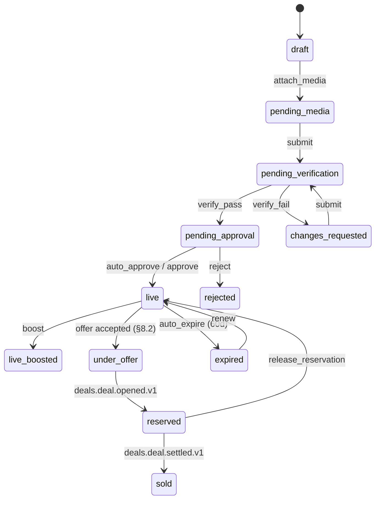

# Module 10 — Vehicle Marketplace, Sell Flow, C2C Escrow, Requirement Board

> Covers PRD modules 1 (Buy), 2 (Sell), 4 (Search & Discovery), 8 (Requirement Board).
> Owning projects: `AutoHub.Modules.Listings` (primary), `AutoHub.Modules.Catalog` (media pipeline),
> `AutoHub.Modules.Search` (index + query). Schemas: `listings.*`, `catalog.*` (media), OpenSearch.
>
> Derives from `00-north-star.md`, `01-design-system.md`, `02-domain-model.md`, `03-data-model-erd.md`,
> `04-api-contract.md`. Where those files already defined a table, a column or an error code, this
> document **extends** it and never redefines it. New DDL in here follows §2 conventions of 03.

---

## 0. What this module is, in one paragraph

A listing is not a page. It is an **offer of a specific transaction shape over a canonical vehicle**,
carrying a workflow instance, a pinned form version, a pinned pricing context, a media set, a
quality score, and a search projection. Buy, Sell and Search are three read/write faces of the same
row. Everything that a business person could change — which fields a seller fills, which states a
listing passes through, what a boost costs, which attribute becomes a filter — is registry data.
The only things this module hardcodes are the transport (HTTP codes, S3 keys, OpenSearch field
naming convention) and the arithmetic.

**The hard number that shapes every decision below:** a used-car seller in India abandons a sell
flow at roughly 55–65% between "entered plate" and "published". Every state, timer and nudge in §4
exists to reclaim a slice of that.

---

## 1. Bounded responsibilities

| Concern | Owner | This module's relationship |
|---|---|---|
| Vehicle identity, VIN/RC, VAHAN sync, dedupe | Catalog | Reads `catalog.v_vehicle_summary`; never writes `catalog.vehicles` |
| Media bytes, virus scan, pHash, variants | Catalog (`catalog.vehicle_media`) | Attaches media to a listing via `listing_id`; consumes `catalog.media.*` events |
| Price band / market value | Valuation | Guard input only (`price_out_of_band`), never a source of truth |
| Escrow, ledger, invoice, payout | Payments + Deals | Listings **never** posts a ledger row. It raises deal lines. |
| Chat threads, message masking | Chat | Listings creates the thread by contract; masking policy is Chat's |
| Appointment slots | Bookings | Listings creates a booking request; Bookings owns the `EXCLUDE` constraint |
| Auction lots, bids, anti-snipe | Auction | Listings hands over a `listing_intent` of type `auction`; gets `auction.lot.won.v1` back |
| Dealer inventory, CRM, subscription | Dealer | Requirement Board tables live here (`listings.requirements`) but route under `/dealer/*` — see §9.0 |

---

## 2. The four seller paths at a glance

```
                       ┌────────────────────────────────┐
                       │  PLATE / MANUAL ENTRY (hero)   │
                       │  → valuation quote, no login   │
                       └───────────────┬────────────────┘
                                       │  create draft
                       ┌───────────────▼────────────────┐
                       │  SELL FORM  (Form Schema Reg.)  │
                       │  steps compiled per category    │
                       └───────────────┬────────────────┘
                                       │  choose path (feature-flagged per city/tier)
        ┌──────────────┬───────────────┼────────────────┬──────────────────┐
        ▼              ▼               ▼                ▼                  │
  SELL DIRECT    DEALER AUCTION   INSTANT OFFER   INSPECTION FIRST         │
  list to        sealed/live      algorithmic     inspect, then            │
  buyers, C2C    dealer bidding   buy-now price   choose any path above    │
        │              │               │                │                  │
        └──────────────┴───────────────┴────────────────┴──────────────────┘
                                       │
                                 ┌─────▼──────┐
                                 │   DEAL     │  ← one escrow, one commission engine
                                 └────────────┘
```

All four are **one `listing` workflow definition**. The path is chosen at `submit` and lives in
`platform.workflow_instances.context.path_code`. Guards branch on it. Adding a fifth path
("Bank Repo Consignment") is a `platform.codes` row in set `seller_path`, a handful of
`workflow_transitions` rows, and a `flag_rules` row. No deploy.

> **Why one machine and not four?** Four machines means four `listings.state_code` vocabularies,
> four `StatusPill` mappings, four analytics funnels, and a migration whenever a seller switches
> path mid-flow (which they do — see §4.9). One machine with unreachable-by-guard states costs
> nothing at runtime and keeps `WorkflowTimeline` universal.

---

## 3. Sell flow — rendered entirely from the Form Schema Registry

### 3.1 The entry point is the plate (design system §5)

`POST /api/v1/valuation/quotes` with `{ "registration_number": "MH12AB1234" }` — anonymous, no OTP.
Catalog resolves identity via VAHAN (Integration registry capability `vahan.rc`), Valuation returns
a band, and the odometer roll fires once. Only when the seller taps **List this car** do we ask for
a phone number. The draft is created *before* auth using an anonymous `draft_token` (HMAC, 24 h)
and is claimed on OTP success. This is worth ~9 points of funnel and costs one table:

```sql
CREATE TABLE listings.listing_drafts (
    id              uuid PRIMARY KEY DEFAULT platform.uuid_generate_v7(),
    draft_token_hash platform.sha256_hex,          -- anonymous claim; NULL once claimed
    owner_party_id  uuid REFERENCES identity.parties(id),
    listing_id      uuid REFERENCES listings.listings(id),   -- set on first materialisation
    category_id     uuid NOT NULL REFERENCES platform.categories(id),
    form_version_id uuid NOT NULL REFERENCES platform.form_versions(id),
    path_code       platform.code_key,             -- 'sell_direct'|'dealer_auction'|'instant_offer'|'inspection_first'
    payload         platform.jsonb_object NOT NULL DEFAULT '{}',   -- exactly the form's data shape
    completed_steps platform.code_key[] NOT NULL DEFAULT '{}',
    last_step_code  platform.code_key,
    valuation_quote_id uuid,
    source_channel  platform.code_key NOT NULL DEFAULT 'web',
    expires_at      timestamptz NOT NULL DEFAULT now() + interval '90 days',
    created_at timestamptz NOT NULL DEFAULT now(), created_by uuid,
    updated_at timestamptz NOT NULL DEFAULT now(), updated_by uuid,
    row_version bigint NOT NULL DEFAULT 1
);
CREATE INDEX ix_listing_drafts__owner ON listings.listing_drafts (owner_party_id, updated_at DESC);
CREATE INDEX ix_listing_drafts__abandoned ON listings.listing_drafts (updated_at)
    WHERE listing_id IS NULL;                       -- feeds the resume-nudge job
```

Endpoints (additive to 04 §9.4):

| Method | Path | Perm | Notes |
|---|---|---|---|
| POST | `/listings/drafts` | anon | Returns `draft_token` + resolved `form_schema_key` |
| PATCH | `/listings/drafts/{id}` | token/self | Autosave, merge-patch, `If-Match` on `row_version` |
| POST | `/listings/drafts/{id}/claim` | user | Binds an anonymous draft to the authenticated party |
| POST | `/listings/drafts/{id}/materialise` | `listings.listing.create` | Creates the `listings.listings` row in `draft` state |

### 3.2 How the client gets the right form (nothing is bundled)

```
Client                          API                     Platform registry
  │  GET /platform/forms/listing.sell.vehicle
  │      ?category_id=…&city_id=…&channel=android
  │─────────────────────────►│
  │                          │ resolve platform.form_assignments
  │                          │   ORDER BY priority ASC, specificity DESC
  │                          │   (category_id, city_id, party_kind_code, channel_code, audience JsonLogic)
  │                          │─────────────────────►│
  │                          │◄─── form_version_id, schema, ui_schema, layout, checksum
  │◄── 200 + ETag: "sha256…" │
  │    Cache-Control: private, max-age=300, stale-while-revalidate=86400
```

`meta.registry_versions.form` is echoed on every listings response (04 §2.3). When the epoch moves,
the client refetches on the next idle tick — never mid-form.

### 3.3 The schema is **compiled**, not hand-written

An admin editing the sell form in the registry UI edits *sections and field references*. A
**form compiler** (in `AutoHub.Platform`) resolves each reference against
`platform.attribute_definitions` for the target `category_id` and emits the JSON Schema stored in
`platform.form_versions.schema`. Consequences:

- Adding `boom_length` to `CONSTRUCTION_EQUIPMENT` and marking it `is_required` puts it in the sell
  form automatically on the next publish — the admin does not retype validation rules.
- `attribute_definitions.validation` (`{"min":0,"max":60,"step":0.5}`) becomes JSON Schema
  keywords. One source of truth for client Zod, server FluentValidation, and the OpenSearch range facet.
- `checksum` is `sha256(canonical_json(schema) || canonical_json(ui_schema) || canonical_json(layout))`.
  The client sends `form_schema_version`; the server also verifies checksum on high-risk forms.

### 3.4 The actual JSON Schema — `listing.sell.vehicle` v7 (abridged to one of each kind)

```jsonc
{
  "$schema": "https://json-schema.org/draft/2020-12/schema",
  "$id": "https://schemas.autohub.in/forms/listing.sell.vehicle/7",
  "type": "object",
  "required": ["vehicle", "commercial", "location", "seller_declaration"],
  "properties": {
    "vehicle": {
      "type": "object",
      "required": ["category_id", "registration_number", "make_id", "model_id",
                   "variant_id", "manufacture_year", "odometer_km", "owner_serial"],
      "properties": {
        "category_id":         { "type": "string", "format": "uuid",
                                 "x-taxonomy": { "source": "categories", "filter": { "allowed_intent_codes": ["sale"] } } },
        "registration_number": { "type": "string", "minLength": 4, "maxLength": 14,
                                 "x-plate-format-set": true,
                                 "description.i18n": "form.sell.reg_no.help" },
        "vin":                 { "type": "string", "pattern": "^[A-HJ-NPR-Z0-9]{17}$" },
        "make_id":             { "type": "string", "format": "uuid", "x-taxonomy": { "source": "makes", "dependsOn": "/vehicle/category_id" } },
        "model_id":            { "type": "string", "format": "uuid", "x-taxonomy": { "source": "models", "dependsOn": "/vehicle/make_id" } },
        "variant_id":          { "type": "string", "format": "uuid", "x-taxonomy": { "source": "variants", "dependsOn": "/vehicle/model_id" } },
        "manufacture_year":    { "type": "integer", "minimum": 1985, "maximum": 2026 },
        "registration_year":   { "type": "integer", "minimum": 1985, "maximum": 2026 },
        "rto_office_code":     { "type": "string", "x-geo": { "source": "rto_offices", "dependsOn": "/vehicle/registration_number" } },
        "odometer_km":         { "type": "integer", "minimum": 0, "maximum": 1500000, "x-unit": "km" },
        "owner_serial":        { "type": "integer", "minimum": 1, "maximum": 15,
                                 "description.i18n": "form.sell.owner_serial.help" },
        "attributes":          { "$ref": "#/$defs/attributes_by_category" }
      }
    },

    "commercial": {
      "type": "object",
      "required": ["ask_price_paise", "is_negotiable"],
      "properties": {
        "ask_price_paise":  { "type": "integer", "minimum": 100000, "maximum": 500000000000,
                              "x-money": { "currency": "INR", "input": "rupees", "transform": "paise_from_rupees" } },
        "is_negotiable":    { "type": "boolean", "default": true },
        "accepts_exchange": { "type": "boolean", "default": false },
        "finance_assist":   { "type": "boolean", "default": true },
        "reason_for_sale":  { "type": "string", "x-code-set": "sell_reason" }
      }
    },

    "documents": {
      "type": "object",
      "properties": {
        "rc_document_id":         { "type": "string", "format": "uuid", "x-document-type": "rc" },
        "insurance_document_id":  { "type": "string", "format": "uuid", "x-document-type": "insurance_policy" },
        "insurance_valid_till":   { "type": "string", "format": "date" },
        "insurance_type":         { "type": "string", "x-code-set": "insurance_cover_type" },
        "puc_valid_till":         { "type": "string", "format": "date" },
        "has_hypothecation":      { "type": "boolean", "default": false },
        "financier_name":         { "type": "string", "maxLength": 120 },
        "loan_outstanding_paise": { "type": "integer", "minimum": 0 },
        "noc_available":          { "type": "boolean" }
      },
      "allOf": [
        { "if":   { "properties": { "has_hypothecation": { "const": true } }, "required": ["has_hypothecation"] },
          "then": { "required": ["financier_name", "loan_outstanding_paise", "noc_available"] } }
      ]
    },

    "media": {
      "type": "object",
      "required": ["photos"],
      "properties": {
        "photos": {
          "type": "array", "minItems": 6, "maxItems": 40,
          "items": { "type": "object", "required": ["media_id", "slot_code"],
                     "properties": { "media_id": { "type": "string", "format": "uuid" },
                                     "slot_code": { "type": "string", "x-code-set": "media_slot" } } },
          "x-required-slots": ["front_left", "rear_right", "interior_front", "odometer", "engine_bay", "vin_plate"]
        },
        "walkaround_video_id": { "type": "string", "format": "uuid" }
      }
    },

    "location": {
      "type": "object", "required": ["pincode"],
      "properties": {
        "pincode":  { "type": "string", "pattern": "^[1-9][0-9]{5}$", "x-geo": { "source": "pincodes" } },
        "city_id":  { "type": "string", "format": "uuid", "x-geo": { "source": "cities", "derivedFrom": "/location/pincode" } },
        "lat":      { "type": "number", "minimum": 6.0,  "maximum": 37.6 },
        "lng":      { "type": "number", "minimum": 68.0, "maximum": 97.5 }
      }
    },

    "seller_declaration": {
      "type": "object",
      "required": ["is_owner", "no_pending_challan_hidden", "consent_purpose_codes"],
      "properties": {
        "is_owner":                  { "const": true },
        "no_pending_challan_hidden": { "const": true },
        "is_accidental":             { "type": "boolean" },
        "is_flood_damaged":          { "type": "boolean" },
        "consent_purpose_codes":     { "type": "array", "items": { "type": "string" },
                                       "contains": { "const": "listing_publication" },
                                       "x-dpdp-consent": true }
      }
    }
  },

  "$defs": {
    "attributes_by_category": {
      "type": "object",
      "allOf": [
        { "if":   { "$data": "/vehicle/category_id", "x-category-path": "vehicle.four_wheeler" },
          "then": { "$ref": "#/$defs/attrs_four_wheeler" } },
        { "if":   { "$data": "/vehicle/category_id", "x-category-path": "vehicle.two_wheeler" },
          "then": { "$ref": "#/$defs/attrs_two_wheeler" } },
        { "if":   { "$data": "/vehicle/category_id", "x-category-path": "vehicle.commercial" },
          "then": { "$ref": "#/$defs/attrs_commercial" } },
        { "if":   { "$data": "/vehicle/category_id", "x-category-path": "vehicle.construction_equipment" },
          "then": { "$ref": "#/$defs/attrs_construction" } }
      ]
    },

    "attrs_four_wheeler": {
      "required": ["fuel_type", "transmission", "colour"],
      "properties": {
        "fuel_type":      { "type": "string", "x-attribute": "fuel_type",     "x-options-from": "attribute_options" },
        "transmission":   { "type": "string", "x-attribute": "transmission",  "x-options-from": "attribute_options" },
        "colour":         { "type": "string", "x-attribute": "colour",        "x-options-from": "attribute_options" },
        "seating_capacity": { "type": "integer", "minimum": 2, "maximum": 10, "x-attribute": "seating_capacity" },
        "features":       { "type": "array", "items": { "type": "string" }, "uniqueItems": true, "x-attribute": "features" },
        "cng_kit_fitted": { "type": "boolean", "x-attribute": "cng_kit_fitted" },
        "cng_kit_endorsed_on_rc": { "type": "boolean", "x-attribute": "cng_kit_endorsed_on_rc" },
        "battery_health_percent": { "type": "integer", "minimum": 0, "maximum": 100, "x-attribute": "battery_health_percent" }
      },
      "allOf": [
        { "if":   { "properties": { "fuel_type": { "enum": ["cng", "petrol_cng"] } } },
          "then": { "required": ["cng_kit_fitted", "cng_kit_endorsed_on_rc"] } },
        { "if":   { "properties": { "fuel_type": { "const": "electric" } } },
          "then": { "required": ["battery_health_percent"] } }
      ]
    },

    "attrs_two_wheeler": {
      "required": ["engine_cc", "colour"],
      "properties": {
        "engine_cc":      { "type": "integer", "minimum": 45, "maximum": 2500, "x-attribute": "engine_cc" },
        "colour":         { "type": "string",  "x-attribute": "colour" },
        "start_type":     { "type": "string",  "x-attribute": "start_type" },
        "abs_type":       { "type": "string",  "x-attribute": "abs_type" }
      }
    },

    "attrs_commercial": {
      "required": ["gvw_kg", "permit_type", "body_type", "permit_valid_till"],
      "properties": {
        "gvw_kg":            { "type": "integer", "minimum": 300, "maximum": 60000, "x-attribute": "gvw_kg", "x-unit": "kg" },
        "payload_kg":        { "type": "integer", "minimum": 0, "x-attribute": "payload_kg" },
        "permit_type":       { "type": "string",  "x-attribute": "permit_type" },      // national|state|contract_carriage|goods
        "permit_valid_till": { "type": "string", "format": "date", "x-attribute": "permit_valid_till" },
        "fitness_valid_till":{ "type": "string", "format": "date", "x-attribute": "fitness_valid_till" },
        "body_type":         { "type": "string",  "x-attribute": "body_type" },
        "axle_configuration":{ "type": "string",  "x-attribute": "axle_configuration" },
        "tyre_condition_percent": { "type": "integer", "minimum": 0, "maximum": 100, "x-attribute": "tyre_condition_percent" }
      }
    },

    "attrs_construction": {
      "required": ["operating_hours", "boom_length"],
      "properties": {
        "operating_hours": { "type": "integer", "minimum": 0, "maximum": 200000, "x-attribute": "operating_hours", "x-unit": "hour" },
        "boom_length":     { "type": "number", "minimum": 0, "maximum": 60, "multipleOf": 0.5, "x-attribute": "boom_length", "x-unit": "metre" },
        "lifting_capacity_tonnes": { "type": "number", "minimum": 0, "x-attribute": "lifting_capacity_tonnes" }
      }
    }
  }
}
```

**`x-*` keywords are the compiler's output, not client logic.** `packages/forms` treats every `x-`
keyword as a lookup instruction against a registry endpoint. It never contains a list of fuel types.
`$data` + `x-category-path` is resolved by the renderer against the taxonomy `ltree` path so
`vehicle.four_wheeler.suv` matches the `vehicle.four_wheeler` branch — subcategories inherit.

### 3.5 UI schema (control hints, order, conditional display)

```jsonc
{
  "ui:order": ["vehicle", "commercial", "documents", "media", "location", "seller_declaration"],
  "vehicle": {
    "registration_number": {
      "ui:control": "plate-input",            // the PlateBlock as an input — design system §5
      "ui:autoFocus": true,
      "ui:mask": "plate-format-registry",
      "ui:onBlur": [{ "action": "lookup", "capability": "vahan.rc", "target": "/vehicle" }],
      "ui:helpTone": "instrument"
    },
    "vin":               { "ui:control": "text", "ui:font": "data", "ui:transform": "upper",
                           "ui:visibleWhen": { "==": [{ "var": "vehicle.rc_lookup_status" }, "manual"] } },
    "make_id":           { "ui:control": "combobox", "ui:sortBy": "popularity_rank", "ui:pinTop": 8 },
    "model_id":          { "ui:control": "combobox", "ui:disabledUntil": "/vehicle/make_id" },
    "variant_id":        { "ui:control": "combobox", "ui:disabledUntil": "/vehicle/model_id",
                           "ui:emptyState.i18n": "form.sell.variant.empty" },
    "odometer_km":       { "ui:control": "number", "ui:font": "data", "ui:suffix.i18n": "unit.km",
                           "ui:groupSeparator": "en-IN" },
    "owner_serial":      { "ui:control": "segmented", "ui:options": [1,2,3,"4+"] },
    "attributes": {
      "features":        { "ui:control": "chip-multiselect", "ui:columns": 2 },
      "battery_health_percent": { "ui:control": "slider", "ui:step": 1,
                                  "ui:visibleWhen": { "==": [{ "var": "vehicle.attributes.fuel_type" }, "electric"] } }
    }
  },
  "commercial": {
    "ask_price_paise": {
      "ui:control": "money", "ui:locale": "en-IN", "ui:renderer": "MoneyValue",
      "ui:sideCar": { "type": "valuation-band", "source": "/valuation/quotes/{{valuation_quote_id}}" },
      "ui:warnWhen": { "or": [ { "<": [{ "var": "commercial.ask_price_paise" }, { "var": "$ctx.band_min_paise" }] },
                               { ">": [{ "var": "commercial.ask_price_paise" }, { "var": "$ctx.band_max_paise" }] } ] },
      "ui:warn.i18n": "form.sell.price.out_of_band"
    }
  },
  "documents": {
    "financier_name":         { "ui:visibleWhen": { "==": [{ "var": "documents.has_hypothecation" }, true] } },
    "loan_outstanding_paise": { "ui:visibleWhen": { "==": [{ "var": "documents.has_hypothecation" }, true] },
                                "ui:control": "money" },
    "noc_available":          { "ui:visibleWhen": { "==": [{ "var": "documents.has_hypothecation" }, true] },
                                "ui:help.i18n": "form.sell.noc.help" }
  },
  "media": {
    "photos": { "ui:control": "slot-grid", "ui:slotsFrom": "code_set:media_slot",
                "ui:capture": { "guide_overlay": true, "min_resolution": [1280, 720] },
                "ui:uploadVia": "upload-intents" }
  },
  "seller_declaration": {
    "consent_purpose_codes": { "ui:control": "consent-block", "ui:source": "trust.consent_purposes" }
  }
}
```

### 3.6 Layout (steps) — and why steps are data

```jsonc
{
  "type": "stepper",
  "persistence": "autosave",
  "steps": [
    { "code": "identify", "i18n": "form.sell.step.identify", "fields": ["/vehicle/registration_number", "/vehicle/category_id",
      "/vehicle/make_id", "/vehicle/model_id", "/vehicle/variant_id", "/vehicle/manufacture_year"],
      "exitEvent": "sell.step.identify_completed" },
    { "code": "condition", "i18n": "form.sell.step.condition", "fields": ["/vehicle/odometer_km", "/vehicle/owner_serial", "/vehicle/attributes"] },
    { "code": "documents", "i18n": "form.sell.step.documents", "fields": ["/documents"],
      "skippableWhen": { "==": [{ "var": "$ctx.path_code" }, "instant_offer"] } },
    { "code": "photos",   "i18n": "form.sell.step.photos",   "fields": ["/media"] },
    { "code": "price",    "i18n": "form.sell.step.price",    "fields": ["/commercial"],
      "hiddenWhen": { "in": [{ "var": "$ctx.path_code" }, ["dealer_auction", "instant_offer"]] } },
    { "code": "publish",  "i18n": "form.sell.step.publish",  "fields": ["/location", "/seller_declaration"] }
  ]
}
```

The `price` step disappears for auction and instant-offer sellers because in those paths the price
is discovered, not declared. That is a layout row, not an `if (path == "auction")` in a React component.

### 3.7 `form_bindings` — where each field actually lands

| `json_pointer` | `target_kind` | target | `transform` | `is_write_once` |
|---|---|---|---|---|
| `/vehicle/registration_number` | column | `catalog.vehicle_identities.value` (`identity_type='registration'`) | `strip_non_alnum_upper` | true |
| `/vehicle/vin` | column | `catalog.vehicle_identities.value` (`identity_type='vin'`) | `upper` | true |
| `/vehicle/make_id` | column | `catalog.vehicles.make_id` | – | false |
| `/vehicle/odometer_km` | column | `catalog.vehicles.odometer_km` | – | false |
| `/vehicle/owner_serial` | column | `catalog.vehicles.owner_serial` | – | false |
| `/vehicle/attributes/fuel_type` | attribute | `attribute_definitions.code='fuel_type'` | – | false |
| `/vehicle/attributes/boom_length` | attribute | `attribute_definitions.code='boom_length'` | – | false |
| `/commercial/ask_price_paise` | column | `listings.listing_intents.ask_price_paise` | `paise_from_rupees` | false |
| `/commercial/is_negotiable` | column | `listings.listing_intents.is_negotiable` | – | false |
| `/documents/rc_document_id` | document | `document_types.code='rc'` | – | false |
| `/documents/has_hypothecation` | column | `catalog.vehicle_encumbrances` (upsert `type_key='HYPOTHECATION'`) | – | false |
| `/location/pincode` | column | `listings.listings.pincode` | – | false |
| `/seller_declaration/consent_purpose_codes` | document | `trust.consents` | – | true |
| `/media/photos` | transient | handled by media pipeline (§5) | – | – |

Write-once bindings are how a seller cannot silently change the VIN after publish. Attempting it
returns `422 platform.form.field_immutable` with the pointer.

### 3.8 Validation parity

One schema, three executions:

| Where | Engine | Notes |
|---|---|---|
| Client (web) | `zod` compiled from JSON Schema at render time by `packages/forms` | Instant field errors |
| Client (Flutter) | `json_schema` package, same document | Offline drafts validate identically |
| Server | `AutoHub.Platform.Forms.SchemaValidator` (JsonSchema.Net) | **Authoritative.** Runs before any handler |

`422` bodies use RFC 9457 with `errors[]` entries carrying `pointer` (RFC 6901), `code`, and
`params`, so the renderer highlights the exact control it drew. There is no second, hand-written
validator anywhere in the request path — the north star's ban on hardcoding applies to validation
logic too.

**Server-only guards that cannot live in JSON Schema** (they need I/O) run after schema validation
as rule sets in `platform.rule_sets` with `domain='guard'`:

| rule set `code` | Checks | Failure code |
|---|---|---|
| `sell_price_band` | ask price within `[band_min, band_max]` from Valuation | `listings.listing.price_out_of_band` |
| `sell_media_minimum` | required slots present, all `moderation_state='approved'` | `listings.listing.media_minimum_not_met` |
| `sell_vehicle_eligible` | `rc_status ∉ (SCRAPPED, BLACKLISTED)`, age ≤ registry max | `listings.listing.vehicle_ineligible` |
| `sell_seller_kyc` | `kyc_level >= intent_types.requires_kyc_level` | `identity.kyc.level_insufficient` |
| `sell_duplicate_active` | no other active listing of this intent on this vehicle | `listings.listing.duplicate_active` |
| `sell_intent_enabled` | Feature registry flag `sell.path.{path_code}` for city × party kind | `listings.listing.intent_not_enabled` |

---

## 4. The four seller paths as workflow registry data

### 4.1 The `listing` machine — `platform.workflow_states`

Extends the abbreviated seed in `03 §3.4`. Every code below is a row; none is an enum.

| `code` | `kind_code` | `pub_visible` | `editable` | `holds_resource` | `counts_as_open` | `sla_minutes` | `ui.tone` / `ui.pill` |
|---|---|---|---|---|---|---|---|
| `draft` | initial | false | true | false | true | – | info / DRAFT |
| `pending_media` | active | false | true | false | true | 2880 | caution / PHOTOS PENDING |
| `pending_documents` | active | false | true | false | true | 4320 | caution / DOCS PENDING |
| `pending_verification` | waiting | false | false | false | true | 120 | info / VERIFYING |
| `pending_approval` | waiting | false | false | false | true | 240 | caution / IN REVIEW |
| `changes_requested` | waiting | false | true | false | true | 4320 | caution / ACTION NEEDED |
| `live` | active | **true** | true | false | true | – | clear / LIVE |
| `live_boosted` | active | **true** | true | false | true | – | clear / FEATURED |
| `inspection_requested` | active | false | true | false | true | 60 | info / INSPECTION BOOKED |
| `inspection_scheduled` | waiting | false | true | true | true | – | info / INSPECTION BOOKED |
| `inspection_in_progress` | waiting | false | false | true | true | 240 | info / INSPECTING |
| `inspection_failed` | active | false | true | false | true | – | flag / INSPECTION FAILED |
| `auction_queued` | waiting | false | false | false | true | 1440 | info / AUCTION QUEUED |
| `in_auction` | active | **true** (dealers only) | false | true | true | – | clear / IN AUCTION |
| `auction_unsold` | active | false | true | false | true | – | caution / UNSOLD |
| `offer_pending` | waiting | true | false | false | true | 2880 | info / OFFER OPEN |
| `offer_expired` | active | false | true | false | true | – | caution / OFFER EXPIRED |
| `under_offer` | active | **true** | false | true | true | – | info / UNDER OFFER |
| `reserved` | active | false | false | true | true | 4320 | info / RESERVED |
| `paused_by_seller` | waiting | false | true | false | true | – | info / PAUSED |
| `paused_by_system` | waiting | false | false | false | true | – | caution / PAUSED |
| `sold` | terminal_success | false | false | false | false | – | clear / SOLD |
| `sold_offline` | terminal_success | false | false | false | false | – | clear / SOLD ELSEWHERE |
| `rejected` | terminal_failure | false | true | false | false | – | flag / REJECTED |
| `expired` | terminal_failure | false | true | false | false | – | flag / EXPIRED |
| `withdrawn` | terminal_cancelled | false | true | false | false | – | info / WITHDRAWN |
| `legal_hold` | waiting | false | false | true | true | – | flag / ON HOLD |

`entry_effects` examples (jsonb on the state row):

```jsonc
// state 'live'
[ { "type": "emit",   "event": "listings.listing.published.v1" },
  { "type": "invoke", "command": "search.index_listing" },
  { "type": "notify", "event_code": "listing.approved" },
  { "type": "timer",  "transition": "auto_expire", "in": "P60D" },
  { "type": "invoke", "command": "listings.match_requirements" } ]

// state 'in_auction'
[ { "type": "invoke", "command": "auction.create_lot_from_listing" },
  { "type": "emit",   "event": "listings.listing.reserved.v1" } ]

// state 'sold'
[ { "type": "invoke", "command": "search.remove_listing" },
  { "type": "notify", "event_code": "listing.sold.seller" },
  { "type": "invoke", "command": "listings.pause_sibling_intents" } ]
```

### 4.2 `platform.workflow_transitions` — the full seed

`ctx` = `workflow_instances.context`. Guards are `rule_sets` ids, shown by code.

| `code` | from → to | trigger | guard rule set | perm | auto | path applicability |
|---|---|---|---|---|---|---|
| `attach_media` | draft → pending_media | api | – | `listing.update` | ✓ | all |
| `submit` | draft, pending_media, pending_documents, changes_requested → pending_verification | manual | `sell_submit_ready` | `listing.submit` | – | all |
| `verify_pass` | pending_verification → pending_approval | event `catalog.vehicle.compliance_synced.v1` | `verify_no_high_risk_mismatch` | – | ✓ | all |
| `verify_fail` | pending_verification → changes_requested | event | – | – | ✓ | all |
| `auto_approve` | pending_approval → live | system | `moderation_auto_approve` | – | ✓ | `sell_direct` |
| `approve` | pending_approval → live | manual | – | `listing.approve` | – | `sell_direct` |
| `request_changes` | pending_approval → changes_requested | manual | – | `listing.approve` | – | all |
| `reject` | pending_approval → rejected | manual | – | `listing.approve` | – | all |
| `route_to_auction` | pending_approval → auction_queued | system | `path_is(dealer_auction)` | – | ✓ | `dealer_auction` |
| `open_auction` | auction_queued → in_auction | event `auction.auction.opened.v1` | `auction_lot_ready` | – | ✓ | `dealer_auction` |
| `auction_won` | in_auction → under_offer | event `auction.lot.won.v1` | – | – | ✓ | `dealer_auction` |
| `auction_unsold` | in_auction → auction_unsold | event `auction.lot.closed.v1` (`reserve_met=false`) | – | – | ✓ | `dealer_auction` |
| `relist_from_auction` | auction_unsold → auction_queued | manual | `relist_attempts_lt_max` | `listing.update` | – | `dealer_auction` |
| `switch_to_direct` | auction_unsold, offer_expired, inspection_failed → draft | manual | `path_switch_allowed` | `listing.update` | – | all |
| `make_instant_offer` | pending_approval → offer_pending | system | `path_is(instant_offer)` ∧ `instant_offer_priced` | – | ✓ | `instant_offer` |
| `accept_instant_offer` | offer_pending → under_offer | manual | `offer_not_expired` | `listing.accept_offer` | – | `instant_offer` |
| `expire_instant_offer` | offer_pending → offer_expired | timer (48 h) | – | – | ✓ | `instant_offer` |
| `request_inspection` | draft, pending_media, live → inspection_requested | manual | `inspection_available_in_pincode` | `listing.request_inspection` | – | all |
| `schedule_inspection` | inspection_requested → inspection_scheduled | event `bookings.booking.confirmed.v1` | – | – | ✓ | all |
| `start_inspection` | inspection_scheduled → inspection_in_progress | event | – | – | ✓ | all |
| `inspection_passed` | inspection_in_progress → pending_approval | event `inspection.inspection.completed.v1` (grade ≥ threshold) | – | – | ✓ | all |
| `inspection_failed` | inspection_in_progress → inspection_failed | event | – | – | ✓ | all |
| `boost` | live → live_boosted | api | `boost_payment_captured` | `listing.promote` | – | all |
| `boost_expired` | live_boosted → live | timer | – | – | ✓ | all |
| `reserve` | live, live_boosted, under_offer → reserved | event `deals.deal.opened.v1` | – | – | ✓ | all |
| `release_reservation` | reserved → live | event `deals.deal.state_changed.v1` (terminal_failure/cancelled) | – | – | ✓ | all |
| `mark_sold` | reserved, under_offer → sold | event `deals.deal.settled.v1` | – | – | ✓ | all |
| `mark_sold_offline` | *any non-terminal* → sold_offline | manual | – | `listing.update` | – | all |
| `pause` | live, live_boosted → paused_by_seller | manual | `no_open_deal` | `listing.update` | – | all |
| `resume` | paused_by_seller → live | manual | `not_expired` | `listing.update` | – | all |
| `system_pause` | *any* → paused_by_system | event `trust.party.blacklisted.v1` ∣ `catalog.vehicle.compliance_synced.v1` (adverse) | – | – | ✓ | all |
| `auto_expire` | live, live_boosted → expired | timer (60 d) | – | – | ✓ | all |
| `renew` | expired → live | api | `renew_payment_ok` ∧ `not_stale_beyond(P30D)` | `listing.update` | – | all |
| `withdraw` | *any non-terminal* → withdrawn | manual | `no_funds_held` | `listing.delete` | – | all |
| `place_on_legal_hold` | *any* → legal_hold | manual | – | `listing.legal_hold` | – | all |
| `release_legal_hold` | legal_hold → *previous* | manual | – | `listing.legal_hold` | – | all |

`from_state_id IS NULL` (the `*any*` rows) is exactly the mechanism 03 §3.4 describes — legal hold
was added later without editing 26 state rows.

### 4.3 Timers (`platform.workflow_timers` seeded by `entry_effects`)

| Timer | Set on entering | Fires | Transition |
|---|---|---|---|
| Draft nudge 1 | `pending_media` | +6 h | notify only (`listing.draft_nudge`) |
| Draft nudge 2 | `pending_media` | +48 h | notify only |
| Draft expiry | `pending_media` | +30 d | `withdraw` (auto, reason `abandoned`) |
| Moderation SLA | `pending_approval` | +4 h | `auto_approve` if `moderation_auto_approve` passes, else escalate to queue priority 1 |
| Instant-offer expiry | `offer_pending` | +48 h | `expire_instant_offer` |
| Auction queue SLA | `auction_queued` | +24 h | notify ops; listing stays queued |
| Listing expiry | `live` | +60 d | `auto_expire` |
| Boost expiry | `live_boosted` | +`boost.duration_days` | `boost_expired` |
| Reservation expiry | `reserved` | +72 h | `release_reservation` if deal has not funded |

**All durations are `workflow_states.entry_effects` / `sla_minutes` values.** "Give Pune sellers 90
days instead of 60" is a scoped workflow definition variant or a rule-driven timer value — never a
constant.

### 4.4 Path A — Sell Direct (C2C)



Median time to live: **11 minutes** if RC lookup succeeds and moderation auto-approves; **4 hours**
if it hits the human queue. Both numbers are SLA rows, and the moderation dashboard is fed by
`counts_as_open`.

### 4.5 Path B — Dealer Auction

Seller consigns; verified dealers bid. Listing visibility is `dealers_only`
(`listings.visibility_code`), so `is_publicly_visible=true` on `in_auction` is filtered a second
time at the search layer by an RBAC row filter — a consumer never sees an auction lot.

```
draft ─submit─► pending_verification ─verify_pass─► pending_approval
                                                          │ route_to_auction (guard: path_is(dealer_auction))
                                                          ▼
                                                    auction_queued ──open_auction──► in_auction
                                                          ▲                              │
                                        relist_from_auction│              auction_won ────┤──► under_offer ─► reserved ─► sold
                                                          │                              │
                                                    auction_unsold ◄───auction_unsold────┘
                                                          │ switch_to_direct
                                                          ▼
                                                        draft
```

- The seller sets `reserve_price_paise` on the `listing_intents` row. **Invariant L3 (02 §7.2):** it
  is never in a bidder-facing projection — the OpenSearch dealer index physically omits the field,
  and the read model is a different DTO, not a masked one.
- `relist_attempts_lt_max` guard: `ctx.relist_count < registry.thresholds['auction.max_relists']`
  (default 3). After that the seller must switch path or re-price.
- Auction mechanics — increments, anti-snipe, proxy bids, settlement — belong to the Auction module.
  This module's only contract is: hand over a `listing_intent_id`, receive `auction.lot.won.v1`.

### 4.6 Path C — Instant Offer

AutoHub (or a standing dealer-network buyer) quotes a firm, time-boxed price. This is the highest
conversion path and the highest inventory risk, so the guards are strict.

| Guard rule (`rule_sets.code = instant_offer_priced`) | Purpose |
|---|---|
| `valuation.confidence >= 0.82` | No firm offer on a thin model |
| `vehicle.age_years <= flags['instant_offer.max_age_years']` | Inventory policy |
| `odometer_km <= flags['instant_offer.max_km']` | " |
| `challan_total_paise <= flags['instant_offer.max_challan_paise']` | We inherit the liability |
| `encumbrance.open == false OR noc_available == true` | Cannot buy a hypothecated car without NOC |
| `rc_status == 'ACTIVE'` | |
| `city_id IN service_areas WHERE capability='instant_offer'` | Geography registry |

The offer amount is **not** the valuation. It is `valuation_point − haircut`, where the haircut is a
pricing-registry fee component:

| `fee_components.code` | method | basis | value | scope |
|---|---|---|---|---|
| `instant_offer_haircut` | slab_percent | `valuation_point` | 6% ≤ ₹3L · 5% ₹3–8L · 4% > ₹8L | – |
| `instant_offer_haircut` (Delhi NCR) | slab_percent | `valuation_point` | +1.5 pp on all slabs | `scope_city_id ∈ NCR`, priority 50 |
| `instant_offer_reconditioning_reserve` | flat | flat | ₹12,000 | `scope_category_id = four_wheeler` |
| `instant_offer_doc_handling` | flat | flat | ₹1,999 | – |

The offer is stored as a `listings.offers` row (§8.2) with `offer_kind='instant'`,
`expires_at = now() + 48h` and a signed `terms_snapshot` jsonb. Accepting it opens a `sale` deal
where the buyer party is the platform-designated buying entity — **the same deal spine, the same
escrow, the same invoice**. There is no "instant offer" table, no "instant offer" ledger.

`offer_pending` → `offer_expired` on the 48 h timer. Sellers who let it expire get one re-quote
(`ctx.requote_count < 1`); the second requote requires an inspection, because a stale valuation on a
firm-price purchase is how you buy a flood-damaged car.

### 4.7 Path D — Inspection First

```
draft ─request_inspection─► inspection_requested ─(bookings.booking.confirmed.v1)─► inspection_scheduled
      ─(inspector arrives)─► inspection_in_progress
            ├─ grade ≥ threshold ─► pending_approval ─► live | auction_queued | offer_pending
            └─ grade < threshold ─► inspection_failed ─► (switch_to_direct with disclosure flags forced)
```

- `inspection_available_in_pincode` reads `platform.service_areas` with capability
  `inspection.doorstep`. If none, the transition is offered but returns
  `422 inspection.booking.no_inspector_in_area` with the nearest three centres from Geography registry.
- Passing an inspection writes `verification_badges += 'inspected'` and feeds the quality score
  (§6.2). A 200-point report raises `quality_score` by the registry weight, which raises search
  ranking, which is the actual reason a seller pays ₹999.
- `inspection_failed` does **not** kill the listing. It forces disclosure: the failed checklist items
  become mandatory `is_accidental` / `is_flood_damaged` / `has_structural_damage` attribute values on
  the listing and are rendered on the detail page. Hiding them is the fraud we are preventing.

### 4.8 Path selection and switching

`path_code` is chosen on the `submit` transition via `confirm_form_version_id` pointing at a tiny
form (`listing.sell.path_choice`). Available paths are computed, not hardcoded:

```
available_paths = intent_types WHERE is_active
                ∩ categories.allowed_intent_codes
                ∩ feature_flags 'sell.path.*' evaluated for {city, party_kind, app_version}
                ∩ rule_set 'path_eligibility' per path
```

Switching is the `switch_to_direct` transition, which resets to `draft`, **retains all media,
attributes and documents**, and appends to `workflow_history` so the funnel report can measure
"auction → direct" leakage. `ctx.path_history[]` accumulates. What never happens is a listing being
deleted and recreated — that would break the vehicle's price history and the buyer's saved link.

---

## 5. Media pipeline

### 5.1 The stages

```
 client                      API                    S3/R2                 workers
   │  POST /listings/{id}/media/upload-intents
   │   {slots:[{slot_code, mime, size_bytes, sha256}]}
   │─────────────►│ quota + MIME + size check (Feature registry)
   │              │ create catalog.vehicle_media (moderation_state='pending')
   │◄─ presigned PUT (15 min) + media_id ─────────┐
   │                                              │
   │══ PUT bytes direct to object store ═════════►│
   │  POST /listings/{id}/media  {media_ids[]}    │
   │─────────────►│ HEAD object, verify size + sha256
   │              │ outbox → catalog.media.uploaded.v1
   │                                                        ┌──────────────────────────┐
   │                                                        │ S1 virus scan (ClamAV)   │
   │                                                        │ S2 decode + sanity       │
   │                                                        │ S3 EXIF strip + geo keep │
   │                                                        │ S4 pHash + dHash         │
   │                                                        │ S5 quality/blur score    │
   │                                                        │ S6 AI checks (§5.4)      │
   │                                                        │ S7 plate mask, face blur │
   │                                                        │ S8 background removal    │
   │                                                        │ S9 variants + blurhash   │
   │                                                        │ S10 CDN warm + publish   │
   │◄── SSE/socket media.processed ─────────────────────────└──────────────────────────┘
```

Stages S1–S10 are a single durable job with per-stage checkpointing:

```sql
CREATE TABLE catalog.media_pipeline_runs (
    id             uuid PRIMARY KEY DEFAULT platform.uuid_generate_v7(),
    media_id       uuid NOT NULL REFERENCES catalog.vehicle_media(id) ON DELETE CASCADE,
    pipeline_code  platform.code_key NOT NULL,      -- 'photo_v3','video_v1','document_scan_v2'
    stage_code     platform.code_key NOT NULL,      -- current stage
    stages_done    platform.code_key[] NOT NULL DEFAULT '{}',
    status_code    platform.code_key NOT NULL DEFAULT 'queued', -- queued|running|succeeded|failed|quarantined
    attempts       smallint NOT NULL DEFAULT 0,
    last_error_code platform.code_key,
    last_error     text,
    scores         jsonb NOT NULL DEFAULT '{}',     -- merged into vehicle_media.moderation_scores on success
    started_at     timestamptz, finished_at timestamptz,
    created_at timestamptz NOT NULL DEFAULT now(),
    updated_at timestamptz NOT NULL DEFAULT now(),
    row_version bigint NOT NULL DEFAULT 1,
    CONSTRAINT uq_media_pipeline_runs__media_pipeline UNIQUE (media_id, pipeline_code)
);

CREATE TABLE catalog.media_variants (
    id           uuid PRIMARY KEY DEFAULT platform.uuid_generate_v7(),
    media_id     uuid NOT NULL REFERENCES catalog.vehicle_media(id) ON DELETE CASCADE,
    variant_code platform.code_key NOT NULL,        -- 'thumb_160','card_480','detail_1280','zoom_2560','og_1200x630'
    format_code  platform.code_key NOT NULL,        -- 'avif','webp','jpeg'
    storage_key  text NOT NULL,
    width_px     integer NOT NULL, height_px integer NOT NULL,
    size_bytes   bigint NOT NULL,
    CONSTRAINT uq_media_variants UNIQUE (media_id, variant_code, format_code)
);

CREATE TABLE catalog.media_hashes (
    media_id     uuid PRIMARY KEY REFERENCES catalog.vehicle_media(id) ON DELETE CASCADE,
    phash        bit(64) NOT NULL,                  -- perceptual (DCT) hash
    dhash        bit(64) NOT NULL,                  -- difference hash, catches crops pHash misses
    embedding    vector(512),                       -- pgvector; CLIP-style, for near-dupe + "similar cars"
    computed_at  timestamptz NOT NULL DEFAULT now()
);
CREATE INDEX ix_media_hashes__phash ON catalog.media_hashes USING gist (phash gist_bit_ops);
CREATE INDEX ix_media_hashes__embedding ON catalog.media_hashes USING hnsw (embedding vector_cosine_ops);
```

### 5.2 Stage detail and failure behaviour

| # | Stage | Implementation | On failure |
|---|---|---|---|
| S1 | Virus scan | ClamAV daemon, stream from object store | `moderation_state='quarantined'`, object moved to `quarantine/` bucket prefix with 30-day lifecycle, `trust.fraud_signals` row, `422 listings.media.virus_detected` on the confirm call, seller told *"This file couldn't be accepted. Upload the photo again from your camera roll."* |
| S2 | Decode + sanity | `libvips`; reject > 40 MP, > 25 MB, animated payloads in still slots, polyglot files (magic bytes ≠ declared MIME) | `422 listings.media.format_unsupported` with the detected type |
| S3 | EXIF strip | Strip **all** EXIF/XMP/IPTC into `catalog.vehicle_media.captured_at` + `captured_geo` **before** writing the public object; public variants carry zero metadata | Non-fatal; `exif_stripped=false` blocks publish (checked by `sell_media_minimum`) |
| S4 | Perceptual hash | pHash (DCT 32→8) + dHash; store both | Non-fatal, but duplicate detection degrades to checksum only; flagged in `scores.degraded[]` |
| S5 | Quality score | Laplacian variance (blur), luminance histogram (under/over-exposure), edge density, resolution, subject-fill ratio | score < registry floor → `blurred` finding (§5.4) |
| S6 | AI checks | Model calls through Integration registry capabilities `vision.vehicle_classify`, `vision.damage_detect`, `ocr.plate`, `ocr.odometer` | See §5.4 |
| S7 | Plate mask / face blur | Plate box from `ocr.plate`; faces from a local detector. Masks the **public** variants; the original stays in a restricted bucket for moderation and dispute | Failure blocks publish only if `flags['media.mask_plate_required']` is true for the city |
| S8 | Background removal | Optional, dealer-tier only; produces `variant_code='studio_1280'` on a neutral `--ah-plate` background | Non-fatal; falls back to the original |
| S9 | Variants + blurhash | AVIF + WebP + JPEG at 5 widths; blurhash string for zero-CLS (design system §8) | Retry ×3; after that publish with the original and log |
| S10 | CDN warm | `PURGE` + prefetch the `card_480` variant for the first 6 slots | Non-fatal |

**Idempotency:** every stage keys its output on `(media_id, stage_code)`. A worker crash re-runs the
stage; re-running S3 on an already-stripped file is a no-op because `exif_stripped` is checked first.

**Ordering:** S7 must run after S6 (needs the plate box). S9 must run after S7 (masks must be baked
into variants, never applied client-side — a client-side mask is not a mask).

### 5.3 Perceptual-hash duplicate detection — the ladder

```
exact bytes      → sha256 equal
                   ├─ same vehicle  → 409 media.duplicate_photo (constraint, 03 §11)
                   └─ other vehicle → trust.fraud_signals 'media_reuse_cross_vehicle', severity by seller age

near-duplicate   → hamming(phash) ≤ 6  OR  hamming(dhash) ≤ 8
                   ├─ same seller, different listing, same model  → likely a genuine relist: soft warn
                   ├─ different seller                            → 'media_theft_suspected', listing → pending_approval
                   └─ stock/OEM press image (matched against a curated press-image hash set) → 'stock_image', hard block

semantic dupe    → cosine(embedding) ≥ 0.94 and different reg number
                   → moderation task, never auto-block (two silver Swifts genuinely look alike)
```

Thresholds `6`, `8`, `0.94` are `platform.rules` rows in rule set `media_duplicate_policy`, domain
`scoring`. Tightening them is an admin action.

### 5.4 The AI checks and what each failure does

`catalog.vehicle_media.moderation_scores` accumulates one key per check. `ai_labels` carries the
human-readable output.

| Check | Signal | Threshold source | Verdict | Effect |
|---|---|---|---|---|
| **Blurred / low quality** | Laplacian variance, resolution, exposure | `media_quality_policy.min_sharpness` | `soft_fail` | Photo accepted but excluded from the first 6 slots and from `is_primary`; seller sees *"This photo is soft. Retake it in daylight."*; contributes negatively to quality score |
| **Duplicate** | §5.3 ladder | `media_duplicate_policy` | `hard_fail` on cross-seller theft, `soft_fail` on relist | Hard: `moderation_state='rejected'`, listing cannot publish; `trust.fraud_signals` severity 3 |
| **Fake / not-a-vehicle** | `vision.vehicle_classify` confidence that the image contains the declared category | `media_content_policy.min_vehicle_confidence` (0.75) | `hard_fail` | Rejected with `listings.media.content_mismatch`. Screenshots, brochures, memes and adult content all land here |
| **Watermark / third-party branding** | Text detector + logo classifier | `media_content_policy.watermark_action` | `soft_fail` → `hard_fail` for competitor watermarks | Competitor-watermarked photos are rejected; dealer's own watermark is allowed if `dealer.watermark_registered` |
| **VIN mismatch** | `ocr.vin` on the `vin_plate` slot vs `catalog.vehicle_identities` (`identity_type='vin'`) | `media_identity_policy` | `mismatch` (not `fail`) | Withholds `vin_verified` badge; if the mismatch is ≥ 3 characters → listing routed to `pending_approval` with a human task and `trust.fraud_signals` `vin_photo_mismatch`. OCR on a stamped chassis plate in bad light is genuinely unreliable — we never auto-reject on it |
| **RC mismatch** | `ocr.rc` on the uploaded RC vs VAHAN snapshot: reg no, chassis, engine, owner name, fuel, make/model | `media_identity_policy.high_risk_fields` | field-dependent | High-risk field (chassis, engine, owner name, blacklist) mismatch → `pending_approval` + `rc_verified` withheld + fraud signal. Low-risk (colour, model spelling) → badge withheld only, listing continues. Exactly the rule from 03 §10.4 |
| **Odometer photo vs declared km** | `ocr.odometer` vs `/vehicle/odometer_km` | `media_identity_policy.odo_tolerance_percent` (2%) | `mismatch` | Declared km is corrected to the photographed value with `source_code='ocr'` and `confidence=0.7`; EAV precedence (02 §16.3) decides the winner. A **decrease** vs a prior recorded reading fires `odometer_rollback_suspected` immediately |
| **Damage detection** | `vision.damage_detect` → panel-level labels | – | informational | Populates `ai_labels.damage[]`; if `is_accidental=false` was declared but damage confidence > 0.8 on ≥ 2 panels, forces `pending_approval` with reason `undeclared_damage` |

**No AI check ever silently changes a price, and no AI check alone rejects a listing that a human
cannot appeal.** Every `hard_fail` writes a `listings.moderation_tasks` row with `appealable=true`.

### 5.5 CDN variants

| `variant_code` | Width | Used by | Format order |
|---|---|---|---|
| `thumb_160` | 160 | Chat cards, requirement matches, admin tables | avif → webp → jpeg |
| `card_480` | 480 | `VehicleCard` in search grid | avif → webp → jpeg |
| `detail_1280` | 1280 | Listing detail gallery | avif → webp → jpeg |
| `zoom_2560` | 2560 | Pinch-zoom, inspection evidence | webp → jpeg |
| `og_1200x630` | 1200×630 | WhatsApp/OG share card, plate + price burned in | jpeg only (WhatsApp ignores avif) |
| `studio_1280` | 1280 | Background-removed, dealer tier | webp |

Delivery: `https://cdn.autohub.in/m/{media_id}/{variant}.{ext}` with a 1-year immutable cache and
content-hash in the object key. `Accept` negotiation happens at the CDN edge, not in the app.

**The `og_1200x630` variant matters more than it looks.** Listings are shared on WhatsApp more than
anywhere else in India. Burning the `PlateBlock`, the `MoneyValue` (`₹8.4L`) and the city into the
OG image is the single highest-leverage growth surface this module has.

### 5.6 DPDP Act 2023 obligations in the pipeline

- EXIF GPS is personal data. It is stripped from every public variant and retained only on the
  restricted original, justified by the `fraud_prevention` purpose in `trust.consents`.
- Faces of bystanders are blurred by default; the seller cannot opt out for public variants.
- Registration plates in photos are masked when `flags['media.mask_plate_required']` is on for the
  city — some states treat a visible plate + location as re-identifying.
- On an erasure request (`trust.erasure_requests`), media objects are purged and
  `catalog.vehicle_media` rows are crypto-shredded, but `media_hashes.phash` is **retained** under
  the legal-obligation basis so a fraudster cannot launder a blocked photo by deleting the account.
  That retention is a `platform.pii_registry` row with an explicit basis, reviewed annually.

### 5.7 When the pipeline is down

| Broken | Behaviour | Listing state |
|---|---|---|
| Object store unavailable | `POST upload-intents` returns `503 media.upload_unavailable`; draft saves without media | stays `pending_media` |
| ClamAV down | Uploads accepted, S1 queued, media held `pending`; publish blocked | `pending_media` |
| Vision provider down | Integration registry fails over per `provider_routes`; if the whole capability is down, `moderation_scores.ai='unavailable'` and the listing routes to **human** `pending_approval` instead of `auto_approve` | `pending_approval` |
| Variant worker backlog > 10 min | Serve the original object through the CDN with a `?w=` resize at the edge; publish is not blocked | unchanged |
| CDN purge failing | Stale image for ≤ 1 h; acceptable, monitored | unchanged |

The invariant: **an integration outage never publishes something unverified and never fails a
seller's draft.** It stalls, and it tells the seller what it is waiting for.

---

## 6. Listing lifecycle, moderation, quality, ranking, promotion

### 6.1 Moderation queue

```sql
CREATE TABLE listings.moderation_tasks (
    id            uuid PRIMARY KEY DEFAULT platform.uuid_generate_v7(),
    listing_id    uuid NOT NULL REFERENCES listings.listings(id) ON DELETE CASCADE,
    queue_code    platform.code_key NOT NULL,       -- 'new_listing','media_flag','price_outlier','fraud_signal','appeal'
    priority      smallint NOT NULL DEFAULT 100,    -- lower = sooner
    reason_codes  platform.code_key[] NOT NULL DEFAULT '{}',
    evidence      jsonb NOT NULL DEFAULT '{}',      -- scores, matched media ids, mismatched fields
    assigned_to_user_id uuid,
    assigned_at   timestamptz,
    lease_until   timestamptz,                      -- soft lock so two moderators don't collide
    decision_code platform.code_key,                -- 'approve','request_changes','reject','escalate'
    decision_reason_code platform.code_key,
    decision_note text,
    decided_by    uuid, decided_at timestamptz,
    sla_due_at    timestamptz NOT NULL,
    appealable    boolean NOT NULL DEFAULT true,
    created_at timestamptz NOT NULL DEFAULT now(),
    updated_at timestamptz NOT NULL DEFAULT now(),
    row_version bigint NOT NULL DEFAULT 1
);
CREATE INDEX ix_moderation_tasks__queue ON listings.moderation_tasks (queue_code, priority, created_at)
    WHERE decided_at IS NULL;
CREATE INDEX ix_moderation_tasks__sla ON listings.moderation_tasks (sla_due_at) WHERE decided_at IS NULL;
```

- **Assignment** is pull-based with a 10-minute lease (`lease_until`), not push. A moderator claiming
  a task takes `FOR UPDATE SKIP LOCKED` on the highest-priority unleased row.
- **Auto-approve** (`moderation_auto_approve` rule set) fires when: seller `kyc_level ≥ 2`, seller has
  ≥ 1 prior settled deal with no dispute, all AI checks `pass`, price within band, and no fraud signal
  in 90 days. In steady state this should clear ~70% of listings. Every auto-approval still writes a
  `moderation_tasks` row with `decision_code='approve'`, `decided_by=NULL` — so the audit trail is
  identical and a policy change can be back-tested against real traffic.
- **Reason codes** come from `platform.code_sets` (`listing_rejection_reason`), so adding
  "Vehicle is under RTO seizure" is a data row that immediately appears in the moderator UI and in
  the seller's notification, in every locale.
- Moderator actions require `listing.approve` at city scope; `role_permissions.row_filter`
  `{"city_id":{"var":"scope.city_id"}}` means a Pune moderator's queue query is filtered in SQL, not
  in the UI.

### 6.2 Quality score

`listings.quality_score numeric(5,2)` is computed by rule set `listing_quality_v3`
(`domain='scoring'`), recomputed on every media/attribute/verification change, and snapshotted:

| Component | Weight | Definition |
|---|---|---|
| `completeness` | 25 | filled non-null bindings ÷ total bindings for the resolved form version |
| `media_count` | 15 | `min(approved_photos, 12) / 12` |
| `media_quality` | 10 | mean sharpness score of the first 6 slots |
| `required_slots` | 10 | fraction of `x-required-slots` present |
| `verification` | 20 | `rc_verified` 8 · `vin_verified` 4 · `inspected` 8 |
| `description` | 5 | length band + no contact info + no ALL CAPS |
| `price_realism` | 10 | 1 − normalised distance from the valuation band midpoint |
| `freshness` | 5 | decays from 1.0 at publish to 0 at 60 days |

```jsonc
// platform.rules row, rule_set 'listing_quality_v3'
{ "code": "verification_weights", "priority": 30,
  "condition": { "==": [1,1] },
  "outcome": { "weights": { "rc_verified": 8, "vin_verified": 4, "inspected": 8 } },
  "explain_i18n_key": "quality.verification.explain" }
```

The seller-facing UI renders this as a checklist ("Add 3 more photos → +7"), not a number, because
a raw score invites gaming. The number drives ranking.

### 6.3 Ranking and boost model

Search ordering is an OpenSearch `script_score` whose coefficients are registry rows
(`rule_set = 'listing_ranking_v4'`), fetched by the search service at query time from Redis:

```
score = w_relevance · text_relevance
      + w_quality   · (quality_score / 100)
      + w_freshness · exp(-λ · days_since_bump)
      + w_geo       · geo_decay(distance_km, scale = city_radius_km)
      + w_price_fit · price_fit(query_budget, ask_price)
      + w_seller    · seller_trust_score
      + boost_rank  · w_boost                       ← paid, capped
      − w_penalty   · (dup_signal + stale_signal + no_reply_signal)
```

| Coefficient | Default | Notes |
|---|---|---|
| `w_relevance` | 1.00 | 0 when the query has no text |
| `w_quality` | 0.85 | |
| `w_freshness` | 0.60, λ = 0.05/day | `days_since_bump` uses `last_bumped_at`, not `published_at` |
| `w_geo` | 0.90 | Gaussian decay, `scale` from `cities.metro_radius_km` |
| `w_price_fit` | 0.40 | Applied only when the user supplied a budget filter |
| `w_seller` | 0.35 | dealer rating × response rate × dispute rate |
| `w_boost` | 0.50 | **capped so a boosted low-quality listing never outranks an organic high-quality one by more than one page position** |
| `w_penalty` | 1.20 | |

**Two rules we enforce in code because they are integrity, not policy:**
1. Boost is additive and capped — never a multiplier, never a re-sort. Paid placement that can bury a
   better car destroys the search product within a quarter.
2. Boosted results carry `is_promoted: true` in the response and render a `FEATURED` `StatusPill`
   (design system §6). Undisclosed paid placement is an ASCI compliance problem, not just an ethics one.

**Anti-gaming:** `last_bumped_at` can only move forward once per `flags['listing.bump_cooldown_hours']`
(default 24) and at most `bump_quota` times per listing lifetime by tier. Attempting more returns
`429 listings.listing.bump_quota_exceeded`. Repricing by ±₹100 to fake freshness does not move
`last_bumped_at` — only a `renew`, a `boost`, or a price change ≥ 1% does.

### 6.4 Premium and featured placement — pricing registry rows

```sql
CREATE TABLE listings.listing_promotions (
    id             uuid PRIMARY KEY DEFAULT platform.uuid_generate_v7(),
    listing_id     uuid NOT NULL REFERENCES listings.listings(id) ON DELETE CASCADE,
    promotion_code platform.code_key NOT NULL,      -- matches fee_components.code
    deal_id        uuid,                            -- the SERVICE deal that paid for it
    boost_rank_delta smallint NOT NULL,
    placement_codes platform.code_key[] NOT NULL DEFAULT '{}',  -- 'search_top','home_spotlight','city_pin','similar_rail'
    starts_at      timestamptz NOT NULL,
    ends_at        timestamptz NOT NULL,
    state_code     platform.code_key NOT NULL,      -- workflow 'promotion' machine
    workflow_instance_id uuid NOT NULL REFERENCES platform.workflow_instances(id),
    pricing_snapshot jsonb NOT NULL,                -- frozen fee + tax, per 02 §20.5
    created_at timestamptz NOT NULL DEFAULT now(), created_by uuid,
    updated_at timestamptz NOT NULL DEFAULT now(), updated_by uuid,
    row_version bigint NOT NULL DEFAULT 1,
    CONSTRAINT ck_listing_promotions__window CHECK (ends_at > starts_at)
);
CREATE INDEX ix_listing_promotions__active ON listings.listing_promotions (listing_id, ends_at)
    WHERE state_code = 'active';
```

`platform.fee_components` rows (extending the seed in 03 §3.5):

| `code` | method | basis | amount | scope | payer | tax rule |
|---|---|---|---|---|---|---|
| `listing_boost_7d` | flat | flat | ₹499 | – | seller | `gst_services_18` |
| `listing_boost_15d` | flat | flat | ₹799 | – | seller | `gst_services_18` |
| `listing_feature_city_7d` | flat | flat | ₹1,499 | – | seller | `gst_services_18` |
| `listing_feature_city_7d` (Tier-3) | flat | flat | ₹899 | `scope_city_id ∈ tier_3`, priority 50 | seller | `gst_services_18` |
| `listing_home_spotlight_1d` | flat | flat | ₹2,999 | – | seller | `gst_services_18` |
| `listing_urgent_tag_3d` | flat | flat | ₹299 | – | seller | `gst_services_18` |
| `dealer_showroom_pin_30d` | flat | flat | ₹9,999 | `scope_party_tier='dealer_gold'` | seller | `gst_services_18` |
| `listing_renew_30d` | flat | flat | ₹0 (first) / ₹199 | via `rule_set 'renew_pricing'` | seller | `gst_services_18` |

Every promotion is a `SERVICE`-intent deal so it flows through the same escrow-free path, the same
GST invoice, the same ledger. **There is no "promotions payment" code path.** Payment failure means
the `boost` transition's guard `boost_payment_captured` never passes; the listing stays `live`.

Inventory control: `home_spotlight` has `flags['placement.home_spotlight.max_concurrent']` slots per
city per day. Overselling is prevented by a Redis token bucket claimed *before* the payment intent is
created, released on payment failure or expiry. Selling a slot that does not exist is the fastest way
to earn a refund and a support ticket.

### 6.5 Expiry, renewal, and the "is it still available?" problem

| Trigger | Effect |
|---|---|
| Day 45 | Notification `listing.expiring_soon` (WhatsApp → push → SMS ladder) |
| Day 55 | Second nudge with a suggested price cut from Valuation's current band |
| Day 60 | `auto_expire` timer fires; listing leaves search within 5 s (outbox → indexer) |
| Day 60 + 30 | Row soft-deleted from the search index entirely; still resolvable by URL with a `410`-style "This car is no longer listed" page (SEO: 410 Gone, not 404 — it removes the URL faster) |
| Any time | Seller taps *Still available?* in a WhatsApp nudge → `renew` transition, one tap, no form |

**The staleness problem is a marketplace's real quality metric.** A buyer enquiring on a sold car is
worse than no result. Three mitigations, all registry-tuned: the 60-day timer; a
`no_reply_signal` penalty when a seller ignores ≥ 3 enquiries in 7 days (auto `paused_by_system`
after `flags['listing.auto_pause_after_ignored_enquiries']`); and `mark_sold_offline` offered
prominently in every seller notification, because a seller who sold privately will happily tell us
if we make it one tap.

---

## 7. Search — OpenSearch over dynamic attributes

### 7.1 Index topology

| Index | Contents | Refresh | Consumers |
|---|---|---|---|
| `listings-public-v{n}` | `is_publicly_visible` sale/rental/lease/attachment listings | 1 s | Web, app, anon API |
| `listings-dealer-v{n}` | Auction lots + `dealers_only` visibility, includes fields consumers may not see (never `reserve_price_paise`) | 1 s | Dealer portal |
| `listings-archive-v{n}` | Sold/expired, 24 months | 30 s | Price history, valuation training, "similar sold" |
| `requirements-v{n}` | Dealer demand rows (§9) | 1 s | Matching engine |

Aliases `listings-public` → `listings-public-v{n}`. Reindex is blue/green: build `v{n+1}`, verify doc
count and a golden-query set, flip the alias atomically, keep `v{n}` for 48 h.

**Sharding:** one primary shard per ~25 GB, 1 replica. At launch scale (≤ 2 M listings) that is
3 primaries. Routing by `city_id` is deliberately **not** used — cross-city search ("Swift within
200 km of Pune") is common and routing would force a scatter anyway.

### 7.2 Mapping — the naming convention carries the type

```jsonc
PUT /listings-public-v1
{
  "settings": {
    "index": { "number_of_shards": 3, "number_of_replicas": 1, "max_result_window": 10000 },
    "analysis": {
      "filter": {
        "ah_synonyms":   { "type": "synonym_graph", "synonyms_path": "analysis/ah_vehicle_synonyms.txt", "updateable": true },
        "ah_indic_folding": { "type": "icu_folding" },
        "ah_edge":       { "type": "edge_ngram", "min_gram": 2, "max_gram": 12 }
      },
      "analyzer": {
        "ah_text_index":  { "tokenizer": "standard", "filter": ["lowercase", "ah_indic_folding", "asciifolding"] },
        "ah_text_search": { "tokenizer": "standard", "filter": ["lowercase", "ah_indic_folding", "asciifolding", "ah_synonyms"] },
        "ah_suggest":     { "tokenizer": "standard", "filter": ["lowercase", "asciifolding", "ah_edge"] },
        "ah_plate":       { "tokenizer": "keyword",  "filter": ["uppercase", "ah_strip_non_alnum"] }
      }
    }
  },
  "mappings": {
    "dynamic_templates": [
      { "attr_num": { "match": "attr_num_*", "mapping": { "type": "double" } } },
      { "attr_int": { "match": "attr_int_*", "mapping": { "type": "long"   } } },
      { "attr_kw":  { "match": "attr_kw_*",  "mapping": { "type": "keyword", "ignore_above": 256 } } },
      { "attr_bool":{ "match": "attr_bool_*","mapping": { "type": "boolean" } } },
      { "attr_dt":  { "match": "attr_dt_*",  "mapping": { "type": "date"   } } },
      { "attr_txt": { "match": "attr_txt_*", "mapping": { "type": "text", "analyzer": "ah_text_index",
                                                          "search_analyzer": "ah_text_search" } } }
    ],
    "properties": {
      "listing_id":   { "type": "keyword" },
      "public_ref":   { "type": "keyword" },
      "intent_type_code": { "type": "keyword" },
      "state_code":   { "type": "keyword" },
      "visibility_code": { "type": "keyword" },
      "title":        { "type": "text", "analyzer": "ah_text_index", "search_analyzer": "ah_text_search",
                        "fields": { "suggest": { "type": "text", "analyzer": "ah_suggest" } } },
      "description":  { "type": "text", "analyzer": "ah_text_index", "search_analyzer": "ah_text_search" },
      "registration_masked": { "type": "keyword" },          // 'MH12****34' — never the full plate
      "plate_search":  { "type": "text", "analyzer": "ah_plate" },  // seller-side lookup only, RBAC-gated
      "category_path": { "type": "keyword" },                 // 'vehicle.four_wheeler.suv' + ancestors, multi-valued
      "make_code":     { "type": "keyword" },
      "model_code":    { "type": "keyword" },
      "variant_code":  { "type": "keyword" },
      "manufacture_year": { "type": "short" },
      "ask_price_paise":  { "type": "long" },
      "rate_amount_paise":{ "type": "long" },
      "emi_from_paise":   { "type": "long" },
      "city_id":       { "type": "keyword" },
      "city_code":     { "type": "keyword" },
      "pincode":       { "type": "keyword" },
      "location":      { "type": "geo_point" },
      "quality_score": { "type": "half_float" },
      "boost_rank":    { "type": "short" },
      "seller_trust":  { "type": "half_float" },
      "verification_badges": { "type": "keyword" },
      "published_at":  { "type": "date" },
      "last_bumped_at":{ "type": "date" },
      "indexed_at":    { "type": "date" },
      "embedding":     { "type": "knn_vector", "dimension": 512,
                         "method": { "name": "hnsw", "space_type": "cosinesimil", "engine": "lucene" } },
      "facet_terms":   { "type": "keyword" }                  // flattened 'attr:value' pairs for cheap multi-facet AND
    }
  }
}
```

**Field-name derivation** (`AutoHub.Modules.Search.FieldNaming`, the one piece of naming logic in the
system, matching 02 §20.7):

| `attribute_definitions.data_type` | Field |
|---|---|
| `integer` | `attr_int_{code}` |
| `decimal`, `money` | `attr_num_{code}` |
| `string`, `enum` | `attr_kw_{code}` |
| `multi_enum` | `attr_kw_{code}` (array) |
| `boolean` | `attr_bool_{code}` |
| `date` | `attr_dt_{code}` |
| free text | `attr_txt_{code}` |
| geo | folded into `location` |

`attribute_definitions.opensearch_field` overrides the derivation when a legacy field name must be
kept. That column exists precisely so a rename never requires a reindex.

### 7.3 Facets are generated, never listed

```
GET /api/v1/search/facets?category_id=…&city_id=…

Server:
  1. read taxonomy registry: attribute_definitions
       WHERE entity_type='listing'
         AND (category_id = :cat OR category_id IS NULL OR category_id ∈ ancestors(:cat))
         AND is_facet = true AND is_active
       ORDER BY display_group, sort_order
  2. for each → build an aggregation:
       data_type enum/string/multi_enum → terms agg on attr_kw_{code}, size = 50
       data_type integer/decimal/money  → histogram or range agg using validation.min/max/step,
                                          or explicit buckets from attribute_options
       data_type boolean                → filters agg (true/false)
       data_type date                   → date_range agg from validation.buckets
  3. label each bucket via attribute_options.i18n_key → localization registry
  4. cache under reg:facet:{category}:{city}:{epoch}
```

Response gives the UI **everything it needs to draw the filter panel**, including control type,
order, group heading, and counts. `apps/web` has zero knowledge of what a facet is called.

```jsonc
{ "facets": [
    { "code": "fuel_type", "label": "Fuel", "control": "chip", "group": "engine", "sort_order": 10,
      "buckets": [ { "value": "petrol", "label": "Petrol", "count": 4821 },
                   { "value": "diesel", "label": "Diesel", "count": 3110 },
                   { "value": "cng",    "label": "CNG",    "count": 902 },
                   { "value": "electric","label": "Electric","count": 217 } ] },
    { "code": "boom_length", "label": "Boom length", "control": "range", "unit": "m",
      "group": "specifications", "sort_order": 40,
      "range": { "min": 0, "max": 60, "step": 0.5 },
      "buckets": [ { "from": 0, "to": 12, "count": 41 }, { "from": 12, "to": 18, "count": 87 } ] }
] }
```

### 7.4 A new attribute becomes a facet with zero code change

```
Admin action (registry UI)                     What happens automatically
──────────────────────────────────────────     ──────────────────────────────────────────────
1. INSERT platform.attribute_definitions       epoch 'taxonomy' bumps → every reg:* key rolls
   code='boom_length', category='CONSTRUCTION',
   data_type='decimal', unit='metre',
   is_facet=true, is_filterable=true,
   validation={"min":0,"max":60,"step":0.5}

2. Publish form version (compiler runs)        Sell form gains the field on web + Android + iOS
                                               on next form fetch. §3.3.

3. (nothing)                                   Indexer maps it to attr_num_boom_length via the
                                               dynamic template. No mapping PUT. No reindex.

4. (nothing)                                   /search/facets returns it in the "specifications"
                                               group with a range control and live counts.

5. (nothing)                                   Filter grammar accepts attr.boom_length[gte]=12
                                               because the parser validates against the registry,
                                               not against a static allow-list.

6. Optional: mark is_hot=true                  Generated column + btree in PostgreSQL (02 §16.4),
                                               a reviewed migration, for admin/reporting only.
```

Backfill for existing docs: the attribute simply does not exist on older documents. OpenSearch range
queries skip missing fields, so old listings drop out of a `boom_length` filter — which is correct,
because we genuinely do not know their boom length. The UI shows *"87 of 128 listings have this
detail"* rather than pretending.

### 7.5 Query construction and geo + relevance

```jsonc
POST /listings-public/_search
{
  "size": 24,
  "track_total_hits": 2000,
  "query": {
    "function_score": {
      "query": {
        "bool": {
          "filter": [
            { "term":  { "state_code": "live" } },
            { "terms": { "intent_type_code": ["sale"] } },
            { "term":  { "category_path": "vehicle.four_wheeler" } },
            { "range": { "ask_price_paise": { "lte": 90000000 } } },
            { "terms": { "attr_kw_fuel_type": ["petrol", "cng"] } },
            { "range": { "attr_int_km_driven": { "lte": 60000 } } },
            { "geo_distance": { "distance": "75km", "location": { "lat": 18.5204, "lon": 73.8567 } } }
          ],
          "must": [
            { "multi_match": {
                "query": "swift vxi",
                "type": "best_fields",
                "fields": ["title^4", "model_code^6", "variant_code^3", "description^1", "attr_txt_*"],
                "fuzziness": "AUTO:4,7",
                "prefix_length": 1 } }
          ],
          "should": [
            { "term": { "verification_badges": { "value": "inspected", "boost": 1.4 } } },
            { "knn":  { "embedding": { "vector": "…", "k": 100, "boost": 0.6 } } }
          ]
        }
      },
      "functions": [
        { "field_value_factor": { "field": "quality_score", "factor": 0.0085, "missing": 0.5 }, "weight": 0.85 },
        { "gauss": { "last_bumped_at": { "origin": "now", "scale": "14d", "decay": 0.5 } }, "weight": 0.60 },
        { "gauss": { "location": { "origin": { "lat": 18.5204, "lon": 73.8567 }, "scale": "25km", "decay": 0.5 } }, "weight": 0.90 },
        { "field_value_factor": { "field": "boost_rank", "factor": 0.05, "missing": 0 }, "weight": 0.50 },
        { "field_value_factor": { "field": "seller_trust", "missing": 0.5 }, "weight": 0.35 }
      ],
      "score_mode": "sum", "boost_mode": "multiply"
    }
  },
  "aggs": { /* generated per §7.3 */ }
}
```

`fuzziness: AUTO:4,7` — no fuzz below 4 characters (so `i10` does not fuzz into `i20`, a real and
expensive confusion), 1 edit for 4–6, 2 edits above. `prefix_length: 1` keeps `swift`/`shift` apart.

`track_total_hits: 2000` caps the count so a broad query does not pay for an exact count nobody
reads; the UI says *"2000+ cars"*.

### 7.6 Synonyms for Indian model names

`analysis/ah_vehicle_synonyms.txt` is **generated** from the taxonomy registry
(`makes.aliases`, `models.aliases`) plus a curated `search_synonym` code set, written to the index
on every taxonomy epoch bump and reloaded via `POST /listings-public/_reload_search_analyzers`
(possible because the filter is `updateable: true` and used only as a *search* analyzer).

```
# make aliases (from platform.makes.aliases)
maruti, maruti suzuki, msil, suzuki => maruti_suzuki
mahindra, m&m, mahindra and mahindra => mahindra
tata, tata motors, tml              => tata
re, royal enfield, bullet           => royal_enfield

# model colloquialisms (curated code set 'search_synonym')
dzire, swift dzire, desire, dizire  => dzire
wagonr, wagon r, wagan r            => wagon_r
alto k10, alto800, alto 800, alto   => alto
xuv 700, xuv700, xuv-700            => xuv700
scorpio n, scorpio-n, scorpion      => scorpio_n
scorpio classic, scorpio s11        => scorpio_classic
innova crysta, crysta, innova       => innova_crysta
i20, elite i20, i20 nline, i20 n line => i20
grand i10, i10 nios, grand i10 nios => grand_i10_nios
vitara brezza, brezza, breza        => brezza
nexon ev, nexon ev max, nexon ev prime => nexon_ev
tata ace, chhota hathi, chota hathi => tata_ace
bolero pickup, bolero pikup, maxitruck => bolero_pickup
tempo traveller, tempo travaller, traveller => tempo_traveller
piaggio ape, ape auto, apey         => piaggio_ape
activa, honda activa, activa 6g     => activa
classic 350, classic350, bullet 350 => classic_350

# category and body colloquialisms
7 seater, seven seater, 7seater     => seating_7
automatic, auto, amt, cvt, dct, at  => transmission_automatic
first owner, 1st owner, single owner => owner_1

# Devanagari / Indic (folded by icu_folding, mapped explicitly where folding is insufficient)
स्विफ्ट => swift
बोलेरो  => bolero
```

Rules that keep this from rotting:
- **Explicit-mapping (`=>`) form only**, never equivalent-set form, so `maruti` never expands into
  every Suzuki model and blows up the query.
- Synonyms apply at **search time only**. Index-time synonyms would require a reindex whenever a
  marketing team adds a nickname.
- `synonym_graph` (not `synonym`) so multi-word phrases (`swift dzire`) tokenise correctly.
- A CI test asserts every RHS token exists as a `models.code` or `makes.code`. A typo in a synonym
  file is otherwise invisible until a dealer complains that "crysta" returns nothing.
- Zero-result queries land in `analytics.search_events` (`result_count = 0`, already indexed in
  03 §7). The weekly report is the synonym backlog **and** the requirement-board seed (§9.3).

### 7.7 Indexing pipeline and consistency

```
listings.listings UPDATE ──┐
listing_intents UPDATE ────┤
vehicle_media approved ────┼──► platform.outbox_messages ──► IndexerConsumer ──► bulk API
catalog.vehicle.* events ──┤        (per-listing key)          (batch 500 / 250 ms)
promotions start/end ──────┘
```

- Ordering per listing is guaranteed by `search_doc_version` (a monotonically increasing `bigint` on
  `listings.listings`). The indexer sends `version_type: external` with that number, so an
  out-of-order consumer write is rejected by OpenSearch itself, not by our code.
- Target p99 publish→searchable: **5 s**. `indexed_at` rides on every hit, and the UI renders
  *"updated 4s ago"* rather than pretending to be transactional.
- A nightly full-consistency job diffs `count(*) WHERE is_publicly_visible` against the index and
  writes `platform.integrity_findings` on drift > 0.1%.
- **Delete is a real delete**, not a flag: leaving sold listings in the public index with a filter is
  how a marketplace ends up serving sold cars when a filter is forgotten in one query path.

### 7.8 Degradation

Per 04 §9.5, OpenSearch down → PostgreSQL fallback using `ix_listings__city_live` +
`ix_listings__city_attrs` (GIN containment on `attributes`). Capability lost: fuzzy text, facet
counts, relevance ordering, geo decay (falls back to a bounding box on `ix_listings__location`).
The response sets `meta.degraded: true` and `meta.engine: "postgres_fallback"`. This is the reason
03 keeps those GIN indexes even though it says PostgreSQL is not the faceting surface — they are the
lifeboat, not the ship.

---

## 8. C2C — enquiry to settled deal

### 8.1 The flow

```
buyer views listing
      │  POST /listings/enquiries  {listing_id, message?, intent_kind}
      ▼
listings.listing_enquiries ──► chat.threads (contract call) ──► seller notified
      │                                   │
      │ POST /listings/{id}/call-sessions │  masked call (§8.3)
      ▼                                   ▼
listings.offers  ◄── offer card in chat ──┘
      │  accept
      ▼
listing → under_offer      Bookings: test drive / handover appointment (§8.4)
      │  deals.deal.opened.v1
      ▼
DEAL (Deals module) ── escrow ── RC transfer obligations ── settlement ── commission
```

```sql
CREATE TABLE listings.listing_enquiries (
    id            uuid PRIMARY KEY DEFAULT platform.uuid_generate_v7(),
    listing_id    uuid NOT NULL REFERENCES listings.listings(id) ON DELETE CASCADE,
    listing_intent_id uuid REFERENCES listings.listing_intents(id),
    buyer_party_id uuid NOT NULL REFERENCES identity.parties(id),
    enquiry_kind_code platform.code_key NOT NULL,   -- 'question','test_drive','offer','finance','exchange'
    chat_thread_id uuid,
    source_channel platform.code_key NOT NULL DEFAULT 'web',
    state_code    platform.code_key NOT NULL,       -- workflow 'enquiry' machine
    workflow_instance_id uuid NOT NULL REFERENCES platform.workflow_instances(id),
    first_response_at timestamptz,                  -- feeds seller_trust.response_rate
    created_at timestamptz NOT NULL DEFAULT now(), created_by uuid,
    updated_at timestamptz NOT NULL DEFAULT now(), updated_by uuid,
    row_version bigint NOT NULL DEFAULT 1,
    CONSTRAINT uq_listing_enquiries__buyer UNIQUE (listing_id, buyer_party_id, enquiry_kind_code)
);
```

The unique constraint is deliberate: one open enquiry per buyer per kind per listing. A buyer
spamming "is it available?" five times creates one row and five chat messages.

### 8.2 Negotiation — the `offer` object

```sql
CREATE TABLE listings.offers (
    id             uuid PRIMARY KEY DEFAULT platform.uuid_generate_v7(),
    public_ref     text NOT NULL,                   -- 'OFR-7K2M9Q'
    listing_id     uuid NOT NULL REFERENCES listings.listings(id) ON DELETE CASCADE,
    listing_intent_id uuid NOT NULL REFERENCES listings.listing_intents(id),
    enquiry_id     uuid REFERENCES listings.listing_enquiries(id),
    offer_kind     platform.code_key NOT NULL,      -- 'buyer','seller_counter','instant','dealer_bid'
    parent_offer_id uuid REFERENCES listings.offers(id),   -- the counter chain
    from_party_id  uuid NOT NULL REFERENCES identity.parties(id),
    to_party_id    uuid NOT NULL REFERENCES identity.parties(id),
    amount_paise   platform.money_paise NOT NULL,
    currency_code  platform.currency_code NOT NULL DEFAULT 'INR',
    conditions     platform.jsonb_object NOT NULL DEFAULT '{}',
        -- {"subject_to_inspection":true,"exchange_vehicle_id":"…","finance_required":true,
        --  "token_paise":2500000,"handover_by":"2026-08-14"}
    message        text,
    expires_at     timestamptz NOT NULL,
    state_code     platform.code_key NOT NULL,      -- workflow 'offer' machine
    workflow_instance_id uuid NOT NULL REFERENCES platform.workflow_instances(id),
    deal_id        uuid,                            -- set on acceptance
    terms_snapshot jsonb NOT NULL DEFAULT '{}',     -- fees + tax quoted at offer time
    created_at timestamptz NOT NULL DEFAULT now(), created_by uuid,
    updated_at timestamptz NOT NULL DEFAULT now(), updated_by uuid,
    row_version bigint NOT NULL DEFAULT 1,
    CONSTRAINT ck_offers__parties CHECK (from_party_id <> to_party_id),
    CONSTRAINT ck_offers__amount CHECK (amount_paise > 0)
);
CREATE UNIQUE INDEX uq_offers__one_open_per_pair ON listings.offers (listing_intent_id, from_party_id)
    WHERE state_code IN ('open','countered');
```

**`offer` workflow machine** (registry rows, not an enum):

| state | kind | flags | notes |
|---|---|---|---|
| `open` | active | `counts_as_open` | awaiting the other party |
| `countered` | active | `counts_as_open` | superseded by a child offer |
| `accepted` | terminal_success | `holds_resource` | fires `deal.open` |
| `declined` | terminal_failure | | |
| `withdrawn` | terminal_cancelled | | |
| `expired` | terminal_failure | | timer, default 72 h |
| `lapsed` | terminal_failure | | listing left `live` under it |

| transition | from → to | guard | effect |
|---|---|---|---|
| `counter` | open → countered | `counter_count < flags['offer.max_counters']` (default 6) | creates child offer, notifies |
| `accept` | open → accepted | `offer_not_expired` ∧ `listing_still_live` ∧ `buyer_kyc_ok` | `deals.open_deal`, listing → `under_offer` |
| `decline` | open → declined | – | notify |
| `withdraw` | open → withdrawn | `from_party = actor` | notify |
| `expire` | open → expired | timer 72 h | notify both |
| `lapse` | open, countered → lapsed | event `listings.listing.state_changed.v1` to non-live | notify buyer with 3 similar cars |

The `uq_offers__one_open_per_pair` partial unique index kills the classic race: two browser tabs both
submitting an offer. The second gets `409 listings.offer.already_open`.

**Acceptance race:** two buyers accept a seller counter within the same second. Both handlers take
`pg_advisory_xact_lock(hashtextextended('listing:'||listing_id, 0))`, then re-read
`listings.state_code`. The loser gets `409 listings.listing.reserved_by_deal`. The listing can only
enter `under_offer` once because the workflow transition itself is guarded by `row_version`
(03 §10.3).

### 8.3 Call masking

Numbers are never exchanged. `POST /listings/{id}/call-sessions` allocates a DID from a masking
provider resolved through the Integration registry (`capability = 'telephony.number_masking'`,
providers Exotel → Knowlarity → Ozonetel by `provider_routes.priority`).

```sql
CREATE TABLE listings.masked_call_sessions (
    id             uuid PRIMARY KEY DEFAULT platform.uuid_generate_v7(),
    listing_id     uuid NOT NULL REFERENCES listings.listings(id) ON DELETE CASCADE,
    enquiry_id     uuid REFERENCES listings.listing_enquiries(id),
    caller_party_id uuid NOT NULL, callee_party_id uuid NOT NULL,
    provider_code  platform.code_key NOT NULL,
    virtual_number text NOT NULL,                   -- the DID both sides see
    provider_session_id text,
    expires_at     timestamptz NOT NULL,            -- DID returned to the pool after this
    call_status_code platform.code_key,             -- 'initiated','connected','no_answer','busy','failed'
    duration_seconds integer,
    recording_document_id uuid,                     -- only if BOTH parties consented (DPDP)
    consent_artifact_id uuid,                       -- trust.consents row proving it
    created_at timestamptz NOT NULL DEFAULT now(),
    updated_at timestamptz NOT NULL DEFAULT now(),
    row_version bigint NOT NULL DEFAULT 1
);
CREATE INDEX ix_masked_call_sessions__did ON listings.masked_call_sessions (virtual_number, expires_at);
```

- DID pool is small and expensive. A number is leased for `flags['masking.session_ttl_minutes']`
  (default 240) and reused only after a cool-down, otherwise a buyer who saves the DID reaches the
  wrong seller next week. Cool-down is enforced by the index above plus a Redis set.
- **Recording is opt-in, both-party, and disclosed by an IVR prompt** before connection. Recording a
  call without notice is a DPDP problem and, for two-party consent expectations in commercial
  disputes, an evidentiary one. `consent_artifact_id` is required for the recording to exist at all.
- Provider outage: masking unavailable → the CTA degrades to chat with a banner
  *"Calling is unavailable right now. Message the seller — they usually reply in 20 minutes."*
  We never fall back to revealing a real number. That is a one-way door.
- Anti-disintermediation: Chat redacts phone numbers and UPI IDs until the thread reaches a
  permitting workflow state (04 §9.15). Masked calls are the sanctioned channel before that.

### 8.4 Appointments

Test drive, doorstep inspection, and handover are all `bookings.bookings` rows with different
`booking_type_code` — the Bookings module owns the `EXCLUDE USING gist` overlap constraint that
makes double-booking impossible (`23P01 → booking.slot_taken`).

| Booking type | Resource held | Cancellation window | No-show consequence |
|---|---|---|---|
| `test_drive` | seller's slot | 2 h | `seller_trust`/`buyer_trust` penalty after 2 in 30 d |
| `doorstep_inspection` | inspector's slot | 4 h | ₹299 cancellation fee (`fee_components.inspection_late_cancel`) |
| `handover` | both parties + optional RTO agent | 24 h | deal SLA breach, notifies ops |

Slot generation comes from Geography registry (`platform.service_areas`, `calendar_days` for public
holidays — an inspector does not work on Diwali and the calendar is a data table, not a hardcoded
list).

### 8.5 Escrow — what "platform as escrow" actually means in India

**AutoHub does not hold customer money.** Under the RBI Payment Aggregator directions, funds sit in
the PA's escrow account and settle to us on T+1. The ledger account `1000 ESCROW_BANK` (02 §15.3) is
a **mirror** of that balance, not a bank account we operate. Everything below is written against
that reality.

```
buyer pays token (UPI / card / netbanking)
   → PA escrow                            J: DR 1000 ESCROW_BANK    CR 2000 ESCROW_LIABILITY(seller)
   → webhook payments.payment.captured.v1
   → deal: TOKEN_RECEIVED

buyer pays balance
   → deal: FUNDS_IN_ESCROW  (state has holds_funds = true)

hypothecation cleared (Form 35 + financier NOC)  → ENCUMBRANCE_CLEARED
possession handed over (OTP + odometer photo)    → POSSESSION_TRANSFERRED
Form 29 + Form 30 filed at RTO                   → RC_TRANSFER_INITIATED
VAHAN shows new owner                            → RC_TRANSFER_COMPLETED

payout to seller (minus commission, minus holdback)
   J: DR 2000 ESCROW_LIABILITY   CR 1000 ESCROW_BANK
      DR 2000 ESCROW_LIABILITY   CR 4000 COMMISSION_INCOME + 2200 GST_OUTPUT
      DR 2000 ESCROW_LIABILITY   CR 2100 HOLDBACK_LIABILITY
   → deal: SETTLED
```

**The holdback is the mechanism that makes RC transfer actually happen.** A configurable slice
(`fee_components.rc_transfer_holdback`, default 8% capped at ₹25,000) is retained from the seller's
payout until `RC_TRANSFER_COMPLETED` or 45 days, whichever is first. Without it, the seller has no
incentive to sign Form 29/30 after the money lands. With it, our support team's job is one reminder.

| Failure | Handling |
|---|---|
| Buyer funds escrow, then vanishes | Deal timer → `cancel` → full refund minus payment-gateway charge if the registry says the buyer bears it; ledger reverses via a refund journal, never a manual edit |
| Seller refuses handover after funds are in escrow | `deal.dispute` state (`holds_funds=true`), ops-mediated, refund with a `seller_default` reason; `seller_trust` penalty; repeated → `trust.party.blacklisted.v1` |
| Both parties go silent | 30-day timer → `stale_deal` → funds return to the buyer. Money is never "parked" indefinitely; that is regulatorily indefensible |
| PA webhook lost | Reconciliation job polls the PA's settlement report every 15 min and re-drives; `payments.orphan_webhooks` handles the reverse (webhook before our write, 02 §14.3) |
| Refund initiated while settlement is in flight | Per-deal advisory lock; settlement guard checks `open_refunds = 0` (02 §17.4) |

### 8.6 Ownership transfer — the paperwork, as obligations

Deals raise **obligations** (02 §14.2 `deals.obligation.raised.v1`). Each is a
`platform.document_types` code with an owner, an SLA and a blocking effect:

| Obligation | Form / doc | Owner | Blocks | India note |
|---|---|---|---|---|
| Seller identity + address | PAN, address proof (DigiLocker) | Seller | escrow funding | Aadhaar number is never stored — OKYC/DigiLocker reference id only (03 §12.9) |
| Transfer notice | **Form 29** (2 copies, seller-signed) | Seller | `RC_TRANSFER_INITIATED` | Seller must deliver to RTO within 14 days of transfer |
| Transfer application | **Form 30** (both parties) | Both | `RC_TRANSFER_INITIATED` | Buyer files within 30 days |
| Hypothecation termination | **Form 35** + financier NOC | Seller + financier | `ENCUMBRANCE_CLEARED` → payout (Invariant V1) | Without both, we do not release funds. Ever. |
| Interstate NOC | **Form 28** from origin RTO | Seller | re-registration | 30–60 day SLA; extends holdback window automatically |
| Insurance transfer | Endorsement request to insurer | Buyer | `SETTLED` (soft) | 14 days from transfer or the policy is void for the buyer — IRDAI-mandated; we nudge at day 3, 7, 12 |
| Challan clearance | VAHAN/state challan portal | Seller | `POSSESSION_TRANSFERRED` if total > `flags['deal.max_pending_challan_paise']` | Challans follow the vehicle, not the owner |
| HSRP + colour sticker | RTO/authorised vendor | Buyer | – | Informational; flagged if `hsrp_fitted=false` |
| Road-tax / green-tax on re-registration | Destination RTO | Buyer | – | Estimated in the fee breakdown so nobody is surprised |
| RC smart-card delivery | RTO | – | closes the obligation | `catalog.vehicle_registrations` updated on VAHAN confirmation |

Progress is polled from VAHAN (`vahan.rc`) every 24 h while the obligation is open, with backoff. If
VAHAN is down for > 48 h, the obligation SLA clock **pauses** — we do not penalise a seller for a
government portal outage, and the pause is recorded in `workflow_history` with
`actor_kind='integration'`.

### 8.7 Commission, GST, TCS, e-invoicing

`fee_components` rows applied to a C2C sale deal:

| Component | Payer | Basis | Value | Notes |
|---|---|---|---|---|
| `c2c_success_fee` | seller | flat | ₹1,999 | Charged on `SETTLED`, not on listing |
| `c2c_buyer_convenience` | buyer | slab_flat | ₹999 ≤₹5L · ₹1,999 ₹5–15L · ₹2,999 >₹15L | Disclosed before token payment |
| `rc_transfer_assist` | buyer | flat | ₹1,499 | Optional add-on |
| `rc_transfer_holdback` | seller | percent | 8%, cap ₹25,000 | **Not revenue** — a liability, released on obligation fulfilment |
| `payment_gateway_recovery` | buyer | percent | 1.9% on card, ₹0 on UPI | Registry-scoped by `method_code` |

**Tax treatment, stated precisely:**

- **GST on the vehicle itself:** an individual seller who is not GST-registered charges no GST on a
  used car. A **dealer** selling used vehicles uses the margin scheme (Notification 8/2018-CT(R)):
  GST on (sale price − depreciated/purchase value) only, 12% for sub-1200cc petrol / sub-1500cc
  diesel, 18% otherwise. Both are `tax_rules` rows (`gst_goods_used_vehicle_12`,
  `gst_goods_used_vehicle_18`) selected by `applies_when` JsonLogic over the seller's party kind and
  the variant's `engine_cc` + `fuel_option_id`. **Not an `if`.**
- **GST on our commission:** always 18% (`gst_services_18`, SAC 998599). IGST vs CGST+SGST is decided
  by `place_of_supply_rule` against `platform.states.gst_state_code`.
- **TCS u/s 206C(1F):** 1% on sale consideration of a motor vehicle exceeding ₹10,00,000 — but only
  where the *seller* is a specified person (company/firm/audited individual). A private individual
  selling their own car to another individual is **not** liable. The `tax_rules` row therefore
  carries `applies_to_registered_only = true` and an `applies_when` clause on the seller's party
  kind. Getting this wrong in either direction (collecting from a housewife, or not collecting from
  a dealer) is a real assessment risk.
- **TDS u/s 194-O:** AutoHub is an e-commerce operator, so 0.1% is deducted on the gross amount
  credited to a participant seller, with the ₹5,00,000-per-FY exemption for individual/HUF sellers
  who have furnished PAN/Aadhaar. Tracked per seller per FY in the Payments module; the threshold is
  a `tax_rules.threshold_amount_paise` with `threshold_basis='per_fy_per_buyer'`.
- **E-invoicing:** commission invoices to GST-registered dealers require an IRN + signed QR from the
  IRP when our aggregate turnover crosses ₹5 crore. `invoices.irn` is `NOT NULL`-checked by
  `ck_invoices__irn` for B2B invoices; IRP downtime parks the invoice in `pending_irn` and a job
  retries — the invoice number series stays gapless because the number is allocated before the IRN,
  and a cancelled IRN produces a credit note, never a hole.
- **Money display:** `₹8,40,000` in documents, `₹8.4L` in UI, `84000000` paise on the wire. One
  `MoneyValue` component, one truth.

---

## 9. Requirement Board — demand as a first-class object

### 9.0 Where it lives

A requirement is an **inverted listing**: same taxonomy, same attributes, same geography, opposite
direction. It is therefore modelled in the `listings` schema so the matching engine can query supply
and demand with the same code, the same facet metadata and the same OpenSearch conventions. The
`/dealer/requirements` routes declared in 04 §9.12 are a thin facade owned by the Dealer module
calling the Listings contract. Permission codes stay `dealer.requirement.*`.

### 9.1 Tables

```sql
CREATE TABLE listings.requirements (
    id             uuid PRIMARY KEY DEFAULT platform.uuid_generate_v7(),
    public_ref     text NOT NULL,                   -- 'REQ-4H8T2P'
    requester_party_id uuid NOT NULL REFERENCES identity.parties(id),
    requester_org_id   uuid REFERENCES identity.organizations(id),
    requirement_kind platform.code_key NOT NULL,    -- 'dealer_demand','buyer_wishlist','fleet_procurement','corporate_rfq'
    intent_type_code platform.code_key NOT NULL REFERENCES platform.intent_types(code),
    title          text NOT NULL,                   -- 'Need 20 Dzire, 2019-2022, under 60k km'
    category_id    uuid NOT NULL REFERENCES platform.categories(id),
    quantity_required integer NOT NULL DEFAULT 1 CHECK (quantity_required > 0),
    quantity_fulfilled integer NOT NULL DEFAULT 0,
    criteria       platform.jsonb_object NOT NULL DEFAULT '{}',   -- the SAME shape the search filter grammar uses
    budget_min_paise platform.money_paise,
    budget_max_paise platform.money_paise,
    city_ids       uuid[] NOT NULL DEFAULT '{}',
    max_distance_km smallint,
    needed_by      date,
    form_version_id uuid NOT NULL REFERENCES platform.form_versions(id),
    state_code     platform.code_key NOT NULL,      -- workflow 'requirement' machine
    workflow_instance_id uuid NOT NULL REFERENCES platform.workflow_instances(id),
    visibility_code platform.code_key NOT NULL DEFAULT 'dealers_only',
    match_notify_mode platform.code_key NOT NULL DEFAULT 'batched',  -- instant|batched|digest|off
    expires_at     timestamptz NOT NULL,
    created_at timestamptz NOT NULL DEFAULT now(), created_by uuid,
    updated_at timestamptz NOT NULL DEFAULT now(), updated_by uuid,
    deleted_at timestamptz, deleted_by uuid,
    row_version bigint NOT NULL DEFAULT 1,
    CONSTRAINT ck_requirements__budget CHECK (budget_max_paise IS NULL OR budget_min_paise IS NULL
                                           OR budget_max_paise >= budget_min_paise),
    CONSTRAINT ck_requirements__fulfilled CHECK (quantity_fulfilled <= quantity_required)
);

CREATE TABLE listings.requirement_matches (
    id             uuid PRIMARY KEY DEFAULT platform.uuid_generate_v7(),
    requirement_id uuid NOT NULL REFERENCES listings.requirements(id) ON DELETE CASCADE,
    listing_id     uuid NOT NULL REFERENCES listings.listings(id) ON DELETE CASCADE,
    match_score    numeric(5,2) NOT NULL,           -- 0..100
    score_breakdown jsonb NOT NULL DEFAULT '{}',    -- per-criterion contribution, shown in the UI
    matched_by     platform.code_key NOT NULL,      -- 'engine','manual','dealer_proposal'
    state_code     platform.code_key NOT NULL,      -- 'new','notified','viewed','shortlisted','rejected','converted'
    notified_at    timestamptz, viewed_at timestamptz,
    created_at timestamptz NOT NULL DEFAULT now(),
    updated_at timestamptz NOT NULL DEFAULT now(),
    row_version bigint NOT NULL DEFAULT 1,
    CONSTRAINT uq_requirement_matches UNIQUE (requirement_id, listing_id)
);
CREATE INDEX ix_requirement_matches__req ON listings.requirement_matches (requirement_id, match_score DESC)
    WHERE state_code <> 'rejected';

CREATE TABLE listings.requirement_proposals (
    id             uuid PRIMARY KEY DEFAULT platform.uuid_generate_v7(),
    requirement_id uuid NOT NULL REFERENCES listings.requirements(id) ON DELETE CASCADE,
    proposer_party_id uuid NOT NULL REFERENCES identity.parties(id),
    listing_id     uuid REFERENCES listings.listings(id),          -- NULL = off-platform stock offered
    offered_price_paise platform.money_paise NOT NULL,
    quantity_offered integer NOT NULL DEFAULT 1,
    note           text,
    state_code     platform.code_key NOT NULL,      -- workflow 'proposal' machine
    workflow_instance_id uuid NOT NULL REFERENCES platform.workflow_instances(id),
    deal_id        uuid,
    expires_at     timestamptz NOT NULL,
    created_at timestamptz NOT NULL DEFAULT now(), created_by uuid,
    updated_at timestamptz NOT NULL DEFAULT now(), updated_by uuid,
    row_version bigint NOT NULL DEFAULT 1
);
```

`criteria` uses the **same filter grammar as search** (04 §7.4), which means the matching engine is
literally the search engine with the query inverted. One grammar, one parser, one set of bugs.

```jsonc
// "Need 20 Dzire, 2019-2022, under 60k km, petrol or CNG, Pune + PCMC, ≤ ₹6.5L"
{
  "model_code":       { "in": ["dzire"] },
  "manufacture_year": { "gte": 2019, "lte": 2022 },
  "attr_int_km_driven": { "lte": 60000 },
  "attr_kw_fuel_type":  { "in": ["petrol", "cng"] },
  "attr_int_owner_serial": { "lte": 2 },
  "ask_price_paise":  { "lte": 65000000 },
  "city_id":          { "in": ["<pune>", "<pcmc>"] },
  "verification_badges": { "contains": "rc_verified" }
}
```

### 9.2 The matching engine

Runs in **two directions**, both cheap because they are OpenSearch queries:

```
A. New/updated listing → which requirements want it?
   trigger: listings.listing.published.v1 | price_changed.v1 | attributes_changed
   query:   requirements-v{n} with a percolate-style reverse match
            (OpenSearch percolator: each requirement's criteria stored as a registered query)
   result:  upsert requirement_matches rows with a score

B. New/updated requirement → what supply exists right now?
   trigger: requirement published, or hourly re-sweep for open requirements
   query:   listings-public + listings-dealer with criteria as filters
   result:  same table
```

**Percolator is the right call for direction A.** With ~50k open requirements and ~20k listing events
a day, running 50k stored queries against one document is far cheaper than running 20k document
queries against 50k rows, and it keeps requirement criteria in exactly one syntax.

Scoring (`rule_set = 'requirement_match_v2'`, weights are registry rows):

| Criterion | Weight | Scoring |
|---|---|---|
| Hard filters (model, category, intent) | gate | miss → no match row at all |
| Price vs budget | 30 | 100 at or below `budget_max`, linear decay to 0 at +15% |
| Year | 15 | inside range = 100, ±1 year = 60, else 0 |
| Kilometres | 15 | linear from `criteria.lte` |
| Distance | 15 | Gaussian, scale = `max_distance_km` |
| Quality score | 10 | listing's own quality |
| Verification badges | 10 | fraction of required badges present |
| Seller responsiveness | 5 | response rate over 30 days |

Matches below `flags['requirement.min_match_score']` (default 55) are stored but not notified — the
dealer can still browse them under "Near matches", which is where the interesting inventory
arbitrage lives.

### 9.3 Notification fan-out

Driven entirely by the Notification registry:

| `notification_events.code` | Recipients | Default channels | Throttle | Quiet hours |
|---|---|---|---|---|
| `requirement.match_found` | requirement owner + assigned staff | whatsapp, push, in_app | `{"max":3,"per_minutes":60,"key":"requirement_id"}` | respected |
| `requirement.match_digest` | requirement owner | whatsapp, email | daily 09:00 IST | n/a |
| `requirement.proposal_received` | requirement owner | push, whatsapp, in_app | `{"max":10,"per_minutes":60}` | respected |
| `requirement.proposal_accepted` | proposer | push, whatsapp, sms | – | overridden (money-relevant) |
| `listing.matches_requirement` | **listing seller** | push, in_app | `{"max":1,"per_minutes":1440,"key":"listing_id"}` | respected |
| `requirement.expiring` | owner | in_app, email | – | respected |

The reverse notification (`listing.matches_requirement`) is the underrated one: telling a private
seller *"3 dealers in Pune are looking for exactly your car"* converts far better than any boost
upsell, and it costs one push.

**Fan-out safety.** A dealer posting "need 200 hatchbacks, any model, any year" would match half the
index and page 4,000 sellers. Guards:

- `requirement.max_matches_per_hour` per requester (default 50) — beyond that the requirement is
  auto-switched to `match_notify_mode='digest'` and the requester is told why.
- `requirement.min_criteria_specificity` — a requirement must pin at least two of
  {model, year range, price range, km range}; otherwise `422 listings.requirement.too_broad`.
- Notification dedupe via `notification_events.dedupe_window_seconds` keyed on
  `(requirement_id, listing_id)` — a listing that is edited five times does not notify five times.
- TRAI DLT: every WhatsApp/SMS template here is `utility`/`service_implicit`, registered with a DLT
  template id. An unregistered template is never sent; the ladder demotes to push + in-app.

### 9.4 Fulfilment tracking

```
requirement (qty 20)
   ├── proposal (dealer A, listing L1, qty 1)  ──accept──► deal D1 ──settled──► fulfilled +1
   ├── proposal (dealer B, listing L2, qty 3)  ──accept──► deal D2 ──settled──► fulfilled +3
   └── match    (listing L9, score 78)         ──shortlisted──► chat thread
```

- `quantity_fulfilled` increments **only** on `deals.deal.settled.v1` carrying a
  `requirement_proposal_id` in its source reference. Counting on acceptance would let a dealer inflate
  their fulfilment rate by accepting and cancelling.
- `requirement` workflow states: `draft → open → partially_fulfilled → fulfilled | expired | cancelled`,
  with `partially_fulfilled` set by an automatic transition guarded on
  `0 < quantity_fulfilled < quantity_required`.
- Sourcing commission is its own fee component:

| `fee_components.code` | method | basis | value | payer |
|---|---|---|---|---|
| `requirement_sourcing_fee` | percent | `deal_gross` | 0.75%, min ₹2,500, cap ₹15,000 | requester (buying dealer) |
| `requirement_sourcing_fee` (fleet ≥ 10 units) | percent | `deal_gross` | 0.5% | requester, `applies_when` qty ≥ 10, priority 40 |

- **Fulfilment rate is a dealer trust input.** A requester who accepts proposals and never settles
  drops in `seller_trust`/`buyer_trust`, which lowers their requirement's notification priority.
  The board polices itself.

### 9.5 Where requirements come from when dealers do not write them

The zero-result search index (03 §7, `ix_search_events__zero`) produces a weekly
*"unmet demand in your city"* report, and a dealer can convert any row into a requirement in one tap
with the criteria pre-filled. This closes the loop: buyers search for what does not exist → dealers
are told → dealers source it → supply improves. That loop is the actual product.

---

## 10. Error codes added by this module

Extends 04 §3.5. Existing codes there are unchanged.

| Code | HTTP | Condition |
|---|---|---|
| `listings.listing.vehicle_ineligible` | 422 | `rc_status ∈ (SCRAPPED, BLACKLISTED)` or age/km beyond registry limits |
| `listings.listing.path_not_available` | 422 | Selected seller path disabled for city/category/tier |
| `listings.listing.bump_quota_exceeded` | 429 | Bump cooldown or lifetime quota hit; `params.retry_after_seconds` |
| `listings.listing.promotion_slot_unavailable` | 409 | Placement inventory exhausted for that city/day |
| `listings.draft.expired` | 410 | Draft past `expires_at` |
| `listings.draft.already_claimed` | 409 | Anonymous draft claimed by another party |
| `listings.media.content_mismatch` | 422 | Vision classifier says this is not the declared vehicle |
| `listings.media.identity_mismatch` | 409 | VIN/RC OCR mismatch on a high-risk field; `params.fields[]` |
| `listings.media.required_slot_missing` | 422 | `params.slots[]` lists the missing slots |
| `listings.media.upload_unavailable` | 503 | Object store down |
| `listings.offer.already_open` | 409 | An open offer from this party already exists |
| `listings.offer.expired` | 410 | Past `expires_at` |
| `listings.offer.counter_limit_reached` | 422 | `offer.max_counters` exceeded |
| `listings.offer.amount_below_floor` | 422 | Below `flags['offer.min_percent_of_ask']` |
| `listings.enquiry.rate_limited` | 429 | Enquiry velocity guard |
| `listings.call.masking_unavailable` | 503 | All masking providers down |
| `listings.requirement.too_broad` | 422 | Fails `requirement.min_criteria_specificity` |
| `listings.requirement.quota_exceeded` | 422 | Over the dealer tier's open-requirement cap |
| `listings.requirement.closed` | 409 | Proposal against a fulfilled/expired requirement |
| `listings.proposal.listing_not_owned` | 403 | Proposing a listing the proposer does not control |

---

## 11. Domain events published by this module

Extends 02 §14.2. Existing events unchanged.

| Event | Payload beyond envelope | Consumers | Ordering |
|---|---|---|---|
| `listings.draft.created.v1` | draft_id, category_id, source_channel | Analytics | per draft |
| `listings.draft.abandoned.v1` | draft_id, last_step_code, minutes_spent | Notifications, Analytics | per draft |
| `listings.listing.submitted.v1` | listing_id, path_code, form_version_id | Trust, Analytics | per listing |
| `listings.listing.moderation_decided.v1` | listing_id, decision_code, reason_codes[], by_human | Analytics, Trust | per listing |
| `listings.listing.quality_scored.v1` | listing_id, quality_score, components{} | Search, Analytics | per listing |
| `listings.listing.promoted.v1` | listing_id, promotion_code, starts_at, ends_at | Search, Analytics | per listing |
| `listings.listing.bumped.v1` | listing_id, last_bumped_at | Search | per listing |
| `listings.enquiry.created.v1` | enquiry_id, listing_id, buyer_party_id, kind | Chat, Dealer CRM, Notifications | per enquiry |
| `listings.offer.made.v1` | offer_id, listing_intent_id, amount_paise, kind | Notifications, Analytics | per listing_intent |
| `listings.offer.accepted.v1` | offer_id, deal_id, amount_paise | **Deals**, Notifications | per listing_intent |
| `listings.offer.expired.v1` | offer_id | Notifications | per offer |
| `listings.requirement.published.v1` | requirement_id, criteria, quantity | Search (percolator register), Notifications | per requirement |
| `listings.requirement.matched.v1` | requirement_id, listing_id, match_score | Notifications | per requirement |
| `listings.requirement.fulfilled.v1` | requirement_id, quantity_fulfilled | Dealer, Analytics | per requirement |
| `catalog.media.uploaded.v1` | media_id, vehicle_id, listing_id, slot_code | Media pipeline | per media |
| `catalog.media.processed.v1` | media_id, scores{}, moderation_state | Listings, Search | per media |
| `catalog.media.quarantined.v1` | media_id, reason_code | Trust, Notifications | per media |

---

## 12. Cross-module assumptions other documents must honour

1. **`listings.requirements*` lives in the `listings` schema**, exposed under `/dealer/requirements`
   by a facade in the Dealer module. The Dealer doc must not define its own requirement tables.
2. **The media pipeline extends `catalog.vehicle_media`** with `catalog.media_pipeline_runs`,
   `catalog.media_variants`, `catalog.media_hashes`. Catalog owns them; Listings reads through a
   contract view. No module writes `catalog.vehicle_media` except Catalog.
3. **`path_code` is `workflow_instances.context.path_code`**, one `listing` workflow definition, not
   four. Any doc referencing a "sell path" must use that key.
4. **`listings.offers` is the only negotiation object.** Auction bids, instant offers and buyer
   counters are all rows here (or, for live auctions, `auction.bids` mirrored into an `offer` on
   win). Deals must accept `offer_id` as a deal source.
5. **Search field naming is `attr_{int|num|kw|bool|dt|txt}_{attribute_code}`**, derived from
   `attribute_definitions.data_type` unless `opensearch_field` overrides it. No module may introduce
   another convention. (Honours 02 §20.7.)
6. **`reserve_price_paise` never enters any read model, index or DTO reachable by a bidder.** The
   dealer index physically omits the field.
7. **Holdback is a liability, not revenue.** `rc_transfer_holdback` posts to `2100 HOLDBACK_LIABILITY`
   and is released by `deals.obligation.fulfilled.v1`. Payments/Deals docs must model it as such.
8. **TCS 206C(1F) is conditional on the seller being a specified person**; the Payments/Invoicing doc
   must implement `applies_to_registered_only` + `applies_when`, not a flat "1% above ₹10L".
9. **Every fee in this document is a `platform.fee_components` row** and every percentage shown is a
   seed value, not a constant. The Pricing doc owns the definitive seed file.
10. **Listing expiry, boost duration, offer TTL, draft TTL and moderation SLA are workflow timers**,
    never `TimeSpan` constants. The Platform/workflow-engine doc must support `entry_effects` of type
    `timer` with ISO-8601 durations.
11. **Search results always carry `indexed_at` and `meta.degraded`.** Any UI doc must render
    freshness and degradation rather than assume transactional search.
12. **Call recordings require a `trust.consents` artefact id.** The Chat/Comms doc must not introduce
    an unconsented recording path.
