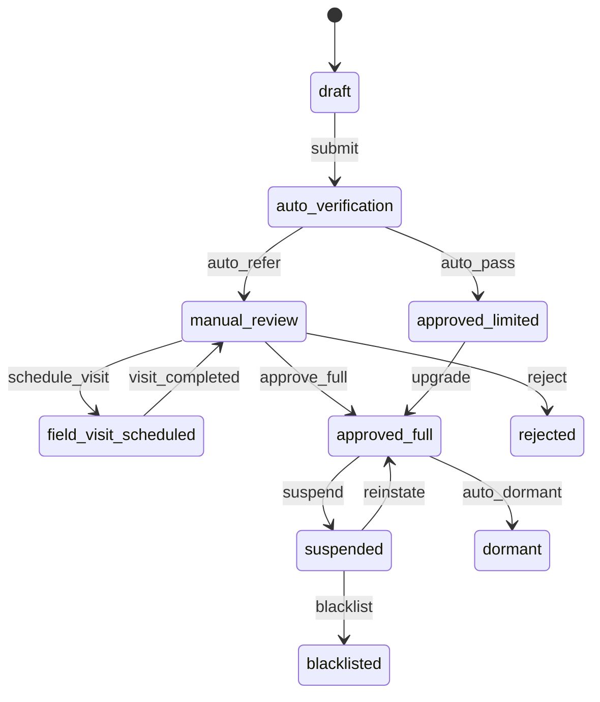
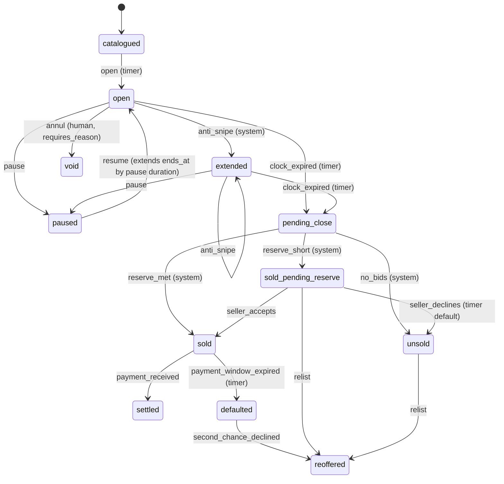

# 11 — Dealer Marketplace, Dealer CRM, Live Dealer Auction

> PRD modules **3** (Dealer Marketplace), **9** (Dealer CRM), **18** (Live Auction).
> Backend: `AutoHub.Modules.Dealer` (new) + `AutoHub.Modules.Auction`. Portals: `apps/dealer`, `apps/admin`.
> Anchors: `00-north-star.md` (stack, prime directive), `01-design-system.md` (compact density, `BidTicket`,
> `PlateBlock`), `02-domain-model.md` §6–§8 (Party, Listing, Lot, Bid), `03-data-model-erd.md` §3–§4,
> `04-api-contract.md` §9.8/§9.12/§12. **This document adds; it never re-decides.**

---

## 0. Where this module sits

Dealers are the liquidity engine (Phase 3) and auction is the highest-margin transaction shape
(Phase 4). Both ride the same spine:

```
identity.organizations(org_type='dealer')      ← WHO (one row, one GSTIN, one PAN)
        │
        ├── dealer.branches                     ← WHERE (RBAC scope 'branch')
        ├── dealer.staff_memberships            ← WHO acts (RBAC scope 'dealer'|'branch')
        ├── dealer.stock_items ──► listings.listings ──► auction.auction_lots
        │        (owned metal)        (an offer)           (a timed offer)
        ├── dealer.leads ──► dealer.tasks ──► notification.outbox
        └── payments.ledger_accounts(dealer_wallet | emd_held | dealer_receivable)
                                       │
                              deals.deals ── the single settlement spine
```

Three rules that follow from the north star and are enforced by review:

1. **A dealer is an `identity.organizations` row, not a new identity concept.** There is no
   `dealers` table. `org_type='dealer'` and a satellite `dealer.dealer_profiles` for
   dealer-only operating data.
2. **Auction is a listing intent, not a vertical.** A lot is `listings.listings` +
   `listings.terms_auction` + `auction.auction_lots`. The money lands in `deals.deals` with
   `intent_key='AUCTION'`, priced by the Pricing Registry, posted to the double-entry ledger.
3. **Every status word on every screen in this document is a `platform.workflow_states` row.**
   If you find `if (lot.state_code == "closing")` in a handler, the handler is wrong — ask
   `is_terminal` / `holds_funds` / a named semantic flag instead.

---

# PART A — DEALER ONBOARDING

## A.1 Data shape

`identity.organizations` (03-ERD §4.1) already carries `gstin`, `pan_hash`, `pan_last4`, `cin`,
`udyam_number`, `tier_code`, `billing_state_id`, `status_code`, `workflow_instance_id`. Additions:

```sql
CREATE TABLE dealer.dealer_profiles (
    organization_id   uuid PRIMARY KEY REFERENCES identity.organizations(id),
    dealer_kind_code  platform.code_key NOT NULL,     -- taxonomy 'dealer_kind':
                                                      -- independent_used | oem_authorised | multi_brand
                                                      -- | broker_desk | fleet_disposal | scrap_dismantler
    brands_authorised uuid[] NOT NULL DEFAULT '{}',   -- platform.makes ids; empty for multi-brand
    trade_certificate_no text,                        -- CMVR Rule 35 Form 17, e.g. 'MH01/TC/2231'
    trade_certificate_valid_till date,
    trade_plate_numbers text[] NOT NULL DEFAULT '{}', -- 'MH01TC1234'
    shop_establishment_no text,                       -- Gumasta (MH) / equivalent municipal licence
    shop_establishment_valid_till date,
    yard_capacity_units  integer,
    year_established     smallint,
    default_branch_id    uuid,
    consignment_allowed  boolean NOT NULL DEFAULT false,  -- may sell stock it does not own
    auction_seller_enabled boolean NOT NULL DEFAULT false,
    auction_buyer_enabled  boolean NOT NULL DEFAULT false,
    onboarding_form_version_id uuid REFERENCES platform.form_versions(id),  -- pinned, §3.3 ERD
    created_at timestamptz NOT NULL DEFAULT now(), created_by uuid,
    updated_at timestamptz NOT NULL DEFAULT now(), updated_by uuid,
    row_version bigint NOT NULL DEFAULT 1
);

CREATE TABLE dealer.branches (
    id            uuid PRIMARY KEY DEFAULT platform.uuid_generate_v7(),
    organization_id uuid NOT NULL REFERENCES identity.organizations(id),
    code          text NOT NULL,                       -- dealer-chosen, unique per org
    name          text NOT NULL,
    gstin         platform.gstin,                      -- additional place of business / other state
    address       jsonb NOT NULL DEFAULT '{}',
    city_id       uuid NOT NULL REFERENCES platform.cities(id),
    pincode       text NOT NULL,
    geo           geography(Point,4326),
    service_pincodes text[] NOT NULL DEFAULT '{}',     -- CRM territory routing
    operating_hours jsonb NOT NULL DEFAULT '{}',       -- Geography registry shape
    is_primary    boolean NOT NULL DEFAULT false,
    state_code    platform.code_key NOT NULL,          -- workflow: 'dealer_branch'
    workflow_instance_id uuid NOT NULL,
    created_at timestamptz NOT NULL DEFAULT now(), created_by uuid,
    updated_at timestamptz NOT NULL DEFAULT now(), updated_by uuid,
    deleted_at timestamptz, deleted_by uuid,
    row_version bigint NOT NULL DEFAULT 1,
    CONSTRAINT uq_branches__code UNIQUE (organization_id, code)
);

CREATE TABLE dealer.staff_memberships (
    id            uuid PRIMARY KEY DEFAULT platform.uuid_generate_v7(),
    organization_id uuid NOT NULL REFERENCES identity.organizations(id),
    branch_id     uuid REFERENCES dealer.branches(id),   -- NULL = org-wide
    user_id       uuid NOT NULL,
    role_id       uuid NOT NULL REFERENCES platform.roles(id),
    employee_ref  text,
    state_code    platform.code_key NOT NULL,            -- workflow: 'dealer_staff'
    invited_at    timestamptz, accepted_at timestamptz, revoked_at timestamptz,
    revoke_reason_code platform.code_key,
    row_version bigint NOT NULL DEFAULT 1,
    CONSTRAINT uq_staff__user_scope UNIQUE (organization_id, user_id, branch_id, role_id)
);

CREATE TABLE dealer.verifications (          -- one row per evidence artefact, append-mostly
    id            uuid PRIMARY KEY DEFAULT platform.uuid_generate_v7(),
    organization_id uuid NOT NULL REFERENCES identity.organizations(id),
    branch_id     uuid REFERENCES dealer.branches(id),
    kind_code     platform.code_key NOT NULL,   -- taxonomy 'dealer_verification_kind'
    provider_code platform.code_key,            -- Integration Registry adapter that answered
    request_ref   text, provider_ref text,
    state_code    platform.code_key NOT NULL,   -- workflow: 'dealer_verification'
    result        jsonb NOT NULL DEFAULT '{}',  -- normalised provider payload (no raw PII)
    match_score   numeric(5,2),                 -- name-match confidence 0..100
    evidence_document_id uuid,
    expires_at    timestamptz,                  -- re-verification clock
    verified_at   timestamptz, verified_by uuid,
    failure_code  platform.code_key,
    row_version bigint NOT NULL DEFAULT 1
);
CREATE INDEX ix_dealer_verifications__due ON dealer.verifications (expires_at)
    WHERE state_code = 'verified';
```

**Nothing about "which checks are required" is in this schema.** The required set is a Form Schema
Registry document (`form_definitions.code = 'dealer_onboarding'`) plus a guard rule set. Adding
"Udyam certificate mandatory for Tier-2 cities" is a rule row.

## A.2 The onboarding state machine (Workflow Registry, `code='dealer_org'`)

`platform.workflow_states` rows — this is the whole status vocabulary, as data:

| `code` | `kind_code` | `is_editable` | `counts_as_open` | `sla_minutes` | `ui.tone` | Semantic effect |
|---|---|---|---|---|---|---|
| `draft` | initial | true | true | – | info | Application started, nothing submitted |
| `awaiting_documents` | waiting | true | true | 4320 | caution | Checklist incomplete |
| `auto_verification` | active | false | true | 30 | info | GST/PAN/penny-drop adapters running |
| `manual_review` | waiting | false | true | 480 | caution | Ops queue; auto checks inconclusive |
| `field_visit_scheduled` | waiting | false | true | 5760 | info | Yard photo + geo-verify booking |
| `approved_limited` | active | true | true | – | clear | Can list; **cannot** bid, cannot receive payout |
| `approved_full` | active | true | true | – | clear | All capabilities |
| `suspended` | waiting | false | true | – | flag | Reversible; listings hidden, bids blocked |
| `blacklisted` | terminal_failure | false | false | – | flag | Trust module decision, irreversible without appeal |
| `rejected` | terminal_failure | true | false | – | flag | Application refused with reason |
| `dormant` | waiting | true | false | – | info | No activity for `dealer.dormancy_days` |

`platform.workflow_transitions` rows (abbreviated):

| `code` | from → to | `trigger_type` | `required_permission_code` | `guard_rule_set_id` | `effects` |
|---|---|---|---|---|---|
| `submit` | draft → auto_verification | manual | `dealer.dealer.update` | `dealer_onboarding_completeness.v1` | emit `dealer.application.submitted` |
| `auto_pass` | auto_verification → approved_limited | system | – | `dealer_auto_verify.v1` | emit, notify |
| `auto_refer` | auto_verification → manual_review | system | – | – | create ops task |
| `approve_full` | manual_review → approved_full | manual | `dealer.dealer.verify` | `dealer_full_capability.v1` | emit `dealer.approved`, provision ledger accounts, grant tier |
| `request_docs` | *any* → awaiting_documents | manual | `dealer.dealer.verify` | – | notify with missing-doc list |
| `suspend` | *any* → suspended | manual | `dealer.dealer.suspend` | – | `requires_reason=true`, hide listings, cancel live bids |
| `auto_dormant` | approved_* → dormant | timer | – | – | de-prioritise in search |
| `expire_credential` | *any* → awaiting_documents | timer | – | – | fired by `dealer.verifications.expires_at` |

**`approved_limited` is the load-bearing state.** It exists so a dealer can start listing the day
they sign up — but `workflow_states.holds_funds` semantics plus the guard
`dealer_full_capability.v1` keep them out of auction and out of payout until GSTIN + penny-drop +
KYC level 2 are all green. This is how we get supply fast without RBI/GST exposure.



## A.3 Verification adapters (Integration Registry #8 — every one has a fallback chain)

| `kind_code` | Adapter / source | What we assert | Failure handling |
|---|---|---|---|
| `gstin` | GSTN public search via ASP/GSP (`/taxpayerapi/search`) | `sts='Active'`, `lgnm` matches legal name ≥ 85, `ctb` (constitution), `pradr` state == `billing_state_id`, `rgdt` ≤ today | GSTN portal is unavailable most nights 23:00–00:30 IST → queue with backoff; **local pre-check first**: 15 chars, chars 3–12 == PAN, char 13 entity code, char 14 = 'Z', char 15 mod-36 checksum. A checksum failure never reaches the network. |
| `pan` | Protean/NSDL PAN verification (or GSTIN-derived PAN when GSTIN verified) | status `E`, name match ≥ 85 | If GSTIN already verified, PAN is *derived* and marked `provider_code='derived_from_gstin'` — do not burn a paid API call |
| `cin` | MCA21 V3 lookup | company status `Active`, name match | Optional; only for `ctb ∈ {Private Limited, Public Limited, LLP}` |
| `udyam` | Udyam Registration verification | validity, enterprise type | Optional — unlocks MSME commission slab (a pricing scope, not code) |
| `trade_licence` | **No national API.** Municipal Shop & Establishment / Gumasta | Document upload → OCR (`document_types.'trade_licence'`) → human verify | Always `manual_review`. Expiry drives `expire_credential` timer |
| `trade_certificate` | VAHAN Dealer module / uploaded Form 17 | Number format `<RTO>/TC/<serial>`, validity date, trade plate list | Needed only to *drive/ move* stock on trade plates; not required to transact |
| `bank_penny_drop` | PA "fund account validation" (Razorpay/Cashfree via Integration Registry) — ₹1 IMPS credit | Beneficiary name returned by the bank, matched against `legal_name`/`trade_name` | IMPS returns "name not available" for some co-op banks → fall back to **UPI VPA validation** (no money moves, name returned), then to a cancelled-cheque OCR + manual review. Penny-drop is chargeable; cache the result for `dealer.penny_drop_ttl_days` |
| `aadhaar_kyc` | DigiLocker OAuth (preferred) → Aadhaar offline XML → Aadhaar OTP eKYC | Proprietor / authorised signatory identity, KYC level 2 | DigiLocker down → manual RC/ID upload path, `kyc_level` capped at 1 → auction bidding blocked with `auction.registration.dealer_not_approved`. We **never** store the Aadhaar number; only the last-4 and the signed XML reference (`trust.kyc_records`) |
| `gst_e_invoice_readiness` | IRP e-invoice API sandbox ping | AATO band, IRN capability | Determines whether we must generate an IRN for invoices we raise *to* this dealer |
| `yard_geo` | Field visit booking (`booking_type_code='doorstep_kyc'`) | Geo-tagged yard photos within `dealer.yard_geo_radius_m` of `branches.geo` | Only for `manual_review` referrals or `dealer_kind='independent_used'` above a stock threshold |

**Name matching is a rule set, not a library call.** `dealer_name_match.v1` normalises
(uppercase, strip `M/S`, `PVT`, `LTD`, `LLP`, `&`/`AND`, punctuation), then token-set ratio.
Thresholds `auto_pass ≥ 88`, `refer 70..87`, `fail < 70` are rule outcomes — Ops tunes them from
the admin console when the false-refer rate climbs.

**Re-verification is a clock, not an event.** `dealer.verifications.expires_at` is set from
`taxonomy.dealer_verification_kind.revalidate_after_days` (GSTIN 180, trade licence = licence
expiry, penny-drop 365, trade certificate = certificate expiry). A nightly job creates workflow
timers; expiry moves the org to `awaiting_documents` and, if `auction_buyer_enabled`, cancels
open auction registrations at the *next lot boundary* — never mid-lot, because yanking a bidder
out of a live lot mid-bid is how you get sued.

## A.4 Multi-branch, and the GST subtlety nobody plans for

A dealer with branches in Pune and Bengaluru has **two GSTINs** (GST registration is
state-wise). Consequences we handle explicitly:

- `dealer.branches.gstin` is nullable and, when present, **overrides** the org GSTIN for any
  invoice raised for a transaction whose place of supply resolves to that branch's state.
- `deals.deals` carries the branch through `deal_parties.branch_id`; the pricing engine's
  `place_of_supply_rule` reads the *branch* GSTIN state, so a Bengaluru branch buying at a Pune
  auction gets **IGST**, and a Pune branch gets **CGST+SGST**. Zero code — the tax rule row
  already says `place_of_supply_rule='recipient_state'`.
- Stock transfer between branches of the same legal entity across states is a **deemed supply**
  under GST (Schedule I) and needs a delivery challan + e-way bill. `dealer.stock_items` therefore
  records `branch_id` and a branch move is a `stock_transfer` transition that raises a
  `deals.deals` row with `intent_key='SERVICE'` and a zero-revenue, tax-only line set. We surface
  it as a warning, not a block: *"Moving this car to Bengaluru is an interstate stock transfer.
  A delivery challan and e-way bill are required."*
- E-way bill applies to a vehicle moved on its own wheels too — the vehicle's own registration
  number goes in the conveyance field. Registry row
  `platform.code_sets.'ewb_conveyance_mode' → 'own_propulsion'`.

## A.5 Staff and scoped RBAC

No new authorisation concept. `platform.roles` rows with `party_kind_code='dealer'`, assigned via
`platform.user_role_assignments` with `scope_type_code ∈ {'dealer','branch'}`.

| `roles.code` | `scope_type_code` | Key `role_permissions` | `row_filter` / `amount_limit_paise` |
|---|---|---|---|
| `dealer_owner` | dealer | `dealer.*`, `auction.bid.place`, `dealer.subscription.manage` | – |
| `dealer_manager` | branch | `dealer.inventory.write`, `dealer.lead.assign`, `auction.bid.place` | `amount_limit_paise = 150000000` (₹15L bid ceiling) |
| `dealer_sales_exec` | branch | `dealer.inventory.read`, `dealer.lead.write` | `row_filter: {"assigned_to_user_id":{"var":"scope.self"}}` |
| `dealer_accounts` | dealer | `dealer.statement.read`, `payments.payout.read` | `field_mask: '{customer_phone_e164}'` |
| `dealer_bidder` | dealer | `auction.bid.place`, `auction.auction.read` | `amount_limit_paise` per assignment |
| `dealer_api` | dealer | `dealer.inventory.bulk_import`, `dealer.inventory.read` | machine account, no UI login |

Three enforced consequences:

1. `amount_limit_paise` on `auction.bid.place` is checked **inside the bid admission script**
   (§C.5, `ARGV` carries the resolved ceiling) — not in a controller. A sales exec cannot bid ₹40L
   because the resolved permission says ₹15L, and the rejection is `403 auction.bid.limit_exceeded`
   with `params.user_ceiling_minor`.
2. A user may hold memberships at two dealerships. `X-AutoHub-Scope: dealer:<id>` is mandatory for
   every `/dealer/*` and `/auction/*` write in that case (04-API §5.2). Absent + ambiguous → `409`.
3. Revoking a staff membership publishes to `rt:revoke:{session_id}`; a bidder whose membership is
   revoked mid-auction is disconnected with close code `4403` in under a second and any *armed
   proxy bids they own* are cancelled by the org owner, not automatically — cancelling a live proxy
   silently would change the price. We notify the owner and hold.

## A.6 Dealer tiers — benefits are registry rows, not a benefits table

`identity.organizations.tier_code` is the **single input**; every benefit is expressed in the
registry that already owns that concern. There is deliberately **no `tier_benefits` table**.

| Benefit | Lives in | Row shape |
|---|---|---|
| Active-listing cap | Feature Registry (`variant_type='number'`) | flag `dealer.inventory.active_listing_cap`, `flag_rules.audience = {"==":[{"var":"party.tier"},"gold"]}`, `variant = 500` |
| Bulk upload row cap | Feature Registry | flag `dealer.bulk.max_rows`, variant `5000` |
| Free boosts / month | Feature Registry | flag `dealer.boost.free_per_month`, variant `10` |
| Auction buyer premium | Pricing Registry | `fee_components.code='auction_buyer_premium'` + a `rules` row `{"==":[{"var":"party.tier"},"platinum"]}` → `{"rate_percent":1.25}` |
| EMD multiplier (exposure) | Pricing/Feature | flag `auction.exposure.multiplier`, variant `15` for platinum, `8` for silver |
| Early auction catalogue access | Feature Registry | flag `auction.catalogue.early_access_hours`, variant `24` |
| API rate limit | API §8 tier table | `dealer_pro` bucket |
| Search ranking lift | Search boost config | `listings.quality_score` multiplier row |
| Dedicated RM, priority support | Notification Registry | `recipient_resolver='org.relationship_manager'` |
| Payout cycle | Payments settlement profile | `settlement_profiles.cycle_code = 'T+1'` vs `'T+3'` |

Tier **assignment** is data about the dealer, not a registry:

```sql
CREATE TABLE dealer.tier_assignments (
    id uuid PRIMARY KEY DEFAULT platform.uuid_generate_v7(),
    organization_id uuid NOT NULL REFERENCES identity.organizations(id),
    tier_code     platform.code_key NOT NULL,          -- taxonomy 'dealer_tier': bronze|silver|gold|platinum
    assigned_by_rule_set_id uuid REFERENCES platform.rule_sets(id),  -- 'dealer_tier_eligibility.v1'
    score_snapshot jsonb NOT NULL DEFAULT '{}',        -- the inputs, frozen — dealers WILL dispute this
    is_manual_override boolean NOT NULL DEFAULT false,
    reason_code   platform.code_key, note text,
    effective_from date NOT NULL, effective_to date,
    created_at timestamptz NOT NULL DEFAULT now(), created_by uuid
);
```

Tier changes are evaluated monthly by `dealer_tier_eligibility.v1` (inputs: trailing-90-day GMV,
performance score §E, dispute rate, payment-default count, KYC completeness). **Downgrades are
lagged by one cycle and notified 15 days ahead** — a dealer who loses their buyer-premium rate
mid-month while holding open bids has a legitimate grievance. That lag is a rule outcome
(`{"downgrade_grace_days": 15}`), not an `if`.

---

# PART B — INVENTORY, BULK UPLOAD, WALLET

## B.1 Stock item — the thing a dealer actually manages

A `stock_item` is *owned or consigned metal*. It is not a listing. One stock item may have zero,
one, or many listings over its life (list → unsold → auction → relist), which is precisely why
02-domain-model §4.4 keeps them separate.

```sql
CREATE TABLE dealer.stock_items (
    id             uuid PRIMARY KEY DEFAULT platform.uuid_generate_v7(),
    public_ref     text NOT NULL,                      -- 'STK-2607-8H3K'
    organization_id uuid NOT NULL REFERENCES identity.organizations(id),
    branch_id      uuid NOT NULL REFERENCES dealer.branches(id),
    vehicle_id     uuid NOT NULL REFERENCES catalog.vehicles(id),
    acquisition_kind_code platform.code_key NOT NULL,  -- purchase|trade_in|auction_win|consignment|repossession
    acquisition_deal_id uuid REFERENCES deals.deals(id),
    acquired_on    date NOT NULL,
    purchase_price_paise platform.money_paise,         -- NULL for consignment
    target_price_paise   platform.money_paise,
    floor_price_paise    platform.money_paise,         -- never shown to buyers; RLS-guarded
    current_listing_id uuid REFERENCES listings.listings(id),
    state_code     platform.code_key NOT NULL,         -- workflow 'dealer_stock_item'
    workflow_instance_id uuid NOT NULL,
    days_in_stock  integer GENERATED ALWAYS AS (
                     (CURRENT_DATE - acquired_on)::int) STORED,
    rc_in_dealer_name boolean NOT NULL DEFAULT false,  -- Form 29/30 filed? affects who signs on resale
    hypothecation_open boolean NOT NULL DEFAULT false, -- mirrors catalog.vehicle_encumbrances
    parking_location text,
    key_tag        text,
    notes          text,
    created_at timestamptz NOT NULL DEFAULT now(), created_by uuid,
    updated_at timestamptz NOT NULL DEFAULT now(), updated_by uuid,
    deleted_at timestamptz, deleted_by uuid,
    row_version bigint NOT NULL DEFAULT 1,
    CONSTRAINT uq_stock_items__vehicle_open UNIQUE (organization_id, vehicle_id, deleted_at)
);

CREATE TABLE dealer.stock_item_costs (        -- feeds true margin; append-only in practice
    id uuid PRIMARY KEY DEFAULT platform.uuid_generate_v7(),
    stock_item_id uuid NOT NULL REFERENCES dealer.stock_items(id) ON DELETE CASCADE,
    cost_type_code platform.code_key NOT NULL,  -- taxonomy 'dealer_cost_type':
                                                -- refurb|detailing|transport|parking|interest|rto_fee
                                                -- |insurance|challan_clear|inspection|photography|commission
    amount_paise  platform.money_paise NOT NULL,
    gst_paise     platform.money_paise NOT NULL DEFAULT 0,
    is_input_credit_eligible boolean NOT NULL DEFAULT false,   -- decides margin-scheme availability
    incurred_on   date NOT NULL,
    vendor_name   text, invoice_ref text, document_id uuid,
    created_at timestamptz NOT NULL DEFAULT now(), created_by uuid
);
```

`is_input_credit_eligible` is not bookkeeping trivia: if the dealer has claimed ITC on the vehicle,
the **GST margin scheme is unavailable** and the resale attracts GST on full value, not margin.
The pricing engine reads it through `tax_rules.code ∈ {gst_goods_used_vehicle_18,
gst_goods_used_vehicle_12}` and their `applies_to_registered_only` / rule conditions. A dealer
who marks a ₹40,000 refurb as ITC-eligible changes their own tax outcome — we show the
consequence inline, we do not decide for them.

### Stock-item workflow (`workflow_definitions.code='dealer_stock_item'`)

| `code` | `kind_code` | `is_publicly_visible` | `blocks_deletion` | `sla_minutes` | `ui.tone` |
|---|---|---|---|---|---|
| `intake` | initial | false | false | 1440 | info |
| `in_refurb` | active | false | true | – | caution |
| `ready` | active | false | true | 2880 | info |
| `listed` | active | true | true | – | clear |
| `in_auction` | active | true | true | – | clear |
| `reserved` | waiting | true | true | 4320 | caution |
| `sold` | terminal_success | false | true | – | clear |
| `transferred` | terminal_success | false | true | – | info |
| `returned` | terminal_failure | false | false | – | flag |
| `written_off` | terminal_failure | false | true | – | flag |

`ready → listed` has `guard_rule_set_id = 'listing_publish_ready.v1'`, which is the same guard the
C2C sell flow uses (media count, required documents per `registry.intent_requirements`,
`rc_status ∉ {SCRAPPED, BLACKLISTED}` per invariant V3). One guard, two entry points.

## B.2 Bulk upload — the endpoint dealers judge us on

```
POST /api/v1/dealer/inventory-items/bulk        (multipart: file + optional mapping_id)
  → 202 { job_id, row_count_estimate, mapping: {...}, needs_mapping_confirmation: true|false }
GET  /api/v1/dealer/inventory-items/bulk/{jobId}
GET  /api/v1/dealer/inventory-items/bulk/{jobId}/errors.csv     (signed S3 URL)
GET  /api/v1/dealer/inventory-items/bulk/template?category=suv  (taxonomy-generated)
```

```sql
CREATE TABLE dealer.bulk_jobs (
    id uuid PRIMARY KEY DEFAULT platform.uuid_generate_v7(),
    organization_id uuid NOT NULL, branch_id uuid,
    kind_code     platform.code_key NOT NULL,   -- stock_import|price_update|status_update|photo_attach
    source_file_document_id uuid NOT NULL,
    file_checksum platform.sha256_hex NOT NULL,
    mapping_id    uuid REFERENCES dealer.bulk_column_mappings(id),
    atomic        boolean NOT NULL DEFAULT false,
    total_rows    integer, processed_rows integer NOT NULL DEFAULT 0,
    ok_rows integer NOT NULL DEFAULT 0, error_rows integer NOT NULL DEFAULT 0,
    state_code    platform.code_key NOT NULL,   -- workflow 'dealer_bulk_job'
    result_file_document_id uuid,
    started_at timestamptz, finished_at timestamptz,
    created_at timestamptz NOT NULL DEFAULT now(), created_by uuid,
    row_version bigint NOT NULL DEFAULT 1,
    CONSTRAINT uq_bulk_jobs__checksum UNIQUE (organization_id, kind_code, file_checksum, created_by)
);

CREATE TABLE dealer.bulk_job_rows (
    job_id uuid NOT NULL REFERENCES dealer.bulk_jobs(id) ON DELETE CASCADE,
    row_number integer NOT NULL,
    raw          jsonb NOT NULL,
    normalised   jsonb,
    stock_item_id uuid,
    status_code  platform.code_key NOT NULL,    -- pending|ok|error|skipped_duplicate
    error_code   platform.code_key, error_pointer text, error_message_key text,
    PRIMARY KEY (job_id, row_number)
);

CREATE TABLE dealer.bulk_column_mappings (      -- learned once, reused forever
    id uuid PRIMARY KEY DEFAULT platform.uuid_generate_v7(),
    organization_id uuid NOT NULL,
    name text NOT NULL,
    category_id uuid REFERENCES platform.categories(id),
    -- header text (as the dealer's ERP writes it) → attribute/column target
    column_map jsonb NOT NULL,   -- {"Kms":"kms_driven","Reg No":"registration_number", ...}
    value_map  jsonb NOT NULL DEFAULT '{}',     -- {"fuel_type":{"PETROL":"petrol","P":"petrol"}}
    is_default boolean NOT NULL DEFAULT false,
    created_at timestamptz NOT NULL DEFAULT now(), created_by uuid,
    row_version bigint NOT NULL DEFAULT 1
);
```

### The mapping UI is generated, not written

The dealer portal's mapping screen has **no hardcoded column list**. It renders from:

```
GET /platform/taxonomy/attributes?category=suv     → the target columns (Registry #1)
GET /platform/forms/stock_item_import              → required/optional + validation (Registry #2)
GET /dealer/bulk-mappings?category=suv             → this dealer's saved mappings
```

Auto-mapping ladder, in order, first hit wins:

| # | Strategy | Source |
|---|---|---|
| 1 | Saved mapping for this dealer + category | `dealer.bulk_column_mappings.is_default` |
| 2 | Exact match on `attribute_definitions.code` | Taxonomy registry |
| 3 | Alias match | `platform.attribute_aliases(attribute_definition_id, alias, locale)` — registry rows: `KM`, `Kms`, `Kilometers`, `Odo`, `किमी` → `kms_driven` |
| 4 | Trigram similarity ≥ 0.55 on normalised header | `pg_trgm` over codes + aliases + i18n labels |
| 5 | Unmapped → shown to the user with a dropdown of remaining targets | – |

Value normalisation uses `platform.attribute_options.aliases[]` — so `PETROL`, `Petrol`, `P`,
`पेट्रोल` all resolve to `petrol`. **New alias = new row.** No release. When a dealer maps a
header by hand, we write the alias back as a *dealer-scoped* alias suggestion into an ops queue;
if three different dealers map the same header the same way, it gets promoted to a global alias.
That is how the importer gets better without an engineer.

### Processing contract

- **Streaming, never buffered.** CsvHelper / ClosedXML SAX reader, 500-row chunks, one transaction
  per chunk. A 20,000-row file never materialises in memory.
- **Partial success is the default.** `?atomic=true` (used by ERP integrations) wraps the whole job
  and rolls back on the first error — `dealer.bulk_upload.atomic_failed` names the offending row.
- **Per-row idempotency:** `(job_id, row_number)`. Job idempotency: `file_checksum` unique per
  `(org, kind, uploader)` → re-uploading the identical file returns the **original** job, not a
  second import. This kills the #1 support ticket: "I clicked upload twice, now I have 400
  duplicate cars."
- **Cross-row duplicate detection** inside the file on `catalog.vehicles.dedupe_hash`
  (`sha256(reg_norm|vin_norm|engine_norm)`) and against existing open stock →
  `status_code='skipped_duplicate'`, not an error.
- **Photos:** either a `photo_urls` column (fetched server-side with an SSRF allowlist, 10 MB /
  image cap, content-type sniffing) or a companion ZIP whose filenames match
  `<registration>_<n>.<ext>`. Media checksum uniqueness per vehicle (03-ERD §4.x) blocks the
  classic trick of one photo set across six cars.
- **Caps come from the Feature Registry:** `dealer.bulk.max_rows`, `dealer.bulk.max_file_mb`,
  `dealer.bulk.concurrent_jobs`. Exceeding → `422 dealer.bulk_upload.row_limit_exceeded` with
  `params.limit` and `params.tier` so the UI can say *"Gold plan allows 5,000 rows per file."*
- **Result file** = original row + `error_code` + `error_message` + `pointer`, so ops fixes only
  the failures and re-uploads. Never make a dealer diff two spreadsheets.

Row-level error codes (all under `dealer.bulk_upload.*`, added to 04-API §3.10):

| Code | HTTP (job-level) | Meaning |
|---|---|---|
| `dealer.bulk_upload.file_invalid` | 422 | Not CSV/XLSX, or no header row |
| `dealer.bulk_upload.row_limit_exceeded` | 422 | Over the tier cap |
| `dealer.bulk_upload.mapping_required` | 409 | ≥1 required target unmapped |
| `dealer.bulk_upload.atomic_failed` | 422 | Atomic mode, one row bad |
| `dealer.bulk_row.registration_malformed` | – | Fails `plate_formats.regex` |
| `dealer.bulk_row.registration_conflict` | – | Plate already in another dealer's open stock |
| `dealer.bulk_row.attribute_unknown_option` | – | Value not in `attribute_options` and no alias |
| `dealer.bulk_row.attribute_out_of_range` | – | Violates `attribute_definitions` min/max |
| `dealer.bulk_row.price_implausible` | – | Outside valuation band × `dealer.bulk.price_sanity_factor` |
| `dealer.bulk_row.media_fetch_failed` | – | URL 404 / blocked / oversized |
| `dealer.bulk_row.branch_not_in_scope` | – | Branch column names a branch outside RBAC scope |

## B.3 Price suggestion

`POST /dealer/inventory-items/{id}/price-suggestion` returns, per the design-system voice rule
("a valuation without *as of today* is a rumour"):

```jsonc
{ "suggested_minor": 54900000,
  "band": { "low_minor": 52500000, "high_minor": 57400000 },
  "basis": [
    { "code": "valuation_model",  "label": "AutoHub valuation", "amount_minor": 54900000,
      "model_version": "valuation-ensemble@2026.07.3" },
    { "code": "live_comparables", "label": "11 similar live in Pune", "median_minor": 55900000 },
    { "code": "sold_comparables", "label": "6 sold in 45 days",       "median_minor": 53800000,
      "median_days_to_sell": 27 },
    { "code": "aging_pressure",   "label": "Day 63 in stock",  "adjustment_bps": -250 },
    { "code": "floor_guard",      "label": "Your floor price", "amount_minor": 51000000 }
  ],
  "projected_days_to_sell": { "at_suggested": 24, "at_current": 61 },
  "as_of": "2026-07-29", "expires_at": "2026-08-05T00:00:00Z" }
```

Rules of engagement: (a) it is **never auto-applied** — a suggestion that silently repriced a
₹40L car would end the relationship; (b) it never goes below `floor_price_paise`, it *reports*
the collision; (c) `adjustment_bps` for ageing comes from rule set `dealer_price_pressure.v1`
(bucket → bps), so ops tunes aggressiveness per city; (d) accepting a suggestion writes
`listings.listing_price_history` and emits `listings.listing.price_changed.v1` which wakes every
buyer watching the listing — that notification is worth more than the price change.

## B.4 Ageing and stock-turn analytics

Buckets are `platform.code_sets.code='dealer_aging_buckets'` rows (`0-15`, `16-30`, `31-60`,
`61-90`, `90+`) with `ui.tone` per bucket. Not constants.

| Metric | Definition | Why this one |
|---|---|---|
| Days in stock | `CURRENT_DATE - acquired_on` | The number a used-car dealer actually manages |
| Stock turn (annualised) | `units_sold_trailing_90 / avg_units_in_stock_trailing_90 × 4` | Ratio, comparable across yard sizes |
| Median days to sell | median over `sold` items, trailing 180d, by make/model/city | Powers `projected_days_to_sell` |
| Sell-through rate | `sold / (sold + still_in_stock_aged_over_median)` | Detects a yard full of unsellable stock |
| True gross margin | `sale_price − purchase_price − Σ costs − commission − holding_cost` | The only margin worth showing |
| Holding cost | `days_in_stock × dealer.holding_cost_per_day_paise` (Feature Registry, per tier/city) | Makes ageing cost visible in rupees |
| Ageing at risk | `Σ purchase_price` in `61-90` + `90+` | The tile that changes behaviour |

Implementation: `analytics.mv_dealer_inventory_aging` materialised view, `REFRESH MATERIALIZED
VIEW CONCURRENTLY` every 15 minutes, plus a live overlay from `dealer.stock_items` for anything
changed since `mv.refreshed_at`. Never `COUNT(*)` a hot table for a dashboard tile (north star §6).

## B.5 Dealer wallet and credit limit — and the RBI line we do not cross

**AutoHub does not issue a wallet.** A stored-value instrument redeemable at third parties is a
Prepaid Payment Instrument and needs an RBI PPI authorisation. What we operate is a
**ledger-backed running account**: money physically sits in the licensed Payment Aggregator's
escrow account (RBI PA/PG guidelines — permitted credits/debits only, settlement to the merchant
within the prescribed Tp+1 cycle), and `payments.ledger_accounts` records who it belongs to.

| `account_code` | Type | Meaning |
|---|---|---|
| `dealer_wallet` | Liability | Funds we hold for the dealer (top-ups, refunds, unadjusted EMD) |
| `emd_held` | Liability | EMD earmarked against a specific auction |
| `dealer_receivable` | Asset | Invoiced and unpaid (auction wins, subscription, boosts) |
| `dealer_credit_exposure` | Memo | Non-financial; drives the bidding limit only |

```sql
CREATE TABLE dealer.credit_lines (
    id uuid PRIMARY KEY DEFAULT platform.uuid_generate_v7(),
    organization_id uuid NOT NULL REFERENCES identity.organizations(id),
    limit_paise    platform.money_paise NOT NULL,
    utilised_paise platform.money_paise NOT NULL DEFAULT 0,   -- cache; ledger is truth
    security_kind_code platform.code_key,        -- none|fd_lien|bank_guarantee|corporate_guarantee|emd_only
    security_document_id uuid,
    interest_free_days smallint NOT NULL DEFAULT 0,
    overdue_fee_component_code platform.code_key,  -- Pricing Registry: 'dealer_credit_overdue_fee'
    assigned_by_rule_set_id uuid,                  -- 'dealer_credit_limit.v1'
    state_code   platform.code_key NOT NULL,       -- workflow 'dealer_credit_line'
    review_due_on date,
    created_at timestamptz NOT NULL DEFAULT now(), created_by uuid,
    updated_at timestamptz NOT NULL DEFAULT now(), updated_by uuid,
    row_version bigint NOT NULL DEFAULT 1
);
```

Hard rules:

- Top-up in only via UPI / netbanking / NEFT into the PA escrow. **Refunds go to source only.**
  No dealer→dealer transfer, no cash-out to a third-party beneficiary. That single restriction is
  what keeps this out of PPI territory, and it is enforced in Payments, not here.
- `utilised_paise` is a cache. Every report, payout and bidding-limit decision recomputes from
  `payments.ledger_entries` (03-ERD §10.6). The nightly reconciler pages on any drift.
- **Bidding headroom** = `emd_held × auction.exposure.multiplier + credit_line.available −
  Σ(open winning bids) − Σ(overdue receivables)`. Overdue receivables subtract at
  `dealer.credit.overdue_weight` (default 2.0) — a dealer who has not paid for last week's win
  gets less rope this week, automatically.
- Interest / late fee on credit is a Pricing Registry `fee_component` with
  `calc_method='per_unit'`, `unit_code='day'`. Never a hardcoded APR. (And it is a *fee for a
  service*, GST 18%, not interest income — a distinction the tax rule row encodes.)

---

# PART C — DEALER CRM

## C.1 Lead ingestion

```sql
CREATE TABLE dealer.leads (
    id uuid PRIMARY KEY DEFAULT platform.uuid_generate_v7(),
    public_ref text NOT NULL,                        -- 'LD-2607-4KQ2'
    organization_id uuid NOT NULL, branch_id uuid,
    source_code   platform.code_key NOT NULL,        -- taxonomy 'lead_source'
    source_ref    text,                              -- listing_id / campaign_id / call_sid
    customer_party_id uuid REFERENCES identity.parties(id),   -- NULL until identified
    contact_name  text,
    contact_phone_e164 text,                         -- encrypted at rest (DPDP)
    contact_phone_hash platform.sha256_hex,          -- dedupe + search without decrypting
    interest_vehicle_id uuid, interest_listing_id uuid,
    interest_category_id uuid, interest_budget_min_paise platform.money_paise,
    interest_budget_max_paise platform.money_paise,
    finance_required boolean, exchange_vehicle_id uuid,
    assigned_user_id uuid, assigned_at timestamptz,
    score numeric(5,2),                              -- rule set 'lead_score.v1'
    state_code    platform.code_key NOT NULL,        -- workflow 'dealer_lead'
    workflow_instance_id uuid NOT NULL,
    first_response_at timestamptz, last_activity_at timestamptz,
    lost_reason_code platform.code_key,
    won_deal_id   uuid REFERENCES deals.deals(id),
    consent_artifact_id uuid,                        -- trust.consents — DPDP proof
    created_at timestamptz NOT NULL DEFAULT now(), created_by uuid,
    updated_at timestamptz NOT NULL DEFAULT now(), updated_by uuid,
    deleted_at timestamptz, deleted_by uuid,
    row_version bigint NOT NULL DEFAULT 1
);
CREATE UNIQUE INDEX uq_leads__dedupe ON dealer.leads
    (organization_id, contact_phone_hash, COALESCE(interest_listing_id,'00000000-0000-0000-0000-000000000000'::uuid))
    WHERE state_code NOT IN ('won','lost') AND deleted_at IS NULL;
```

`lead_source` taxonomy rows: `listing_enquiry`, `phone_reveal`, `whatsapp_click`,
`test_drive_booking`, `requirement_board_match`, `auction_underbidder`, `walk_in`, `missed_call`,
`ivr`, `csv_import`, `partner_webhook`, `marketplace_ad`. Each row carries
`default_priority`, `sla_minutes_override`, `requires_consent`.

**`auction_underbidder` is the highest-value source in the product** and it is free: when a lot
closes, every non-winning bidder in the top *N* (`auction.underbidder_lead_depth`, default 3)
becomes a lead for the seller's dealership on the *next* comparable stock item. Emitted from
`auction.lot.closed.v1`, gated by `trust.consents`.

Dedupe: the partial unique index above collapses a repeat enquiry on the same listing into the
existing open lead and appends an activity instead — dealers hate duplicate lead cards more than
they hate missing leads.

**DPDP Act 2023 posture.** AutoHub is the Data Fiduciary for the customer's contact data; the
dealer is a Data Processor bound by the platform's dealer agreement (DPA clause, purpose
limitation, no onward transfer). Consequences enforced in code: (a) `contact_phone_e164` is
encrypted with a per-party key and only decrypted through the masking layer; (b) the dealer portal
shows `+91 98••••5678` and a **click-to-call** button, never the raw number, until the lead
reaches a stage whose `workflow_states.ui.reveal_contact = true`; (c) erasure = crypto-shred the
key + tombstone; the `contact_phone_hash` survives for dedupe because it is not reversible.

## C.2 Assignment rules — a rule set, not an algorithm in a service

`platform.rule_sets(code='lead_assignment.v1', domain='routing')`, evaluated by priority,
`stop_on_match=true`:

| priority | `condition` (JsonLogic) | `outcome` |
|---|---|---|
| 10 | `{"in":[{"var":"lead.source_code"},["auction_underbidder"]]}` | `{"strategy":"named_user","user_id":"…"}` |
| 20 | `{">":[{"var":"lead.interest_budget_max_paise"},2000000000]}` | `{"strategy":"skill","skill":"premium","fallback":"branch_queue"}` |
| 30 | `{"in":[{"var":"lead.pincode"},{"var":"branch.service_pincodes"}]}` | `{"strategy":"territory"}` |
| 40 | `{"==":[{"var":"lead.language"},"mr-IN"]}` | `{"strategy":"skill","skill":"lang:mr"}` |
| 50 | `{"var":"customer.previous_exec_user_id"}` | `{"strategy":"sticky"}` |
| 100 | `true` | `{"strategy":"load_balanced","measure":"open_leads","tie_break":"least_recently_assigned"}` |

Strategies implemented once: `round_robin`, `load_balanced`, `skill`, `territory`, `sticky`,
`named_user`, `branch_queue`. Availability is respected — a user with `staff_memberships.state_code
= 'on_leave'` or outside `branches.operating_hours` is skipped and the lead lands in
`branch_queue`. **Nobody's leave day silently eats twelve leads.**

Reassignment is a workflow transition, not an UPDATE: `reassign` writes
`platform.workflow_history` so "who sat on this lead" is answerable six months later.

## C.3 Pipeline stages (Workflow Registry, `code='dealer_lead'`)

| `code` | `kind_code` | `sla_minutes` | `sla_breach_transition_code` | `counts_as_open` | `ui.tone` | `ui.reveal_contact` |
|---|---|---|---|---|---|---|
| `new` | initial | 15 | `escalate_unattended` | true | caution | false |
| `attempted` | active | 240 | `escalate_unattended` | true | caution | true |
| `contacted` | active | 1440 | – | true | info | true |
| `qualified` | active | 2880 | – | true | info | true |
| `test_drive_scheduled` | waiting | – | – | true | clear | true |
| `negotiation` | active | 4320 | `nudge_manager` | true | clear | true |
| `docs_pending` | waiting | 2880 | – | true | caution | true |
| `won` | terminal_success | – | – | false | clear | true |
| `lost` | terminal_failure | – | – | false | flag | false |
| `dormant` | waiting | – | – | false | info | false |
| `invalid` | terminal_failure | – | – | false | flag | false |

The 15-minute SLA on `new` is the single most valuable row in this table — Indian used-car lead
conversion collapses after the first 30 minutes. `escalate_unattended` reassigns to the branch
manager and fires a WhatsApp to the dealer owner. **A dealer can change the number to 10 or 45
from their own settings screen**, because the value is a workflow-state row scoped to their org
(`workflow_definitions.scope = {"organization_id":"…"}` — a variant machine, exactly as the ERD
intends).

`lost_reason_code` comes from `platform.code_sets.code='lead_lost_reason'`
(`price_too_high`, `bought_elsewhere`, `finance_rejected`, `wanted_different_variant`,
`no_response`, `not_serious`, `exchange_value_low`). Required on the `lose` transition
(`requires_reason=true`) — this is the dataset that later tells a dealer their prices are 6% high.

## C.4 Tasks and follow-ups

```sql
CREATE TABLE dealer.tasks (
    id uuid PRIMARY KEY DEFAULT platform.uuid_generate_v7(),
    organization_id uuid NOT NULL, branch_id uuid,
    subject_entity_type platform.code_key NOT NULL,  -- 'dealer_lead'|'dealer_stock_item'|'auction_lot'
    subject_entity_id uuid NOT NULL,
    task_type_code platform.code_key NOT NULL,       -- call|whatsapp|visit|test_drive|document|payment_follow_up
    title text NOT NULL, note text,
    assigned_user_id uuid NOT NULL,
    due_at timestamptz NOT NULL,
    remind_at timestamptz[],                         -- from notification_events.throttle rules
    completed_at timestamptz, outcome_code platform.code_key,
    state_code platform.code_key NOT NULL,           -- workflow 'dealer_task'
    created_at timestamptz NOT NULL DEFAULT now(), created_by uuid,
    row_version bigint NOT NULL DEFAULT 1
);
CREATE INDEX ix_tasks__my_day ON dealer.tasks (assigned_user_id, due_at)
    WHERE completed_at IS NULL;
```

Auto-created tasks are `workflow_transitions.effects` entries, e.g. the `contact` transition on
`dealer_lead` carries `[{"type":"create_task","task_type":"call","due_in_minutes":1440}]`. A dealer
who wants a 3-day follow-up instead of 1-day edits a registry row.

## C.5 WhatsApp Business API

Adapter behind `Integration Registry` (`capabilities.code='messaging.whatsapp'`), BSP-agnostic
(Meta Cloud API direct, or Gupshup/Interakt/AiSensy as fallback in the chain). What the module
must respect, all of it registry-configured:

| Constraint | Where it lives | Behaviour |
|---|---|---|
| Template pre-approval | `platform.notification_templates.status_code`, `provider_template_name`, `whatsapp_category` | The outbox **never** sends a non-`approved` template; it demotes down the channel ladder (`whatsapp → push → sms`) |
| Template edit invalidates approval | Registry trigger sets `status_code='submitted'`, keeps previous `version` live | Marathi outbid message edit does not silently stop outbid alerts |
| 24-hour customer service window | `dealer.wa_conversations.window_expires_at` | Inside the window: free-form allowed. Outside: template only — attempting free-form returns `notification.whatsapp.window_closed` |
| Category = utility / authentication / marketing | `whatsapp_category` | Marketing requires explicit opt-in (`trust.consents`), utility does not |
| Per-message pricing by category | `notification_channels.cost_per_message_paise` + `platform.rate_cards` per category | Campaign cost estimate before send |
| Quality rating & messaging tier (1K/10K/100K/unlimited per 24h) | `dealer.wa_numbers.quality_rating`, `messaging_tier` | The campaign scheduler throttles to tier; a `red` quality rating **pauses all marketing campaigns** for that number automatically |
| Opt-out | Inbound `STOP`/`बंद` → `notification_subscriptions.withdrawn_at` | Instant, irreversible without fresh opt-in |

```sql
CREATE TABLE dealer.wa_numbers (
    id uuid PRIMARY KEY DEFAULT platform.uuid_generate_v7(),
    organization_id uuid NOT NULL, branch_id uuid,
    waba_id text NOT NULL, phone_number_id text NOT NULL, display_number text NOT NULL,
    provider_code platform.code_key NOT NULL,
    quality_rating platform.code_key,                -- green|yellow|red|unknown
    messaging_tier platform.code_key,                -- tier_1k|tier_10k|tier_100k|unlimited
    state_code platform.code_key NOT NULL,           -- workflow 'dealer_wa_number'
    verified_at timestamptz, row_version bigint NOT NULL DEFAULT 1
);
```

Delivery receipts (`sent → delivered → read → failed`) land in
`notification.delivery_receipts`. Provider error codes we map explicitly:
`131047` (re-engagement required → demote to SMS), `131026` (undeliverable → mark
`contact_phone_invalid` on the lead), `132000/132001` (template param count/name mismatch → this
is *our* bug; alert engineering, do not retry), `130429` (rate limit → exponential backoff on that
`phone_number_id` only).

## C.6 Bulk messaging with template approval

```
POST /dealer/campaigns
  { name, audience: <filter-grammar §7.4 expression or saved_segment_id>,
    template_id, channel_code, variables_map, scheduled_at, dry_run: true }
  → 200 { estimated_recipients: 1842, suppressed: { no_consent: 311, opted_out: 44,
          quiet_hours_deferred: 96, invalid_number: 12, dnd_scrubbed: 58 },
          estimated_cost_minor: 138150, template_status: "approved" }
POST /dealer/campaigns/{id}/transitions  { transition_code: "submit_for_send" }
```

Gates enforced before a single message leaves, in this order:

1. Template `status_code='approved'` **and** `effective_from ≤ now`. Else `409
   dealer.campaign.template_not_approved`.
2. Per-recipient consent: `trust.consents` for the purpose `marketing_<channel>` unless the
   template's `notification_events.is_transactional = true`. DPDP §7 — no legitimate-use loophole
   for marketing.
3. TRAI DLT: SMS templates need `dlt_entity_id` + `dlt_template_id` + `sender_id` (schema CHECK
   already enforces it). Promotional category is scrubbed against DND preferences and restricted to
   the DLT-permitted window; `notification_channels.quiet_hours_enforced` defers rather than drops.
4. Volume: `dealer.campaign.max_recipients_per_day` (Feature Registry, per tier) and the WhatsApp
   messaging tier, whichever is lower.
5. Cost: if `estimated_cost_minor` exceeds `dealer_wallet` available balance and no credit line,
   `402 dealer.campaign.insufficient_balance`. Messaging is billed, so it must reserve funds.

Sending is a paced drain from `notification.outbox` at `campaign.messages_per_second`
(default 20), not a burst — bursting is how a WABA number gets its quality rating shot in an hour.
Campaign state machine (`workflow_definitions.code='dealer_campaign'`):
`draft → estimating → pending_approval → scheduled → sending → paused → completed | cancelled | failed`.
`paused` is entered automatically by a transition triggered on
`notification.quality_degraded` — the safety valve is a registry row.

## C.7 Call logging

Click-to-call through a masked-number provider (Integration Registry
`capabilities.code='telephony.masked_call'`; Exotel / Ozonetel / Knowlarity in the chain). The
dealer's exec and the customer both see a platform virtual number; neither sees the other's real
number until `ui.reveal_contact` is true for the lead's stage.

```sql
CREATE TABLE dealer.call_logs (
    id uuid PRIMARY KEY DEFAULT platform.uuid_generate_v7(),
    organization_id uuid NOT NULL, branch_id uuid,
    lead_id uuid REFERENCES dealer.leads(id),
    user_id uuid,                                   -- the exec
    provider_code platform.code_key NOT NULL, call_sid text NOT NULL,
    direction platform.code_key NOT NULL,           -- outbound|inbound|missed
    virtual_number text NOT NULL,
    started_at timestamptz, answered_at timestamptz, ended_at timestamptz,
    duration_seconds integer,
    status_code platform.code_key NOT NULL,         -- completed|no_answer|busy|failed|cancelled
    disposition_code platform.code_key,             -- code set 'call_disposition'
    recording_document_id uuid,                     -- consent-gated; retention from document_types
    recording_consent_captured boolean NOT NULL DEFAULT false,
    ivr_path jsonb NOT NULL DEFAULT '{}',
    created_at timestamptz NOT NULL DEFAULT now(),
    CONSTRAINT uq_call_logs__sid UNIQUE (provider_code, call_sid)
);
```

Non-obvious requirements: (a) recording requires an announced consent prompt on both legs —
`recording_consent_captured=false` means the recording is discarded, not stored "just in case";
(b) a missed inbound call on a virtual number **auto-creates a lead** with
`source_code='missed_call'` and a `call` task due in 15 minutes; (c) call webhooks arrive out of
order — `call_sid` uniqueness plus a state-precedence table (`completed` beats `ringing`) prevents
a late `ringing` webhook from resurrecting a finished call; (d) duration ≥
`dealer.call.qualifying_seconds` (default 30) is what counts as a "contact attempt" for the SLA —
a 3-second call is not a contact.

---

# PART D — LIVE DEALER AUCTION

This is the hardest real-time problem in the platform. Everything below is written for the
worst case: 300 dealers on 4G, watching one ₹18L Fortuner, in the last 20 seconds.

## D.1 Auction types are registry configuration

`auction.auction_types` is a registry table (change-set controlled, cache-backed, versioned like
every other registry). The lot **freezes** the resolved config at catalogue time into
`auction_lots.config_snapshot jsonb`, so publishing a registry change mid-auction cannot alter a
running lot.

| `code` | `bid_visibility` | `direction` | `close_mode` | `proxy_enabled` | `reserve_mode` | `buy_now_mode` | Notes |
|---|---|---|---|---|---|---|---|
| `live_ascending` | `full` — amount + masked bidder | up | `soft_close` | true | `hard` | `until_first_bid` | The default dealer auction |
| `hidden_ascending` | `position_only` — "You are winning / outbid", no amount | up | `soft_close` | true | `hard` | `none` | Suppresses herd behaviour; harder to collude |
| `sealed_bid` | `none` until close | up | `hard_close` | false | `hard` | `none` | One shot; ties are real (§D.8) |
| `timed` | `full` | up | `soft_close` | true | `soft` | `always` | Multi-day online catalogue |
| `instant_purchase` | n/a | fixed | `first_accept` | false | `none` | `always` | Buy-now only; first `Idempotency-Key` wins |
| `dutch` | `full` | **down** | `first_accept` | false | `hard` (= floor) | `none` | Clock drops by `tick_amount` every `tick_seconds` |
| `best_offer` | `none` | n/a | `manual` | false | `soft` | `always` | Offer/counter, seller decides |

`config_snapshot` shape (all values sourced from Pricing/Feature registries at freeze time):

```jsonc
{
  "type": "live_ascending",
  "increment_ladder": [ {"to_paise":  50000000, "inc_paise":  100000},
                        {"to_paise": 200000000, "inc_paise":  250000},
                        {"to_paise":       null, "inc_paise":  500000} ],
  "soft_close":  { "window_seconds": 120, "extend_seconds": 120,
                   "mode": "fixed_extend",          // fixed_extend | reset_to_window
                   "max_extensions": 20, "max_total_extension_seconds": 3600 },
  "reserve":     { "mode": "hard", "show_reserve_met": true },
  "buy_now":     { "mode": "until_first_bid", "price_paise": 195000000 },
  "proxy":       { "enabled": true, "max_cascade_steps": 8, "visible_to_bidder": "max_only" },
  "retraction":  { "window_seconds": 0 },           // dealer auctions: no retraction
  "emd":         { "percent_bps": 500, "min_paise": 1000000, "exposure_multiplier": 10 },
  "tie_break":   { "policy": "earliest_lot_seq" },
  "clock":       { "skew_grace_ms": 1500 },
  "settlement":  { "window_hours": 48, "second_chance_hours": 12,
                   "emd_forfeit_component": "auction_emd_forfeiture" },
  "pricing_version": 41, "feature_version": 12
}
```

"Change auction commission to 1.5% in Pune only" (north star §2) is already solved by
`fee_components` scope rows. "Make Mumbai auctions 5-minute soft close" is a Feature Registry
`flag_rules` row with `scope_city_id = Mumbai`, variant `{"window_seconds":300}`.

## D.2 Lot lifecycle (Workflow Registry, `code='auction_lot'`)

| `code` | `kind_code` | `is_publicly_visible` | `holds_funds` | `holds_resource` | `ui.tone` | Meaning |
|---|---|---|---|---|---|---|
| `catalogued` | initial | true | false | true | info | In the published catalogue, not yet open |
| `open` | active | true | false | true | clear | Accepting bids |
| `extended` | active | true | false | true | clear | Anti-snipe fired at least once (UI shows the extension count) |
| `paused` | waiting | true | false | true | caution | Ops/system pause; clock frozen |
| `pending_close` | active | false | false | true | info | Clock hit zero; close job holding the lock |
| `sold_pending_reserve` | waiting | true | false | true | caution | Highest bid < reserve; seller has `reserve_decision_hours` |
| `sold` | active | true | true | true | clear | Reserve met / seller accepted; Deal created |
| `unsold` | terminal_failure | true | false | false | flag | No bid or reserve refused |
| `withdrawn` | terminal_failure | false | false | false | flag | Seller/ops pulled it before close |
| `void` | terminal_failure | false | false | false | flag | Fraud/integrity annulment — human decision only |
| `reoffered` | terminal_failure | false | false | false | info | Superseded by a new lot (`superseded_by_lot_id`) |
| `settled` | terminal_success | false | false | false | clear | Deal settled; EMD released/adjusted |
| `defaulted` | terminal_failure | true | false | false | flag | Winner missed the payment window |



Two states earn their keep. **`pending_close`** exists so that "the clock hit zero" and "the
outcome is decided" are separate facts: the close job takes the lot lock, re-reads `closes_at`
(which a bid 4 ms ago may have moved) and either proceeds or *reschedules itself*. Without it,
a timer fires on a stale `closes_at` and closes a lot that is still legally open. **`void`** has
`from_state_id IS NULL` (from any state), `requires_reason=true`, `required_permission_code =
'auction.auction.moderate'` at `risk_level 5` — step-up auth, second approver, full audit.

## D.3 Bidder registration and EMD

```sql
CREATE TABLE auction.registrations (
    id uuid PRIMARY KEY DEFAULT platform.uuid_generate_v7(),
    auction_id uuid NOT NULL REFERENCES auction.auctions(id),
    party_id   uuid NOT NULL REFERENCES identity.parties(id),
    paddle_no  integer NOT NULL,                      -- the masked identity: "Dealer #7 (Pune)"
    state_code platform.code_key NOT NULL,            -- workflow 'auction_registration'
    kyc_level_at_registration smallint NOT NULL,
    deposit_id uuid REFERENCES auction.lot_deposits(id),
    bidding_limit_paise platform.money_paise NOT NULL,
    lot_scope uuid[] NOT NULL DEFAULT '{}',           -- empty = whole auction
    approved_by uuid, approved_at timestamptz,
    suspended_reason_code platform.code_key,
    created_at timestamptz NOT NULL DEFAULT now(),
    row_version bigint NOT NULL DEFAULT 1,
    CONSTRAINT uq_registrations__party UNIQUE (auction_id, party_id),
    CONSTRAINT uq_registrations__paddle UNIQUE (auction_id, paddle_no)
);
```

Registration workflow: `applied → deposit_pending → active → suspended → closed`. `active`
requires: org `approved_full`, `kyc_level ≥ auctions.min_kyc_level` (2 = DigiLocker/Aadhaar),
EMD in `held`, and `eligibility_rule_set_id` passing (which is where "no dealers with an open
payment default", "no dealers outside the West zone", "commercial-vehicle auctions need a
transport-permit document" all live as rules).

EMD (`auction.lot_deposits`) is real money in the PA escrow with a ledger entry
(`Dr 1000 Escrow / Cr 2025 EMD held:Party`) — 02-domain-model §(b) J1. It is:
`percent_bps` of the estimated hammer, floored at `min_paise`, computed by the Pricing Registry at
registration time and **frozen** on the registration row. Bidding limit = `EMD ×
exposure_multiplier`, then intersected with the RBAC `amount_limit_paise` of the acting user
(§A.5) and the credit headroom (§B.5). The *minimum* of the three is what the bid script enforces.

`paddle_no` is the anti-collusion device. `GET /auction/auctions/{id}/bids` masks bidders to
`"Dealer #7 (Pune)"` unless the caller holds `auction.bid.read_identities`. Paddle numbers are
**reassigned per auction** so a ring cannot track "Dealer #7" across events.

## D.4 The bid path

```
CLIENT                        API NODE                    redis-auction (single primary)         POSTGRES
  │                              │                                │                                 │
  │ POST /auction/auctions/{a}/bids                              │                                 │
  │ Idempotency-Key, seen_bid_seq│                                │                                 │
  ├─────────────────────────────►│                                │                                 │
  │                              │ 1. authn + resolve ceiling     │                                 │
  │                              │    (JWT scp/perm, cached)      │                                 │
  │                              │ 2. EVALSHA ah_bid_admit  ──────►                                 │
  │                              │                          [ ATOMIC LUA — §D.5 ]                   │
  │                              │                           idem? state? window? increment?        │
  │                              │                           self-bid? exposure? proxy cascade?     │
  │                              │                           CAS current_bid, lot_seq++,            │
  │                              │                           anti-snipe extend, XADD stream         │
  │                              │◄──── {ACCEPTED, lot_seq, admitted_at_ms, price, ends_at, …}      │
  │                              │ 3. BEGIN                                                        │
  │                              │    INSERT auction.bids (+ proxy auto rows) ────────────────────►│
  │                              │    UPDATE auction_lots … WHERE current_bid_paise < :amt  (CAS) ►│
  │                              │    INSERT platform.outbox_messages (bid_placed, outbid)        ►│
  │                              │    COMMIT ─────────────────────────────────────────────────────►│
  │◄─── 201 {bid_id, seq, is_winning, min_next_bid_minor, ends_at, extended_by_seconds}             │
  │                              │                                                    NOTIFY outbox │
  │                              │                                                          │       │
  │◄══ SignalR auction.bid.placed (seq, server_ts_ms) ══ fan-out worker ◄─────────────────────┘      │
  │◄══ SignalR auction.outbid (targeted, previous winner) ══                                        │
```

Latency budget, p50 / p99, measured at the API node:

| Step | p50 | p99 | Note |
|---|---|---|---|
| Auth + permission resolve | 0.4 ms | 2 ms | JWT claims + Redis-cached role permissions |
| Lua admission | 0.9 ms | 4 ms | Script body is ~60 µs of CPU; the rest is RTT |
| PG transaction (3 statements) | 3.5 ms | 12 ms | Same-AZ, prepared statements, no round trips |
| **HTTP 201 returned** | **~6 ms** | **~22 ms** | Excludes client network |
| Outbox NOTIFY → fan-out enqueue | 2 ms | 8 ms | LISTEN/NOTIFY, not polling |
| SignalR delivery to a watcher | 12 ms | 60 ms | Includes Redis Streams backplane hop |

**The socket is never the write path.** Bids are HTTP with `Idempotency-Key` (04-API §12 already
mandates this) so a dropped WebSocket cannot lose or duplicate a bid. The socket is a read-side
broadcast whose events are emitted **after the Postgres commit** — so every event a bidder sees is
already durable. That single ordering choice removes the entire class of "provisional bid" bugs.

## D.5 The critical section — the Lua script

Deployment decision: **auction state lives on a dedicated Redis primary (`redis-auction`) with one
replica, not the shared cluster.** Single-primary means one clock, one slot, multi-key scripts, and
no cross-slot gymnastics. The whole working set is ~2 KB per open lot; 500 open lots is 1 MB.
(If we ever must shard: hash-tag every key `{lotId}` and move the cross-lot exposure counter to a
stream-driven reconciler with a `auction.exposure.safety_margin_bps` cushion. Documented, not built.)

```lua
-- ah_bid_admit.lua  — the ONLY writer of live lot state.
-- KEYS[1] ah:lot:{lot}:state     HASH   st, closes_ms, cur_paise, cur_party, cur_bid_seq,
--                                       lot_seq, ext_n, ext_total_s, cfg (json), reserve_paise
-- KEYS[2] ah:lot:{lot}:proxies   ZSET   member=partyId  score=maxPaise
-- KEYS[3] ah:lot:{lot}:stream    STREAM append-only event log (also the socket replay buffer)
-- KEYS[4] ah:lot:{lot}:idem      HASH   idemKey -> packed result   (TTL managed by caller)
-- KEYS[5] ah:party:{party}:expo  STRING paise currently committed across all live lots
-- ARGV: 1 partyId 2 amtPaise 3 seenLotSeq 4 idemKey 5 proxyMaxPaise
--       6 ceilingPaise (min(rbac, emd*mult, credit)) 7 sellerPartyId 8 relatedPartiesCsv
local st = redis.call('HGETALL', KEYS[1])
if #st == 0 then return {'ERR','lot.state_missing'} end
local h = {}; for i=1,#st,2 do h[st[i]] = st[i+1] end

local prior = redis.call('HGET', KEYS[4], ARGV[4])
if prior then return {'REPLAY', prior} end                      -- idempotent retry, same answer

local t     = redis.call('TIME')                                -- THE clock. One clock. Always.
local now   = tonumber(t[1]) * 1000 + math.floor(tonumber(t[2]) / 1000)
local cfg   = cjson.decode(h.cfg)
local amt   = tonumber(ARGV[2])
local cur   = tonumber(h.cur_paise) or 0
local party = ARGV[1]

if h.st ~= 'open' and h.st ~= 'extended' then return {'ERR','auction.auction.paused', h.st} end
if now < tonumber(h.opens_ms) - cfg.clock.skew_grace_ms then
  return {'ERR','auction.auction.not_started'} end
if now >= tonumber(h.closes_ms) then return {'ERR','auction.auction.closed'} end
if party == ARGV[7] or string.find(','..ARGV[8]..',', ','..party..',') then
  return {'ERR','auction.bid.self_bid_forbidden'} end
if amt > tonumber(ARGV[6]) then return {'ERR','auction.bid.limit_exceeded'} end

-- increment ladder: first band whose to_paise is nil or > cur
local function step(v)
  for i = 1, #cfg.increment_ladder do
    local b = cfg.increment_ladder[i]
    if b.to_paise == cjson.null or v < b.to_paise then return b.inc_paise end
  end
  return cfg.increment_ladder[#cfg.increment_ladder].inc_paise
end
local minNext = (cur == 0) and tonumber(h.start_paise) or (cur + step(cur))
if amt < minNext then return {'ERR','auction.bid.below_increment', minNext} end
if (amt - minNext) % step(cur) ~= 0 then
  return {'ERR','auction.bid.not_multiple_of_increment', minNext} end

-- stale-view guard: the client bid against a screen it no longer owns
if tonumber(ARGV[3]) < tonumber(h.lot_seq) and amt <= cur then
  return {'ERR','auction.bid.outbid_race', cur, minNext, h.lot_seq} end

-- ── proxy resolution, INSIDE the lock. Doing it outside is the classic bug. ──
-- Top competing proxy = highest max belonging to anyone except this bidder & the seller.
local top = redis.call('ZREVRANGE', KEYS[2], 0, 3, 'WITHSCORES')
local rivalParty, rivalMax = nil, 0
for i = 1, #top, 2 do
  if top[i] ~= party and top[i] ~= ARGV[7] then rivalParty = top[i]; rivalMax = tonumber(top[i+1]); break end
end

local seq      = tonumber(h.lot_seq)
local events   = {}
local winner, price = party, amt
if rivalParty and rivalMax >= amt + step(amt) then
  -- The armed proxy beats this bid: incoming is recorded, proxy counters analytically.
  seq = seq + 1; events[#events+1] = {seq, party, amt, 'manual', 'outbid'}
  price  = math.min(rivalMax, amt + step(amt))
  winner = rivalParty
  seq = seq + 1; events[#events+1] = {seq, rivalParty, price, 'proxy_auto', 'winning'}
elseif rivalParty and rivalMax >= amt then
  -- Equal-ish: proxy exhausts at its max, incoming still wins above it.
  seq = seq + 1; events[#events+1] = {seq, rivalParty, rivalMax, 'proxy_auto', 'outbid'}
  seq = seq + 1; events[#events+1] = {seq, party, amt, 'manual', 'winning'}
  redis.call('ZREM', KEYS[2], rivalParty)
else
  seq = seq + 1; events[#events+1] = {seq, party, amt, 'manual', 'winning'}
end
if tonumber(ARGV[5]) > price then redis.call('ZADD', KEYS[2], tonumber(ARGV[5]), party) end

-- ── anti-snipe: evaluated on SERVER RECEIPT time, one atomic decision ──
local closes  = tonumber(h.closes_ms)
local extBy   = 0
local sc      = cfg.soft_close
if sc.window_seconds > 0
   and (closes - now) <= sc.window_seconds * 1000
   and tonumber(h.ext_n) < sc.max_extensions
   and tonumber(h.ext_total_s) < sc.max_total_extension_seconds then
  extBy  = sc.extend_seconds
  closes = (sc.mode == 'reset_to_window') and (now + sc.window_seconds * 1000)
                                          or (closes + extBy * 1000)
  redis.call('HINCRBY', KEYS[1], 'ext_n', 1)
  redis.call('HINCRBY', KEYS[1], 'ext_total_s', extBy)
  redis.call('HSET',    KEYS[1], 'st', 'extended')
end

local prevWinner, prevPaise = h.cur_party, cur
redis.call('HSET', KEYS[1],
  'cur_paise', price, 'cur_party', winner, 'lot_seq', seq,
  'closes_ms', closes, 'cur_bid_seq', seq,
  'reserve_met', (tonumber(h.reserve_paise) == 0 or price >= tonumber(h.reserve_paise)) and 1 or 0)

-- exposure: commit the new winner, release the displaced one
redis.call('INCRBY', KEYS[5], price)
if prevWinner and prevWinner ~= '' and prevWinner ~= winner then
  redis.call('DECRBY', 'ah:party:'..prevWinner..':expo', prevPaise)
end

for i = 1, #events do
  redis.call('XADD', KEYS[3], '*', 'seq', events[i][1], 'party', events[i][2],
             'paise', events[i][3], 'kind', events[i][4], 'pos', events[i][5],
             'closes_ms', closes, 'at_ms', now)
end
local packed = cjson.encode({ok=1, seq=seq, price=price, winner=winner, closes_ms=closes,
                             ext_by=extBy, min_next=price + step(price), at_ms=now,
                             prev_winner=prevWinner, events=events})
redis.call('HSET', KEYS[4], ARGV[4], packed)
return {'OK', packed}
```

Design notes that are not obvious:

- **`redis.call('TIME')` is the authority.** Every API node shares one clock through this script.
  App-node NTP drift, which is routinely 20–200 ms across autoscaled instances, cannot decide who
  bid before the bell. (Redis 7 replicates scripts by effects, so calling `TIME` is legal.)
- **Idempotency is inside the script**, keyed by the caller's `Idempotency-Key`. A 4G client that
  retries after a timeout gets the *original* answer including the original `seq` — it never
  places a second bid at a higher price.
- **Proxy cascade is analytic, not iterative.** We resolve against the top rival max in O(1)
  instead of looping proxies against each other, which is what `max_cascade_steps` was guarding.
  An iterative cascade inside a Lua script is an unbounded blocking loop on a single-threaded
  server — a great way to stall every other lot.
- **The stale-view guard fires only when the bidder would lose.** If `seen_bid_seq` is stale but
  the amount still clears `min_next`, we accept — punishing a bidder for a slow socket when their
  money was good is bad product.
- **Exposure is best-effort in Redis, authoritative in Postgres.** The `DECRBY` on the displaced
  winner can drift under failover; a 30-second reconciler recomputes from
  `auction_lots.current_bidder_party_id` and corrects. A drifted exposure can only ever cause a
  *rejected* bid, never an over-exposed win, because the Deal creation path re-checks against the
  ledger.

## D.6 Anti-snipe, in prose

A bid whose **server receipt time** falls inside `window_seconds` of `closes_at` extends the lot.
Two modes as data: `fixed_extend` (closes += extend_seconds — the classic) and `reset_to_window`
(closes = now + window — used for `dutch` and high-heat lots). Caps: `max_extensions` and
`max_total_extension_seconds`, both enforced in the same atomic write, so two simultaneous late
bids extend **once**, not twice.

Edge cases handled explicitly:

| Case | Behaviour |
|---|---|
| Bid at `closes_at − 3 ms` with 400 ms of network latency | Admitted on receipt time; the extension fires. The bidder who "just made it" always gets their extension |
| Bid arrives at `closes_at + 2 ms` | `auction.auction.closed`. No grace on the closing side — a grace window is just a later deadline with worse optics |
| Extension cap reached, bid still valid | Bid accepted, **no** extension, `params.extension_limit_reached: true` in the response so the UI can say *"Final — no more extensions"* |
| Two lots in the same auction both extending | Independent; lots have independent clocks. The catalogue's staggered ladder (§D.10) keeps overlap small |
| The countdown must never jump backwards | `reset_to_window` can shorten a clock only if `now + window < closes`; the script takes `max(closes, now+window)`. Enforced in review and unit-tested |

## D.7 Reserve price handling

`auction_lots.reserve_price_paise` is encrypted at rest, guarded by column-level RLS, and
**physically omitted** from every bidder-facing projection (02-domain-model invariant L3). The only
thing a bidder ever learns is the boolean `reserve_met`, and only when
`config_snapshot.reserve.show_reserve_met` is true.

- `reserve_mode='hard'` — below reserve at close ⇒ `sold_pending_reserve`; the seller gets
  `reserve_decision_hours` (registry) to accept, counter, or decline. Accepting is a **new**
  transition creating the Deal at the highest bid; it is never a retroactive bid.
- `reserve_mode='soft'` — the lot closes `sold` regardless; the reserve only drives a warning to
  the seller. Used for `timed` fleet-disposal catalogues where the consignor wants liquidity.
- `reserve_mode='none'` — absolute auction. Requires an explicit seller acknowledgement captured
  by a confirm form (`workflow_transitions.confirm_form_version_id`) because "no reserve" means
  "sold at ₹1 if that's the top bid", and consignors forget that.
- Reserve **may be lowered while a lot is open**, never raised. Raising a reserve after bids exist
  is fraud in every jurisdiction that regulates auctions. Enforced by
  `guard_rule_set_id='auction_reserve_change.v1'` → `{"deny":"auction.reserve.cannot_increase"}`.
- Seller declining ⇒ `unsold` → optional `relist` with `relist_count++`. After
  `auction.relist.suggest_reserve_cut_after` relists, the seller sees a reserve-cut suggestion
  computed from the underbid distribution.

## D.8 Tie-breaking

In ascending auctions A1 (strict increment) makes equal amounts impossible — that is the *point*
of the increment ladder. Ties are real in `sealed_bid` and in `best_offer`. Policy is a
`config_snapshot.tie_break.policy` value:

| `policy` | Rule | When to use |
|---|---|---|
| `earliest_lot_seq` | Lowest `lot_seq` (= earliest server admission) wins | Default. Objective, auditable, explainable |
| `highest_deposit` | Larger EMD wins; then `earliest_lot_seq` | Fleet disposal where funding certainty matters |
| `seller_choice` | Lot → `sold_pending_reserve`, seller picks within the decision window | Consignment auctions |
| `mini_auction` | Tied parties get a `tie_break.duration_seconds` sudden-death round | Government/PSU-style disposal where "fairness theatre" is required |

Never randomise. A dealer who loses a ₹14L lot to `random()` will ask to see the seed, and they
will be right to.

## D.9 Clock and skew

| Actor | Clock | Rule |
|---|---|---|
| Bid admission | `redis.call('TIME')` on `redis-auction` | The only authority for open/closed/extend |
| Bid record | Postgres `clock_timestamp()` (`bids.placed_at`) | For the record and for partitioning |
| Forensics | `bids.latency_ms`, `client_ts` from the request body | Recorded, **never** used for a decision |
| Client countdown | `ends_at − (client_now + skew)`, `skew = server_ts_ms − client_receive_ms` | Recomputed on every socket message; implemented once in `packages/workflow` and the Flutter shared package |

`redis-auction` runs chrony against the same stratum-2 source as the DB. A monitored divergence
between Redis `TIME` and Postgres `now()` above `auction.clock_divergence_alarm_ms` (200 ms) pages
— and the lot workflow has an automatic `pause` transition triggered on
`platform.clock_divergence_critical` at 1000 ms. **We stop the auction rather than run it on two
clocks.**

`425 auction.auction.not_started` uses `clock.skew_grace_ms` (default 1500) on the *opening* side
only. A dealer whose phone is 1.2 seconds fast should not be told "not started" for a lot that is,
for all practical purposes, open. The closing side gets no grace (§D.6).

## D.10 Disconnect, reconnect, sequence replay

Three sequence numbers exist, and conflating them is the bug that eats a weekend:

| Number | Scope | Assigned by | Used for |
|---|---|---|---|
| `lot_seq` | per lot, gap-free | the Lua script (`HINCRBY lot_seq`) | `seen_bid_seq`, bid ordering, tie-break |
| `channel_seq` | per realtime channel, gap-free | the same Lua invocation, at `XADD` | socket resume (`resume_from`) |
| `server_seq` | global | `auction.bid_server_seq` in Postgres | forensic total order, cross-lot audit |

Because `lot_seq` and `channel_seq` are assigned in the *same atomic script*, they cannot diverge.
For a single-lot auction they are the same number, which is why 04-API §9.8.1 shows one.

```
disconnect (4G handover / tunnel / app backgrounded)
   │
   ├─ reconnect: exponential backoff + full jitter 0,2,5,10,20,30s (cap 30s)
   ├─ new single-use hub ticket (60 s TTL, bound to user+device+hub)
   └─ Subscribe { channels:[...], resume_from:{ "auction:{id}": 41 } }
        │
        ├─ gap ≤ buffer  → replay (41, current] in order, then {"type":"channel.resumed"}
        │                  buffer = Redis Stream, MAXLEN ~ 1000, ~2 h
        │
        └─ gap > buffer / trimmed / lot state rebuilt
                         → {"type":"channel.resync_required","current_seq":312}
                           Client MUST GET /auction/auctions/{id}/state
                           and GET /auction/auctions/{id}/bids?since_seq=41 and rebuild.
                           Never silently continue.
```

Client-side rules that matter as much as the server ones:

1. **Optimistic UI must reconcile on `causation_id`.** The socket echo of your own bid carries the
   `request_id` that caused it; without that check every naive implementation double-counts.
2. **A bid in flight during a disconnect is not lost.** It was an HTTP POST with an
   `Idempotency-Key`; on reconnect the client re-POSTs the same key and gets the original result
   (`REPLAY` branch of the script). The UI shows "Confirming your bid…" and resolves, it does not
   show "failed".
3. **Polling fallback is a first-class path**, not a pity path: `GET /auction/auctions/{id}/state`
   is ~120 B, served entirely from Redis, `Cache-Control: no-store`, and is designed to be polled
   at 2 s by every bidder in the final minute. Indian corporate networks and a meaningful slice of
   ISPs still break WebSocket.
4. **Background/foreground on mobile:** on resume, always `resync_required` if the app was
   backgrounded longer than `auction.resync_after_background_seconds` (default 90). Trusting a
   stale buffered stream after an OS freeze produces a bidder staring at a dead price.

## D.11 Scale target and the concurrency math

Design target for the first 18 months, stated so it can be tested:

| Dimension | Target | Peak assumption |
|---|---|---|
| Concurrent authenticated bidders | 2,000 | 3,000 for a flagship event |
| Simultaneous live auctions | 12 (city/zone events) | – |
| Open lots at any instant | 500 | – |
| Lots closing per minute (staggered ladder) | 3 | 20 s between lot close times |
| Platform-wide bids | 1,200 / min sustained | 4,000 / min in the last 5 min of an event |
| Bids on one hot lot in its final 30 s | 40 / s burst | – |
| Watchers on a hot lot | 300 | – |

Derived load:

```
Redis (redis-auction, single primary, 1 core matters)
  Lua script cost         ≈ 60 µs CPU  (HGETALL 12 fields, ZREVRANGE 4, 2×XADD, 6 HSET/INCR)
  Peak script ops         = 4,000 bids/min ÷ 60 = 67/s  → 67 × 60 µs = 0.4 % of one core
  Burst on one lot        = 40/s → 2.4 ms/s → 0.24 %
  Read ops (state polls)  = 2,000 bidders ÷ 2 s = 1,000 GET/s → served from the same hash, ~3 % core
  Headroom                = ~25× at peak.  The bottleneck is NOT Redis.

PostgreSQL
  Bid writes              = 67/s sustained, 200/s burst.  3 statements + 1 outbox row per bid.
  Row size ~ 220 B → 40 M bids/yr ≈ 9 GB/yr before indexes.  Monthly RANGE partitions (03-ERD §8).
  Contention              = per-lot only; two lots never contend. Advisory-lock fallback path
                            measured at ~40 ms/bid — 25 bids/s per lot, still above the 40/s burst
                            only if we shard the lot across… we don't: we pause instead (§D.12).

SignalR fan-out
  Messages                = 40 bids/s × 300 watchers = 12,000 msg/s on the hot lot
                            + 500 open lots × low-rate traffic ≈ 3,000 msg/s → ~15,000 msg/s peak
  Payload ~ 420 B         → ~6.3 MB/s egress; with 2,000 connections that is ~3 KB/s each
  Nodes                   = 3 × (5,000 msg/s comfortable) with Redis Streams backplane
  Connections             = 2,000 sockets × 3 channels avg = 6,000 subscriptions (cap 50/conn)
```

**The staggered closing ladder is the load-management decision.** Lots in an auction close 20 s
apart (`auctions.lot_close_stagger_seconds`, registry). With a 120 s soft-close window, at most
~7 lots can be in soft close simultaneously, and realistically ~3 are hot. Closing 250 lots at
the same instant would be a self-inflicted thundering herd — and would also be a worse auction,
because a bidder cannot chase four lots in the same ten seconds.

## D.12 Redis failure — what happens to the last bid

**Durability rule: a bid is durable when its Postgres row commits. Redis never holds the only copy
of a bid the bidder has been told was accepted.** The 201 is returned *after* the PG commit, and
the socket event is emitted by the outbox consumer *after* the commit. Redis is admission control
and sequencing, not the record.

| Failure | Detection | Behaviour |
|---|---|---|
| Script returns, PG transaction **fails** | Exception on commit | Compensating `EVALSHA ah_bid_rollback` restores `cur_paise/cur_party/lot_seq/closes_ms` from the packed prior value, deletes the idem entry, emits `auction.bid.rejected` on the stream. Bidder gets `503` with `retryable:true`. **The bidder is never told a bid landed that did not.** |
| PG CAS `WHERE current_bid_paise < :amt` affects **0 rows** | Redis and PG disagree (post-failover) | Bid inserted with `is_valid=false, invalid_reason_code='lost_race'`; Redis hash rebuilt from PG; bidder gets `409 auction.bid.outbid_race` immediately with the true current price |
| Redis primary fails over to replica | Sentinel; breaker on the API node | Replica is `appendfsync everysec` — it may be up to 1 s behind. So: **do not trust it.** Lot workflow fires the automatic `pause` transition; state is rebuilt from Postgres; `resume` extends `closes_at` by the pause duration (`effects: {"extend_end_by_pause_duration": true}`) |
| Redis entirely unavailable | Breaker open | Feature flag `auction.redis_outage_mode`: `pause` (default for `live_ascending`) or `degrade_to_pg` (default for `timed`). Degraded path = `pg_advisory_xact_lock(hashtextextended('lot:'||lot_id,0))` + `SELECT … FOR UPDATE` + the same validations in C#. ~40 ms/bid instead of ~6 ms. **Correct, just slower.** |
| Redis Stream trimmed under load | `channel.resync_required` | Clients rebuild from `/state` + `/bids?since_seq=` |
| Split brain (two primaries) | Divergent `lot_seq` on reconciliation | Lot → `paused`, then `void` if bids exist on both sides. This is the one case where we annul rather than guess. Never has happened; the runbook exists anyway |

State rebuild from Postgres (idempotent, safe to run repeatedly):

```sql
SELECT b.amount_paise, b.bidder_party_id, l.lot_seq_high, l.closes_at, l.extension_count
FROM auction.auction_lots l
LEFT JOIN LATERAL (
    SELECT amount_paise, bidder_party_id
    FROM auction.bids
    WHERE lot_id = l.id AND is_valid
    ORDER BY amount_paise DESC, server_seq ASC
    LIMIT 1
) b ON true
WHERE l.id = $1
FOR UPDATE;
-- then SETRANGE the hash, re-seed proxies from auction.proxy_bids WHERE is_active,
-- and set lot_seq = (SELECT max(lot_seq) FROM auction.bids WHERE lot_id=$1)
```

`ORDER BY amount_paise DESC, server_seq ASC` — highest amount, and among equals the earliest
admitted. That is the tie-break policy expressed in SQL, and it must match `tie_break.policy`;
`earliest_lot_seq` is the only policy resolvable without a human, which is why it is the default.

## D.13 Close and settlement

```
lot clock expires
   │  timer → pending_close (takes the lot lock; re-reads closes_at; reschedules if it moved)
   ├── no valid bids ─────────────────────────► unsold
   ├── highest < reserve (mode=hard) ─────────► sold_pending_reserve  (seller window, timer)
   └── reserve met / mode≠hard ───────────────► sold
                                                  │
                                                  ├ emit auction.lot.closed.v1
                                                  ├ emit auction.lot.won.v1  → Deals (idempotent on lot_id)
                                                  │      creates deals.deals(intent_key='AUCTION')
                                                  │      prices via POST /platform/pricing/quote
                                                  │      scope 'auction.win'
                                                  ├ notify winner   (whatsapp → sms → push, override quiet hours)
                                                  ├ notify seller, notify top-N underbidders (lead gen)
                                                  └ start settlement timer = settlement.window_hours
```

Settlement mechanics, all registry-driven:

| Element | Registry source | Default |
|---|---|---|
| Payment window | `config_snapshot.settlement.window_hours` | 48 h |
| Buyer premium | `fee_components.auction_buyer_premium` | 2.0% ≤₹5L, 1.5% >₹5L, cap ₹25,000, GST 18% |
| Seller commission | `fee_components.auction_seller_commission` | 1.0%, min ₹2,000, GST 18% |
| TCS on hammer | `tax_rules.tcs_206c1f_motor_vehicle` | 1% above ₹10,00,000 per transaction, collected by the **seller** |
| TDS on payout | `tax_rules.tds_194o_ecommerce` | 0.1% above ₹5,00,000/FY for individual/HUF participants |
| EMD adjustment | ledger `2025 EMD held` → `1100 Receivable` | J5 in 02-domain-model §(b) |
| Forfeiture | `fee_components.auction_emd_forfeiture` | 100% of EMD; GST treatment `sac_999794_tolerate` 18% |
| Second chance | `settlement.second_chance_hours` | 12 h to the underbidder at their last bid |

Payment rails and the amounts that break them:

- UPI collect caps out per bank (commonly ₹1,00,000, up to ₹5,00,000 for select verified merchant
  categories). Hammer prices routinely exceed that, so the settlement page routes above
  `payments.upi_max_paise` to **NEFT/RTGS** (RTGS min ₹2,00,000, 24×7) with a UTR the buyer enters
  and a reconciliation job that matches on `(amount, UTR, remitter IFSC)`. Manual UTR entry is
  *evidence*, never *credit* — funds are credited when the bank statement webhook confirms.
- Partial payment is allowed only if the intent's pricing rule permits it; otherwise the excess
  becomes `2070 Refund payable` immediately (02-domain-model §18.2).
- The invoice is raised with `place_of_supply` from the **buying branch's** GSTIN state. If the
  dealer's AATO crosses the e-invoicing threshold, an IRN is required; if the IRP is down the
  invoice is held in `PENDING_IRN` and retried inside the legal window. **Never fabricate an IRN.**

Document obligations raised as `deals.obligations` (not auction concerns, but auction *creates*
them): Form 29/30 from the seller, Form 28 NOC if interstate, Form 35 + financier NOC if
hypothecation is open, valid PUC, insurance transfer, HSRP status, open-challan clearance above
`deal.challan_disclosure_threshold_paise`. Payout to the seller is blocked while any obligation
with `blocks_payout=true` is open — invariant V1, enforced by the workflow guard, not by auction
code.

## D.14 Default, forfeiture, relist

Winner misses the window → workflow timer fires `payment_window_expired`:

1. Lot → `defaulted`. Deal → `cancelled_buyer_default` (Deals module workflow).
2. EMD forfeiture posts `Dr 2025 EMD held:Buyer / Cr 4050 Forfeited EMD income` plus GST per
   `tax_rules`. The *percentage* is a pricing row — a first-time defaulter may forfeit 50% and a
   repeat defaulter 100%, expressed as a rule condition on
   `{"var":"party.default_count_trailing_180d"}`. **Note:** whether forfeiture is a taxable
   "agreeing to tolerate an act" (SAC 999794) is legally contested post-Circular 178/10/2022. It is
   a `tax_rules` row precisely so a fresh legal opinion is a row edit, not a release.
3. Trust module records `auction_payment_default`; the dealer performance score drops (§E), which
   can demote the tier next cycle, which changes their EMD multiplier. The feedback loop is
   entirely registry-mediated.
4. Second chance: the underbidder is offered the lot at their last bid for
   `second_chance_hours`. Accepting creates a **new** Deal — the original is not rewritten,
   because a cancelled deal with an invoice cannot be edited into a different buyer.
5. Declined/expired → `reoffered`: a new lot in the next scheduled auction, `relist_count++`,
   linked by `superseded_by_lot_id`, with the reserve-cut suggestion if applicable.
6. **Seller-side default** (car not handed over, RC not signed, undisclosed damage found at
   handover) is symmetrical: `fee_components.auction_seller_penalty`, buyer fully refunded
   including premium, seller rating hit, and `auction_seller_enabled=false` after
   `auction.seller_default_suspend_after` occurrences.

---

# PART E — AUCTION FRAUD

Detection writes signals; **actions are registry-mapped and, above a threshold, human.** Voiding a
lot is a contractual act, not a heuristic.

```sql
CREATE TABLE auction.integrity_signals (
    id uuid PRIMARY KEY DEFAULT platform.uuid_generate_v7(),
    detected_at timestamptz NOT NULL DEFAULT now(),
    signal_code platform.code_key NOT NULL,     -- taxonomy 'auction_integrity_signal'
    auction_id uuid, lot_id uuid,
    subject_party_ids uuid[] NOT NULL,          -- 1 for shill, N for a ring
    score numeric(5,2) NOT NULL,                -- 0..100 from rule set 'auction_integrity.v1'
    evidence jsonb NOT NULL,                    -- the numbers, so a human can audit the machine
    action_taken_code platform.code_key,        -- from 'auction_risk_action'
    reviewed_by uuid, reviewed_at timestamptz, review_outcome_code platform.code_key,
    row_version bigint NOT NULL DEFAULT 1
);
```

## E.1 Shill bidding (seller inflating their own lot)

| Signal | Computation | Threshold source |
|---|---|---|
| `shill.related_party` | Bidder ∈ `trust.party_relations` closure of the seller, or shares PAN hash / GSTIN PAN segment / bank account fingerprint / authorised signatory | Hard block — already A3 in the Lua script |
| `shill.device_overlap` | Same `device_id_hash` or same `ip_hash` /24 as the seller within the auction window | rule `auction_integrity.v1` |
| `shill.seller_affinity` | `bids_on_seller_lots / total_bids > θ₁` **and** `wins / bids_on_seller_lots < θ₂` — bids a lot, never buys | θ₁ 0.6, θ₂ 0.05 |
| `shill.ceiling_hugger` | Bidder's bid is the second-highest on ≥ *k* of one seller's lots and never the highest | k = 4 in 30 days |
| `shill.withdraw_pattern` | Bids then requests retraction disproportionately | retraction is disabled in dealer auctions, so any request is itself a signal |
| `shill.reserve_proximity` | Bidder's final bid lands within `reserve ± 2 increments` suspiciously often — implies knowledge of a hidden reserve | strongest single signal we have |

`shill.reserve_proximity` deserves emphasis: the reserve is never transmitted to any client, so a
bidder who repeatedly stops one increment below it either has inside information or is the seller.
This test alone catches most naive shilling.

## E.2 Collusion rings (bid suppression)

| Signal | Computation |
|---|---|
| `ring.non_competition` | Over a trailing window, build a co-participation matrix `C[i][j]` = lots where *i* and *j* both registered, and `B[i][j]` = lots where both actually bid. A pair with high `C` and near-zero `B` is not competing |
| `ring.rotating_winner` | Chi-square on the winner distribution within a suspected group vs uniform; a ring rotates wins to keep everyone fed |
| `ring.price_suppression` | Group's winning hammer / AutoHub valuation is persistently below the platform median for the same make-model-city band, by > `ring.discount_sigma` |
| `ring.settlement_linkage` | Post-auction, the winner resells to a co-member within `ring.resale_window_days` — the knock-out payoff, and it is visible in our own data because both transactions are ours |
| `ring.synchronised_absence` | Members simultaneously stop bidding on lots where a specific member is winning |

`ring.settlement_linkage` is the one that converts suspicion into evidence, and it exists only
because AutoHub owns both sides of the resale. Worth building the join.

## E.3 Bid velocity and automation

| Signal | Computation | Note |
|---|---|---|
| `velocity.inhuman_latency` | Median inter-bid latency from `bids.latency_ms` < `velocity.human_floor_ms` (250) over ≥ 10 bids | Bot on the API |
| `velocity.uniform_interval` | Coefficient of variation of inter-bid intervals < 0.08 | Humans are jittery; scripts are not |
| `velocity.burst` | > `velocity.max_bids_per_minute` (30) on one lot from one party | Also a hard rate limit at the gateway, its own bucket (04-API §8) |
| `velocity.round_number_ladder` | Every bid exactly `min_next` and nothing else, for > 20 bids | Sniping bot signature; legal, but scored |
| `velocity.proxy_probe` | Rapid small bids to discover a rival's proxy max, then withdraw interest | Mitigated structurally: `hidden_ascending` never shows amounts |

**Rate limiting is not fraud control but it is the first wall.** `auction.bid.place` has its own
token bucket that no other endpoint can starve (04-API §8, load-shedding order never sheds bids).

## E.4 From signal to action

`platform.rule_sets(code='auction_risk_action.v1', domain='routing')` maps score bands to actions
that already exist:

| Score | `action_taken_code` | Effect |
|---|---|---|
| 0–39 | `observe` | Signal recorded; nothing user-visible |
| 40–59 | `step_up` | Next bid requires re-authentication (04-API §4.7) |
| 60–74 | `throttle` | Bid rate limit reduced to `velocity.throttled_per_minute` for that party |
| 75–89 | `suspend_bidding` | Registration → `suspended`; existing winning bids stand; ops task created with SLA |
| 90–100 | `escalate_void` | **Human only.** Creates a maker-checker task at `risk_level 5`; nothing is voided by a machine |

Voiding a lot (`void` transition, `requires_reason`, second approver): all bids on the lot get a
compensating `bid_kind='admin_correction'` row (the bid table is append-only — 03-ERD §4.6), EMD
released to everyone including the accused, both parties notified with the reason code, and the
vehicle relisted. The full bid history stays queryable forever because a voided auction is exactly
the auction someone will litigate.

---

# PART F — DEALER ANALYTICS AND PERFORMANCE SCORING

## F.1 What a dealer actually sees

`GET /dealer/analytics/summary?period=90d&branch_id=` — every tile below is a
materialised-view read plus a live delta, never a table scan:

| Group | Metrics |
|---|---|
| Supply | Active listings, listings by ageing bucket, ₹ at risk in 90+, avg days to sell, sell-through rate, stock turn |
| Demand | Listing views, unique viewers, phone reveals, chats started, leads by source, view→lead rate, lead→test-drive rate |
| Conversion | Leads by stage, win rate, avg deal cycle days, lost-reason distribution, first-response-time p50/p90 vs SLA |
| Money | GMV, gross margin ₹ and %, commission paid, holding cost, wallet balance, receivables ageing, credit utilisation |
| Auction | Lots consigned, sell-through, avg hammer vs reserve, avg hammer vs AutoHub valuation, bids won/placed, buyer premium paid, default count |
| Team | Per-exec leads, response time, conversion, calls ≥ qualifying duration, tasks overdue |
| Benchmark | This dealer vs the anonymised city median for the same `dealer_kind` and tier (never named competitors) |

Benchmarking rule: a benchmark cohort is suppressed below `analytics.min_cohort_size` (default 7)
dealers, otherwise "the city median" is a single identifiable competitor's number — a DPDP and a
commercial problem at once.

## F.2 Performance score

`platform.rule_sets(code='dealer_performance.v1', domain='scoring')`. Components and weights are
`platform.rules` rows; the table below is *seed data*, not a specification of code.

| Component | Weight | Measure | Normalisation |
|---|---|---|---|
| Listing quality | 15 | Media count, completeness, inspection attached, attribute fill rate | 0–100 from `listings.quality_score` median |
| Response speed | 20 | Lead first-response p50 vs the `new` stage SLA | 100 at ≤50% of SLA, 0 at ≥200% |
| Conversion | 15 | Lead→won rate vs city cohort median | z-score clamped to ±2 → 0–100 |
| Fulfilment reliability | 20 | Deals completed / deals opened, minus seller-default count | Hard floor: any auction default caps this at 40 |
| Payment discipline | 15 | Days-to-pay on auction wins, receivables ageing | 100 at ≤24 h, 0 at ≥ window |
| Customer rating | 10 | `reviews` module weighted mean, Bayesian-smoothed to the platform prior | Prevents a single 5★ from crowning a new dealer |
| Dispute rate | −up to 25 | Disputes / deals, weighted by severity | Penalty, not a component |
| Compliance | gate | Any expired credential ⇒ score frozen at last value, not recomputed | Frozen, never silently zeroed |

```sql
CREATE TABLE dealer.performance_scores (
    organization_id uuid NOT NULL, branch_id uuid,
    period_start date NOT NULL, period_end date NOT NULL,
    rule_set_version integer NOT NULL,
    score numeric(5,2) NOT NULL,
    components jsonb NOT NULL,        -- {"response_speed":{"raw":18,"norm":86,"weight":20,"points":17.2},…}
    cohort_percentile numeric(5,2),
    PRIMARY KEY (organization_id, COALESCE(branch_id,'00000000-0000-0000-0000-000000000000'::uuid), period_start)
);
```

`components` is stored expanded — with raw value, normalised value, weight, and points — because
the first thing a dealer does on seeing a score of 62 is ask *why*, and "the model says so" ends
the relationship. `rule_set_version` is pinned so a score computed in July stays reproducible in
December even after the weights change.

Score → tier is the `dealer_tier_eligibility.v1` rule set (§A.6), with the one-cycle downgrade lag.

---

# PART G — CONTRACT ADDITIONS

## G.1 New error codes (extending 04-API §3.7 / §3.10)

| Code | HTTP | Meaning |
|---|---|---|
| `dealer.dealer.gstin_invalid_checksum` | 422 | Local mod-36 check failed; never reached the network |
| `dealer.dealer.gstin_inactive` | 422 | GSTN says `sts ≠ Active` |
| `dealer.dealer.name_mismatch` | 409 | Name match below the refer threshold; `params.score` |
| `dealer.dealer.penny_drop_failed` | 422 | Bank rejected; `params.provider_reason` |
| `dealer.dealer.penny_drop_name_mismatch` | 409 | Beneficiary name ≠ legal/trade name |
| `dealer.dealer.credential_expired` | 403 | Trade licence / certificate past validity |
| `dealer.branch.gstin_state_mismatch` | 422 | Branch GSTIN state ≠ branch address state |
| `dealer.staff.limit_exceeded` | 402 | Over the tier's seat cap |
| `dealer.stock_item.duplicate_registration` | 409 | Plate already in this dealer's open stock |
| `dealer.stock_item.below_floor_price` | 422 | Price change violates `floor_price_paise` |
| `dealer.credit.limit_exceeded` | 402 | Action exceeds available credit headroom |
| `dealer.campaign.template_not_approved` | 409 | Template not `approved` on the channel |
| `dealer.campaign.no_consent_recipients` | 422 | Every recipient suppressed; nothing would send |
| `dealer.campaign.insufficient_balance` | 402 | Estimated cost > wallet + credit |
| `dealer.lead.duplicate_open` | 409 | Collapsed into an existing open lead; `params.lead_id` |
| `auction.registration.deposit_expired` | 402 | EMD released before the auction opened |
| `auction.bid.contended` | 409 | Admission script could not be acquired; retry (client auto-retries twice) |
| `auction.bid.state_missing` | 503 | Lot state absent in Redis; rebuild in progress |
| `auction.reserve.cannot_increase` | 422 | Reserve raise attempted after bids exist |
| `auction.lot.clock_divergence` | 503 | Redis/PG clock divergence beyond tolerance; lot paused |
| `auction.settlement.second_chance_expired` | 409 | Underbidder offer window elapsed |

## G.2 New domain events (extending 02-domain-model §14.2)

| Event | Producer | Payload | Consumers | Ordering |
|---|---|---|---|---|
| `dealer.application.submitted.v1` | Dealer | organization_id, dealer_kind | Trust, Notifications, Ops | per org |
| `dealer.approved.v1` | Dealer | organization_id, capabilities[], tier_code | Payments (ledger accounts), Listings, Auction | per org |
| `dealer.suspended.v1` | Dealer | organization_id, reason_code, scope | **everything** — hides listings, blocks bids | per org |
| `dealer.tier_changed.v1` | Dealer | organization_id, from, to, effective_from | Pricing cache, Feature eval, Notifications | per org |
| `dealer.stock_item.acquired.v1` | Dealer | stock_item_id, vehicle_id, acquisition_kind, deal_id | Analytics, Valuation | per stock item |
| `dealer.stock_item.aged_into_bucket.v1` | Dealer | stock_item_id, bucket_code, days | Notifications, Pricing suggestion | per stock item |
| `dealer.bulk_job.completed.v1` | Dealer | job_id, ok_rows, error_rows, result_document_id | Notifications, Search reindex | per job |
| `dealer.lead.created.v1` | Dealer | lead_id, source_code, org, branch | Assignment, Notifications, Analytics | per lead |
| `dealer.lead.assigned.v1` | Dealer | lead_id, user_id, strategy | Notifications, Tasks | per lead |
| `dealer.lead.sla_breached.v1` | Dealer | lead_id, stage, overdue_minutes | Escalation, Analytics | per lead |
| `dealer.campaign.completed.v1` | Dealer | campaign_id, sent, delivered, failed, cost_minor | Billing, Analytics | per campaign |
| `auction.registration.activated.v1` | Auction | auction_id, party_id, paddle_no, limit_minor | Notifications, realtime ACL | per registration |
| `auction.lot.reserve_met.v1` | Auction | lot_id | realtime, Notifications (seller) | per lot |
| `auction.lot.defaulted.v1` | Auction | lot_id, winner_party_id, forfeit_minor | Payments, Trust, Notifications | per lot |
| `auction.lot.second_chance_offered.v1` | Auction | lot_id, party_id, amount_minor, expires_at | Notifications | per lot |
| `auction.integrity.signal_raised.v1` | Auction | signal_code, score, subject_party_ids[] | Trust, Ops | per signal |
| `auction.lot.voided.v1` | Auction | lot_id, reason_code, approved_by[] | Payments (EMD release), Deals, Notifications | per lot |

## G.3 Notification events this module registers

`platform.notification_events` rows (the ones with `overrides_quiet_hours=true` are marked ⚡ —
a live auction does not respect 22:00, and a dealer who is bidding at 23:40 wants the outbid alert):

| `code` | Channels (ladder) | Recipient resolver | Throttle |
|---|---|---|---|
| `auction.catalogue_published` | push, whatsapp, email | `auction.registered_and_watchlist` | – |
| `auction.lot.opening_soon` | push | `lot.watchers` | once per lot |
| `auction.outbid` ⚡ | push, whatsapp, sms | `lot.previous_winner` | `{"max":3,"per_minutes":10,"key":"lot_id"}` |
| `auction.lot.extended` ⚡ | push | `lot.active_bidders` | once per extension |
| `auction.lot.won` ⚡ | push, whatsapp, sms, email | `lot.winner` | – |
| `auction.settlement.reminder` | whatsapp, sms | `deal.buyer` | at T−24h, T−4h, T−1h |
| `auction.lot.defaulted` | email, whatsapp | `lot.winner`, `role:auction_moderator` | – |
| `dealer.credential.expiring` | email, whatsapp | `org.owner` | at 30/15/3 days |
| `dealer.lead.assigned` | push | `lead.assigned_user` | – |
| `dealer.lead.sla_breach` | push, whatsapp | `branch.manager` | – |
| `dealer.stock.aging_alert` | email (digest) | `org.owner`, `branch.manager` | weekly |

---

# PART H — FAILURE MODES, ONE TABLE

| Scenario | Without care | Our answer |
|---|---|---|
| GSTN portal down during onboarding | Dealer stuck at signup | `auto_refer → manual_review`; dealer proceeds to `approved_limited` on documents alone; GSTIN re-checked by timer. Listing yes, payout no |
| Penny-drop returns no beneficiary name (co-op bank) | Cannot verify bank | Fall back to UPI VPA validation, then cancelled-cheque OCR + manual. Payout stays blocked until one passes (invariant P2) |
| Dealer uploads the same 400-row file twice | 400 duplicate cars | `file_checksum` unique per (org, kind, uploader) → returns the original `job_id` |
| Bulk file has a column we have never seen | Import fails | Unmapped columns are *reported*, not fatal; required-target coverage is the only gate |
| Two staff edit the same stock item | Lost update | `row_version` optimistic concurrency → `409 concurrency.stale_write` |
| WhatsApp quality rating drops to red mid-campaign | WABA number banned | Campaign auto-`paused` by a registry-triggered transition; marketing suspended, utility/auth continue |
| DLT template rejected after we changed the Marathi copy | Silent message loss | `status_code → submitted` keeps the previous approved version live; the outbox never sends unapproved |
| Bid arrives 3 ms before close, network adds 400 ms | Bidder robbed | Server-receipt time decides; the extension fires. Client clocks are never consulted |
| Two bids, same amount, 30 ms apart | Ambiguous winner | Impossible in ascending (strict increment). In sealed bid: `tie_break.policy`, default earliest `lot_seq` |
| Redis failover mid-lot | Bids lost or double-counted | PG is the record; lot pauses, rebuilds, resumes with `closes_at` extended by the pause |
| Postgres commit fails after Redis admitted | Phantom accepted bid | Compensating rollback script + 503 with `retryable`. The bidder is never told a bid landed that did not |
| Winner disappears after hammer | Seller stranded | 48 h window → `defaulted` → EMD forfeit → second chance to the underbidder → relist |
| Seller raises reserve mid-lot | Fraud | Guard denies with `auction.reserve.cannot_increase` |
| Vehicle merged (duplicate resolution) mid-auction | Lot points at a dead vehicle | Lots hold `vehicle_snapshot`; the merge handler repoints asynchronously; the auction never blocks |
| VAHAN says the lot vehicle is now `BLACKLISTED` | Selling an unsellable car | `catalog.vehicle.compliance_synced.v1` → lot `withdrawn` if not yet closed; if closed, the Deal parks on an obligation and the buyer is refunded |
| Dealer's credential expires between bid and settlement | Payout to an unverified party | Payout guard reads party state at payout time, not at bid time. The win stands; the payout waits |
| e-Invoice IRP down at settlement | Settlement blocked | Deal settles; invoice held `PENDING_IRN`, retried within the legal window. Never fabricate an IRN |
| 300 bidders poll `/state` at 2 s in the final minute | API saturated | 120 B response served from Redis, `no-store`, own rate-limit bucket, never load-shed |
| Ops needs to stop everything | Uncontrolled | `platform.kill_switch.changed` broadcast + auction workflow `pause`. Clocks freeze; resume extends by the pause duration |

---

# PART I — DEALER PORTAL SURFACES (design system, briefly)

`apps/dealer` runs `density=compact`, 88rem content width (01-design-system §4). Screens and the
components they are made of — no screen invents a token:

| Screen | Built from |
|---|---|
| Inventory grid | `DataTable` (column set from a registry column config) + `PlateBlock:xs` + `MoneyValue` + `StatusPill` from `dealer_stock_item` states |
| Stock item detail | `FieldBlock` grid (RC-card atom) + `SpecStrip` + cost ledger + ageing meter |
| Bulk upload | `SchemaForm` for options + mapping table (taxonomy-driven) + per-row error list |
| Lead board | Kanban of `dealer_lead` states, ordered by `sort_order` from the registry, `ui.tone` for column headers |
| Live auction | `BidTicket` — countdown (skew-corrected), current bid in `MoneyValue`, your position, `--ah-signal` yellow on the single **Place bid** action and nowhere else |
| Auction catalogue | `VehicleCard` grid with `PlateBlock` masked until registration is `active` |
| Analytics | Tiles + `WorkflowTimeline` for any entity's history, rendered generically from `platform.workflow_history` |

Two design rules this module must not break: **one `--ah-signal` element per viewport** (the bid
button owns it during a live lot — nothing else may be yellow on that screen), and **money is
never formatted in the domain** — the API sends `amount_minor`, `MoneyValue` renders `₹8.4L` /
`₹1.2Cr`.

---

## Appendix — Redis key layout (`redis-auction`)

```
ah:lot:{lotId}:state        HASH    st, opens_ms, closes_ms, start_paise, cur_paise, cur_party,
                                    cur_bid_seq, lot_seq, ext_n, ext_total_s, reserve_paise,
                                    reserve_met, cfg(json)          TTL = closes + 24 h
ah:lot:{lotId}:proxies      ZSET    partyId → maxPaise               TTL = closes + 24 h
ah:lot:{lotId}:stream       STREAM  MAXLEN ~ 1000                    TTL = closes + 2 h
ah:lot:{lotId}:idem         HASH    idemKey → packed result          TTL = 24 h (bid dispute window)
ah:party:{partyId}:expo     STRING  committed paise across live lots TTL = none; reconciled 30 s
ah:auction:{id}:lots        ZSET    lotId → closes_ms                (the close scheduler reads this)
ah:auction:{id}:chan        STREAM  channel_seq fan-out buffer       MAXLEN ~ 5000
```

The close scheduler is a single leader-elected worker doing
`ZRANGEBYSCORE ah:auction:{id}:lots -inf <now>` every 250 ms, then firing the `clock_expired`
transition per lot. Leader election via a Redis lock with a 5 s TTL and fencing token; if the
leader dies, the next one picks up within 5 s and the `pending_close` re-read of `closes_at`
makes a late close harmless — it can only ever close a lot that was already past its clock.
