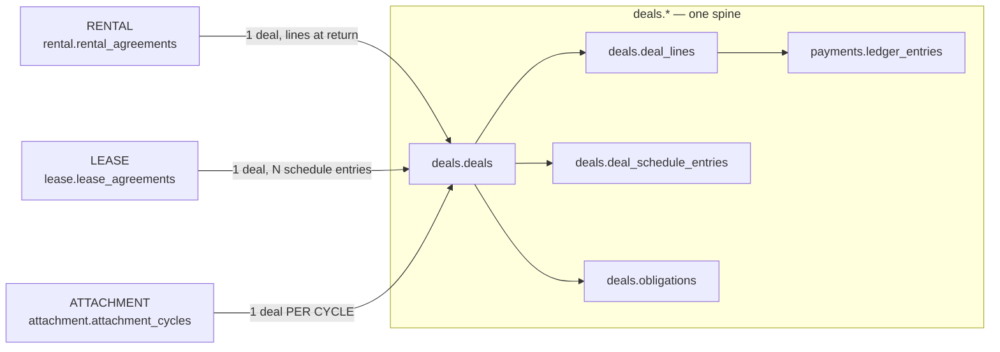
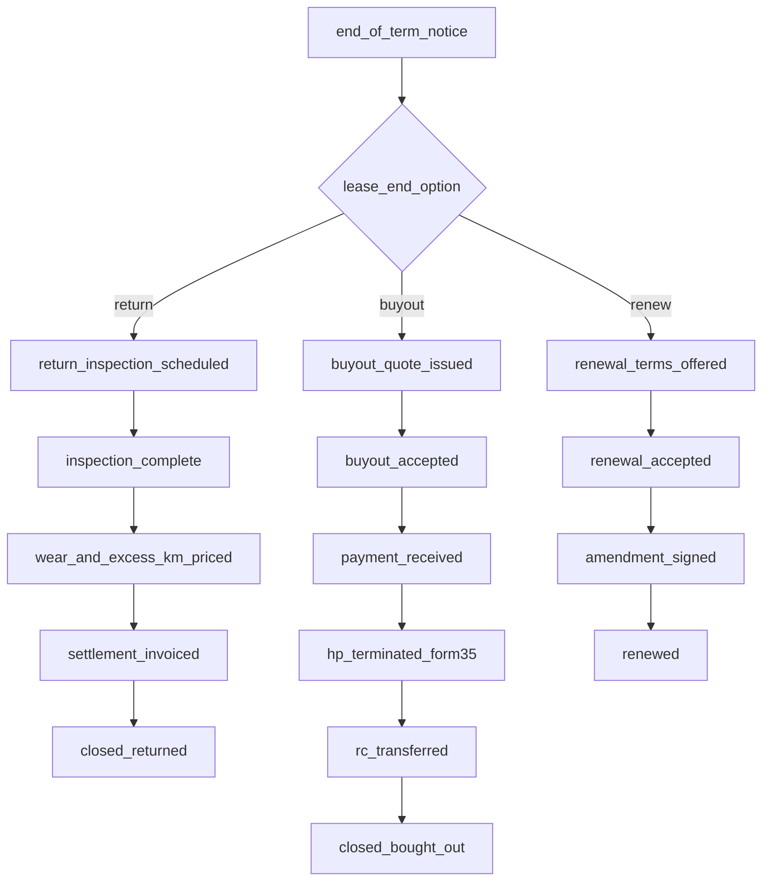
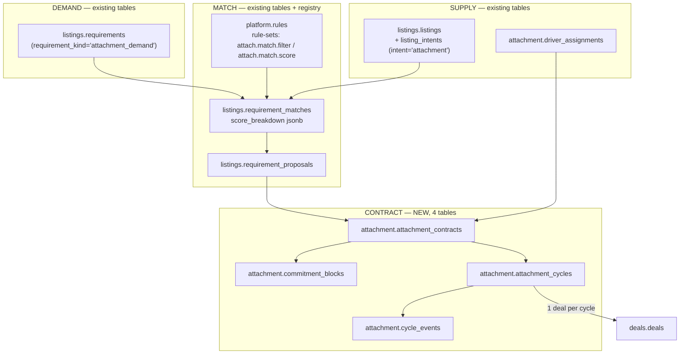
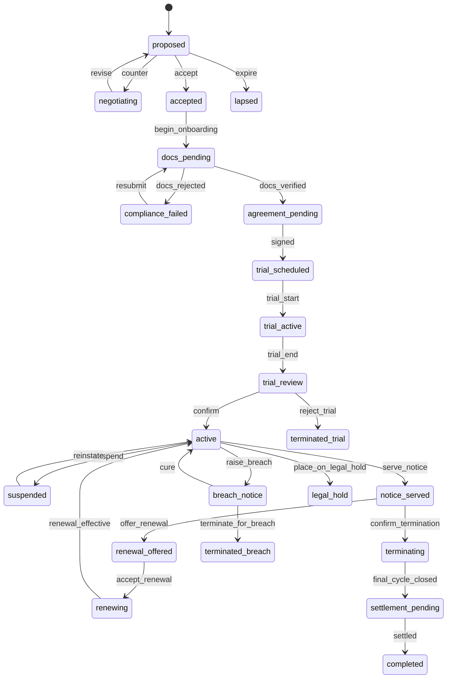

# Module Spec 12 — Rental, Lease, and the Taxi Attachment Centre

> PRD modules 5, 6, 7. Three intents, one spine.
> Anchors: `00-north-star.md` (stack, prime directive, repository shape), `01-design-system.md`.
> Derives from: `02-domain-model.md` §9 (aggregates), `03-data-model-erd.md` §2 (conventions),
> §3 (registries), §4 (spine tables), `04-api-contract.md` §1 (REST), §3.9 (error codes), §9.13 (routes).
>
> **This document adds no new architecture.** It adds registry rows, three schemas of
> *terms-and-operations* tables, and the engineering judgment needed to make short-term possession,
> long-term possession, and earning-capacity brokerage work in India.

---

## 0. Scope, and the one rule this document obeys

Three intents — `rental`, `lease`, `attachment` — that a naive build ships as three verticals with
three status enums, three fee tables and three settlement paths. This document builds them as
**three sets of registry rows plus fifteen operational tables**, riding the Listing + Deal spine
that already exists.

The rule, applied on every page:

> A status is a `platform.workflow_states` row.
> A rupee is a `platform.fee_components` row.
> An option list is a `platform.codes` row.
> A field is a `platform.form_versions` schema property.
> Anything left over is an operational fact — a timestamp, an odometer reading, a UTR — and only
> those get columns.

The taxi attachment centre (§5) is the module that pays for the architecture. It is a genuine
two-sided market with a matching engine, recurring settlement and churn management, and it adds
**four tables**. Everything else it needs already exists.

---

## 1. Three intents, one spine — proved at the column level

### 1.1 The `platform.intent_types` rows that drive everything

`02-domain-model.md` §3.3 defines the intent taxonomy. These are the three rows this document
depends on, with the metadata columns the engines read:

| `code` | `settlement_mode` | `asset_cardinality` | `requires_possession_transfer` | `default_workflow_code` | `deal_source_kind` | `is_recurring` | `counterparty_direction` |
|---|---|---|---|---|---|---|---|
| `rental` | `one_shot_plus_variable` | 1 | true (temporary) | `deal.rental` | `booking` | false | supply → demand |
| `lease` | `recurring` | 1 | true (temporary) | `deal.lease` | `agreement` | true | supply → demand |
| `attachment` | `recurring_reverse` | 1 | **false** | `deal.attachment` | `contract_cycle` | true | **demand → supply** |

`counterparty_direction` is the column that makes attachment work without a second codebase. In
`rental` and `lease` the vehicle owner is paid *by* the counterparty and the platform's commission
is deducted from the owner's receipt. In `attachment` the money still flows payer → escrow → payee,
but the vehicle never changes hands and the "customer" is a fleet operator buying capacity.
`recurring_reverse` tells Deals to open one Deal **per cycle** rather than one per transaction, and
to treat the supply side as the payee. Two registry columns; zero branches.

### 1.2 What actually differs between the three, and where each difference lives

This is the table to argue with. A reviewer who thinks rental needs its own listing table must name
a row here that cannot be satisfied.

| Concept | Rental | Lease | Attachment | Where it lives |
|---|---|---|---|---|
| The offer | a car available Fri–Sun | a car available for 36 months | a taxi + driver on a Whitefield route | `listings.listings` + `listings.listing_intents` (one row per intent) |
| Rate basis | `per_day` / `per_hour` | `per_month` | `per_duty` / `per_km` / `revenue_share` / `per_month` | `listing_intents.rate_basis_code` → code set `rate_basis` |
| Rate | ₹2,200/day | ₹28,430/month | 6% of gross, or ₹1,850/duty | `listing_intents.rate_amount_paise` / `revenue_share_bps` |
| Term bounds | 4 hrs – 30 days | 12/24/36/48 months | 3 – 36 months | `min_term_units`, `max_term_units`, `term_unit_code` |
| Deposit | ₹5,000 refundable | ₹1,50,000 down payment | ₹0 or a security guarantee | `listing_intents.security_deposit_paise` |
| Included usage | 200 km/day | 15,000 km/year | 120 km/duty | `listing_intents.included_km_per_period` |
| Overage rate | ₹9/km | ₹6.50/km | ₹14/km | `listing_intents.extra_km_rate_paise` |
| Fuel policy | `full_to_full` | lessee's problem | operator reimburses | `listing_intents.terms.fuel_policy_code` |
| Driver | self-drive or with-driver | never | almost always | `listing_intents.terms.driver_supplied_by` |
| Residual value | n/a | 42% of ex-showroom | n/a | `platform.rules`, rule-set `lease.residual_curve` |
| Duty pattern | n/a | n/a | 12hr/120km, 26 duties/month | `listing_intents.terms.duty_pattern` |
| Route | n/a | n/a | H3 cells + named corridor | `listing_intents.terms.route` + `listings.location` |
| Required documents | rent-a-cab licence, host KYC | lessor licence, bureau consent | contract-carriage permit, fitness, PSV badge | `platform.intent_requirements` rows |
| The form the user fills | `rental.host_listing.v3` | `lease.plan_offer.v2` | `attach.supply_post.v4` | `platform.form_versions` |
| The statuses | 20 | 17 | 19 | `platform.workflow_states` rows on 3 definitions |
| The fees | 8 components | 6 components | 9 components | `platform.fee_components` rows |
| The settlement | one Deal, variable lines at return | one Deal, N schedule entries | one Deal **per cycle** | `deals.deals` + `deals.deal_lines` |

Every "Rental needs X" argument resolves to one of five destinations: a typed column that already
exists on `listing_intents`, a key in `listing_intents.terms` jsonb governed by a form schema, a
taxonomy code, a registry rule, or an operational table in this document.

### 1.3 Tables this document does **not** create, and why

| Tempting table | Use instead | Reason |
|---|---|---|
| `rental.rental_listings` | `listings.listing_intents WHERE intent_type_code='rental'` | A fleet Bolero is simultaneously for sale, for rent and for attachment. Three listing tables = three truths for one car. |
| `attachment.demand_posts` | `listings.requirements WHERE requirement_kind='attachment_demand'` | Module 10 §9 already built the requirement board on the search grammar. Attachment demand *is* an inverted listing. |
| `attachment.matches` | `listings.requirement_matches` | Same table, richer `score_breakdown`. The re-ranker is registry rows, not a schema. |
| `rental.invoices`, `lease.invoices`, `attachment.invoices` | `payments.invoices` | One GST/e-invoicing path. Three would mean three IRN failure modes. |
| `*.statuses` lookup tables | `platform.workflow_states` | North star §2. |
| `*.pricing_rules` | `platform.fee_components` + `platform.fee_slabs` | North star §2. |
| `attachment.drivers` | `identity.parties` (role `driver`) + `documents.documents` | A driver is a Party; a DL is a Document. What is attachment-specific is the *assignment* (§5.8). |

Net new tables: **6 rental, 5 lease, 4 attachment**.

### 1.4 How the same Deal spine settles three different money shapes



| | Deals per contract | Lines created when | Schedule entries | Obligations that block payout |
|---|---|---|---|---|
| Rental | 1 | at booking (rent, deposit) + at return (late fee, excess km, fuel, damage, toll, challan) | 0 | `challan_clearance`, `damage_assessment` |
| Lease | 1 | at signing (down payment, fees) + one `rent` line per period as it falls due | `tenure_months` | `hp_endorsement`, `insurance_transfer`, `rc_endorsement` |
| Attachment | 1 **per cycle** | at cycle close, all of them | 0 (the cycle *is* the period) | `variance_reconciliation`, `dispute_open` |

For attachment, `deals.deals.source_kind_code='contract_cycle'` and `source_id=attachment_cycles.id`;
deal creation is idempotent on `(source_kind_code, source_id)` — already a unique index (`02` §14.3).
Re-running a cycle close cannot produce two deals.

---

## 2. The registry surface these three modules consume

| # | Registry | What these modules put in it |
|---|---|---|
| 1 | Taxonomy | code sets `rate_basis`, `term_unit`, `fuel_policy`, `driver_supplied_by`, `lease_kind`, `lease_end_option`, `attachment_contract_type`, `attachment_cycle`, `deduction_kind`, `sla_clause`, `damage_severity`, `dispute_reason`, `termination_reason`, `churn_band`, `permit_class`, `dl_class` |
| 2 | Form Schema | `rental.host_listing.v3`, `rental.booking_request.v5`, `rental.condition_report.v4`, `rental.damage_claim.v2`, `lease.plan_offer.v2`, `lease.application.v6`, `lease.corporate_approval.v2`, `lease.end_of_lease.v3`, `attach.supply_post.v4`, `attach.demand_post.v4`, `attach.proposal.v3`, `attach.trial_review.v2`, `attach.cycle_dispute.v2` |
| 3 | Workflow | definitions `rental_booking`, `rental_unit`, `damage_claim`, `deposit_hold`, `lease_application`, `lease_agreement`, `lease_end`, `attachment_supply`, `attachment_contract`, `attachment_cycle`, `attachment_dispute` |
| 4 | Pricing & Commission | 23 `fee_components` (§3.3, §4.9, §5.9), `fee_slabs` for tiered commission, `tax_rules` for SAC 9966/9973/998599, TDS 194-I / 194-O, RCM flags |
| 5 | RBAC | `rental.unit.manage`, `rental.booking.handover`, `rental.damage.assess`, `lease.plan.publish`, `lease.approve` (scoped `org:{id}` / `cost_centre:{id}`), `attachment.demand.publish`, `attachment.contract.terminate`, `attachment.cycle.close`, `attachment.cycle.override` |
| 6 | Feature & Module | `module.rental`, `module.lease`, `module.attachment`, `rental.self_drive`, `rental.class_level_booking`, `attachment.auto_match`, `attachment.trial_period` — each city/tier scoped |
| 7 | Notification | 41 event codes (§6.4) |
| 8 | Integration | `parivahan.sarathi_dl`, `vahan.rc`, `esign.aadhaar_otp`, `estamp.shcil`, `pg.razorpay_preauth`, `upi.block_debit`, `fastag.netc`, `aggregator.uber_partner`, `aggregator.ola_partner`, `telematics.ais140`, `bureau.cibil`, `irp.einvoice` — each with a fallback chain |
| 9 | Localization | every label above; Hindi / Marathi / Kannada / Tamil are the priority set for attachment (owner-drivers) |
| 10 | Geography | `platform.service_areas` for rental delivery radius and attachment corridors; `platform.rto_offices` for permit jurisdiction |

Cache keys follow `03` §3.0 (`reg:wf:{entity_type}:{epoch}`, `reg:fee:{module}:{epoch}`). No module
here reads a registry table directly; all reads go through the `Platform` registry client.

---

## 3. RENTAL

### 3.1 The bookable resource

A `listing_intent` is an *offer*. What gets double-booked is a physical car — or, for a fleet, a
*pool* of interchangeable cars. Those are different concurrency problems, and that distinction is
the single most important design decision in this module.

```sql
CREATE SCHEMA rental;

CREATE TABLE rental.unit_classes (
    id              uuid PRIMARY KEY DEFAULT platform.uuid_generate_v7(),
    host_party_id   uuid NOT NULL REFERENCES identity.parties(id),
    code            platform.code_key NOT NULL,         -- 'hatch_mt_ac','sedan_at','suv_7s'
    name            text NOT NULL,
    category_id     uuid NOT NULL REFERENCES platform.categories(id),
    city_id         uuid NOT NULL REFERENCES platform.cities(id),
    capacity        smallint NOT NULL,                  -- physical units in the pool
    overbook_percent numeric(5,2) NOT NULL DEFAULT 0,   -- deliberate; see §3.2.4
    upgrade_ladder  platform.code_key[] NOT NULL DEFAULT '{}',
    created_at timestamptz NOT NULL DEFAULT now(), created_by uuid,
    updated_at timestamptz NOT NULL DEFAULT now(), updated_by uuid,
    deleted_at timestamptz, deleted_by uuid,
    row_version bigint NOT NULL DEFAULT 1,
    CONSTRAINT uq_unit_classes__host_code UNIQUE (host_party_id, code, deleted_at),
    CONSTRAINT ck_unit_classes__capacity CHECK (capacity > 0),
    CONSTRAINT ck_unit_classes__overbook CHECK (overbook_percent BETWEEN 0 AND 50)
);

CREATE TABLE rental.rental_units (
    id              uuid PRIMARY KEY DEFAULT platform.uuid_generate_v7(),
    public_ref      text NOT NULL,                      -- 'RU-7K2M9X'
    host_party_id   uuid NOT NULL REFERENCES identity.parties(id),
    host_org_id     uuid REFERENCES identity.organizations(id),
    vehicle_id      uuid NOT NULL REFERENCES catalog.vehicles(id),
    listing_id      uuid REFERENCES listings.listings(id),
    listing_intent_id uuid REFERENCES listings.listing_intents(id),
    vehicle_snapshot platform.jsonb_object NOT NULL,    -- 02 §20.6, mandatory
    unit_class_id   uuid REFERENCES rental.unit_classes(id),  -- NULL = this exact car is bookable
    home_city_id    uuid NOT NULL REFERENCES platform.cities(id),
    home_location   geography(Point,4326) NOT NULL,
    service_area_id uuid REFERENCES platform.service_areas(id),
    delivery_radius_km smallint,                        -- NULL = pickup only
    odometer_km     integer NOT NULL,
    odometer_read_at timestamptz NOT NULL,
    odometer_offset_km integer NOT NULL DEFAULT 0,      -- cluster replacement
    tank_capacity_l numeric(5,1),
    fuel_type_code  platform.code_key NOT NULL,
    plate_class_code platform.code_key NOT NULL,
    -- compliance PROJECTIONS of catalog.vehicle_compliance; never authored here
    permit_valid_till    date,
    fitness_valid_till   date,
    insurance_valid_till date,
    puc_valid_till       date,
    compliance_synced_at timestamptz,
    workflow_instance_id uuid NOT NULL REFERENCES platform.workflow_instances(id),
    state_code      platform.code_key NOT NULL,         -- 'onboarding','active','maintenance','retired'
    is_bookable     boolean NOT NULL DEFAULT false,     -- projected from workflow_states
    created_at timestamptz NOT NULL DEFAULT now(), created_by uuid,
    updated_at timestamptz NOT NULL DEFAULT now(), updated_by uuid,
    deleted_at timestamptz, deleted_by uuid,
    row_version bigint NOT NULL DEFAULT 1,
    CONSTRAINT uq_rental_units__vehicle UNIQUE (vehicle_id, deleted_at),
    CONSTRAINT ck_rental_units__odo CHECK (odometer_km >= 0)
);
```

**Why `is_bookable` is a column, not a state check.** The exclusion constraint in §3.2 needs an
IMMUTABLE predicate; it cannot join to `platform.workflow_states` to ask "does this state hold the
resource?". So the flag is projected onto the row in the same transaction as the state change —
exactly the pattern `03` §4.7 established for `booking.bookings.holds_resource`. Adding a state
`awaiting_pollution_check` that should still block bookings means setting `holds_resource=true` on
that registry row. No migration.

**Compliance columns are projections, not sources.** `catalog.vehicle_compliance` is the truth; a
`catalog.vehicle.compliance_synced.v1` event refreshes these four dates. They are duplicated here
because the availability query runs thousands of times a minute and must not join across a module
boundary (north star §4). On disagreement, Catalog wins and the projection is rebuilt.

### 3.2 Availability and the overbooking problem — the reservation model, precisely

Three layers. Only one is authoritative.

```
┌──────────────────────────────────────────────────────────────────────────┐
│ LAYER 1 — CALENDAR READ MODEL (Redis)          ADVISORY. NEVER DECIDES.  │
│   rental:cal:{unit_id}:{YYYYMM} → 2976-bit bitmap of 15-min slots        │
│   rental:cls:{class_id}:{YYYYMMDD} → remaining count                     │
│   Rebuilt from Layer 3 via outbox; TTL 3600s as a safety net.            │
│   Serves GET /rental/availability in ~2 ms. May be stale by seconds.     │
├──────────────────────────────────────────────────────────────────────────┤
│ LAYER 2 — HOLD (Postgres row, TTL'd)           A RESERVATION.            │
│   availability_blocks row, block_kind_code='hold', expires_at = now+TTL  │
│   Inserted in the SAME TRANSACTION as the payment intent.                │
│   Subject to the same exclusion constraint as a confirmed booking.       │
├──────────────────────────────────────────────────────────────────────────┤
│ LAYER 3 — CONFIRMED BLOCK (Postgres row)       THE ONLY TRUTH.           │
│   The same row, PROMOTED IN PLACE to block_kind_code='booked'.           │
│   Guarded by ex_availability_blocks__unit_overlap (GiST EXCLUDE).        │
└──────────────────────────────────────────────────────────────────────────┘
```

#### 3.2.1 The table and the constraint

```sql
CREATE TABLE rental.availability_blocks (
    id              uuid PRIMARY KEY DEFAULT platform.uuid_generate_v7(),
    unit_id         uuid REFERENCES rental.rental_units(id),      -- NULL for class-level holds
    unit_class_id   uuid REFERENCES rental.unit_classes(id),      -- NULL for unit-level holds
    block_kind_code platform.code_key NOT NULL,   -- 'hold','booked','maintenance','blackout','buffer'
    period          tstzrange NOT NULL,
    agreement_id    uuid,                          -- rental.rental_agreements.id (FK added later)
    deal_id         uuid,                          -- deals.deals.id — no FK, module isolation
    quote_id        uuid,
    is_active       boolean NOT NULL DEFAULT true, -- the IMMUTABLE predicate driver
    expires_at      timestamptz,                   -- non-NULL only for 'hold'
    released_at     timestamptz,
    released_reason_code platform.code_key,        -- 'hold_expired','cancelled','promoted','ops_release'
    created_at timestamptz NOT NULL DEFAULT now(), created_by uuid,
    updated_at timestamptz NOT NULL DEFAULT now(), updated_by uuid,
    row_version bigint NOT NULL DEFAULT 1,
    CONSTRAINT ck_availability_blocks__target CHECK (
        (unit_id IS NOT NULL) <> (unit_class_id IS NOT NULL)),
    CONSTRAINT ck_availability_blocks__period CHECK (NOT isempty(period)),
    CONSTRAINT ck_availability_blocks__hold_ttl CHECK (
        (block_kind_code = 'hold') = (expires_at IS NOT NULL)),
    -- THE double-booking guard. btree_gist supplies uuid equality.
    CONSTRAINT ex_availability_blocks__unit_overlap EXCLUDE USING gist (
        unit_id WITH =,
        period  WITH &&
    ) WHERE (is_active AND unit_id IS NOT NULL)
);

CREATE INDEX ix_availability_blocks__hold_sweep
    ON rental.availability_blocks (unit_id, expires_at)
    WHERE is_active AND block_kind_code = 'hold';

CREATE INDEX ix_availability_blocks__class_window
    ON rental.availability_blocks USING gist (unit_class_id, period)
    WHERE is_active AND unit_class_id IS NOT NULL;
```

**The trap most implementations hit.** The obvious predicate is
`WHERE (expires_at IS NULL OR expires_at > now())`. PostgreSQL rejects it — index and exclusion
predicates must be IMMUTABLE and `now()` is STABLE. Expiry therefore *cannot* be enforced by the
constraint, and an expired-but-unswept hold would block a legitimate booking if we relied on a
background janitor alone.

#### 3.2.2 The booking transaction, exactly

```
BEGIN;  -- READ COMMITTED (Postgres default). Do NOT use REPEATABLE READ here.

-- 1. Targeted expiry sweep. Bounded, indexed, and it takes row locks that serialise
--    two concurrent bookers contending on the same expired hold.
UPDATE rental.availability_blocks
   SET is_active = false, released_at = now(), released_reason_code = 'hold_expired'
 WHERE unit_id = :unit_id
   AND block_kind_code = 'hold'
   AND is_active
   AND expires_at <= now()
   AND period && :requested_period;

-- 2. Compliance + bookability guard — reads the ENTITY, never a provider's availability
SELECT is_bookable, permit_valid_till, insurance_valid_till, fitness_valid_till
  FROM rental.rental_units WHERE id = :unit_id FOR SHARE;
--    fails → rental.unit.compliance_lapsed (422)

-- 3. Insert the hold. The EXCLUDE constraint decides. No SELECT-then-INSERT anywhere.
INSERT INTO rental.availability_blocks
       (unit_id, block_kind_code, period, quote_id, expires_at)
VALUES (:unit_id, 'hold', :requested_period, :quote_id,
        now() + make_interval(secs => :hold_ttl_seconds));
--    23P01 on ex_availability_blocks__unit_overlap → rental.availability.conflict (409)

-- 4. Create the payment intent for rent + deposit, in the SAME transaction
INSERT INTO payments.payment_intents (...) RETURNING id;

COMMIT;
```

`:hold_ttl_seconds` is `platform.feature_flags['rental.hold_ttl_seconds']`, default **900**. It is
900 and not 300 because a UPI collect request legitimately sits unanswered for 5–8 minutes on a weak
network, and a hold that dies while the customer is authorising in their PSP app is the worst
possible failure: the customer pays and there is nothing to pay for.

**Promotion, not re-insertion.** On `payments.payment.captured.v1`:

```sql
UPDATE rental.availability_blocks
   SET block_kind_code = 'booked', expires_at = NULL,
       agreement_id = :agreement_id, deal_id = :deal_id
 WHERE id = :block_id AND block_kind_code = 'hold' AND is_active;
-- 0 rows → the hold was swept while the payment was in flight
--          → rental.hold_expired (409) + IMMEDIATE auto-refund (§3.13 F2)
```

Delete-then-insert opens a window — however small — in which the slot is free. Under load that
window is exactly where the double booking lands. **Promote in place.**

#### 3.2.3 Race conditions, enumerated

| # | Race | Outcome | Mechanism |
|---|---|---|---|
| R1 | Two customers request the same unit, overlapping windows, same millisecond | One commits; one gets `23P01` → `rental.availability.conflict` with `alternates[]` | GiST exclusion. No application lock. |
| R2 | Hold expires between a competing transaction's sweep and insert | Impossible: the sweep row-locks the expired hold; the second transaction blocks until commit, then re-reads | `READ COMMITTED` re-evaluation after lock release |
| R3 | Payment captured after the hold was swept | `rental.hold_expired`; auto-refund within 60 s; customer notified with the reason | 0-row promotion UPDATE |
| R4 | PG webhook arrives twice | No-op (block is already `booked`, so the promotion matches 0 rows); payment idempotency also catches it | Two independent guards |
| R5 | Host adds maintenance over a confirmed booking | `23P01` → `rental.blackout.conflicts_booking` (409), listing the conflicting agreements | Same constraint, host side |
| R6 | Extension requested while another customer holds the next slot | Extension is a *separate adjacent* block; conflict → `rental.extension.blocked` (409) with the earliest conflicting start | §3.8 |
| R7 | Unit retired mid-booking | Retirement guard counts active blocks → `rental.unit.has_active_bookings` | Workflow guard rule-set |
| R8 | Class-level booking oversells | §3.2.4 | Advisory xact lock |
| R9 | Two ops users release the same hold | Second is an idempotent no-op | `WHERE is_active` |

Postgres emits `23P01` with `constraint_name`; `03` §2.6 makes the API middleware map constraint
name → machine code. Renaming `ex_availability_blocks__unit_overlap` is an API-breaking change.

#### 3.2.4 Class-level booking and *deliberate* overbooking

Peer-to-peer hosts rent a specific car. Fleet operators rent a *class* — "any automatic sedan" — and
assign the physical car at T-24h. Real rental businesses also overbook 3–8% because no-shows are
predictable. Both are legitimate; neither works with an interval-exclusion constraint, because the
constraint has no `unit_id` to key on.

The class path uses a **transactional advisory lock keyed on the class**, serialising only bookings
for the same class:

```sql
BEGIN;
SELECT pg_advisory_xact_lock(hashtextextended('rental:cls:' || :class_id::text, 0));

WITH cls AS (SELECT capacity, overbook_percent FROM rental.unit_classes WHERE id = :class_id),
     taken AS (SELECT count(*) AS n FROM rental.availability_blocks
                WHERE unit_class_id = :class_id AND is_active
                  AND (expires_at IS NULL OR expires_at > now())
                  AND period && :requested_period)
SELECT (taken.n < floor(cls.capacity * (1 + cls.overbook_percent/100.0))) AS ok FROM cls, taken;
-- false → rental.class.sold_out (409)

INSERT INTO rental.availability_blocks (unit_class_id, block_kind_code, period, expires_at) ...;
COMMIT;
```

The lock is `xact`-scoped, so it releases on commit or rollback with no leak path. Note this query
*may* use `now()` — it is a plain query, not an index predicate.

Assignment at T-24h converts a class block into a unit block, and *that* insert goes through the
exclusion constraint. If assignment fails because the fleet genuinely oversold:

```
1. Walk upgrade_ladder in order → assign a higher class at the booked rate; raise a
   `discount` deal_line via fee component `rental_upgrade_absorption` (payer = host).
2. No upgrade available → transition `denied_service`; fee component
   `rental_denied_service_compensation` (payer = host, payee = renter) fires:
   100% refund + 25% of booking value, capped ₹5,000.
3. The compensation is A REGISTRY ROW. A host who overbooks aggressively pays for it
   automatically. That is the control loop — not a policy document.
```

`overbook_percent` is CHECK-capped at 50 because an unbounded value is an operational weapon. The
effective value per class/city/day can be overridden by `platform.rules` rule-set
`rental.overbook_policy` (inputs: class, city, day-of-week, lead time, historical no-show rate).

#### 3.2.5 The calendar read model

`GET /rental/availability/{listingIntentId}?from=&to=` must answer a 90-day window in single-digit
milliseconds and must never decide a booking.

- **Storage:** Redis bitmap per unit-month, 15-minute granularity (2,976 bits ≈ 372 bytes/month);
  bit set = unavailable. Class-level: a hash of `YYYYMMDD → remaining`.
- **Write path:** every block insert/promote/release publishes `rental.availability.changed.v1`
  through the outbox; the projector sets/clears bits. The outbox guarantees eventual agreement with
  Layer 3.
- **Divergence:** a nightly job recomputes every active unit's bitmap from Postgres and writes
  mismatches to `platform.integrity_findings`. Expected count: 0. Non-zero pages ops.
- **Fragmentation:** the API returns `bookable_windows[]` filtered by `min_term_units`. A 4-hour gap
  between two bookings is not bookable for a 1-day minimum, and showing it as green is a lie that
  converts into a 409. The host dashboard surfaces *fragmentation cost* (unbookable free hours ÷
  total free hours) — that number is what makes a host accept a longer minimum term.
- **Buffer blocks:** `block_kind_code='buffer'` is auto-inserted around every booking for
  `rental.turnaround_minutes` (registry; 60 self-drive, 120 with-driver). Cleaning, refuelling and
  the drive back are real; the calendar must own them, otherwise the host absorbs them silently.

### 3.3 Pricing — what is registry, what is host data, and how they combine

| Thing | Owner | Where |
|---|---|---|
| "₹2,200/day for my Swift" | **host** | `listing_intents.rate_amount_paise` |
| "₹3,400 on 31 December" | **host** | `rental.rate_calendar` |
| "weekly bookings get 12% off" | **registry** (host picks a policy) | `platform.rules`, rule-set `rental.rate_modifiers` |
| "Goa ×1.4 in December" | **registry** | same rule-set, `applies_when` on city + date |
| "platform takes 12% of rent" | **registry** | `fee_components.rental_platform_fee` |
| "late fee ₹250/hour after 60 min grace" | **registry** | `fee_components.rental_late_fee` |
| "GST 5% without ITC on rent-a-cab" | **registry** | `tax_rules` |

```sql
CREATE TABLE rental.rate_calendar (
    id              uuid PRIMARY KEY DEFAULT platform.uuid_generate_v7(),
    listing_intent_id uuid NOT NULL REFERENCES listings.listing_intents(id) ON DELETE CASCADE,
    unit_class_id   uuid REFERENCES rental.unit_classes(id),
    day             date NOT NULL,
    rate_amount_paise platform.money_paise,             -- absolute override
    rate_multiplier numeric(5,3),                        -- OR relative; exactly one
    min_term_units  smallint,                            -- "3-night minimum on NYE"
    is_closed       boolean NOT NULL DEFAULT false,      -- host stop-sell
    source_code     platform.code_key NOT NULL DEFAULT 'host',   -- host|yield_engine|import
    created_at timestamptz NOT NULL DEFAULT now(), created_by uuid,
    updated_at timestamptz NOT NULL DEFAULT now(), updated_by uuid,
    row_version bigint NOT NULL DEFAULT 1,
    CONSTRAINT uq_rate_calendar__intent_day UNIQUE (listing_intent_id, day),
    CONSTRAINT ck_rate_calendar__one_form CHECK (num_nonnulls(rate_amount_paise, rate_multiplier) <= 1)
);
```

#### 3.3.1 The day-vector algorithm

Pricing a rental is not `days × rate`. It is a vector reduction, and the order of operations is
registry data because a business person will want to change it.

```
INPUT:  period [pickup_at, dropoff_at), listing_intent, renter context (city, tier, coupon)
OUTPUT: rent_gross_paise + pricing_trace[] where every element names the rule that fired

1. EXPAND    period → billable units per rate_basis_code
             per_day : ceil to whole days with `rental.grace_minutes` (registry, 59) tolerance,
                       so a 24 h 05 m rental is 1 day, not 2
             per_hour: ceil to whole hours; the per-day floor applies after N hours (registry)
2. BASE      each unit → rate_calendar override ?? listing_intent.rate_amount_paise
3. MODIFIERS evaluate rule-set `rental.rate_modifiers` per unit in `priority` order.
             outcome: {"op":"mul"|"add"|"set","value":…,"explain_i18n_key":…}
             stop_on_match=false — modifiers stack
4. COMBINE   fold in priority order. Registry flag `rental.modifier_combine`
             = "sequential" (default) | "max_single" | "sum_of_deltas"
5. FLOOR/CAP outcome may carry {"floor_paise":…,"cap_paise":…}; applied per unit
6. SUM       Σ units → rent_base_paise
7. TERM      weekly/monthly discount applied to the SUM, not per unit
8. FEES      fee_components with basis `rent_total`: platform fee, delivery, driver, waiver,
             young-driver surcharge
9. TAX       tax_rules per component; place of supply from renter state vs host state
10. ROUND    round each COMPONENT per rounding_mode/rounding_to_paise, then sum the rounded
             values. NEVER round the running total — the invoice must foot.
```

Modifier rows as they actually look (`platform.rules`, rule-set `rental.rate_modifiers`, domain
`pricing`):

| `code` | `priority` | `condition` (JsonLogic over the day context) | `outcome` |
|---|---|---|---|
| `weekend` | 10 | `{"in":[{"var":"dow"},["sat","sun"]]}` | `{"op":"mul","value":1.15}` |
| `season_goa_dec` | 20 | `{"and":[{"==":[{"var":"city_code"},"GOA"]},{">=":[{"var":"mmdd"},"12-20"]}]}` | `{"op":"mul","value":1.40}` |
| `festival_block` | 25 | `{"in":[{"var":"day"},{"var":"registry.holiday_calendar"}]}` | `{"op":"mul","value":1.25}` |
| `surge_utilisation` | 30 | `{">":[{"var":"class_utilisation_pct"},85]}` | `{"op":"mul","value":1.20,"cap_paise":600000}` |
| `lead_time_early` | 40 | `{">":[{"var":"lead_days"},21]}` | `{"op":"mul","value":0.92}` |
| `lead_time_last_min` | 41 | `{"<":[{"var":"lead_hours"},6]}` | `{"op":"mul","value":1.10}` |
| `week_term` | 80 | `{">=":[{"var":"total_days"},7]}` | `{"op":"mul","value":0.88}` |
| `month_term` | 81 | `{">=":[{"var":"total_days"},28]}` | `{"op":"mul","value":0.72}` |
| `city_floor_mumbai` | 90 | `{"==":[{"var":"city_code"},"BOM"]}` | `{"op":"set","floor_paise":180000}` |

Adding "Bengaluru ×1.3 during a metro strike" is one row with an `effective_from`. No deploy. That
is the north star's acceptance test applied to rental pricing.

**Surge is capped and disclosed.** `cap_paise` exists because an uncapped multiplier during a flood
is a reputational event, and Indian consumer-protection scrutiny of surge pricing is real. Whenever
any multiplier > 1.0 fired, the UI must show the `pricing_trace` — `01-design-system.md` §7:
*numbers always carry their unit and their date*.

#### 3.3.2 Worked example

Swift AT, Pune → Lonavala, Fri 12 Dec 09:00 → Mon 15 Dec 18:00 IST. Base ₹2,200/day, self-drive,
200 km/day included.

| Day | Base | Modifiers fired | Day price |
|---|---|---|---|
| Fri 12 | ₹2,200 | — | ₹2,200 |
| Sat 13 | ₹2,200 | `weekend` ×1.15 | ₹2,530 |
| Sun 14 | ₹2,200 | `weekend` ×1.15 | ₹2,530 |
| Mon 15 | ₹2,200 | `surge_utilisation` ×1.20 | ₹2,640 |
| | | **rent_base** | **₹9,900** |

4 days < 7 → no term modifier.

| Line | Component | Basis | Amount | Tax | Total |
|---|---|---|---|---|---|
| Rent | `rent` | — | ₹9,900 | GST 5% no-ITC (`gst_rentacab_5`) | ₹10,395 |
| Delivery | `rental_delivery_fee` | flat, 8 km | ₹400 | 5% | ₹420 |
| Damage waiver | `rental_cdw_optional` | 8% of rent | ₹792 | 18% | ₹934 |
| **Renter pays now** | | | | | **₹11,749** |
| Security deposit | `rental_security_deposit` | flat | ₹5,000 | **none** | ₹5,000 *blocked, not charged* |
| Platform fee | `rental_platform_fee` | 12% of rent | ₹1,188 | 18% | ₹1,402 *deducted from host* |
| Host receives T+1 | | ₹9,900 + ₹400 − ₹1,402 | | | **₹8,898** |

Displayed as `₹11,749`; stored as `1174900` paise. The deposit is shown with the word **blocked**,
never *paid* (§3.5).

**The GST question that will be asked.** Renting a motor vehicle where the cost of fuel is included
in the consideration is SAC 9966 at 5% **without ITC**, or 12% with ITC — the host elects once on
their party profile, and the election is a `tax_rules` code on their settlement profile, not a
per-booking decision. Self-drive without an operator is arguably SAC 9973 ("transfer of the right to
use goods"), which carries the *same rate as the underlying goods* — 28% + cess. This is the largest
tax risk in the module. Our position: `tax_rule_code` is resolved from
`(with_driver, fuel_included, host_election, host_gst_registration)` by the eligibility rule-set
`rental.tax_treatment`, so a CBIC circular is a registry edit with an `effective_from` date — never a
code change, and never a retroactive re-tax (`tax_rules` rows are never UPDATEd; `03` §3.5).

### 3.4 Self-drive vs with-driver — a legal fork, not a checkbox

`listing_intents.terms.driver_supplied_by ∈ {none, host, platform_pool}` looks like a boolean. It
changes the vehicle's legal category, the required permit, the insurance product, the GST treatment,
the deposit size and the liability model.

| | Self-drive (`none`) | With driver (`host`) |
|---|---|---|
| Legal basis | Rent-a-Cab Scheme, Rules 82–85A CMVR 1989 | Contract-carriage permit / All-India Tourist Permit |
| Plate class | **Black plate, yellow lettering** (`black_self_drive`) | **Yellow plate, black lettering** (`yellow_commercial`) |
| Operator licence | Rent-a-Cab Operator's Licence held by the host | Permit held by the host |
| Renter's DL | **Mandatory**, verified against Sarathi, class must cover the vehicle | Not required |
| DL class check | `lmv` (cars), `mcwg` (two-wheelers), `hmv`/`htv` (>7.5 t) | n/a |
| Insurance | OD + TP; renter is the named driver | Commercial passenger policy with occupant cover |
| Deposit | ₹5,000 – ₹25,000 (registry slab on vehicle value) | ₹0 – ₹2,000 |
| GST | see §3.3.2 | SAC 9966, 5% no-ITC / 12% with ITC |
| Challan liability | **Renter** (recovered per §3.8) | Host/driver |
| Driver Party | `renter_party_id` | `driver_party_id`, must pass §5.8 compliance |

**A white private plate can never be rented, at any price, with or without a driver.** This is
`platform.intent_requirements` for `intent_type_code='rental'`:

| `requirement_code` | `applies_when` | Enforced at |
|---|---|---|
| `plate_class_commercial_or_selfdrive` | always | listing publish guard → `listing.not_publishable` |
| `rentacab_licence` | `driver_supplied_by='none'` | unit activation guard |
| `contract_carriage_permit` | `driver_supplied_by<>'none'` | unit activation guard |
| `commercial_insurance` | always | unit activation + daily sweep |
| `fitness_certificate` | `plate_class='yellow_commercial'` | daily sweep |
| `renter_dl_verified` | `driver_supplied_by='none'` | booking confirm guard |
| `driver_psv_badge` | `driver_supplied_by<>'none'` | handover guard |

DL verification calls `parivahan.sarathi_dl` through the Integration registry. What we store is
**derived, minimised and DPDP-lawful**: `dl_number_masked` (`MH12 ****7891`), `dl_classes[]`,
`valid_till`, `verified_at`, `verification_ref`, `name_match_score` against the KYC name. We do
**not** store the raw response, the address, or the photograph — DPDP Act 2023 purpose limitation,
and the purpose here is "confirm this person may lawfully drive this class of vehicle". Cached for
`rental.dl_cache_hours` (registry, 720) keyed on the DL hash.

**When Sarathi is down** (it is, often): the guard reads *entity state*, never provider availability
(`03` §11). The verification record parks in `pending_provider`; a workflow timer retries every 15
minutes for 24 hours. The booking can be created but cannot reach a `holds_funds` state; the
customer sees *"Licence check is queued — we'll confirm within a few minutes"* and the hold TTL is
extended once by `rental.hold_ttl_extension_seconds`. If the fallback chain
(`parivahan.sarathi_dl` → `digilocker.dl` → `manual_review`) exhausts, an ops task is created with
the uploaded DL image and a human decides. We never guess, and we never silently allow.

### 3.5 Security deposit — hold, adjust, release

The hardest money problem in the module, because India has no single instrument that does what a US
card pre-auth does.

| Instrument | Mechanism | Validity | When we use it |
|---|---|---|---|
| Card pre-auth | Razorpay `authorize`-only, capture or void later | **~5 days**, issuer-dependent | Bookings ≤ 4 days, card available |
| UPI single-block-multi-debit | NPCI block-and-debit mandate; funds ring-fenced in the payer's account | Up to the mandate end date | **Preferred.** Any duration, any PSP that supports it |
| Capture + refund | Charge, refund at settlement | n/a | Fallback. Costs the customer float and us MDR twice |
| Bank guarantee / corporate credit | Enterprise renters | Contractual | B2B only |
| Cash at handover | Off-platform | n/a | **Disallowed above `rental.cash_deposit_cap_paise`** (₹19,999) — §269ST of the Income-tax Act caps cash receipts, and cash deposits are unauditable and dispute-generating |

```sql
CREATE TABLE rental.deposit_holds (
    id              uuid PRIMARY KEY DEFAULT platform.uuid_generate_v7(),
    agreement_id    uuid NOT NULL,                 -- rental.rental_agreements.id
    instrument_code platform.code_key NOT NULL,    -- card_preauth|upi_block|capture_refund|bg|corporate_credit
    amount_paise    platform.money_paise NOT NULL,
    payment_intent_id uuid,
    external_ref    text,                           -- PG auth id / UPI mandate UMN
    blocked_at      timestamptz,
    expires_at      timestamptz,                    -- INSTRUMENT expiry, not the booking end
    reauth_count    smallint NOT NULL DEFAULT 0,
    adjusted_paise  platform.money_paise NOT NULL DEFAULT 0,
    released_paise  platform.money_paise NOT NULL DEFAULT 0,
    state_code      platform.code_key NOT NULL,
    workflow_instance_id uuid NOT NULL REFERENCES platform.workflow_instances(id),
    created_at timestamptz NOT NULL DEFAULT now(), created_by uuid,
    updated_at timestamptz NOT NULL DEFAULT now(), updated_by uuid,
    row_version bigint NOT NULL DEFAULT 1,
    CONSTRAINT ck_deposit_holds__amounts CHECK (adjusted_paise + released_paise <= amount_paise)
);
```

**The pre-auth expiry problem, handled.** A 10-day rental with a 5-day card auth lapses mid-trip.
The instrument selector (rule-set `rental.deposit_instrument`; inputs: duration, amount, available
instruments, renter tier) refuses card pre-auth when
`duration_days > integration_registry['pg.razorpay_preauth'].max_auth_days - 1`. If no instrument
qualifies → `rental.deposit.instrument_unavailable` (422) with the reason surfaced, never a silent
downgrade to capture-and-refund. Where re-auth is possible, a workflow timer fires at
`expires_at - 24h`, attempts re-auth, and on failure escalates to the renter and then to a
`deposit_at_risk` state that blocks trip extension.

**Ledger treatment.** `DR 1010 PG receivable / CR 2020 Security deposit held`. A deposit is not
consideration for a supply, so **no GST at collection**. On forfeiture or adjustment it becomes
consideration for the underlying supply (damage, late fee), and GST applies *then*, on the adjusted
amount, through the fee component that consumed it — never as a lump. Taxing a refundable deposit at
collection and refunding it later is a GST reconciliation nightmare and an ITC mismatch for
corporate renters.

**Release, and why it is delayed.** `rental.deposit_release_delay_hours` (registry, default **72**)
exists because e-challans arrive days after the trip (§3.8):

```
return completed
  → settlement computed (§3.8) → adjustments raised as deal_lines
  → adjusted_paise = Σ(lines payable from deposit), capped at amount_paise
  → workflow timer +72 h → challan re-sync for the trip window
  → release: void the block/auth for (amount − adjusted), or refund if capture_refund
  → rental.deposit.settled.v1
```

If adjustments exceed the deposit, the excess becomes a **receivable on the renter**
(`DR 1100 Buyer receivable`) with the Payments module's dunning workflow — not an unpaid invoice
that ops chases by phone. A challan landing after release takes the same path. The design refuses to
pretend 72 hours is sufficient; it makes the common case clean and the rare case explicit.

### 3.6 Agreement, e-stamp, e-sign

| Step | Mechanism | Registry |
|---|---|---|
| Generate | Document template per `(intent, state, driver_mode, language)`, rendered to PDF/A | `platform.document_templates` |
| Stamp | SHCIL e-stamp via `estamp.shcil`; duty per state Stamp Act Art. 5 | rule-set `rental.stamp_duty` (state → amount/percent) |
| Sign | Aadhaar OTP eSign (IT Act §3A + Second Schedule) via `esign.aadhaar_otp`; DSC for corporates; click-wrap + audit trail below `rental.esign_threshold_paise` | Integration registry with fallback chain |
| Store | `documents.documents` with `content_sha256`, ESP txn id, signer IP/time, `retention_policy_code` | Documents module |

A rental agreement under 11 months is not compulsorily registrable under §17 of the Registration
Act; stamp duty still applies and varies by state — hence a rule-set, not a constant. Below the
eSign threshold (registry default ₹50,000 booking value) a click-wrap acceptance with a full audit
trail is used, because Aadhaar eSign costs money and adds ~40 seconds to a ₹1,800 booking.

**When the ESP is down:** the agreement parks in `awaiting_signature`, the handover guard fails with
`rental.agreement.unsigned`, and the hold TTL extends once. Handover **never** proceeds on an
unsigned agreement — no signature means no enforceable claim on the deposit, no liability transfer,
and no defence in a challan dispute.

### 3.7 Handover and return

One form schema, two uses: `rental.condition_report.v4`, rendered by `SchemaForm` identically on web
and Flutter, captured offline-first (handovers happen in basements with no signal — the same
constraint as inspections, `02` §IN2).

```sql
CREATE TABLE rental.condition_reports (
    id              uuid PRIMARY KEY DEFAULT platform.uuid_generate_v7(),
    agreement_id    uuid NOT NULL,
    phase_code      platform.code_key NOT NULL,        -- 'handover' | 'return'
    form_version_id uuid NOT NULL REFERENCES platform.form_versions(id),
    responses       platform.jsonb_object NOT NULL,    -- schema-validated
    odometer_km     integer NOT NULL,
    fuel_level_pct  smallint NOT NULL,
    damage_marks    jsonb NOT NULL DEFAULT '[]',       -- [{panel,severity_code,media_ids[],note}]
    media_ids       uuid[] NOT NULL DEFAULT '{}',
    captured_at     timestamptz NOT NULL,
    captured_geo    geography(Point,4326),
    device_id       text,
    offline_captured boolean NOT NULL DEFAULT false,
    client_revision integer NOT NULL DEFAULT 1,
    otp_hash        platform.sha256_hex,               -- counterparty acknowledgement
    otp_verified_at timestamptz,
    signed_document_id uuid,
    created_at timestamptz NOT NULL DEFAULT now(), created_by uuid,
    updated_at timestamptz NOT NULL DEFAULT now(), updated_by uuid,
    row_version bigint NOT NULL DEFAULT 1,
    CONSTRAINT uq_condition_reports__phase UNIQUE (agreement_id, phase_code),
    CONSTRAINT ck_condition_reports__fuel CHECK (fuel_level_pct BETWEEN 0 AND 100)
);
```

- **OTP is mutual.** Handover requires the renter's OTP (they took possession); return requires the
  host's OTP (they took it back). `otp_hash` only, never the OTP (`03` §4.7).
- **Media minimums** come from the registry (`rental.handover_min_photos`, default 8: four corners,
  odometer, fuel gauge, interior, boot). A report below the minimum cannot complete the transition.
  This is the single highest-leverage anti-dispute control in the module.
- **Geo + timestamp** are captured because "he returned it at 6 pm" versus "9 pm" is a ₹750
  late-fee argument that happens daily.
- **Offline sync** is idempotent on `(agreement_id, phase_code, client_revision)`; conflicts resolve
  last-writer-wins **per field**, with the full conflict recorded.
- **Odometer regression** is a database-level CHECK on the agreement (§3.11), because a return
  reading below the handover reading silently zeroes the excess-km line.

### 3.8 The four variable lines: extension, late fee, KM overage, fuel

All four are `deal_lines` on the *same* Deal opened at booking. None is computed by a literal.

#### Extension

An extension is a **new adjacent block**, not a mutation. `POST /rental/bookings/{id}/extension-quote`
returns price + feasibility with no commitment; `POST .../transitions {action:"extend"}` runs the
§3.2.2 transaction for `[old_end, new_end)`. Conflict → `rental.extension.blocked` (409) carrying the
earliest conflicting start, so the UI offers *"we can extend you until 14:00 tomorrow"* instead of
*"unavailable"*. Extension pricing re-runs the day vector **for the new days only** — the original
days keep their frozen prices, because re-pricing a trip the customer is already on is indefensible.

#### Late fee accrual

```
fee_component `rental_late_fee`
  calc_method = 'per_unit', unit_code = 'hour', basis = 'flat'
  per_unit_amount_paise = 25000                          -- ₹250/hour
  applies_when = {">":[{"var":"overdue_minutes"},{"var":"registry.rental.late_grace_minutes"}]}
  rule_set_id  → `rental.late_fee_escalation`
fee_slabs on overdue hours (is_marginal = true)
  0–2 h  → ₹250/h      2–6 h → ₹400/h
  6–24 h → capped at one full day rate + ₹1,000
  >24 h  → one full day rate per started day; workflow fires `overdue_escalated`
```

Accrual is **computed on read**, never materialised by a cron — a pure function of
`(dropoff_at, now(), fee rows)`. A cron writing hourly rows for every overdue booking is thousands of
writes for money that may never be charged, and the amount must be recomputable from first principles
during a dispute. It is **frozen** into a `deal_line` exactly once, at the return transition, with
`pricing_snapshot` capturing the rules that produced it.

At >24 h overdue the workflow fires `overdue_escalated`, which (a) notifies the host, (b) raises an
ops task, (c) requests a telematics location ping if fitted, and (d) after `rental.theft_report_hours`
(registry, 72) surfaces the FIR/theft-report workflow. A rental platform without a defined path from
*late* to *stolen* discovers it needs one at 2 a.m.

#### KM overage

```
included_km  = listing_intents.included_km_per_period × billable_units
travelled_km = return.odometer_km − handover.odometer_km
excess_km    = greatest(0, travelled_km − included_km)
line         = fee_component `rental_excess_km` (per_unit, unit='km',
               per_unit_amount_paise = listing_intents.extra_km_rate_paise)
```

| Edge case | Handling |
|---|---|
| Odometer rollover (6-digit wrap) | If `return < handover` and `handover > 900000`, add 10⁶. Otherwise reject with `rental.odometer.regression`. |
| Cluster replaced mid-life | `rental_units.odometer_offset_km` (sourced from `catalog.vehicle_attribute_values`) is applied before comparison |
| Telematics vs manual disagree | Tolerance `rental.odo_tolerance_pct` (registry, 2%). Beyond it → `variance_hold`; ops adjudicates with the GPS trail; the **lower** figure is billed pending resolution |
| Unit swapped mid-booking (breakdown) | Each unit gets its own report pair; excess km sums across segments; included km is **not** re-granted |
| Returned by tow | Excess km computed to the breakdown point; recovery is a `damage` line or a host cost depending on the fault code |

#### Fuel

`fuel_policy_code` ∈ `full_to_full`, `same_to_same`, `prepaid_full`, `included`.

```
missing_pct = max(0, handover.fuel_level_pct − return.fuel_level_pct)   -- same_to_same
              or (100 − return.fuel_level_pct)                          -- full_to_full
litres      = missing_pct/100 × unit.tank_capacity_l
rate        = platform.fuel_prices(city_id, fuel_type_code, on_date)    -- daily synced
line        = litres × rate × (1 + fee_component `rental_refuel_service` markup)
```

The markup is a registry percentage (default 15%), disclosed at booking rather than discovered at
return. Fuel gauges are quantised (an 8-segment gauge cannot express 3%), so the form schema
constrains `fuel_level_pct` to `rental.fuel_gauge_steps` (default 8 → multiples of 12.5) and
settlement rounds **down** to the nearest step in the renter's favour. Arguing about half a segment
of petrol destroys more goodwill than it recovers.

#### Toll and challan recovery

- **Tolls:** `fastag.netc` posts transactions T+1 to T+3 against the vehicle's tag. Transactions
  whose timestamp falls inside `[actual_pickup_at, actual_dropoff_at)` become a `toll_recovery` line.
  Pass-through means zero markup; whether it is a pure-agent reimbursement (Rule 33, CGST Rules —
  outside the value of supply) or part of the taxable value depends on whose name the document is in,
  so the `tax_rules` code is **selected by a rule**, never assumed.
- **Challans:** `catalog.vehicle_challans` syncs from VAHAN/PARIVAHAN and state portals. A challan
  whose `issued_on` falls inside the rental window creates a `challan_recovery` obligation on that
  Deal. Recovery order: deposit → renter receivable → dunning. Paying the challan remains the host's
  legal duty (the RC holder is liable); the platform only recovers the money. That distinction goes
  in the agreement text, in every language, because renters believe otherwise.

### 3.9 Damage claim

```sql
CREATE TABLE rental.damage_claims (
    id              uuid PRIMARY KEY DEFAULT platform.uuid_generate_v7(),
    public_ref      text NOT NULL,                        -- 'DMG-2607-3K9P'
    agreement_id    uuid NOT NULL,
    raised_by_party_id uuid NOT NULL REFERENCES identity.parties(id),
    severity_code   platform.code_key NOT NULL,           -- code set 'damage_severity'
    panels          platform.code_key[] NOT NULL DEFAULT '{}',
    claimed_paise   platform.money_paise NOT NULL,
    assessed_paise  platform.money_paise,
    assessor_party_id uuid REFERENCES identity.parties(id),
    inspection_id   uuid,                                  -- inspection.inspections.id
    insurance_claim_ref text,
    insurer_settled_paise platform.money_paise,
    deductible_paise platform.money_paise,
    renter_liable_paise platform.money_paise,
    evidence_media_ids uuid[] NOT NULL DEFAULT '{}',
    handover_media_ids uuid[] NOT NULL DEFAULT '{}',       -- the "before" set, FROZEN
    state_code      platform.code_key NOT NULL,
    workflow_instance_id uuid NOT NULL REFERENCES platform.workflow_instances(id),
    deal_line_id    uuid,
    created_at timestamptz NOT NULL DEFAULT now(), created_by uuid,
    updated_at timestamptz NOT NULL DEFAULT now(), updated_by uuid,
    row_version bigint NOT NULL DEFAULT 1,
    CONSTRAINT ck_damage_claims__assessed CHECK (assessed_paise IS NULL OR assessed_paise >= 0)
);
```

Workflow `damage_claim`: `raised → evidence_review → assessment_ordered → assessed →
renter_notified → {accepted | disputed} → arbitration → resolved → {recovered | waived}`.

1. **The "before" set is frozen at handover.** A claim cannot cite media captured after handover as
   the baseline. `handover_media_ids` is copied at claim creation and is immutable.
2. **Auto-approval** below `rental.damage_auto_approve_paise` (registry, ₹2,000) with `applies_when`
   on host tier and renter history: the deposit adjusts immediately and the renter can still dispute.
   Money moves fast; disputes stay open.
3. **Above `rental.damage_assessor_required_paise`** (₹15,000) an independent assessment is ordered
   through the Inspection module — same inspector network, same form registry, different scheme key
   (`inspection_type_code='damage_assessment'`).
4. **Insurance path.** Above the host's OD deductible, the host files a motor OD claim with their
   IRDAI-regulated insurer (cashless network garage). Renter liability caps at
   **deductible + non-payable items + depreciation on parts**, unless `rental_cdw_optional` was
   purchased, in which case it caps at `rental.cdw_excess_paise`. All three numbers are tracked
   separately because they settle at different times and the renter's exposure must be knowable on
   day one.
5. **Renter liability never silently exceeds the deposit.** Any excess is a receivable with an
   explicit acceptance step. A blocked UPI mandate is not a licence to charge an unbounded amount.

### 3.10 The `rental_booking` workflow definition — this *is* the status model

`platform.workflow_definitions`: `code='rental_booking'`, `entity_type='rental_agreement'`,
`version=3`, `config={"lock_mode":"row","history_retention_months":84}`. A scoped variant (e.g.
`{"city_id":"<goa>"}`) can add a `beach_permit_check` state without touching the default machine.

**States** (`platform.workflow_states`):

| `code` | `kind_code` | `holds_resource` | `holds_funds` | `is_editable` | `counts_as_open` | `sla_minutes` | `ui.tone` |
|---|---|---|---|---|---|---|---|
| `quoted` | initial | false | false | true | true | 15 | info |
| `hold_placed` | active | **true** | false | true | true | 15 | caution |
| `awaiting_payment` | waiting | **true** | false | false | true | 15 | caution |
| `awaiting_dl_check` | waiting | **true** | true | false | true | 1440 | caution |
| `awaiting_signature` | waiting | **true** | true | false | true | 720 | caution |
| `confirmed` | active | **true** | true | false | true | – | clear |
| `handover_due` | active | **true** | true | false | true | 60 | caution |
| `in_trip` | active | **true** | true | false | true | – | clear |
| `overdue` | active | **true** | true | false | true | 60 | flag |
| `return_due` | active | **true** | true | false | true | 120 | caution |
| `returned` | active | false | true | false | true | 1440 | info |
| `settlement_pending` | waiting | false | true | false | true | 4320 | caution |
| `deposit_release_pending` | waiting | false | true | false | true | 4320 | info |
| `deposit_at_risk` | waiting | **true** | true | false | true | 720 | flag |
| `completed` | terminal_success | false | false | false | false | – | clear |
| `cancelled_by_renter` | terminal_failure | false | false | false | false | – | flag |
| `cancelled_by_host` | terminal_failure | false | false | false | false | – | flag |
| `denied_service` | terminal_failure | false | false | false | false | – | flag |
| `no_show` | terminal_failure | false | false | false | false | – | flag |
| `expired_hold` | terminal_failure | false | false | false | false | – | flag |
| `legal_hold` | waiting | **true** | **true** | false | true | – | flag |

**Transitions** (abridged; 26 rows in the seed):

| `code` | from | to | `trigger_type` | `required_permission_code` | `guard_rule_set` | `effects` |
|---|---|---|---|---|---|---|
| `place_hold` | `quoted` | `hold_placed` | api | `rental.booking.create` | `rental.bookable` | `[{"type":"invoke","command":"rental.insert_hold"}]` |
| `request_payment` | `hold_placed` | `awaiting_payment` | system | – | – | `[{"type":"invoke","command":"payments.create_intent"}]` |
| `payment_captured` | `awaiting_payment` | `awaiting_dl_check` | event | – | – | `[{"type":"invoke","command":"rental.promote_block"},{"type":"emit","event":"rental.booking.confirmed"}]` |
| `dl_verified` | `awaiting_dl_check` | `awaiting_signature` | event | – | `rental.dl_valid` | – |
| `dl_skip_with_driver` | `awaiting_dl_check` | `awaiting_signature` | system | – | `rental.driver_supplied` | – |
| `signed` | `awaiting_signature` | `confirmed` | event | – | – | `[{"type":"notify","event_code":"rental.confirmed.renter"}]` |
| `handover_window_open` | `confirmed` | `handover_due` | timer | – | – | – |
| `handover_complete` | `handover_due` | `in_trip` | api | `rental.booking.handover` | `rental.handover_complete` | `[{"type":"invoke","command":"rental.freeze_baseline"}]` |
| `mark_overdue` | `in_trip` | `overdue` | timer | – | – | `[{"type":"notify","event_code":"rental.overdue.renter"}]` |
| `extend` | `in_trip` \| `overdue` | `in_trip` | api | `rental.booking.extend` | `rental.extension_available` | `[{"type":"invoke","command":"rental.insert_extension_block"}]` |
| `return_complete` | *any active* | `returned` | api | `rental.booking.return` | `rental.return_complete` | `[{"type":"invoke","command":"rental.compute_settlement"},{"type":"emit","event":"rental.vehicle.returned"}]` |
| `settle` | `returned` | `settlement_pending` | system | – | – | `[{"type":"invoke","command":"deals.raise_variable_lines"}]` |
| `hold_deposit_window` | `settlement_pending` | `deposit_release_pending` | system | – | `rental.no_open_claims` | – |
| `release_deposit` | `deposit_release_pending` | `completed` | timer | – | `rental.no_open_obligations` | `[{"type":"invoke","command":"rental.release_deposit"},{"type":"ledger","txn_kind":"deposit_release"}]` |
| `expire_hold` | `hold_placed` \| `awaiting_payment` | `expired_hold` | timer | – | – | `[{"type":"invoke","command":"rental.release_block"}]` |
| `cancel_renter` | *any pre-trip* | `cancelled_by_renter` | api | `rental.booking.cancel` | – | `[{"type":"invoke","command":"rental.apply_cancellation_policy"}]` |
| `place_on_legal_hold` | **any** (`from_state_id IS NULL`) | `legal_hold` | api | `rental.booking.legal_hold` | – | – |

The `place_on_legal_hold` row with `from_state_id IS NULL` is how the north star's "insert a Legal
Hold state" example is satisfied for rental: two registry inserts, no migration, no deploy.

**Cancellation policy is a slab, not a state.** `fee_components.rental_cancellation_fee` with
`fee_slabs` on hours-before-pickup:

| Hours before pickup | Charge | Refund |
|---|---|---|
| > 72 | ₹0 | 100% |
| 24–72 | 10% of rent, min ₹300 | 90% |
| 6–24 | 30% of rent | 70% |
| < 6 | 50% of rent | 50% |
| No-show | 100% of first day | balance |

Host-initiated cancellation flips the payer to the host and adds
`rental_denied_service_compensation`. A host with a high cancellation rate loses money automatically.

### 3.11 The rental agreement table

```sql
CREATE TABLE rental.rental_agreements (
    id              uuid PRIMARY KEY DEFAULT platform.uuid_generate_v7(),
    public_ref      text NOT NULL,                       -- 'RNT-2607-8Q4M'
    deal_id         uuid NOT NULL,                       -- deals.deals.id, no FK (module isolation)
    listing_intent_id uuid REFERENCES listings.listing_intents(id),
    unit_id         uuid REFERENCES rental.rental_units(id),
    unit_class_id   uuid REFERENCES rental.unit_classes(id),
    availability_block_id uuid REFERENCES rental.availability_blocks(id),
    host_party_id   uuid NOT NULL REFERENCES identity.parties(id),
    renter_party_id uuid NOT NULL REFERENCES identity.parties(id),
    driver_party_id uuid REFERENCES identity.parties(id),
    driver_supplied_by_code platform.code_key NOT NULL,
    vehicle_snapshot platform.jsonb_object NOT NULL,
    pickup_at       timestamptz NOT NULL,
    dropoff_at      timestamptz NOT NULL,
    actual_pickup_at timestamptz,
    actual_dropoff_at timestamptz,
    pickup_mode_code platform.code_key NOT NULL,          -- self_pickup|delivery|airport_desk
    pickup_address  jsonb NOT NULL DEFAULT '{}',
    dropoff_address jsonb NOT NULL DEFAULT '{}',
    terms_snapshot  platform.jsonb_object NOT NULL,       -- rate, included km, fuel policy, waiver
    fee_component_codes platform.code_key[] NOT NULL DEFAULT '{}',
    included_km     integer,
    extra_km_rate_paise platform.money_paise,
    fuel_policy_code platform.code_key NOT NULL,
    odo_out         integer, odo_in integer,
    fuel_out_pct    smallint, fuel_in_pct smallint,
    agreement_document_id uuid,
    estamp_ref      text,
    esign_txn_ref   text,
    dl_verification_id uuid,
    workflow_instance_id uuid NOT NULL REFERENCES platform.workflow_instances(id),
    state_code      platform.code_key NOT NULL,
    cancel_reason_code platform.code_key,
    created_at timestamptz NOT NULL DEFAULT now(), created_by uuid,
    updated_at timestamptz NOT NULL DEFAULT now(), updated_by uuid,
    deleted_at timestamptz, deleted_by uuid,
    row_version bigint NOT NULL DEFAULT 1,
    CONSTRAINT uq_rental_agreements__deal UNIQUE (deal_id),
    CONSTRAINT ck_rental_agreements__window CHECK (dropoff_at > pickup_at),
    CONSTRAINT ck_rental_agreements__odometer CHECK (
        odo_in IS NULL OR odo_out IS NULL OR odo_in >= odo_out),
    CONSTRAINT ck_rental_agreements__target CHECK (
        unit_id IS NOT NULL OR unit_class_id IS NOT NULL)
);

CREATE INDEX ix_rental_agreements__host_open ON rental.rental_agreements (host_party_id, pickup_at)
    WHERE deleted_at IS NULL;
CREATE INDEX ix_rental_agreements__renter ON rental.rental_agreements (renter_party_id, created_at DESC)
    WHERE deleted_at IS NULL;
```

`ck_rental_agreements__odometer` maps to `rental.odometer.regression` (422) by constraint name.
`terms_snapshot` exists for the same reason `deal_lines.pricing_snapshot` does: the agreement must
be reproducible after the host edits their listing.

### 3.12 Rental API surface

Extends `04-api-contract.md` §9.13. Existing routes unchanged; `+` marks additions.

| Method | Path | Perm | `Idempotency-Key` | Notes |
|---|---|---|---|---|
| GET | `/rental/availability/{listingIntentId}` | anon | – | Layer-1 read model; `bookable_windows[]` respects `min_term_units`; `Cache-Control: max-age=60` |
| GET | `/rental/pricing-preview` | anon | – | Full day vector + `pricing_trace[]` naming every rule that fired |
| POST | `/rental/quotes` `+` | anon | required | Returns `quote_id` + TTL. **Reserves nothing.** |
| POST | `/rental/bookings` | user | required | Carries `quote_id`. 409 returns `alternates[]` (nearest free windows + upgrade classes) |
| POST | `/rental/bookings/{id}/transitions` | party | required | `action` ∈ live transition codes; never a client-chosen status |
| POST | `/rental/bookings/{id}/handover` | party | required | Condition report + OTP |
| POST | `/rental/bookings/{id}/return` `+` | party | required | Condition report + OTP; returns the settlement preview |
| POST | `/rental/bookings/{id}/extension-quote` `+` | self | required | Price + calendar feasibility; no commitment |
| POST | `/rental/bookings/{id}/damages` | party | required | Damage claim intake |
| GET | `/rental/bookings/{id}/settlement` `+` | party | – | Every variable line with its `pricing_snapshot` |
| POST | `/rental/driver-licences/verify` | user | required | Parivahan; cached per registry TTL |
| POST | `/rental/units` `+` | host | required | Register a unit |
| PUT | `/rental/units/{id}/rate-calendar` `+` | host | required | Bulk day upsert |
| POST | `/rental/units/{id}/blocks` `+` | host | required | Maintenance/blackout; 409 on booking conflict |
| DELETE | `/rental/units/{id}/blocks/{blockId}` `+` | host | required | Soft release |
| GET | `/rental/hosts/{id}/utilisation` `+` | host | – | Utilisation, revenue, **fragmentation cost** |

### 3.13 Rental failure modes

| # | Failure | Behaviour |
|---|---|---|
| F1 | Payment gateway down at booking | Hold survives its TTL only. Customer sees *"Payment isn't going through right now. Your car is held until 14:32."* Integration registry falls back Razorpay → Cashfree; a mid-flow fallback creates a **new** intent, never reuses the failed one |
| F2 | Payment captured after hold swept | `rental.hold_expired`; auto-refund raised within 60 s with reason `hold_expired`; renter notified with alternates. Not optional, not manual |
| F3 | Sarathi/VAHAN down | Guard reads entity state. Verification parks `pending_provider`, retries 15 min × 24 h, then manual review. Booking cannot reach a `holds_funds` state |
| F4 | e-Sign ESP down | `awaiting_signature` persists; handover blocked; hold TTL extended once; ops notified at 2× TTL |
| F5 | FASTag feed lags past deposit release | Toll becomes a renter receivable. The 72-hour delay is a mitigation, not a guarantee |
| F6 | Redis calendar diverges | Reads may be wrong; **writes cannot** (Layer 3 decides). Nightly reconciliation → `platform.integrity_findings`; >0.1% of units pages |
| F7 | Host deletes a listing mid-booking | Soft delete only; `blocks_deletion=true` on all `counts_as_open` states → `rental.unit.has_active_bookings` |
| F8 | Vehicle goes `scrapped`/`blacklisted` on VAHAN | `catalog.vehicle.compliance_synced.v1` → unit auto-transitions to `retired`; future bookings cancelled as `cancelled_by_host` with full refund + compensation (Invariant V3, `02` §7.1) |
| F9 | Renter's DL expires mid-trip | Detected on the daily sweep. The trip is not interrupted (they are already driving), but extension is blocked and the host is notified |
| F10 | Two hosts list the same vehicle | `uq_rental_units__vehicle` + Catalog identity resolution (`02` §4.4). Second host gets `rental.unit.vehicle_already_listed` and a claim-dispute path |

---

## 4. LEASE

Rental is possession for days. Lease is possession for years, with a *residual value bet* at the end
and a credit decision at the start. Those two facts generate every difference.

### 4.1 Lease kinds are taxonomy, not subclasses

Code set `lease_kind`, with the metadata columns the engines read:

| `code` | `rc_holder_role` | `hypothecation_required` | `residual_borne_by` | `buyout_default` | `gst_sac` | `ind_as_116_class` |
|---|---|---|---|---|---|---|
| `operating_individual` | `lessor` | false | lessor | optional | 9973 | short/low-value test |
| `operating_corporate` | `lessor` | false | lessor | optional | 9973 | ROU asset |
| `finance_individual` | `lessee` | **true** (lessor as financier) | lessee | mandatory ₹1 | 9971 + 9973 split | ROU asset |
| `fleet_operating` | `lessor` | false | lessor | optional | 9973 | ROU asset |
| `taxi_lease` | `lessor` | false | lessor | optional | 9966 (with operator) | ROU asset |
| `ev_subscription` | `lessor` | false | lessor | rare | 9973 | short-term exemption often applies |
| `commercial_cv` | `lessee` | **true** | lessee | mandatory | 9971 + 9973 | ROU asset |

Adding "two-wheeler subscription" is one row plus a residual curve. The module has no `switch`.

**Invariant LE1 (from `02` §9.2), enforced as a guard, not code.** `rc_holder_party_id` must equal
`lessor_party_id` for an operating lease — the RC stays with the lessor and the lessee is endorsed
as the permitted user under §51 of the Motor Vehicles Act. For a finance lease the RC is in the
lessee's name with the lessor's hypothecation endorsed. The workflow transition `activate` carries
`guard_rule_set = lease.rc_holder_matches_kind`; the *predicate* is domain code, the *decision to
apply it* is registry data. That split is how guards stay configurable without business logic living
in a string.

### 4.2 Lease plans — lessor product data, registry-validated

A lease plan is a lessor's product (tenure × down payment × km cap → monthly rent). It is **not**
platform registry data — a lessor must be able to publish a plan without an admin. What *is* registry
data is the residual curve, the allowed tenure set, the fee components and the tax treatment.

```sql
CREATE SCHEMA lease;

CREATE TABLE lease.lease_plans (
    id              uuid PRIMARY KEY DEFAULT platform.uuid_generate_v7(),
    public_ref      text NOT NULL,                        -- 'PLN-2607-5T1B'
    lessor_party_id uuid NOT NULL REFERENCES identity.parties(id),
    lessor_org_id   uuid REFERENCES identity.organizations(id),
    listing_id      uuid REFERENCES listings.listings(id),
    listing_intent_id uuid REFERENCES listings.listing_intents(id),
    lease_kind_code platform.code_key NOT NULL,
    category_id     uuid NOT NULL REFERENCES platform.categories(id),
    vehicle_id      uuid REFERENCES catalog.vehicles(id),   -- NULL = model-level plan, not a unit
    model_id        uuid REFERENCES platform.models(id),
    variant_id      uuid REFERENCES platform.variants(id),
    city_ids        uuid[] NOT NULL DEFAULT '{}',
    -- the matrix, as rows in lease.lease_plan_terms
    ex_showroom_paise platform.money_paise NOT NULL,
    on_road_paise   platform.money_paise NOT NULL,
    apr_bps         platform.basis_points NOT NULL,        -- lessor's base rate before risk grade
    apr_grade_adjustments jsonb NOT NULL DEFAULT '{}',     -- {"A":0,"B":150,"C":325} in bps
    includes        platform.code_key[] NOT NULL DEFAULT '{}',  -- insurance|maintenance|tyres|roadside|fastag
    workflow_instance_id uuid NOT NULL REFERENCES platform.workflow_instances(id),
    state_code      platform.code_key NOT NULL,
    published_at    timestamptz,
    expires_at      timestamptz,
    created_at timestamptz NOT NULL DEFAULT now(), created_by uuid,
    updated_at timestamptz NOT NULL DEFAULT now(), updated_by uuid,
    deleted_at timestamptz, deleted_by uuid,
    row_version bigint NOT NULL DEFAULT 1,
    CONSTRAINT ck_lease_plans__prices CHECK (on_road_paise >= ex_showroom_paise)
);

CREATE TABLE lease.lease_plan_terms (
    id              uuid PRIMARY KEY DEFAULT platform.uuid_generate_v7(),
    plan_id         uuid NOT NULL REFERENCES lease.lease_plans(id) ON DELETE CASCADE,
    tenure_months   smallint NOT NULL,
    down_payment_paise platform.money_paise NOT NULL,
    km_cap_per_year integer NOT NULL,
    residual_percent numeric(5,2) NOT NULL,                -- RESOLVED from registry at publish, then pinned
    residual_source_rule_id uuid,                          -- platform.rules.id that produced it
    monthly_rent_paise platform.money_paise NOT NULL,      -- COMPUTED at publish, then pinned
    excess_km_rate_paise platform.money_paise NOT NULL,
    computed_at     timestamptz NOT NULL DEFAULT now(),
    computation_trace jsonb NOT NULL DEFAULT '{}',         -- inputs + formula version, reproducible
    is_active       boolean NOT NULL DEFAULT true,
    CONSTRAINT uq_lease_plan_terms UNIQUE (plan_id, tenure_months, down_payment_paise, km_cap_per_year),
    CONSTRAINT ck_lease_plan_terms__tenure CHECK (tenure_months BETWEEN 6 AND 84),
    CONSTRAINT ck_lease_plan_terms__residual CHECK (residual_percent BETWEEN 0 AND 100)
);
```

**Why `monthly_rent_paise` is stored and not computed on read.** A lease quote must be stable for the
life of the application (which can run three weeks through a corporate approval chain). Recomputing
it on every read means the number changes when the residual curve is updated, and the lessee sees a
different rent after approval. So the rent is computed once at publish, pinned, and
`computation_trace` records the inputs so any auditor can reproduce it. Registry changes affect
*new* plan terms only. This is the same freeze discipline as `deal_lines.pricing_snapshot`.

### 4.3 Residual value — the one number that is genuinely registry data

Residual value is a depreciation forecast, and it changes when the used-car market changes. It is
therefore a `platform.rules` rule-set (`lease.residual_curve`, domain `pricing`) whose outcome is a
percentage of ex-showroom:

| `code` | `priority` | `condition` | `outcome` |
|---|---|---|---|
| `resid_hatch_36_15k` | 10 | `{"and":[{"==":[{"var":"body_type"},"hatchback"]},{"==":[{"var":"tenure_months"},36]},{"<=":[{"var":"km_per_year"},15000]}]}` | `{"residual_percent":45.0}` |
| `resid_sedan_36_15k` | 10 | `… body_type=sedan, 36m, ≤15k` | `{"residual_percent":42.0}` |
| `resid_suv_36_15k` | 10 | `… body_type=suv, 36m, ≤15k` | `{"residual_percent":48.0}` |
| `resid_ev_36_15k` | 5 | `… fuel_type=electric, 36m` | `{"residual_percent":36.0,"explain_i18n_key":"lease.residual.ev_battery_risk"}` |
| `resid_km_penalty` | 50 | `{">":[{"var":"km_per_year"},15000]}` | `{"residual_delta_percent":-0.6,"per_unit":1000,"basis":"km_over"}` |
| `resid_tenure_48` | 20 | `{"==":[{"var":"tenure_months"},48]}` | `{"residual_percent_multiplier":0.80}` |
| `resid_luxury_haircut` | 60 | `{">":[{"var":"ex_showroom_paise"},4000000000]}` | `{"residual_delta_percent":-4.0}` |

EV residual at 36% vs an equivalent ICE hatchback at 45% is not a typo — battery-health uncertainty
and rapid model refresh are real in the Indian EV market, and getting this wrong is how a lessor goes
insolvent quietly. The `explain_i18n_key` surfaces the reason in the lessor's plan builder.

`resid_km_penalty` shows the shape that matters: an *adjustment* rule with `per_unit` and `basis`, so
"18,000 km/year" applies −0.6% per 1,000 km over 15,000 = −1.8%. Business changes the slope; nobody
deploys.

### 4.4 EMI / rent schedule generation — exact algorithm

At signing the schedule is generated once and **frozen** (Invariant LE2, `02` §9.2). Rate changes
create a `LeaseAmendment` with a new schedule from a future period; they never mutate history.

```
INPUTS
  cap_cost_paise   = on_road_paise − down_payment_paise − trade_in_allowance_paise
                     + capitalised_fees_paise            (registration, first insurance, accessories)
  residual_paise   = round(residual_percent × ex_showroom_paise)
  n                = tenure_months
  apr_bps          = plan.apr_bps + apr_grade_adjustments[credit_grade]
  i                = apr_bps / 10000 / 12                 (monthly periodic rate)
  timing           = 'advance' (rentals payable at period start; the Indian norm) | 'arrears'

FORMULA  (annuity with a balloon = residual)
  pv_of_residual = residual_paise / (1 + i)^n
  pmt_arrears    = (cap_cost_paise − pv_of_residual) × i / (1 − (1 + i)^-n)
  pmt            = timing = 'advance' ? pmt_arrears / (1 + i) : pmt_arrears
  i = 0 special case: pmt = (cap_cost_paise − residual_paise) / n

ROUNDING — the rule that prevents the classic bug
  1. Compute pmt in paise as a decimal(18,6). Do NOT round yet.
  2. rent_paise = round_half_up(pmt, to = 100 paise)     -- whole rupees
  3. Generate periods 1..n-1 at rent_paise.
  4. FINAL period absorbs the accumulated delta so that the schedule reconciles EXACTLY:
       final_paise = round(pv_check) − Σ(periods 1..n-1)
     where pv_check re-discounts the actual rounded stream + residual back to cap_cost.
  5. ASSERT |Σ(all rents) + residual − (cap_cost × growth)| < registry
     `lease.schedule_tolerance_paise` (default 100). Failure raises `lease.schedule_unbalanced`
     (500) and blocks signing. A schedule that does not foot is never issued.
```

**Interest/principal split** is computed per period for finance leases (the lessee's books need it,
and so does the buyout quote):

```
opening_1 = cap_cost_paise
for k in 1..n:
    finance_charge_k = round(opening_k × i)          -- 0 for period 1 when timing='advance'
    principal_k      = rent_k − finance_charge_k
    opening_{k+1}    = opening_k − principal_k
closing_n must equal residual_paise ± tolerance      -- asserted
```

#### Worked example

Hatchback, ex-showroom ₹11,50,000, on-road ₹13,20,000. 36 months, down payment ₹1,50,000, 15,000
km/year, credit grade B (+150 bps on a 12.00% base → 13.50% APR), rentals in advance.

| Input | Value |
|---|---|
| `cap_cost` | ₹13,20,000 − ₹1,50,000 = **₹11,70,000** |
| `residual_percent` (rule `resid_hatch_36_15k`) | 45.0% → but tenure 36 & hatch → **42.0%** after `resid_luxury_haircut` n/a; take 42.0% |
| `residual_paise` | 0.42 × ₹11,50,000 = **₹4,83,000** |
| `i` | 0.1350 / 12 = **0.011250** |
| `(1+i)^36` | 1.495961 |
| `pv_of_residual` | 4,83,000 / 1.495961 = **₹3,22,869** |
| `pmt_arrears` | (11,70,000 − 3,22,869) × 0.011250 / (1 − 0.668466) = **₹28,746** |
| `pmt` (advance) | 28,746 / 1.011250 = **₹28,426** |
| `rent_paise` (rounded to ₹) | **₹28,430** (half-up to the nearest ₹10 per `rounding_to_paise=1000`) |

Schedule head and tail:

| Period | Due on | Rent | Finance charge | Principal | Closing balance |
|---|---|---|---|---|---|
| 1 | 2026-08-05 | ₹28,430 | ₹0 (advance) | ₹28,430 | ₹11,41,570 |
| 2 | 2026-09-05 | ₹28,430 | ₹12,843 | ₹15,587 | ₹11,25,983 |
| 3 | 2026-10-05 | ₹28,430 | ₹12,667 | ₹15,763 | ₹11,10,220 |
| … | … | … | … | … | … |
| 35 | 2029-06-05 | ₹28,430 | ₹5,795 | ₹22,635 | ₹4,88,240 |
| 36 | 2029-07-05 | **₹28,415** ← delta absorbed | ₹5,492 | ₹22,923 | **₹4,83,000** = residual ✓ |

Displayed as `₹28,430/mo` by `MoneyValue`; stored as `2843000` paise.

**GST is added on top of the rent, per period, and is not part of the amortisation.** Mixing GST into
the annuity is a classic error: the tax rate can change mid-tenure (a new `tax_rules` row with an
`effective_from`), and the amortisation must not move when it does. Each period's invoice resolves
the tax rule as of the **invoice date**, never `now()` and never the signing date.

**Ind AS 116.** A corporate lessee must recognise a right-of-use asset and a lease liability for
anything that is not short-term or low-value. `GET /lease/agreements/{id}/ind-as-116-schedule`
returns a second schedule discounted at the lessee's **incremental borrowing rate** (supplied by the
lessee, not assumed), because their finance team will otherwise rebuild it in Excel and disagree with
us. Emitting it is a two-hour feature that removes a recurring dispute.

### 4.5 Corporate approval hierarchy

An individual lease is one signature. A corporate lease is a budget event with a maker-checker chain,
a cost centre, and a CFO who is out of office.

```sql
CREATE TABLE lease.approval_tasks (
    id              uuid PRIMARY KEY DEFAULT platform.uuid_generate_v7(),
    application_id  uuid NOT NULL REFERENCES lease.lease_applications(id) ON DELETE CASCADE,
    step_no         smallint NOT NULL,
    approver_role_code platform.code_key NOT NULL,        -- RBAC role, scoped
    approver_scope  platform.jsonb_object NOT NULL,       -- {"org_id":"…","cost_centre_id":"…"}
    assigned_party_id uuid REFERENCES identity.parties(id),
    delegated_from_party_id uuid REFERENCES identity.parties(id),
    decision_code   platform.code_key,                    -- approved|rejected|returned|abstained
    decision_note   text,
    decided_at      timestamptz,
    due_at          timestamptz NOT NULL,
    escalated_at    timestamptz,
    escalated_to_party_id uuid REFERENCES identity.parties(id),
    form_version_id uuid REFERENCES platform.form_versions(id),  -- lease.corporate_approval.v2
    responses       platform.jsonb_object NOT NULL DEFAULT '{}',
    created_at timestamptz NOT NULL DEFAULT now(), created_by uuid,
    updated_at timestamptz NOT NULL DEFAULT now(), updated_by uuid,
    row_version bigint NOT NULL DEFAULT 1,
    CONSTRAINT uq_approval_tasks__step UNIQUE (application_id, step_no)
);
```

> This table is deliberately `lease`-scoped, not `platform.approval_tasks`. Finance will need the same
> shape for loan sanctioning. **Promote it to `platform` when the second consumer arrives**, not
> before — a generic approval framework built for one consumer always fits one consumer.

**The chain itself is registry data.** Rule-set `lease.approval_matrix` (domain `routing`), evaluated
against `{org_id, total_contract_value_paise, tenure_months, cost_centre_id, is_off_catalogue,
vehicle_class}`:

| `code` | `priority` | `condition` | `outcome` |
|---|---|---|---|
| `appr_below_5l` | 10 | `{"<=":[{"var":"tcv_paise"},50000000]}` | `{"steps":[{"role":"fleet_manager"}]}` |
| `appr_5l_25l` | 20 | `{"<=":[{"var":"tcv_paise"},250000000]}` | `{"steps":[{"role":"fleet_manager"},{"role":"finance_controller"}]}` |
| `appr_above_25l` | 30 | `{">":[{"var":"tcv_paise"},250000000]}` | `{"steps":[{"role":"fleet_manager"},{"role":"finance_controller"},{"role":"cfo"}]}` |
| `appr_off_catalogue` | 5 | `{"==":[{"var":"is_off_catalogue"},true]}` | `{"steps_prepend":[{"role":"procurement_head"}]}` |
| `appr_ev_fast_track` | 4 | `{"and":[{"==":[{"var":"fuel_type"},"electric"]},{"<=":[{"var":"tcv_paise"},150000000]}]}` | `{"steps":[{"role":"fleet_manager"}],"explain_i18n_key":"lease.approval.ev_fasttrack"}` |

Rules that are easy to get wrong and are specified here:

1. **Steps are materialised at submission, not evaluated live.** Changing the matrix mid-approval
   must not silently add a step to an application already at step 2. Materialise, then pin.
2. **Approver resolution is RBAC-scoped, never a named user.** `approver_role_code='finance_controller'`
   with `approver_scope={"org_id":…,"cost_centre_id":…}` resolves through the RBAC registry to a set
   of parties. Any one of them may act. A named-user chain breaks the day that person resigns.
3. **Empty resolution is a hard stop, not a skip.** If no party holds the role in scope, the task
   escalates immediately to the org admin with `lease.approval.no_approver_in_scope` — it never
   auto-approves. Auto-approving an unrouted step is how ₹40 lakh gets committed by nobody.
4. **Delegation is a first-class column,** not a workaround. Out-of-office delegation is recorded on
   the task (`delegated_from_party_id`) so the audit trail shows who actually decided.
5. **Escalation is `sla_minutes` on the workflow state.** Breach fires
   `sla_breach_transition_code = 'escalate'`, which reassigns to the next step's role and notifies.
6. **`returned` is not `rejected`.** A returned application goes back to the applicant with the
   approval chain reset from step 1 if `total_contract_value_paise` changed by more than
   `lease.reapproval_delta_bps` (registry, 500 = 5%), and from the returning step otherwise.
   Re-approving a materially changed number without going back to the top is a control failure.
7. **Maker-checker:** the applicant can never be an approver on their own application. Enforced by
   the guard `lease.approver_not_applicant`, and audited.

### 4.6 Credit, KYC and the application

```sql
CREATE TABLE lease.lease_applications (
    id              uuid PRIMARY KEY DEFAULT platform.uuid_generate_v7(),
    public_ref      text NOT NULL,                        -- 'LAP-2607-9R3D'
    plan_id         uuid REFERENCES lease.lease_plans(id),
    plan_term_id    uuid REFERENCES lease.lease_plan_terms(id),
    lessor_party_id uuid NOT NULL REFERENCES identity.parties(id),
    applicant_party_id uuid NOT NULL REFERENCES identity.parties(id),
    applicant_org_id uuid REFERENCES identity.organizations(id),
    cost_centre_id  uuid,
    lease_kind_code platform.code_key NOT NULL,
    quantity        smallint NOT NULL DEFAULT 1,          -- fleet orders: 20 cars, one application
    quoted_monthly_rent_paise platform.money_paise NOT NULL,
    quoted_at       timestamptz NOT NULL,
    quote_expires_at timestamptz NOT NULL,
    tcv_paise       platform.money_paise NOT NULL,        -- total contract value, drives approvals
    form_version_id uuid NOT NULL REFERENCES platform.form_versions(id),
    responses       platform.jsonb_object NOT NULL DEFAULT '{}',
    -- credit
    bureau_pull_ref text,
    bureau_consent_document_id uuid,                      -- CICRA 2005 requires recorded consent
    credit_score    smallint,
    credit_grade    platform.code_key,                    -- A|B|C|D — code set, drives apr adjustment
    credit_decision_code platform.code_key,               -- approved|conditional|declined|referred
    credit_conditions jsonb NOT NULL DEFAULT '[]',        -- ["guarantor_required","deposit_2x"]
    credit_decided_at timestamptz,
    workflow_instance_id uuid NOT NULL REFERENCES platform.workflow_instances(id),
    state_code      platform.code_key NOT NULL,
    decline_reason_code platform.code_key,
    created_at timestamptz NOT NULL DEFAULT now(), created_by uuid,
    updated_at timestamptz NOT NULL DEFAULT now(), updated_by uuid,
    deleted_at timestamptz, deleted_by uuid,
    row_version bigint NOT NULL DEFAULT 1,
    CONSTRAINT ck_lease_applications__qty CHECK (quantity > 0)
);
```

- **Bureau consent is a stored document, not a checkbox.** The Credit Information Companies
  (Regulation) Act 2005 requires the consumer's written consent before a bureau pull;
  `bureau_consent_document_id` points at the signed artefact. No consent document → the credit
  transition guard fails with `lease.bureau_consent_missing`. A checkbox in a form response is not a
  defensible record.
- **The score is stored; the report is not.** We keep `credit_score`, `credit_grade`, the pull
  reference and the decision. The full bureau report is PII with no ongoing purpose (DPDP
  purpose-limitation) and is purged per `retention_policy_code` on the Documents record.
- **`credit_grade` drives APR through `apr_grade_adjustments`**, which lives on the *plan* (lessor
  data), so two lessors can price risk differently. The mapping score → grade is registry
  (`lease.credit_grade_bands`), so a lessor cannot invent a grade.
- **`quote_expires_at`** exists because a quote that survives a corporate approval chain for six
  weeks has outlived its residual assumption. On expiry the application transitions to
  `quote_expired`, and re-quoting re-enters approval per rule 6 above if the delta exceeds the
  threshold.
- **When the bureau is down:** the application parks in `credit_pending_provider` with retries; the
  lessor may override to `conditional` with `credit_decision_code` set manually and an audit entry.
  We never fabricate a score, and the fallback chain is `bureau.cibil → bureau.experian →
  manual_underwriting`.

### 4.7 The lease agreement and its schedule

```sql
CREATE TABLE lease.lease_agreements (
    id              uuid PRIMARY KEY DEFAULT platform.uuid_generate_v7(),
    public_ref      text NOT NULL,                        -- 'LSE-2607-2W7H'
    deal_id         uuid NOT NULL,                        -- deals.deals.id, no FK
    application_id  uuid REFERENCES lease.lease_applications(id),
    plan_term_id    uuid REFERENCES lease.lease_plan_terms(id),
    lessor_party_id uuid NOT NULL REFERENCES identity.parties(id),
    lessee_party_id uuid NOT NULL REFERENCES identity.parties(id),
    lessee_org_id   uuid REFERENCES identity.organizations(id),
    vehicle_id      uuid REFERENCES catalog.vehicles(id),  -- NULL until allocation for new vehicles
    vehicle_snapshot platform.jsonb_object NOT NULL DEFAULT '{}',
    lease_kind_code platform.code_key NOT NULL,
    tenure_months   smallint NOT NULL,
    start_on        date NOT NULL,
    end_on          date NOT NULL,
    timing_code     platform.code_key NOT NULL DEFAULT 'advance',
    cap_cost_paise  platform.money_paise NOT NULL,
    down_payment_paise platform.money_paise NOT NULL,
    monthly_rent_paise platform.money_paise NOT NULL,
    apr_bps         platform.basis_points NOT NULL,
    residual_paise  platform.money_paise NOT NULL,
    residual_percent numeric(5,2) NOT NULL,
    km_cap_total    integer NOT NULL,
    excess_km_rate_paise platform.money_paise NOT NULL,
    under_km_credit_rate_paise platform.money_paise NOT NULL DEFAULT 0,
    buyout_option   boolean NOT NULL DEFAULT false,
    -- India: who holds the RC and is there an HP endorsement
    rc_holder_party_id uuid NOT NULL REFERENCES identity.parties(id),
    hypothecation_required boolean NOT NULL DEFAULT false,
    hp_endorsed_on  date,
    form35_document_id uuid,                               -- HP termination, filed at end of lease
    permitted_user_endorsed boolean NOT NULL DEFAULT false,
    insurance_policy_ref text,
    insurance_holder_role_code platform.code_key,          -- lessor|lessee
    -- documents
    agreement_document_id uuid,
    estamp_ref      text,
    esign_txn_ref   text,
    schedule_hash   platform.sha256_hex NOT NULL,          -- freeze proof (02 §LE2)
    workflow_instance_id uuid NOT NULL REFERENCES platform.workflow_instances(id),
    state_code      platform.code_key NOT NULL,
    terminated_on   date,
    termination_reason_code platform.code_key,
    created_at timestamptz NOT NULL DEFAULT now(), created_by uuid,
    updated_at timestamptz NOT NULL DEFAULT now(), updated_by uuid,
    deleted_at timestamptz, deleted_by uuid,
    row_version bigint NOT NULL DEFAULT 1,
    CONSTRAINT uq_lease_agreements__deal UNIQUE (deal_id),
    CONSTRAINT ck_lease_agreements__dates CHECK (end_on > start_on),
    CONSTRAINT ck_lease_agreements__residual CHECK (residual_paise >= 0)
);

CREATE TABLE lease.lease_schedule_entries (
    id              uuid PRIMARY KEY DEFAULT platform.uuid_generate_v7(),
    agreement_id    uuid NOT NULL REFERENCES lease.lease_agreements(id) ON DELETE CASCADE,
    period_no       smallint NOT NULL,
    due_on          date NOT NULL,
    rent_paise      platform.money_paise NOT NULL,
    finance_charge_paise platform.money_paise NOT NULL DEFAULT 0,
    principal_paise platform.money_paise NOT NULL DEFAULT 0,
    opening_balance_paise platform.money_paise NOT NULL,
    closing_balance_paise platform.money_paise NOT NULL,
    state_code      platform.code_key NOT NULL,            -- scheduled|invoiced|paid|overdue|waived|written_off
    workflow_instance_id uuid REFERENCES platform.workflow_instances(id),
    deal_schedule_entry_id uuid,                            -- deals.deal_schedule_entries.id
    invoice_id      uuid,                                   -- payments.invoices.id
    paid_at         timestamptz,
    amendment_id    uuid REFERENCES lease.lease_amendments(id),  -- NULL = original schedule
    created_at timestamptz NOT NULL DEFAULT now(), created_by uuid,
    updated_at timestamptz NOT NULL DEFAULT now(), updated_by uuid,
    row_version bigint NOT NULL DEFAULT 1,
    CONSTRAINT uq_lease_schedule_entries UNIQUE (agreement_id, period_no, amendment_id)
);

CREATE TABLE lease.lease_amendments (
    id              uuid PRIMARY KEY DEFAULT platform.uuid_generate_v7(),
    agreement_id    uuid NOT NULL REFERENCES lease.lease_agreements(id),
    amendment_no    smallint NOT NULL,
    reason_code     platform.code_key NOT NULL,            -- rate_revision|tenure_extension|km_revision|vehicle_swap|novation
    effective_from_period smallint NOT NULL,               -- NEVER retroactive
    changes         platform.jsonb_object NOT NULL,
    new_schedule_hash platform.sha256_hex NOT NULL,
    approved_by_party_id uuid REFERENCES identity.parties(id),
    document_id     uuid,
    esign_txn_ref   text,
    created_at timestamptz NOT NULL DEFAULT now(), created_by uuid,
    updated_at timestamptz NOT NULL DEFAULT now(), updated_by uuid,
    row_version bigint NOT NULL DEFAULT 1,
    CONSTRAINT uq_lease_amendments UNIQUE (agreement_id, amendment_no),
    CONSTRAINT ck_lease_amendments__future CHECK (effective_from_period > 0)
);
```

`schedule_hash` is `sha256` over the ordered `(period_no, due_on, rent_paise)` tuples. It is
recomputed and compared on every invoice run; a mismatch raises `lease.schedule_tampered` (500) and
halts billing on that agreement. A frozen schedule that can be silently edited is not frozen.

**Due-date arithmetic that will otherwise produce a bug.** `due_on` for period *k* is
`start_on + k months` using calendar-month addition with **end-of-month clamping**: a lease starting
31 January has period 2 due 28/29 February, and period 3 due 31 March — it does **not** drift to the
28th for the rest of the tenure. Dates are IST calendar dates (`date`, not `timestamptz`), and the
invoice job runs on IST day boundaries. India has no DST, but an agreement generated by a UTC-naive
job still bills a day early for half the year.

### 4.8 The `lease_agreement` workflow definition

`code='lease_agreement'`, `entity_type='lease_agreement'`, `version=2`.

| `code` | `kind_code` | `holds_funds` | `counts_as_open` | `blocks_deletion` | `sla_minutes` | `ui.tone` |
|---|---|---|---|---|---|---|
| `drafting` | initial | false | true | false | 2880 | info |
| `awaiting_signature` | waiting | false | true | true | 4320 | caution |
| `awaiting_down_payment` | waiting | false | true | true | 4320 | caution |
| `awaiting_vehicle_allocation` | waiting | true | true | true | 20160 | caution |
| `awaiting_rc_endorsement` | waiting | true | true | true | 43200 | caution |
| `awaiting_hp_endorsement` | waiting | true | true | true | 43200 | caution |
| `awaiting_delivery` | waiting | true | true | true | 10080 | caution |
| `active` | active | true | true | true | – | clear |
| `payment_overdue` | active | true | true | true | 1440 | flag |
| `suspended` | waiting | true | true | true | – | flag |
| `end_of_term_notice` | active | true | true | true | – | caution |
| `end_option_selected` | active | true | true | true | 20160 | info |
| `awaiting_return_inspection` | waiting | true | true | true | 10080 | caution |
| `awaiting_buyout_settlement` | waiting | true | true | true | 10080 | caution |
| `renewed` | terminal_success | false | false | false | – | clear |
| `closed_returned` | terminal_success | false | false | false | – | clear |
| `closed_bought_out` | terminal_success | false | false | false | – | clear |
| `terminated_early` | terminal_failure | false | false | false | – | flag |
| `repossessed` | terminal_failure | false | false | false | – | flag |
| `legal_hold` | waiting | **true** | true | true | – | flag |

Selected transitions:

| `code` | from | to | trigger | guard rule-set | effects |
|---|---|---|---|---|---|
| `sign` | `awaiting_signature` | `awaiting_down_payment` | event | – | `[{"type":"emit","event":"lease.agreement.signed"}]` |
| `down_payment_received` | `awaiting_down_payment` | `awaiting_vehicle_allocation` | event | – | `[{"type":"ledger","txn_kind":"lease_down_payment"}]` |
| `allocate_vehicle` | `awaiting_vehicle_allocation` | `awaiting_rc_endorsement` | api | `lease.vehicle_available` | `[{"type":"invoke","command":"lease.snapshot_vehicle"}]` |
| `rc_endorsed` | `awaiting_rc_endorsement` | `awaiting_hp_endorsement` | api | `lease.rc_holder_matches_kind` | – |
| `hp_endorsed` | `awaiting_hp_endorsement` | `awaiting_delivery` | api | `lease.hp_required_or_skip` | – |
| `deliver` | `awaiting_delivery` | `active` | api | `lease.insurance_active` | `[{"type":"invoke","command":"lease.generate_schedule_deal_entries"}]` |
| `mark_overdue` | `active` | `payment_overdue` | timer | – | `[{"type":"notify","event_code":"lease.emi.overdue"}]` |
| `suspend` | `payment_overdue` | `suspended` | timer | `lease.dpd_threshold_breached` | `[{"type":"notify","event_code":"lease.suspended"}]` |
| `repossess` | `suspended` | `repossessed` | api | `lease.repossession_permitted` | `[{"type":"emit","event":"lease.repossession.initiated"}]` |
| `serve_end_notice` | `active` | `end_of_term_notice` | timer | – | fires at `end_on − lease.end_notice_days` (registry, 90) |
| `select_end_option` | `end_of_term_notice` | `end_option_selected` | api | – | form `lease.end_of_lease.v3` |
| `place_on_legal_hold` | **any** | `legal_hold` | api | – | – |

`suspend` deserves a note: `lease.dpd_threshold_breached` reads `lease.dpd_suspend_days` (registry,
default 45 for corporate, 30 for individual — a scoped rule). Repossession in India is governed by
the RBI's Fair Practices Code where the lessor is an NBFC: notice period, no coercion, a
board-approved repossession policy, and a re-possession agent whose details are recorded. Our guard
requires (a) a served notice document, (b) `dpd >= lease.repossession_dpd_days`, and (c) an ops
approval with `attachment`-grade audit. Automating repossession without these is a regulatory and
reputational disaster.

### 4.9 End of lease: return / buyout / renew

At `end_on − lease.end_notice_days` the timer fires `serve_end_notice`, and the lessee picks one of
three options from code set `lease_end_option`. Each option is a sub-workflow (`lease_end`
definition), not a boolean on the agreement.



#### Return

| Charge | Component | Basis |
|---|---|---|
| Excess kilometres | `lease_excess_km` | `(actual_km − km_cap_total) × excess_km_rate_paise` |
| Under-km credit | `lease_under_km_credit` | `(km_cap_total − actual_km) × under_km_credit_rate_paise`, capped by registry at 50% of the excess rate and at `lease.under_km_credit_cap_paise` |
| Excess wear | `lease_excess_wear` | Inspection grade → a `fee_slabs` band, **not** an assessor's free-text number |
| Missing items | `lease_missing_items` | Per-item registry price list (second key ₹4,500, tool kit ₹1,800, …) |
| Disposition fee | `lease_disposition_fee` | Flat, disclosed at signing |
| Refurbishment | `lease_refurb_recovery` | Actuals, capped at registry % of residual |

**Excess wear must be graded, not estimated.** The return inspection uses the Inspection module with
`inspection_type_code='lease_return'` and a scheme whose output is a grade; the grade maps to a fee
slab. An assessor typing "₹22,000" is the single largest source of end-of-lease disputes in this
industry, and the fix is that the assessor grades panels and the registry prices grades.

#### Buyout

```
buyout_price = residual_paise
             + fee_component `lease_buyout_fee` (flat, registry)
             + outstanding_dues (unpaid rents, late fees, excess km to date)
             − any deposit held
GST: the buyout is a SALE of a used motor vehicle by the lessor.
     Rate resolved from tax_rules by engine capacity/length (28%/18%/12% + cess as applicable).
     The margin scheme (Notification 8/2018) is NOT available where ITC was claimed on purchase —
     which is the normal case for a lessor. The tax_rules code is selected by the
     `lease.buyout_tax_treatment` eligibility rule-set, never assumed.
TCS 206C(1F): 1% applies where sale value exceeds ₹10,00,000 — collected by the SELLER (lessor).
     The platform surfaces it as a line and posts to `2055 TCS collected on behalf of seller`.
Obligations raised: `hp_termination` (Form 35 + NOC from the financier), `rc_transfer`
     (Forms 29/30), `insurance_transfer`. All three carry `blocks_payout = true`.
```

The buyout produces a **second Deal** with `intent_key='sale'` and
`source_kind_code='lease_agreement'`, linked by `deals.deal_relations`. It is not a lease line,
because it is a different supply with a different HSN, a different tax rate and a different set of
statutory obligations. Forcing it onto the lease Deal would corrupt the GST return.

#### Renew

A renewal is a `lease_amendment` with `reason_code='tenure_extension'`, a fresh residual resolved
from the *current* curve, a new schedule from `effective_from_period`, and an e-signed addendum.
Corporate renewals re-enter the approval matrix only if the delta exceeds
`lease.reapproval_delta_bps`. The original schedule rows survive with their `amendment_id = NULL`;
new rows carry the amendment id. History is never rewritten.

### 4.10 Lease fee components and tax

| `code` | `calc_method` | `basis` | Value | Payer | GL | `tax_rule` |
|---|---|---|---|---|---|---|
| `lease_platform_origination` | percent | `tcv` | 1.25%, cap ₹35,000 | lessor | `4000` | `gst_services_18` |
| `lease_processing_fee` | flat | flat | ₹5,900 | lessee | `4020` | `gst_services_18` |
| `lease_rent` | – | schedule | from plan | lessee | `2001` → `4000` on accrual | `gst_lease_motor_9973` / `gst_rentacab_5` |
| `lease_late_payment` | percent | `overdue_amount` | 2%/month, min ₹500 | lessee | `4040` | `gst_services_18` |
| `lease_excess_km` | per_unit | `km` | plan rate | lessee | `4000` | same as rent |
| `lease_excess_wear` | slab_flat | `grade` | grade band | lessee | `4000` | `gst_services_18` |
| `lease_disposition_fee` | flat | flat | ₹8,500 | lessee | `4020` | `gst_services_18` |
| `lease_buyout_fee` | flat | flat | ₹11,800 | lessee | `4020` | `gst_services_18` |
| `lease_foreclosure_charge` | slab_percent | `outstanding_principal` | 5% ≤12m remaining, 3% >12m | lessee | `4040` | `gst_services_18` |

**Tax realities that must be modelled, not discovered:**

| Item | Treatment |
|---|---|
| GST on lease rentals | "Transfer of the right to use goods" (SAC 9973) attracts **the same rate as the supply of like goods** — for cars that is 28% + compensation cess (1%/3%/15%/17%/20%/22% by segment). Where the lease includes an operator it is SAC 9966 at 5% no-ITC or 12% with ITC. The election drives the number materially; it is a `tax_rules` code chosen by the `lease.tax_treatment` rule-set from `(with_operator, lessee_registration, lessor_itc_position)`. |
| TDS 194-I(a) | A corporate lessee deducts **2%** TDS on rent for plant & machinery — car lease rentals qualify. The invoice must show it; the settlement must expect net receipt; the platform posts `1400 TDS receivable` and reconciles against Form 26AS quarterly. |
| TDS 194-C | Applies instead where the contract is for *transportation services* rather than the hire of the vehicle. The distinction is real and audited. `deal_lines.tax_treatment_key` carries which one applies. |
| e-Invoicing | Mandatory where the supplier's AATO exceeds the current threshold; IRN must be obtained from the IRP and reported within the statutory window. Invoice numbers are allocated **before** the IRN so the series stays gapless; a failed IRN retries, and a cancelled IRN produces a credit note, never a hole (`10` §8). |
| Place of supply | For B2B, the recipient's registered state; for B2C, the supplier's. `platform.states.gst_state_code` decides IGST vs CGST+SGST inside the pricing engine — never in an `if`. |
| Interstate leases | The vehicle is registered in one state and used in another → road tax and, for commercial use, a permit in the using state. Raised as obligations, not assumed away. |

### 4.11 Lease API surface

| Method | Path | Perm | Idem | Notes |
|---|---|---|---|---|
| GET | `/lease/plans` | anon | – | Tenure × down-payment × km-cap matrix, with `residual_source_rule_id` for transparency |
| POST | `/lease/plans` `+` | `lease.plan.publish` | required | Lessor publishes; residual + rent computed and pinned |
| GET | `/lease/plans/{id}/quote` `+` | anon | – | Point quote with `computation_trace` |
| POST | `/lease/applications` | user | required | |
| GET | `/lease/applications/{id}` | self | – | Includes materialised approval chain + lender decisions |
| POST | `/lease/applications/{id}/documents` | self | required | |
| POST | `/lease/applications/{id}/transitions` | scoped | required | |
| POST | `/lease/applications/{id}/approvals/{step}` `+` | `lease.approve` scoped | required | Maker-checker enforced; applicant blocked |
| GET | `/lease/agreements/{id}/schedule` `+` | party | – | Cash schedule with `schedule_hash` |
| GET | `/lease/agreements/{id}/ind-as-116-schedule` `+` | lessee | – | Discounted at the lessee-supplied IBR |
| POST | `/lease/agreements/{id}/amendments` `+` | scoped | required | `effective_from_period` must be in the future |
| POST | `/lease/agreements/{id}/end-options` `+` | lessee | required | return / buyout / renew |
| GET | `/lease/agreements/{id}/buyout-quote` `+` | lessee | – | Residual + dues + GST + TCS, with expiry |
| POST | `/lease/agreements/{id}/return-inspection` `+` | scoped | required | Books through the Inspection module |

Error codes added to `04` §3.9: `lease.schedule_unbalanced` (500), `lease.schedule_tampered` (500),
`lease.bureau_consent_missing` (422), `lease.approval.no_approver_in_scope` (409),
`lease.approver_is_applicant` (403), `lease.quote_expired` (410), `lease.amendment_retroactive` (422),
`lease.rc_holder_mismatch` (422), `lease.hp_not_endorsed` (409), `lease.residual_rule_missing` (500),
`lease.repossession_not_permitted` (403), `lease.buyout_dues_outstanding` (409).

### 4.12 Lease failure modes

| # | Failure | Behaviour |
|---|---|---|
| L1 | Residual rule-set has no matching row for a new body type | `lease.residual_rule_missing` (500) — a **config incident**, paged. The plan cannot publish. We never fall back to a default residual; a silently wrong residual is a multi-lakh error discovered 36 months later |
| L2 | Bureau down at application | Parks in `credit_pending_provider`; fallback chain; lessor manual override with audit. Never a fabricated score |
| L3 | Vehicle not allocated within SLA (new-vehicle waiting periods are months in India) | `awaiting_vehicle_allocation` SLA breach → notify + optional `lease_delivery_delay_credit` fee component (payer = lessor). The waiting period is the lessor's risk, not the lessee's |
| L4 | RTO endorsement rejected | Transition guard fails; agreement stays pre-`active`; **no rent accrues before `active`**. Billing a lessee for a car they do not have is the fastest way to lose a fleet account |
| L5 | GST rate changes mid-tenure | New `tax_rules` row with `effective_from`; each invoice resolves as of its own document date. The amortisation does not move |
| L6 | Lessee's GSTIN changes mid-tenure | `deal_parties.tax_context` is frozen per deal (`02` §D6); a change creates a new tax context effective from the next period. Issued invoices are never re-taxed |
| L7 | Vehicle written off mid-lease (total loss) | Insurance settles to the RC holder; agreement transitions `terminated_early` with reason `total_loss`; the gap between IDV and outstanding is a `lease_gap_shortfall` line, which is exactly why GAP insurance is offered at signing |
| L8 | e-Invoice IRP down at month-end billing | Invoice number allocated, IRN retried with backoff inside the statutory window; if the window is at risk, ops is paged. Billing is never skipped and numbers are never reused |
| L9 | Corporate approver leaves the company | Role-scoped resolution finds the successor automatically. If the role becomes empty → `lease.approval.no_approver_in_scope`, escalated. Never auto-approved |
| L10 | Amendment attempted with `effective_from_period` in the past | `lease.amendment_retroactive` (422). Frozen history is frozen |

---

## 5. THE TAXI ATTACHMENT CENTRE

### 5.1 What this market actually is

In India a taxi owner with one to five vehicles does not run a business — they *attach* to one. They
sign with a travel company, a fleet operator, a corporate transport vendor or an aggregator, and in
return get predictable monthly earnings. The owner supplies a vehicle (and usually a driver); the
operator supplies demand and takes an operational cut.

This market runs today on WhatsApp groups, a broker's phone book, and a ₹5,000 "line charge". It is
opaque, unpriced, and the owner has no way to compare offers. **That is the arbitrage AutoHub takes.**

Structurally it is the inverse of every other module on the platform:

```
SALE / RENTAL / LEASE          ATTACHMENT
  supply lists an asset          supply lists EARNING CAPACITY (vehicle + driver + hours + route)
  demand searches                DEMAND ALSO POSTS (a fleet needs 40 sedans in Whitefield by 1 Sep)
  one transaction                a RECURRING CONTRACT with monthly settlement
  possession transfers           possession NEVER transfers
  platform takes a cut once      platform takes a cut EVERY CYCLE, for as long as the match lives
```

The last line is why this module matters commercially: a single successful match yields commission
for 18 months, not once. It is also why churn management (§5.11) is a first-class feature and not a
dashboard.

### 5.2 The two-sided model, mapped onto tables that already exist



**Supply post** = a `listings.listings` row with a `listing_intents` row where
`intent_type_code='attachment'`. The attachment-specific fields live in `listing_intents.terms`,
validated by form schema `attach.supply_post.v4`:

```jsonc
{
  "driver_supplied_by": "owner",              // owner | operator | platform_pool
  "duty_pattern": { "hours": 12, "km": 120, "duties_per_month": 26 },
  "rate_expectation": { "basis": "per_duty", "min_paise": 175000 },
  "accepts_revenue_share": true,
  "min_guarantee_required_paise": 4000000,
  "route": { "home_h3_r7": ["8760a1…","8760a2…"], "corridor_code": "blr_orr_whitefield",
             "max_deadhead_km": 18, "outstation_ok": true },
  "availability": { "from": "2026-09-01", "notice_days": 15, "exclusive": true },
  "vehicle_extras": ["ac","carrier","first_aid","ais140_vltd","panic_button"],
  "contract_types_accepted": ["corporate_ets","airport_transfer","aggregator_attach"]
}
```

**Demand post** = a `listings.requirements` row with `requirement_kind='attachment_demand'` and
`intent_type_code='attachment'`, whose `criteria` uses the **same filter grammar as search** (`10`
§9.1) so the matching engine is literally the search engine with the query inverted:

```jsonc
// "40 sedans, ≤3 yrs, CNG/EV, Whitefield ETS, 12hr/120km, ₹1,850/duty, from 1 Sep, 12 months"
{
  "category_code":        { "in": ["sedan"] },
  "attr_int_vehicle_age_years": { "lte": 3 },
  "attr_kw_fuel_type":    { "in": ["cng", "electric"] },
  "attr_kw_permit_class": { "in": ["contract_carriage", "aitp"] },
  "attr_bool_ais140":     { "eq": true },
  "terms.duty_pattern.hours": { "eq": 12 },
  "route.h3_r7":          { "intersects": ["8760a1…", "8760a3…"] },
  "rate.per_duty_paise":  { "lte": 185000 },
  "available_from":       { "lte": "2026-09-01" },
  "driver.psv_badge":     { "eq": true }
}
```

`quantity_required = 40`, `quantity_fulfilled` increments as contracts activate. One requirement, 40
contracts, 40 owners — the table already supports it.

### 5.3 Contract types are taxonomy rows, and they carry their own rules

Code set `attachment_contract_type`. The `metadata` on each code row is what makes nine very
different commercial arrangements share one module:

| `code` | Default cycle | Default rate basis | Required docs (beyond base) | Default SLA clauses | Typical commission |
|---|---|---|---|---|---|
| `corporate_ets` | monthly | `per_duty` | ETS vendor agreement, driver police verification (≤6 mo), AIS-140 VLTD, panic button, female-safety training cert | attendance ≥95%, on-time ≥92%, GPS uptime ≥98%, grooming | 5–7% of gross |
| `airport_transfer` | fortnightly | `per_trip` | Airport entry permit, AITP or state permit, luggage carrier | acceptance ≥90%, no-show ≤2%, vehicle age ≤5 y | 8–10% |
| `fixed_route_shuttle` | monthly | `per_month` | Route permit, stage-carriage or contract-carriage as applicable, seating certificate | trip completion ≥98%, schedule adherence ±10 min | 4–6% |
| `aggregator_attach` | weekly | `revenue_share` | Aggregator onboarding ref, city licence under MV Aggregator Guidelines | login hours ≥ X, acceptance ≥ Y, rating ≥4.3 | 3–5% |
| `outstation_pool` | monthly | `per_km` | AITP, national permit where applicable, driver bata agreement | availability ≥85%, breakdown ≤1/quarter | 6–8% |
| `hotel_desk` | monthly | `per_duty` | Hotel vendor agreement, uniform undertaking | availability 24×7, grooming, vehicle presentation | 7–9% |
| `school_transport` | monthly | `per_month` | School bus/van fitness, speed governor, CCTV, female attendant, driver ≥5 yrs experience, no adverse police record | zero-tolerance safety, GPS 100%, attendance 100% | 4–5% |
| `intercity_cab` | fortnightly | `per_km` | AITP, border tax undertaking | on-time ≥90%, cancellation ≤3% | 6–8% |
| `self_drive_supply` | monthly | `per_month` | Rent-a-cab licence held by the operator, black self-drive plate | availability ≥90%, condition grade ≥B | 8–12% |

`school_transport` sharing a module with `aggregator_attach` is only possible because the differences
are registry rows — required documents, SLA clauses, cycle length, commission basis — and not code.
Adding "hospital ambulance attachment" is one code row, a document requirement set, an SLA set and a
fee component.

### 5.4 The matching algorithm

Two stages, both registry-driven, both explainable. Stage 1 is a **hard filter** that produces a
deny reason. Stage 2 is a **weighted score** that produces a ranking and a breakdown.

```
                    ┌──────────────────────────────────────────────┐
   demand post ────▶│ CANDIDATE GENERATION                          │
   or supply post   │  OpenSearch percolator (10 §9.2) both ways:   │
                    │  A. new supply → which demands want it?       │
                    │  B. new/re-swept demand → what supply exists? │
                    │  Geo pre-filter: H3 r7 cells within           │
                    │  max_deadhead_km, via geo_shape query          │
                    └───────────────────┬──────────────────────────┘
                                        │ ~200–2000 candidates
                    ┌───────────────────▼──────────────────────────┐
                    │ STAGE 1 — HARD FILTERS                        │
                    │  rule-set `attach.match.filter`               │
                    │  domain='eligibility', outcome {"deny":code}  │
                    │  Every denial is RECORDED, not discarded      │
                    └───────────────────┬──────────────────────────┘
                                        │ ~10–200 eligible
                    ┌───────────────────▼──────────────────────────┐
                    │ STAGE 2 — WEIGHTED SCORE                      │
                    │  rule-set `attach.match.score`                │
                    │  12 factors × registry weights × named curves │
                    │  → score 0..100 + score_breakdown jsonb       │
                    └───────────────────┬──────────────────────────┘
                    ┌───────────────────▼──────────────────────────┐
                    │ STAGE 3 — RE-RANK                             │
                    │  diversity cap · exploration slots · dedupe   │
                    └───────────────────┬──────────────────────────┘
                                        ▼
                          listings.requirement_matches
```

#### 5.4.1 Stage 1 — hard filters

Rule-set `attach.match.filter`, domain `eligibility`, `stop_on_match = true`. Each rule's outcome is
`{"deny": "<reason_code>", "explain_i18n_key": "…"}`.

| `priority` | `code` | Denies when | Reason code |
|---|---|---|---|
| 10 | `f_blacklist` | either party is blacklisted or KYC level < `attach.min_kyc_level` | `party_not_eligible` |
| 20 | `f_geo` | H3 cell intersection is empty **and** deadhead distance > `max_deadhead_km` | `out_of_area` |
| 30 | `f_category` | vehicle category / seating capacity below requirement | `category_mismatch` |
| 40 | `f_age` | `vehicle_age_years > criteria.max_age` | `vehicle_too_old` |
| 50 | `f_fuel` | fuel type not in the demand's allowed set (ESG mandates are real and non-negotiable) | `fuel_mismatch` |
| 60 | `f_permit` | permit class wrong, or `permit_valid_till < today + attach.min_permit_validity_days` (registry, 45) | `permit_invalid` |
| 61 | `f_fitness` | `fitness_valid_till < today + 30` | `fitness_expiring` |
| 62 | `f_insurance` | no valid **commercial** policy with the required occupant cover | `insurance_invalid` |
| 63 | `f_telematics` | demand requires AIS-140 VLTD / panic button and the vehicle lacks it | `telematics_missing` |
| 70 | `f_driver` | `driver_supplied_by='owner'` and no compliant driver assigned (§5.8) | `driver_noncompliant` |
| 80 | `f_availability` | availability window overlap < demand's `min_tenure_months` | `availability_mismatch` |
| 90 | `f_exclusivity` | supply already committed exclusively over the demand window (§5.7.2) | `already_committed` |
| 95 | `f_rate` | `supply.min_rate > demand.max_rate × (1 + attach.rate_stretch_pct)` (registry, 12%) | `rate_infeasible` |

Two decisions worth defending:

1. **Denials are recorded, not discarded.** Every filtered candidate writes a row to
   `listings.requirement_matches` with `state_code='ineligible'` and the reason in
   `score_breakdown.deny`. This produces the single most valuable screen in the module: *"You matched
   0 of 40 requirements. 31 of them rejected you because your permit expires in 22 days."* A matching
   engine that silently returns nothing teaches the owner nothing. Retention is a rounding error
   compared to this.
2. **`f_rate` uses a stretch factor, not equality.** A supply asking ₹1,950 against a demand cap of
   ₹1,850 is a negotiation, not a mismatch. Within the stretch band the candidate survives with a
   depressed `rate_fit` score and the proposal UI opens at the demand's number. Filtering it out
   destroys liquidity in a thin market.

#### 5.4.2 Stage 2 — the scoring model

Rule-set `attach.match.score`, domain `scoring`, `stop_on_match = false`. Each rule contributes one
factor; the outcome names the factor, its weight and the normalising curve. **Weights are registry
data and must sum to 1.0** — a startup validator rejects a rule-set that does not, because a silently
unnormalised weight vector produces scores that cannot be compared across cities.

| Factor | Signal | Curve | Default weight | Anti-gaming |
|---|---|---|---|---|
| `rate_fit` | `(demand_max − supply_min) / demand_max`, clamped to [0,1] | `linear_clamped` | 0.18 | – |
| `geo_fit` | Jaccard overlap of supply home H3 cells vs demand duty cells, penalised by deadhead km | `jaccard_penalised` | 0.16 | Home cells derived from **telematics history** where available, self-declared otherwise, with `provenance_weight` 1.0 vs 0.6 |
| `tenure_fit` | `min(supply_available_months, demand_months) / demand_months` | `linear` | 0.10 | – |
| `owner_reliability` | completed-contract ratio, on-time vehicle presentation, historical early-termination rate | `logistic(k=8, x0=0.7)` | 0.12 | Requires ≥3 completed cycles; below that the factor takes the city prior, not 0 |
| `driver_compliance` | fraction of required driver documents valid **and** fresh, weighted by criticality | `linear` | 0.10 | Documents must be `verified`, not merely uploaded |
| `vehicle_condition` | inspection grade + age + odometer band | `banded` | 0.08 | Full weight only for an inspection ≤ `attach.inspection_freshness_days` (180); self-reported condition caps at 0.5 |
| `past_performance_with_demander` | prior contracts with **this** counterparty, weighted by outcome | `step(0→0, 1→0.7, 2+→1.0)` | 0.07 | – |
| `responsiveness` | median proposal response time over the last 90 days | `inverse_log` | 0.05 | – |
| `price_competitiveness` | supply rate vs city+class median (z-score) | `zscore_band` | 0.05 | Median from `analytics`, refreshed weekly |
| `capacity_depth` | count of similar eligible vehicles the owner holds | `log1p_capped(10)` | 0.04 | Matters only for `quantity_required > 1` |
| `esg_bonus` | EV/CNG where the demand expresses a preference (not a hard requirement) | `step` | 0.03 | – |
| `churn_risk_penalty` | supply's churn score (§5.11) | `negative_linear` | **−0.08** | A negative weight is legitimate and the validator permits it |

```
score = 100 × Σ_f ( weight_f × curve_f(signal_f) )
```

`score_breakdown` records, per factor: `raw`, `normalised`, `weight`, `contribution`,
`provenance`, and the rule's `explain_i18n_key`. The UI renders *"Matched on: route overlap 92%,
rate within budget, EV preferred, 2 previous contracts with this operator"* — and, critically, the
**operator** sees the same breakdown. A black-box match in a market built on brokers' opacity would
be an odd product decision.

**Why not learn the weights?** Because on day one there is no outcome data, and a hand-tuned
explainable model that a category manager can adjust per city beats an unexplainable one. The rule
outcome shape (`factor`, `weight`, `curve`, `params`) is exactly what a learned model would emit, so
when Phase 7 (north star §7) has enough completed contracts, an offline learner writes new
`platform.rules` rows through the registry change-set workflow. **The registry is the model
deployment mechanism.** No code changes when the model improves.

#### 5.4.3 Stage 3 — re-rank

Three post-processing rules, all registry-parameterised:

1. **Diversity cap.** At most `attach.max_matches_per_owner` (default 3) of the top *N* for a single
   requirement come from one owner. Without this, one 60-car fleet takes every slot on a 40-car
   requirement and the marketplace has no second side.
2. **Exploration slots.** `attach.exploration_share` (default 0.15) of surfaced matches are reserved
   for suppliers with fewer than 3 completed contracts, drawn from the eligible pool ranked by score.
   Cold-start starvation kills two-sided markets; a fixed exploration budget is the cheapest cure.
3. **Deduplication by vehicle.** `uq_requirement_matches (requirement_id, listing_id)` already
   prevents duplicates; identity resolution (`02` §4.4) prevents the same physical vehicle appearing
   under two listings.

Matching is triggered by `listings.listing.published.v1`, `listings.requirement.published.v1`, a
change to either side's terms, an hourly re-sweep of open requirements, and a daily compliance sweep
(a permit renewal makes previously-ineligible supply eligible — and the owner should be told).

Latency budget: candidate generation ≤120 ms, filters ≤40 ms, scoring ≤60 ms for 2,000 candidates
(pure in-memory arithmetic over pre-fetched projections), re-rank ≤10 ms. The scoring stage never
issues a query — every signal it needs is denormalised onto an `attachment.supply_signals`
projection refreshed by event handlers.

### 5.5 Proposal and negotiation

A match is an *opinion*. A proposal is an *offer*. `listings.requirement_proposals` (existing table,
`10` §9.1) carries it, with attachment-specific content in the form schema `attach.proposal.v3`:
offered rate, basis, start date, tenure, minimum guarantee, notice period, exclusivity, driver
arrangement, and which SLA clause set is accepted.

Negotiation is **not** a chat feature with a price hidden in a message. Each counter is a new
proposal row (`supersedes_proposal_id`) with its own expiry, so the accepted terms are always a
structured object that can be frozen into a contract. The chat thread (Chat module) references the
proposal; it never carries the number.

A proposal expires at `expires_at` (registry default 72 h) and a supply post can hold at most
`attach.max_open_proposals` (default 5) concurrently — a supplier who proposes to 40 requirements and
accepts none is noise, and the cap is registry data so it can be tuned per market thinness.

### 5.6 The `attachment_contract` workflow — proposal → trial → active → renewal → termination

`platform.workflow_definitions`: `code='attachment_contract'`, `entity_type='attachment_contract'`,
`version=4`.



**States** (`platform.workflow_states`) — note `holds_resource`, which is what drives the exclusivity
constraint in §5.7.2:

| `code` | `kind_code` | `holds_resource` | `holds_funds` | `counts_as_open` | `sla_minutes` | `ui.tone` |
|---|---|---|---|---|---|---|
| `proposed` | initial | false | false | true | 4320 | info |
| `negotiating` | active | false | false | true | 2880 | info |
| `accepted` | active | **true** | false | true | 1440 | clear |
| `docs_pending` | waiting | **true** | false | true | 7200 | caution |
| `compliance_failed` | waiting | false | false | true | 2880 | flag |
| `agreement_pending` | waiting | **true** | false | true | 4320 | caution |
| `trial_scheduled` | waiting | **true** | false | true | – | caution |
| `trial_active` | active | **true** | true | true | – | caution |
| `trial_review` | waiting | **true** | true | true | 2880 | caution |
| `active` | active | **true** | true | true | – | clear |
| `suspended` | waiting | **true** | true | true | 10080 | flag |
| `breach_notice` | active | **true** | true | true | 10080 | flag |
| `notice_served` | active | **true** | true | true | – | caution |
| `renewal_offered` | waiting | **true** | true | true | 10080 | info |
| `renewing` | active | **true** | true | true | 4320 | clear |
| `terminating` | active | **true** | true | true | – | caution |
| `settlement_pending` | waiting | false | true | true | 20160 | caution |
| `completed` | terminal_success | false | false | false | – | clear |
| `terminated_trial` | terminal_failure | false | false | false | – | info |
| `terminated_breach` | terminal_failure | false | false | false | – | flag |
| `lapsed` | terminal_failure | false | false | false | – | info |
| `legal_hold` | waiting | **true** | **true** | true | – | flag |

Selected transitions:

| `code` | from | to | trigger | permission | guard rule-set | effects |
|---|---|---|---|---|---|---|
| `accept` | `proposed` \| `negotiating` | `accepted` | api | `attachment.proposal.accept` | `attach.both_parties_eligible` | `[{"type":"invoke","command":"attachment.insert_commitment_block"}]` |
| `docs_verified` | `docs_pending` | `agreement_pending` | event | – | `attach.compliance_complete` | – |
| `signed` | `agreement_pending` | `trial_scheduled` | event | – | – | `[{"type":"emit","event":"attachment.contract.signed"}]` |
| `trial_start` | `trial_scheduled` | `trial_active` | timer | – | `attach.driver_assigned` | `[{"type":"invoke","command":"attachment.open_cycle"}]` |
| `trial_end` | `trial_active` | `trial_review` | timer | – | – | fires at `trial_days` from the contract |
| `confirm` | `trial_review` | `active` | api | `attachment.contract.confirm` | `attach.trial_metrics_met` | `[{"type":"notify","event_code":"attachment.trial.confirmed"}]` |
| `reject_trial` | `trial_review` | `terminated_trial` | api | `attachment.contract.confirm` | – | `[{"type":"invoke","command":"attachment.release_commitment"}]` |
| `serve_notice` | `active` | `notice_served` | timer\|api | `attachment.contract.terminate` | `attach.notice_period_respected` | fires at `ends_on − notice_days` |
| `suspend` | `active` | `suspended` | api\|event | `attachment.contract.suspend` | – | `[{"type":"invoke","command":"attachment.freeze_payouts"}]` |
| `raise_breach` | `active` | `breach_notice` | api | `attachment.breach.raise` | – | `[{"type":"notify","event_code":"attachment.breach.raised"}]` |
| `terminate_for_breach` | `breach_notice` | `terminated_breach` | api | `attachment.contract.terminate` | `attach.cure_period_elapsed` | `[{"type":"invoke","command":"attachment.apply_termination_penalty"}]` |
| `place_on_legal_hold` | **any** | `legal_hold` | api | `attachment.contract.legal_hold` | – | – |

**The trial period is the module's most commercially important state.** Registry-configured
(`attach.trial_days`, default 15; `attach.trial_commission_bps`, default **0**), it exists because
neither side will commit 12 months to a stranger. During the trial:

- The platform charges **zero commission** — the fee component `attach_platform_commission` has an
  `applies_when` of `{"!=":[{"var":"contract_state"},"trial_active"]}`.
- Either side may exit with no penalty; `terminated_trial` is `terminal_failure` but carries no
  reliability penalty in the `owner_reliability` factor (the scoring rule explicitly excludes it).
- Trial metrics are computed from the trial cycle and checked by `attach.trial_metrics_met` against
  thresholds in the contract's pinned SLA clause set.

Giving up 15 days of commission to convert a 12-month contract is arithmetic, not generosity.

### 5.7 The contract, and how exclusivity is locked

#### 5.7.1 The contract table

```sql
CREATE SCHEMA attachment;

CREATE TABLE attachment.attachment_contracts (
    id              uuid PRIMARY KEY DEFAULT platform.uuid_generate_v7(),
    public_ref      text NOT NULL,                        -- 'ATC-2607-4J8N'
    contract_type_code platform.code_key NOT NULL,        -- code set attachment_contract_type
    -- the two sides
    owner_party_id  uuid NOT NULL REFERENCES identity.parties(id),
    operator_party_id uuid NOT NULL REFERENCES identity.parties(id),
    operator_org_id uuid REFERENCES identity.organizations(id),
    -- provenance: which post, which requirement, which proposal produced this
    listing_id      uuid REFERENCES listings.listings(id),
    listing_intent_id uuid REFERENCES listings.listing_intents(id),
    requirement_id  uuid REFERENCES listings.requirements(id),
    proposal_id     uuid REFERENCES listings.requirement_proposals(id),
    match_score     numeric(5,2),                          -- frozen at acceptance, for model eval
    -- the asset (which does NOT change hands)
    vehicle_id      uuid NOT NULL REFERENCES catalog.vehicles(id),
    vehicle_snapshot platform.jsonb_object NOT NULL,
    driver_supplied_by_code platform.code_key NOT NULL,    -- owner|operator|platform_pool
    -- commercial terms, frozen at signing
    rate_basis_code platform.code_key NOT NULL,            -- per_duty|per_km|per_month|revenue_share|per_trip
    rate_amount_paise platform.money_paise,
    revenue_share_bps platform.basis_points,
    min_guarantee_paise platform.money_paise,
    duty_pattern    platform.jsonb_object NOT NULL DEFAULT '{}',
    included_km_per_period integer,
    extra_km_rate_paise platform.money_paise,
    driver_bata_paise platform.money_paise,                -- outstation night allowance
    cycle_code      platform.code_key NOT NULL,            -- weekly|fortnightly|monthly
    cycle_anchor_day smallint NOT NULL DEFAULT 1,
    -- lifecycle
    starts_on       date NOT NULL,
    ends_on         date,                                   -- NULL = evergreen with notice
    notice_days     smallint NOT NULL DEFAULT 30,
    is_exclusive    boolean NOT NULL DEFAULT true,
    trial_days      smallint NOT NULL DEFAULT 15,
    trial_ends_on   date,
    auto_renew      boolean NOT NULL DEFAULT false,
    renewal_of_contract_id uuid REFERENCES attachment.attachment_contracts(id),
    -- pinned registry references (the freeze discipline)
    fee_component_codes platform.code_key[] NOT NULL DEFAULT '{}',
    sla_clause_codes    platform.code_key[] NOT NULL DEFAULT '{}',
    deduction_order     platform.code_key[] NOT NULL DEFAULT '{}',
    terms_snapshot  platform.jsonb_object NOT NULL,
    -- compliance evidence at signing (documents module ids)
    permit_document_id uuid NOT NULL,
    fitness_document_id uuid NOT NULL,
    commercial_insurance_document_id uuid NOT NULL,
    agreement_document_id uuid,
    esign_txn_ref   text,
    -- settlement
    settlement_profile_id uuid,                             -- owner's verified bank account
    workflow_instance_id uuid NOT NULL REFERENCES platform.workflow_instances(id),
    state_code      platform.code_key NOT NULL,
    terminated_on   date,
    termination_reason_code platform.code_key,
    created_at timestamptz NOT NULL DEFAULT now(), created_by uuid,
    updated_at timestamptz NOT NULL DEFAULT now(), updated_by uuid,
    deleted_at timestamptz, deleted_by uuid,
    row_version bigint NOT NULL DEFAULT 1,
    CONSTRAINT ck_attachment_contracts__dates CHECK (ends_on IS NULL OR ends_on > starts_on),
    CONSTRAINT ck_attachment_contracts__rate CHECK (
        rate_amount_paise IS NOT NULL OR revenue_share_bps IS NOT NULL),
    CONSTRAINT ck_attachment_contracts__parties CHECK (owner_party_id <> operator_party_id)
);

CREATE INDEX ix_attachment_contracts__owner ON attachment.attachment_contracts (owner_party_id, state_code)
    WHERE deleted_at IS NULL;
CREATE INDEX ix_attachment_contracts__operator ON attachment.attachment_contracts (operator_party_id, state_code)
    WHERE deleted_at IS NULL;
CREATE INDEX ix_attachment_contracts__renewal_due ON attachment.attachment_contracts (ends_on)
    WHERE deleted_at IS NULL AND ends_on IS NOT NULL;
```

`ck_attachment_contracts__parties` prevents the most obvious wash-trade: an operator attaching their
own vehicle to themselves to farm platform incentives. Related-party detection goes further, through
`identity.party_relations` and the Trust module's `deal.self_dealing` check — the same predicate the
auction module uses for `bid.self_bidding` (`02` §A3). Reusing it is free.

#### 5.7.2 Exclusivity — the same interval-exclusion pattern, third application

A vehicle under an exclusive contract cannot be committed to another operator for the same period.
This is structurally the rental double-booking problem with a different unit of time, and it gets the
same solution:

```sql
CREATE TABLE attachment.commitment_blocks (
    id              uuid PRIMARY KEY DEFAULT platform.uuid_generate_v7(),
    vehicle_id      uuid NOT NULL REFERENCES catalog.vehicles(id),
    contract_id     uuid REFERENCES attachment.attachment_contracts(id),
    block_kind_code platform.code_key NOT NULL,   -- 'committed','offer_hold','maintenance'
    period          daterange NOT NULL,
    is_exclusive    boolean NOT NULL DEFAULT true,
    is_active       boolean NOT NULL DEFAULT true,   -- projected from workflow_states.holds_resource
    expires_at      timestamptz,                     -- non-NULL only for 'offer_hold'
    released_at     timestamptz,
    released_reason_code platform.code_key,
    created_at timestamptz NOT NULL DEFAULT now(), created_by uuid,
    updated_at timestamptz NOT NULL DEFAULT now(), updated_by uuid,
    row_version bigint NOT NULL DEFAULT 1,
    CONSTRAINT ck_commitment_blocks__period CHECK (NOT isempty(period)),
    CONSTRAINT ex_commitment_blocks__vehicle_overlap EXCLUDE USING gist (
        vehicle_id WITH =,
        period     WITH &&
    ) WHERE (is_active AND is_exclusive)
);
```

Identical shape to `rental.availability_blocks`, deliberately a **separate physical table in a
separate schema**. The north star's module-isolation rule (§4) forbids a module touching another
module's tables, so sharing one physical table across Rental and Attachment would be a violation
dressed up as DRY. What is shared is the *pattern*, and `booking.bookings` (`03` §4.7) already
established it. Three modules, one technique, three tables — that is correct, not duplicated.

The `accept` transition inserts an `offer_hold` block with a TTL; `signed` promotes it in place to
`committed`. A conflicting acceptance gets `23P01` → `attachment.vehicle.already_committed` (409),
listing the conflicting contract's `public_ref` and end date.

**Non-exclusive contracts** (`is_exclusive=false`) are excluded from the constraint predicate — a
vehicle can hold five non-exclusive aggregator attachments simultaneously, which is exactly how
owner-drivers actually work (Uber in the morning, a hotel desk in the evening). The exclusivity flag
is a commercial term, and the constraint respects it rather than assuming it.

### 5.8 Driver attachment and document compliance

A driver is an `identity.parties` row with the `driver` role. What is attachment-specific is the
**assignment** — which driver drives which vehicle under which contract, over which period.

```sql
CREATE TABLE attachment.driver_assignments (
    id              uuid PRIMARY KEY DEFAULT platform.uuid_generate_v7(),
    contract_id     uuid NOT NULL REFERENCES attachment.attachment_contracts(id),
    driver_party_id uuid NOT NULL REFERENCES identity.parties(id),
    vehicle_id      uuid NOT NULL REFERENCES catalog.vehicles(id),
    assigned_by_code platform.code_key NOT NULL,           -- owner|operator|platform
    shift_code      platform.code_key,                      -- day|night|full|split
    period          daterange NOT NULL,
    -- compliance PROJECTION, refreshed by documents.document.verified.v1 and a daily sweep
    dl_number_masked text,
    dl_classes      platform.code_key[] NOT NULL DEFAULT '{}',
    dl_valid_till   date,
    dl_has_transport_endorsement boolean NOT NULL DEFAULT false,
    psv_badge_no_masked text,
    psv_badge_valid_till date,
    police_verification_document_id uuid,
    police_verification_done_on date,
    medical_cert_valid_till date,                            -- Form 1A, required >40 yrs / commercial
    training_cert_codes platform.code_key[] NOT NULL DEFAULT '{}',
    compliance_score numeric(5,2) NOT NULL DEFAULT 0,        -- 0..100, drives driver_compliance factor
    compliance_state_code platform.code_key NOT NULL,        -- compliant|expiring|lapsed|suspended
    workflow_instance_id uuid NOT NULL REFERENCES platform.workflow_instances(id),
    state_code      platform.code_key NOT NULL,
    created_at timestamptz NOT NULL DEFAULT now(), created_by uuid,
    updated_at timestamptz NOT NULL DEFAULT now(), updated_by uuid,
    deleted_at timestamptz, deleted_by uuid,
    row_version bigint NOT NULL DEFAULT 1,
    -- a driver cannot be assigned to two vehicles in the same period
    CONSTRAINT ex_driver_assignments__driver_overlap EXCLUDE USING gist (
        driver_party_id WITH =,
        period          WITH &&
    ) WHERE (deleted_at IS NULL AND state_code <> 'ended' AND shift_code IS NULL)
);
```

The exclusion predicate carries `shift_code IS NULL` because a full-time assignment is exclusive but
two drivers legitimately share one vehicle across day and night shifts — and one driver legitimately
does not appear in two places at once. Shift-level exclusion (`(driver_party_id, shift_code, period)`)
is a second constraint added when a market needs it; over-constraining on day one blocks the common
two-shift taxi pattern.

**The document set is `platform.intent_requirements` data, not a hardcoded checklist:**

| `requirement_code` | Document type | Validity rule | Criticality | Applies when |
|---|---|---|---|---|
| `driver_dl_transport` | Driving licence with **transport** endorsement | `valid_till > today + attach.dl_min_validity_days` (30) | **critical** | always |
| `driver_psv_badge` | PSV badge (issued by the state transport authority) | `valid_till > today` | **critical** | passenger-carrying contract types |
| `driver_police_verification` | Police verification certificate | `done_on > today − attach.pvc_max_age_days` (registry; **365** default, **180** for `school_transport` and `corporate_ets`) | **critical** | all aggregator/corporate types — required by the Motor Vehicle Aggregator Guidelines |
| `driver_medical_1a` | Form 1A medical certificate | `valid_till > today` | high | driver age > 40, or commercial per state rule |
| `driver_aadhaar_kyc` | Aadhaar/DigiLocker KYC | one-time, `verified` | high | always |
| `driver_bank_account` | Penny-drop verified account | `verified` | medium | `driver_supplied_by='platform_pool'` |
| `driver_training_safety` | Female-safety / defensive-driving certificate | per contract type | medium | `corporate_ets`, `school_transport` |
| `driver_experience` | Declared + reference-checked years | `>= attach.min_experience_years` per type | medium | `school_transport` (5), `outstation_pool` (3) |

`compliance_score` is a weighted fraction: `Σ(criticality_weight × is_valid) / Σ(criticality_weight)`,
with weights in the registry. **A single lapsed `critical` document forces
`compliance_state_code='lapsed'` regardless of score** — a weighted average that lets an expired DL
be offset by a fresh medical certificate is not a compliance system.

**The daily compliance sweep** (a `Platform` scheduled job, one query, no per-contract code):

```
For every active driver_assignment and every active contract:
  recompute validity from documents.documents.valid_till
  T−45 → notify owner + driver + operator: "PSV badge expires in 45 days" (notification registry)
  T−15 → escalate; the supply post's `driver_compliance` score drops, so new matches stop
  T−0  → compliance_state_code='lapsed'
         → driver_assignment transitions to 'suspended'
         → contract guard `attach.driver_assigned` now fails
         → contract transitions to 'suspended' after `attach.compliance_grace_days` (registry, 3)
         → cycle earnings continue to accrue but PAYOUT IS BLOCKED (holds_funds)
```

The grace period exists because an RTO appointment takes a week, and terminating a contract over a
three-day paperwork gap destroys a livelihood over an administrative artefact. Blocking the *payout*
rather than the *earning* is the proportionate lever: the owner is motivated, the operator is not
stranded mid-week, and the money is safe.

**DPDP treatment of driver data.** A driver's DL, Aadhaar reference, police verification and medical
certificate are personal data processed for a stated purpose (regulatory compliance of a commercial
transport contract). We store masked identifiers and validity dates in the projection; the documents
themselves live in the Documents module, encrypted, with `retention_policy_code` and `purge_after`.
The operator sees **validity status and masked identifiers**, never the raw documents — an operator
does not need a driver's Aadhaar image to verify that their badge is current. On contract
termination + retention period, the projection columns are cleared and the document references
released. Erasure is crypto-shredding at `trust.parties` (`02` §20.12); this module implements no
delete path of its own.

### 5.9 The recurring cycle: commission, invoicing, settlement

This is where the module earns. One cycle = one `attachment.attachment_cycles` row = one
`deals.deals` row = one invoice set = one payout.

```sql
CREATE TABLE attachment.attachment_cycles (
    id              uuid PRIMARY KEY DEFAULT platform.uuid_generate_v7(),
    public_ref      text NOT NULL,                        -- 'ACY-2607-0012'
    contract_id     uuid NOT NULL REFERENCES attachment.attachment_contracts(id),
    cycle_no        integer NOT NULL,
    period          tstzrange NOT NULL,                    -- IST day boundaries, stored UTC
    freeze_at       timestamptz NOT NULL,                  -- period_end + grace_hours
    -- declared vs measured vs agreed
    declared_gross_paise platform.money_paise,             -- operator's number
    measured_gross_paise platform.money_paise,             -- platform's duty slips / telematics
    agreed_gross_paise   platform.money_paise,             -- after reconciliation; the billing basis
    variance_bps    platform.basis_points,
    trips_count     integer NOT NULL DEFAULT 0,
    duties_count    integer NOT NULL DEFAULT 0,
    km_run          integer NOT NULL DEFAULT 0,
    -- computed
    commission_paise platform.money_paise NOT NULL DEFAULT 0,
    commission_tax_paise platform.money_paise NOT NULL DEFAULT 0,
    deductions      platform.jsonb_object NOT NULL DEFAULT '{}',   -- ordered, itemised, each with a fee_component
    penalties_paise platform.money_paise NOT NULL DEFAULT 0,
    tds_paise       platform.money_paise NOT NULL DEFAULT 0,
    net_payable_paise platform.money_paise NOT NULL DEFAULT 0,
    min_guarantee_topup_paise platform.money_paise NOT NULL DEFAULT 0,
    -- settlement
    deal_id         uuid,                                   -- deals.deals.id, one per cycle
    statement_document_id uuid,
    payout_id       uuid,
    disputed_paise  platform.money_paise NOT NULL DEFAULT 0,
    carried_from_cycle_no integer,
    computation_trace jsonb NOT NULL DEFAULT '{}',
    workflow_instance_id uuid NOT NULL REFERENCES platform.workflow_instances(id),
    state_code      platform.code_key NOT NULL,
    created_at timestamptz NOT NULL DEFAULT now(), created_by uuid,
    updated_at timestamptz NOT NULL DEFAULT now(), updated_by uuid,
    row_version bigint NOT NULL DEFAULT 1,
    CONSTRAINT uq_attachment_cycles UNIQUE (contract_id, cycle_no),
    CONSTRAINT ex_attachment_cycles__no_overlap EXCLUDE USING gist (
        contract_id WITH =, period WITH &&)
);

CREATE TABLE attachment.cycle_events (        -- APPEND-ONLY (03 §2.4): no updated_*, no deleted_*, no row_version
    id              uuid NOT NULL DEFAULT platform.uuid_generate_v7(),
    occurred_at     timestamptz NOT NULL,
    contract_id     uuid NOT NULL,
    cycle_id        uuid,                                   -- assigned at ingest; NULL until bucketed
    event_kind_code platform.code_key NOT NULL,             -- duty|trip|km|toll|fuel|penalty|advance|challan|adjustment
    source_code     platform.code_key NOT NULL,             -- aggregator_api|operator_upload|duty_slip|telematics|manual|challan_sync
    external_ref    text,
    amount_paise    platform.money_paise,
    quantity        numeric(12,3),
    unit_code       platform.code_key,
    payload         platform.jsonb_object NOT NULL DEFAULT '{}',
    provenance_weight numeric(3,2) NOT NULL DEFAULT 1.00,
    ingested_at     timestamptz NOT NULL DEFAULT now(),
    ingested_by     uuid,
    correlation_id  uuid,
    CONSTRAINT pk_cycle_events PRIMARY KEY (id, occurred_at),
    CONSTRAINT uq_cycle_events__source_ref UNIQUE (contract_id, source_code, external_ref, occurred_at)
) PARTITION BY RANGE (occurred_at);
```

`uq_cycle_events__source_ref` is the idempotency guarantee for earnings ingestion. An aggregator API
that re-sends yesterday's trips — and they all do — inserts zero duplicate rows. `attachment.cycles`
carries an exclusion constraint on `(contract_id, period)` so two overlapping cycles cannot exist
even if the anchor day is misconfigured.

#### 5.9.1 The cycle-close pipeline

```
STATE MACHINE `attachment_cycle`:
  open → awaiting_earnings → reconciling → variance_hold? → priced → invoiced
       → awaiting_funds → settling → settled          (or → disputed → resolved → settling)

1. OPEN        Created by a timer at period start. `period` computed in IST:
               tstzrange(date_trunc('day', anchor) AT TIME ZONE 'Asia/Kolkata', …)
               India has no DST, but a UTC-naive job still bills a day early for half the year.

2. INGEST      cycle_events append continuously from four sources:
                 aggregator_api    (Uber/Ola partner APIs)      provenance 1.00
                 telematics        (AIS-140 VLTD km + GPS)      provenance 1.00
                 duty_slip         (OTP-signed in the app)      provenance 0.95
                 operator_upload   (CSV/XLSX via the SAME bulk pipeline as dealer stock, 11 §4)
                                                                provenance 0.70
                 manual            (ops entry, audited)         provenance 0.50
               Events are bucketed to a cycle by `occurred_at ∈ period`.

3. FREEZE      At `freeze_at = period_end + attach.cycle_grace_hours` (registry, 48) the cycle
               moves to `reconciling`. Events arriving after freeze are bucketed into the NEXT
               cycle with `carried_from_cycle_no` set. A cycle is never reopened; late money moves
               forward, never backward. Reopening a settled cycle invalidates an issued invoice.

4. RECONCILE   Three-way: declared (operator) vs measured (duty slips + telematics) vs contract
               expectation (duties_per_month × rate).
               variance_bps = |declared − measured| / measured × 10000
               variance_bps > attach.variance_tolerance_bps (registry, 300 = 3%)
                 → state `variance_hold`, ops task, both parties notified with the itemised delta
                 → agreed_gross defaults to min(declared, measured) pending resolution
               Within tolerance → agreed_gross = declared_gross.

5. PRICE       commission = resolve(`attach_platform_commission`, basis, agreed_gross)
               Basis is registry data on the fee component:
                 gross_earnings | net_payable | contract_value | per_vehicle_flat | per_trip
               Slabs apply (volume discounts for large fleets are how this market works).
               Trial cycles: applies_when excludes contract_state='trial_active' → 0.

6. DEDUCT      Ordered by `contract.deduction_order[]`, PINNED AT SIGNING. Order is money:
               a penalty applied before or after TDS changes the owner's receipt.
               Default order (registry `attach.default_deduction_order`):
                 1. statutory_withholding (TDS)
                 2. platform_commission + its GST
                 3. sla_penalty
                 4. advance_recovery      (operator advances to the owner)
                 5. fuel_recovery / toll_recovery
                 6. maintenance_recovery
                 7. challan_recovery
               Each deduction is a `deal_line` with its own fee component and pricing_snapshot.
               FLOOR: net_payable_paise may not go below zero. Excess deductions carry forward as
               `attachment.carry_forward_recovery` on the next cycle, capped at
               `attach.max_recovery_pct_of_gross` (registry, 40%) per cycle. Zeroing an owner's
               month is how you lose the owner AND the recovery.

7. GUARANTEE   If contract.min_guarantee_paise > gross and the SLA availability threshold was met,
               raise `attach_min_guarantee_topup` (payer = operator). If availability was NOT met,
               the guarantee is pro-rated by availability_pct — a registry formula, not a judgement.

8. TAX         Platform commission: 18% GST, SAC 998599.
               Underlying supply (vehicle + driver to a body corporate): SAC 9966. Where the owner
               is a non-body-corporate not charging 12%, GST is payable by the RECIPIENT under
               reverse charge — the statement carries the RCM flag and the operator self-invoices.
               TDS 194-O @0.1% on the gross facilitated amount, deducted BY THE PLATFORM as the
               e-commerce operator where the platform handles the money. Where 194-O applies, the
               operator does NOT additionally deduct 194-C on the same sum — 194-O overrides for
               e-commerce participants. `deal_lines.tax_treatment_key` records which regime applied,
               because this is the first question in any assessment.

9. INVOICE     Three documents, generated together:
                 a) Platform tax invoice → payer, for commission + GST (e-invoice IRN if in scope)
                 b) Owner's invoice to the operator, generated on the owner's behalf — ONLY where a
                    written authorisation document exists on the party profile; otherwise the owner
                    uploads their own and the cycle waits
                 c) Settlement statement (not a tax document): every line, every deduction, every
                    rule that fired, in the owner's language
10. SETTLE     Operator funds the escrow (RBI PA escrow/nodal; no co-mingling with platform funds).
               Payout to the owner at T+`attach.payout_delay_days` (registry) after funds clear.
               Payer default → dunning workflow, contract → `suspended`, and the supply post is
               RE-LISTED so the owner is not stranded while collection runs.
```

#### 5.9.2 Worked cycle

Corporate ETS, Bengaluru. One Dzire CNG, `per_duty` ₹1,850 (12 hr / 120 km), 26 duties, extra km ₹14.
Commission 6% of gross. One vehicle no-show penalty. Owner is an unregistered proprietor.

| Step | Line | Component / rule | Amount |
|---|---|---|---|
| Earnings | 26 duties × ₹1,850 | contract rate | ₹48,100 |
| Earnings | 340 extra km × ₹14 | `attach_extra_km` | ₹4,760 |
| | **agreed gross** | declared = measured, variance 0 bps | **₹52,860** |
| Deduct 1 | TDS 194-O @0.1% | `tds_194o_ecommerce` | −₹53 |
| Deduct 2 | Platform commission 6% | `attach_platform_commission` | −₹3,172 |
| Deduct 2 | GST 18% on commission | `gst_services_18` | −₹571 |
| Deduct 3 | Vehicle no-show × 1 | `attach_penalty_vehicle_noshow` (₹1,500 flat) | −₹1,500 |
| Deduct 5 | FASTag tolls paid by operator | `attach_toll_recovery` (pass-through) | −₹860 |
| Deduct 7 | Challan (over-speeding, in period) | `attach_challan_recovery` | −₹1,000 |
| | **Net payable to owner** | | **₹45,704** |

Memo on the statement, not a deduction: *GST ₹2,643 on this supply is payable by the recipient under
reverse charge (SAC 9966, 5%). You are not required to collect it.* Owners believe they owe this
money; saying so in Kannada on the statement removes a support ticket per cycle.

Platform revenue this cycle: **₹3,172** commission (₹571 GST is a liability, not revenue). Over a
12-month contract, ₹38,064 from one vehicle, from one match.

#### 5.9.3 The ledger journals

Amounts in rupees for readability; stored in paise as `bigint`.

```
(a) Operator funds the cycle (₹52,860 into escrow)
    DR 1000 Escrow bank                                52,860
       CR 2000 Customer advance (operator)                     52,860

(b) Cycle priced — commission earned, taxes recognised
    DR 2000 Customer advance (operator)                52,860
       CR 2010 Party payable (owner)                           45,704
       CR 4000 Commission income                                3,172
       CR 2041/2042 GST output CGST+SGST                          571
       CR 2060 TDS payable — 194-O                                 53
       CR 2010 Party payable (operator, recoveries)             3,360
          -- penalty 1,500 + toll 860 + challan 1,000

(c) Payout to owner (UTR recorded)
    DR 2010 Party payable (owner)                      45,704
       CR 1000 Escrow bank                                     45,704

(d) TDS deposited to the government by the 7th of the following month
    DR 2060 TDS payable — 194-O                            53
       CR 1020 Platform bank                                       53
```

Structurally identical to a SALE payout (`02` §15.4) — same accounts, same shapes, different line
types. That is the proof that `recurring_reverse` is a settlement *mode*, not a settlement *system*.
`payments.assert_journal_balanced()` fires as a deferred constraint trigger; an unbalanced cycle
journal never commits.

**Commission caps and the regulatory line.** The Motor Vehicle Aggregator Guidelines cap what an
*aggregator* may charge a driver as a share of fare. AutoHub's commission is a **matchmaking and
settlement fee charged to the operator**, which is a different supply — but the distinction will be
argued, so `attach_platform_commission` carries a `max_amount_paise` cap and a registry rule
`attach.commission_regulatory_cap` that can clamp the effective rate per city/contract type without a
deploy. Building the clamp before it is needed costs one registry row; retrofitting it under a
regulator's timeline costs a release.

### 5.10 SLA clauses, penalties and disputes

**Penalties are fee components with JsonLogic conditions over the cycle context.** No penalty logic
exists in code.

| `code` | `calc_method` | `applies_when` | Amount | Payer |
|---|---|---|---|---|
| `attach_penalty_vehicle_noshow` | per_unit | `{">":[{"var":"vehicle_noshow_count"},0]}` | ₹1,500 each | owner |
| `attach_penalty_driver_noshow` | per_unit | `{">":[{"var":"driver_noshow_count"},0]}` | ₹1,000 each | owner |
| `attach_penalty_attendance` | slab_flat | `{"<":[{"var":"attendance_pct"},95]}` | 95–90% ₹2,000; 90–85% ₹5,000; <85% ₹10,000 | owner |
| `attach_penalty_gps_downtime` | per_unit | `{">":[{"var":"gps_offline_hours"},{"var":"registry.attach.gps_grace_hours"}]}` | ₹100/hour | owner |
| `attach_penalty_late_reporting` | per_unit | `{">":[{"var":"late_report_count"},2]}` | ₹300 each | owner |
| `attach_penalty_rating` | flat | `{"<":[{"var":"avg_rating"},4.0]}` | ₹2,500 | owner |
| `attach_penalty_operator_late_payment` | percent | `{">":[{"var":"operator_dpd"},7]}` | 2%/month on the outstanding | **operator** |
| `attach_penalty_operator_underutilisation` | percent | `{"<":[{"var":"duties_offered_pct"},80]}` | 50% of the shortfall at contract rate | **operator** |
| `attach_early_termination_fee` | slab_percent | `{"<":[{"var":"months_completed"},{"var":"contract.min_months"}]}` | 1 month's guarantee ≤3 mo; 50% >3 mo | terminating party |

Two of these bill the **operator**. A penalty schedule that only ever punishes the owner is a broker
relationship, not a marketplace, and owners in this market can tell the difference within one cycle.
`attach_penalty_operator_underutilisation` — the operator promised 26 duties and offered 19 — is the
clause that makes an owner trust the platform over a WhatsApp group.

The contract pins `sla_clause_codes[]` at signing, so a registry change to a penalty amount does not
alter a live contract. New contracts get the new number; existing ones keep theirs.

**Dispute handling** (`attachment_dispute` workflow):

```
raised → evidence_pending → under_review → {resolved_upheld | resolved_rejected | resolved_partial}
                                        → escalated → ops_adjudication → resolved_*
```

| Rule | Specification |
|---|---|
| Window | `attach.dispute_window_days` (registry, 7) from statement issue. After that the cycle is final. |
| Scope | A dispute freezes **only the disputed lines**, never the whole payout. `disputed_paise` moves to `2035 Holdback held`; the undisputed remainder pays out on schedule. Freezing an owner's entire month over a ₹1,000 challan is how a platform loses supply. |
| Evidence | GPS trail (telematics), OTP-signed duty slips, condition photos, ratings, the operator's roster. All are already stored; the dispute UI assembles them, it does not collect them. |
| Burden | The party whose data has **lower `provenance_weight`** carries the burden. An operator's CSV (0.70) loses to a telematics trail (1.00) absent contrary evidence. Stating this in the contract is what makes it work. |
| Adjudication SLA | `sla_minutes` on `under_review` (registry, 4320 = 3 days); breach auto-escalates to ops. |
| Outcome | `resolved_partial` is a first-class outcome, not a failure. It produces a **reversal line** (`reversal_of_line_id`) plus a GST credit note — never an edit to the original line (`02` §D5). |
| Repeat disputes | Dispute rate feeds `owner_reliability` and the operator's counterpart score. Both sides are scored; both scores affect future matching. |

### 5.11 Renewal reminders and churn risk

A match that dies at month 4 destroys the unit economics that justified giving away the trial period.
Churn is therefore instrumented, not observed.

```sql
CREATE TABLE attachment.contract_health (
    contract_id     uuid PRIMARY KEY REFERENCES attachment.attachment_contracts(id) ON DELETE CASCADE,
    computed_at     timestamptz NOT NULL,
    churn_score     numeric(5,2) NOT NULL,                 -- 0..100, higher = more likely to churn
    churn_band_code platform.code_key NOT NULL,            -- code set churn_band: low|medium|high|critical
    signals         platform.jsonb_object NOT NULL,        -- per-signal raw + normalised + contribution
    top_reason_codes platform.code_key[] NOT NULL DEFAULT '{}',
    retention_task_id uuid,
    last_intervention_at timestamptz,
    intervention_outcome_code platform.code_key,
    row_version bigint NOT NULL DEFAULT 1
);
```

Recomputed nightly by a `Platform` scheduled job, scored by rule-set `attach.churn.score` (domain
`scoring`) — the same engine, the same shape and the same explainability as the matcher:

| Signal | Why it predicts churn | Curve | Weight |
|---|---|---|---|
| `earnings_trend_3cycle` | 3-cycle slope of `agreed_gross`; a falling line means the operator is starving this vehicle | `negative_slope` | 0.16 |
| `duties_offered_pct` | operator promised 26, offered 19 — the owner is already talking to someone else | `linear_inverse` | 0.14 |
| `payout_delay_days` | the strongest single predictor in this market: an owner tolerates a lot but not a late payment | `logistic(x0=5)` | 0.14 |
| `rate_vs_city_median` | this owner is being paid 12% below the city median for the class; they will find out | `zscore_negative` | 0.12 |
| `dispute_count_90d` | friction compounds | `log1p` | 0.09 |
| `penalty_trend` | rising penalties precede exit in both directions | `positive_slope` | 0.08 |
| `driver_turnover_90d` | three drivers in a quarter means the owner cannot staff the contract | `log1p` | 0.08 |
| `competing_supply_post` | **the owner published a new supply post while under contract** — the loudest possible signal | `step(0→0, 1→1)` | 0.07 |
| `compliance_expiry_60d` | permit/fitness/badge expiring; a lapse ends the contract administratively | `step` | 0.05 |
| `app_recency_days` | stopped opening the app | `logistic` | 0.04 |
| `csat_trend` | support sentiment | `negative_slope` | 0.03 |

Bands and actions are registry rows (`attach.churn_bands`), so a retention lead re-tunes them without
a release:

| Band | Score | Automated action |
|---|---|---|
| `low` | 0–29 | none |
| `medium` | 30–54 | notification `attachment.health.tip` to the owner; operator nudged if `duties_offered_pct` is the top reason |
| `high` | 55–79 | retention task assigned to the city ops queue with the top three reason codes pre-filled; owner offered a rate review; matcher begins surfacing **alternative demand** to the owner |
| `critical` | 80–100 | ops call within 24 h; automatic rate-revision proposal to the operator; the supply post is pre-drafted so re-listing is one tap if the contract ends |

The `critical` behaviour is deliberate and worth defending: when a contract is dying, the platform's
interest is **keeping the owner**, not keeping the contract. Pre-drafting the re-list converts a
churn event into a re-match instead of a lost supplier. The alternative — pretending the contract is
healthy until it terminates — loses both.

**Renewal reminders** are workflow timers, not a cron with hardcoded offsets:

```
Contract `active`, ends_on = 2027-03-31, notice_days = 30
  timer T−60 → notification `attachment.contract.renewal_t60` (both parties, all channels)
  timer T−45 → churn score consulted; if band ≥ high, ops task created BEFORE the renewal ask
  timer T−30 → transition `serve_notice` fires automatically → state `notice_served`
               → renewal terms auto-generated from the current market rate + performance
  timer T−15 → escalation to the account owner if neither party has responded
  timer T−0  → auto_renew ? `renewing` : `terminating`
```

Auto-renewal (`auto_renew=true`) requires an affirmative opt-in recorded on the contract and, per the
renewal notice, an unambiguous opt-out path — an auto-renewing commercial contract with a buried
opt-out is a consumer-protection problem and, more practically, the fastest way to a public dispute.

### 5.12 Attachment API surface

Extends `04` §9.13. Existing `/attachment/*` routes stay; `+` marks additions.

| Method | Path | Perm | Idem | Notes |
|---|---|---|---|---|
| GET | `/attachment/aggregators` | anon | – | Onboarded operators, by city |
| GET | `/attachment/earnings-estimate` | anon | – | City × class earning bands from `analytics`, with `as_of` |
| POST | `/attachment/supply-posts` `+` | user | required | Thin facade over `listings` + `listing_intents`; form `attach.supply_post.v4` |
| POST | `/attachment/demand-posts` `+` | `attachment.demand.publish` | required | Facade over `listings.requirements` |
| GET | `/attachment/demand-posts/{id}/matches` `+` | party | – | Ranked, with full `score_breakdown` |
| GET | `/attachment/supply-posts/{id}/matches` `+` | self | – | **Includes `ineligible` matches with deny reasons** |
| POST | `/attachment/proposals` `+` | party | required | |
| POST | `/attachment/proposals/{id}/counter` `+` | party | required | Creates a superseding proposal |
| POST | `/attachment/proposals/{id}/accept` `+` | party | required | Inserts the commitment block; 409 → `attachment.vehicle.already_committed` |
| POST | `/attachment/enrolments` | user | required | Legacy alias → supply post (kept for app compatibility) |
| GET | `/attachment/enrolments/{id}` | self | – | Compliance checklist |
| POST | `/attachment/contracts/{id}/transitions` | scoped | required | Registry transition codes |
| POST | `/attachment/contracts/{id}/drivers` `+` | party | required | Driver assignment; 409 on overlap |
| GET | `/attachment/contracts/{id}/compliance` `+` | party | – | Per-document status + expiry countdown |
| GET | `/attachment/contracts/{id}/cycles` `+` | party | – | Paginated |
| GET | `/attachment/cycles/{id}` `+` | party | – | Full statement with `computation_trace` |
| POST | `/attachment/cycles/{id}/events` `+` | operator | required | Bulk earnings ingest; idempotent on `(source, external_ref)` |
| POST | `/attachment/cycles/{id}/close` `+` | `attachment.cycle.close` | required | Idempotent on `(contract_id, cycle_no)` |
| POST | `/attachment/cycles/{id}/disputes` `+` | party | required | Line-scoped |
| GET | `/attachment/contracts/{id}/health` `+` | `attachment.health.read` | – | Churn band + reason codes (ops/owner, not the operator) |
| POST | `/attachment/contracts/{id}/renewal` `+` | party | required | Accept / counter / decline |

Error codes added to `04` §3.9 (existing `attachment.aggregator.not_onboarded`,
`attachment.vehicle.permit_invalid`, `attachment.vehicle.fitness_expired` stand):
`attachment.vehicle.already_committed` (409), `attachment.driver.noncompliant` (422),
`attachment.driver.already_assigned` (409), `attachment.cycle.frozen` (409),
`attachment.cycle.variance_hold` (409), `attachment.cycle.already_closed` (409),
`attachment.earnings.source_unverified` (422), `attachment.proposal.expired` (410),
`attachment.proposal.limit_reached` (429), `attachment.contract.notice_period_violated` (422),
`attachment.settlement.profile_unverified` (422), `attachment.match.weights_unnormalised` (500),
`attachment.self_dealing` (403).

### 5.13 Attachment failure modes

| # | Failure | Behaviour |
|---|---|---|
| A1 | Aggregator API down at cycle close | Cycle holds in `awaiting_earnings` with an SLA timer. Falls back to operator declaration at `provenance_weight` 0.70, which **automatically** trips the variance check and lands in `variance_hold`. We never estimate earnings. |
| A2 | Operator uploads a CSV with 3 duplicate rows | `uq_cycle_events__source_ref` rejects them silently at ingest; the import report shows 3 skipped with reasons (same pipeline as dealer bulk upload) |
| A3 | Telematics offline for 40 hours | `gps_offline_hours` feeds the penalty component **and** the reconciliation drops telematics provenance for that window, so duty slips carry the reconciliation instead of the vehicle being penalised twice |
| A4 | Late trip events arrive after freeze | Bucketed to the next cycle with `carried_from_cycle_no`. A settled cycle is never reopened. |
| A5 | Cycle close runs twice (retry, two ops users) | `uq_attachment_cycles (contract_id, cycle_no)` + deal idempotency on `(source_kind_code, source_id)`. Second run is a no-op returning the existing cycle. |
| A6 | Operator defaults on funding | Dunning workflow; contract → `suspended`; **the supply post is re-listed immediately** so the owner is not idle while collection runs. Owner receivable against the operator persists. |
| A7 | Owner sells the vehicle mid-contract | `catalog.vehicle.ownership_changed` → contract guard blocks payout → forced choice: novation to the new owner (new contract, `renewal_of_contract_id` chain) or termination with `attach_early_termination_fee` |
| A8 | Vehicle goes `scrapped`/`blacklisted` on VAHAN | Contract auto-`suspended`; commitment block released; matcher re-surfaces the demand to other supply within the hour |
| A9 | Driver's DL expires mid-cycle | Daily sweep → assignment `suspended` → 3-day grace → contract `suspended`. Earnings accrue; **payout blocked**, not earnings. |
| A10 | VAHAN down during compliance sweep | Guard reads the last-known snapshot with `staleness_days`. Beyond `attach.compliance_staleness_max_days` (registry, 14) the contract cannot transition to `active`, but an already-active contract is **not** suspended for our provider's outage |
| A11 | Two operators accept the same exclusive supply simultaneously | `23P01` on `ex_commitment_blocks__vehicle_overlap` → one wins, the other gets `attachment.vehicle.already_committed` with the conflicting contract's end date, and the matcher immediately offers three alternates |
| A12 | Match weights edited to sum to 1.4 | Registry change-set validation rejects the publish with `attachment.match.weights_unnormalised`. Scores must remain comparable across cities. |
| A13 | e-Invoice IRP down at cycle-end billing | Invoice number allocated first, IRN retried with backoff; payout proceeds on the settlement statement (not a tax document) so the owner is paid on time; the IRN reconciles within the statutory window |
| A14 | Owner's bank account fails penny-drop | `attachment.settlement.profile_unverified` (422) blocks payout, not earning; net payable accumulates in `2010 Party payable` and pays out on verification |
| A15 | Related-party wash contract | `ck_attachment_contracts__parties` + `identity.party_relations` + Trust's self-dealing predicate → `attachment.self_dealing` (403), flagged for review |

---

## 6. Cross-cutting

### 6.1 Domain events

Extends the catalogue in `02` §14.2. Envelope and ordering conventions are unchanged.

| Event | Producer | Payload (beyond envelope) | Consumers | Ordering |
|---|---|---|---|---|
| `rental.availability.changed.v1` | Rental | unit_id, class_id, period, block_kind | Calendar projector, Search | per unit |
| `rental.booking.confirmed.v1` | Rental | agreement_id, deal_id, period, unit_id | Deals, Notifications | per unit |
| `rental.booking.extended.v1` | Rental | agreement_id, new_end, added_paise | Deals, Notifications | per agreement |
| `rental.vehicle.handed_over.v1` | Rental | agreement_id, odo_out, fuel_out_pct | Deals | per agreement |
| `rental.vehicle.returned.v1` | Rental | agreement_id, odo_in, fuel_in_pct, damages[] | Deals (variable lines) | per agreement |
| `rental.deposit.settled.v1` | Rental | agreement_id, adjusted_paise, released_paise | Payments | per agreement |
| `rental.damage_claim.resolved.v1` | Rental | claim_id, assessed_paise, renter_liable_paise | Deals, Trust | per claim |
| `lease.plan.published.v1` | Lease | plan_id, lessor_party_id, term_count | Search, Notifications | per plan |
| `lease.application.approved.v1` | Lease | application_id, credit_grade, tcv_paise | Deals, Notifications | per application |
| `lease.agreement.signed.v1` | Lease | agreement_id, deal_id, schedule_hash | Deals, Documents | per agreement |
| `lease.installment.due.v1` | Lease | agreement_id, period_no, amount_paise | Payments, Notifications | per agreement |
| `lease.agreement.amended.v1` | Lease | agreement_id, amendment_no, effective_from_period | Deals, Documents | per agreement |
| `lease.end_option.selected.v1` | Lease | agreement_id, option_code | Deals, Inspection, Catalog | per agreement |
| `attachment.supply.published.v1` | Attachment | listing_intent_id, city_id, contract_types[] | Matcher, Search | per listing |
| `attachment.demand.published.v1` | Attachment | requirement_id, quantity_required | Matcher, Notifications | per requirement |
| `attachment.match.created.v1` | Attachment | requirement_id, listing_id, score, top_factors[] | Notifications, Analytics | per requirement |
| `attachment.contract.signed.v1` | Attachment | contract_id, owner, operator, starts_on, cycle_code | Deals, Documents, Commitment | per contract |
| `attachment.contract.state_changed.v1` | Attachment | contract_id, from, to, reason_code | everything downstream | per contract |
| `attachment.cycle.closed.v1` | Attachment | contract_id, cycle_no, agreed_gross, net_payable | **Deals (creates the cycle deal)** | per contract |
| `attachment.cycle.disputed.v1` | Attachment | cycle_id, disputed_paise, line_ids[] | Payments (holdback), Ops | per cycle |
| `attachment.driver.compliance_lapsed.v1` | Attachment | assignment_id, driver_party_id, document_type | Contract guard, Notifications | per assignment |
| `attachment.contract.churn_risk_changed.v1` | Attachment | contract_id, band, top_reason_codes[] | Ops, Notifications, Matcher | per contract |

`attachment.cycle.closed.v1` is the one that creates money movement, so it carries the full computed
totals and Deals treats it as idempotent on `(contract_id, cycle_no)`.

### 6.2 Notification registry rows (abridged)

Templates × channel × locale × event, per registry #7. The 41 event codes cluster as:

| Cluster | Codes | Default channels | Notes |
|---|---|---|---|
| Rental renter | `rental.quote_expiring`, `rental.confirmed`, `rental.handover_reminder`, `rental.overdue`, `rental.settlement_ready`, `rental.deposit_released` | WhatsApp + push + SMS fallback | `rental.overdue` escalates channel every 2 h |
| Rental host | `rental.new_booking`, `rental.cancelled`, `rental.return_due`, `rental.payout_sent`, `rental.utilisation_weekly`, `rental.compliance_expiring` | WhatsApp + email | |
| Lease lessee | `lease.quote_ready`, `lease.approval_pending`, `lease.emi_due_t3`, `lease.emi.overdue`, `lease.end_notice`, `lease.buyout_quote` | email + WhatsApp | `emi_due_t3` is T−3 days, registry-configurable |
| Lease approver | `lease.approval_assigned`, `lease.approval_escalated` | email + push | SLA-driven |
| Attachment owner | `attachment.match_found`, `attachment.proposal_received`, `attachment.trial_started`, `attachment.statement_ready`, `attachment.payout_sent`, `attachment.compliance_expiring_t45/t15`, `attachment.renewal_t60/t30`, `attachment.health.tip` | **WhatsApp first**, IVR fallback | Owner-drivers are WhatsApp-native; Hindi/Marathi/Kannada/Tamil ship at parity |
| Attachment operator | `attachment.supply_matched`, `attachment.contract_signed`, `attachment.cycle_variance`, `attachment.payment_due`, `attachment.underutilisation_penalty` | email + dashboard | |

`attachment.statement_ready` carries a PDF in the owner's language with the full deduction trail.
Sending an owner a number without the trail generates one support call per cycle per owner, which at
scale is the module's largest operating cost.

### 6.3 Feature registry rows

```jsonc
"module.rental":     { "enabled": true,  "cities": ["PUN","BOM","GOA","BLR"], "tiers": ["all"] },
"module.lease":      { "enabled": false, "reason": "geo", "cities": ["BLR"], "tiers": ["dealer","corporate"] },
"module.attachment": { "enabled": true,  "cities": ["BLR","HYD","PUN"], "tiers": ["all"] },
"rental.class_level_booking": { "enabled": true, "party_kinds": ["fleet","dealer"] },
"rental.self_drive":          { "enabled": true, "cities": ["PUN","GOA"] },
"attachment.auto_match":      { "enabled": true, "rollout_pct": 100 },
"attachment.trial_period":    { "enabled": true, "contract_types": ["corporate_ets","airport_transfer"] }
```

Launching Lease in Bengaluru only, to dealers only, is exactly the north star §2 acceptance test —
and it is this JSON, not a branch.

### 6.4 Search and analytics contract

- Attachment supply and demand index into the existing `listings-*` and `requirements-*` indices with
  the `attr_num_* / attr_kw_* / attr_txt_* / attr_dt_*` conventions (`02` §20.7). Route cells index
  as `attr_kw_route_h3_r7[]`; a `geo_shape` field carries the corridor for intersect queries. **No
  mapping change is needed for a new attachment attribute** — that is the contract.
- The percolator index (`10` §9.2) holds each open requirement's `criteria` as a registered query.
  Attachment demands register there identically; the matcher's Stage 1 filters run *after*
  percolation, in the application, because they need registry rules and cross-module projections that
  do not belong in a search query.
- `analytics.attachment_city_rates` (weekly rollup) backs `price_competitiveness`,
  `rate_vs_city_median` and `/attachment/earnings-estimate`. Every figure it serves carries `as_of` —
  `01-design-system.md` §7.

---

## 7. Cross-module assumptions other documents must honour

1. **Three intent rows exist in `platform.intent_types`** — `rental`, `lease`, `attachment` — with
   `settlement_mode` ∈ `one_shot_plus_variable`, `recurring`, `recurring_reverse`, plus the
   `counterparty_direction` and `is_recurring` metadata columns §1.1 relies on. The registry spec may
   add columns; it may not rename these.
2. **`deals.deals.source_kind_code` accepts `booking`, `agreement` and `contract_cycle`**, and deal
   creation is idempotent on `(source_kind_code, source_id)`. Attachment opens **one Deal per cycle**;
   any Deals-module logic assuming one deal per contract is wrong.
3. **`listings.listing_intents` is the only home for rental/lease/attachment commercial terms.** The
   typed columns (`rate_basis_code`, `rate_amount_paise`, `security_deposit_paise`,
   `included_km_per_period`, `extra_km_rate_paise`, `min/max_term_units`, `revenue_share_bps`) plus
   `terms jsonb` are sufficient. No module may add a per-intent listing table.
4. **Attachment demand lives in `listings.requirements`** with `requirement_kind='attachment_demand'`,
   and matches in `listings.requirement_matches`. Module 10 owns those tables; this module writes
   through the Listings contract, and `requirement_matches.state_code` must include `ineligible`.
5. **The interval-exclusion pattern is the platform's standard concurrency answer for
   "this resource cannot be double-committed"** — `booking.bookings`, `rental.availability_blocks`,
   `attachment.commitment_blocks`. Each module owns its own physical table (module isolation);
   the predicate always keys off a boolean projected from `workflow_states.holds_resource`, never a
   state string, and never `now()`.
6. **Registry-resolved money is frozen at the moment of commitment.** `deal_lines.pricing_snapshot`,
   `lease_plan_terms.computation_trace`, `lease_agreements.schedule_hash`,
   `attachment_contracts.fee_component_codes[]`/`sla_clause_codes[]`/`deduction_order[]`, and
   `rental_agreements.terms_snapshot`. A registry edit changes future commitments only. Any module
   that recomputes a committed price from live registry rows is broken.
7. **Deduction order is contract data, pinned at signing.** Payments must apply
   `attachment_contracts.deduction_order[]` as given; it may not impose its own ordering. TDS before
   commission before penalties is a business decision, not a code convention.
8. **Payouts are blocked by state and obligation, never by earnings suppression.** Compliance lapses,
   disputes and unverified settlement profiles set `holds_funds` / raise obligations. No module may
   respond to a compliance problem by refusing to record what was earned.
9. **Driver identity is `identity.parties` + `documents.documents`.** Only the *assignment* is
   attachment-owned. Trust owns blacklisting; Documents owns verification and retention; this module
   owns a masked, minimised projection and nothing else.
10. **Tax regime selection is always a registry rule-set decision, never an inference.**
    `rental.tax_treatment`, `lease.tax_treatment`, `lease.buyout_tax_treatment`, and the RCM / 194-O
    / 194-I / 194-C selection on attachment cycles. `deal_lines.tax_treatment_key` must record which
    regime applied, because that is the first question in any assessment.
11. **Matching weights are `platform.rules` rows validated to sum to 1.0** (negative weights
    permitted). The registry change-set validator must enforce it; a Phase-7 learned model deploys by
    writing rows, not by shipping code.
12. **Money crosses the API as `{ amount_minor, currency }`.** Lakh/crore rendering is `MoneyValue`'s
    job. Cycle statements, EMI schedules and settlement previews are no exception.


