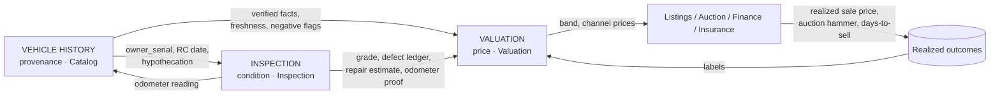

# Module 13 — Valuation Engine, Inspection, Vehicle History

> PRD modules 10 (Valuation), 11 (Inspection), 17 (Vehicle History).
> Derives from `00-north-star.md` (stack, prime directive, module isolation) and
> `01-design-system.md` (PlateBlock hero, odometer roll, "a valuation without a date is a rumor").
> Refines `02-domain-model.md` §10 and `03-data-model-erd.md` §4.8/§4.9 — additive only.
> Backend projects: `AutoHub.Modules.Valuation`, `AutoHub.Modules.Inspection`,
> `AutoHub.Modules.Catalog` (history lives with vehicle identity, not in a fourth module).

---

## 0. Scope, ownership, boundaries

| Concern | Owner module | Why not elsewhere |
|---|---|---|
| Price opinion, model runs, comparables, offers | `Valuation` | A price is an opinion with a shelf life. It is not a listing and not a deal. |
| Checklist capture, scoring, grading, report PDF | `Inspection` | An inspection is a *fact* produced by a person at a place at a time. It outlives the listing. |
| RC snapshot, challans, ownership chain, service + accident history, freshness | `Catalog` | History is provenance of the canonical `catalog.vehicles` row. Splitting it would put a foreign key across a module wall. |
| Booking the inspection slot, inspector calendar | `Bookings` | Slot exclusion constraints already live there (`booking.bookings`, `EXCLUDE USING gist`). |
| Charging for inspection / paid history report | `Deals` + `Payments` | Inspection raises a service Deal (`02-domain-model.md` §"Inspection … raises a service Deal with intent=SERVICE"). |
| Model training infrastructure, drift jobs | `Analytics` | Valuation *consumes* a model version; it does not own MLOps tables. |

**Module isolation is respected**: `Valuation` reads vehicle facts through
`Catalog.Contracts.IVehicleFactsReader`, never `catalog.vehicles` directly. `Inspection` publishes
`inspection.inspection.completed.v1`; `Valuation` and `Listings` subscribe. No module reads
another's tables.

### 0.1 The three truths, and how they feed each other



Three rules that fall out of this and are enforced, not aspirational:

1. **A valuation never invents a fact.** Every feature value carries a `source_code` and a
   `confidence`, resolved by `registry.attribute_source_precedence` (`02-domain-model.md` §16.3).
   If the only source for `owner_serial` is `SELLER_DECLARED`, confidence drops and the band widens.
2. **An inspection never quotes a price.** It produces a grade and a repair estimate. The rupee
   consequence of a defect is a *pricing* decision, computed in `Valuation` from registry rows.
3. **History is never presented without its as-of date, per section.** Not one date for the report —
   one date per source, because VAHAN, challan and insurance data go stale at wildly different rates.

---

# PART A — THE VALUATION ENGINE

## A1. What "better than Cars24" has to mean, concretely

"Better" is not a bigger number. Six commitments, each measurable:

| # | Commitment | Metric | Target at GA |
|---|---|---|---|
| 1 | **Accuracy on realized outcomes** | MAPE of `market_price` vs actual C2C sale price, 30-day window | ≤ 6.5% p50, ≤ 12% p90 |
| 2 | **Honest intervals** | Coverage: % of realized prices inside the published `[low, high]` band | 78–84% (band is quoted as p10–p90) |
| 3 | **Seven prices, not one** | The same car is worth different amounts through different channels — we publish all of them | §A6 |
| 4 | **Explainability** | Every quote returns a signed adjustment ledger summing to the point estimate | 100% of quotes |
| 5 | **Reproducibility** | Any quote can be re-run 5 years later, byte-identical, from `inputs` + `model_version` | 100%, enforced by immutability |
| 6 | **Coverage without lying** | Rare variants get a *wider band*, never a refusal and never a fabricated point estimate | `confidence_too_low` → band-only response |

Commitment 3 is the structural differentiator. Cars24-class products give a seller one number that
is really the *instant-buy* number dressed up as market value. AutoHub separates them and shows the
spread — which is exactly the information a seller is trying to buy.

## A2. The feature vector

The feature *set* is registry data (`analytics.ml_feature_definitions`, §A9), not a C# record. The
list below is the launch content of that table for `category = four_wheeler`.

### A2.1 Identity and specification (from Taxonomy Registry)

| Feature key | Type | Source | Missing-value policy |
|---|---|---|---|
| `make_id`, `model_id`, `generation_id`, `variant_id` | categorical (target-encoded) | `platform.makes/models/generations/variants` | fall up the hierarchy (variant→model→make); see cold start §A5 |
| `ex_showroom_launch_paise` | numeric | `platform.variants.ex_showroom_price_paise` | imputed from segment median × body × cc |
| `body_option_id`, `fuel_option_id`, `transmission_option_id` | categorical | `platform.attribute_options` | required — `insufficient_inputs` if absent |
| `engine_cc`, `power_bhp`, `torque_nm`, `kerb_weight_kg` | numeric | variant spec | model-median impute + `spec_imputed=true` flag feature |
| `seating_capacity`, `is_commercial` | numeric / bool | `catalog.vehicles` | default from variant |
| `emission_norm_code` | categorical | variant (`BS4`, `BS6_P1`, `BS6_P2`, `BS7`) | derived from registration year × fuel |
| `generation_status` | categorical | derived: `current`, `run_out`, `superseded`, `discontinued` | see §A2.6 |

### A2.2 Age, usage, ownership

| Feature key | Type | Notes |
|---|---|---|
| `age_months` | numeric | from `manufacture_year/month`, **not** registration date — a 2019-built car registered in 2020 is a 2019 car and the market prices it as one |
| `reg_to_mfg_lag_months` | numeric | large lag = year-end stock discount, permanently depresses resale |
| `odometer_km` | numeric | winsorized at p1/p99 per model-age cell |
| `km_per_year` | numeric | `odometer_km / max(age_months/12, 0.5)` — the single strongest usage feature |
| `km_vs_cohort_z` | numeric | z-score against same make/model/age cell |
| `owner_serial` | ordinal | 1..N; the 1→2 step is worth far more than 2→3 |
| `odometer_source_code` | categorical | `inspection` / `ocr` / `service_record` / `seller` — a seller-declared odo is discounted |
| `odometer_verified` | bool | true only if an inspection or service record corroborates within ±2% |

### A2.3 Condition (populated by Inspection; degrades gracefully without it)

| Feature key | Type | Source |
|---|---|---|
| `inspection_grade_code` | ordinal | `inspection.inspections.grade_code` |
| `inspection_overall_score` | numeric 0–100 | `inspection.inspections.overall_score` |
| `section_score_exterior/interior/engine/electricals/suspension/ac/tyres/documents` | numeric | `inspection.inspection_items` rollup |
| `repair_estimate_paise` | numeric | `inspection.inspections.estimated_repair_paise` |
| `structural_damage_flag` | bool | any item with `is_dealbreaker = true` in section `structure` |
| `repaint_panel_count` | numeric | count of items with `condition_code = 'repainted'` |
| `replaced_panel_count` | numeric | `condition_code = 'replaced'` |
| `flood_indicator` | bool | rules over silt/corrosion/ECU items + flood-cohort geography (§C10.2) |
| `tyre_min_tread_mm`, `tyre_set_age_months` | numeric | tyre section + DOT code read |
| `battery_health_pct`, `battery_age_months` | numeric | OBD/multimeter item |
| `ev_soh_pct`, `ev_cycle_count` | numeric | EV only, from OBD (§B6) |
| `dtc_active_count`, `dtc_severity_max` | numeric | OBD-II scan |
| `condition_self_declared_code` | ordinal | fallback when no inspection: the `refine` step form |

### A2.4 Market and geography

| Feature key | Type | Notes |
|---|---|---|
| `city_id`, `city_tier`, `state_id` | categorical | listing/quote city, not RTO city |
| `city_price_index` | numeric | `valuation.city_indices` — registry-seeded, job-refreshed |
| `rto_office_id`, `rto_state_matches_city` | categorical/bool | an MH-registered car sold in Bengaluru costs the buyer lifetime road tax again |
| `is_bh_series` | bool | BH plates transfer across states without re-registration — a genuine premium |
| `comp_count_45d` | numeric | live comparables in the similarity radius |
| `comp_median_ask_paise`, `comp_iqr_ratio` | numeric | from the comparable pool (§A4.3) |
| `days_on_market_cohort_p50` | numeric | liquidity of this model in this city |
| `search_demand_index` | numeric | `analytics.search_events` rollup: searches per live listing, model × city, 28d |
| `auction_clearing_index` | numeric | realized hammer / predicted market, model × city, 90d — the feedback loop (§A4.4) |

### A2.5 Compliance, cost-of-ownership, and legal life

This block is where an India-built engine separates from a ported one.

| Feature key | Type | Why it moves price |
|---|---|---|
| `legal_life_remaining_months` | numeric | NCR: diesel 10 yr / petrol 15 yr. A 9-year-old Delhi diesel is a *cliff*, not a slope. Registry: `valuation.legal_life_rules` |
| `fitness_valid_remaining_months` | numeric | commercial vehicles; expiry = immediate cost |
| `tax_paid_upto_remaining_months` | numeric | unpaid road tax is a transfer blocker |
| `insurance_valid_remaining_months`, `insurance_type_code` | numeric/cat | comprehensive vs third-party; a lapsed policy costs the buyer a break-in inspection |
| `ncb_percent` | numeric | transferable NCB is real money to the buyer |
| `puc_valid` | bool | trivially cheap to fix, but its absence correlates with neglect |
| `is_hypothecated`, `hypothecation_age_months` | bool/num | Form 35 + bank NOC adds 15–30 days to transfer |
| `pending_challan_count`, `pending_challan_paise` | numeric | direct deduction, and a transfer blocker in several states |
| `is_blacklisted`, `is_rc_suspended`, `is_scrapped` | bool | hard gates — see §A10.3 |
| `noc_issued_to_state_id` | categorical | an NOC already issued means the seller was planning to move it |
| `scrap_floor_paise` | numeric | RVSF scrap value floor from `valuation.scrap_floor_rates` — no valuation may go below it |

### A2.6 Time-varying market shocks

| Feature key | Type | Source |
|---|---|---|
| `festive_index` | numeric | `valuation.seasonality_indices` keyed `(state_id, iso_week)` — Navratri/Dussehra/Diwali nationally, Onam in KL, Pongal in TN, Bihu in AS |
| `month_of_year`, `iso_week` | cyclic (sin/cos) | Dec registrations are discounted by the market; Jan is a buyer's month |
| `fuel_price_delta_90d_pct` | numeric per fuel | petrol/diesel/CNG city retail; drives cross-fuel substitution |
| `fuel_spread_diesel_petrol` | numeric | when the spread narrows, diesel resale softens |
| `cng_kit_present`, `cng_station_density` | bool/num | a CNG car in a city with no pumps is a Petrol car with a heavy boot |
| `successor_launch_horizon_months` | numeric | `platform.generations.successor_expected_from` — an *announced* facelift depresses the outgoing model 3–6 months before launch |
| `oem_discount_index` | numeric | new-car discounting compresses used prices from above |
| `interest_rate_index` | numeric | RBI repo → used-car loan rate; sub-₹6L segment is the most rate-elastic |
| `model_recall_open` | bool | open recall campaign on this VIN range |

**Total launch feature count: 63 for `four_wheeler`, 41 for `two_wheeler`, 58 for
`commercial_vehicle`.** The per-category set is a registry query, not a compile-time constant.

## A3. The ensemble

```
                       ┌───────────────────────────────────────────────┐
   normalised request  │  FEATURE RESOLVER                              │
   ──────────────────▶ │  taxonomy · history · inspection · market      │
                       │  emits feature vector + provenance + coverage  │
                       └───────────────┬───────────────────────────────┘
                                       │
      ┌──────────────┬─────────────────┼─────────────────┬──────────────────┐
      ▼              ▼                 ▼                 ▼                  ▼
 ┌─────────┐   ┌───────────┐    ┌────────────┐    ┌────────────┐    ┌────────────┐
 │ L0      │   │ L1        │    │ L2         │    │ L3         │    │ L4         │
 │ Hedonic │   │ GBDT      │    │ Live comps │    │ Auction    │    │ Guardrails │
 │ prior   │   │ quantile  │    │ kNN        │    │ clearing   │    │ (hard)     │
 │         │   │ p10/50/90 │    │            │    │ correction │    │            │
 └────┬────┘   └─────┬─────┘    └──────┬─────┘    └──────┬─────┘    └──────┬─────┘
      │              │                 │                 │                 │
      └──────────────┴────────┬────────┴─────────────────┘                 │
                              ▼                                            │
                   ┌────────────────────┐                                  │
                   │ BLENDER            │  weights = registry rule set     │
                   │ precision-weighted │  `valuation.blend.<category>`     │
                   └─────────┬──────────┘                                  │
                             ▼                                             ▼
                   ┌────────────────────┐                        ┌──────────────────┐
                   │ market_price + band│───────────────────────▶│ clamp to floors, │
                   └─────────┬──────────┘                        │ scrap, ex-showrm │
                             ▼                                   └──────────────────┘
                   ┌────────────────────┐
                   │ CHANNEL PROJECTOR  │  spreads = registry rows (§A6)
                   │ → 7 outputs        │
                   └────────────────────┘
```

### A3.1 L0 — hedonic depreciation prior

A closed-form retention curve, entirely registry data, evaluated in-process in <1 ms:

```
value_L0 = ex_showroom_launch_paise
         × retention(category, fuel, age_months)          -- valuation.depreciation_points
         × km_factor(km_vs_cohort_z)                       -- rule set `valuation.km_curve`
         × owner_factor(owner_serial)                      -- rule set `valuation.owner_curve`
         × city_price_index                                -- valuation.city_indices
         × condition_factor(grade_code | self_declared)    -- rule set `valuation.condition_curve`
```

L0 exists for three reasons: it is the **cold-start prior** for unseen variants (§A5), it is the
**fallback engine** when the model service is down (§A10), and it is the **sanity rail** — if L1
disagrees with L0 by more than the registry threshold (`blend.l0_divergence_max_pct`, seed 35%),
the quote is routed to `low_confidence` and the band widens instead of silently trusting the model.

### A3.2 L1 — gradient-boosted quantile baseline

- **Algorithm:** LightGBM, three heads trained with pinball loss at τ = 0.10 / 0.50 / 0.90.
  Quantile heads, not a point model with a bootstrapped interval — the band must be a *prediction*
  interval, not a confidence interval on the mean, because the seller's question is
  "what will *my* car fetch", not "what does the average car fetch".
- **Target:** `log(realized_price_paise / ex_showroom_launch_paise)` — modelling *retention ratio*
  rather than absolute rupees makes the model transfer across price segments and survives inflation
  and OEM price hikes without retraining.
- **Two label sources, two model keys:**
  - `val-car-retail-vN` trained on C2C/dealer realized sale prices (`valuation.realized_outcomes`,
    `outcome_kind = 'c2c_sale' | 'dealer_retail'`)
  - `val-car-auction-vN` trained on auction hammer prices (`outcome_kind = 'auction_hammer'`)
  These are genuinely different distributions with different censoring. Training one model and
  applying a flat spread is the mistake that makes competitor valuations feel wrong to dealers.
- **Censoring correction:** listing ask prices are *right-censored* observations of value (unsold
  listings tell you value is below ask). Unsold-at-expiry listings enter training as censored
  samples with a Tobit-style adjusted weight from `analytics.ml_model_versions.train_config`.
- **Serving:** ONNX-exported, served by the `valuation.model` capability through
  `platform.provider_routes`. p95 budget 45 ms.

### A3.3 L2 — live marketplace comparables

Retrieval, not a model. Runs against OpenSearch on live + recently-sold listings:

```
must:     category_id, fuel, transmission, body
should:   model_id (boost 8), variant_id (boost 5), generation_id (boost 3)
filter:   age_months within ±18, odometer within ±35%, listing age ≤ 90d
geo:      city_id, expanding ladder: city → 100 km → state → tier-peer cities
```

Each comp is adjusted to the subject vehicle before being averaged — a comp is only useful once you
have removed the differences:

```
adj_price_i = ask_price_i
            × (retention(age_subject) / retention(age_i))
            × km_factor(km_subject) / km_factor(km_i)
            × owner_factor(...) / owner_factor(...)
            × ask_to_sale_ratio(city, model)        -- registry: asks are not sales
```

`ask_to_sale_ratio` is `valuation.negotiation_spreads` — seed 0.93 nationally, 0.90 for
listing_age > 45d, calibrated weekly from realized outcomes. **Never average raw ask prices.**

L2 output: `comp_median_paise`, `comp_p10/p90`, `comp_count_effective` (sum of similarity weights,
not row count), `comp_recency_days_p50`.

### A3.4 L3 — auction-clearing feedback loop

The single highest-signal correction we have, because an auction produces a **cleared price against
a known reserve within a known hour** — the cleanest label in the business.

Nightly job, per `(model_id, city_id, age_bucket)` cell with ≥ 8 lots in 90 days:

```
clearing_index = median( hammer_paise / predicted_auction_price_paise )
```

Applied as a multiplicative correction with shrinkage toward 1.0 by cell size:

```
λ = n / (n + k)            -- k from rule set `valuation.blend`, seed k = 12
correction = 1 + λ × (clearing_index − 1)
```

Also feeds back the **no-sale signal**: lots that failed to meet reserve raise
`reserve_miss_rate`, which widens the band and lowers confidence for that cell — a cell where
dealers refuse to bid is a cell where our price is wrong, and we should say so.

### A3.5 The blender

Precision-weighted (inverse-variance) combination, with weights bounded by registry rules:

```
w_i ∝ prior_weight_i / variance_i          (variance from each layer's own interval)
value = Σ w_i × value_i  /  Σ w_i
```

`prior_weight_i` comes from rule set `valuation.blend.<category>`, domain `pricing`:

| rule `code` | condition (JsonLogic) | outcome |
|---|---|---|
| `blend_default` | `true` | `{"w_l0":0.10,"w_l1":0.55,"w_l2":0.30,"w_l3":0.05}` |
| `blend_thin_comps` | `comp_count_effective < 4` | `{"w_l0":0.20,"w_l1":0.75,"w_l2":0.05,"w_l3":0.00}` |
| `blend_no_model_coverage` | `model_coverage_rows < 200` | `{"w_l0":0.65,"w_l1":0.10,"woll2":0.25,"w_l3":0.00}` |
| `blend_auction_purpose` | `purpose_code == "auction_floor"` | `{"w_l0":0.05,"w_l1":0.45,"w_l2":0.20,"w_l3":0.30}` |
| `blend_fallback_only` | `model_service_available == false` | `{"w_l0":1.00,"w_l1":0,"w_l2":0,"w_l3":0}` |

Changing the blend for two-wheelers in Kerala is one `platform.rules` row with
`scope`/`applies_when`, shipped through a `registry_change_sets` approval. No deploy.

### A3.6 L4 — hard guardrails (applied after the blend, always)

These are not model outputs; they are floors and ceilings the business will not cross.

| Guardrail | Rule | Rationale |
|---|---|---|
| Scrap floor | `value ≥ scrap_floor_paise` (kerb weight × `valuation.scrap_floor_rates.rate_per_kg_paise`) | A running car is never worth less than its RVSF deposit certificate |
| New-car ceiling | `value ≤ current_ex_showroom × ceiling_pct` (seed 0.95; **exempt** if `waitlist_months ≥ 3`) | Prevents absurd used > new, but Indian reality has genuine above-MSRP used prices on waitlisted models |
| Legal-life cliff | if `legal_life_remaining_months ≤ 12`, blend toward `scrap_floor` with weight `1 − months/12` | NCR diesel end-of-life is a cliff; a linear depreciation curve is *wrong* here and this is where competitors visibly fail |
| Negative-flag gate | `is_scrapped or is_rc_suspended` → no price, `valuation.subject.not_transferable` | We do not price a vehicle that cannot legally change hands |
| Band monotonicity | `low ≤ point ≤ high`, enforced by `ck_valuations__band` | DB constraint, not application discipline |

## A4. Realized-outcome capture (the thing that makes it improve)

```sql
CREATE TABLE valuation.realized_outcomes (
    id             uuid PRIMARY KEY DEFAULT platform.uuid_generate_v7(),
    vehicle_id     uuid NOT NULL REFERENCES catalog.vehicles(id),
    outcome_kind   platform.code_key NOT NULL,      -- code set 'valuation_outcome_kind':
                                                    -- c2c_sale|dealer_retail|dealer_buy|auction_hammer|
                                                    -- auction_no_sale|instant_offer_accepted|
                                                    -- instant_offer_declined|listing_expired_unsold
    source_entity_type platform.code_key NOT NULL REFERENCES platform.entity_types(code),
    source_entity_id uuid NOT NULL,                 -- deal / lot / listing
    realized_paise platform.money_paise,            -- NULL for no_sale / expired
    reserve_paise  platform.money_paise,
    is_censored    boolean NOT NULL DEFAULT false,  -- true for no_sale / expired
    days_to_outcome integer,
    city_id        uuid REFERENCES platform.cities(id),
    feature_snapshot jsonb NOT NULL,                -- vector AT THE TIME, not reconstructed later
    valuation_id   uuid REFERENCES valuation.valuations(id),  -- what we predicted, if we predicted
    predicted_paise platform.money_paise,
    occurred_at    timestamptz NOT NULL,
    created_at     timestamptz NOT NULL DEFAULT now(),
    CONSTRAINT uq_realized_outcomes__source UNIQUE (source_entity_type, source_entity_id, outcome_kind)
);
```

**`feature_snapshot` is written at outcome time, not derived later.** Reconstructing a 2026 feature
vector from 2028 tables produces label leakage (the odometer has since been updated, the inspection
has since been added) and silently poisons every future model. This one column is the difference
between a valuation engine that improves and one that slowly rots.

Populated by outbox subscribers on `deals.deal.settled.v1`, `auction.lot.closed.v1`,
`auction.lot.won.v1`, `listings.listing.state_changed.v1` (→ `expired`), and
`valuation.offer.decided.v1`. Every subscriber is idempotent on the unique constraint.

## A5. Cold start for rare variants

A 2011 Mitsubishi Cedia in Guwahati has no comps and 3 training rows. The ladder, evaluated in
order, is registry data (`valuation.coldstart_ladder`), and **each rung records itself in
`adjustments` so the user can see what we did**:

| Rung | Condition to use it | Estimator | Band multiplier |
|---|---|---|---|
| 0 | `variant_rows ≥ 200` | full ensemble at variant granularity | ×1.00 |
| 1 | `model_rows ≥ 200` | ensemble at model level + variant delta from `variants.ex_showroom_price_paise` ratio | ×1.20 |
| 2 | `generation_rows ≥ 150` | generation-level model + spec-based hedonic delta (cc, bhp, body, features) | ×1.45 |
| 3 | `segment_rows ≥ 500` | segment × fuel × body model on **spec features only** (no make/model IDs) | ×1.75 |
| 4 | none of the above | pure L0 hedonic on launch price + category retention curve | ×2.20, `confidence ≤ 0.35` |
| 5 | no launch price known (imports, grey market, heavily modified) | **no point estimate.** Return band only + `valuation.model.confidence_too_low` semantics with `manual_expert` CTA | — |

Rung 5 is a product decision worth defending: a fabricated point estimate on a Nissan Patrol import
destroys more trust than an honest "we need a human to price this — book a free expert call".
`method_code = 'manual_expert'` valuations are written by an ops user with
`valuation.manual.write`, carry `model_key = NULL`, and are excluded from training labels.

**Cross-city borrowing:** when a cell is thin locally but dense elsewhere, we borrow the *shape*
(the model's response to km/age/owners) but not the *level*, re-levelling via `city_price_index`.
Borrowing the level is how you tell a Guwahati seller his car is worth Mumbai money.

## A6. The seven outputs

All seven are `platform.codes` rows in set `valuation_channel` — adding an eighth (say
`bank_repo_reserve`) is a registry insert plus a spread row. The API returns them in the
`channels[]` array of `04-api-contract.md` §9.6.

| # | `code` | Question it answers | Derivation |
|---|---|---|---|
| 1 | `market_price` | "What is it worth?" | **The model's primary output.** L1 retail head, blended. This is the anchor; all others are spreads from it. |
| 2 | `trade_in` | "What will a dealer give me against a new car?" | `market_price × (1 − trade_spread)` where `trade_spread` = `valuation.channel_spreads`, seeded 0.14, +0.03 if `repair_estimate > 3% of market`, −0.02 for `grade_code in (5_star,4_star)`. OEM exchange bonuses are **not** included — they are a Finance/Deals promotion, not a value. |
| 3 | `dealer_retail` | "What will a dealer sell it for?" | `market_price × (1 + retail_markup)`, seed 0.11, city-scoped. Also net of the GST margin scheme: dealer margin is taxed at 18%/12% on the *margin only* (Notification 8/2018-CTR) when no ITC was claimed — so `retail_markup` is grossed up by the applicable margin GST from `platform.tax_rules`, not hardcoded. |
| 4 | `auction_clearing` | "What will dealers actually bid?" | **Its own model head** (`val-car-auction-vN`), not a spread. Then × L3 `clearing_index`. Published as a band by default because a single auction is a high-variance draw. |
| 5 | `quick_sale` | "What if I need money in 72 hours?" | `min(auction_clearing_p25, market_price × (1 − quick_sale_discount))`, seed 0.16. This is the number AutoHub is willing to *commit* to, so it is bounded below by `valuation.instant_offer_floor` risk policy and is the only channel that produces a binding offer (§A7). |
| 6 | `expected_resale` | "What will it be worth when I sell it in N months?" | `market_price × retention_forward(age+N) / retention(age) × market_drift(N)` where `market_drift` is the segment's 12-month realized price trend, damped. Returned for N ∈ {6, 12, 24, 36} from `valuation.forecast_horizons`. |
| 7 | `future_depreciation` | "How fast does it lose money?" | The curve itself: `[{month, value_paise, value_low, value_high}]` at monthly granularity to 36 months, plus `annualised_depreciation_pct` and `cost_per_km_owned`. Widening band with horizon (`band_widen_per_year`, seed 1.35×/yr). |

### A6.1 Ordering invariant

Enforced after projection, before persistence:

```
scrap_floor ≤ quick_sale ≤ auction_clearing ≤ trade_in ≤ market_price ≤ dealer_retail
```

A violation is a **bug, not a business case** — it means a spread row and the auction model
disagree. The engine clamps to preserve order, sets `adjustments[].factor = "channel_order_clamp"`,
and raises a `valuation.channel_order_violated` metric that pages the pricing owner. Silently
serving a `trade_in` above `market_price` is how a dealer decides your product is a toy.

### A6.2 Purpose-specific channels

`valuation.valuations.purpose_code` already carries `insurance_idv` and `loan_ltv`. These are **not
opinions** and must not come from the ML model:

| purpose | Source | Why |
|---|---|---|
| `insurance_idv` | `valuation.idv_depreciation_grid` — the IRDAI Motor Package schedule (5% ≤6m, 15% 6m–1y, 20% 1–2y, 30% 2–3y, 40% 3–4y, 50% 4–5y; >5y mutually agreed) applied to current ex-showroom + accessories | It is a regulated grid. Publishing our model's number as an IDV would mislead a policyholder and is an IRDAI exposure. `method_code = 'rule_table'`. |
| `loan_ltv` | `min(market_price, lender's own grid)` × lender LTV cap | Lenders have their own grids; we present ours as *indicative* and the lender's as binding. |

## A7. The instant offer (channel 5 becomes a commitment)

`POST /valuation/quotes/{id}/accept-offer` converts a `quick_sale` channel price into a Deal. This
is the only place a valuation stops being an opinion, so it gets its own guards:

| Guard | Rule | Registry |
|---|---|---|
| Offer eligibility | requires `confidence ≥ offer_min_confidence` (seed 0.72), `inspection_grade_code IS NOT NULL` **or** offer is conditional-on-inspection, no negative RC flag | rule set `valuation.offer_eligibility` (domain `eligibility`) |
| Offer validity | `valid_until = now + offer_ttl_hours` (seed 72) | `platform.rules` |
| Price re-check at acceptance | if `now > quote.valid_until` → `valuation.quote.expired` (410). If a re-run moves the price by more than `offer_reprice_tolerance_pct` (seed 3%), the offer is **re-issued**, not honoured | rule set |
| Conditional offers | offer is `subject_to_inspection`; final price = offer − verified `repair_estimate_paise` capped at `offer_deduction_cap_pct` (seed 8%) | rule set |
| Exposure cap | per-city daily rupee cap on committed offers | `platform.feature_flags` variant `valuation.instant_offer.daily_cap_paise` (kill-switch) |

The deduction cap matters commercially: an uncapped "we'll adjust after inspection" is exactly the
bait-and-switch complaint that Cars24-class players are known for. Capping it in the registry — and
printing the cap on the offer — is a differentiator we can change per city without a release.

## A8. Confidence — a real score, not a decoration

`valuation.valuations.confidence numeric(4,3)`. Computed as a registry-weighted logistic over eight
inputs, each normalised to [0,1]:

| Input | Definition | Seed weight |
|---|---|---|
| `c_comp_density` | `min(comp_count_effective / 12, 1)` | 0.20 |
| `c_comp_agreement` | `1 − min(comp_iqr_ratio / 0.40, 1)` | 0.14 |
| `c_interval_width` | `1 − min(((p90−p10)/p50) / 0.45, 1)` | 0.18 |
| `c_feature_completeness` | Σ(weight of present required features) / Σ(all required) | 0.16 |
| `c_provenance` | mean of source precedence weights of the features actually used, /100 | 0.12 |
| `c_variant_resolution` | 1.0 exact variant · 0.7 model · 0.45 generation · 0.2 segment | 0.10 |
| `c_ood` | `1 − sigmoid(mahalanobis_distance_to_train_centroid)` | 0.06 |
| `c_recency` | `1 − min(comp_recency_days_p50 / 60, 1)` | 0.04 |

```
raw     = Σ wᵢ · cᵢ                       -- weights: rule set `valuation.confidence_weights`
conf    = clamp(raw × penalty, 0.05, 0.97)
penalty = Π over active penalty rules     -- rule set `valuation.confidence_penalties`
```

Penalty rules (registry, `platform.rules` with `stop_on_match = false` so they compound):

| `code` | condition | outcome |
|---|---|---|
| `pen_fallback` | `fallback_used == true` | `{"multiplier": 0.55}` |
| `pen_no_inspection` | `inspection_grade_code == null` | `{"multiplier": 0.88}` |
| `pen_odo_unverified` | `odometer_verified == false` | `{"multiplier": 0.92}` |
| `pen_odo_rollback` | `odometer_rollback_suspected == true` | `{"multiplier": 0.60}` |
| `pen_l0_divergence` | `abs(l1 − l0)/l0 > 0.35` | `{"multiplier": 0.70}` |
| `pen_stale_market` | `comp_recency_days_p50 > 60` | `{"multiplier": 0.85}` |
| `pen_reserve_miss` | `cell_reserve_miss_rate > 0.45` | `{"multiplier": 0.80}` |
| `pen_coldstart_rung` | `coldstart_rung >= 3` | `{"multiplier": 0.65}` |

`confidence_band` (`high` ≥ 0.75, `medium` ≥ 0.50, `low` ≥ 0.30, below that → band-only) comes from
`platform.codes` set `valuation_confidence_band` with `metadata.min_confidence`, so moving the
publish threshold is a registry edit.

**The confidence score must be honest to be useful.** It is calibrated monthly against realized
coverage: if quotes scored 0.80 achieve 80% band coverage, the score is calibrated; if they achieve
62%, isotonic recalibration is applied and shipped as a new `analytics.ml_model_versions` row of
task `valuation_calibration`. Calibration is a model version, so it promotes like one (§A9).

## A9. The model registry — a new model is a config promotion, never a deploy

This is the section that makes the Prime Directive hold for ML. **No model artifact, threshold,
feature list, or blend weight is in the .NET assembly.**

```sql
CREATE TABLE analytics.ml_models (
    key           text PRIMARY KEY,                 -- 'val-car-retail','val-car-auction',
                                                    -- 'val-2w-retail','val-calibration','insp-damage-panel'
    task_code     platform.code_key NOT NULL,       -- 'valuation_point','valuation_quantile',
                                                    -- 'calibration','vision_damage','ocr_odometer'
    category_id   uuid REFERENCES platform.categories(id),
    owner_user_id uuid NOT NULL,
    description   text NOT NULL,
    output_schema jsonb NOT NULL,                   -- canonical response contract for every version
    created_at timestamptz NOT NULL DEFAULT now(), created_by uuid,
    updated_at timestamptz NOT NULL DEFAULT now(), updated_by uuid
);

CREATE TABLE analytics.ml_feature_definitions (
    id            uuid PRIMARY KEY DEFAULT platform.uuid_generate_v7(),
    model_key     text NOT NULL REFERENCES analytics.ml_models(key),
    feature_key   platform.code_key NOT NULL,       -- 'km_per_year'
    dtype         platform.code_key NOT NULL,       -- numeric|categorical|boolean|cyclic|ordinal
    source_kind   platform.code_key NOT NULL,       -- column|attribute|derived|integration|rule
    source_ref    text NOT NULL,                    -- 'catalog.vehicles.odometer_km' | 'derive:km_per_year'
    transform     text,                             -- 'log1p','winsor:p1,p99','target_encode','sin_cos:12'
    is_required   boolean NOT NULL DEFAULT false,
    completeness_weight numeric(5,3) NOT NULL DEFAULT 1.0,   -- feeds c_feature_completeness
    impute_strategy platform.code_key NOT NULL DEFAULT 'cohort_median',
    drift_metric  platform.code_key NOT NULL DEFAULT 'psi',  -- psi|ks|chi2|none
    drift_threshold numeric(6,4) NOT NULL DEFAULT 0.20,
    sort_order    smallint NOT NULL DEFAULT 100,
    is_active     boolean NOT NULL DEFAULT true,
    change_set_id uuid REFERENCES platform.registry_change_sets(id),
    created_at timestamptz NOT NULL DEFAULT now(), created_by uuid,
    updated_at timestamptz NOT NULL DEFAULT now(), updated_by uuid,
    row_version bigint NOT NULL DEFAULT 1,
    CONSTRAINT uq_ml_feature_definitions__model_key UNIQUE (model_key, feature_key)
);

CREATE TABLE analytics.ml_model_versions (
    id            uuid PRIMARY KEY DEFAULT platform.uuid_generate_v7(),
    model_key     text NOT NULL REFERENCES analytics.ml_models(key),
    version       text NOT NULL,                    -- 'v4.2.1' — matches valuations.model_version
    artifact_uri  text NOT NULL,                    -- s3://ah-models/val-car-retail/v4.2.1/model.onnx
    artifact_sha256 platform.sha256_hex NOT NULL,   -- verified on load; mismatch = refuse to serve
    feature_set_hash platform.sha256_hex NOT NULL,  -- hash of the ml_feature_definitions rows used
    runtime_code  platform.code_key NOT NULL DEFAULT 'onnx',   -- onnx|pmml|python_svc|builtin_rule
    train_config  jsonb NOT NULL DEFAULT '{}',      -- hyperparams, label window, censoring weights
    train_window  tstzrange NOT NULL,
    train_row_count bigint NOT NULL,
    eval_metrics  jsonb NOT NULL DEFAULT '{}',      -- {"mape_p50":0.061,"coverage_80":0.812,
                                                    --  "mape_by_city":{...},"mape_by_price_decile":[...]}
    baseline_stats jsonb NOT NULL DEFAULT '{}',     -- per-feature train distribution → PSI reference
    status_code   platform.code_key NOT NULL DEFAULT 'registered',
    -- registered → validating → approved → shadow → canary → champion → retired → quarantined
    approved_by   uuid, approved_at timestamptz,
    lineage_parent_version text,                    -- what it was trained on top of
    model_card_document_id uuid,                    -- generated PDF: data, metrics, limitations
    created_at timestamptz NOT NULL DEFAULT now(), created_by uuid,
    updated_at timestamptz NOT NULL DEFAULT now(), updated_by uuid,
    row_version bigint NOT NULL DEFAULT 1,
    CONSTRAINT uq_ml_model_versions UNIQUE (model_key, version)
);

CREATE TABLE analytics.ml_deployments (
    id            uuid PRIMARY KEY DEFAULT platform.uuid_generate_v7(),
    model_key     text NOT NULL REFERENCES analytics.ml_models(key),
    version       text NOT NULL,
    role          platform.code_key NOT NULL,       -- 'champion'|'canary'|'shadow'|'holdout_control'
    traffic_percent numeric(5,2) NOT NULL DEFAULT 0 CHECK (traffic_percent BETWEEN 0 AND 100),
    bucket_by     platform.code_key NOT NULL DEFAULT 'request_fingerprint',
    scope_city_id uuid REFERENCES platform.cities(id),
    scope_category_id uuid REFERENCES platform.categories(id),
    applies_when  jsonb,                            -- JsonLogic over the feature vector
    priority      smallint NOT NULL DEFAULT 100,
    is_active     boolean NOT NULL DEFAULT true,
    effective_from timestamptz NOT NULL DEFAULT now(),
    effective_to   timestamptz,
    change_set_id uuid REFERENCES platform.registry_change_sets(id),
    created_at timestamptz NOT NULL DEFAULT now(), created_by uuid,
    updated_at timestamptz NOT NULL DEFAULT now(), updated_by uuid,
    row_version bigint NOT NULL DEFAULT 1,
    CONSTRAINT fk_ml_deployments__version FOREIGN KEY (model_key, version)
        REFERENCES analytics.ml_model_versions(model_key, version),
    CONSTRAINT uq_ml_deployments__role_scope
        UNIQUE (model_key, role, scope_city_id, scope_category_id, effective_from)
);
```

**Promotion is a `registry_change_sets` row**, exactly like a commission change:

```
2026-08-14-val-car-retail-v4.3.0-canary
  registry_codes: ['ml_deployment']
  diff: [ {op:'U', ml_deployments: champion v4.2.1 traffic 100 → 90},
          {op:'I', ml_deployments: canary  v4.3.0 traffic 0  → 10} ]
  risk_level: 3 → requires approver with permission `valuation.model.promote`
```

### A9.1 The promotion ladder

```
registered ──validate──▶ validating ──eval gates pass──▶ approved
                                │ fail
                                ▼
                           quarantined  (artifact hash mismatch, metric regression, schema drift)

approved ──▶ SHADOW  (traffic_percent = 0, but every live request is ALSO scored by it,
          │           result written to analytics.ml_prediction_log, never returned to a user)
          │           minimum dwell: 7 days AND 25,000 shadow predictions
          ▼
        CANARY (10% by request_fingerprint hash — stable, so the same car does not flip
          │      between models across refine calls in one session)
          │      minimum dwell: 72 h; auto-rollback triggers armed
          ▼
      CHAMPION (100%) ── old champion moves to `retired`, retained forever for reproducibility
```

**Auto-rollback triggers** (evaluated every 5 min by the canary watchdog; any one fires a
`registry_change_sets` rollback and pages):

| Trigger | Threshold (registry: `valuation.canary_guards`) |
|---|---|
| Prediction-distribution shift vs champion | median ratio outside [0.94, 1.06] |
| p95 inference latency | > 120 ms |
| Error rate | > 0.5% of scored requests |
| Instant-offer acceptance rate | drops > 25% relative |
| Realized MAPE on canary-attributed outcomes | > champion MAPE × 1.15 (min n = 200) |
| Band coverage on canary | < 0.70 |

**Rollback is one UPDATE.** `ml_deployments`: canary → `is_active = false`, champion traffic → 100.
Epoch bumps, Redis route cache invalidates, next request uses the old model. Mean time to rollback
target: **< 90 seconds**, no build, no deploy, no on-call engineer touching a YAML file.

### A9.2 Shadow-mode plumbing

Shadow scoring must never affect the user's latency or their answer:

- The request handler returns as soon as the champion (or canary) responds.
- Shadow scoring is dispatched through the outbox as `valuation.shadow_score.requested.v1` with the
  **frozen feature vector**, so the shadow model sees exactly the same inputs, not a re-resolved
  vector that has since changed.
- Shadow results land in `analytics.ml_prediction_log` (partitioned daily, 90-day retention):
  `(id, occurred_at, model_key, version, role, request_fingerprint, valuation_id, features_hash,
  p10/p50/p90_paise, latency_ms, error_code)`.
- Shadow failures are logged and **never** surfaced. A shadow model that 500s does not degrade the
  product; it fails its dwell gate and never gets promoted.

### A9.3 Where the model actually runs

`platform.capabilities.code = 'valuation.model'` with `is_critical = false` (critical = false is
deliberate: we have a working fallback, so a total model outage degrades rather than breaks).
`platform.provider_routes` rows resolve *which inference service*; `analytics.ml_deployments`
resolves *which model version inside it*. Two registries, two questions, no overlap.

| provider `code` | role | priority | timeout_ms | Notes |
|---|---|---|---|---|
| `ah_inference_primary` | primary | 10 | 400 | in-VPC ONNX runtime, autoscaled |
| `ah_inference_secondary` | fallback | 20 | 600 | different AZ, same artifacts |
| `builtin_hedonic` | fallback | 90 | — | in-process L0; `runtime_code = 'builtin_rule'`, cannot fail |

## A10. Drift monitoring and retraining

### A10.1 What we watch

| Class | Metric | Cadence | Registry threshold |
|---|---|---|---|
| **Feature drift** | PSI per feature vs `baseline_stats` | hourly rollup, daily alert | `ml_feature_definitions.drift_threshold`, seed PSI 0.20 (warn), 0.30 (page) |
| **Prediction drift** | KS statistic on p50 distribution, 7d vs 28d | daily | 0.12 |
| **Label drift** | mean realized retention ratio, 30d vs 180d | weekly | ±8% |
| **Performance** | MAPE, MAE, coverage@80 on `realized_outcomes` joined to `predicted_paise` | daily (rolling 30d) | MAPE > 8.5% → warn; > 11% → forced retrain |
| **Segment performance** | same metrics sliced by city × price-decile × fuel × age-bucket | weekly | any slice with n ≥ 150 and MAPE > 15% → targeted retrain |
| **Calibration** | coverage of published bands | monthly | outside [0.74, 0.86] → recalibration version |
| **Business** | instant-offer acceptance rate, auction reserve-miss rate, listing price-vs-band distribution | daily | flag-driven |

Two India-specific drift alarms that a generic setup would miss:

- **Fuel-price regime break.** A ≥ 8% move in diesel retail within 30 days invalidates the
  diesel/petrol substitution coefficients faster than PSI notices. `fuel_regime_break` triggers an
  immediate targeted retrain of the fuel-interaction features, not a full retrain.
- **Policy break.** A state changing its road tax, an NGT order changing end-of-life age, a GST
  notification changing the used-vehicle rate, or a scrappage-incentive announcement. These are
  step functions. They are entered as `valuation.policy_events` rows with an effective date, and
  the training pipeline **excludes pre-break data for affected cells** rather than averaging across
  the break. Registry-driven, because policy is not predictable enough to schedule.

### A10.2 Retraining cadence

| Trigger | Scope | Automation |
|---|---|---|
| Weekly (Mon 02:00 IST) | incremental refit on last 18 months, all live model keys | fully automated → `registered` → auto-`validating` |
| Monthly (1st) | full retrain, hyperparameter search, feature-importance review | automated to `approved`; **shadow promotion requires a human** |
| Drift/perf breach | targeted retrain of the affected model key | automated, jumps the queue |
| Policy event | affected cells, with data-exclusion window | manual kick-off, mandatory model-card note |
| New category / city launch | cold-start ladder handles it; retrain once `realized_outcomes ≥ 300` in that cell | automated watcher |

**Nothing auto-promotes to champion.** The ladder always includes a human approval on the
`registry_change_sets` row, because a bad valuation model does not throw an exception — it quietly
underpays sellers, and the only defence is a person signing their name to the diff.

### A10.3 Eval gates (must all pass to reach `approved`)

```
mape_p50           ≤ champion.mape_p50 × 1.02
coverage_80        ∈ [0.76, 0.85]
monotonicity       ∂value/∂odometer ≤ 0 and ∂value/∂age ≤ 0 on a 10k-point synthetic grid
no_leakage         no feature with source_ref referencing listings.price or deals.gross_amount
segment_floor      no slice (n≥150) with MAPE > champion_slice_MAPE × 1.25
fairness_geo       max_city_MAPE − min_city_MAPE ≤ 0.06  (we will not systematically underpay tier-3)
artifact_integrity sha256(artifact) == artifact_sha256
schema_match       feature_set_hash matches active ml_feature_definitions
```

`monotonicity` deserves emphasis: an ensemble that occasionally prices a higher-km car above a
lower-km one of the same variant is indefensible in front of a dealer, regardless of aggregate
MAPE. LightGBM monotone constraints are set on `odometer_km`, `age_months`, `owner_serial`,
`repair_estimate_paise`, `pending_challan_paise` (all decreasing) via `train_config`.

## A11. Fallback: rule-based valuation when the model service is unavailable

Triggered when: all `valuation.model` provider routes have open circuits, OR inference p95 > timeout
for 60s, OR `analytics.ml_deployments` has no active champion for the resolved category.

The fallback **is L0**, running in-process in `AutoHub.Modules.Valuation`, reading only registry
tables that are already in the Redis registry cache. It has no network dependency and cannot fail
short of the process dying.

```sql
CREATE TABLE valuation.depreciation_curves (
    id            uuid PRIMARY KEY DEFAULT platform.uuid_generate_v7(),
    code          platform.code_key NOT NULL,       -- 'car_petrol_hatch_default','2w_scooter','cv_lcv'
    category_id   uuid NOT NULL REFERENCES platform.categories(id),
    fuel_option_id uuid REFERENCES platform.attribute_options(id),
    body_option_id uuid REFERENCES platform.attribute_options(id),
    make_id       uuid REFERENCES platform.makes(id),      -- NULL = any; brand curves differ a lot
    model_id      uuid REFERENCES platform.models(id),
    priority      smallint NOT NULL DEFAULT 100,           -- most specific wins
    is_active     boolean NOT NULL DEFAULT true,
    effective_from date NOT NULL DEFAULT CURRENT_DATE,
    effective_to   date,
    change_set_id uuid REFERENCES platform.registry_change_sets(id),
    created_at timestamptz NOT NULL DEFAULT now(), created_by uuid,
    updated_at timestamptz NOT NULL DEFAULT now(), updated_by uuid,
    row_version bigint NOT NULL DEFAULT 1
);

CREATE TABLE valuation.depreciation_points (
    curve_id      uuid NOT NULL REFERENCES valuation.depreciation_curves(id) ON DELETE CASCADE,
    age_months    smallint NOT NULL,
    retention_pct numeric(6,3) NOT NULL CHECK (retention_pct BETWEEN 0 AND 200),
    CONSTRAINT pk_depreciation_points PRIMARY KEY (curve_id, age_months)
);
```

Seed rows, `car_petrol_hatch_default` (interpolated linearly between points):

| `age_months` | 0 | 6 | 12 | 24 | 36 | 48 | 60 | 84 | 120 | 180 |
|---|---|---|---|---|---|---|---|---|---|---|
| `retention_pct` | 100.0 | 84.0 | 78.0 | 68.0 | 59.5 | 52.0 | 45.5 | 34.0 | 21.0 | 11.0 |

The 0→6 month drop of 16% is the on-road-price haircut (registration + insurance + accessories are
not recoverable) and is real; a curve that starts at 95% at month 6 is wrong about India.

Supporting registry tables (same shape: scoped, temporal, change-set tracked):

| Table | Drives | Seed example |
|---|---|---|
| `valuation.km_factors` | `km_factor(km_vs_cohort_z)` | `z=−2 → 1.09`, `z=0 → 1.00`, `z=+2 → 0.88`, `z=+4 → 0.79` |
| `valuation.owner_factors` | `owner_factor(owner_serial)` | `1 → 1.00`, `2 → 0.93`, `3 → 0.87`, `4+ → 0.82` |
| `valuation.condition_factors` | `condition_factor(grade)` | `5_star → 1.06`, `4_star → 1.00`, `3_star → 0.93`, `2_star → 0.84`, `1_star → 0.72` |
| `valuation.city_indices` | `city_price_index` | `Mumbai 1.04`, `Delhi 0.98`, `Bengaluru 1.03`, `Guwahati 0.91` |
| `valuation.seasonality_indices` | `festive_index` | `(MH, W40) 1.03`, `(KL, W35) 1.04`, `(TN, W03) 1.03` |
| `valuation.scrap_floor_rates` | `scrap_floor_paise` | `₹22/kg` ferrous, revised quarterly |
| `valuation.legal_life_rules` | `legal_life_remaining_months` | `(NCR, diesel, 120 months)`, `(NCR, petrol, 180)`, `(default, any, NULL)` |

### A11.1 Fallback behaviour contract

| Aspect | Behaviour |
|---|---|
| Response | 200 with a full quote. **Not** a 503. The homepage hero must never show an error. |
| `method_code` | `'rule_table'` |
| `model_key` / `model_version` | `NULL` / `NULL`; `rule_set_id` populated instead |
| `fallback_used` | `true` (column exists in `02-domain-model.md` §10; add to `03` DDL) |
| Band | widened by `fallback_band_widen` (seed ×1.8) |
| `confidence` | × 0.55 (`pen_fallback`) → typically lands 0.28–0.45 → `confidence_band = 'low'` |
| Channels | only `market_price`, `trade_in`, `dealer_retail`, `future_depreciation`. **`quick_sale` is suppressed** — we do not make binding offers off a fallback |
| `valid_until` | shortened to `fallback_ttl_hours` (seed 6) so the user is re-priced properly soon |
| UI copy (localization registry, key `valuation.fallback_notice`) | *"Estimated from our depreciation tables — live market data is temporarily unavailable. Re-run in a few hours for a tighter range."* |
| Training | fallback quotes are **excluded** from `realized_outcomes.predicted_paise` attribution |
| Alerting | `valuation.fallback_rate` > 5% over 10 min pages the on-call |

`01-design-system.md` §7 says errors state the problem and the fix and never apologise. The copy
above does exactly that, and the odometer roll still plays — a low-confidence number is still a
number, and hiding the whole hero because a service is down is worse.

## A12. Quote lifecycle, caching, and races

### A12.1 The lifecycle entity

`valuation.valuations` is **immutable** (`03-data-model-erd.md` §4.9). A workflow instance therefore
cannot live on it. Refinement: the workflow-bearing entity is the *request*.

```sql
CREATE TABLE valuation.quote_requests (
    id            uuid PRIMARY KEY DEFAULT platform.uuid_generate_v7(),
    public_ref    text NOT NULL,                    -- 'VQR-2607-9K4M' — this is the `quote_id` on the wire
    request_fingerprint text NOT NULL,              -- sha256(normalised inputs || feature_set_hash)
    subject_kind  platform.code_key NOT NULL,       -- 'registration' | 'manual_spec' | 'vehicle'
    registration_number_norm text,
    vehicle_id    uuid REFERENCES catalog.vehicles(id),
    purpose_code  platform.code_key NOT NULL,
    requested_by_party_id uuid REFERENCES identity.parties(id),
    anonymous_session_id text,
    source_channel platform.code_key NOT NULL DEFAULT 'web',
    city_id       uuid REFERENCES platform.cities(id),
    inputs_raw    platform.jsonb_object NOT NULL DEFAULT '{}',
    form_version_id uuid REFERENCES platform.form_versions(id),   -- the refine form used
    workflow_instance_id uuid NOT NULL REFERENCES platform.workflow_instances(id),
    state_code    platform.code_key NOT NULL,
    current_valuation_id uuid REFERENCES valuation.valuations(id),
    attempt_count smallint NOT NULL DEFAULT 0,
    last_error_code text,
    created_at timestamptz NOT NULL DEFAULT now(), created_by uuid,
    updated_at timestamptz NOT NULL DEFAULT now(), updated_by uuid,
    deleted_at timestamptz, deleted_by uuid,
    row_version bigint NOT NULL DEFAULT 1
);
CREATE INDEX ix_quote_requests__fingerprint ON valuation.quote_requests (request_fingerprint, created_at DESC);
```

One request → 0..n immutable valuations (initial + each `refine` + each re-run), chained by
`superseded_by_id`. This satisfies `02-domain-model.md` §10's `workflow_*` on the valuation aggregate
without breaking `03`'s immutability guarantee.

### A12.2 Workflow registry rows — `workflow_definitions.code = 'valuation_quote'`

| state `code` | `kind_code` | `is_publicly_visible` | `counts_as_open` | `sla_minutes` | `ui.tone` | `ui.pill` |
|---|---|---|---|---|---|---|
| `queued` | initial | false | true | 1 | info | QUEUED |
| `resolving_facts` | active | false | true | 2 | info | RESOLVING |
| `scoring` | active | false | true | 1 | info | PRICING |
| `priced` | terminal_success | true | false | – | clear | PRICED |
| `priced_low_confidence` | terminal_success | true | false | – | caution | INDICATIVE |
| `band_only` | terminal_success | true | false | – | caution | RANGE ONLY |
| `needs_more_input` | waiting | true | true | – | caution | NEEDS INPUT |
| `manual_review` | waiting | false | true | 480 | info | WITH EXPERT |
| `not_priceable` | terminal_failure | true | false | – | flag | NOT PRICEABLE |
| `expired` | terminal_failure | false | false | – | flag | EXPIRED |
| `superseded` | terminal_failure | false | false | – | info | SUPERSEDED |

| transition `code` | from | to | trigger | guard rule set | effects |
|---|---|---|---|---|---|
| `resolve` | queued | resolving_facts | system | – | `invoke:valuation.resolve_features` |
| `score` | resolving_facts | scoring | system | `valuation.has_min_inputs` | `invoke:valuation.run_ensemble` |
| `publish` | scoring | priced | system | `valuation.confidence_gte_publish` | `emit:valuation.valuation.completed.v1` |
| `publish_low` | scoring | priced_low_confidence | system | `valuation.confidence_gte_low` | `emit:…completed.v1` |
| `publish_band` | scoring | band_only | system | – | `emit:…completed.v1`, `notify:valuation.band_only` |
| `request_input` | resolving_facts | needs_more_input | system | `!valuation.has_min_inputs` | serve `next_form_schema_key` |
| `refine` | needs_more_input \| priced* | queued | api | – | new valuation row, old → superseded |
| `escalate` | scoring | manual_review | system | `valuation.coldstart_rung_gte_5` | `notify:valuation.expert_required` |
| `expert_price` | manual_review | priced_low_confidence | manual | perm `valuation.manual.write` | writes `method_code='manual_expert'` |
| `reject_subject` | *any* | not_priceable | system | `valuation.subject_blocked` | – |
| `auto_expire` | priced* \| band_only | expired | timer | – | `emit:valuation.quote.expired.v1` |
| `supersede` | priced* | superseded | event | – | on newer valuation for same fingerprint |

Nobody greps for `"PRICED"`. `StatusPill` reads `ui.tone`; the API returns `state_code`; the
localisation registry supplies the label per locale.

### A12.3 Fingerprint, cache, idempotency

```
request_fingerprint = sha256(
    canonical_json(normalised_inputs)     -- keys sorted, plate normalised, km bucketed to 500,
    || feature_set_hash                    -- so a feature-set change busts the cache
    || active_deployment_hash              -- so a model promotion busts the cache
    || city_id || purpose_code
)
```

- **Cache key:** `val:q:{fingerprint}` in Redis, TTL = `valuation.cache_ttl_minutes` (seed 360),
  value = `valuation_id`. Hit → return the existing immutable row if `valid_until > now()`.
- **km bucketing to 500 km** is deliberate: typing 42,750 vs 42,800 must not cost a model call, and
  must not produce two different numbers on screen for the same car.
- **Idempotency:** `POST /valuation/quotes` requires `Idempotency-Key` (North Star §6). Replay
  within the window returns the same `quote_id` with `409` semantics per `04-api-contract.md`.
- **Thundering herd:** a Redis `SET NX` lock on `val:lock:{fingerprint}` (TTL 15s). Losers poll the
  cache key for up to 3s, then return `202` with `poll_url`. A dealer bulk upload of 500 identical
  Swifts costs one model call.

### A12.4 Race conditions and how they resolve

| Race | Resolution |
|---|---|
| Two `refine` calls from web and app on the same request | Both insert valuations; the later `created_at` wins as `current_valuation_id` via `UPDATE … WHERE row_version = @v`; the loser is immediately `superseded_by_id`-chained. Both remain queryable. |
| Model promoted mid-request | The deployment is resolved **once** at `resolving_facts` and pinned in the request context. A promotion never splits a single quote across two model versions. |
| Inspection completes while a quote is scoring | `inspection.inspection.completed.v1` handler does **not** mutate the in-flight quote. It emits `valuation.refresh.suggested.v1`; the UI shows *"Inspection done — get an updated price"*. Silently changing a number the user is looking at is worse than asking. |
| VAHAN returns after we fell back to manual entry | Same pattern: new valuation, old superseded, user notified only if the delta exceeds `valuation.notify_delta_pct` (seed 5%). |
| Instant offer accepted at the same moment the quote expires | `accept-offer` takes the per-request advisory lock and re-reads `valid_until` inside the transaction. Expired → `410 valuation.quote.expired`. There is no "close enough". |
| Anonymous session merges into an account mid-quote | `requested_by_party_id` backfills by `anonymous_session_id`; the valuation rows are untouched (immutable) — only `quote_requests` updates. |

## A13. Pricing Registry rows for valuation products

Every rupee below is a `platform.fee_components` row. Zero percentages in code.

| `code` | method | basis | rate/flat | scope | payer | payee | tax rule |
|---|---|---|---|---|---|---|---|
| `valuation_basic` | flat | flat | ₹0 | – | requester | platform | – |
| `valuation_certified_report` | flat | flat | ₹499 | – | requester | platform | `gst_services_18` |
| `valuation_bulk_dealer` | per_unit | flat | ₹9 / vehicle | `scope_party_tier = 'dealer_pro'` | dealer | platform | `gst_services_18` |
| `valuation_api_partner` | slab_flat | flat | ₹12 (≤10k), ₹8 (≤50k), ₹5 (>50k) / call | – | partner | platform | `gst_services_18` |
| `insurance_idv_certificate` | flat | flat | ₹199 | – | requester | platform | `gst_services_18` |
| `instant_offer_convenience` | percent | deal_gross | 1.0%, cap ₹9,999 | – | seller | platform | `gst_services_18` |

The basic valuation is ₹0 **as a registry row, not as an absence**. When marketing wants to charge
₹49 in tier-1 cities for the third valuation in a month, that is a `fee_components` row with
`applies_when: {">": [{"var":"quotes_this_month"}, 2]}` and a `scope_city_id`. No code change.

## A14. API surface

Beyond `04-api-contract.md` §9.6, which stands as written:

| Method | Path | Perm | Notes |
|---|---|---|---|
| `GET` | `/valuation/quotes/{id}/channels` | anon (token) | All seven channel prices with per-channel `valid_until` |
| `GET` | `/valuation/quotes/{id}/depreciation-curve` | anon (token) | `[{month, value_minor, low_minor, high_minor}]` to 36 months |
| `GET` | `/valuation/quotes/{id}/comparables` | anon (token) | Comps used, with adjustment shown per comp. Plates masked. |
| `POST` | `/valuation/quotes/{id}/transitions` | scoped | `refine`, `escalate`, `expert_price` |
| `GET` | `/valuation/models` | `valuation.model.read` | Admin: deployments, roles, traffic, drift status |
| `POST` | `/valuation/models/{key}/deployments` | `valuation.model.promote` | Creates a change set; **never** applies directly |
| `GET` | `/valuation/models/{key}/drift` | `valuation.model.read` | PSI/KS/MAPE time series |
| `GET` | `/valuation/registry/curves` | `valuation.registry.read` | Depreciation curves for the admin editor |

### A14.1 Error codes (extends `04-api-contract.md` §3.6)

| Code | HTTP | Meaning |
|---|---|---|
| `valuation.request.plate_unresolvable` | 422 | Plate parsed but no RTO/taxonomy match; offer manual entry form key in `params.fallback_form_key` |
| `valuation.request.category_not_priced` | 422 | Feature Registry has no valuation module for this category in this city |
| `valuation.subject.not_transferable` | 422 | RC scrapped/suspended/blacklisted — we refuse to price |
| `valuation.offer.not_eligible` | 422 | `params.failed_guards[]` from the eligibility rule set |
| `valuation.offer.lapsed` | 410 | Offer past `valid_until` |
| `valuation.offer.repriced` | 409 | Price moved beyond tolerance; `params.new_quote_id` |
| `valuation.bulk.row_limit_exceeded` | 422 | `params.max_rows` from the Feature Registry |
| `valuation.model.promotion_requires_change_set` | 409 | Direct deployment mutation attempted |
| `valuation.model.eval_gate_failed` | 422 | `params.failed_gates[]` |

## A15. Valuation failure modes

| Scenario | Behaviour | Never |
|---|---|---|
| Model service circuit open | Fallback L0, `fallback_used = true`, band ×1.8, `quick_sale` suppressed | Never a 503 on the hero |
| OpenSearch down (no comps) | `blend_thin_comps` rule fires; L1+L0 only; `c_comp_density = 0` drops confidence | Never a silent zero-comp average |
| VAHAN down | Manual-entry form version served; features fall to `SELLER_DECLARED` precedence; confidence penalty | Never present unverified input as verified |
| Redis down | Fingerprint cache miss on every request; lock unavailable → all requests hit the model | Never block the request on cache availability |
| Inference returns NaN / negative | Treat as provider failure, fail over to next route, then L0. Log to `ml_prediction_log` with `error_code` | Never clamp a NaN to zero and serve it |
| Taxonomy has no `ex_showroom_price_paise` | Impute from segment median; set `spec_imputed`; rung 3+ | Never assume ₹0 launch price |
| Two model versions active for the same scope | `uq_ml_deployments__role_scope` prevents it at write time; resolver picks lowest `priority` and raises `valuation.deployment_ambiguous` | Never round-robin between versions within a session |
| Training data poisoned by our own predictions | `realized_outcomes` never accepts a row whose `source_entity_type` is a valuation; only deals/lots/listings produce labels | Never train on your own output |
| Dealer scrapes the endpoint for bulk pricing | Rate limits per `04-api-contract.md` §8 + `valuation_api_partner` metering; anonymous quotes capped per session/IP by Feature Registry variant | Never expose `/valuation/bulk` without a subscription check |
| Seller games inputs (understates km) | Inputs are labelled `SELLER_DECLARED`; the instant offer is conditional on inspection; the deduction cap keeps it fair both ways | Never treat declared km as verified |

## A16. India-specific price physics — worked example

A 2016 Maruti Swift VDi (diesel), 1st owner, 96,000 km, registered **DL**, quoted in **Delhi**,
July 2026. Age 121 months. NCR diesel legal life = 120 months.

```
L0  ex-showroom launch ₹6,98,000 × retention(121m ≈ 0.205)          =  ₹1,43,090
    × km_factor(z=+1.4 → 0.91) × owner(1.00) × city(0.98)           =  ₹1,27,600
L1  GBDT p50 (retention head)                                        =  ₹1,52,400
L2  comps: 6 effective, median adj ₹1,49,000, IQR ratio 0.31         =  ₹1,49,000
L3  auction clearing index for Swift/Delhi/8-10yr = 0.94, λ=0.55     =  ×0.967
    blended (thin-comp weights)                                      =  ₹1,45,800

L4  GUARDRAIL: legal_life_remaining_months = −1  →  vehicle cannot be
    re-registered in NCR. Rule `nc_eol_cliff` fires:
      value = max(scrap_floor, resale_in_permitted_state × transfer_cost_factor)
      scrap_floor = 935 kg × ₹22/kg = ₹20,570
      NOC-out resale (UP/MP grade, − ₹18,000 NOC+re-reg cost)        =  ₹1,04,000
    FINAL market_price                                                =  ₹1,04,000
    band [₹88,000 – ₹1,21,000], confidence 0.58 (medium)
```

The interesting part is the last block. A generic depreciation curve says ₹1.46L. The car is worth
₹1.04L because it is illegal to drive in Delhi and its only market is an out-of-state buyer who
must pay NOC and re-registration. **That gap is the product.** It is also entirely registry data —
`valuation.legal_life_rules` + a rule in `valuation.guardrails` — so when the NGT order changes,
one row changes.

Money rendering follows `01-design-system.md` §6: `MoneyValue` shows `₹1.04L`, the odometer roll
plays once on the reveal, and `as_of` is printed beneath it.

---

# PART B — INSPECTION

## B1. What an inspection is, and what it is not

An inspection is a **dated, geo-located, signed observation of a physical vehicle by an accountable
human**, with machine assistance. Three properties follow, and they drive everything below:

1. **It is a fact, not an opinion.** It records `condition_code` and `severity_code` per item. It
   never records a rupee value of the *vehicle*. It may record a rupee value of a *repair*, because
   a repair quote is itself a fact from a rate card.
2. **It has a shelf life.** `inspection.inspections.expires_at` exists in the schema for a reason:
   a 4-month-old inspection on a car that has since driven 9,000 km is stale evidence. Expiry is
   registry data, not a constant (§B9.3).
3. **It is attributable.** `inspector_party_id`, `location`, `geo_verified`, `device_meta`,
   `captured_offline`. Every claim in an inspection report can be traced to a person, a device, a
   place and a minute. This is what makes the report worth paying for, and what makes inspector
   fraud detectable (§B12).

### B1.1 Inspection types

`inspection.inspections.inspection_type_code` is a `platform.codes` set (`inspection_type`). Adding
`lease_return_2w` is a code row + a form assignment + a fee component — no deploy.

| `code` | Trigger | Who pays | Checklist form | Report visibility | SLA |
|---|---|---|---|---|---|
| `pre_listing` | Seller opts in during sell flow, or listing enters `pending_inspection` | Seller (or free under a promo fee row) | `inspection_4w` | Public on the listing | 48 h from booking |
| `pre_purchase` | Buyer requests on someone else's listing | Buyer | `inspection_4w` | Buyer + seller only | 24 h |
| `auction_grade` | Lot enters `pending_grade` | Platform (recovered in auction commission) | `inspection_auction_4w` (harsher rubric) | All bidders | Before lot goes live |
| `return_condition` | Rental/lease return (`12-rental-lease-attachment.md`) | Operator | `inspection_return_4w` | Both parties + dispute file | At handover |
| `finance_collateral` | Lender requires it before disbursal | Lender | `inspection_collateral_4w` | Lender only | 24 h |
| `insurance_break_in` | Lapsed policy needs a break-in inspection (IRDAI practice) | Policyholder | `inspection_breakin_4w` | Insurer only | Same day |
| `claim_survey` | Own-damage claim | Insurer | `inspection_claim_4w` | Insurer + insured | 24 h |
| `arbitration` | Dispute escalation (§B11) | Loser of the dispute | Same form as disputed one | Both parties + ops | 72 h |

Scheduling, slots and inspector calendars are **not** in this module — `booking.bookings` owns them
with its `EXCLUDE USING gist` slot constraint. `inspection.inspections.booking_id` is the join.

## B2. The 200+ point checklist is Form Schema Registry data

Nothing in `AutoHub.Modules.Inspection` knows that a bonnet exists.

### B2.1 The registry rows

```
platform.form_definitions
  code = 'inspection_4w'
  entity_type = 'inspection'
  purpose = 'checklist'
  module_code = 'inspection'
  supports_partial_save = true
  supports_offline      = true      ← this is the flag the Flutter partner app keys off

platform.form_versions
  form_definition_id = <inspection_4w>
  version = 11
  status_code = 'published'
  checksum = sha256(schema || ui_schema || layout || materialised_code_sets)
  change_set_id = <2026-06-02-add-paint-thickness>

platform.form_assignments        -- which version does THIS inspector, in THIS city, get?
  (inspection_4w, category=four_wheeler, city=NULL, channel='android', priority=100)
  (inspection_4w, category=four_wheeler, city=Bengaluru, version=12, priority=10)   -- pilot
```

### B2.2 The schema shape

`schema` is JSON Schema 2020-12. It compiles to Zod on web, to `FluentValidation` on the server via
the shared compiler in `AutoHub.Platform`, and to a Dart validator in the Flutter app — **one
schema, three validators, zero drift** (North Star §3).

```jsonc
{
  "$schema": "https://json-schema.org/draft/2020-12/schema",
  "$id": "https://autohub.in/forms/inspection_4w/v11",
  "type": "object",
  "required": ["odometer_km", "odometer_media", "sections"],
  "properties": {
    "odometer_km": {
      "type": "integer", "minimum": 0, "maximum": 3000000,
      "x-binding": "vehicle.odometer_km",
      "x-verify": { "ocr_capability": "ocr.odometer", "tolerance_pct": 2 }
    },
    "odometer_media": { "$ref": "#/$defs/media", "x-media-slot": "odometer", "minItems": 1 },

    "sections": {
      "type": "object",
      "required": ["documents","identity_vin","exterior_panels","structure_underbody",
                   "engine_transmission","tyres_wheels","test_drive"],
      "properties": {
        "exterior_panels": {
          "type": "object",
          "title": "@i18n:inspection.section.exterior_panels",
          "x-section-code": "exterior_panels",
          "properties": {
            "bonnet":        { "$ref": "#/$defs/panel_item", "x-item-code": "bonnet" },
            "roof":          { "$ref": "#/$defs/panel_item", "x-item-code": "roof" },
            "front_bumper":  { "$ref": "#/$defs/panel_item", "x-item-code": "front_bumper" },
            "fender_fl":     { "$ref": "#/$defs/panel_item", "x-item-code": "fender_fl" }
            /* … 17 panels total … */
          }
        },
        "obd_electronics": {
          "type": "object",
          "x-section-code": "obd_electronics",
          "x-applies-when": { ">=": [{ "var": "vehicle.emission_norm_rank" }, 4] },
          "properties": {
            "scan": { "$ref": "#/$defs/obd_scan" }
          }
        }
      }
    }
  },

  "$defs": {
    "panel_item": {
      "type": "object",
      "required": ["condition"],
      "properties": {
        "condition": { "type": "string", "x-code-set": "inspection_condition",
                       "enum": ["ok","scratched","dented","repainted","replaced","not_working"] },
        "severity":  { "type": "string", "x-code-set": "inspection_severity",
                       "enum": ["cosmetic","minor","major","critical"] },
        "paint_thickness_um": { "type": "integer", "minimum": 0, "maximum": 2000,
                                "x-instrument": "coating_gauge" },
        "media":     { "$ref": "#/$defs/media" },
        "remark":    { "type": "string", "maxLength": 280 }
      },
      "allOf": [
        { "if":   { "properties": { "condition": { "enum": ["repainted","replaced","dented"] } },
                    "required": ["condition"] },
          "then": { "required": ["media","severity","paint_thickness_um"] } },
        { "if":   { "properties": { "severity": { "const": "critical" } }, "required": ["severity"] },
          "then": { "required": ["media","remark"] } }
      ]
    },
    "media": {
      "type": "array", "minItems": 0, "maxItems": 6,
      "items": { "type": "string", "format": "uuid" },
      "x-capture": { "source": "camera_only", "min_long_edge_px": 1600,
                     "require_geo": true, "max_geo_drift_m": 150, "max_age_seconds": 3600 }
    }
  }
}
```

Four things in that snippet are load-bearing:

| Extension | Why it exists |
|---|---|
| `x-code-set` + a materialised `enum` | The **source of truth is `platform.codes`**, but an offline device cannot query it mid-inspection. So the enum is *materialised into the schema at publish time* and covered by `checksum`. Adding a `condition_code` publishes a new form version through a change set. The registry stays authoritative; the device stays offline-capable. |
| `x-binding` | Points at a `platform.form_bindings` row. `odometer_km` lands in `catalog.vehicles.odometer_km` via `target_kind='column'`. No name-based inference, ever. |
| `x-applies-when` | JsonLogic evaluated against the pre-loaded vehicle facts. A 2009 BS3 Alto never renders the OBD section, so it never counts against completeness or score (§B7.3). |
| `x-capture` | The device-enforced media contract. `camera_only` means the gallery picker is not offered — the single highest-value anti-fraud control in the whole module. |

`ui_schema` carries control hints and the section ordering; `layout` carries the step structure the
inspector actually walks:

```jsonc
// layout (excerpt)
{ "kind": "stepper", "allow_out_of_order": true, "persist_per_step": true,
  "steps": [
    { "code": "arrival",    "pointer": "/arrival",           "gate": "geo_verified" },
    { "code": "documents",  "pointer": "/sections/documents" },
    { "code": "walkaround", "pointer": "/sections/exterior_panels", "capture_mode": "guided_slots" },
    { "code": "underbody",  "pointer": "/sections/structure_underbody" },
    { "code": "engine",     "pointer": "/sections/engine_transmission", "requires": ["cold_start_audio"] },
    { "code": "obd",        "pointer": "/sections/obd_electronics" },
    { "code": "drive",      "pointer": "/sections/test_drive", "min_duration_seconds": 240 },
    { "code": "review",     "pointer": "/",                   "gate": "all_required_complete" }
  ] }
```

`allow_out_of_order: true` matters. An inspector in a basement parking with no space to open the
bonnet does the interior first. A rigid wizard makes people fake data to get past a step.

### B2.3 Section inventory — where the "200+ points" actually are

Seed content of `inspection_4w` v11. **Points** = leaf fields the inspector answers.
**Weight** = the section's share of `overall_score`, from the scoring rule set (§B7), summing to 100.

| # | `section_code` | Points | Weight | What is actually checked |
|---|---|---|---|---|
| 1 | `documents` | 14 | 8 | RC original/duplicate, RC vs vehicle match, insurance policy + validity + NCB proof, PUC, road-tax receipt, Form 35 / bank NOC if hypothecated, service book, both keys, invoice, permit + fitness (CV) |
| 2 | `identity_vin` | 8 | 6 | Chassis embossing photo + pencil rubbing, engine number, VIN vs RC vs OBD Mode 09, **HSRP present + laser PIN photo**, colour-coded fuel sticker, third registration sticker on windscreen |
| 3 | `exterior_panels` | 34 | 13 | 17 panels × {condition, paint thickness µm}. Panel gaps, rust bubbling, badge/trim |
| 4 | `glass_lights` | 14 | 3 | Windscreen chips/cracks, all glass brand+date etch consistency (a replaced glass on one door is an accident tell), headlamp fogging/moisture, all lamps functional |
| 5 | `tyres_wheels` | 20 | 6 | 5 wheels × {tread depth mm, **DOT week/year code**, brand, sidewall damage, alloy/steel, kerb rash} |
| 6 | `structure_underbody` | 16 | 14 | Front/rear apron, firewall, chassis rails, floor pan, boot floor, spare-wheel well, weld marks, cut-and-shut evidence, jack points, underbody rust |
| 7 | `engine_transmission` | 26 | 15 | **Cold-start audio recording**, idle stability, smoke colour on load, oil condition + level, coolant, all fluid leaks by location, belt, mounts, clutch bite point, gear engagement 1→R, turbo whine, DPF/EGR (diesel) |
| 8 | `obd_electronics` | 12 | 5 | Full scan (§B5) — conditional on `emission_norm_rank ≥ 4` |
| 9 | `electricals` | 18 | 5 | Battery voltage rest + cranking, alternator charging, starter, all windows/mirrors/locks/wipers, infotainment, reverse camera, horn, warning-lamp sweep at IGN-ON |
| 10 | `ac_hvac` | 8 | 3 | Vent temperature at 5 min, blower all speeds, compressor cut-in, heater, cabin filter, gas top-up evidence |
| 11 | `interior` | 20 | 5 | Seats, fabric/leather, dashboard cracks, headliner sag, pedal-rubber wear **vs claimed km**, steering-wheel wear vs km, boot, odour, airbag cover integrity + SRS lamp behaviour |
| 12 | `suspension_steering_brakes` | 16 | 9 | Bounce test 4 corners, strut leak, bush play, steering free play + pull, brake pad/disc, handbrake travel, ABS lamp, brake-fluid colour |
| 13 | `test_drive` | 12 | 8 | ≥ 4 min / ≥ 2 km. Acceleration, braking straightness, steering return, NVH at 3 speeds, AC under load, gear shift quality, vibration at 60–80 km/h |
| 14 | `flood_corrosion` | 10 | **0 (gate)** | Silt in seat rails and spare well, water line in boot, corroded seat bolts, ECU/fusebox corrosion, mud in seatbelt retractor when pulled fully out, musty odour, headlamp condensation |
| 15 | `ev_battery` | 14 | *(EV re-weight)* | Pack SoH %, cycle count, cell-delta, charge-port condition, AC + DC charge test, cable/charger present, thermal-system fault codes, warranty transferability |

**218 points** on a petrol/diesel 4-wheeler with the flood module. **242** on an EV.
`inspection_2w` is 96 points, `inspection_cv_4w` (commercial) is 247 — it adds permit, fitness,
tachograph, body/load-bed, cabin and reflective-tape compliance.

Two rubric decisions worth defending:

- **`flood_corrosion` carries weight 0 and acts only as a gate.** Flood damage is not a nine-point
  deduction on a hundred-point scale; it is a disqualification. Any `is_dealbreaker` item in this
  section caps the grade at `2_star` and forces `flood_indicator = true` on the valuation feature
  vector. Scoring it linearly is how a flooded car ends up graded 4-star with a "minor electrical
  issue" note.
- **`documents` at weight 8 outranks `interior` at 5.** A missing bank NOC on a hypothecated car
  costs the buyer three weeks. Torn seat fabric costs ₹4,000. The rubric should rank by *cost to
  the transaction*, not by *how bad it looks in a photo*.

### B2.4 Version pinning is not optional

`inspection.inspections.checklist_form_version_id` is `NOT NULL` and written at *assignment* time,
not at submit time. Publishing v12 while 340 inspections are in flight on v11 must not:
change what those inspectors see, invalidate their partial saves, or re-score their results.
The scoring rule set is pinned the same way (`scoring_rule_set_id`), so a report regenerated in 2029
reproduces the 2026 score exactly.

## B3. The inspector app — offline-first, because the basement has no signal

The Flutter `partner` app (North Star §4, `mobile/`). Design constraints from
`01-design-system.md` §8: 360px width, sunlight legibility, ≥44px touch targets, one-handed.
Operating reality: a Tier-3 inspector on a ₹9,000 Android Go device, in a basement parking or a
village yard, on 2G, with 14% battery, in 41°C.

### B3.1 The offline bundle

Downloaded when the assignment is accepted, over Wi-Fi where possible:

| Content | Source | Typical size |
|---|---|---|
| Form version (schema + ui_schema + layout, enums materialised) | `platform.form_versions` | 240 KB |
| Localisation strings for the inspector's locale | Localization Registry | 60 KB |
| Scoring rule set + grade bands (for a **provisional** on-device score) | `platform.rule_sets` | 30 KB |
| Repair rate card slice for the city + make tier | `inspection.repair_rate_cards` | 180 KB |
| Vehicle facts: taxonomy row, RC snapshot, prior inspection, prior odometer observations | Catalog contracts | 40 KB |
| Booking address + geofence polygon + customer masked contact | `booking.bookings` | 4 KB |
| Panel-damage model (quantised, on-device tier only) | `analytics.ml_model_versions` | 6–11 MB |

Bundle identity: `bundle_etag = sha256(form_version.checksum ‖ registry_epoch ‖ rule_set_version ‖ rate_card_version)`.

- If `bundle_age > max_bundle_age_hours` (Feature Registry variant, seed 72) **and** the device has
  connectivity, refresh is mandatory before starting.
- If there is no connectivity, the inspector proceeds and the inspection is flagged
  `bundle_stale = true`. **We never block a paid job on a registry refresh.** The server re-scores
  on sync against the pinned version anyway.

### B3.2 Sync is an operation log, not state replication

The naive design — POST the whole `responses` object and let last-write-win — loses work whenever a
second device or an ops user touches the same inspection. So the wire format is an append-only
event log per item.

```sql
CREATE TABLE inspection.item_events (
    id             uuid PRIMARY KEY,                -- ULID generated ON THE DEVICE
    inspection_id  uuid NOT NULL REFERENCES inspection.inspections(id) ON DELETE CASCADE,
    device_id      text NOT NULL,
    device_seq     bigint NOT NULL,                 -- monotonic per device, gap-detectable
    hlc_physical_ms bigint NOT NULL,                -- hybrid logical clock
    hlc_logical    integer NOT NULL,
    section_code   platform.code_key,
    item_code      platform.code_key,
    json_pointer   text NOT NULL,                   -- '/sections/exterior_panels/bonnet/condition'
    op_code        platform.code_key NOT NULL,      -- 'set'|'clear'|'attach_media'|'detach_media'
                                                    -- |'note'|'start_step'|'complete_step'|'signature'
    payload        jsonb,
    captured_at_device timestamptz NOT NULL,
    device_clock_skew_ms bigint,                    -- server_receipt − device_claim, kept for audit
    received_at    timestamptz NOT NULL DEFAULT now(),
    batch_id       uuid NOT NULL REFERENCES inspection.sync_batches(id),
    CONSTRAINT uq_item_events__device_seq UNIQUE (inspection_id, device_id, device_seq)
);
CREATE INDEX ix_item_events__replay ON inspection.item_events
    (inspection_id, hlc_physical_ms, hlc_logical, device_id);

CREATE TABLE inspection.sync_batches (
    id             uuid PRIMARY KEY DEFAULT platform.uuid_generate_v7(),
    inspection_id  uuid NOT NULL REFERENCES inspection.inspections(id),
    client_batch_id text NOT NULL,                  -- device-generated; the Idempotency-Key
    device_id      text NOT NULL,
    app_version    text NOT NULL,
    event_count    integer NOT NULL,
    offline_duration_seconds integer,
    network_class  text,                            -- '2g','3g','4g','wifi' at sync time
    accepted_count integer NOT NULL DEFAULT 0,
    rejected       jsonb NOT NULL DEFAULT '[]',
    received_at    timestamptz NOT NULL DEFAULT now(),
    CONSTRAINT uq_sync_batches__client UNIQUE (inspection_id, device_id, client_batch_id)
);
```

`inspection.inspections.responses` is a **projection**: the server replays `item_events` in HLC
order and materialises the object. It is never written directly by a client. That single rule makes
the whole conflict problem tractable — there is no "merge two documents" step, only "order two
event streams".

Hybrid logical clock, because Indian field devices genuinely have wrong wall clocks:

```
on local event:   pt = max(now_ms, hlc.pt);  logical = (pt == hlc.pt) ? hlc.logical+1 : 0
on receiving:     pt = max(now_ms, hlc.pt, remote.pt); logical = …standard HLC merge…
ordering key:     (hlc_physical_ms, hlc_logical, device_id)   -- device_id is the deterministic tiebreak
```

`device_clock_skew_ms` is retained rather than corrected away: a device consistently 40 minutes fast
is itself a fraud signal (§B12).

### B3.3 The lease — how we avoid conflicts instead of resolving them

Ninety-five percent of conflicts should never happen. An inspection is **leased to one device**:

```
POST /inspection/{id}/lease   { device_id, ttl_seconds }
  → 200 { lease_id, expires_at }        -- renewable, heartbeat every 60s when online
  → 409 inspection.lease.held_elsewhere { holder_device_masked, expires_at }
```

`inspection.inspections` gains `lease_device_id text`, `lease_expires_at timestamptz`. Writes from a
non-holder are **accepted but quarantined** (`sync_batches.rejected[]` with reason
`lease_not_held`) — never silently dropped and never blindly applied. Ops resolves them from the
admin console with a diff view. Refusing to store an inspector's two hours of offline work because
a lease expired is unacceptable; applying it blindly over someone else's is worse.

### B3.4 Conflict resolution matrix

Applied at replay time. Every rule is a `platform.rules` row in set `inspection.merge_policy`, so
the merge policy is registry data like everything else.

| Conflict | Resolution | Rationale |
|---|---|---|
| Same field, two events, same device | Higher `device_seq` wins | Trivial ordering |
| Same field, two devices, both lease-holders at different times | Higher HLC wins; loser retained in `item_events`, surfaced in the report's audit tab | Genuine sequential work |
| Same field, two devices, overlapping leases | Lease-holder's event wins regardless of HLC; other quarantined → `inspection.sync.conflict_pending` | The lease is the authority, not the clock |
| Media attach vs media attach | **Union, never LWW.** `attach_media` is additive; only an explicit `detach_media` removes | Losing a photo is losing evidence |
| Ops edit (server-side) vs offline device edit | Ops edit carries `device_id = 'server'` and `hlc_physical_ms = now`; it wins on HLC, **but** the device event raises `inspection.review_required` if it touched a dealbreaker item | A remote ops user is not better informed than the person standing at the car |
| Device submits against form v11, server has published v12 | Accepted against v11 (pinned). If v12 *added* required fields, inspection lands in `needs_addendum`, not `rejected` | The inspector answered every question they were asked |
| Device submits after the inspection was already `completed` | Rejected `inspection.sync.terminal_state`; events stored with `batch.rejected`; ops can open an `addendum` | Immutability of a published report |
| Duplicate batch replay (flaky 2G, client retries) | `uq_sync_batches__client` → return the original result, HTTP 200, no reprocessing | North Star §6 idempotency |
| Gap in `device_seq` (events lost) | Server responds `resume_from_seq`; device replays from its local log | Detect loss instead of assuming completeness |

### B3.5 Media upload queue

Photos are the payload; JSON is rounding error. A full 4W inspection produces **44–70 images
(~90 MB raw)**, one 45–90 s walkaround video, and one cold-start audio clip.

```
capture → local encode (JPEG q82, long edge 1600px, EXIF preserved locally)
        → SQLite queue row (state: pending)
        → POST /media/upload-intents  (batched, returns presigned S3 multipart URLs + media_ids)
        → direct-to-S3 multipart, 5 MB parts, resumable across app restarts
        → POST /inspection/{id}/media/commit { media_id, checksum_sha256, slot_code, captured_at, geo }
        → server: virus scan → EXIF strip → plate/face masking → moderation → ai_labels
```

Field-reality rules, all Feature-Registry variants (`inspection.media.*`) so ops can retune per city:

| Rule | Seed | Why |
|---|---|---|
| Upload only on unmetered or ≥3G | on | Inspectors pay for their own data |
| Max concurrent parts | 2 | Android Go devices thermally throttle at 4 |
| Retain original on device until `commit` acknowledged + 7 days | 7 d | The only recovery path if S3 rejects a checksum |
| Video: 720p, 30 fps, ≤ 90 s, H.264 | — | 1080p triples the upload with no diagnostic gain |
| Cold-start audio: 20 s, AAC 64 kbps mono, `media_kind='audio_note'` | — | Engine knock is audible at 64 kbps; a dealer will listen to it |
| Hard cap per inspection | 120 media | Backstop against a runaway capture loop |

The inspection can reach `submitted` with media still uploading. It cannot reach `completed` — the
`grade` transition guard requires every `x-media-slot` marked required to be committed. The
inspector's job ends at the car; the queue drains on the ride home.

## B4. Photo and video capture requirements

### B4.1 Mandatory slots

`catalog.vehicle_media.slot_code` values, defined in `platform.codes` set `media_slot` and referenced
by the form's `x-media-slot`. Required slots for `inspection_4w`:

```
EXTERIOR (8 fixed angles, guided overlay)
  front_straight · front_left_45 · left_side · rear_left_45
  rear_straight  · rear_right_45 · right_side · front_right_45

IDENTITY (5)   odometer · vin_plate · chassis_rubbing · engine_number · hsrp_pin
DOCUMENTS (4)  rc_front · rc_back · insurance_page1 · puc          (masked before storage)
ENGINE (4)     engine_bay · oil_dipstick · coolant_reservoir · battery_terminals
INTERIOR (6)   dashboard_ign_on · odometer_cluster · front_seats · rear_seats · boot · roof_liner
UNDERBODY (4)  front_apron · firewall · rear_apron · spare_wheel_well
TYRES (5)      tyre_fl · tyre_fr · tyre_rl · tyre_rr · tyre_spare   (tread + DOT legible)
CONDITIONAL    one photo per item where condition ≠ 'ok'  (enforced by the schema's allOf)
VIDEO (1)      walkaround_360, 45–90 s, continuous, no cuts
AUDIO (1)      cold_start, engine from key-on, ≥ 20 s
```

`dashboard_ign_on` is deliberately specified as **ignition-on, engine-off**: that is the only moment
every warning lamp is legally required to illuminate. A missing airbag lamp in that frame means the
SRS system has been disabled — a two-second check that a photo makes permanent and auditable.

### B4.2 On-device validation (before the shutter is accepted)

| Check | Method | Failure copy (localization key) |
|---|---|---|
| Blur | Variance of Laplacian < `min_sharpness` (seed 45) | `inspection.media.too_blurry` — *"Too blurry to read. Hold still and tap again."* |
| Exposure | Mean luma outside [40, 215] or > 8% clipped | `inspection.media.too_dark` / `too_bright` |
| Resolution | Long edge < 1600 px | `inspection.media.too_small` |
| Framing | On-device slot classifier confidence < 0.6 for the expected slot | `inspection.media.wrong_angle` — *"This doesn't look like the front-left. Retake or confirm."* (confirmable, not blocking) |
| Geo | Distance from booking location > `max_geo_drift_m` (150) | `inspection.media.geo_out_of_range` — blocking |
| Mock location | Android `isFromMockProvider` / iOS integrity check | Silent: capture allowed, `trust.fraud_signals` raised. **Never tell a fraudster which check caught them.** |
| Source | Camera session only; no gallery picker exists in the UI | — |
| Freshness | `captured_at` older than `max_age_seconds` (3600) at commit | `inspection.media.stale_capture` |

Framing is *advisory* and geo is *blocking*, and that asymmetry is intentional. A misclassified angle
is a model error; a photo taken 40 km from the car is a lie.

### B4.3 Server-side validation

1. `checksum_sha256` unique per vehicle (ERD §4.2) — same photo twice in one inspection is rejected.
2. Cross-vehicle checksum match → `trust.fraud_signals` (`media_reused_across_vehicles`), not a hard
   error: a genuinely relisted car reuses photos.
3. Perceptual hash (pHash) against the seller's own listing photos and against a stock-image corpus.
   A "walkaround" that matches an OEM press image is an instant inspector suspension trigger.
4. Plate OCR on `front_straight` / `rear_straight` vs `registration_number_norm`. Mismatch →
   `inspection.identity.plate_mismatch`, hard-blocks the `grade` transition.
5. Odometer OCR (`ocr.odometer` capability) vs typed `odometer_km`, tolerance 2%. Outside tolerance
   → the inspector must re-enter and the discrepancy is stored in `ai_human_delta`.
6. EXIF: capture timestamps must be monotonic and span ≥ `min_session_minutes` (seed 18). Forty
   photos with EXIF timestamps inside 90 seconds means someone photographed a photo album.
7. Face blur + plate masking on anything that becomes publicly visible (`face_blurred`,
   `plate_masked` columns already exist). Document scans are masked at ingest: RC owner name →
   `owner_name_masked`, insurance policy number → last 4.

## B5. OBD-II scan ingestion

India-specific gating: OBD-II is meaningfully available on **BS4 (2017+) and universally on BS6**
(BS6 Phase 1 Apr 2020, full OBD-II under BS6 Phase 2 Apr 2023). Pre-BS4 vehicles get the section
suppressed by `x-applies-when` and are **not penalised for its absence** (§B7.3). Hardware: a
Bluetooth ELM327-class dongle issued to the inspector, paired to the app.

```sql
CREATE TABLE inspection.obd_scans (
    id            uuid PRIMARY KEY DEFAULT platform.uuid_generate_v7(),
    inspection_id uuid NOT NULL REFERENCES inspection.inspections(id) ON DELETE CASCADE,
    protocol_code text,                              -- 'ISO15765-4 CAN 11/500'
    dongle_serial text,
    vin_from_obd  text,                              -- Mode 09 PID 02
    ecu_odometer_km integer,                         -- where the ECU/cluster exposes it
    distance_since_codes_cleared_km integer,         -- Mode 01 PID 0x31   ← the tamper detector
    distance_with_mil_on_km integer,                 -- Mode 01 PID 0x21
    runtime_since_start_s integer,                   -- Mode 01 PID 0x1F
    coolant_temp_c smallint, fuel_level_pct numeric(5,2),
    readiness_monitors jsonb NOT NULL DEFAULT '{}',  -- {"catalyst":"complete","evap":"incomplete",…}
    freeze_frame jsonb NOT NULL DEFAULT '{}',        -- Mode 02
    mode06_results jsonb NOT NULL DEFAULT '{}',      -- on-board test results, pass/fail vs limits
    ev_pack jsonb NOT NULL DEFAULT '{}',             -- SoH, cycles, cell delta (make-specific PIDs)
    scanned_at    timestamptz NOT NULL,
    raw_log_media_id uuid,                           -- the full session log, for disputes
    created_at timestamptz NOT NULL DEFAULT now(),
    CONSTRAINT uq_obd_scans__inspection UNIQUE (inspection_id)
);

CREATE TABLE inspection.obd_dtcs (
    id            uuid PRIMARY KEY DEFAULT platform.uuid_generate_v7(),
    obd_scan_id   uuid NOT NULL REFERENCES inspection.obd_scans(id) ON DELETE CASCADE,
    dtc_code      text NOT NULL,                     -- 'P0401'
    dtc_kind      platform.code_key NOT NULL,        -- 'stored'(03)|'pending'(07)|'permanent'(0A)
    system_code   platform.code_key,                 -- 'powertrain','chassis','body','network'
    severity_code platform.code_key,                 -- from inspection.dtc_catalog, NOT from code
    description_i18n_key text,
    estimated_repair_paise platform.money_paise,
    CONSTRAINT uq_obd_dtcs UNIQUE (obd_scan_id, dtc_code, dtc_kind)
);
```

### B5.1 The three inferences that make an OBD scan worth doing

| Inference | Signal | Why it matters in India |
|---|---|---|
| **Codes were cleared just before the inspection** | `readiness_monitors` has ≥ 2 `incomplete` **and** `distance_since_codes_cleared_km < 80` | Clearing the check-engine light before a sale is routine. Readiness monitors take 50–150 km of mixed driving to re-complete — they cannot be faked by a cheap scanner. Raises `trust.fraud_signals: dtc_cleared_pre_inspection`, forces a section note on the report, and applies a grade cap. |
| **Permanent DTCs** | any `dtc_kind = 'permanent'` (Mode 0A) | Mode 0A codes are erasable only by the ECU after the fault genuinely clears. A permanent code is unarguable evidence of a live fault, and it is the one thing a seller cannot scrub. |
| **VIN and odometer cross-check** | `vin_from_obd` vs `catalog.vehicle_identities`, `ecu_odometer_km` vs typed odometer | A cluster swap changes the displayed km but not the ECU's stored distance. Mismatch > `odometer_tolerance_km` → `odometer_rollback_suspected`, which Part A consumes as `pen_odo_rollback` (×0.60 confidence). |

`inspection.dtc_catalog` is registry data — `(dtc_code, system_code, severity_code, i18n_key,
typical_repair_paise, make_id NULL-able)`. The severity of `P0420` on a Maruti differs from a BMW,
and that is a row, not a `switch`.

**EV state-of-health has no standard PID.** SoH, cycle count and cell delta live behind
manufacturer-specific PIDs and UDS services. So `obd.ev_soh` is its own `platform.capabilities` row
with **one provider route per make** (`applies_when: {"==":[{"var":"make_code"},"tata"]}`). When Tata
changes its PID map, that is a provider config change. If no route resolves, the EV section falls
back to a charge-rate observation (kWh accepted over a 15-minute DC session) with a wide band and
`confidence` noted on the report.

## B6. AI damage detection — assistant and auditor, never the author

Model `insp-damage-panel`, `task_code = 'vision_damage'`, registered in `analytics.ml_models` and
promoted through the identical ladder as the valuation model (§A9). One registry, one promotion
process, one rollback path for every model in the platform.

```
panel photo ─▶ slot classifier ─▶ damage segmentation ─▶ per-panel findings
                (is this the        (dent / scratch /      [{panel:'fender_fl',
                 front-left?)        crack / rust /          type:'dent', severity:'minor',
                                     misalignment)           bbox:[…], confidence:0.81}]
                                          │
                                          ▼
                              inspections.ai_findings (advisory)
                                          │
                          inspector confirms / overrides on device
                                          │
                                          ▼
                              inspections.ai_human_delta
                          ┌───────────────┴────────────────┐
                          ▼                                ▼
                 training labels                 inspector audit signal (§B12)
```

**The hard rule: `ai_findings` never writes `inspection_items`.** The model proposes; the inspector
disposes. Three reasons, in order of importance:

1. **Liability.** An inspection report is contractual evidence in a dispute and, for
   `finance_collateral`, a document a lender relies on. A named human must own every claim.
2. **Distribution shift is guaranteed.** Indian conditions — dust films that read as scratches,
   monsoon water beading, harsh overhead sun in a compound, dark basement parking — produce false
   positives at rates that would be unacceptable if auto-applied.
3. **The disagreement is the most valuable data we generate.** `ai_human_delta` is simultaneously the
   labelled training set and the inspector-quality signal. Auto-applying findings destroys both.

What the model **is** allowed to do unilaterally:

| Allowed | Effect |
|---|---|
| Pre-fill a suggested `condition_code` in the UI, visually marked as a suggestion | Saves ~9 minutes per inspection |
| Refuse a slot photo whose classifier confidence is < 0.6 (advisory, confirmable) | Catches genuine mis-slotting |
| Raise `inspection.review_required` when it detects `major`/`critical` damage the inspector marked `ok` | The auditor role |
| Detect stock/duplicate/screenshot images | Fraud gate |
| Read the odometer, the VIN plate, the tyre DOT code, the RC fields (`ocr.*` capabilities) | Transcription, verified against typed values |

Latency and placement: the on-device quantised model runs during capture (< 400 ms, no network).
The full server model re-runs on commit and can *add* findings — never remove the inspector's.
Server findings arriving after submit produce a `review_required` flag, not a silent edit.

## B7. Scoring rubric — arithmetic from a rule set, not from a class

`inspection.inspections.scoring_rule_set_id` pins the rule set. `inspection_items.weight` and
`score_contribution` are **snapshots**, so a historical report never re-scores.

### B7.1 The arithmetic

```
factor(item)   = condition_factor[condition_code] × severity_multiplier[severity_code]
                                          -- both from platform.codes.metadata.score_factor

section_score  = 100 × Σ_i (w_i × factor_i) / Σ_i w_i          -- over APPLICABLE items only
overall_score  = Σ_s (W_s × section_score_s) / Σ_s W_s          -- W_s renormalised over applicable
                                                                --   sections (§B7.3)
```

Seed `condition_factor` (`platform.codes` set `inspection_condition`, `metadata.score_factor`):

| `condition_code` | factor |
|---|---|
| `ok` | 1.00 |
| `scratched` | 0.85 |
| `dented` | 0.60 |
| `repainted` | 0.55 |
| `replaced` | 0.40 |
| `not_working` | 0.00 |

Seed `severity_multiplier` (set `inspection_severity`):
`cosmetic` 1.00 · `minor` 0.90 · `major` 0.65 · `critical` 0.25.

`repainted` scoring *below* `dented` is deliberate and is a point of difference. A dent is visible
and cheap. A repaint is a concealed repair whose cause is unknown — and paint thickness is how we
prove it. Registry rule `paint_repaint_inference` in set `inspection.derived_conditions`:

```
factory range: 90–130 µm            (seed, per make tier in inspection.paint_baselines)
> 200 µm on any panel               → condition forced to 'repainted' if inspector marked 'ok'
> 350 µm, or > 2 adjacent panels    → severity 'major', section note, review_required
< 60 µm                             → panel likely replaced/unpainted → 'replaced'
```

An inspector who marks a 380 µm bonnet as `ok` is either careless or paid. Either way the system
knows before the report is published.

### B7.2 Dealbreakers and grade caps

`inspection_items.is_dealbreaker` is set by the rule set, not typed by the inspector. Rule set
`inspection.dealbreakers`:

| rule `code` | Condition | Effect |
|---|---|---|
| `db_chassis_weld` | `structure_underbody.chassis_rails.condition in ('repaired','replaced')` | grade cap `salvage`; listing blocked from `auction_grade` |
| `db_flood` | ≥ 3 items in `flood_corrosion` non-`ok`, or any `critical` | grade cap `2_star`; `flood_indicator = true` |
| `db_airbag_deployed` | `interior.airbag_cover.condition = 'replaced'` **and** SRS lamp abnormal | grade cap `2_star`; mandatory report banner |
| `db_odometer_rollback` | `odometer_rollback_suspected` from any source | grade cap `2_star`; blocks `pre_listing` publication until resolved |
| `db_vin_mismatch` | OBD VIN ≠ RC VIN ≠ chassis rubbing | **no grade at all** → `not_gradeable`; `trust` case opened |
| `db_engine_seized` | `engine_transmission.cold_start = 'not_working'` | grade cap `1_star` |
| `db_rc_negative` | `is_scrapped` / `is_rc_suspended` / `is_blacklisted` from Part C | inspection completes; grade published with a legal-status banner; listing blocked |

Caps are applied **after** scoring, so a flooded car can still show `overall_score = 71` alongside
`grade_code = '2_star'` — and the report explains the gap in one line. Hiding the score would look
like the tool is broken; explaining the override is what a knowledgeable dealer would do.

### B7.3 Not-applicable is not zero

The single most common scoring bug in inspection products: a section that does not apply
(no OBD on a BS3 car, no EV pack on a petrol car, no permit on a private car) silently scores 0 and
drags the grade down. Handled explicitly:

- An item suppressed by `x-applies-when` is written with `condition_code = NULL`,
  `weight = NULL`, `score_contribution = NULL`.
- Both the section and overall denominators sum **only applicable weights**, then renormalise.
- The report prints `NOT APPLICABLE` for that section — never a zero, never a blank.

Distinguished from a third state: an item the inspector **could not check** (car on a lift-less
kerb, no jack point access). That is `condition_code = 'not_checked'`, which *does* count against
`completeness_pct` (a separate published number) but not against `overall_score`, and it prints as
`NOT CHECKED — <reason>`. Three states, three renderings, no conflation.

### B7.4 Repair estimate

`estimated_repair_paise = Σ inspection_items.repair_cost_estimate_paise`, each looked up from a
rate card. This is the number the valuation engine consumes as a feature, so it must be defensible.

```sql
CREATE TABLE inspection.repair_rate_cards (
    id            uuid PRIMARY KEY DEFAULT platform.uuid_generate_v7(),
    code          platform.code_key NOT NULL,
    category_id   uuid NOT NULL REFERENCES platform.categories(id),
    item_code     platform.code_key NOT NULL,
    condition_code platform.code_key NOT NULL,
    severity_code platform.code_key,
    action_code   platform.code_key NOT NULL,       -- 'repair'|'repaint'|'replace'|'service'
    make_tier_code platform.code_key NOT NULL,      -- 'mass'|'premium'|'luxury'|'exotic'
    city_tier     smallint,                         -- NULL = all
    parts_paise   platform.money_paise NOT NULL DEFAULT 0,
    labour_paise  platform.money_paise NOT NULL DEFAULT 0,
    paint_paise   platform.money_paise NOT NULL DEFAULT 0,
    is_oem_part   boolean NOT NULL DEFAULT false,
    effective_from date NOT NULL DEFAULT CURRENT_DATE,
    effective_to   date,
    change_set_id uuid REFERENCES platform.registry_change_sets(id),
    created_at timestamptz NOT NULL DEFAULT now(), created_by uuid,
    updated_at timestamptz NOT NULL DEFAULT now(), updated_by uuid,
    row_version bigint NOT NULL DEFAULT 1
);
```

Seed rows (mass-market, city tier 1, aftermarket parts):

| item | condition | action | parts | labour | paint | total |
|---|---|---|---|---|---|---|
| `front_bumper` | `scratched`/`cosmetic` | `repaint` | ₹0 | ₹900 | ₹2,600 | **₹3,500** |
| `front_bumper` | `dented`/`major` | `replace` | ₹4,200 | ₹1,100 | ₹2,600 | **₹7,900** |
| `windscreen` | `cracked`/`major` | `replace` | ₹9,500 | ₹1,800 | ₹0 | **₹11,300** |
| `tyre` (each) | `tread<2mm` | `replace` | ₹4,100 | ₹250 | ₹0 | **₹4,350** |
| `battery` | `not_working` | `replace` | ₹6,400 | ₹200 | ₹0 | **₹6,600** |
| `clutch_assembly` | `not_working`/`major` | `replace` | ₹11,000 | ₹4,500 | ₹0 | **₹15,500** |
| `ac_compressor` | `not_working` | `replace` | ₹18,000 | ₹2,800 | ₹0 | **₹20,800** |

`make_tier` multiplies everything: the same bumper replacement on `luxury` is a different row, not a
coefficient in code. Rate cards are re-priced quarterly through a change set with an ops owner.

## B8. Grade assignment

```sql
CREATE TABLE inspection.grade_bands (
    id            uuid PRIMARY KEY DEFAULT platform.uuid_generate_v7(),
    inspection_type_code platform.code_key NOT NULL,
    category_id   uuid NOT NULL REFERENCES platform.categories(id),
    grade_code    platform.code_key NOT NULL,       -- code set 'inspection_grade'
    min_score     numeric(5,2) NOT NULL,
    max_repair_ratio numeric(5,3),                  -- repair estimate / market_price ceiling
    max_dealbreakers smallint NOT NULL DEFAULT 0,
    sort_order    smallint NOT NULL,
    change_set_id uuid REFERENCES platform.registry_change_sets(id),
    CONSTRAINT uq_grade_bands UNIQUE (inspection_type_code, category_id, grade_code)
);
```

Seed for `pre_listing` / four-wheeler:

| `grade_code` | `min_score` | `max_repair_ratio` | Plain meaning |
|---|---|---|---|
| `5_star` | 88 | 0.020 | Nothing to fix beyond consumables |
| `4_star` | 76 | 0.045 | Cosmetic work only |
| `3_star` | 62 | 0.090 | Needs work, nothing structural |
| `2_star` | 45 | 0.180 | Significant spend before it is retail-ready |
| `1_star` | 0 | — | Trade/parts only |
| `salvage` | — | — | Dealbreaker-assigned only |
| `not_gradeable` | — | — | Identity mismatch or aborted inspection |

`auction_grade` uses the **same code set with stricter bands** (`5_star` needs 92, `max_repair_ratio`
0.012) because dealers bid against a grade and a soft grade is a chargeback.

**On auction-house letter grades:** the schema pins `grade_set = 'inspection_grade'` by CHECK
constraint, and that constraint stays. Letter grades (`A`/`B`/`C`) are a **presentation mapping**,
not a second grade set — `platform.codes.metadata.auction_letter` on each grade code, with
per-auction-house overrides in `inspection.grade_display_mappings (auction_house_org_id, grade_code,
display_label)`. One canonical grade, many labels. Two grade *sets* would mean two truths.

## B9. Report generation

### B9.1 Deterministic by construction

```
report_content_hash = sha256(
    inspection.id ‖ responses_projection ‖ item rows ‖ scoring_rule_set_id
    ‖ checklist_form_version_id ‖ template_code ‖ template_version ‖ locale
    ‖ media manifest (id + checksum, ordered) )
```

Regenerating a report must produce the identical hash. That is what lets us store only the hash plus
inputs and re-render on demand rather than keeping every PDF forever — and it is what makes the
report admissible in a dispute two years later.

Templates are registry rows (`documents.report_templates`: `code`, `version`, `layout jsonb`,
`locale`, `status_code`, `change_set_id`), so a Marathi report or a co-branded dealer report is a
row plus localisation keys — no deploy. Every string in the PDF resolves through the Localization
Registry; there is not one English literal in the renderer.

### B9.2 Page structure

The PDF is the design system on paper (`01-design-system.md` §5–6), because a dealer prints it and
tapes it to a windscreen:

```
p1  PlateBlock (full plate) · make/model/variant · SpecStrip (year · km · fuel · owners)
    GRADE badge (StatusPill, workflow tone) · overall_score · completeness_pct
    "Inspected on 14 Jul 2026 at 11:24 IST · Bengaluru · Inspector INS-4471 · Valid to 12 Oct 2026"
    QR → https://autohub.in/verify/INS-2607-6H2K
p2  Summary of findings: dealbreakers first, then major, then minor. Repair estimate total.
p3  Section scorecard: 15 rows, FieldBlock label over value, applicable/NA/not-checked explicit
p4+ Per-section detail: item, condition, severity, remark, thumbnails
pN  Photo appendix: all mandatory slots, contact-sheet grid, captions = slot label + timestamp
pN+1 OBD appendix: DTC table, readiness monitors, distance-since-clear
pN+2 Declarations: inspector name + ID + signature, what this report does NOT cover, dispute window
```

The "what this report does not cover" page is a deliberate trust move and a legal necessity: an
inspection is not a warranty, does not include a compression test, does not disassemble anything,
and cannot detect a fault that is not present on the day. Saying so plainly is what a knowledgeable
dealer does. Hiding it is what a salesperson does (`01-design-system.md` §7).

### B9.3 Validity and expiry

`expires_at = completed_at + validity_days`, from rule set `inspection.validity`:

| Rule | Validity | Rationale |
|---|---|---|
| default 4W | 90 days | Condition drifts |
| `auction_grade` | 21 days | Bidders price a grade; stale grades cause post-auction disputes |
| `insurance_break_in` | 7 days | IRDAI practice — insurers will not accept older |
| any type, if `odometer_delta_since > 3000 km` | expires immediately | Registry rule `insp_expiry_km`, evaluated when a newer odometer observation lands |
| `finance_collateral` | 30 days | Lender policy |

An expired inspection is not deleted and its report stays retrievable — it is rendered with an
`EXPIRED` pill and the age in days, and its `inspection_grade_code` feature is *dropped* from the
valuation vector rather than used stale.

## B10. Workflow registry — `workflow_definitions.code = 'inspection'`

| state `code` | `kind_code` | `is_publicly_visible` | `counts_as_open` | `holds_resource` | `sla_minutes` | `ui.tone` |
|---|---|---|---|---|---|---|
| `requested` | initial | true | true | false | 60 | info |
| `scheduled` | active | true | true | true (slot) | – | info |
| `inspector_assigned` | active | true | true | true | 30 | info |
| `en_route` | active | true | true | true | – | info |
| `in_progress` | active | true | true | true | 120 | info |
| `submitted` | active | false | true | false | 15 | info |
| `syncing_media` | active | false | true | false | 240 | caution |
| `scoring` | active | false | true | false | 5 | info |
| `review_required` | waiting | false | true | false | 240 | caution |
| `completed` | terminal_success | true | false | false | – | clear |
| `needs_addendum` | waiting | true | true | false | 1440 | caution |
| `disputed` | active | true | true | false | 2880 | caution |
| `regraded` | terminal_success | true | false | false | – | clear |
| `cancelled_by_customer` | terminal_failure | true | false | false | – | flag |
| `no_show_customer` | terminal_failure | true | false | false | – | flag |
| `aborted_by_inspector` | terminal_failure | true | false | false | – | flag |
| `not_gradeable` | terminal_failure | true | false | false | – | flag |

| transition `code` | from → to | trigger | guard | effects |
|---|---|---|---|---|
| `schedule` | requested → scheduled | api | `booking.slot_available` | `invoke:booking.reserve_slot` |
| `assign` | scheduled → inspector_assigned | system | `inspection.inspector_eligible` | `notify:inspection.assigned` |
| `start` | inspector_assigned/en_route → in_progress | api | `inspection.geo_within_fence` | acquires lease |
| `submit` | in_progress → submitted | api | `inspection.required_items_complete` | `emit:inspection.inspection.submitted.v1` |
| `media_synced` | submitted → scoring | system | `inspection.all_required_media_committed` | – |
| `score` | scoring → completed | system | `inspection.no_review_flags` | `emit:inspection.inspection.completed.v1`, generate report |
| `flag_review` | scoring → review_required | system | `inspection.has_review_flags` | `notify:inspection.review_required` |
| `approve` | review_required → completed | manual | perm `inspection.review.approve` | – |
| `request_addendum` | review_required → needs_addendum | manual | perm `inspection.review.approve` | re-leases to inspector |
| `abort` | in_progress → aborted_by_inspector | api | reason code required | refund per fee rules |
| `reject_identity` | *any active* → not_gradeable | system | `inspection.identity_mismatch` | `emit:trust.case.opened.v1` |
| `dispute` | completed → disputed | api | `inspection.within_dispute_window` | holds dependent deal transitions |
| `regrade` | disputed → regraded | manual | perm `inspection.grade.override` | new grade + reason, old retained |
| `uphold` | disputed → completed | manual | perm `inspection.dispute.resolve` | – |
| `auto_expire_media` | syncing_media → review_required | timer | 240 min elapsed | `notify:inspection.media_stuck` |

`ui.pill` labels live in the Localization Registry. Nobody greps for `"COMPLETED"`.

## B11. Re-inspection and dispute

### B11.1 Who may dispute, and when

Rule set `inspection.dispute_eligibility`:

| Disputant | Window | Grounds accepted |
|---|---|---|
| Buyer (pre-purchase they paid for) | 72 h from report | Missed defect, wrong grade, photos don't match the car |
| Seller (pre-listing) | 48 h from report | Grade too low, defect wrongly attributed |
| Winning dealer (auction) | 24 h from **physical delivery**, not from report | Grade mismatch on arrival — the standard auction arbitration window |
| Lender / insurer | 7 days | Report incomplete for their purpose |
| Platform ops | any time | Fraud signal, audit failure |

Auction disputes anchoring to *delivery* rather than *report* is the operationally correct choice —
a dealer bidding remotely first sees the car when it arrives, and any other window makes the
arbitration meaningless.

### B11.2 What a dispute does to money

`inspection.disputes` carries `deal_id`. Opening a dispute on an inspection that a Deal depends on
transitions that Deal into a workflow state with `holds_funds = true` (North Star: the ledger is the
truth). Escrow is not released while a grade is contested. The hold is a *workflow state flag*, not
an `if (dispute != null)` in the payout service.

### B11.3 Resolution ladder

```
disputed
  ├─ desk review (ops, ≤ 4 h)          photos + OBD + AI findings re-examined
  │     ├─ uphold        → completed, disputant informed with the evidence
  │     └─ regrade       → regraded, new grade + reason_code, old grade retained and shown
  ├─ arbitration inspection (≤ 72 h)   different inspector, different org where available,
  │                                     blind to the original grade
  │     └─ arbitration grade is FINAL for the transaction
  └─ withdrawn
```

The arbitration inspector is **blind to the original grade** — the app hides it. Anchoring is real,
and an arbitration that starts by showing the disputed answer is theatre. The delta between original
and arbitration grade is the single highest-quality inspector-quality signal we have (§B12) and is
written to `inspection.inspector_grade_deltas`.

Who pays for arbitration is a `fee_components` row keyed on outcome: regraded → platform absorbs;
upheld → disputant pays `inspection_arbitration_fee`. Changing that to "always free in month one of
a new city" is a scoped fee row.

## B12. Inspector quality audit and fraud signals

### B12.1 Scorecard

```sql
CREATE TABLE inspection.inspector_scorecards (
    inspector_party_id uuid NOT NULL REFERENCES identity.parties(id),
    period_start   date NOT NULL,
    period_end     date NOT NULL,
    inspections_count integer NOT NULL DEFAULT 0,
    median_duration_minutes numeric(6,2),
    geo_fail_rate  numeric(5,4),
    photo_reject_rate numeric(5,4),
    ai_delta_rate  numeric(5,4),                    -- % items where inspector overrode a ≥major finding
    dispute_rate   numeric(5,4),
    regrade_rate   numeric(5,4),
    arbitration_grade_delta_mean numeric(5,3),      -- signed: + means they grade high
    grade_distribution jsonb,                       -- vs the peer cohort
    grade_kl_divergence numeric(6,4),               -- vs cohort baseline
    price_realization_delta numeric(6,4),           -- realized sale ÷ predicted, for cars they graded
    dealer_affinity_max numeric(6,4),               -- §B12.2
    blind_audit_agreement numeric(5,4),
    composite_score numeric(5,2),                   -- weights: rule set inspection.inspector_scoring
    tier_code      platform.code_key,               -- 'probation'|'standard'|'senior'|'arbitrator'
    computed_at    timestamptz NOT NULL DEFAULT now(),
    CONSTRAINT pk_inspector_scorecards PRIMARY KEY (inspector_party_id, period_start)
);
```

### B12.2 Fraud signals — the ones that actually catch people

All written to `trust.fraud_signals` (Trust module owns the case). Detection rules are
`platform.rules` in set `inspection.fraud_signals`, so thresholds are tunable per city without a
release.

| Signal `code` | Detection | Why it works |
|---|---|---|
| `insp_too_fast` | duration < `min_duration_minutes` for the form (seed 32) | A 218-point inspection cannot be done in 11 minutes |
| `insp_geo_spoof` | mock-location flag, or GPS jump > 2 km/min, or all photos at an identical coordinate to 6 decimals | Identical coordinates means one saved fix reused |
| `insp_exif_burst` | 40+ photos with EXIF span < 90 s | Photographing a photo album |
| `insp_impossible_route` | two inspections by the same device where travel time between locations exceeds the gap | Simple, unfakeable geometry |
| `insp_clock_skew` | `device_clock_skew_ms` consistently > 15 min | Manual clock manipulation to backdate captures |
| `insp_ai_suppression` | `ai_delta_rate` > cohort p95 **and** delta is one-directional (always downgrading AI findings to `ok`) | Honest disagreement is two-directional; grade inflation is not |
| `insp_dealer_affinity` | mean grade for dealer D minus inspector's own baseline > 0.6 stars over ≥ 12 inspections | **The collusion detector.** An inspector who grades one dealer's stock consistently higher than everything else they touch |
| `insp_grade_cluster` | grade_kl_divergence > threshold; e.g. 71% of grades are `4_star` | Real condition is not that uniform; it means the checklist is being pattern-filled |
| `insp_photo_reuse` | pHash match against another vehicle's inspection | Photos from a different car |
| `insp_odo_blind` | inspector typed an odometer that OCR contradicted > 2%, more than 3 times in a period | Either not looking, or being told what to type |
| `insp_dtc_ignored` | permanent DTCs present, inspector marked `obd_electronics` all-clear | Mode 0A codes cannot be argued with |
| `insp_blind_audit_gap` | blind re-inspection grade differs by ≥ 1.5 stars | The ground-truth check |

### B12.3 Blind audit programme

`blind_audit_sample_rate` is a Feature Registry variant (seed: 4% overall, 12% for `probation` tier,
100% for the first 10 inspections of any new inspector, and **always** for any inspection above
`audit_value_threshold_paise` — seed ₹15,00,000). The audited inspection is re-done within 48 h by a
`senior`/`arbitrator` inspector who does not see the original. The delta is ground truth and feeds
both the scorecard and the `insp-damage-panel` training set.

### B12.4 Consequence ladder

Driven by RBAC scope and the workflow, never by code:

```
composite_score < 70   → coaching flag, blind audit rate → 12%
composite_score < 60   → tier demoted to 'probation', excluded from auction_grade + finance_collateral
                          (RBAC: permission inspection.perform scoped by inspection_type)
2 confirmed fraud cases → assignment suspended (identity.parties workflow → 'suspended'),
                          all their open inspections re-queued, their last 30 days re-audited
confirmed collusion     → suspension + the dealer's listings flagged for Trust review + payout hold
```

The re-audit of the last 30 days is the expensive, necessary part. One caught fraud implies a
population, and re-grading those cars is cheaper than the disputes that follow if we don't.

## B13. Pricing Registry rows for inspection

Every rupee is a `platform.fee_components` row. Nothing below is a constant in code.

| `code` | method | rate/flat | scope | payer | payee | tax |
|---|---|---|---|---|---|---|
| `inspection_4w_standard` | flat | ₹1,499 | – | requester | platform | `gst_services_18` |
| `inspection_4w_premium` | flat | ₹2,499 | – | requester | platform | `gst_services_18` |
| `inspection_2w_standard` | flat | ₹499 | – | requester | platform | `gst_services_18` |
| `inspection_cv_standard` | flat | ₹2,999 | – | requester | platform | `gst_services_18` |
| `inspection_doorstep_surcharge` | flat | ₹300 | `city_tier ≥ 2` | requester | platform | `gst_services_18` |
| `inspection_outstation_per_km` | per_unit | ₹14/km beyond 25 km | – | requester | platform | `gst_services_18` |
| `inspection_bundled_free` | flat | ₹0 | `applies_when: listing_intent = 'sale' AND seller_tier = 'assured'` | – | – | – |
| `inspection_reinspection` | flat | ₹999, **waived if regraded** | – | disputant | platform | `gst_services_18` |
| `inspection_arbitration_fee` | flat | ₹1,999, outcome-conditional | – | losing party | platform | `gst_services_18` |
| `inspector_payout_job` | flat | ₹520 (4W), ₹190 (2W) | city-scoped | platform | inspector org | `tds_194c_1` |
| `inspector_payout_quality_bonus` | percent | 12% of job fee if `composite_score ≥ 85` | – | platform | inspector org | `tds_194c_1` |
| `inspector_payout_travel` | per_unit | ₹9/km beyond 15 km | – | platform | inspector org | `tds_194c_1` |

India tax notes that live in `platform.tax_rules`, not in code:

- Inspection is a **service**: GST 18%, SAC 998719. Place of supply is the location of the vehicle
  (§12(2) IGST Act), so an inspection in Pune billed to a Bengaluru dealer is **IGST**, not CGST+SGST.
  The intra/inter determination is a tax rule evaluated against `(supplier_state, place_of_supply)`.
- Inspector payouts attract **TDS u/s 194C** (1% individual/HUF, 2% others). The rate row carries
  both, selected by the partner's `party_kind_code` and PAN status (20% if PAN not furnished, §206AA).
- B2B invoices over the e-invoicing turnover threshold need an IRN. Per ERD §3.9, an IRP outage
  yields `irn IS NULL, einvoice_status='pending'` with a retry job inside the statutory window —
  **payouts are not blocked on IRN**.

## B14. Inspection API surface and error codes

| Method | Path | Perm | Notes |
|---|---|---|---|
| `POST` | `/inspection/inspections` | `inspection.request` | Creates + books; `Idempotency-Key` required |
| `GET` | `/inspection/assignments` | `inspection.perform` | Inspector's queue + bundle manifest + `bundle_etag` |
| `POST` | `/inspection/{id}/lease` | `inspection.perform` | 409 `inspection.lease.held_elsewhere` |
| `DELETE` | `/inspection/{id}/lease` | `inspection.perform` | Explicit release |
| `POST` | `/inspection/{id}/sync` | `inspection.perform` | Batch of `item_events`; idempotent on `client_batch_id` |
| `POST` | `/media/upload-intents` | `inspection.perform` | Batched presigned multipart URLs |
| `POST` | `/inspection/{id}/media/commit` | `inspection.perform` | Checksum + slot + geo |
| `POST` | `/inspection/{id}/obd-scan` | `inspection.perform` | Full scan payload + raw log media id |
| `POST` | `/inspection/{id}/transitions` | scoped | `submit`, `abort`, `dispute`, `approve`, `regrade` |
| `GET` | `/inspection/{id}` | scoped | Full result; field masking by RBAC |
| `GET` | `/inspection/{id}/report` | scoped | `302` to a signed, expiring S3 URL |
| `GET` | `/public/verify/{public_ref}` | anon | QR target: grade, date, validity, superseded flag. **No PII.** |
| `GET` | `/inspection/checklists/{code}/versions/active` | `inspection.perform` | Resolved form version for this inspector/city/category |
| `GET` | `/inspection/inspectors/{id}/scorecard` | `inspection.audit.read` | Admin |
| `POST` | `/inspection/{id}/audit-sample` | `inspection.audit.write` | Force a blind re-inspection |

| Error code | HTTP | Meaning |
|---|---|---|
| `inspection.lease.held_elsewhere` | 409 | `params.expires_at`, `params.holder_device_masked` |
| `inspection.sync.batch_conflict` | 409 | `params.resume_from_seq` |
| `inspection.sync.lease_not_held` | 202 | Accepted + quarantined; `params.quarantine_id` |
| `inspection.sync.terminal_state` | 409 | Inspection already completed; open an addendum |
| `inspection.submit.incomplete` | 422 | `params.incomplete_pointers[]`, `params.missing_slots[]` |
| `inspection.media.geo_out_of_range` | 422 | `params.distance_m`, `params.max_m` |
| `inspection.media.capture_source_invalid` | 422 | Non-camera source detected |
| `inspection.media.duplicate_checksum` | 409 | `params.existing_media_id` |
| `inspection.identity.plate_mismatch` | 422 | `params.expected_masked`, `params.observed_masked` |
| `inspection.identity.vin_mismatch` | 422 | Routes to `not_gradeable` |
| `inspection.geo.outside_fence` | 422 | `start` transition guard failed |
| `inspection.inspector.not_assigned` | 403 | Someone else's job |
| `inspection.inspector.suspended` | 403 | `params.tier_code` |
| `inspection.inspector.type_not_permitted` | 403 | Probation tier attempting `auction_grade` |
| `inspection.dispute.window_closed` | 422 | `params.window_closed_at` |
| `inspection.report.not_ready` | 409 | Media still syncing; `params.pending_media_count` |
| `inspection.form_version.stale_bundle` | 426 | Bundle older than `max_bundle_age_hours` with connectivity present |
| `inspection.obd.unsupported_vehicle` | 422 | Pre-BS4; section suppressed, not an error path in normal flow |

## B15. Inspection failure modes

| Scenario | Behaviour | Never |
|---|---|---|
| Inspector offline for 6 hours | All work in the local event log; sync on reconnect; `captured_offline = true`, `offline_duration_seconds` recorded | Never lose an event; never block capture on network |
| Device dies mid-inspection | Events are written to SQLite **before** UI acknowledgement. New device: acquire lease after the old one expires (TTL 30 min) and resume from server state + local export | Never require restarting a 45-minute inspection |
| S3 unavailable at commit | Media stays queued; inspection reaches `submitted` and parks in `syncing_media`; 240-min timer routes to `review_required` | Never fail the inspection because object storage is down |
| Two inspectors dispatched to the same car | `booking` slot exclusion prevents double-booking; if it happens, first lease wins, second gets `inspection.inspector.not_assigned` and is paid a `wasted_trip` fee row | Never let both submit |
| Form v12 published mid-inspection | v11 stays pinned; on submit, missing v12-required fields → `needs_addendum` | Never invalidate completed work |
| AI model outage | `ai_findings = {}`; inspection proceeds fully manual; `review_required` triggers only from deterministic rules | Never block an inspection on a model |
| OBD dongle fails to connect | Section marked `not_checked` with reason; counts against `completeness_pct`, not against score; valuation gets `dtc_active_count = NULL` and a completeness penalty | Never record "no DTCs" when nothing was read |
| Customer refuses the test drive | `test_drive` section → `not_checked`, reason `customer_declined`; grade caps at `4_star` per rule `db_no_drive_cap` | Never grade drivability from a static car |
| VAHAN down at inspection time | Inspector types RC fields from the physical card; `source_code='manual'`, `verification_state='unverified'`; reconcile job retries | Never show `rc_verified` on manually typed data |
| Report requested before media sync completes | `409 inspection.report.not_ready` with `pending_media_count` and an ETA | Never generate a report with missing evidence |
| Inspector marks everything `ok` in 14 minutes | `insp_too_fast` + `insp_grade_cluster` + `insp_ai_suppression` fire; inspection routes to `review_required` before publication | Never publish an un-reviewed statistical outlier |
| Clock on device is 3 days behind | HLC ordering still correct (physical component is `max`-merged); `device_clock_skew_ms` logged and flagged | Never order by raw device wall-clock |

---

# PART C — VEHICLE HISTORY

## C1. The problem this module actually solves

India has no Carfax. There is no single authority that will tell you whether a car has been in an
accident. What exists is a scattered, partially-stale, permission-encumbered set of sources — VAHAN,
eChallan, IIB, DigiLocker, OEM dealer management systems, insurers, and our own data. Each is
incomplete. Each goes stale at a different rate. Several will be down.

So the product problem is not "fetch the history". It is:

> **How do you build a report a buyer will trust and act on, when you cannot guarantee any single
> source, and when silence from a source must never be read as good news?**

Everything in Part C follows from one rule:

> **Absence of a negative is not evidence of a positive.**
> "0 pending challans" and "challan check unavailable" are different facts, stored differently,
> rendered differently, and weighted differently by every consumer including the valuation engine.

History lives in `AutoHub.Modules.Catalog` because it is provenance of `catalog.vehicles`, and
splitting it into a fourth module would put a foreign key across a module wall (§0).

## C2. Sources, and their Integration Registry rows

Each source is a `platform.capabilities` row with `provider_routes` failover — swapping an RC data
aggregator is two UPDATEs, per ERD §3.9.

| `capability.code` | Providers (seed routes) | Canonical response | `is_critical` | Timeout | Cost/call |
|---|---|---|---|---|---|
| `vahan.rc` | `karza` (primary, p10) → `signzy` (fallback, p20) → `surepass` (p30) | RC particulars, validity dates, hypothecation, negative flags | false | 6000 ms | ₹3.20 |
| `vahan.challan` | `parivahan_agg_a` → `parivahan_agg_b` | Challan list with status | false | 8000 ms | ₹2.10 |
| `vahan.blacklist` | same as `vahan.rc` (bundled field) + state theft-registry feed | blacklist / RC-suspended / scrapped / theft | false | 6000 ms | bundled |
| `digilocker.rc` | `digilocker` (DEPA/Issued-Documents API) | **Issuer-signed** RC, owner-consented | false | 10000 ms | ₹1.00 |
| `insurance.policy_status` | `iib_agg` → `vahan.rc` insurance fields | insurer, policy validity, policy type | false | 6000 ms | ₹2.40 |
| `insurance.ncb_claim` | insurer partner APIs (own Insurance module customers only) | NCB %, claim count, claim years | false | 8000 ms | contract |
| `puc.status` | `parivahan_agg_a` | PUC validity | false | 6000 ms | ₹1.10 |
| `fastag.transactions` | `netc_agg` (owner-consented) | Toll crossings with timestamps + plaza | false | 10000 ms | ₹4.00 |
| `oem.service_history` | per-make DMS adapters, `applies_when` on `make_code` | Service visits, odometer, jobs | false | 12000 ms | contract |
| `ocr.rc` / `ocr.service_book` | `ocr_primary` → `ocr_secondary` | Structured fields from a photo | false | 9000 ms | ₹0.90 |
| `rto.form_status` | state RTO portals where available | NOC / transfer / hypothecation-removal status | false | 12000 ms | varies |

**No history capability is `is_critical = true`.** A vehicle history source being down must degrade
the report, never break the listing, the deal, or the valuation. The one place we do hard-gate is
ownership transfer (§C7.3), and there the gate is a *workflow guard on the Deal*, not an exception
in an adapter.

### C2.1 Source precedence

`registry.attribute_source_precedence(source_key, weight)` (`02-domain-model.md` §16.3) resolves
which source wins per field, and its weight feeds the valuation's `c_provenance` confidence input
(§A8).

| `source_key` | Weight | Why here |
|---|---|---|
| `digilocker` | 100 | Issuer-signed, owner-consented, cryptographically verifiable. The best data we can obtain. |
| `deal_internal` | 95 | A transfer *we* brokered. We watched it happen. |
| `vahan` | 90 | Authoritative but frequently lags reality by days to weeks |
| `inspector` | 85 | A human standing at the car, geo-verified |
| `insurer_partner` | 80 | Contractual, consented |
| `oem_dms` | 75 | Accurate but only covers authorised-workshop visits |
| `ocr` | 60 | Accurate transcription of a document that may itself be forged |
| `dealer_feed` | 50 | Motivated party, bulk-entered |
| `seller_declared` | 30 | Motivated party, single vehicle |

**`digilocker` above `vahan` is a deliberate inversion of the obvious.** Both ultimately source from
the same RTO records, but a DigiLocker pull is signed by the issuer, is fetched with the data
principal's explicit consent, and carries no third-party-PII problem under the DPDP Act (§C13). It
is both better data and cleaner law. The product should push every seller toward it — and the sell
flow does, with a single "Fetch my RC from DigiLocker" step that skips manual entry entirely.

## C3. The freshness model — the heart of the module

```sql
CREATE TABLE catalog.vehicle_history_sources (
    id             uuid PRIMARY KEY DEFAULT platform.uuid_generate_v7(),
    vehicle_id     uuid NOT NULL REFERENCES catalog.vehicles(id) ON DELETE CASCADE,
    section_code   platform.code_key NOT NULL,      -- 'rc'|'challan'|'insurance'|'puc'|'blacklist'
                                                    -- |'ownership'|'service'|'accident'|'usage'
    capability_code platform.code_key NOT NULL REFERENCES platform.capabilities(code),
    provider_id    uuid REFERENCES platform.integration_providers(id),
    status_code    platform.code_key NOT NULL,      -- code set 'history_source_status':
                                                    -- fresh|stale|unavailable|consent_required
                                                    -- |consent_denied|not_applicable|not_found
    fetched_at     timestamptz,
    expires_at     timestamptz,
    attempt_count  smallint NOT NULL DEFAULT 0,
    last_attempt_at timestamptz,
    last_error_code text,
    payload_hash   platform.sha256_hex,             -- did anything actually change?
    consent_id     uuid REFERENCES trust.consents(id),
    cost_paise     platform.money_paise NOT NULL DEFAULT 0,
    created_at timestamptz NOT NULL DEFAULT now(),
    updated_at timestamptz NOT NULL DEFAULT now(),
    row_version bigint NOT NULL DEFAULT 1,
    CONSTRAINT uq_vehicle_history_sources UNIQUE (vehicle_id, section_code)
);
CREATE INDEX ix_vehicle_history_sources__refresh
    ON catalog.vehicle_history_sources (expires_at) WHERE status_code IN ('fresh','stale');
```

Freshness policy is registry data:

```sql
CREATE TABLE catalog.source_freshness_policies (
    section_code    platform.code_key PRIMARY KEY,
    fresh_hours     integer NOT NULL,
    stale_hours     integer NOT NULL,               -- beyond this: refuse to publish the section
    refetch_on_events text[] NOT NULL DEFAULT '{}', -- domain events that force a refetch
    max_daily_fetches_per_vehicle smallint NOT NULL DEFAULT 3,
    change_set_id   uuid REFERENCES platform.registry_change_sets(id)
);
```

Seed:

| `section_code` | fresh | stale-limit | Forced refetch on | Reasoning |
|---|---|---|---|---|
| `rc` | 168 h (7 d) | 720 h (30 d) | `deals.deal.created`, `deals.deal.funded`, `listings.listing.published` | RC particulars change slowly, but a transfer must see today's data |
| `challan` | 24 h | 168 h | `deals.deal.funded`, `deals.transfer.initiated` | Challans accrue daily; a challan is a transfer blocker in several states |
| `blacklist` | 24 h | 72 h | `deals.transfer.initiated`, `auction.lot.published` | The one section where staleness is a real liability |
| `insurance` | 168 h | 720 h | `deals.deal.funded`, `insurance.quote.requested` | Policy validity is a date; the date does not move |
| `puc` | 168 h | 2160 h (90 d) | – | Cheap to fix, low stakes |
| `ownership` | 720 h | – | `catalog.vehicle.registration_changed` | Derived, not fetched |
| `service` | 720 h | – | `inspection.inspection.completed` | Append-only; never goes "stale", only incomplete |
| `accident` | 720 h | – | `insurance.claim.settled` | Append-only |
| `usage` (FASTag) | 720 h | – | – | Consent-gated, optional |

**The pre-transfer rule is the important one.** Rule set `catalog.transfer_gate` is evaluated as a
guard on the Deal workflow's `initiate_transfer` transition:

```
blacklist section must be status='fresh' AND fetched_at > now() − 6 hours
  AND is_blacklisted = false AND is_rc_suspended = false AND is_scrapped = false
challan  section must be status='fresh' AND (pending_challan_paise = 0
                                             OR challan_settlement_deal_line exists)
```

Six hours, not twenty-four. Between a buyer paying and an RC transfer being filed, a car can be
reported stolen. Re-checking costs ₹3.20 and prevents a case we cannot win.

## C4. RC particulars and hypothecation

`catalog.vehicle_registrations` (ERD §4.2) is already the right shape and stays as written. Three
additions this spec makes explicit:

1. **Snapshots are append-only.** A refetch inserts a new row and flips the previous
   `is_current = false`. Two snapshots of the same vehicle six months apart are how we reconstruct
   the ownership chain (§C8) — and a snapshot history is a genuine moat that grows for free.
2. `payload_hash` on the source row means an unchanged refetch does **not** insert a duplicate
   snapshot; it just extends `expires_at`. Storage stays proportional to actual change.
3. `raw_payload` is stored **PII-stripped** (per ERD §4.2). Owner name is reduced to
   `owner_name_masked` at ingest, in the adapter, before it ever reaches the database. There is no
   "we'll redact it later" step, because there is no later.

### C4.1 Hypothecation — the transfer blocker that surprises people

`is_hypothecated` looks like a boolean and behaves like a 15–30 day delay.

| Field | Meaning | Product consequence |
|---|---|---|
| `is_hypothecated = true` | A financier's lien is on the RC | Transfer requires **Form 35** + the bank's NOC. Both are documents, both take time. |
| `hypothecated_to` | Financier name | Shown on the report; drives the "who do I chase" copy |
| `hypothecation_removed_on` | Date the lien was terminated | If NULL and `is_hypothecated = false`, VAHAN has been updated but we have no date — flag as `derived` |

Behaviour we build on top:

- The Deals workflow gets a state with `holds_funds = true` named `awaiting_hypothecation_release`.
  Escrow is not released to a seller whose car still carries a lien.
- `hypothecation_age_months` is a valuation feature (§A2.5). A loan closed last week whose Form 35
  is not yet filed is a different risk from one closed three years ago.
- The report's copy is instructional, not alarming (`01-design-system.md` §7):
  > *This car is still hypothecated to HDFC Bank. The seller needs Form 35 and a bank NOC before
  > the RC can transfer. Typically 15–30 days. Ask for it before you pay anything.*
- A **very common real-world case**: the loan is closed, the bank issued the NOC, but VAHAN still
  shows hypothecation because nobody filed Form 35. So we accept a seller-uploaded NOC as a
  *document*, mark the field `seller_declared` with the NOC as evidence, and render both facts side
  by side. We do not overwrite VAHAN with a claim.

### C4.2 HSRP, fuel stickers and BH-series

| Fact | Source | Why it is in the report |
|---|---|---|
| HSRP fitted (laser PIN photographed) | Inspection §B2.3 item `hsrp_pin` | Mandatory nationwide; a non-HSRP plate is a fine risk and a ₹500–1,100 cost, and in some states blocks transfer |
| Colour-coded fuel sticker present | Inspection | Required alongside HSRP; its absence is a cheap tell for a plate that was never officially re-issued |
| Third registration mark on windscreen | Inspection | Same |
| `is_bh_series` | Plate format from `platform.plate_formats` | BH-series transfers across states without re-registration or fresh road tax — a genuine resale premium, and a valuation feature |
| RTO state vs sale city | `home_rto_office_id` vs quote `city_id` | Cross-state purchase means NOC (Form 28) + re-registration + fresh lifetime tax, partially offset by an old-tax refund that in practice takes months. The report states the estimated cost and the estimated weeks. |

## C5. Challan lookup

`catalog.vehicle_challans` (ERD §4.2) as written. What this spec adds is the *behaviour*:

| Concern | Decision |
|---|---|
| Aggregation | Report shows `pending_count`, `pending_paise`, `oldest_pending_date`, plus a `disposed_count`. `in_court` is called out separately — a court challan is not settled by paying online. |
| Per-state coverage | Coverage genuinely varies by state. `platform.states.metadata.challan_coverage` ∈ `{full, partial, none}` drives the section footer: *"Challan records for Nagaland are not available through the national portal."* We say which state, not a generic disclaimer. |
| Settlement in the deal | Pending challans become a **deal line item** (`deals`), settled from escrow before payout, with the receipt attached. That converts a blocker into a service. |
| Staleness during a deal | Forced refetch on `deal.funded` and again on `transfer.initiated`. A challan issued between listing and handover is the seller's, and the timestamps prove it. |
| Volume | A commercial vehicle can carry 200+ challans. Paginate; summarise by year and offence class; do not render 200 rows into a PDF. |
| Privacy | Challan records include the offence location and time — that is behavioural PII about the driver. Public listing surfaces show **count and total only**; the itemised list requires a deal-scoped permission. |

## C6. Insurance, NCB and PUC

| Field | Source | Presentation rule |
|---|---|---|
| `insurance_valid_upto`, `insurance_company` | `vahan.rc` fields, corroborated by `insurance.policy_status` | If the two disagree, show the **later** date and mark `conflicting_sources`, because VAHAN lags renewals by weeks |
| `insurance_type_code` (comprehensive / third-party / OD-only) | Policy document OCR or partner API | A lapsed or TP-only policy means the buyer needs a **break-in inspection** before comprehensive cover — a real cost and a real delay, stated in the report |
| `ncb_percent` | Insurer partner API, or the renewal notice the seller uploads | NCB is transferable to the buyer's new policy on the same vehicle class and is worth 20–50% of the OD premium. It is also an **accident proxy**: NCB reset to 0% on a policy that should be at 45% means a claim was made. We say exactly that, and label it a derived inference, not a fact. |
| `idv_last_declared` | Policy document | Cross-check against our own `insurance_idv` valuation (§A6.2) |
| `puc_valid_upto` | `puc.status` | Expired PUC blocks nothing legally at transfer but is a ₹10,000 fine risk and correlates with neglect |

Regulatory line we do not cross: we present policy **status**, never advice on adequacy of cover.
Anything that reads as a recommendation to buy, switch or not renew a policy is an IRDAI-regulated
distribution activity and belongs in the Insurance module behind a licensed intermediary
(`14-finance-insurance-payments.md`).

## C7. Blacklist, theft, RC suspension and scrappage

### C7.1 The negative flags

| Flag | Source | Meaning | Effect |
|---|---|---|---|
| `is_blacklisted` | VAHAN | RTO block: unpaid tax, court order, enforcement action | Listing blocked from publish; existing listing → `suspended`; Deal transfer guard fails |
| `is_rc_suspended` | VAHAN | RC suspended by the RTO | Same as above |
| `is_scrapped` | VAHAN / RVSF | Certificate of Deposit issued; the RC is dead | Vehicle marked terminal; valuation refuses (`valuation.subject.not_transferable`) |
| `theft_reported` | State theft registry / NCRB feed / VAHAN | Stolen vehicle | **Highest severity.** Listing removed, Trust case opened at `severity=critical`, ops-only visibility, and the buyer of an in-flight deal is contacted by a human |
| `noc_issued_to_state_id` | VAHAN | An NOC to move the car out of state has been issued | Not negative, but it means the seller was planning a move; re-registration liability shifts |

### C7.2 What we tell whom

A theft flag is the one case where the product deliberately does **not** show the full truth to the
public surface. Rendering *"This vehicle is reported stolen"* on a listing page tips off the seller
and destroys the only chance of recovery. The listing disappears with a generic
`listing.unavailable` state; the Trust case carries the detail; ops follows a documented runbook.
This is an intentional divergence from our transparency default, and it is written down here so it
is a decision rather than an accident.

### C7.3 The transfer gate

The only hard gate in Part C. Implemented as a **guard rule on the Deal workflow transition**, not
as an exception thrown by an integration adapter:

```
guard: catalog.transfer_gate
  blacklist_section.status == 'fresh'
  AND blacklist_section.fetched_at > now() - interval '6 hours'
  AND NOT (is_blacklisted OR is_rc_suspended OR is_scrapped OR theft_reported)
```

If the source is **unavailable**, the guard fails **closed** and the deal parks in a waiting state
with a retry timer and a visible reason. This is the deliberate exception to "degrade, never break":
transferring ownership of a possibly-stolen vehicle is not a degradation we are willing to accept.
Everywhere else in this module, unavailability degrades. Here it blocks — and the user is told
precisely why and what the retry cadence is.

## C8. Ownership chain

VAHAN gives you `owner_serial` and the current registration date. It does not give you a chain. We
reconstruct one and are explicit about the gaps.

```sql
CREATE TABLE catalog.vehicle_ownership_events (
    id             uuid PRIMARY KEY DEFAULT platform.uuid_generate_v7(),
    vehicle_id     uuid NOT NULL REFERENCES catalog.vehicles(id) ON DELETE CASCADE,
    owner_serial   smallint,
    event_code     platform.code_key NOT NULL,      -- 'first_registered'|'transferred'|'noc_issued'
                                                    -- |'re_registered'|'hypothecation_added'
                                                    -- |'hypothecation_removed'|'converted_commercial'
                                                    -- |'scrapped'|'inferred_gap'
    effective_date date,
    date_precision platform.code_key NOT NULL DEFAULT 'day',  -- day|month|year|unknown
    state_id       uuid REFERENCES platform.states(id),
    rto_office_id  uuid REFERENCES platform.rto_offices(id),
    owner_kind_code platform.code_key,              -- 'individual'|'company'|'taxi'|'rental_fleet'|'govt'
    source_code    platform.code_key NOT NULL,
    confidence     numeric(4,3) NOT NULL,
    evidence_document_id uuid,
    derived_from   jsonb NOT NULL DEFAULT '{}',     -- which snapshots/records produced this
    created_at timestamptz NOT NULL DEFAULT now(),
    CONSTRAINT uq_vehicle_ownership_events UNIQUE (vehicle_id, event_code, effective_date, owner_serial)
);
```

Reconstruction inputs, in precedence order:

| Input | What it proves | Confidence |
|---|---|---|
| A deal **we** brokered | An exact transfer date, both parties, the payment | 1.00 |
| Two RC snapshots with different `owner_serial` | A transfer happened between the two `fetched_at` timestamps | 0.90, `date_precision` set to the snapshot gap |
| `noc_issued_to_state_id` appearing then the RC re-registering | An inter-state move | 0.85 |
| Insurance policy-holder change (partner data) | Likely transfer | 0.65 |
| Service record customer-name change (OEM DMS) | Likely transfer | 0.60 |
| `owner_serial` jump with no intermediate evidence | A transfer we did not observe | 0.50, emits an `inferred_gap` event |

**Gaps are first-class.** If `owner_serial` goes 1 → 3 with no evidence for owner 2, we emit an
`inferred_gap` row and the timeline renders:

```
2019 Mar  ●  First registered · Pune (MH12) · Individual              VAHAN
2021 ?    ○  Ownership changed — no records for this period            INFERRED
2023 Aug  ●  Transferred to 3rd owner · Pune (MH12)                    VAHAN
2024 Jan  ●  Hypothecation added · Bajaj Finance                       VAHAN
2026 May  ●  Hypothecation removed                                     VAHAN
2026 Jul  ●  Listed on AutoHub                                         AUTOHUB
```

An open circle with "no records for this period" is more valuable than a closed one that pretends
completeness. Buyers can price uncertainty; they cannot price a lie.

**Commercial-use detection** is worth calling out separately because it materially changes value:
`owner_kind_code = 'taxi'` or `'rental_fleet'` anywhere in the chain, or a yellow-plate period, or
a `converted_commercial` event, means the car was almost certainly driven far harder than its
odometer suggests. This is a valuation feature and a report banner, and it is one of the most common
undisclosed facts in the Indian used-car market. FASTag toll density (§C9.3) corroborates it.

## C9. Service history, odometer truth, and rollback detection

### C9.1 Ingestion

```sql
CREATE TABLE catalog.vehicle_service_records (
    id             uuid PRIMARY KEY DEFAULT platform.uuid_generate_v7(),
    vehicle_id     uuid NOT NULL REFERENCES catalog.vehicles(id) ON DELETE CASCADE,
    service_date   date NOT NULL,
    odometer_km    integer,
    service_type_code platform.code_key,            -- 'periodic'|'repair'|'accident_repair'
                                                    -- |'recall'|'warranty'|'bodyshop'|'tyre'|'battery'
    workshop_name  text,
    workshop_kind_code platform.code_key NOT NULL,  -- 'oem_authorised'|'multi_brand'|'local'|'self'
    workshop_city_id uuid REFERENCES platform.cities(id),
    jobs           jsonb NOT NULL DEFAULT '[]',     -- [{"code":"oil_change","description_i18n":"…"}]
    parts_replaced jsonb NOT NULL DEFAULT '[]',
    amount_paise   platform.money_paise,
    invoice_document_id uuid,
    source_code    platform.code_key NOT NULL,      -- 'oem_dms'|'ocr'|'seller_upload'|'inspector'
    verification_state platform.code_key NOT NULL DEFAULT 'unverified',
    dedupe_hash    platform.sha256_hex,             -- sha256(vehicle||date||odo||workshop_norm)
    created_at timestamptz NOT NULL DEFAULT now(), created_by uuid,
    CONSTRAINT uq_vehicle_service_records__dedupe UNIQUE (vehicle_id, dedupe_hash)
);
```

Four ingestion paths, each with a different trust level:

1. **OEM DMS API** (`oem.service_history`, per-make provider route) — best. Covers only authorised
   workshops, which for a 9-year-old car is often zero. Consented via the owner's registered mobile.
2. **DigiLocker / e-invoice** where the workshop issues one — verifiable.
3. **Service-book OCR** (`ocr.service_book`) — the seller photographs the stamped book. We extract
   date, km, stamp text. Stamps are forgeable, so `verification_state = 'unverified'` unless a
   matching invoice exists.
4. **Inspector transcription** — the inspector photographs the book during the `documents` section
   and the entries are transcribed with the photo as evidence. This is the path that actually fires
   most often, because most Indian used cars arrive with a physical book and nothing digital.

Dedupe matters: the same oil change arrives from the DMS, the OCR and the inspector. `dedupe_hash`
over `(date, odometer, normalised workshop name)` collapses them, and the surviving row takes the
**highest-precedence** `source_code` while retaining the others in `derived_from`.

### C9.2 The odometer timeline

```sql
CREATE TABLE catalog.vehicle_odometer_observations (
    id             uuid PRIMARY KEY DEFAULT platform.uuid_generate_v7(),
    vehicle_id     uuid NOT NULL REFERENCES catalog.vehicles(id) ON DELETE CASCADE,
    odometer_km    integer NOT NULL CHECK (odometer_km BETWEEN 0 AND 3000000),
    observed_at    timestamptz NOT NULL,
    source_code    platform.code_key NOT NULL,      -- 'inspection'|'obd_ecu'|'service_record'
                                                    -- |'ocr'|'prior_listing'|'insurance_claim'
                                                    -- |'seller_declared'|'fastag_derived'
    evidence_entity_type platform.code_key,
    evidence_entity_id uuid,
    is_outlier     boolean NOT NULL DEFAULT false,
    rollback_delta_km integer,                      -- how far below the running max, if below
    created_at timestamptz NOT NULL DEFAULT now()
);
CREATE INDEX ix_odo_obs__timeline ON catalog.vehicle_odometer_observations
    (vehicle_id, observed_at);
```

**Rollback detection.** For each vehicle, sort observations by `observed_at` and track the running
maximum. Any observation below `running_max − tolerance_km` (registry `catalog.odometer_tolerance_km`,
seed 500 to absorb OCR digit errors) sets `is_outlier` and `rollback_delta_km`, and emits
`catalog.vehicle.odometer_rollback_suspected.v1` — which the Valuation module already consumes as
`pen_odo_rollback` (×0.60 confidence, §A8) and Inspection consumes as dealbreaker `db_odometer_rollback`
(§B7.2). One detection, three consumers, no duplicated logic.

**The best rollback detector we have costs nothing.** It is our own prior listings. A car listed on
AutoHub in 2024 at 92,000 km and relisted in 2026 at 71,000 km is a rollback, proven by our own
database with a timestamp and a photograph. Every marketplace that keeps its history accumulates
this asset; we are explicitly designing for it by writing an odometer observation on **every**
listing publish, every inspection, every OBD scan and every service record ingest.

Secondary corroborators:

| Signal | Inference |
|---|---|
| ECU / cluster stored distance (OBD) vs displayed | Cluster swap or tamper |
| Pedal-rubber and steering-wheel wear (inspection items) vs claimed km | Physical wear does not roll back |
| Tyre DOT codes: all four tyres from 2019 on a car claiming 30,000 km in 2026 | Either the km is wrong or the tyres are dangerously old — both matter |
| Service-record km sequence non-monotonic | Direct evidence |
| Distance-since-codes-cleared (OBD PID 0x31) large while claimed annual km is small | Inconsistent usage story |

### C9.3 FASTag as a usage oracle

Consent-gated (`fastag.transactions`, owner-consented, DPDP purpose `usage_verification`). Toll
crossings do not give kilometres, but they give **usage shape**, and that is often enough:

- Crossings per month → a lower bound on highway distance.
- Plaza pairs → routes. Two hundred crossings a month on the same two plazas is a commercial run,
  not a family car.
- Night-time crossing density → taxi/fleet usage.
- A gap of 14 months in crossings → the car was probably off the road; ask why.

We never publish the toll records themselves (that is location history of a person). We publish
derived indicators — `usage_intensity_index`, `commercial_usage_likelihood` — with the raw data
retained only for the consent's lifetime. This distinction is the difference between a useful
feature and a DPDP violation.

## C10. Accident history

### C10.1 Sources, honestly ranked

There is no public accident registry in India. So we build the best composite available and we
label its coverage rather than implying completeness.

| Source | What it gives | Availability |
|---|---|---|
| **Our own inspections** | Paint thickness per panel, replaced panels, structural repair evidence, weld marks | Whenever the car was inspected by us — the only source we fully control |
| **Insurer partner claims** | Claim date, amount, own-damage vs third-party, total-loss flag | Only for vehicles insured through our Insurance module, or where the insurer has a data-sharing contract |
| **NCB reset inference** | A policy at 0% NCB that should be at 35–50% implies a claim in the last cycle | Wherever we can see the policy; **inference, labelled as such** |
| **Seller declaration** | Anything they choose to say | Always; weight 30 |
| **Salvage / total-loss auction registries** | Vehicles written off and sold as salvage | Partner feeds; patchy |
| **Bodyshop service records** | `service_type_code = 'accident_repair'`, parts list | Wherever service history reached us |
| **Airbag deployment evidence** | Replaced airbag cover + SRS lamp behaviour (inspection §B7.2) | Inspection only |

```sql
CREATE TABLE catalog.vehicle_accident_events (
    id             uuid PRIMARY KEY DEFAULT platform.uuid_generate_v7(),
    vehicle_id     uuid NOT NULL REFERENCES catalog.vehicles(id) ON DELETE CASCADE,
    event_code     platform.code_key NOT NULL,      -- 'insurance_claim'|'total_loss'|'salvage_sold'
                                                    -- |'inspector_observed'|'bodyshop_repair'
                                                    -- |'owner_declared'|'ncb_reset_inferred'
    event_date     date,
    date_precision platform.code_key NOT NULL DEFAULT 'day',
    severity_code  platform.code_key,               -- 'cosmetic'|'moderate'|'structural'|'total_loss'
    claim_amount_paise platform.money_paise,
    affected_areas text[] NOT NULL DEFAULT '{}',    -- section/item codes
    is_inference   boolean NOT NULL DEFAULT false,
    source_code    platform.code_key NOT NULL,
    confidence     numeric(4,3) NOT NULL,
    evidence_document_id uuid,
    inspection_id  uuid REFERENCES inspection.inspections(id),
    created_at timestamptz NOT NULL DEFAULT now(),
    CONSTRAINT uq_vehicle_accident_events UNIQUE (vehicle_id, event_code, event_date, source_code)
);
```

`is_inference` is a column and not a convention. An NCB-reset inference and an insurer-confirmed
claim render differently, weigh differently in `accident_history_coverage`, and — critically —
carry different legal exposure if wrong.

### C10.2 Flood cohort screening

Registry table `catalog.flood_events (code, state_id, city_ids[], date_range daterange, severity,
rto_office_ids[], change_set_id)`. Seeded with the events that actually put tens of thousands of
cars into the used market: Chennai 2015, Kerala 2018, Mumbai/Hyderabad 2020, Bengaluru 2022,
Chennai (Michaung) 2023, Sikkim 2023.

A vehicle whose registration RTO and ownership timeline place it inside a flood window gets
`flood_cohort = true`. That is **not** a claim that the car was flooded — it is a targeted
instruction to the inspector app, which promotes the `flood_corrosion` section from optional to
mandatory and adds four extra photo slots (seat rails, spare well, fusebox, seatbelt fully extended).

This is the whole design pattern of Part C in one example: a weak statistical signal is never
published as a fact; it is used to **direct a strong observation**. The valuation feature
`flood_indicator` (§A2.3) is set by the inspection result, not by the cohort membership.

## C11. Composing a trustworthy report

### C11.1 Section states and how each renders

| `status_code` | Pill | Copy pattern | Counts toward completeness |
|---|---|---|---|
| `fresh` | `VERIFIED` (clear) | *"Checked with VAHAN today, 14 Jul 2026, 09:12 IST."* | Full weight |
| `stale` | `AS OF <date>` (caution) | *"Last checked 22 days ago. Re-check before you pay."* | Half weight |
| `unavailable` | `NOT CHECKED` (caution) | *"We could not reach the challan database. This section is blank, not clear."* | Zero |
| `consent_required` | `NEEDS OWNER OK` (info) | *"The seller can share service history from their DigiLocker in 30 seconds."* | Zero |
| `consent_denied` | `NOT SHARED` (info) | *"The owner chose not to share this."* | Zero |
| `not_applicable` | `N/A` (neutral) | *"Fitness certificates apply to commercial vehicles only."* | Excluded from denominator |
| `not_found` | `NO RECORDS` (neutral) | *"No challans found in the national database for this number."* | Full weight |

The distinction between `unavailable` and `not_found` is the single most important line in this
document. `not_found` is a *result*. `unavailable` is a *non-result*. Collapsing them into a green
tick is how history-report products lose the trust they exist to create — and it is the specific
failure mode a buyer will only discover after they have paid.

### C11.2 Completeness, not a trust score

```
history_completeness_pct = 100 × Σ (section_weight × state_factor) / Σ (applicable section_weight)
```

Section weights (registry `catalog.report_section_weights`): `rc` 22, `blacklist` 18, `ownership` 14,
`challan` 12, `insurance` 10, `accident` 10, `service` 8, `puc` 3, `usage` 3.
State factors: fresh 1.0, not_found 1.0, stale 0.5, everything else 0.

We publish **completeness**, not a "trust score" out of 100. A trust score invites the reader to
believe the car is 82% good. Completeness says: *we were able to check 82% of what we try to check* —
which is the honest claim, and the one that makes the missing 18% legible instead of invisible.

### C11.3 What the report never does

| Never | Because |
|---|---|
| Show a single green "All Clear" badge | It hides which of nine checks actually ran |
| Print one report-level `as_of` date | VAHAN at 6 hours old and service history at 8 months old cannot share a date |
| Show the RC owner's full name on a public surface | Third-party PII; §C13 |
| Render an inference as a fact | `is_inference` exists precisely to prevent this |
| Reuse a cached section past `stale_hours` | Better to say "not checked" than to quote month-old blacklist data |
| Charge for a report that returned < `min_completeness_to_charge` | Registry rule, seed 55% — if we could not check, we refund automatically before the user asks |

That last row is a commercial decision and it belongs in the registry: `catalog.report_refund_policy`.
Auto-refunding a thin report costs less than one support ticket and is the cheapest trust we can buy.

## C12. The report entity

```sql
CREATE TABLE catalog.vehicle_history_reports (
    id             uuid PRIMARY KEY DEFAULT platform.uuid_generate_v7(),
    public_ref     text NOT NULL,                   -- 'VHR-2607-4B8N'
    vehicle_id     uuid NOT NULL REFERENCES catalog.vehicles(id),
    registration_number_norm text NOT NULL,
    requested_by_party_id uuid REFERENCES identity.parties(id),
    anonymous_session_id text,
    purpose_code   platform.code_key NOT NULL,      -- 'buyer_diligence'|'seller_listing'
                                                    -- |'lender_underwriting'|'insurer_underwriting'
                                                    -- |'auction_catalogue'|'internal_audit'
    tier_code      platform.code_key NOT NULL,      -- 'basic'|'full'|'bundled'
    sections       jsonb NOT NULL,                  -- FROZEN snapshot: per-section data + status + as_of
    completeness_pct numeric(5,2) NOT NULL,
    negative_flags text[] NOT NULL DEFAULT '{}',
    workflow_instance_id uuid NOT NULL REFERENCES platform.workflow_instances(id),
    state_code     platform.code_key NOT NULL,
    document_id    uuid,                            -- generated PDF
    content_hash   platform.sha256_hex NOT NULL,
    share_token_hash text,                          -- sha256 of the share token; token never stored
    share_expires_at timestamptz,
    consent_id     uuid REFERENCES trust.consents(id),
    deal_id        uuid REFERENCES deals.deals(id), -- unlocks owner-name reveal, §C13.3
    fee_paise      platform.money_paise NOT NULL DEFAULT 0,
    valid_until    timestamptz NOT NULL,
    superseded_by_id uuid REFERENCES catalog.vehicle_history_reports(id),
    created_at timestamptz NOT NULL DEFAULT now(), created_by uuid,
    row_version bigint NOT NULL DEFAULT 1
);
```

**Reports are immutable snapshots**, the same rule as valuations. `sections` freezes what each source
said and when. A buyer who paid for a report on 14 July and discovers a problem in October must be
able to produce exactly what we told them, and we must be able to show that VAHAN said the car was
clean at 09:12 IST on 14 July. Re-running produces a new report with `superseded_by_id` chaining.

Workflow `vehicle_history_report`: `requested → fetching → partial → complete → published`, plus
`refunded_thin`, `expired`, `superseded`. `partial` is a real state with `counts_as_open = true` and
a retry timer — a report missing two sources is not a failure, it is a report that is still trying.

Sharing: `share_token_hash` stores only the hash; the token goes in the URL once and is never
recoverable from the database. Every view of a shared report writes an audit row
(`who/when/from where`, North Star §6) because a shared history report is someone's vehicle data.

## C13. DPDP Act 2023 compliance

This module fetches personal data about a **third party** — the registered owner — usually at the
request of someone who is not that owner. That is the sharp edge of the whole platform, and it is
handled structurally, not with a checkbox.

### C13.1 The consent model

| Scenario | Legal basis | Implementation |
|---|---|---|
| Owner requests their own vehicle's history | Consent, self | `trust.consents` row, purpose `self_diligence`; DigiLocker preferred (issuer-signed, no third-party PII) |
| Seller lists on AutoHub | Consent, captured in the sell flow | Purpose `listing_verification`; notice rendered in the seller's chosen language from the Localization Registry; consent artefact stores the exact notice **version** shown |
| Buyer requests a report on someone else's car | **Not the buyer's data to consent to** | We serve only the fields that are already public-by-design (validity dates, negative flags, challan counts, class) with the **owner's name and address masked at ingest**. The full RC never reaches the buyer. |
| Buyer in a funded deal needs owner details to file Form 29/30 | Legitimate use, contractually necessary, seller-consented at deal creation | Deal-scoped reveal (§C13.3) |
| Lender underwriting a loan the applicant applied for | Consent, captured in the loan application | Purpose `lender_underwriting`, consent id on the report row |

Consent notices are Localization Registry entries with versioned keys
(`consent.notice.vehicle_history.v3`) and the consent artefact stores `notice_key` **and**
`notice_version`. Under DPDP the notice must be available in the Eighth Schedule languages; that
requirement is satisfied by the registry, not by a translation sprint.

### C13.2 Purpose limitation, retention, erasure

- `trust.consents.purpose_code` is checked on **every** fetch. A consent given for
  `listing_verification` does not authorise a `lender_underwriting` fetch. The check is in the
  history service, not the UI.
- **Withdrawal** stops all future fetches immediately, deletes cached `raw_payload`, revokes live
  share tokens, and marks affected sections `consent_denied`. It does **not** delete the derived,
  non-personal vehicle facts (odometer observations, negative flags, grades) — those are vehicle
  attributes retained under the legal-retention carve-out in ERD §9.2, and this doc adopts that
  resolution unchanged.
- Retention: `raw_payload` 90 days; masked snapshots per `platform.pii_registry`; the report PDF for
  the statutory dispute-and-tax window (8 years, matching the ERD retention matrix). Every column
  added by this spec that holds PII is registered in `platform.pii_registry` in the same migration —
  CI enforces it (ERD §12.8).
- **Data-principal rights**: an owner can see every access to their vehicle's data
  (`GET /trust/me/vehicle-access-log`) — who fetched, when, under which purpose and consent. That log
  is also our best insider-abuse detector.
- Aadhaar is never stored (ERD §12.9). DigiLocker returns a reference id and signed documents; that
  is the whole KYC surface.
- No cross-border transfer of RC/challan payloads. Providers are contractually India-resident, which
  is a `platform.integration_providers.config` attribute checked at onboarding, not folklore.
- A **DPIA** is required for the two automated decision systems in this document — the valuation
  model (§A9) and the damage-detection model (§B6) — as part of Significant Data Fiduciary readiness.
  The `model_card_document_id` on `ml_model_versions` is where that lives.

### C13.3 Owner-name reveal

The single most-requested and most-dangerous feature. Rules:

```
requires: an active deals.deals row in a state with holds_funds = true
      AND requesting party is the buyer on that deal
      AND seller consent artefact with purpose = 'ownership_transfer'
      AND permission catalog.vehicle.owner_identity.read
effects:  audit row (who, what, when, from where, deal_id)
          time-boxed to 14 days or deal closure
          rate-limited per party; anomaly alert on volume
```

A dealer bulk-revealing owner names is the exfiltration scenario, and volume anomaly detection on
this endpoint is not optional.

## C14. Pricing Registry rows for history

| `code` | method | rate | scope | payer | tax |
|---|---|---|---|---|---|
| `history_report_basic` | flat | ₹0 | – | requester | – |
| `history_report_full` | flat | ₹299 | – | requester | `gst_services_18` |
| `history_report_bundled` | flat | ₹0 | `applies_when: inspection_purchased = true` | – | – |
| `history_report_dealer_bulk` | per_unit | ₹19/vehicle | `scope_party_tier = 'dealer_pro'` | dealer | `gst_services_18` |
| `history_report_lender_api` | slab_flat | ₹24 (≤5k), ₹17 (≤25k), ₹11 (>25k) | – | partner | `gst_services_18` |
| `history_report_thin_refund` | refund | 100% | `applies_when: completeness_pct < 55` | platform → requester | reversal |
| `challan_settlement_service` | percent | 2% of challan value, min ₹99, cap ₹999 | – | seller | `gst_services_18` |

`history_report_basic` at ₹0 is a fee row, not an absence — the same discipline as
`valuation_basic` (§A13). Turning on a ₹49 charge for the fourth report in a month is
`applies_when: {">": [{"var":"reports_this_month"}, 3]}` plus a `scope_city_id`. No deploy.

## C15. History API surface and error codes

| Method | Path | Perm | Notes |
|---|---|---|---|
| `POST` | `/catalog/vehicles/{id}/history/refresh` | `vehicle.history.refresh` | Body: `sections[]`. Respects `max_daily_fetches_per_vehicle`. `202` + `poll_url` |
| `GET` | `/catalog/vehicles/{id}/history` | scoped | Current composite; each section carries `status_code` + `as_of` |
| `POST` | `/catalog/history-reports` | `vehicle.history.report` | Creates an immutable report; `Idempotency-Key` required |
| `GET` | `/catalog/history-reports/{id}` | scoped | Frozen snapshot |
| `GET` | `/catalog/history-reports/{id}/pdf` | scoped | `302` to a signed expiring URL |
| `POST` | `/catalog/history-reports/{id}/share` | owner | Returns a one-time token; only the hash is stored |
| `GET` | `/public/history/{public_ref}?t=<token>` | anon | Shared view. No owner PII. Logged. |
| `GET` | `/catalog/vehicles/{id}/ownership-chain` | scoped | Timeline with confidence + explicit gaps |
| `GET` | `/catalog/vehicles/{id}/odometer-timeline` | scoped | Observations + outliers + rollback deltas |
| `POST` | `/catalog/vehicles/{id}/service-records` | `vehicle.service.write` | Seller/inspector upload; OCR pipeline |
| `POST` | `/catalog/vehicles/{id}/owner-identity/reveal` | `catalog.vehicle.owner_identity.read` | Deal-gated, audited, time-boxed (§C13.3) |
| `GET` | `/catalog/history/source-status` | `vehicle.history.read` | Live provider health per capability — powers the report footer honestly |

| Error code | HTTP | Meaning |
|---|---|---|
| `history.registration.invalid_format` | 422 | Fails `platform.plate_formats` validation; `params.expected_format` |
| `history.subject.not_found` | 404 | No RTO record for this number. Design-system copy: *"This registration number isn't in the RTO records. Check the digits, or enter details manually."* |
| `history.consent.required` | 403 | `params.purpose_code`, `params.consent_flow_url` |
| `history.consent.purpose_mismatch` | 403 | Consent exists but for a different purpose |
| `history.consent.withdrawn` | 403 | Owner withdrew; sections show `consent_denied` |
| `history.fetch.rate_limited` | 429 | `max_daily_fetches_per_vehicle` hit; `params.retry_after_seconds` |
| `history.report.thin` | 200 | **Not an error.** Report returned with `completeness_pct` and auto-refund applied |
| `history.report.expired` | 410 | Past `valid_until`; `params.new_report_url` |
| `history.share_token.invalid` | 404 | Wrong or expired token — 404, never 403, so tokens are not enumerable |
| `history.owner_identity.not_permitted` | 403 | `params.failed_guards[]` from `catalog.transfer_gate` |
| `history.transfer_gate.blocked` | 409 | Negative flag or a stale blacklist check; `params.flag`, `params.retry_at` |
| `history.source.all_providers_down` | 503 | Only when *every* section failed **and** the caller asked for a synchronous report |

## C16. History failure modes

| Scenario | Behaviour | Never |
|---|---|---|
| VAHAN aggregator returns 200 with an empty body | Treated as a failure, not as "no records". Adapter validates against `capabilities.response_schema`; schema miss → next route | Never render an empty payload as `not_found` |
| Primary aggregator degrades to 40 s latency | Circuit opens on the p95 breach; route falls to `signzy`; `provider_health` records it; report footer shows the source that actually answered | Never let one slow provider hold a page render |
| All RC providers down | `rc` section `unavailable`; report still generated with the remaining eight sections; auto-refund if completeness < 55%; listing publish proceeds with `rc_verified` badge withheld | Never block a listing on an integration |
| VAHAN contradicts the seller | `verification_state = 'mismatch'`, not `'failed'` (ERD §10.4 stands). High-risk fields (chassis, owner serial, blacklist) hide the listing; a model-name mismatch does not | Never treat every mismatch as fraud |
| VAHAN data is simply stale (transfer done last week, still shows old owner) | Seller uploads the new RC; both facts render side by side with sources and dates; the derived `owner_serial` takes the higher-precedence source | Never overwrite an authoritative source with a claim |
| Challan portal returns a partial list (state coverage gap) | Section marked `fresh` for covered states, with an explicit list of uncovered states in the footer | Never imply national coverage |
| Two RC snapshots arrive concurrently | `uq` on `(vehicle_id, is_current)` maintained inside one transaction; the later `fetched_at` becomes current; both retained | Never end up with two `is_current` rows |
| Deal is mid-transfer and the blacklist check goes stale | Transfer guard fails closed; deal parks in a waiting state with a retry timer and a visible reason | Never wave through a transfer on an expired check |
| Owner withdraws consent while a report is being generated | Generation aborts; affected sections → `consent_denied`; the requester is refunded; already-issued reports are not retroactively deleted (they were lawful when issued) but share tokens are revoked | Never continue fetching after withdrawal |
| Same vehicle exists twice in `catalog.vehicles` | `dedupe_hash` + `merged_into_vehicle_id` (ERD §4.2); history rows follow the merge and the surviving vehicle inherits the **union** of observations | Never lose an odometer observation in a merge |
| Provider changes response shape without notice | `response_schema` validation fails → route marked unhealthy → failover; a schema-drift alert pages integrations | Never persist an unvalidated payload |
| A dealer scripts `/history/refresh` for 4,000 vehicles | `max_daily_fetches_per_vehicle` + per-party rate limits + `history_report_dealer_bulk` metering; each call has a real rupee cost recorded in `cost_paise` | Never expose an uncosted fetch endpoint |
| Report requested for a vehicle we have never seen | Fetch by `registration_number_norm`, create a shell `catalog.vehicles` row with `provenance_score` low; the report is still produced | Never require a listing to exist first |

---

# PART D — CROSS-MODULE CONTRACTS

## D1. Events this document publishes

| Event | Emitted when | Primary consumers |
|---|---|---|
| `valuation.valuation.completed.v1` | Any quote reaches a terminal-success state | Listings (price guidance), Finance (LTV), Insurance (IDV), Analytics |
| `valuation.quote.expired.v1` | Timer transition | Notifications, Analytics |
| `valuation.offer.decided.v1` | Instant offer accepted/declined | Deals, `realized_outcomes` writer |
| `valuation.refresh.suggested.v1` | New facts materially change a priced subject | Web/app (a prompt, never a silent re-price) |
| `inspection.inspection.scheduled.v1` | `schedule` transition | Notifications, Bookings |
| `inspection.inspection.submitted.v1` | Inspector submits | Media pipeline, Analytics |
| `inspection.inspection.completed.v1` | Grade published | **Valuation**, Listings (badge + condition facts), Auction (lot gating), Finance, Insurance, Deals |
| `inspection.inspection.disputed.v1` | Dispute opened | Deals (fund hold), Trust, Notifications |
| `inspection.inspection.regraded.v1` | Arbitration or desk regrade | Valuation (refresh suggested), Auction (bidder notice), Deals |
| `inspection.inspector.flagged.v1` | Fraud signal confirmed | Trust, Identity (party suspension) |
| `catalog.vehicle.history_refreshed.v1` | Any section transitions to `fresh` | Valuation, Listings, Deals |
| `catalog.vehicle.negative_flag_raised.v1` | blacklist / suspension / scrapped / theft appears | Listings (suspend), Auction (withdraw lot), Deals (block transfer), Trust |
| `catalog.vehicle.odometer_rollback_suspected.v1` | Outlier observation detected | Valuation (confidence penalty), Trust, Listings |
| `catalog.vehicle.registration_changed.v1` | New RC number / re-registration | Catalog identities, Ownership chain, Search reindex |
| `catalog.history_report.generated.v1` | Report published | Payments (fee), Notifications, Analytics |

All go through the outbox (North Star §6). All handlers are idempotent on the event id.

## D2. What other module specs must honour

1. **No module writes `inspection.inspection_items` except the Inspection module**, and no module —
   including Inspection — writes them from `ai_findings` without a human confirmation event.
2. **No module reads `catalog.*` tables directly.** Valuation reads through
   `Catalog.Contracts.IVehicleFactsReader`; that contract returns every fact with its `source_code`,
   `as_of` and `confidence`. A fact without provenance is not a fact this platform will price.
3. **Nobody re-implements freshness.** If your module needs to know whether an RC check is current,
   read `catalog.vehicle_history_sources.status_code`. Do not compare `fetched_at` to a constant.
4. **`inspection_grade_code` is not a proxy for price**, and `overall_score` is not a percentage of
   value. Any module that wants a rupee consequence of condition calls Valuation.
5. **The transfer gate lives on the Deal workflow**, as a guard rule referencing
   `catalog.transfer_gate`. Deals must not re-implement negative-flag logic; Catalog must not know
   what a deal is.
6. **Model promotion is a `registry_change_sets` row.** Any module introducing an ML model
   (moderation, fraud scoring, recommendations) registers it in `analytics.ml_models` and promotes it
   through the §A9 ladder. There is exactly one MLOps path in this platform.
7. **Every status in this document is a `workflow_states` row.** `valuation_quote`, `inspection`,
   `inspection_dispute`, `vehicle_history_report` are four workflow definitions. No module may
   declare a C# enum for any of them.
8. **Every rupee is a `fee_components` row and every tax is a `tax_rules` row.** Including ₹0 ones.
9. **Money crossing a module boundary is `bigint` paise plus a currency code.** Formatting to
   `₹8.4L` happens only in `MoneyValue`.
10. **Absence is not a negative result.** Any surface that renders history or inspection data must
    distinguish `not_found` from `unavailable` from `not_applicable` from `not_checked`. A single
    green tick over any of them is a defect, not a design choice.

## D3. Build sequence within this module

Mapped to North Star §7 phases:

| Phase | This module ships | Depends on |
|---|---|---|
| 1 — Supply | L0 hedonic fallback valuation (the homepage hero works on day one), `vahan.rc` + `vahan.challan`, RC snapshot, negative flags, `inspection_4w` form v1, inspector app capture + sync, manual scoring rule set, report PDF v1 | Registries, workflow engine, media pipeline |
| 1.5 | Grade bands, repair rate cards, seven-channel projection off L0 + comps | Listings live enough to produce comps |
| 2 — Demand | L2 comparables, confidence scoring, history report as a paid product, dispute workflow | Search, Deals, Payments |
| 4 — Auction | `auction_grade` checklist + harsher bands, L3 clearing feedback, arbitration flow | Auction module |
| 7 — Intelligence | L1 GBDT quantile model, `insp-damage-panel`, drift monitoring, blind-audit programme at scale, instant offers | ≥ 300 realized outcomes per cell |

The ordering point that matters: **the valuation engine ships in Phase 1 as pure registry
arithmetic and never stops working that way.** L1 arrives in Phase 7 as a *blend weight change* —
one `platform.rules` row moving `w_l1` from 0.00 to 0.55. That is the Prime Directive applied to
machine learning: the model is data, its weight is data, and its removal is an UPDATE.

---
