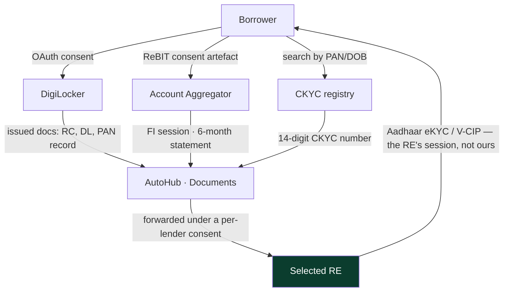
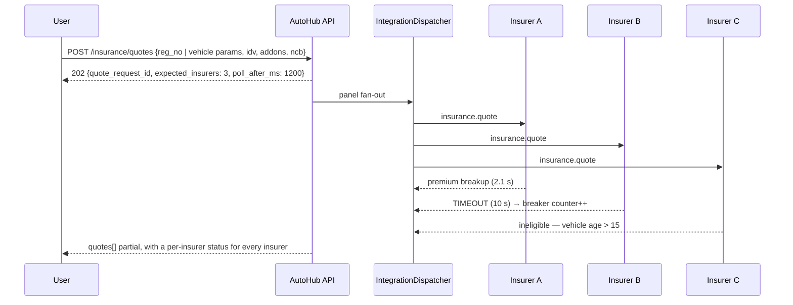
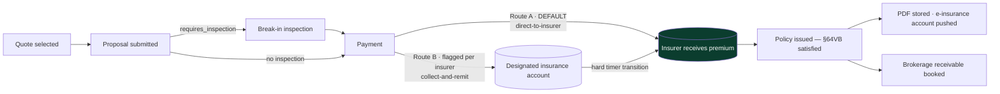

# Module 14 — Loan Marketplace, Insurance Marketplace, Payments and Ledger

> PRD modules 12 (Finance), 13 (Insurance), 14 (Payments & Settlement).
> Derives from `00-north-star.md` (stack, prime directive, module isolation, "the ledger is the
> truth, not the order row") and `01-design-system.md` (`MoneyValue` lakh/crore, `FieldBlock`,
> `StatusPill` driven by the workflow registry).
> Refines `02-domain-model.md` §15 and `03-data-model-erd.md` §4.5 — **additive only**.
> Backend projects: `AutoHub.Modules.Finance`, `AutoHub.Modules.Insurance`,
> `AutoHub.Modules.Payments`. The `Deal` spine stays in `AutoHub.Modules.Deals`; this document owns
> the *money mechanics*, not the deal lifecycle.

**Restating the prime directive here, because this is where it is most tempting to break it.** Every
status below is a `platform.workflow_states` row. Every percentage, flat fee, cap, floor, hold
period and tax rate is a `platform.fee_components` / `platform.fee_slabs` / `platform.tax_rules`
row. Every provider choice is a `platform.provider_routes` row. There is no `enum LoanStatus`, no
`const REFERRAL_RATE`, no `if (provider == "razorpay")`. A reviewer who finds one of those in a PR
rejects it and cites this line.

---

## 0. What this document owns, and what it deliberately does not

| Owns | Does not own (owner) |
|---|---|
| `finance` and `insurance` schema DDL, their workflows, the lender/insurer adapters, referral accounting | The `Deal` spine itself (`02` §11, module 10) |
| Gateway abstraction, method matrix, mandates, refunds, chargebacks, webhooks | Auction EMD *collection triggers* (module 11) — only their ledger treatment |
| Escrow mechanics: accounts, hold windows, release triggers, dispute freeze | KYC provider mechanics and fraud scoring (module 16) — only what Finance/Insurance consume |
| Journal templates registry, wallets, T+N payouts, GST/e-invoicing, TDS/TCS, month-end close | The double-entry primitives (`02` §15, `03` §4.5) — restated only where additive |
| Reconciliation against gateway settlement files | Break-in inspection *execution* (module 13) — only the reference and the outcome |

**Naming reconciliation, once, then never again.** `02` §15.2 calls the posting header
`payments.journal_entries`; `03` §4.5 calls the physical table `payments.ledger_transactions`. They
are the same object. **This document uses the physical names from `03`** —
`payments.ledger_transactions` (header) + `payments.ledger_entries` (legs) — because that is what
the migrations create. Domain code may keep the `JournalEntry` type name.

**Module isolation holds.** `Finance` never reads `payments.ledger_entries`; it emits
`finance.loan.disbursed.v1`, `Deals` creates the referral deal, `Payments` prices and posts it.
`Insurance` never reads `catalog.vehicles`; it asks `Catalog.Contracts.IVehicleFactsReader` for the
fields an insurer needs. One direction, through contracts, always.

---

## 1. The regulatory posture, stated once and encoded everywhere

AutoHub earns **referral revenue on money it never owns**. Three sentences generate every rule below.

| Line of business | What AutoHub is | Under what | The single constraint that shapes the design |
|---|---|---|---|
| Loans | **LSP** (Lending Service Provider) + DSA to Regulated Entities | RBI's Digital Lending framework | **Loan money never touches an AutoHub account.** Disbursal is RE → borrower (or RE → seller for a specified end use). Repayment is borrower → RE. No pool account, ever. |
| Insurance | **Direct Broker (General)** | IRDAI (Insurance Brokers) Regulations, 2018 | **We act for the insured.** §64VB, Insurance Act 1938: the insurer cannot assume risk until premium is received — so issuance is strictly downstream of *realised* payment. |
| Payments | **Merchant** on a licensed PA; not a PA | RBI PA/PG Directions, 2020 (as amended) | **Customer funds sit in the PA's escrow.** Our `escrow_holding` accounts are a **mirror** of that balance, reconciled daily — not a bank account we operate. |

A broker, not a corporate agent, and not a web aggregator: a broker may place risk with any number
of insurers (a corporate agent is capped per line of business) and may render claims assistance.
That choice is the only reason §4.11 can exist at all.

### 1.1 The permission matrix the code actually enforces

A "may not" that no guard enforces is a compliance incident waiting to happen, so every row names
its enforcement point.

| # | AutoHub **may** | AutoHub **may not** | Enforced by |
|---|---|---|---|
| F1 | Present offers from multiple REs in a digital, unbiased view | Rank by our own referral fee, or hide a willing lender | `rule_sets.finance_offer_ranking` input allow-list + CI test `RankingRuleMayNotReferencePricing` (§3.7) |
| F2 | Collect documents and forward them to the RE | Perform Aadhaar eKYC ourselves (we are not an AUA/KUA) | `capabilities.kyc.aadhaar_okyc` has **no** AutoHub-owned route; the adapter proxies the RE's session |
| F3 | Be paid a referral fee **by the RE** | Charge the borrower a facilitation fee | DB CHECK: `module_code <> 'finance' OR payer_role_code <> 'borrower'` (§3.12) |
| F4 | Show the RE-generated KFS and APR | Invent a "headline rate" and present it as the cost of credit | A null APR blocks the offer card: `422 finance.offer.apr_unavailable` |
| F5 | Store application metadata | Store borrower biometrics; store this data outside India | `platform.pii_registry` classification + region-pinned buckets |
| F6 | Operate with **no** default loss guarantee | Give a DLG/FLDG without board + regulator-aware structuring and a portfolio cap | No contingent-liability account exists in the chart of accounts |
| I1 | Solicit, place and service general insurance | Underwrite, or display a premium we computed | `ck_quotes__premium_source CHECK (premium_source_code = 'insurer')` |
| I2 | Assist with claims | Charge the insured for claim assistance; admit or quantify liability | `insurance_claim_assist` fee row is ₹0 and `is_active=false`; the claim machine has no state that writes a settlement amount |
| I3 | Receive brokerage from the insurer | Rebate any part of premium or brokerage (§41, Insurance Act 1938) | Promo/discount rules deny `module_code='insurance'` via the Feature Registry gate |
| I4 | Route premium directly to the insurer | Hold premium past the remittance window when collect-and-remit is used | `insurance.premium_remittances` + a hard timer transition (§4.8) |
| P1 | Collect our own fees, deposits and (contractually) sale consideration | Warehouse customer funds in an account we control | `ck_ledger_accounts__escrow_backing` (§6.1) |
| P2 | Hold escrow for the period the deal workflow requires | Exceed the hold ceiling without a documented dispute | `payments.settlement_overdue` + the escrow clock report (§6.4) |

**The design consequence that is easiest to get wrong:** a vehicle loan **may** be disbursed
directly to the seller or dealer — the "specific end use / disbursal to the end-beneficiary"
carve-out covers it. What is prohibited is the money passing through *our* pool account on the way.
So §3.11's disbursal leg credits the seller's verified account from the **lender's** rail, and
AutoHub only records the UTR and reconciles. **There is no journal template that debits escrow for
loan principal, and there never will be.**

---

## 2. Registry inventory for this module

Nothing below is new machinery. It is **content** for the ten registries that already exist.

| # | Registry | Rows this module adds | Example change with no deploy |
|---|---|---|---|
| 1 Taxonomy | `code_sets`: `loan_purpose`, `employment_type`, `income_proof_type`, `insurance_cover_kind`, `insurance_addon`, `idv_depreciation`, `ncb_slab`, `claim_type`, `payment_method`, `mandate_rail`, `mandate_return_reason`, `payout_rail`, `refund_reason`, `chargeback_reason`, `recon_break`, `close_task` | Add the `zero_dep_plus` add-on |
| 2 Form Schema | `finance.application.v*`, `finance.income_salaried.v*`, `finance.income_self_employed.v*`, `insurance.proposal_motor.v*`, `insurance.previous_policy.v*`, `insurance.claim_intimation.v*`, `payments.payout_account.v*`, `payments.dispute_raise.v*` | Add "co-applicant PAN" to the loan form on web + Android + iOS at once |
| 3 Workflow | `loan_application`, `loan_lender_submission`, `finance_mandate`, `insurance_quote_request`, `insurance_proposal`, `insurance_policy`, `insurance_claim_assist`, `payment_intent`, `refund`, `payout`, `chargeback`, `recon_break`, `accounting_period` | Insert `credit_committee_review` before `sanctioned` for one lender |
| 4 Pricing/Tax | `fee_components`: `finance_referral`, `finance_referral_dealer_share`, `finance_referral_agent_share`, `insurance_brokerage_od/_tp/_addon`, `insurance_dealer_share`, `pg_fee_*`, `payout_rail_fee_*`, `escrow_service_fee`; `tax_rules`: `tds_194h_commission`, `tds_194o_ecommerce`, `tcs_206c1f_motor_vehicle`, `stamp_loan_agreement_*` | Change the dealer referral share from 30% to 35% in Pune only |
| 5 RBAC | `finance.application.read_pii`, `finance.bureau.read_raw`, `finance.lender.manage`, `finance.application.manual_stamp`, `insurance.claim.assist`, `insurance.policy.read`, `payments.payout.release`, `payments.payout.approve`, `payments.refund.override`, `payments.ledger.adjust`, `payments.dispute.release`, `payments.recon.write_off`, `payments.period.close`, `payments.period.reopen` | Create "Settlement Approver — West, ≤ ₹5,00,000" |
| 6 Feature | `finance.marketplace`, `finance.sponsored_placement` (**off**), `insurance.marketplace`, `insurance.collect_and_remit`, `payments.upi_autopay`, `payments.part_payment`, `payments.payouts` (kill switch), `escrow.tripartite_above_threshold` | Launch insurance in Bengaluru only |
| 7 Notification | `finance.offers_ready`, `finance.offer_expiring`, `finance.mandate_pending`, `finance.disbursed`, `insurance.quote_ready`, `insurance.break_in_required`, `insurance.policy_issued`, `insurance.renewal.t_minus_*`, `payments.payment_failed`, `payments.refund_credited`, `payments.payout_settled`, `payments.mandate_pre_debit` | Change the Marathi renewal WhatsApp copy |
| 8 Integration | 20 new capabilities (§2.2), one provider per lender/insurer/gateway, routes with roles `primary` / `fallback` / **`panel`** (§2.1) | Swap Razorpay → Cashfree, keep Razorpay as fallback |
| 9 Localization | Every disclosure string, KFS label, IRDAI disclosure block, error message. **Regulatory text carries `is_verbatim=true`** — a translator may localise, never paraphrase | Ship Tamil disclosures |
| 10 Geography | `platform.states.gst_state_code` (IGST vs CGST+SGST), state-scoped stamp duty, RTO offices for the hypothecation endorsement, **banking-holiday calendars** used by payout batching | Add a state holiday that shifts a NEFT batch |

### 2.1 One contract addition to Registry 8

`platform.provider_routes.role` currently carries `primary | fallback | canary | shadow` — a
`code_key`, therefore data. This module adds the row **`panel`**:

> `role='panel'` means **call every active route for this capability whose `applies_when` evaluates
> true, in parallel, and aggregate the responses.** `primary`/`fallback` means failover down
> `priority`. A capability must use one semantic or the other; mixing is a configuration error
> caught by the registry publish validator on `platform.registry_change_sets`.

Lender panels and insurer panels are `panel`. Payment gateways are `primary`/`fallback`. That one
row is the difference between "who do I call" and "who do I call *instead*", and getting it wrong
means silently showing one lender's offer when three were available — an F1 violation with a
regulatory edge.

### 2.2 New capability rows (`platform.capabilities`)

The canonical `response_schema` is the whole point: the domain sees `LenderOffer`, never a bank's
DTO.

| `code` | `is_critical` | `is_idempotent` | `default_timeout_ms` | Canonical response, abbreviated |
|---|---|---|---|---|
| `lending.eligibility` | false | true | 4000 | `{eligible, max_amount_paise, indicative_apr_bps, reasons[]}` |
| `lending.application_submit` | false | **false** | 15000 | `{lender_ref, accepted, decision_eta_seconds, missing_documents[]}` |
| `lending.offer_fetch` | false | true | 8000 | `LenderOffer[]` (§3.3) |
| `lending.kfs_fetch` | false | true | 6000 | `{kfs_document_url, apr_bps, total_repayment_paise, generated_at}` |
| `lending.disbursal_status` | false | true | 6000 | `{state_code, disbursed_amount_paise, utr, disbursed_at, beneficiary_masked}` |
| `bureau.credit_report` | false | **false** | 12000 | `{score, score_name, bureau_code, enquiry_kind, report_ref, pulled_at}` |
| `aa.consent_create` / `aa.fi_fetch` | false | true | 10000 | ReBIT consent artefact / FI data session handle |
| `ckyc.search` / `ckyc.download` | false | true | 8000 | `{ckyc_number, name, dob, address_masked, photo_ref}` |
| `mandate.enach` / `mandate.upi_autopay` | false | **false** | 20000 | `{mandate_ref, umrn, status_code, max_amount_paise, valid_from, valid_to}` |
| `estamp.purchase` | false | **false** | 15000 | `{certificate_no, stamp_duty_paise, state_code, issued_at, pdf_ref}` |
| `insurance.quote` | false | true | 10000 | `InsurerQuote[]` (§4.3) |
| `insurance.proposal_submit` | false | **false** | 15000 | `{proposal_ref, requires_inspection, payment_link, expires_at}` |
| `insurance.policy_issue` | false | **false** | 20000 | `{policy_number, risk_start_at, risk_end_at, pdf_ref}` |
| `insurance.claim_intimate` / `insurance.claim_status` | false | false / true | 12000 | `{claim_number, state_code, surveyor{…}, next_action_code}` |
| `payment.emi` / `payment.card_token` | false | true | 6000 | EMI plan list / network token handle |
| `payout.imps` / `payout.neft` / `payout.rtgs` / `payout.upi` | **true** | **false** | 20000–30000 | `{payout_ref, utr, state_code, failure_code}` |
| `settlement.file_fetch` | false | true | 60000 | `{settlement_id, value_date, gross_paise, fee_paise, tax_paise, rows[]}` |
| `escrow.tripartite` | false | **false** | 20000 | `{escrow_ref, balance_paise, hold_refs[], release_ack}` |

`is_idempotent=false` is not decoration. The dispatcher **refuses to blind-retry** a non-idempotent
capability; it must call the provider's status endpoint first, or carry a provider-side idempotency
key from `provider_routes.retry_policy.idempotency_header`. A blind retry on `payout.neft` is how a
marketplace pays a dealer twice.

---

# PART A — LOAN MARKETPLACE

## 3.1 The actors, and what each may see

```
  Borrower ──── application ────▶  AutoHub (LSP)  ──panel fan-out──▶  RE #1 (Bank)
     │                                  │                             RE #2 (NBFC)
     │◀──── unbiased offer view ────────┘                             RE #3 (Captive)
     │
     └──── accepts ONE offer ──────────────────────────────────────▶  chosen RE
                                                                        │
   seller's verified bank a/c  ◀──── disbursal on the RE's rail ────────┘
                                     UTR reported to AutoHub
   AutoHub raises a REFERRAL deal against the RE ──▶ invoice + GST + (dealer share − TDS 194H)
```

| Actor | Sees | Never sees |
|---|---|---|
| Borrower | All own offers, all KFS, own documents | Other borrowers; our referral rate |
| Referring dealer (a sub-referrer, never a party to the loan) | Application state, sanctioned amount, disbursal state | Bureau score, income documents, bank statements — `finance.application.read_pii` is not granted at dealer scope |
| Lender (RE) | Only the applications routed to it, only after a per-lender consent artefact | Competing offers, our ranking, other lenders' presence in the funnel |
| AutoHub ops | Everything except the raw bureau report body — decryption needs `finance.bureau.read_raw` + step-up + an audit row | — |

## 3.2 Lender onboarding

A lender is an `identity.organizations` row (`org_kind_code='lender'`), a `finance.lenders` profile,
and **one `integration_providers` row per environment**. The onboarding checklist is
`platform.form_versions` data, so compliance can add "GST certificate of the RE" next quarter
without a release.

| Step | Artefact | Gate before `is_active=true` |
|---|---|---|
| 1 | Signed LSP/DSA agreement, with the DLG position stated explicitly (**AutoHub gives none**) | `contract_ref` non-null |
| 2 | RE's regulatory registration (CoR for NBFCs, banking licence reference) | `finance.lenders.regulator_ref`, verified maker-checker |
| 3 | Sandbox certification: 12 scripted cases — approve, decline, conditional, doc-shortfall, timeout, duplicate, mandate-fail, partial disbursal, cancel, KFS-fetch, status-drift, webhook-replay | `certified_at` non-null (enforced by CHECK) |
| 4 | KFS format confirmed; their charge names mapped to our canonical `apr_components[]` | `lender_products.apr_component_map` non-empty |
| 5 | Product catalogue loaded: tenure grid, LTV grid, vehicle-age appetite, geography, income policy | ≥1 active `finance.lender_products` |
| 6 | Referral commercial terms | ≥1 `fee_components` row scoped to the lender (§3.12) |
| 7 | Data-sharing addendum: what PII goes out, retention at the RE, deletion on decline | A `trust.consents` template for `finance.share_with_lender.{code}` |
| 8 | Webhook secret provisioned; replay window and clock skew agreed | Active `provider_credentials.webhook_secret` |

**Appetite is data.** `finance.lender_products.eligibility_rule_set_id` points at a
`platform.rule_sets` row. Switching a lender off for 10-year-old commercial vehicles in Kerala is a
rule insert:

```json
{ "code": "hdfc_uc_appetite", "priority": 20, "stop_on_match": true,
  "condition": {"and":[
      {"==":[{"var":"vehicle.category_code"},"commercial_vehicle"]},
      {">":[{"var":"vehicle.age_years"},10]},
      {"==":[{"var":"geo.state_code"},"KL"]}]},
  "outcome": {"deny":"finance.lender.out_of_appetite"},
  "explain_i18n_key": "finance.decline.age_geo" }
```

## 3.3 The lender-agnostic adapter

One port per capability, one adapter class per lender, resolved by
`integration_providers.adapter_key`. The domain never learns a lender's vocabulary.

```
Application ── ILoanOfferPort ─▶ IntegrationDispatcher ─▶ provider_routes(capability='lending.offer_fetch')
                                       │                      role='panel' :  hdfc_bank    priority 10
                                       │                      role='panel' :  icici_bank   priority 10
                                       │                      role='panel' :  bajaj_fin    priority 10
                                       │                      (no fallback — a lender has no substitute)
                                       ▼
                        per-provider circuit breaker · timeout · rate limit
                                       ▼
                          Adapter.MapToCanonical() ──▶ LenderOffer
```

### The canonical `LenderOffer`

```jsonc
{
  "lender_code": "hdfc_bank",
  "lender_legal_name": "HDFC Bank Limited",          // RE's name, verbatim. Never "our partner".
  "lender_regulator_ref": "…",
  "product_code": "used_car_salaried_v3",
  "offer_ref": "HDFC-OFR-88213",
  "decision_code": "approved | conditional | declined | pending",
  "sanctioned_amount_paise": 48000000,
  "ltv_percent": 75.0,
  "tenure_months": 60,
  "interest_rate_bps": 1249,                          // 12.49% nominal — NOT the APR
  "rate_kind_code": "reducing_monthly | flat",        // flat must be converted before display
  "apr_bps": 1394,                                    // all-in, excluding contingent charges
  "apr_source_code": "lender | autohub_computed",
  "apr_components": [
    {"code":"interest","amount_paise":16210000},
    {"code":"processing_fee","amount_paise":590000,"rate_percent":1.23},
    {"code":"documentation","amount_paise":150000},
    {"code":"stamp_duty","amount_paise":24000},
    {"code":"mandatory_insurance","amount_paise":0}
  ],
  "emi_paise": 1081100,
  "total_repayment_paise": 64866000,
  "conditions": [{"code":"co_applicant_required","i18n_key":"…"}],
  "required_documents": ["pan","aadhaar_masked","bank_statement_6m","salary_slip_3m"],
  "kfs_document_url": "https://…/kfs/HDFC-OFR-88213.pdf",
  "kfs_generated_at": "2026-07-29T09:12:44Z",
  "valid_until": "2026-08-12T18:29:59Z",
  "cooling_off_days": 3,
  "foreclosure_terms": {"lock_in_months":6,"charge_percent":3.0,"floating_rate_nil":true},
  "grievance": {"nodal_officer":"…","email":"…","phone":"…","escalation_url":"…"}
}
```

Four judgment calls baked into that shape:

1. **`interest_rate_bps` and `apr_bps` are separate fields, and the UI may not show the first
   without the second.** Indian lenders quote 9.99% and mean 13.4% after fees. Showing only the
   nominal rate is the most common mis-selling pattern in this category.
2. **`rate_kind_code='flat'` is converted, never displayed raw.** A 7% flat rate over 60 months is
   ~12.8% reducing. We normalise for comparison and label the original; the presentation log keeps
   both, so a complaint in 2029 can be answered exactly.
3. **`apr_components[]` is mandatory.** If a lender cannot supply it we compute the APR ourselves,
   set `apr_source_code='autohub_computed'`, and the card carries a disclosure saying so. What we
   never do is leave APR null and show a rate anyway.
4. **`valid_until` is the lender's, not ours.** Countdown timers render from this field only. A
   fabricated urgency timer is a dark pattern, banned by D6.

### APR and EMI arithmetic

APR is the annualised IRR of the borrower's real cash flows: net disbursal in, EMI schedule out,
contingent charges (late fee, bounce charge) excluded.

```
Solve for monthly i:   NetDisbursal = Σ EMI_k / (1+i)^k ,  k = 1..n
APR_bps = round(i × 12 × 10000)

EMI = P·i·(1+i)^n / ((1+i)^n − 1)   → half-up to the rupee;
                                      the final instalment absorbs the residue so ΣEMI == total exactly.
```

Newton–Raphson on `decimal`, seed `i = nominal/12`, tolerance `1e-10`, 60-iteration cap, **bisection
fallback on [0,1]** when the derivative flattens. Never `double` — an APR that renders 13.99% on web
and 14.00% on Flutter is a complaint we cannot defend. Both live in
`AutoHub.Modules.Finance.Domain.Amortisation` as pure functions with a golden-file test of 400
rate × tenure × fee combinations checked against the lenders' own KFS PDFs.

## 3.4 Eligibility pre-check without a hard bureau pull

| Tier | Input | Bureau | Output | Budget |
|---|---|---|---|---|
| **T0 — Indicative** | Vehicle price, city, declared income, declared obligations, age | **None** | Amount band + indicative APR band per lender, labelled *indicative* | < 300 ms, zero external calls |
| **T1 — Soft** | T0 + PAN + mobile + explicit soft-enquiry consent | **Soft** | Score band, per-lender pre-qualified flags, tighter amount | < 4 s |
| **T2 — Full** | T1 + KYC + documents + submitted application | **Hard**, once, at the selected RE only | Sanction, KFS, APR | Minutes–days |

T0 runs entirely on registry data. FOIR and LTV come from `rule_sets.finance_eligibility_t0`:

```json
{"code":"foir_salaried_metro","priority":30,
 "condition":{"and":[{"==":[{"var":"employment_type"},"salaried"]},
                     {"==":[{"var":"city_tier"},1]},
                     {">":[{"var":"monthly_income_paise"},7500000]}]},
 "outcome":{"foir_percent":55,"max_ltv_percent":85,"max_tenure_months":84,
            "indicative_apr_bps_low":1150,"indicative_apr_bps_high":1550},
 "explain_i18n_key":"finance.t0.foir_metro"}
```

```
max_emi  = (monthly_income × foir%) − existing_obligations
max_loan = amortise_inverse(max_emi, indicative_apr_high, tenure)
max_loan = min(max_loan, vehicle_price × max_ltv%, product_ceiling)
tenure   = min(max_tenure_months, (age_cap_years − vehicle_age_years) × 12)
```

That last line matters. A 2015 car quoted an 84-month tenure is an offer no lender will honour, and
showing it destroys trust before the funnel begins. `age_cap_years` is per product — typically 10
for cars, 8 for two-wheelers — and it is registry data.

**T0 never says "approved."** Copy from the localization registry: *"Indicative only. Based on what
you told us. Final terms come from the lender after checks."*

## 3.5 Soft vs hard enquiry policy

| | Soft | Hard |
|---|---|---|
| Triggered by | AutoHub, as the consumer's agent | The RE, on the RE's member ID |
| Purpose code | consumer-initiated / pre-qualification | credit application |
| Score impact | None | Recorded; clustered pulls depress the score |
| Consent artefact | `trust.consents` purpose `finance.bureau_soft` | purpose `finance.bureau_hard.{lender_code}` — **per lender, named** |
| Raw report retention | 90 days encrypted, then only the derived band | Not retained by us |
| Frequency cap | `rule_sets.bureau_throttle` → 1 per 30 days per PAN, cache-served between | Once per selected offer |

Four enforced rules:

1. **One hard pull per application, at the lender the borrower selected.** Fanning out five hard
   pulls is a real and common harm. Our fan-out is soft/eligibility only. The `select_offer`
   transition is the **only** place `bureau.credit_report` is called with `enquiry_kind='hard'`, and
   it carries the guard `consent_present('finance.bureau_hard.' || lender_code)`.
2. **Consent is an artefact, not a checkbox.** `trust.consents` stores the rendered consent text
   version, timestamp, IP, device and the exact purpose string. Absent → `403
   finance.bureau.consent_missing`. Withdrawal binds going forward; it cannot un-pull a past
   enquiry, and the UI says exactly that.
3. **Soft results cache against `sha256(pan_upper || pepper)`** (pepper in KMS) with the throttle
   TTL. Re-running eligibility three times in an evening costs one pull.
4. **A declined applicant is told the reason category** from the lender's canonical
   `decline_reason_code`, mapped to a localized, non-derogatory string. We never invent a reason.

## 3.6 Loan application — the workflow registry definition

Two machines. The parent tracks the borrower's journey; the child tracks one lender's opinion. That
separation is why a lender timing out does not stall an application.

### Machine `loan_application` v1 — `platform.workflow_states`

| `code` | `kind_code` | `is_editable` | `counts_as_open` | `blocks_deletion` | `sla_minutes` | `ui.tone` | Notes |
|---|---|---|---|---|---|---|---|
| `draft` | initial | true | true | false | – | info | Form captured, nothing sent |
| `eligibility_checked` | active | true | true | false | – | info | T0/T1 done |
| `kyc_pending` | waiting | true | true | true | 2880 | caution | CKYC / DigiLocker / eKYC at the RE |
| `documents_pending` | waiting | true | true | true | 4320 | caution | Union of lender shortfalls |
| `submitted` | active | false | true | true | 60 | info | Panel fan-out fired; children created |
| `offers_received` | waiting | false | true | true | 10080 | clear | ≥1 child in `offer_made` |
| `offer_selected` | active | false | true | true | 120 | info | Hard pull authorised here, and only here |
| `underwriting` | waiting | false | true | true | 4320 | caution | Selected lender processing |
| `conditional_sanction` | waiting | true | true | true | 2880 | caution | Conditions listed; borrower acts |
| `sanctioned` | active | false | true | true | 4320 | clear | KFS delivered; cooling-off starts |
| `agreement_pending` | waiting | false | true | true | 2880 | caution | e-stamp then eSign |
| `mandate_pending` | waiting | false | true | true | 2880 | caution | e-NACH / UPI Autopay |
| `disbursal_pending` | waiting | false | true | true | 4320 | caution | RE queued the payout |
| `disbursed` | active | false | true | true | – | clear | Money left the RE, UTR captured |
| `completed` | terminal_success | false | false | true | – | clear | Hypothecation on the RC; referral invoiced |
| `declined_all` | terminal_failure | false | false | false | – | flag | Every child terminal-declined |
| `withdrawn` | terminal_cancelled | false | false | false | – | info | Borrower withdrew |
| `expired` | terminal_failure | false | false | false | – | info | No action in the window |
| `fraud_hold` | waiting | false | true | true | – | flag | Trust raised a case |
| `legal_hold` | waiting | false | true | true | – | flag | Reachable from *any* state |

### `platform.workflow_transitions`

| `code` | from → to | `trigger_type` | Guard rule set | Effects |
|---|---|---|---|---|
| `check_eligibility` | draft → eligibility_checked | api | `finance_t0_input_complete` | emit `finance.eligibility.computed.v1` |
| `submit` | eligibility_checked → submitted | api | `finance_submit_ready` (KYC level ≥ 2, consent present, vehicle resolved) | invoke `finance.fanout_to_panel`; notify |
| `request_kyc` | submitted → kyc_pending | event `trust.kyc.required` | – | notify |
| `kyc_cleared` | kyc_pending → submitted | event `trust.kyc.verified.v1` | – | invoke `finance.fanout_to_panel` |
| `offers_ready` | submitted → offers_received | event `finance.lender.offer_made.v1` | – | notify; snapshot `offer_presentations` |
| `request_documents` | submitted \| offers_received → documents_pending | event | – | notify with the union of shortfalls |
| `documents_submitted` | documents_pending → offers_received | api | `finance_documents_complete` | invoke `finance.resubmit_documents` |
| `select_offer` | offers_received → offer_selected | api | `finance_offer_selectable` (not expired **and** `finance.bureau_hard.{lender}` consent present) | invoke hard pull; move siblings to `not_selected` |
| `enter_underwriting` | offer_selected → underwriting | event | – | – |
| `conditional` | underwriting → conditional_sanction | event | – | notify with condition list |
| `conditions_met` | conditional_sanction → underwriting | api | `finance_conditions_satisfied` | – |
| `sanction` | underwriting → sanctioned | event `finance.lender.sanctioned.v1` | `finance_kfs_present` | notify; start the cooling-off timer |
| `start_agreement` | sanctioned → agreement_pending | api | `finance_cooling_off_elapsed_or_waived` | invoke `estamp.purchase`, then `esign.aadhaar` |
| `agreement_signed` | agreement_pending → mandate_pending | event `documents.esign.completed.v1` | – | invoke `mandate.*` per rail rule |
| `mandate_active` | mandate_pending → disbursal_pending | event `finance.mandate.active.v1` | – | notify the RE |
| `disburse` | disbursal_pending → disbursed | event / poll | `finance_disbursal_beneficiary_matches` | emit `finance.loan.disbursed.v1` → **Deals creates the referral deal** |
| `complete` | disbursed → completed | event `catalog.vehicle.encumbrance_changed.v1` | – | emit `finance.loan.completed.v1` |
| `decline_all` | *any non-terminal* → declined_all | system | `finance_all_children_declined` | notify with reason category |
| `withdraw` | *any non-terminal* → withdrawn | api | `finance_withdrawable` (not `disbursed`) | invoke `finance.notify_lenders_withdrawn` |
| `auto_expire` | offers_received → expired | timer | – | `workflow_timers.fire_at = max(child.valid_until)` |
| `raise_fraud_hold` | *any* → fraud_hold | event `trust.case.opened.v1` | – | freeze referral accrual |
| `place_on_legal_hold` | **from_state_id IS NULL** → legal_hold | manual, perm `finance.application.legal_hold` | – | `workflow_instances.is_locked = true` |

### Child machine `loan_lender_submission` v1

| `code` | `kind_code` | Meaning |
|---|---|---|
| `queued` | initial | Created by fan-out, not yet dispatched |
| `submitted` | active | Lender accepted the payload |
| `in_underwriting` | waiting | `sla_minutes` = `lender_products.decision_sla_minutes` |
| `document_shortfall` | waiting | Lender named missing documents |
| `offer_made` / `conditional_offer` | active | Canonical offer stored |
| `offer_expired` | terminal_failure | Timer on `valid_until` |
| `declined` | terminal_failure | With `decline_reason_code` |
| `not_selected` | terminal_cancelled | Borrower chose someone else |
| `error` | waiting | Transport failure; 5 retries, exponential |
| `sanctioned` / `disbursed` | active / terminal_success | Only on the selected child |

**Parent state is a projection, and the projection rule is registry data.**
`rule_sets.finance_application_rollup` maps the multiset of child states to the parent state. Adding
"nudge if any child sat in `offer_made` for 48 h" is a rule row plus a timer.

**Race, named:** two lenders return offers in the same millisecond and both fire `offers_ready`.
`idempotency_scope='instance'` plus `uq_workflow_transitions__def_code` makes the second a no-op
returning the current state, and the notification deduplicates on
`(event_code, entity_id, recipient_id, window)`. The borrower gets one message, not two.

## 3.7 Offer comparison, ranking, and the anti-mis-selling rules

This is the section a regulator reads first.

### Default ordering, and the complete input allow-list

`rule_sets.finance_offer_ranking` v1 may reference **only** these:

```
apr_bps · sanctioned_amount_paise · tenure_months · emi_paise · total_repayment_paise
processing_fee_paise · foreclosure_charge_percent · lock_in_months · conditions_count
decision_sla_minutes · lender_disbursal_p50_hours · lender_rejection_rate_90d
```

Rejected at rule-save time with `platform.rule.field_not_permitted`:

```
referral_fee_paise · referral_rate_percent · lender_tier · is_sponsored · partner_priority
```

Default sort: `apr_bps ASC, total_repayment_paise ASC, decision_sla_minutes ASC`. The user may
re-sort; the active sort is stated in the header (*"Sorted by: lowest APR"*) and recorded.

### Disclosure rules — each is a rendering requirement

| # | Rule | Failure mode it prevents |
|---|---|---|
| D1 | Every card names the **RE's legal name**. "AutoHub Finance" appears nowhere | Borrower thinking we are the lender |
| D2 | APR shown with equal or greater visual weight than the nominal rate | The 9.99% / 13.4% deception |
| D3 | KFS link present and reachable before acceptance; missing → `409 finance.offer.kfs_missing` blocks the CTA | Contract without key facts |
| D4 | Page-level banner, verbatim: *"AutoHub is a Lending Service Provider. We do not lend. Loans are made by the lender named on each offer."* | Role confusion |
| D5 | **No pre-selection.** No card checked by default; a "recommended" badge only with a stated, computed criterion (*"Lowest APR"*) | Steering |
| D6 | Countdowns render only from `valid_until`; no lender expiry → no timer | Manufactured urgency |
| D7 | Declined lenders shown as declined with a reason category, not hidden | Illusion of universal approval |
| D8 | Sponsored placement off. If ever enabled: labelled, excluded from the default sort, one slot, never above the lowest-APR offer | Paid mis-ranking |
| D9 | Fees on the card are the **lender's**. AutoHub charges the borrower nothing, and the card says so | Double-charging |
| D10 | Grievance block on every card: lender's nodal officer, escalation route, and our own | Nowhere to complain |

### The mis-selling defence: an immutable presentation log

```sql
CREATE TABLE finance.offer_presentations (
    id               uuid NOT NULL DEFAULT platform.uuid_generate_v7(),
    presented_at     timestamptz NOT NULL DEFAULT now(),
    application_id   uuid NOT NULL,
    actor_party_id   uuid NOT NULL,
    surface_code     platform.code_key NOT NULL,      -- 'web','android','ios','agent_console'
    ranking_rule_set_id uuid NOT NULL,
    ranking_rule_set_version integer NOT NULL,
    sort_key         text NOT NULL,                   -- 'apr_asc'
    offers           jsonb NOT NULL,                  -- the exact ordered rendered cards
    disclosures      jsonb NOT NULL,                  -- {"i18n_key":…,"locale":"mr-IN","hash":…}
    locale_code      platform.code_key NOT NULL,
    content_hash     char(64) NOT NULL,
    CONSTRAINT pk_offer_presentations PRIMARY KEY (id, presented_at)
) PARTITION BY RANGE (presented_at);
CREATE TRIGGER tg_offer_presentations__append_only
    BEFORE UPDATE OR DELETE ON finance.offer_presentations
    FOR EACH ROW EXECUTE FUNCTION platform.tg_append_only();
```

Retained 8 years, aligned with the Companies Act §128 horizon already used for financial records.
When a borrower says in 2029 that they were shown only one lender, we reproduce the screen.

**One CI test guards all of it.** `RankingRuleMayNotReferencePricing` loads every active rule set
matching `finance_offer_ranking%`, walks the JsonLogic AST, and fails the build if any `var` falls
outside the allow-list. Registry-driven does not mean unpoliced.

## 3.8 Document collection — DigiLocker, AA, CKYC, eKYC



| Source | What we take | What we must not do |
|---|---|---|
| **DigiLocker** | *Issued* documents only, issuer signature intact → `documents.source_code='digilocker'`, `is_issuer_signed=true` | Treat a user-uploaded scan as issuer-verified. A self-uploaded RC is `source_code='upload'`, `verification_state_code='unverified'` until the VAHAN cross-check |
| **Account Aggregator** | Statement under a ReBIT consent artefact: purpose code, FI types, date range, `ONETIME` frequency, validity ≤ the application window | Keep raw FI data. Encrypted, TTL 30 days, then only `income_signals` (average-balance band, salary-credit regularity, bounce count) survive |
| **CKYC** | The CKYC number and matched identity block, sparing the borrower re-KYC | Treat CKYC as sufficient KYC. The RE decides |
| **Aadhaar eKYC / V-CIP** | Nothing. **We proxy the RE's session** and receive a success token | Be an AUA/KUA; store an Aadhaar number, a biometric, or an eKYC XML. `platform.pii_registry` marks `aadhaar_number` `prohibited_at_rest`; **the column does not exist** |

Document sufficiency is a form-schema + rule pair. Each `finance.lender_products` row names
`required_document_form_version_id`; the union across live children is the shortfall list;
`finance_documents_complete` is the guard.

## 3.9 e-agreement and e-stamping

Order is enforced by the transition chain: **stamp, then sign.** An unstamped agreement is
inadmissible; signing before stamping invites a dispute about sequence.

1. `estamp.purchase` — duty from `platform.tax_rules` where `tax_type='stamp_duty'`, scoped by
   `platform.states`. Never a constant: states differ and change duty in their budgets.
2. `esign.aadhaar` through a licensed ESP; the signed PDF lands in `documents.documents` as
   `document_type='loan_agreement'` with a long-term-validation timestamp.
3. The RE countersigns; `documents.esign.completed.v1` drives `agreement_signed`.

| `tax_rules.code` | Basis | Value | `statutory_ref` |
|---|---|---|---|
| `stamp_loan_agreement_mh` | loan_amount | 0.1%, cap ₹1,00,000 | Maharashtra Stamp Act, Sch. I Art. 5(h) |
| `stamp_loan_agreement_ka` | loan_amount | 0.1%, cap ₹10,00,000 | Karnataka Stamp Act, Art. 5 |
| `stamp_loan_agreement_dl` | flat | ₹100 | Indian Stamp Act as applicable to Delhi |
| `stamp_hypothecation_mh` | loan_amount | 0.2%, cap ₹5,00,000 | Maharashtra Stamp Act, Art. 6(1) |

**Failure mode:** the e-stamp provider is down at 11 pm on the last day of a sanction's validity. The
transition does not fail the application — it parks in `agreement_pending` with
`context.estamp_retry_count`, a 15-minute timer, and a notification naming exactly what is stuck.
Ops may switch to a manual e-stamp path, which requires `finance.application.manual_stamp` and
writes an audit row.

## 3.10 e-NACH / UPI Autopay mandate

The mandate belongs to the RE. We orchestrate creation and hold the reference.

| Rail | Per-debit ceiling | AFA on each debit | Use when |
|---|---|---|---|
| **e-NACH** | ₹1 crore | No, after one-time authentication | Default for EMIs — almost every vehicle EMI exceeds the card e-mandate AFA-free ceiling |
| **UPI Autopay** | ₹15,000 AFA-free (the ₹1 lakh relaxation covers notified categories, which do **not** include loan EMIs) | Yes above the AFA-free limit | EMIs ≤ ₹15,000 — two-wheeler and small-ticket |
| **Physical NACH** | ₹1 crore | No | Where the destination bank has no e-mandate live |

These ceilings are `platform.codes` rows in the `mandate_rail` set with a `limit_paise` attribute
and a `statutory_ref`. When NPCI moves a limit it is a data change, and
`rule_sets.mandate_rail_selection` picks the rail:

```json
{"code":"rail_by_emi","priority":10,
 "condition":{"<=":[{"var":"emi_paise"},1500000]},
 "outcome":{"rail":"upi_autopay","fallback_rail":"enach"}}
{"code":"rail_default","priority":100,
 "condition":true,
 "outcome":{"rail":"enach","fallback_rail":"physical_nach"}}
```

Machine `finance_mandate`: `initiated → authenticated → registered (UMRN issued) → active`, plus
`rejected`, `expired`, `revoked`, `bank_unreachable`. **Disbursal gates on `active`, not
`registered`** — a UMRN exists before the destination bank confirms, and lenders that disburse on
`registered` eat the first-EMI bounce.

**Edge case:** the borrower changes bank account after registration. New mandate, new UMRN, old one
revoked, both rows retained with `superseded_by_mandate_id`. A UMRN row is never mutated.

## 3.11 Disbursal tracking

```
RE ──(1) disburses──▶ seller's / borrower's verified account
 ├─(2) webhook lending.disbursal_status  ──▶ finance.disbursals, UTR captured
 ├─(3) poll every 30 min for 72 h when no webhook arrives
 └─(4) beneficiary confirms receipt in-app (human oracle, weighted lowest)
```

Three sources disagree constantly. Precedence is registry data
(`rule_sets.disbursal_truth_precedence`): webhook-with-UTR > poll-with-UTR > human confirmation >
webhook-without-UTR. A disbursal without a UTR is `disbursed_unconfirmed` and **does not trigger
referral invoicing** — invoicing an unconfirmed disbursal produces a credit note two weeks later.

**Beneficiary guard.** `finance_disbursal_beneficiary_matches` compares the RE-reported masked
account against the account we verified by penny drop. Mismatch → `422
finance.disbursal.account_mismatch`, ops case, no accrual. This is the control that stops a
compromised dealer account from redirecting a ₹6 lakh disbursal.

**Hypothecation.** After disbursal the RE files the endorsement with the RTO and the RC names the
financier. We watch: `catalog.vehicle.encumbrance_changed.v1` from the VAHAN sync closes the
application. If it has not arrived within `rule_sets.hypothecation_watch` (default 45 days) we raise
an ops task — not because it is our obligation, but because an un-endorsed RC becomes the buyer's
problem at resale and we are the party they will call.

**Partial disbursal** (refurbishment-linked tranches): `finance.disbursals` is one-to-many; the
parent moves to `disbursed` on the first tranche, and the referral fee computes on
`SUM(disbursed_amount_paise)` at the cut-off in the lender's fee row —
`applies_when: {"==":[{"var":"disbursal_finality"},"final"]}`.

## 3.12 The referral deal — how finance revenue actually books

`finance.loan.disbursed.v1` → `Deals` creates a **service deal** with `intent='referral'`, parties =
AutoHub (supplier), lender (recipient), referring dealer (channel partner, if any). `Payments`
prices it from the registry and posts the journals.

### Pricing registry rows

| `fee_components.code` | `calc_method` | `basis` | Value | Scope / `applies_when` | `payer_role_code` | `payee_role_code` | `gl_account_code` | `tax_rule_id` |
|---|---|---|---|---|---|---|---|---|
| `finance_referral` | slab_percent | `loan_amount` | 1.00% / 1.25% / 1.50% by slab | – | `lender` | `platform` | `referral_income` | `gst_services_18` |
| `finance_referral` (HDFC treaty) | percent | `loan_amount` | 1.40%, min ₹3,000 | `lender_code == 'hdfc_bank'`, priority 20 | `lender` | `platform` | `referral_income` | `gst_services_18` |
| `finance_referral_new_ev` | percent | `loan_amount` | 1.75% | `scope_category_id = four_wheeler` + `fuel_code == 'electric'`, priority 30 | `lender` | `platform` | `referral_income` | `gst_services_18` |
| `finance_referral_dealer_share` | percent | `referral_net` | 30% | `referring_dealer_present` | `platform` | `referring_dealer` | `channel_partner_expense` | `gst_services_18` |
| `finance_referral_agent_share` | percent | `referral_net` | 10% | `field_agent_present` | `platform` | `field_agent` | `channel_partner_expense` | `gst_services_18` |

`platform.fee_slabs` for the base row:

| `from_amount_paise` | `to_amount_paise` | `rate_percent` | `is_marginal` |
|---|---|---|---|
| 0 | 3,00,000,00 (₹3L) | 1.00 | false |
| 3,00,000,00 | 10,00,000,00 (₹10L) | 1.25 | false |
| 10,00,000,00 | NULL | 1.50 | false |

`is_marginal=false` is flat-by-band: a ₹10.5 lakh loan earns 1.50% on the whole amount, which is how
lender treaties are actually written. A marginal treaty flips one boolean.

**The constraint that makes F3 unbreakable:**

```sql
ALTER TABLE platform.fee_components
  ADD CONSTRAINT ck_fee_components__finance_never_charges_borrower
  CHECK (module_code <> 'finance' OR payer_role_code <> 'borrower');
```

A product manager cannot create a borrower-paid facilitation fee even by accident.

### Journals — ₹5,00,000 disbursed, lender in Karnataka, AutoHub in Maharashtra (IGST), dealer share 30%

Referral 1.25% = ₹6,250 + IGST 18% ₹1,125 = ₹7,375. Dealer share 30% of ₹6,250 = ₹1,875 + GST
₹337.50 (registered dealer → ITC-bearing inward supply). TDS 194H @2% on ₹1,875 = ₹37.50.

| # | Trigger | Dr | Cr | ₹ |
|---|---|---|---|---|
| J1 | `finance.loan.disbursed.v1` → referral priced, tax invoice to L, IRN generated | `1200` referral_receivable:L | | 7,375.00 |
| | | | `4030` referral_income | 6,250.00 |
| | | | `2043` gst_output_igst | 1,125.00 |
| J2 | Lender remits to **platform bank**, never escrow | `1020` platform_bank | | 7,375.00 |
| | | | `1200` referral_receivable:L | 7,375.00 |
| J3 | Dealer share accrued on the dealer's invoice to us | `5030` channel_partner_expense | | 1,875.00 |
| | `1302` gst_input_igst | | 337.50 | |
| | | | `2010` partner_payable:D | 2,212.50 |
| J4 | TDS 194H @2% withheld | `2010` partner_payable:D | | 37.50 |
| | | | `2061` tds_194h_payable | 37.50 |
| J5 | Dealer paid ₹2,175 | `2010` partner_payable:D | | 2,175.00 |
| | | | `1020` platform_bank | 2,175.00 |

Check: bank 7,375 − 2,175 = 5,200; assets 5,200 + input GST 337.50 = **5,537.50**. Liabilities
1,125 + 37.50 = 1,162.50; equity 6,250 − 1,875 = 4,375; 1,162.50 + 4,375 = **5,537.50 ✓**

**Revenue recognition point:** disbursal confirmed with a UTR. Not sanction, not agreement. If the
RE claws the referral back because the loan foreclosed inside `lender_products.clawback_days`
(default 90), we issue a **credit note against the original IRN** — never a negative invoice, never
a silent ledger reversal.

## 3.13 `finance` schema — the load-bearing tables

```sql
CREATE SCHEMA finance;

CREATE TABLE finance.lenders (
    id              uuid PRIMARY KEY DEFAULT platform.uuid_generate_v7(),
    organization_id uuid NOT NULL REFERENCES identity.organizations(id),
    code            platform.code_key NOT NULL,
    legal_name      text NOT NULL,                     -- rendered verbatim on every offer card
    lender_kind_code platform.code_key NOT NULL,       -- 'bank','nbfc','captive','fintech_nbfc'
    regulator_ref   text NOT NULL,
    grievance       jsonb NOT NULL DEFAULT '{}',
    provider_id     uuid REFERENCES platform.integration_providers(id),
    dispatch_priority smallint NOT NULL DEFAULT 100,   -- fan-out order only; NEVER display order
    is_active       boolean NOT NULL DEFAULT false,
    certified_at    timestamptz,
    contract_ref    text,
    created_at timestamptz NOT NULL DEFAULT now(), created_by uuid,
    updated_at timestamptz NOT NULL DEFAULT now(), updated_by uuid,
    deleted_at timestamptz, deleted_by uuid,
    row_version bigint NOT NULL DEFAULT 1,
    CONSTRAINT uq_lenders__code UNIQUE (code),
    CONSTRAINT ck_lenders__active_requires_cert CHECK (NOT is_active OR certified_at IS NOT NULL)
);

CREATE TABLE finance.lender_products (
    id              uuid PRIMARY KEY DEFAULT platform.uuid_generate_v7(),
    lender_id       uuid NOT NULL REFERENCES finance.lenders(id) ON DELETE CASCADE,
    code            platform.code_key NOT NULL,
    i18n_key        text NOT NULL,
    intent_type_code platform.code_key REFERENCES platform.intent_types(code),
    category_id     uuid REFERENCES platform.categories(id),
    min_amount_paise platform.money_paise NOT NULL,
    max_amount_paise platform.money_paise NOT NULL,
    min_tenure_months smallint NOT NULL,
    max_tenure_months smallint NOT NULL,
    max_ltv_percent platform.rate_percent NOT NULL,
    vehicle_age_cap_years smallint NOT NULL,
    eligibility_rule_set_id uuid REFERENCES platform.rule_sets(id),
    required_document_form_version_id uuid REFERENCES platform.form_versions(id),
    apr_component_map jsonb NOT NULL DEFAULT '{}',     -- lender field → canonical component code
    decision_sla_minutes integer NOT NULL DEFAULT 4320,
    offer_validity_hours integer NOT NULL DEFAULT 336,
    cooling_off_days smallint NOT NULL DEFAULT 3,
    clawback_days   smallint NOT NULL DEFAULT 90,
    supports_soft_pull boolean NOT NULL DEFAULT true,
    is_active       boolean NOT NULL DEFAULT true,
    effective_from timestamptz NOT NULL DEFAULT now(),
    effective_to   timestamptz,
    change_set_id  uuid REFERENCES platform.registry_change_sets(id),
    created_at timestamptz NOT NULL DEFAULT now(), created_by uuid,
    updated_at timestamptz NOT NULL DEFAULT now(), updated_by uuid,
    row_version bigint NOT NULL DEFAULT 1,
    CONSTRAINT uq_lender_products__code UNIQUE (lender_id, code),
    CONSTRAINT ck_lender_products__amounts CHECK (max_amount_paise > min_amount_paise),
    CONSTRAINT ck_lender_products__tenure CHECK (max_tenure_months >= min_tenure_months)
);

CREATE TABLE finance.applications (
    id              uuid PRIMARY KEY DEFAULT platform.uuid_generate_v7(),
    public_ref      text NOT NULL,                     -- 'LN-2607-8KQ2'
    borrower_party_id uuid NOT NULL REFERENCES identity.parties(id),
    co_applicant_party_id uuid REFERENCES identity.parties(id),
    vehicle_id      uuid REFERENCES catalog.vehicles(id),
    listing_id      uuid REFERENCES listings.listings(id),
    deal_id         uuid REFERENCES deals.deals(id),   -- the vehicle deal, if any
    intent_type_code platform.code_key REFERENCES platform.intent_types(code),
    requested_amount_paise platform.money_paise NOT NULL,
    requested_tenure_months smallint NOT NULL,
    vehicle_price_paise platform.money_paise,
    down_payment_paise platform.money_paise,
    purpose_code    platform.code_key NOT NULL,
    employment_type_code platform.code_key NOT NULL,
    declared_monthly_income_paise platform.money_paise,
    declared_obligations_paise platform.money_paise NOT NULL DEFAULT 0,
    referring_dealer_org_id uuid REFERENCES identity.organizations(id),
    referring_agent_party_id uuid REFERENCES identity.parties(id),
    workflow_instance_id uuid REFERENCES platform.workflow_instances(id),
    state_code      platform.code_key NOT NULL,        -- denormalised in the transition's own txn
    selected_offer_id uuid,
    form_version_id uuid REFERENCES platform.form_versions(id),
    form_data       jsonb NOT NULL DEFAULT '{}',
    consent_bundle_id uuid,
    expires_at      timestamptz,
    created_at timestamptz NOT NULL DEFAULT now(), created_by uuid,
    updated_at timestamptz NOT NULL DEFAULT now(), updated_by uuid,
    deleted_at timestamptz, deleted_by uuid,
    row_version bigint NOT NULL DEFAULT 1,
    CONSTRAINT uq_applications__public_ref UNIQUE (public_ref)
);
-- one open application per borrower per vehicle → finance.application.duplicate_in_progress
CREATE UNIQUE INDEX uq_applications__open_per_vehicle
    ON finance.applications (borrower_party_id, vehicle_id)
    WHERE deleted_at IS NULL
      AND state_code NOT IN ('completed','declined_all','withdrawn','expired');

CREATE TABLE finance.lender_submissions (
    id              uuid PRIMARY KEY DEFAULT platform.uuid_generate_v7(),
    application_id  uuid NOT NULL REFERENCES finance.applications(id) ON DELETE CASCADE,
    lender_id       uuid NOT NULL REFERENCES finance.lenders(id),
    lender_product_id uuid NOT NULL REFERENCES finance.lender_products(id),
    lender_ref      text,
    workflow_instance_id uuid REFERENCES platform.workflow_instances(id),
    state_code      platform.code_key NOT NULL,
    decline_reason_code platform.code_key,
    missing_documents jsonb NOT NULL DEFAULT '[]',
    dispatched_at   timestamptz,
    responded_at    timestamptz,
    attempt_count   smallint NOT NULL DEFAULT 0,
    last_error_code platform.code_key,
    idempotency_key text NOT NULL,
    created_at timestamptz NOT NULL DEFAULT now(), created_by uuid,
    updated_at timestamptz NOT NULL DEFAULT now(), updated_by uuid,
    row_version bigint NOT NULL DEFAULT 1,
    CONSTRAINT uq_lender_submissions__app_lender UNIQUE (application_id, lender_id),
    CONSTRAINT uq_lender_submissions__idempotency UNIQUE (idempotency_key)
);

CREATE TABLE finance.offers (
    id              uuid PRIMARY KEY DEFAULT platform.uuid_generate_v7(),
    submission_id   uuid NOT NULL REFERENCES finance.lender_submissions(id) ON DELETE CASCADE,
    offer_ref       text NOT NULL,
    decision_code   platform.code_key NOT NULL,
    sanctioned_amount_paise platform.money_paise NOT NULL,
    tenure_months   smallint NOT NULL,
    interest_rate_bps integer NOT NULL,
    rate_kind_code  platform.code_key NOT NULL,        -- 'reducing_monthly','flat'
    apr_bps         integer NOT NULL,
    apr_source_code platform.code_key NOT NULL,        -- 'lender','autohub_computed'
    apr_components  jsonb NOT NULL,
    emi_paise       platform.money_paise NOT NULL,
    total_repayment_paise platform.money_paise NOT NULL,
    processing_fee_paise platform.money_paise NOT NULL DEFAULT 0,
    conditions      jsonb NOT NULL DEFAULT '[]',
    foreclosure_terms jsonb NOT NULL DEFAULT '{}',
    kfs_document_id uuid,
    kfs_generated_at timestamptz,
    valid_until     timestamptz NOT NULL,
    raw_payload_ref text,                              -- encrypted object-store pointer
    received_at     timestamptz NOT NULL DEFAULT now(),
    created_at timestamptz NOT NULL DEFAULT now(), created_by uuid,
    updated_at timestamptz NOT NULL DEFAULT now(), updated_by uuid,
    row_version bigint NOT NULL DEFAULT 1,
    CONSTRAINT uq_offers__submission_ref UNIQUE (submission_id, offer_ref),
    CONSTRAINT ck_offers__apr_present CHECK (apr_bps > 0),
    CONSTRAINT ck_offers__apr_ge_rate CHECK (apr_bps >= interest_rate_bps)   -- APR is never lower
);

CREATE TABLE finance.mandates (
    id              uuid PRIMARY KEY DEFAULT platform.uuid_generate_v7(),
    application_id  uuid NOT NULL REFERENCES finance.applications(id),
    lender_id       uuid NOT NULL REFERENCES finance.lenders(id),
    rail_code       platform.code_key NOT NULL,        -- 'enach','upi_autopay','physical_nach'
    provider_id     uuid REFERENCES platform.integration_providers(id),
    mandate_ref     text,
    umrn            text,
    debit_account_masked text NOT NULL,
    ifsc            text,
    max_amount_paise platform.money_paise NOT NULL,
    frequency_code  platform.code_key NOT NULL DEFAULT 'monthly',
    valid_from      date NOT NULL,
    valid_to        date,
    state_code      platform.code_key NOT NULL,
    failure_code    platform.code_key,
    superseded_by_mandate_id uuid REFERENCES finance.mandates(id),
    activated_at    timestamptz,
    created_at timestamptz NOT NULL DEFAULT now(), created_by uuid,
    updated_at timestamptz NOT NULL DEFAULT now(), updated_by uuid,
    row_version bigint NOT NULL DEFAULT 1,
    CONSTRAINT uq_mandates__umrn UNIQUE (umrn)
);

CREATE TABLE finance.disbursals (
    id              uuid PRIMARY KEY DEFAULT platform.uuid_generate_v7(),
    application_id  uuid NOT NULL REFERENCES finance.applications(id),
    offer_id        uuid NOT NULL REFERENCES finance.offers(id),
    tranche_no      smallint NOT NULL DEFAULT 1,
    amount_paise    platform.money_paise NOT NULL,
    beneficiary_kind_code platform.code_key NOT NULL,  -- 'borrower','seller','dealer'
    beneficiary_account_masked text NOT NULL,
    utr             text,
    disbursed_at    timestamptz,
    source_code     platform.code_key NOT NULL,        -- 'webhook','poll','human'
    is_final        boolean NOT NULL DEFAULT true,
    referral_deal_id uuid REFERENCES deals.deals(id),
    created_at timestamptz NOT NULL DEFAULT now(), created_by uuid,
    updated_at timestamptz NOT NULL DEFAULT now(), updated_by uuid,
    row_version bigint NOT NULL DEFAULT 1,
    CONSTRAINT uq_disbursals__app_tranche UNIQUE (application_id, tranche_no),
    CONSTRAINT uq_disbursals__utr UNIQUE (utr)          -- NULLs allowed; duplicates are not
);

CREATE INDEX ix_applications__borrower_open ON finance.applications (borrower_party_id, created_at DESC)
    WHERE deleted_at IS NULL;
CREATE INDEX ix_lender_submissions__pending ON finance.lender_submissions (state_code, dispatched_at)
    WHERE state_code IN ('queued','submitted','in_underwriting','error');
CREATE INDEX ix_offers__valid ON finance.offers (submission_id, apr_bps) WHERE valid_until > now();
```

`uq_disbursals__utr` earns its place: a UTR is unique in the banking system. Two rows claiming one
UTR is a duplicate-webhook bug, and we want it to fail at insert rather than double-book ₹6,250 of
referral income.

## 3.14 Finance failure modes

| Scenario | Detection | Behaviour | Ledger effect |
|---|---|---|---|
| One lender times out in the panel | Dispatcher timeout; breaker opens 5/60 s | Child → `error`, 5 exponential retries; parent still reaches `offers_received` on the others | None |
| **All** lenders down | Every child `error` after retries | Parent stays `submitted`; borrower sees "still checking" with a real ETA; alert `finance.fanout_stalled` | None |
| Offer arrives after the parent expired | `valid_until < now()` at insert | Stored as `offer_expired`, not shown, kept for audit | None |
| Duplicate offer webhook | `uq_offers__submission_ref` | 200 OK, replay logged | None |
| Borrower selects an offer that expired a second ago | Guard `finance_offer_selectable` | `410 finance.offer.expired`, refresh CTA re-fans-out | None |
| Hard pull succeeds, lender then declines | Normal path | Child `declined`; another offer may be selected — **a second hard pull needs a fresh, separately named consent** | None |
| Disbursal webhook without a UTR | `utr IS NULL` | `disbursed_unconfirmed`; polling continues 72 h; **no referral invoice** | None until UTR |
| Disbursal to the wrong account | Beneficiary guard | `422 finance.disbursal.account_mismatch`, ops case, RE notified | None |
| Loan foreclosed inside the clawback window | RE clawback file | Credit note against the original IRN | Yes |
| Bureau provider down | Breaker open | T1 degrades to T0 with an honest banner; **never** a fabricated score | None |
| Borrower withdraws consent mid-application | `trust.consent.withdrawn.v1` | Parent → `withdrawn`; lenders notified; documents purged per retention | None |
| Two devices submit the same application | `uq_applications__open_per_vehicle` | `409 finance.application.duplicate_in_progress` | None |

---

# PART B — INSURANCE MARKETPLACE

## 4.1 Boundaries — what a Direct Broker may and may not do

| We may | We may not |
|---|---|
| Solicit and procure general insurance for the insured, from any number of insurers | Underwrite, bear risk, or set a premium |
| Display the insurer's quoted premium and terms | Display a premium we computed or "expect" |
| Recommend, with the basis of recommendation recorded | Recommend on the basis of our brokerage |
| Render claims assistance | Promise, guarantee, quantify or settle a claim |
| Receive brokerage from the insurer within their board-approved expense policy | Rebate any part of premium or brokerage to the insured (§41, Insurance Act 1938) |
| Collect premium **only** where the insurer's agreement authorises it, into a designated insurance bank account, remitted within the contractual window | Hold premium as working capital, or set it off against brokerage receivable |
| Deliver the policy document the insurer generated | Issue a cover note, or backdate risk inception |

**The §64VB consequence, which orders the whole flow:** the insurer cannot assume risk until it has
received the premium. Therefore *payment realised → insurer confirms → policy issued → risk starts*.
We never show "You're insured" before the issuance callback. The intermediate state is
`payment_realised_awaiting_issuance`, and it is a real, visible state with an SLA.

**Default money route: direct-to-insurer.** The customer pays on the insurer's surface (redirect or
insurer sub-merchant). Premium never enters an AutoHub ledger account.
`insurance.collect_and_remit` is a feature flag, off by default, enabled per insurer only where the
agreement permits — and when on, it arms a hard remittance timer (§4.8).

## 4.2 Insurer onboarding

| Gate | Artefact |
|---|---|
| Broker agreement; both parties' IRDAI registration numbers | `insurance.insurers.irdai_registration_no`; our broker registration number in `platform.codes` |
| Product mapping: comprehensive / standalone OD / standalone TP / bundled, add-on catalogue → our `insurance_addon` code set | `insurance.insurer_products` rows |
| IDV policy: their depreciation grid and their tolerance band around our computed IDV | `insurer_products.idv_policy` |
| NCB policy: slabs, proof requirements, break-in rules | `insurer_products.ncb_policy` |
| Break-in policy: threshold days, inspection mode, risk-start rule | `insurer_products.break_in_policy` |
| Disclosure text, verbatim, per locale | `i18n_resources` with `is_verbatim=true` |
| Brokerage terms, split OD / TP / add-on | `fee_components` rows scoped to the insurer |
| Sandbox certification: quote, proposal, payment-pending, issuance, inspection-required, decline, endorsement, cancellation, claim intimation, renewal | `certified_at` (enforced by CHECK) |

## 4.3 Quote fan-out

Quoting is slow (2–15 s per insurer) and partial failure is normal, so the API is asynchronous:
`POST /insurance/quotes` returns `202` with a `quote_request_id`; the client polls
`GET /insurance/quotes/{id}` or subscribes to the hub and renders quotes as they land. Routes are
`role='panel'`.



The response **always** carries a per-insurer status — `quoted`, `pending`, `ineligible`,
`unavailable` — because a silent omission looks identical to "this insurer didn't want you", and
that is a disclosure failure. Copy: *"Insurer B didn't respond in time. Retry"*, not a blank space.

### The canonical `InsurerQuote`

```jsonc
{
  "insurer_code": "icici_lombard",
  "insurer_legal_name": "ICICI Lombard General Insurance Company Limited",
  "irdai_registration_no": "…",
  "product_code": "motor_private_car_comprehensive",
  "cover_kind_code": "comprehensive | own_damage_only | third_party_only | bundled",
  "quote_ref": "IL-Q-9982213",
  "idv_paise": 64000000,
  "idv_min_paise": 57600000, "idv_max_paise": 70400000,   // the insurer's permitted band
  "premium": {
    "od_net_paise": 1180000,
    "tp_net_paise":  621000,
    "addons": [{"code":"zero_depreciation","net_paise":320000},
               {"code":"engine_protect","net_paise":140000},
               {"code":"roadside_assistance","net_paise":25000}],
    "ncb_discount_paise": 236000,
    "other_discounts_paise": 59000,
    "net_premium_paise": 1991000,
    "gst_paise": 358380,                                   // the INSURER's number, echoed
    "gross_premium_paise": 2349380
  },
  "ncb_applied_percent": 20,
  "deductibles": {"compulsory_paise": 200000, "voluntary_paise": 0},
  "requires_break_in_inspection": false,
  "policy_term_months": 12,
  "tp_term_months": 12,
  "valid_until": "2026-08-05T18:29:59Z",
  "disclosures_i18n_keys": ["insurance.disclosure.icici.motor.v3"],
  "brochure_url": "…", "wording_url": "…"
}
```

**`gst_paise` is echoed, not computed.** We do not compute tax on someone else's supply. We validate
it (`|expected − theirs| ≤ tolerance_paise`, a registry value) and alert on drift, but the displayed
figure is theirs. `ck_quotes__premium_source` makes any other origin unrepresentable.

## 4.4 Product structure is taxonomy, not enums

`code_sets` → `insurance_cover_kind`, `insurance_addon`. Launch add-on catalogue:

| `insurance_addon` | Label | Typical eligibility (a registry rule, per insurer) |
|---|---|---|
| `zero_depreciation` | Zero dep | age ≤ 5 y, ≤ 2 prior-year claims |
| `engine_protect` | Engine protection | age ≤ 7 y |
| `return_to_invoice` | Return to invoice | age ≤ 3 y, first owner |
| `consumables` | Consumables | with zero-dep |
| `key_replacement` | Key & lock | – |
| `tyre_protect` | Tyre cover | – |
| `roadside_assistance` | Roadside assistance | – |
| `ncb_protect` | NCB protection | ncb ≥ 25% |
| `pa_owner_driver` | Owner-driver personal accident | **statutory; opt-out only where the owner already holds one** |
| `passenger_cover` | Unnamed passenger PA | seating capacity from taxonomy |
| `daily_allowance` | Courtesy car / daily allowance | – |

Per-insurer eligibility lives in `insurer_products.addon_rules` (JsonLogic). Nothing about add-ons is
compiled.

**Third-party cover is mandatory** (Motor Vehicles Act 1988 §146), and new vehicles carry long-term
TP — which is why `tp_term_months` is a separate field from `policy_term_months`. A used-car buyer
taking fresh OD-only cover on a vehicle with live long-term TP is a **standalone OD** product.
Modelling TP and OD terms as one field makes that case unrepresentable; two fields make it routine.

## 4.5 IDV computation

IDV = the manufacturer's listed selling price for the variant, less depreciation by age, plus
accessories, excluding registration and insurance cost. The grid is registry data
(`code_set='idv_depreciation'`, attribute `percent`):

| Age band | Depreciation % |
|---|---|
| ≤ 6 months | 5 |
| 6 months – 1 year | 15 |
| 1 – 2 years | 20 |
| 2 – 3 years | 30 |
| 3 – 4 years | 40 |
| 4 – 5 years | 50 |
| > 5 years | **by agreement — no default row** |

```
idv_base   = variant_ex_showroom_paise × (1 − depreciation_percent/100)
idv_quoted = idv_base + accessories_idv_paise
```

Above 5 years there is no tariff number and **we do not invent one.** We anchor on the `Valuation`
module's `market_price` (module 13) and present a slider bounded by the insurer's `idv_min/idv_max`,
with copy: *"Above 5 years, IDV is agreed between you and the insurer. This range is what {insurer}
will accept."* `insurance.quote_requests.idv_source_code` records `tariff_grid` or
`valuation_anchor`, because a total-loss dispute three years later turns on how that number was
reached.

**The IDV trade-off is shown, never hidden.** Lower IDV = lower premium = lower total-loss payout.
The slider renders both consequences live, and the **default is the computed `idv_base`, never
`idv_min`**. Silently defaulting to the lowest IDV to win a price comparison is the classic
aggregator abuse; D5's logic applies here too.

## 4.6 NCB carry-forward

NCB attaches to the **person**, not the vehicle, and discounts only the **OD** premium.
`code_set='ncb_slab'`:

| Consecutive claim-free years | NCB % |
|---|---|
| 1 | 20 |
| 2 | 25 |
| 3 | 35 |
| 4 | 45 |
| 5+ | 50 |

Rules in `rule_sets.ncb_policy`:

1. **Proof required** — previous policy number, insurer, expiry, and a no-claim declaration. If the
   previous insurer is on our panel we verify by API; otherwise a declaration plus the prior policy
   PDF. Absent → `422 insurance.policy.previous_policy_required`.
2. **Any claim in the expiring year resets NCB to 0.** No partial carry.
3. **Break-in ≤ 90 days after expiry: NCB retained. Beyond 90 days: NCB lapses to 0.** This is the
   most consequential and least-known rule in Indian motor insurance, and it is the entire commercial
   reason the reminder engine in §4.10 exists.
4. **Vehicle sold:** the seller may carry NCB to a new vehicle via a reserving letter, valid 3 years.
   The buyer inherits nothing. When a deal completes on our platform we automatically offer the
   seller the reserving-letter request — a genuinely useful moment only a platform that owns both
   sides of the transaction can offer.
5. **Misdeclared NCB is rejected by the insurer at claim time.** So the declaration is rendered as an
   explicit affirmation, stored in `insurance.proposals.declarations` with timestamp and IP, with a
   plain-language warning. That record protects the customer as much as us.

## 4.7 Break-in inspection

```
expiry ──▶ break_in_days = today − expiry_date
   ├─ 0            → straight renewal, no inspection, NCB intact
   ├─ 1 … 90       → inspection per insurer policy, NCB intact
   └─ > 90         → inspection required, NCB = 0
```

Thresholds are `insurer_products.break_in_policy`, never constants:

```json
{"inspection_required_after_days": 0,
 "inspection_modes": ["self_video","physical"],
 "ncb_lapse_after_days": 90,
 "inspection_validity_hours": 72,
 "risk_start_rule": "later_of(inspection_approved_at, payment_realised_at)",
 "risk_start_offset_hours": 0}
```

The inspection is executed by **module 13** with `inspection_type='insurance_break_in'` and an
insurer-supplied checklist form version; Insurance holds only the reference and the outcome.

```
proposal → break_in_inspection_pending → inspection_approved → payment_pending
         → payment_realised_awaiting_issuance → issued
```

Two edge cases worth naming: (a) inspection approved but payment made 4 days later, past
`inspection_validity_hours` — the proposal falls back to `break_in_inspection_pending` and the UI
warns at hour 60; (b) the inspection finds damage and the insurer excludes the damaged part — the
exclusion must be shown and explicitly acknowledged **before** payment, stored in `declarations`.

## 4.8 Proposal → premium → issuance, and where the money goes



**Route A — direct-to-insurer (default).** We never touch premium. A `payment_intents` row still
exists with `purpose_code='insurance_premium'` pointing at the insurer's collection route, but the
ledger records **no** premium liability — only, later, our brokerage receivable.

**Route B — collect-and-remit (per-insurer flag).** Premium lands in
`ledger_accounts.account_code='insurance_premium_payable'`, `external_kind='escrow'`,
`allows_negative=false`. Three rules:

- A `workflow_timers` row fires `remit_to_insurer` at
  `realised_at + insurers.remittance_window_hours`, skipping bank holidays from
  `platform.calendar_days`.
- Breach raises `insurance.remittance.overdue`, pages compliance, and **blocks new proposals for
  that insurer** via a guard — a self-imposed circuit breaker on a regulatory obligation.
- **Brokerage is never netted against premium in this account.** Two movements, two journals.
  Netting is exactly the practice that gets a broker's licence examined.

### Brokerage pricing rows

| `fee_components.code` | `calc_method` | `basis` | Value | Scope | `payer_role_code` | `payee_role_code` | `gl_account_code` |
|---|---|---|---|---|---|---|---|
| `insurance_brokerage_od` | percent | `od_net_premium` | 15.00% | – | `insurer` | `platform` | `brokerage_income` |
| `insurance_brokerage_tp` | percent | `tp_net_premium` | **0.00%** | – | `insurer` | `platform` | `brokerage_income` |
| `insurance_brokerage_addon` | percent | `addon_net_premium` | 15.00% | – | `insurer` | `platform` | `brokerage_income` |
| `insurance_brokerage_od` (Bajaj treaty) | percent | `od_net_premium` | 17.50% | `insurer_code == 'bajaj_allianz'`, priority 20 | `insurer` | `platform` | `brokerage_income` |
| `insurance_dealer_share` | percent | `brokerage_net` | 25% | `referring_dealer_present` | `platform` | `referring_dealer` | `channel_partner_expense` |
| `insurance_claim_assist` | flat | flat | **₹0**, `is_active=false` | – | `insured` | `platform` | `service_income` |

The TP row exists at 0.00% **deliberately** rather than being absent. An absent row is ambiguous —
did someone forget? A 0.00% row with `explain_i18n_key='insurance.brokerage.tp_restricted'` is a
visible decision, changeable only through a `registry_change_sets` approval if an insurer treaty and
the prevailing commission rules permit.

**Brokerage recognition point: issuance confirmed by the insurer, not payment.** A payment that
never becomes a policy earns nothing. `insurance.policy.issued.v1` → `Deals` creates the referral
deal → invoice to the insurer → `1210` brokerage_receivable / `4031` brokerage_income / GST output.

**Cancellation and endorsement.** Mid-term cancellation refunds pro-rata premium (the insurer's
computation) and claws back brokerage pro-rata → **credit note against the original IRN**. An
endorsement that raises premium generates additional brokerage as a *fresh* invoice, never as an
amendment to a settled one.

## 4.9 Policy storage, and what "stored" has to mean

| Requirement | Implementation |
|---|---|
| Policy PDF | `documents.documents`, `document_type='insurance_policy'`, object store, SSE-KMS |
| Immutability | Object lock (WORM) for the retention period; a re-issued policy is a **new version**, never an overwrite |
| Access | 15-minute signed URLs, per-download audit row; the insured, plus ops holding `insurance.policy.read` |
| Electronic issuance | Pushed to the insured's e-insurance account where the insurer supports it; `eia_number_masked` stored |
| Searchable metadata | Columns on `insurance.policies` — never PDF parsing at read time |
| Retention | 8 years after expiry **or** final claim closure, whichever is later. A claim extends retention by updating `documents.retention_until` |
| DPDP erasure | A §12 request does **not** delete a live or recent policy — a legal obligation overrides. The response cites the obligation and gives the actual purge date. Silence is not an option; nor is deletion |

## 4.10 Renewal reminder engine

The commercially important machine in this module: a lapsed policy costs the customer their NCB and
costs us a renewal.

Expiry-date sources, in precedence order (`rule_sets.policy_expiry_precedence`):

1. A policy we sold (`insurance.policies.risk_end_at`) — exact.
2. The insurer's renewal file for policies we service.
3. **VAHAN RC `insurance_upto`** — for *any* vehicle in the catalogue, including ones we never
   insured. This is the reach advantage: we can remind the whole user base, not just our customers.
4. User-declared expiry from the sell flow or profile.

Schedule as registry data — `notification_events` with an offset table, not a cron with magic
numbers:

| Offset | Channel ladder | Message intent |
|---|---|---|
| T−30 d | push → whatsapp → sms | "Renewal opens. Lock your NCB." |
| T−15 d | whatsapp → sms | Quote card with the delta vs last year |
| T−7 d | whatsapp → sms → **voice** | One-tap renew |
| T−3 d / T−1 d | whatsapp + push / sms + push | – |
| T+0 | push | "Your cover ended today. Driving without TP cover is an offence." |
| T+1 d | whatsapp | "Renew within 90 days or you lose {ncb}% NCB — about ₹{amount}." |
| T+30 / T+60 / T+85 d | whatsapp | Escalating NCB-loss framing, with the rupee figure |
| T+91 d | push | "NCB has lapsed. A fresh policy still protects you." — honest, no false urgency |

Engineering rules: (a) offsets are `workflow_timers` rows created at issuance, **not** a nightly full
scan — scanning 5 M policies at 6 am is a cost we do not need; (b) reminders respect
`notification_subscriptions` opt-outs and DND windows from the Geography registry; (c) the T+1…T+85
ladder is **suppressed the moment a renewal is detected from any source, including a competitor's** —
VAHAN showing `insurance_upto` moved is enough; (d) the ₹ figure is computed live from a current
quote, and if we cannot compute it we send the message without a number rather than a guess.

## 4.11 Claim assistance

We assist. We do not adjudicate, and every screen says so.

**Machine `insurance_claim_assist` v1:**

| `code` | `kind_code` | `sla_minutes` | What happens |
|---|---|---|---|
| `intimated` | initial | 60 | We file the intimation via `insurance.claim_intimate` |
| `insurer_acknowledged` | active | 1440 | Claim number received |
| `documents_pending` | waiting | 4320 | FIR, DL, RC, policy, estimate — checklist from the insurer's form schema |
| `surveyor_assigned` | active | 2880 | Surveyor name/phone shown |
| `survey_done` | active | 2880 | – |
| `approved` | active | – | The insurer's decision, echoed |
| `partially_approved` | active | – | With the insurer's own deduction breakup |
| `repair_in_progress` | active | – | Garage from the insurer's cashless network |
| `settled` | terminal_success | – | Cashless settlement or reimbursement UTR |
| `rejected` | terminal_failure | – | Insurer's reason verbatim, plus the grievance route |
| `withdrawn` | terminal_cancelled | – | Customer withdrew |
| `escalated_grievance` | waiting | 20160 | Insurer GRO → regulator's grievance portal → Ombudsman, as a guided checklist |

`409 insurance.claim.policy_inactive` if the policy was not in force **on the loss date** — checked
against `risk_start_at`/`risk_end_at`, not against "is this the current policy".

Voice discipline (design system §7): never *"Your claim will be approved."* Always *"We've filed your
claim. {Insurer} decides the outcome. Here's what they need next."*

## 4.12 `insurance` schema — load-bearing tables

```sql
CREATE SCHEMA insurance;

CREATE TABLE insurance.insurers (
    id              uuid PRIMARY KEY DEFAULT platform.uuid_generate_v7(),
    organization_id uuid NOT NULL REFERENCES identity.organizations(id),
    code            platform.code_key NOT NULL,
    legal_name      text NOT NULL,
    irdai_registration_no text NOT NULL,
    provider_id     uuid REFERENCES platform.integration_providers(id),
    collect_and_remit_allowed boolean NOT NULL DEFAULT false,
    remittance_window_hours smallint NOT NULL DEFAULT 24,
    grievance       jsonb NOT NULL DEFAULT '{}',
    is_active       boolean NOT NULL DEFAULT false,
    certified_at    timestamptz,
    created_at timestamptz NOT NULL DEFAULT now(), created_by uuid,
    updated_at timestamptz NOT NULL DEFAULT now(), updated_by uuid,
    deleted_at timestamptz, deleted_by uuid,
    row_version bigint NOT NULL DEFAULT 1,
    CONSTRAINT uq_insurers__code UNIQUE (code),
    CONSTRAINT ck_insurers__active_requires_cert CHECK (NOT is_active OR certified_at IS NOT NULL)
);

CREATE TABLE insurance.insurer_products (
    id              uuid PRIMARY KEY DEFAULT platform.uuid_generate_v7(),
    insurer_id      uuid NOT NULL REFERENCES insurance.insurers(id) ON DELETE CASCADE,
    code            platform.code_key NOT NULL,
    cover_kind_code platform.code_key NOT NULL,
    category_id     uuid REFERENCES platform.categories(id),
    uin             text,                              -- IRDAI Unique Identification Number
    idv_policy      jsonb NOT NULL DEFAULT '{}',
    ncb_policy      jsonb NOT NULL DEFAULT '{}',
    break_in_policy jsonb NOT NULL DEFAULT '{}',
    addon_rules     jsonb NOT NULL DEFAULT '{}',
    appetite_rule_set_id uuid REFERENCES platform.rule_sets(id),
    proposal_form_version_id uuid REFERENCES platform.form_versions(id),
    disclosure_i18n_keys text[] NOT NULL DEFAULT '{}',
    quote_validity_hours smallint NOT NULL DEFAULT 168,
    is_active       boolean NOT NULL DEFAULT true,
    effective_from timestamptz NOT NULL DEFAULT now(),
    effective_to   timestamptz,
    change_set_id  uuid REFERENCES platform.registry_change_sets(id),
    created_at timestamptz NOT NULL DEFAULT now(), created_by uuid,
    updated_at timestamptz NOT NULL DEFAULT now(), updated_by uuid,
    row_version bigint NOT NULL DEFAULT 1,
    CONSTRAINT uq_insurer_products__code UNIQUE (insurer_id, code)
);

CREATE TABLE insurance.quote_requests (
    id              uuid PRIMARY KEY DEFAULT platform.uuid_generate_v7(),
    public_ref      text NOT NULL,
    requester_party_id uuid REFERENCES identity.parties(id),   -- nullable: anonymous quoting allowed
    vehicle_id      uuid REFERENCES catalog.vehicles(id),
    registration_number text,
    vehicle_snapshot jsonb NOT NULL,                   -- variant, year, fuel, cc, seating, city, rto
    requested_cover_kind_code platform.code_key NOT NULL,
    requested_idv_paise platform.money_paise,
    idv_source_code platform.code_key,                 -- 'tariff_grid','valuation_anchor','user'
    requested_addons platform.code_key[] NOT NULL DEFAULT '{}',
    declared_ncb_percent platform.rate_percent NOT NULL DEFAULT 0,
    previous_policy jsonb,                             -- insurer, number, expiry, claim_made
    break_in_days   integer,
    workflow_instance_id uuid REFERENCES platform.workflow_instances(id),
    state_code      platform.code_key NOT NULL,
    expected_insurer_count smallint NOT NULL DEFAULT 0,
    expires_at      timestamptz NOT NULL,
    created_at timestamptz NOT NULL DEFAULT now(), created_by uuid,
    updated_at timestamptz NOT NULL DEFAULT now(), updated_by uuid,
    row_version bigint NOT NULL DEFAULT 1,
    CONSTRAINT uq_quote_requests__public_ref UNIQUE (public_ref)
);

CREATE TABLE insurance.quotes (
    id              uuid PRIMARY KEY DEFAULT platform.uuid_generate_v7(),
    quote_request_id uuid NOT NULL REFERENCES insurance.quote_requests(id) ON DELETE CASCADE,
    insurer_id      uuid NOT NULL REFERENCES insurance.insurers(id),
    insurer_product_id uuid NOT NULL REFERENCES insurance.insurer_products(id),
    quote_ref       text,
    status_code     platform.code_key NOT NULL,        -- 'quoted','pending','ineligible','unavailable'
    ineligible_reason_code platform.code_key,
    idv_paise       platform.money_paise,
    idv_min_paise   platform.money_paise,
    idv_max_paise   platform.money_paise,
    od_net_paise    platform.money_paise NOT NULL DEFAULT 0,
    tp_net_paise    platform.money_paise NOT NULL DEFAULT 0,
    addon_net_paise platform.money_paise NOT NULL DEFAULT 0,
    ncb_discount_paise platform.money_paise NOT NULL DEFAULT 0,
    other_discount_paise platform.money_paise NOT NULL DEFAULT 0,
    net_premium_paise platform.money_paise NOT NULL DEFAULT 0,
    gst_paise       platform.money_paise NOT NULL DEFAULT 0,
    gross_premium_paise platform.money_paise NOT NULL DEFAULT 0,
    premium_source_code platform.code_key NOT NULL DEFAULT 'insurer',
    ncb_applied_percent platform.rate_percent NOT NULL DEFAULT 0,
    addon_breakup   jsonb NOT NULL DEFAULT '[]',
    deductibles     jsonb NOT NULL DEFAULT '{}',
    requires_break_in_inspection boolean NOT NULL DEFAULT false,
    policy_term_months smallint NOT NULL DEFAULT 12,
    tp_term_months  smallint NOT NULL DEFAULT 12,
    latency_ms      integer,
    valid_until     timestamptz,
    raw_payload_ref text,
    created_at timestamptz NOT NULL DEFAULT now(), created_by uuid,
    updated_at timestamptz NOT NULL DEFAULT now(), updated_by uuid,
    row_version bigint NOT NULL DEFAULT 1,
    CONSTRAINT uq_quotes__request_insurer UNIQUE (quote_request_id, insurer_product_id),
    CONSTRAINT ck_quotes__premium_source CHECK (premium_source_code = 'insurer'),
    CONSTRAINT ck_quotes__gross CHECK (gross_premium_paise = net_premium_paise + gst_paise)
);

CREATE TABLE insurance.proposals (
    id              uuid PRIMARY KEY DEFAULT platform.uuid_generate_v7(),
    public_ref      text NOT NULL,
    quote_id        uuid NOT NULL REFERENCES insurance.quotes(id),
    proposer_party_id uuid NOT NULL REFERENCES identity.parties(id),
    vehicle_id      uuid REFERENCES catalog.vehicles(id),
    deal_id         uuid REFERENCES deals.deals(id),
    proposal_ref    text,
    form_version_id uuid REFERENCES platform.form_versions(id),
    form_data       jsonb NOT NULL DEFAULT '{}',
    declarations    jsonb NOT NULL DEFAULT '{}',       -- NCB affirmation, exclusions accepted, IP, ts
    nominee         jsonb,
    inspection_id   uuid,                              -- inspection.inspections
    inspection_valid_until timestamptz,
    payment_intent_id uuid REFERENCES payments.payment_intents(id),
    premium_route_code platform.code_key NOT NULL,     -- 'direct_to_insurer','collect_and_remit'
    workflow_instance_id uuid REFERENCES platform.workflow_instances(id),
    state_code      platform.code_key NOT NULL,
    referring_dealer_org_id uuid REFERENCES identity.organizations(id),
    created_at timestamptz NOT NULL DEFAULT now(), created_by uuid,
    updated_at timestamptz NOT NULL DEFAULT now(), updated_by uuid,
    row_version bigint NOT NULL DEFAULT 1,
    CONSTRAINT uq_proposals__public_ref UNIQUE (public_ref)
);

CREATE TABLE insurance.policies (
    id              uuid PRIMARY KEY DEFAULT platform.uuid_generate_v7(),
    proposal_id     uuid REFERENCES insurance.proposals(id),
    insurer_id      uuid NOT NULL REFERENCES insurance.insurers(id),
    policy_number   text NOT NULL,
    insured_party_id uuid NOT NULL REFERENCES identity.parties(id),
    vehicle_id      uuid REFERENCES catalog.vehicles(id),
    registration_number text,
    cover_kind_code platform.code_key NOT NULL,
    idv_paise       platform.money_paise,
    gross_premium_paise platform.money_paise NOT NULL,
    ncb_percent     platform.rate_percent NOT NULL DEFAULT 0,
    risk_start_at   timestamptz NOT NULL,
    risk_end_at     timestamptz NOT NULL,
    tp_end_at       timestamptz,
    document_id     uuid,
    eia_number_masked text,
    source_code     platform.code_key NOT NULL,        -- 'autohub','vahan','user_declared','insurer_file'
    workflow_instance_id uuid REFERENCES platform.workflow_instances(id),
    state_code      platform.code_key NOT NULL,        -- in_force|expired|cancelled|lapsed
    cancelled_at    timestamptz,
    cancel_reason_code platform.code_key,
    brokerage_deal_id uuid REFERENCES deals.deals(id),
    created_at timestamptz NOT NULL DEFAULT now(), created_by uuid,
    updated_at timestamptz NOT NULL DEFAULT now(), updated_by uuid,
    deleted_at timestamptz, deleted_by uuid,
    row_version bigint NOT NULL DEFAULT 1,
    CONSTRAINT uq_policies__insurer_number UNIQUE (insurer_id, policy_number),
    CONSTRAINT ck_policies__risk_period CHECK (risk_end_at > risk_start_at)
);
CREATE INDEX ix_policies__renewal ON insurance.policies (risk_end_at)
    WHERE state_code = 'in_force' AND deleted_at IS NULL;

CREATE TABLE insurance.premium_remittances (
    id              uuid PRIMARY KEY DEFAULT platform.uuid_generate_v7(),
    insurer_id      uuid NOT NULL REFERENCES insurance.insurers(id),
    proposal_id     uuid NOT NULL REFERENCES insurance.proposals(id),
    amount_paise    platform.money_paise NOT NULL,
    realised_at     timestamptz NOT NULL,
    due_at          timestamptz NOT NULL,
    remitted_at     timestamptz,
    utr             text,
    ledger_transaction_id uuid REFERENCES payments.ledger_transactions(id),
    state_code      platform.code_key NOT NULL,        -- pending|remitted|overdue|failed
    created_at timestamptz NOT NULL DEFAULT now(),
    updated_at timestamptz NOT NULL DEFAULT now(),
    row_version bigint NOT NULL DEFAULT 1,
    CONSTRAINT ck_premium_remittances__due CHECK (due_at > realised_at)
);
CREATE INDEX ix_premium_remittances__overdue ON insurance.premium_remittances (due_at)
    WHERE remitted_at IS NULL;
```

## 4.13 Insurance failure modes

| Scenario | Behaviour |
|---|---|
| One insurer times out | `status_code='unavailable'` with a retry affordance; other quotes render; breaker counter increments |
| **All** insurers down | `503 insurance.partner.upstream_unavailable`; the request parks and the user is offered a notify-when-ready subscription |
| Quote expires between display and proposal | `410 insurance.quote.expired`; auto re-quote that insurer and show the delta **explicitly** — never a silent premium swap |
| Insurer re-rates at proposal | Blocking diff screen — old vs new, with their reason. Payment cannot proceed on the stale figure (`409 insurance.premium.re_rated`) |
| Payment succeeds, issuance fails | `payment_realised_awaiting_issuance`, retry 5 min × 12, then ops. If issuance ultimately fails: **full refund, and the customer is told the risk never started.** Cover is never implied |
| Double-tap payment | `payment_intents.idempotency_key`; the second capture is auto-refunded, ledger balanced, customer notified |
| Break-in inspection expires before payment | Back to `break_in_inspection_pending`; warning at hour 60 |
| Policy PDF not returned | Policy row created from the issuance payload; document fetch retried; UI shows "Policy issued · document arriving" **with the policy number**, which is what matters at a police check |
| NCB rejected at issuance | Premium re-rated; blocking diff screen; the declaration record is preserved |
| Insurer cancels mid-term | `state_code='cancelled'`, pro-rata brokerage clawback, credit note against the original IRN |
| VAHAN says insured, we hold no policy | Row created with `source_code='vahan'`, no document, used **only** for renewal reminders — never presented as a policy we sold |

---

# PART C — PAYMENTS

## 5.1 The gateway-agnostic adapter

```
             ┌──────────────────────── Payments module ────────────────────────┐
  Deal ─────▶│ IPaymentIntentPort · IRefundPort · IPayoutPort · IMandatePort   │
             └───────────────┬─────────────────────────────────────────────────┘
                             ▼
                  IntegrationDispatcher(capability, context)
                             ▼
        provider_routes ORDER BY role, priority ── filtered by ──▶ applies_when (JsonLogic)
                             │                                     scope_city_id / scope_state_id
                             ▼
        circuit breaker (Redis authoritative) → timeout → retry_policy → adapter
                             ▼
              RazorpayAdapter | CashfreeAdapter | PayUAdapter | BankAdapter
                             ▼
                     canonical PaymentResult
```

Launch routes — "Razorpay first, but swappable" is rows, not a code branch:

| `capability_code` | provider | `role` | `priority` | `applies_when` | `timeout_ms` | breaker |
|---|---|---|---|---|---|---|
| `payment.upi` | `razorpay` | primary | 10 | – | 8000 | 5 fails/60 s → open 30 s |
| `payment.upi` | `cashfree` | fallback | 20 | – | 8000 | same |
| `payment.card` | `razorpay` | primary | 10 | – | 12000 | same |
| `payment.card` | `payu` | fallback | 20 | – | 12000 | same |
| `payment.netbanking` | `razorpay` | primary | 10 | – | 15000 | same |
| `payout.imps` | `razorpayx` | primary | 10 | `{"<=":[{"var":"amount_paise"},50000000]}` | 20000 | 3/60 s |
| `payout.neft` | `bank_connected_banking` | primary | 10 | `{">":[{"var":"amount_paise"},50000000]}` | 20000 | 3/60 s |
| `payout.rtgs` | `bank_connected_banking` | primary | 10 | `{">=":[{"var":"amount_paise"},20000000]}` | 30000 | 3/60 s |

Swapping to Cashfree as primary is two UPDATEs on `provider_routes`. The epoch bumps, the route cache
invalidates, the next payment goes to Cashfree. **No deploy.** That is the North Star acceptance
test applied to money.

**Fallback has a hard rule: fail over on *transport* failures, never on *business* declines.** A card
declined for insufficient funds must not be silently retried at a second gateway — that is how a
customer ends up with two holds. `PaymentResult.failure_kind ∈ {transport, business}`, and only
`transport` is retryable. An adapter that cannot classify a failure must return `business`.

## 5.2 Method matrix — the India-specific limits that shape the product

Every number is a `platform.codes` row in the `payment_method` set with `limit_paise` and a
`statutory_ref`, never a constant.

| Method | Practical ceiling | MDR | Settlement | Where it is used |
|---|---|---|---|---|
| **UPI** (collect / intent) | ₹1,00,000 per transaction (higher for notified categories; bank-dependent) | **Zero, by law** | T+1 | Tokens, booking fees, inspection fees, EMD, boosts, deposits |
| **UPI Autopay** | ₹15,000 per debit AFA-free | Zero | T+1 | Small recurring — dealer subscription, rental instalments |
| **Cards** | Issuer limit; **tokenised only** — we never see a card number or CVV | ~1.8–2.2% + GST | T+1/T+2 | Fees, deposits, subscriptions |
| **Netbanking** | Bank limit | Flat | T+1 | Mid-value fees |
| **IMPS** | ₹5,00,000 | Flat | Instant | Escrow funding, payouts |
| **NEFT** | No regulatory cap (bank limits apply) | Flat | Near-real-time batches | Escrow funding, large payouts |
| **RTGS** | Minimum ₹2,00,000, no maximum | Flat | Real-time | Vehicle consideration, dealer settlements |
| **e-NACH** | ₹1 crore per debit | Flat | T+1 | Loan EMIs (lender-side), lease rentals |
| **EMI (card / cardless)** | Issuer / lender limits | Merchant may bear subvention | T+1 | Fee financing, accessories |

**The constraint that most shapes escrow design: a ₹6.4 lakh car cannot be paid by UPI in one
transaction.** Escrow funding is therefore **NEFT/RTGS/IMPS-first**, with a **virtual account per
deal** so the inbound transfer auto-reconciles by VA number rather than by a screenshot the buyer
uploads. UPI covers the sub-₹1-lakh portion, which is exactly what a token amount is. Any design
that assumes "the buyer will just pay on the gateway" has not priced an Indian used car.

```sql
CREATE TABLE payments.virtual_accounts (
    id            uuid PRIMARY KEY DEFAULT platform.uuid_generate_v7(),
    deal_id       uuid NOT NULL REFERENCES deals.deals(id),
    provider_id   uuid NOT NULL REFERENCES platform.integration_providers(id),
    va_number     text NOT NULL,
    ifsc          text NOT NULL,
    upi_handle    text,
    state_code    platform.code_key NOT NULL,          -- active|closed
    closes_at     timestamptz,
    created_at timestamptz NOT NULL DEFAULT now(), created_by uuid,
    updated_at timestamptz NOT NULL DEFAULT now(), updated_by uuid,
    row_version bigint NOT NULL DEFAULT 1,
    CONSTRAINT uq_virtual_accounts__number UNIQUE (provider_id, va_number)
);
```

**Part payment / multi-tender.** One deal, many intents:

```sql
CREATE TABLE payments.payment_schedules (
    id            uuid PRIMARY KEY DEFAULT platform.uuid_generate_v7(),
    deal_id       uuid NOT NULL REFERENCES deals.deals(id),
    total_paise   platform.money_paise NOT NULL,
    schedule_kind_code platform.code_key NOT NULL,     -- 'token_then_balance','milestone','instalment'
    state_code    platform.code_key NOT NULL,
    created_at timestamptz NOT NULL DEFAULT now(), created_by uuid,
    updated_at timestamptz NOT NULL DEFAULT now(), updated_by uuid,
    row_version bigint NOT NULL DEFAULT 1
);
CREATE TABLE payments.payment_schedule_items (
    id            uuid PRIMARY KEY DEFAULT platform.uuid_generate_v7(),
    schedule_id   uuid NOT NULL REFERENCES payments.payment_schedules(id) ON DELETE CASCADE,
    seq_no        smallint NOT NULL,
    due_at        timestamptz,
    amount_paise  platform.money_paise NOT NULL,
    purpose_code  platform.code_key NOT NULL,
    payment_intent_id uuid REFERENCES payments.payment_intents(id),
    state_code    platform.code_key NOT NULL,
    CONSTRAINT uq_schedule_items__seq UNIQUE (schedule_id, seq_no)
);
```

The guard `deal_fully_funded` reads `SUM(captured) >= total_paise − tolerance_paise`, tolerance from
the registry (default 0; set to ₹1 in flows where banks round). Partial funding never advances the
deal state, but it **is** held in escrow — and if the deal dies, it refunds through the normal
machine.

## 5.3 Mandates (platform-side)

Distinct from loan mandates (§3.10), which belong to the RE. Platform mandates cover dealer
subscriptions, lease rentals and rental instalments. Same table shape, same rails, same
rail-selection rule set — deliberately, so there is exactly one mandate concept in the codebase.

Presentation must sit inside `[valid_from, valid_to]`. Failures carry NPCI return reason codes
(insufficient funds, account closed, mandate not registered, amount exceeds limit) mapped into
`code_set='mandate_return_reason'`. Three consecutive failures fire `subscription_suspended` on the
dealer's subscription machine plus a notification. That "three" is a registry number.

## 5.4 Refunds

| Rule | Detail |
|---|---|
| Source of truth | `payments.refunds` + a `refund` ledger transaction. Never a status flag on the order |
| Ceiling | `SUM(refunds) ≤ SUM(captured)` per intent — trigger-enforced, surfaced as `422 payments.refund.exceeds_captured` |
| Window | `rule_sets.refund_window` per purpose code; past it → `409 payments.refund.window_expired`, then the ops override (`payments.refund.override`, maker-checker) |
| Route | Back to the **original instrument** wherever the rail allows. UPI-in → UPI-out; card-in → card reversal; transfer-in → verified beneficiary only |
| Speed | Instant where the PA supports it, otherwise the rail's real cycle — and the UI quotes the rail's cycle, not a hope |
| Debited-but-failed transactions | The RBI turn-around-time framework requires auto-reversal within the prescribed TAT with compensation for delay. **We do not wait for a complaint**: the reconciliation job finds `debited_at_bank AND NOT captured`, files the reversal, and posts any compensation to `5040` customer_compensation |
| Cancellation fee | A **separate fee line with its own GST**, never a quietly smaller refund (`02` §15.4(d)) |

Machine `refund`: `requested → approved → queued → processing → succeeded | failed → retried |
cancelled`. `partially_refunded` lives on the payment intent, not on the refund.

## 5.5 Chargebacks

We are merchant of record for our own fees and a facilitator for deal money — different exposure,
and the ledger must show which.

| State | Meaning | Ledger |
|---|---|---|
| `raised` | Network/PA notified us | `1400` chargeback_receivable Dr / `1010` pg_settlement_account Cr — the money has already gone |
| `evidence_pending` | We have N days (network-defined, a registry row per network) | – |
| `evidence_submitted` | Documents uploaded | – |
| `won` | Funds returned | Reverse the `raised` entry |
| `lost` | Debit stands | `5020` chargeback_loss Dr / `1400` chargeback_receivable Cr |
| `accepted` | We chose not to contest | As `lost`, different reason code |

Evidence assembly is automated from what we already hold: the deal timeline, the OTP proof-of-service
from `Bookings`, chat transcript, inspection report, delivery confirmation, IP/device from the audit
log. A marketplace that has to email ops to assemble chargeback evidence loses chargebacks.

**If the disputed payment funded an escrow already released, the loss is ours** unless we recover
from the payee. That is precisely why `rule_sets.payout_release_policy` holds high-risk payouts
longer (§7.9) — the hold period is a chargeback-risk decision expressed as registry data.

## 5.6 Webhooks — the part that actually breaks

```
POST /webhooks/payments/{provider}      ← NOT /api/v1; no auth middleware; signature only
```

1. **Verify the signature** with `provider_credentials.webhook_secret` at the matching `key_version`.
   Failure → `400 payments.gateway.signature_invalid`, logged, never processed, never retried.
2. **Persist raw** to `payments.webhook_events` (append-only, partitioned by `received_at`) *before*
   any interpretation. A crash after this loses nothing.
3. **Deduplicate** on `(provider_id, provider_event_id)` — unique index. Replays return `200` at once.
4. **Enqueue; never process inline.** Return `200` inside the provider's timeout, or their retry
   storm arrives on top of our slow path.
5. **Process idempotently.** `ledger_transactions.idempotency_key = sha256(provider ||
   provider_payment_id || txn_kind)`, and the unique constraint is the last line of defence — a real
   constraint, not a convention.
6. **Handle out-of-order.** `captured` can precede `authorized`. Transitions key off *event type*,
   and an event for a state already passed is recorded and dropped, not applied. `workflow_history`
   keeps the evidence.
7. **Never trust webhook amounts.** Re-fetch the payment from the provider API and compare before
   posting. A webhook is a notification, not an authority. Mismatch →
   `409 payments.webhook.amount_mismatch`, quarantine, page on-call.

**Machine `payment_intent` v1** — replacing the abbreviated comment in `03` §4.5:

| `code` | `kind_code` | `holds_funds` | Notes |
|---|---|---|---|
| `created` | initial | false | Order created at the PA |
| `attempted` | active | false | User began payment |
| `authorized` | active | true | Card hold; capture pending |
| `captured` | active | true | Money is at the PA |
| `settled` | active | true | Reached our escrow/nodal — set by the **settlement file**, not the webhook |
| `partially_refunded` | active | true | – |
| `refunded` | terminal_cancelled | false | – |
| `failed` | terminal_failure | false | Provider `failure_code` mapped into our code set |
| `expired` | terminal_failure | false | UPI collect lapsed / order TTL passed |
| `disputed` | waiting | true | Chargeback raised |
| `reconciled` | terminal_success | false | Matched against the settlement file **and** the bank statement |

`captured` / `settled` / `reconciled` being three distinct states is deliberate: the PA says so, the
PA's settlement file says so, our bank statement agrees. Three different truths — and finance only
trusts the third.

---

# PART D — ESCROW

## 6.1 What we may actually hold, and for how long

| Money | May we hold it? | Vehicle | Hold ceiling |
|---|---|---|---|
| Our own service fees (inspection, RC-transfer assist, boost, subscription) | Yes — it is our revenue | PA settlement to our current account | PA's normal cycle |
| Token / booking amount | Yes, as facilitator | PA escrow with a split-settlement hold | `escrow_max_hold_days` per intent, default 7 |
| Auction EMD / security deposit | Yes | PA escrow hold, or bank escrow above threshold | Lot settlement + `deposit_release_delay_hours` |
| Rental security deposit | Yes | PA escrow hold | Return + `deposit_release_delay_hours` (challan window) |
| **Vehicle sale consideration** | Only through a licensed structure | ≤ threshold: PA split-settlement hold. > threshold: **tri-party bank escrow with a named escrow agent** | Registry default 7 days, hard ceiling 30 |
| Loan principal | **Never** | — | — |
| Insurance premium | Only under Route B, per insurer | Designated insurance account | `remittance_window_hours` (§4.8) |

```
Structure 1 — PA hold-and-split (v1, ≤ threshold)
  Buyer → PA escrow (the PA's licence) → split at release → seller VA + our fee account
  ledger_accounts.external_kind = 'pg_settlement'  — we hold a *claim*, not cash.

Structure 2 — Tri-party bank escrow (high value, > threshold)
  Buyer → bank escrow a/c (escrow agent, tri-party agreement) → release on our instruction
  ledger_accounts.external_kind = 'escrow'  — instructions are maker-checker, dual-signed.
```

`deals.deals.requires_escrow` and `intent_types.requires_escrow` already exist; the *structure*
choice is `rule_sets.escrow_structure`:

```json
{"code":"escrow_high_value","priority":10,
 "condition":{">":[{"var":"deal_gross_paise"},50000000]},
 "outcome":{"structure":"tripartite_bank","agent_provider_code":"bank_escrow"}}
{"code":"escrow_default","priority":100,
 "condition":true,
 "outcome":{"structure":"pa_split_hold","agent_provider_code":"razorpay_route"}}
```

**The CHECK that prevents the worst mistake:**

```sql
ALTER TABLE payments.ledger_accounts
  ADD CONSTRAINT ck_ledger_accounts__escrow_backing
  CHECK (account_code <> 'escrow_holding' OR external_kind IN ('escrow','pg_settlement'));
```

An `escrow_holding` account backed by `external_kind='current'` would mean customer money sitting in
an account AutoHub operates. The database refuses to represent it.

## 6.2 Release triggers are workflow data

Escrow release is not an escrow feature. It is a **transition effect** on the deal machine, and the
effects payload is the entire integration:

```json
[{"type":"ledger","txn_kind":"commission_charge","fee_component_codes":["c2c_success_fee"]},
 {"type":"ledger","txn_kind":"escrow_release"},
 {"type":"invoke","command":"payments.queue_payout","args":{"policy":"payout_release_policy"}},
 {"type":"emit","event":"deals.deal.settled.v1"},
 {"type":"notify","event_code":"payments.payout_queued"}]
```

| Intent | Release transition | Guard (all must hold) |
|---|---|---|
| `sale` (C2C) | `complete_handover` | OTP-verified handover · RC transfer initiated (Form 29/30 acknowledged) · no open dispute · hypothecation cleared or NOC on file · outstanding challans ≤ threshold |
| `sale` (dealer) | `complete_delivery` | Delivery confirmation · invoice generated · no open dispute |
| `auction` | `settle_lot` | Payment complete · buyer premium charged · gate pass issued |
| `rental` | `close_booking` | Return inspection done · damages settled · challan window elapsed |
| `lease` | `activate_lease` | Agreement signed · first rental collected |
| `attachment` | `close_cycle` | Cycle earnings reconciled with the aggregator |

Every guard is a `rule_sets` row; every human-in-the-loop transition carries
`required_permission_code`. **No release path exists that is not a workflow transition** — there is
no `ReleaseEscrowService.ReleaseNow()`. The admin console's "release" button posts a transition. That
is the only door, and it is audited.

## 6.3 Dispute freeze

```
dispute raised ──▶ deals.deals → 'disputed' (holds_funds = true)
                ├─ workflow_instances.is_locked = true, locked_reason_code = 'dispute'
                ├─ ledger_accounts(escrow_holding/deal:X).is_frozen = true
                ├─ any queued payout for the deal → transition 'hold' (NOT 'cancel')
                └─ the counterparty's OTHER deals are unaffected
```

1. **Freeze is at the account, not the transaction.** A frozen account rejects debits at the posting
   layer, so any code path that tries to release from it fails — including one written next year by
   someone who never read this document.
2. **Freeze reverses nothing.** Money already released is gone; the dispute becomes a receivable with
   a recovery workflow. Pretending otherwise creates phantom balances.
3. **Freeze has an owner and a clock.** `sla_minutes` on `disputed`; breach escalates. A deal frozen
   90 days with nobody assigned is how a marketplace ends up in consumer court.

Unfreeze is maker-checker (`payments.dispute.release`) with a mandatory reason code and a resolution
artefact; the releasing or reversing journal references the dispute id.

## 6.4 The escrow settlement clock

```sql
SELECT d.public_ref, la.balance_paise, d.escrow_funded_at,
       now() - d.escrow_funded_at AS held_for,
       wi.current_state_code, wi.is_locked
  FROM deals.deals d
  JOIN payments.ledger_accounts la
    ON la.owner_type = 'deal' AND la.owner_id = d.id AND la.account_code = 'escrow_holding'
  JOIN platform.workflow_instances wi
    ON wi.entity_id = d.id AND wi.entity_type = 'deal'
 WHERE d.funds_held AND d.escrow_released_at IS NULL
   AND now() - d.escrow_funded_at > :hold_ceiling      -- resolved from rule_sets, not literal
 ORDER BY d.escrow_funded_at;
```

Feeds the `payments.settlement_overdue` alert named in `03` §4.5. Rows with `is_locked = true` are
reported separately and excluded from the breach count: a dispute is a legitimate reason to hold, an
un-actioned deal is not.

---

# PART E — LEDGER, TAX, AND CLOSE

## 7.1 Restated in one line

**The ledger is the truth.** `deals.deals.state_code` says what the business thinks happened;
`payments.ledger_entries` says what happened to the money. When they disagree, the ledger is right
and the deal row is a bug. Every report, statement, payout and invoice reads the ledger.

## 7.2 Journal templates are registry rows

A `txn_kind` is not a switch statement. It is a template.

```sql
CREATE TABLE payments.journal_templates (
    id            uuid PRIMARY KEY DEFAULT platform.uuid_generate_v7(),
    txn_kind      platform.code_key NOT NULL,
    i18n_key      text NOT NULL,
    module_code   platform.code_key NOT NULL,
    legs          jsonb NOT NULL,
    -- [{"direction":"D","account_code":"escrow_holding","owner":"deal","amount_expr":"gross"},
    --  {"direction":"C","account_code":"commission_income","owner":"platform","amount_expr":"taxable"},
    --  {"direction":"C","account_code":"gst_output_cgst","owner":"platform","amount_expr":"cgst"}]
    requires_invoice boolean NOT NULL DEFAULT false,
    reverses_txn_kind platform.code_key,
    is_active     boolean NOT NULL DEFAULT true,
    effective_from timestamptz NOT NULL DEFAULT now(),
    effective_to   timestamptz,
    change_set_id uuid REFERENCES platform.registry_change_sets(id),
    created_at timestamptz NOT NULL DEFAULT now(), created_by uuid,
    updated_at timestamptz NOT NULL DEFAULT now(), updated_by uuid,
    row_version bigint NOT NULL DEFAULT 1,
    CONSTRAINT uq_journal_templates__kind_version UNIQUE (txn_kind, effective_from)
);
```

`amount_expr` names a value from the priced fee context (`gross`, `taxable`, `cgst`, `sgst`, `igst`,
`tcs`, `tds`, `net`). The posting service resolves the template, materialises the legs, and the
deferred balance trigger from `03` §4.5 has the final word. Adding a movement — say
`insurance_premium_remit` — is a template row plus a transition effect. **No new posting code.**

| `txn_kind` | Legs (Dr → Cr) | Invoice? |
|---|---|---|
| `escrow_fund` | pg_receivable → escrow_holding/deal | No |
| `escrow_settle` | nodal_bank → pg_receivable | No |
| `commission_charge` | escrow_holding/deal → commission_income + gst_output | **Yes** |
| `escrow_release` | escrow_holding/deal → seller_payable/party | No |
| `payout_execute` | seller_payable/party → nodal_bank | No |
| `refund` | escrow_holding/deal → refund_payable/party, then refund_payable → nodal_bank | Credit note if fees reversed |
| `wallet_topup` / `wallet_debit` | pg_receivable → user_wallet / user_wallet → escrow_holding | No |
| `referral_accrue` | referral_receivable/lender → referral_income + gst_output | **Yes** |
| `brokerage_accrue` | brokerage_receivable/insurer → brokerage_income + gst_output | **Yes** |
| `partner_share_accrue` | channel_partner_expense + gst_input → partner_payable/party | Inward |
| `tds_withhold` | partner_payable/party → tds_payable | No |
| `tcs_collect` | escrow_holding/deal → tcs_payable | On the vehicle invoice |
| `insurance_premium_collect` / `_remit` | pg_receivable → insurance_premium_payable / → nodal_bank | No |
| `chargeback_raise` / `chargeback_loss` | §5.5 | No |
| `pg_fee` | pg_fee_expense + gst_input → pg_receivable | Inward |
| `adjustment` | any → any, **reason code + maker-checker required** | No |

## 7.3 Chart of accounts — additive columns and new codes

Additive migration `20260801_add_gl_code_to_ledger_accounts`:

```sql
ALTER TABLE payments.ledger_accounts ADD COLUMN gl_code text;   -- ERP/Tally export mapping
CREATE UNIQUE INDEX uq_ledger_accounts__gl_code ON payments.ledger_accounts (gl_code)
    WHERE gl_code IS NOT NULL AND owner_type = 'platform';
```

This reconciles the two vocabularies already in the doc set: `02` uses numeric GL codes, `03` uses
`account_code` keys. They are now the same row.

| `gl_code` | `account_code` | Kind | Introduced by |
|---|---|---|---|
| 1000 | `escrow_holding` | asset (per-deal child) | Deals |
| 1010 | `pg_settlement_account` | asset | Payments |
| 1020 | `platform_bank` | asset | Payments |
| 1100 | `trade_receivable` | asset | Deals |
| 1200 | `referral_receivable` | asset | **Finance** |
| 1210 | `brokerage_receivable` | asset | **Insurance** |
| 1300 / 1301 / 1302 | `gst_input_cgst` / `_sgst` / `_igst` | asset | Payments |
| 1400 | `chargeback_receivable` | asset | **Payments** |
| 2000 | `customer_advance` | liability | Deals |
| 2001 | `unearned_revenue` | liability | **Payments** |
| 2010 | `partner_payable` | liability | Payments |
| 2015 | `insurance_premium_payable` | liability | **Insurance** |
| 2020 | `deposit_held` | liability | Rental / Auction |
| 2030 | `payout_pending` | liability | Payments |
| 2041 / 2042 / 2043 | `gst_output_cgst` / `_sgst` / `_igst` | liability | Payments |
| 2050 | `tcs_payable` | liability | Payments |
| 2060 / 2061 | `tds_194o_payable` / `tds_194h_payable` | liability | **Payments** |
| 2070 | `refund_payable` | liability | Payments |
| 2080 | `user_wallet` | liability | **Payments** |
| 4000 | `commission_income` | income | Deals |
| 4030 | `referral_income` | income | **Finance** |
| 4031 | `brokerage_income` | income | **Insurance** |
| 4050 | `cancellation_income` | income | Deals |
| 5010 | `written_off_expense` | expense | Payments |
| 5020 | `chargeback_loss` | expense | **Payments** |
| 5025 | `pg_fee_expense` | expense | **Payments** |
| 5030 | `channel_partner_expense` | expense | Finance / Insurance |
| 5040 | `customer_compensation` | expense | **Payments** (RBI TAT) |

## 7.4 Wallets are ledger accounts, not balance columns

There is no `wallet_balance` column anywhere in this platform. A wallet is
`ledger_accounts (owner_type='party', account_code='user_wallet')` and its balance is
`SUM(ledger_entries)`; `balance_paise` / `balance_entry_seq` are a **cache** the nightly job proves
correct.

| Wallet | Credits | Debits | Negative allowed | Withdrawable |
|---|---|---|---|---|
| **Customer** | Refunds, cancellation credits, goodwill | Fees, deposits, part-payment | No | Yes, to a penny-drop-verified account, subject to KYC level |
| **Dealer** | Auction refunds, EMD returns, incentives | EMD, subscription, buyer premium | **Configurable** — a credit line is `allows_negative=true` plus a floor rule | Yes, T+N |
| **Broker / agent** | Commission shares net of TDS | – | No | Yes, T+N |
| **Platform** | – | – | Per account kind | N/A |

**Holds are not debits.** An EMD hold is a transfer to `deposit_held/deal:X`, not an `is_held` flag.
`available = balance − Σ(open holds)` therefore falls out of the ledger and has exactly one
definition. `GET /payments/wallet` returns
`{balance_paise, available_paise, holds:[{deal_ref, amount_paise, reason_i18n_key, expected_release_at}]}` —
that hold list is the answer to "why can't I use my ₹50,000", the top wallet ticket in every
marketplace.

## 7.5 Commission capture and revenue recognition

| Revenue | Recognised when | Not when |
|---|---|---|
| Auction buyer premium / seller commission | Lot settled | Bid placed |
| C2C success fee | Handover OTP verified | Escrow funded |
| Listing boost / subscription | Ratably over the period | Payment received |
| Inspection / RC-transfer assist | Service delivered (report published / RTO acknowledgement) | Booking made |
| Finance referral | Disbursal confirmed with UTR | Sanction |
| Insurance brokerage | Policy issued by the insurer | Premium paid |
| Rental platform fee | Trip completed | Booking confirmed |

Deferred revenue is a real liability (`2001 unearned_revenue`), not a spreadsheet. The nightly
`revenue_recognition` job moves the earned slice, one journal per instrument per period, idempotent
on `(instrument_id, period_date)`.

**Commission capture point matters for cash.** We charge commission *inside* the escrow release —
`escrow_holding/deal → commission_income` — so we never invoice and chase a seller who has already
been paid. Charging after payout is how marketplaces build receivables they never collect.

## 7.6 TDS, TCS, and the traps

| Provision | Who | Rate | Threshold | Where it bites |
|---|---|---|---|---|
| **TCS §206C(1F)** | Seller of a motor vehicle | 1% of consideration | Value > ₹10,00,000 | Applies where the seller meets the statutory "seller" test. **A C2C individual seller does not** — so the same ₹12 lakh car is TCS-bearing from a dealer and not from an individual. `tax_rules.applies_to_registered_only` plus a party-attribute rule handles it, and the UI explains it. `422 payments.tcs.pan_missing` blocks the deal without the buyer's PAN |
| **TDS §194-O** | E-commerce operator | 0.1% of gross | Individual/HUF sellers exempt up to ₹5 L per FY where PAN/Aadhaar is furnished | We deduct on participant payouts where consideration flows through our rails. Where we only introduce parties and never touch money, `intent_types.tds_194o_applicable` is false. **This is a judgment call, taken with a tax opinion, recorded as registry data with a `statutory_ref` — not buried in a service class** |
| **TDS §194H** | Payer of commission/brokerage | 2% | ₹15,000 per FY per payee | Dealer/agent share of referral and brokerage |
| **§206AA / §206AB** | Higher rate for missing PAN / non-filers | 20% / twice the rate | – | `tax_rules.applies_when` on `payee.pan_status`. Paying a PAN-less dealer at 2% instead of 20% is a demand notice later |
| **§206C(1H)** | Seller of goods > ₹50 L | 0.1% | Per buyer per FY | The row exists with `effective_to = 2025-03-31`. **It is not deleted.** A 2024 invoice must still reproduce 2024 law — the clearest illustration of why tax rows are append-only |

**The subvention trap.** When a lender or manufacturer subvents interest, the "0% EMI" is funded by
someone. If AutoHub receives the subvention it is our income — taxable and GST-bearing. If it flows
lender-to-dealer it is not ours at all and must not appear in our P&L. `fee_components.payee_role_code`
decides, visibly, in the admin console. A subvention silently booked as revenue is a restatement.

## 7.7 GST, e-invoicing, credit notes

| Concern | Rule |
|---|---|
| Our supply | Platform services under SAC 9985/998599 at 18% |
| Place of supply | `tax_rules.place_of_supply_rule` — `recipient_state` for B2B, `supplier_state` for unregistered B2C. `platform.states.gst_state_code` decides IGST vs CGST+SGST. **No `if` in code** |
| Used vehicle sold by a registered dealer | **Margin scheme** — GST on (sale price − depreciated/purchase value); a negative margin is ignored, not carried. The current row is `gst_goods_used_vehicle_18`; the older 12% row survives with an `effective_to` so historic invoices still reproduce |
| Sale by an unregistered individual | No GST on the vehicle. Our *service fee* to them still carries GST. Two supplies, two treatments, one deal |
| Insurance premium | The insurer's supply, not ours. We echo their GST and never compute it |
| E-invoicing | Mandatory for B2B supplies above the notified turnover threshold. `einvoice_status` on `payments.invoices`; IRN + signed QR stored; the reporting deadline is enforced by a timer whose window is a **registry value with a `statutory_ref`**, because that threshold has moved more than once |
| IRP down | Invoice created with `einvoice_status='pending'` + retry job. **Payouts are not blocked on IRN** — blocking settlement on a government API's uptime is a self-inflicted outage. Compliance is chased by the retry job and the close checklist |
| Cancellation | IRN cancellation at the IRP is possible only inside a short window (currently 24 h). After that: **credit note**. The path is chosen by elapsed time from a registry value |
| Credit notes | Must reference the original invoice and IRN, and must be issued by the statutory cut-off (30 November following the FY end, or the annual return, whichever is earlier). After that the reversal is an expense (`5010`), not a tax adjustment. That date is a registry date evaluated by the rules engine, never a hard-coded month |
| Gapless numbering | Per series per FY from a PostgreSQL sequence claimed in the same transaction; burned numbers recorded in `payments.invoice_number_gaps` with a reason |
| Returns | GSTR-1 outward, GSTR-3B summary, GSTR-2B matched for input credit — all exported from ledger + invoice tables; the close checklist gates on the 2B match |

## 7.8 Reconciliation against gateway settlement files

Three-way, nightly, non-negotiable.

```
   OUR LEDGER              PA SETTLEMENT FILE              BANK STATEMENT
  ledger_entries   ◄────────► settlement rows   ◄────────► CAMT.053 / MT940 / bank API
        │                          │                            │
        └──────────── payments.reconciliation_runs ─────────────┘
                                   │
                       payments.reconciliation_breaks
```

| Step | Detail |
|---|---|
| 1 Fetch | `settlement.file_fetch` per provider per value date; store the raw file with a checksum, then parse |
| 2 Normalise | Provider rows → `{external_ref, kind, gross_paise, fee_paise, tax_paise, net_paise, value_date}` |
| 3 Match | Exact on `provider_payment_id`; then amount + date within tolerance; then fuzzy on VA number / UTR |
| 4 Classify | `MISSING_IN_LEDGER`, `MISSING_AT_PG`, `AMOUNT_MISMATCH`, `DATE_MISMATCH`, `DUPLICATE_CAPTURE`, `UNEXPECTED_REVERSAL`, `FEE_VARIANCE`, `SETTLEMENT_SHORT` |
| 5 Auto-post | **Only** PA fees and their GST (the `pg_fee` template). Everything else is a break |
| 6 Age | Breaks older than `registry.thresholds['recon.escrow_break_hours']` page on-call |
| 7 Resolve | Closed by a human transition with a reason code and, where money moved, a correcting or reversing journal. **Never auto-written-off** — write-off needs `payments.recon.write_off` |

Fee-variance tolerance is a registry value in paise (default 100 — one rupee), because PA fee
rounding differs from ours by a paisa on a fraction of transactions, and paging on that is how alert
fatigue starts.

**The daily proof, run before anyone trusts a dashboard:**

```sql
-- 1. Every transaction balances (the trigger should make this impossible; verify anyway)
SELECT transaction_id FROM payments.ledger_entries
 GROUP BY transaction_id
HAVING SUM(CASE WHEN direction = 'D' THEN amount_paise ELSE -amount_paise END) <> 0;

-- 2. Cached balances match the entries
SELECT la.id, la.balance_paise,
       COALESCE(SUM(CASE WHEN le.direction='D' THEN le.amount_paise ELSE -le.amount_paise END),0) AS computed
  FROM payments.ledger_accounts la
  LEFT JOIN payments.ledger_entries le ON le.account_id = la.id
 GROUP BY la.id, la.balance_paise
HAVING la.balance_paise <> COALESCE(SUM(CASE WHEN le.direction='D' THEN le.amount_paise
                                             ELSE -le.amount_paise END),0);

-- 3. Escrow liability == real-world escrow cash
--    SUM(escrow_holding children) must equal the bank/PA escrow closing balance, to the paisa.
```

Check 3 is the one that matters. If our escrow liability and the bank's escrow balance differ by one
rupee, something is wrong with a customer's money.

## 7.9 T+N payout cycles

Payout timing is a risk decision, so it is a rule set, not a constant.

```json
{"code":"payout_high_risk","priority":10,
 "condition":{"or":[{">":[{"var":"party.fraud_score"},70]},
                    {"==":[{"var":"party.first_transaction"},true]},
                    {">":[{"var":"deal.gross_paise"},100000000]}]},
 "outcome":{"hold_hours":168,"requires_checker":true},
 "explain_i18n_key":"payments.payout.hold_risk"}

{"code":"payout_dealer_verified","priority":50,
 "condition":{"and":[{"==":[{"var":"party.tier"},"verified_dealer"]},
                     {"<=":[{"var":"party.fraud_score"},30]}]},
 "outcome":{"hold_hours":24,"requires_checker":false}}

{"code":"payout_default","priority":100,
 "condition":true,
 "outcome":{"hold_hours":72,"requires_checker":true}}
```

**Machine `payout` v1:**

| `code` | `kind_code` | Gate |
|---|---|---|
| `requested` | initial | Beneficiary penny-drop verified, else `403 payments.payout.beneficiary_unverified` |
| `holding` | waiting | `workflow_timers.fire_at = released_at + hold_hours` |
| `maker_submitted` | waiting | `payments.payout.release` |
| `checker_approved` | active | `payments.payout.approve`, **checker ≠ maker** — a guard, not a convention (`403 payments.payout.checker_same_as_maker`) |
| `queued` | active | Rail chosen by amount (§5.1) |
| `processing` | active | Provider accepted |
| `settled` | terminal_success | UTR captured, ledger posted |
| `failed` | waiting | Return reason code; auto-retry once, **transport failures only** |
| `returned` | waiting | Bank returned the funds days later — reverse the payout journal, restore the payable |
| `cancelled` | terminal_cancelled | Before `queued` only |

Payouts batch per rail per cycle, with bank holidays from `platform.calendar_days` so a Sunday payout
promise is never made. The per-payout idempotency key is `sha256(payout_id || attempt_generation)`,
and **the generation increments only on an explicit human retry, never on an automatic one** — which
is what makes double-payment structurally impossible.

**Returned payouts are the sharp edge.** Money can come back three days later on a wrong-IFSC return.
If we have already marked the deal settled and moved on, the seller's payable has vanished. Hence
`returned` is a first-class state with a reversing journal and a re-collect-details workflow.

## 7.10 Accounting periods and the month-end close

```sql
CREATE TABLE payments.accounting_periods (
    id            uuid PRIMARY KEY DEFAULT platform.uuid_generate_v7(),
    period_code   text NOT NULL,                       -- '2026-07'
    financial_year text NOT NULL,                      -- '2026-27'
    starts_on     date NOT NULL,
    ends_on       date NOT NULL,
    workflow_instance_id uuid REFERENCES platform.workflow_instances(id),
    state_code    platform.code_key NOT NULL,          -- open|soft_closed|hard_closed|reopened
    closed_at     timestamptz, closed_by uuid,
    reopened_reason text,
    CONSTRAINT uq_accounting_periods__code UNIQUE (period_code)
);
```

`hard_closed` makes any `value_date` in that range unpostable — the posting service returns
`409 payments.period.closed`, and a correction posts in the open period referencing the original.
There is no back-dating. Reopening requires `payments.period.reopen`, a reason, and an audit row the
auditor will read.

### The close checklist — `code_set='close_task'`, rendered as a gated list in the admin console

| # | Task | Blocking | Owner |
|---|---|---|---|
| 1 | All PA settlement files fetched and parsed for the period | **Yes** | System |
| 2 | Three-way reconciliation run; no unresolved break older than the threshold | **Yes** | Finance ops |
| 3 | Ledger balance proof (§7.8 checks 1–3) passes | **Yes** | System |
| 4 | Escrow liability = bank/PA escrow closing balance | **Yes** | Finance ops |
| 5 | Every `captured` intent older than 7 days is `settled` or explained | Yes | System |
| 6 | Deferred revenue recognised to period end (boosts, subscriptions, leases) | Yes | System |
| 7 | Every `requires_invoice` transaction has an invoice; every number gap explained | **Yes** | System |
| 8 | `einvoice_status='pending'` count is zero, or each has an IRP failure reason and sits inside the reporting window | Yes | Compliance |
| 9 | Credit notes issued for all cancellations and clawbacks in the period | Yes | Finance ops |
| 10 | GSTR-1 export generated; GSTR-2B matched; unmatched input credit listed | Yes | Compliance |
| 11 | TDS (194-O, 194H) and TCS (206C(1F)) computed; challans identified; liability accounts agree with the working | **Yes** | Compliance |
| 12 | Insurance premium remittances: zero overdue | **Yes** | Compliance |
| 13 | Referral clawbacks from lender files applied | Yes | Finance ops |
| 14 | Chargeback provisions reviewed; `chargeback_receivable` aged | Yes | Finance ops |
| 15 | Wallet liability total = sum of customer/dealer wallet accounts; no negative balance without a credit-line row | **Yes** | System |
| 16 | Escrow holds past the ceiling each carry a dispute or a documented reason | **Yes** | Ops lead |
| 17 | Unapplied receipts and suspense = zero | Yes | Finance ops |
| 18 | Trial balance exported; assets = liabilities + equity | **Yes** | System |
| 19 | Period → `soft_closed`; 3 business days for adjustments | – | Finance lead |
| 20 | Period → `hard_closed`; maker-checker; audit row written | – | Finance lead |

Nine of twenty are system-computed and either pass or block. That ratio is the point: a close
checklist that depends on humans remembering is a close checklist that fails in month four.

---

## 8. Cross-cutting

### 8.1 Error codes added by this module

Merge into `04-api-contract.md` §3. Codes already there are unchanged; these are additions.

| Code | HTTP | Meaning |
|---|---|---|
| `finance.offer.kfs_missing` | 409 | Offer cannot be accepted without a Key Fact Statement |
| `finance.offer.apr_unavailable` | 422 | APR neither supplied nor computable — the card is not rendered |
| `finance.mandate.rail_unavailable` | 503 | All mandate rails unavailable for this bank |
| `finance.mandate.limit_exceeded` | 422 | EMI exceeds the rail's per-debit ceiling |
| `finance.estamp.unavailable` | 503 | e-stamp provider down; manual path offered |
| `finance.lender.out_of_appetite` | 200* | A per-lender decline, not an error |
| `insurance.idv.out_of_band` | 422 | Requested IDV outside the insurer's permitted range |
| `insurance.ncb.proof_required` | 422 | NCB claimed without a verifiable previous policy |
| `insurance.premium.re_rated` | 409 | Premium changed since the quote; user must re-confirm |
| `insurance.issuance.failed` | 502 | Payment realised, issuance failed; refund initiated |
| `insurance.remittance.overdue` | 503 | New proposals blocked for this insurer (self-imposed) |
| `payments.escrow.account_frozen` | 409 | Dispute freeze blocks the movement |
| `payments.escrow.hold_ceiling_exceeded` | 409 | Hold beyond the configured ceiling without a dispute |
| `payments.payout.checker_same_as_maker` | 403 | Segregation of duties violated |
| `payments.payout.returned` | 200* | A state, not a failure |
| `payments.period.closed` | 409 | Posting into a hard-closed accounting period |
| `payments.webhook.amount_mismatch` | 409 | Webhook amount ≠ provider API amount; quarantined |
| `payments.settlement.file_unavailable` | 503 | Settlement file fetch failed; reconciliation deferred |
| `payments.ledger.unbalanced` | 500 | Should be unreachable. If it fires, page on-call |

\* Same convention as `finance.application.lender_declined` in `04` §3.10 — a business outcome is a
state, not an HTTP failure.

### 8.2 Domain events added

Merge into `02-domain-model.md` §14.2.

| Event | Payload | Consumers |
|---|---|---|
| `finance.eligibility.computed.v1` | application_id, tier, max_amount_paise | Analytics |
| `finance.lender.offer_made.v1` | submission_id, lender_code, apr_bps, amount_paise | Finance (rollup), Notifications |
| `finance.lender.sanctioned.v1` | application_id, lender_code, offer_id | Finance, Notifications |
| `finance.mandate.active.v1` | application_id, umrn, rail_code | Finance |
| `finance.loan.disbursed.v1` *(exists)* | **+ utr, tranche_no, is_final** | **Deals**, Catalog |
| `finance.loan.completed.v1` | application_id, hypothecation_confirmed_at | Analytics |
| `finance.referral.clawed_back.v1` | application_id, amount_paise, reason_code | Payments |
| `insurance.quote.completed.v1` | quote_request_id, quoted_count, cheapest_gross_paise | Analytics |
| `insurance.policy.issued.v1` *(exists)* | **+ risk_start_at, risk_end_at, ncb_percent** | **Deals**, Catalog, Notifications |
| `insurance.policy.cancelled.v1` | policy_id, reason_code, refund_paise | Payments |
| `insurance.premium.remitted.v1` | remittance_id, utr | Payments, Compliance |
| `insurance.claim.state_changed.v1` | claim_id, from, to | Notifications |
| `payments.intent.settled.v1` | intent_id, settlement_id, value_date | Deals, Reconciliation |
| `payments.payout.settled.v1` | payout_id, utr, party_id | Deals, Notifications |
| `payments.payout.returned.v1` | payout_id, reason_code | Deals, Ops |
| `payments.chargeback.raised.v1` | chargeback_id, intent_id, amount_paise | Trust, Ops |
| `payments.recon.break_opened.v1` | break_id, break_code, amount_paise | Ops |
| `payments.period.closed.v1` | period_code | Analytics, Reporting |

### 8.3 DPDP Act 2023 — what this module holds and for how long

| Data | Classification | Retention | Erasable on request |
|---|---|---|---|
| Bureau report (raw) | sensitive financial | 90 days, encrypted | Yes, immediately |
| Derived score band | financial | 8 years | No — needed for the presentation record |
| AA-fetched statement (raw) | sensitive financial | 30 days | Yes |
| Derived income signals | financial | 8 years | No |
| `finance.offer_presentations` | financial + behavioural | 8 years | **No** — it is the customer's own evidence and a legal record |
| Loan agreement, KFS | contractual | 8 years post-closure | No |
| Policy PDF | contractual | 8 years post-expiry or post-claim | No |
| Payment instrument data | – | We store **none**. Tokens only | N/A |
| Ledger entries | financial record | 8 years (Companies Act §128) | No — pseudonymise the party link instead |

Consent artefacts are per-purpose and per-recipient (`finance.share_with_lender.hdfc_bank`, not
"share my data"). Withdrawal stops future processing within the notified window; it cannot unwind a
completed disclosure, and the UI says exactly that rather than implying otherwise.

### 8.4 Master failure-mode table

| Integration down | Immediate behaviour | What must never happen |
|---|---|---|
| Razorpay (all payment capabilities) | Route to Cashfree per `provider_routes`; both down → `503 payments.gateway.all_providers_unavailable` and the `fund_escrow` guard blocks the transition | A ledger row for money that never arrived |
| Payout rail | Payouts sit in `queued`; the SLA clock runs and the payee sees the real reason | Marking a payout `settled` without a UTR |
| Bureau | T1 degrades to T0 with a banner | A fabricated score, or a hard pull retried "to be safe" |
| A single lender | That child parks in `error`; everyone else proceeds | The parent stalling on one slow lender |
| All lenders | Parent stays `submitted` with an honest ETA | A fake "no offers available" |
| A single insurer | `status_code='unavailable'` on that card | Silently omitting the insurer |
| Insurer issuance after payment | `payment_realised_awaiting_issuance`, retry ladder, then full refund | Showing "You're covered" before issuance |
| DigiLocker / AA | Manual upload with `verification_state_code='unverified'` | Marking an unverified upload as issuer-signed |
| e-stamp / eSign ESP | Park in `agreement_pending`; manual path with permission + audit | Signing before stamping |
| IRP (e-invoice) | Invoice created `einvoice_status='pending'`, retried inside the statutory window | Blocking payouts on a government API |
| VAHAN | Hypothecation watch defers; reminders fall back to declared dates | Asserting an encumbrance status we could not read |
| Settlement file fetch | Reconciliation deferred, break aging paused, alert raised | Closing the period without reconciliation |
| Redis (breaker state) | Breakers fail closed-to-primary — keep calling the primary rather than lose all routing | Routing to a provider whose credentials could not be loaded |
| PostgreSQL primary | Payments read-only; new intents rejected with a retryable code | Accepting money we cannot record |

---

## 9. What other documents must honour

1. **`Deals` (module 10) owns escrow triggers.** Every release is a workflow transition carrying a
   `{"type":"ledger",…}` effect. No service method releases escrow outside the workflow engine, and
   none may be added.
2. **`deals.deals.state_code` is a projection; the ledger is the truth.** Any report computing
   revenue, payables or balances from deal rows is wrong by construction.
3. **`Dealer` (module 11) prices subscriptions and auction premiums from `platform.fee_components`**
   and posts through the templates in §7.2. No module posts its own journals.
4. **`Inspection` (module 13) must accept `inspection_type='insurance_break_in'`** with an
   insurer-supplied checklist form version, and publish the approval outcome on
   `inspection.completed.v1` — Insurance keys `break_in_approved` off that event.
5. **`Catalog` must emit `catalog.vehicle.encumbrance_changed.v1`** on hypothecation add/remove from
   the VAHAN sync. Finance closes applications on it; Deals guards ownership transfer on it.
6. **`Trust` (module 16) owns KYC state and fraud scores.** Finance, Insurance and Payments read
   through contracts and guard on *state*, never on provider availability.
7. **`Notifications` treats regulatory disclosures as verbatim** (`is_verbatim=true`): localise,
   never paraphrase.
8. **`platform.provider_routes.role` now includes `panel`** (§2.1). The registry publish validator
   must reject a capability that mixes `panel` with `primary`/`fallback`.
9. **Nobody adds a status enum.** A new state is a `platform.workflow_states` row plus a transition
   row, shipped through a `registry_change_sets` approval.
10. **Nobody adds a percentage.** Every rate here is a `fee_components`, `fee_slabs` or `tax_rules`
    row, and tax rows are **append-only** — a rate change is a new row with `effective_from`, never
    an UPDATE.
11. **`MoneyValue` is the only money renderer.** Paise in the API, lakh/crore at the edge (`₹8.4L`,
    `₹1.2Cr`), never a domain-layer format call.
