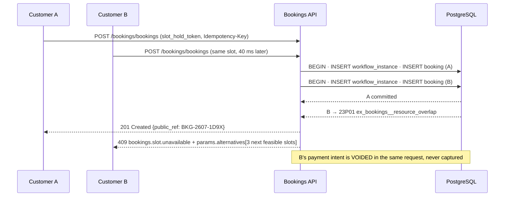

# Module 15 — Chat, Bookings, Notifications, Documents, Reviews, Logistics

> Derives from `00-north-star.md` (stack, prime directive, conventions), `01-design-system.md`
> (surfaces), `02-domain-model.md` (aggregates, context map), `03-data-model-erd.md` (physical
> schema, registries, outbox, retention) and `04-api-contract.md` (envelope, error codes, realtime).
> Where this document and any of those disagree, **they win**. This document only *extends*.
>
> PRD coverage: modules 15 (Chat), 16 (Bookings & Test Drive), 21 (Notifications),
> 22 (Documents & e-Sign), 23 (Reviews & Ratings), plus the logistics leg of delivery/pickup.

---

## 0. What this module is, and why it is one document

These five capabilities look unrelated on a PRD page. They are not. Every one of them is a **thin
module over the same spine**, and each of them is the place where a marketplace either builds trust
or leaks it:

```
                          ┌──────────────────────────────────────┐
                          │  DEAL / LISTING / AUCTION / RENTAL   │
                          │        (the transaction spine)       │
                          └───┬───────┬────────┬────────┬────────┘
                              │       │        │        │
             negotiate ───────┘       │        │        └────── judge
                  CHAT                │        │               REVIEWS
                                      │        │
                     meet ────────────┘        └───────── prove
                   BOOKINGS                            DOCUMENTS
                   + LOGISTICS
                              │
                              └──────── tell ─────────── NOTIFICATIONS
                                    (every module's mouth)
```

Four are **generic engines with typed rows**, exactly like the ten registries:

| Naive design (rejected) | What we build |
|---|---|
| `test_drive_bookings`, `inspection_slots`, `delivery_jobs`, `handover_appointments` | one `booking.bookings` row + a `booking_type` registry code |
| `listing_chat`, `dealer_chat`, `support_tickets` | one `chat.threads` row + a `thread_kind` registry code |
| `send_sms()` calls sprinkled in 20 handlers | one `notification_events` registry row + an outbox consumer |
| `InvoiceGenerator`, `AgreementGenerator`, `ReportGenerator` | one `documents.templates` row + one renderer |
| `dealer_reviews`, `inspector_reviews` | one `reviews.reviews` row + a `subject_entity_type` |

If a PRD line ever reads "add a *home visit* booking", the correct engineering answer is an `INSERT`
into `platform.codes` and a workflow definition — **not a pull request**.

### 0.1 Naming reconciliations (read this before you grep)

Three places where the anchor docs use two names for one thing. These are the resolutions; they are
binding on every other module doc.

| Thing | Postgres schema | Module code / event prefix / API path | Source of the split |
|---|---|---|---|
| Bookings | `booking` | `bookings` (`/api/v1/bookings/…`, `bookings.*` errors) | `03 §4.7` DDL says `booking.bookings`; `02 §2.1` + `04 §9.11` say `bookings` |
| Notifications | `notification` | `notify` (`platform.modules.code`), `notification.*` errors | `03 §3.8` names `notification.outbox/messages/delivery_receipts`; `02 §2.1` says `notify` |
| Chat conversation | `chat.threads` | aggregate `Conversation`, API resource `threads` | `02 §2.1` names the aggregate `Conversation`; `04 §9.15` freezes `/chat/threads` |

Also: `03 §11` maps `ex_bookings__resource_overlap` to `booking.slot_taken`; `04 §3` declares the
three-segment form normative. **`bookings.slot.unavailable` is the canonical wire code**;
`booking.slot_taken` is the same mapping in pre-normalised form and must not appear in a response.

### 0.2 Where each engine surfaces

Design-system components (`01 §6`) are used as-is; this module invents no tokens and no components.

| Engine | `apps/web` | `apps/dealer` | `apps/admin` | Flutter customer | Flutter partner |
|---|---|---|---|---|---|
| Chat | thread drawer on listing detail, full inbox | CRM inbox with assignment, SLA clock, canned replies | moderation queue, unmasked read (audited) | full inbox + push | ops thread only |
| Bookings | slot picker, my appointments | dealer calendar, test-drive desk | dispatch board, resource calendars | booking + live tracking | **the job screen**: today's route, OTP, POD |
| Notifications | bell + preferences | bell + per-staff routing | template editor, delivery dashboard | bell + push settings | job pushes only |
| Documents | vault (`FieldBlock` grid, `PlateBlock` grouping) | deal documents, bulk invoice download | template versioning, legal review, access log | vault + DigiLocker | POD capture |
| Reviews | write review, read reviews | reputation dashboard, one reply per review | moderation queue, weight overrides | write review | – |

---

## 1. CHAT

### 1.1 Thread kinds are data

`chat.threads.thread_kind_code` is a `platform.codes` row in set `chat_thread_kind`. The `metadata`
jsonb on that row is the entire behavioural spec of the thread type — nothing about a "dealer chat"
is a branch in C#.

| `code` | participants | `metadata` (abbreviated) |
|---|---|---|
| `c2c_listing` | buyer ↔ private seller | `{"context":"listing","max_participants":2,"moderation_policy":"strict_pii","allows":["text","image","offer"],"unlock_state":"deal.in_progress","idle_close_hours":336}` |
| `dealer_customer` | dealer staff ↔ customer | `{"context":"listing","max_participants":6,"moderation_policy":"mask_pii","allows":["text","image","pdf","voice","offer","quotation"],"assignable":true,"sla_first_response_minutes":30}` |
| `admin_dealer` | ops ↔ dealer org | `{"context":"organization","moderation_policy":"none","allows":["text","image","pdf"],"retention_months":84,"is_official":true}` |
| `broker_customer` | broker ↔ customer | `{"context":"requirement","moderation_policy":"mask_pii","commission_disclosure_required":true,"allows":["text","image","quotation"]}` |
| `auction_lot_query` | dealer ↔ auction ops | `{"context":"auction_lot","moderation_policy":"none","read_only_after":"lot.closed","allows":["text","image"]}` |
| `attachment_negotiation` | owner ↔ fleet aggregator | `{"context":"attachment_enrolment","moderation_policy":"mask_pii","allows":["text","pdf","quotation"]}` |
| `support` | user ↔ support agent | `{"context":"support_case","moderation_policy":"none","allows":["text","image","pdf","voice"],"escalation_target":true}` |

Adding "insurance advisor ↔ customer" is one row plus a workflow definition. Nothing else.

### 1.2 Schema

```sql
CREATE TABLE chat.threads (
    id              uuid PRIMARY KEY DEFAULT platform.uuid_generate_v7(),
    public_ref      text NOT NULL,                       -- 'CHT-2607-4K2Z'
    thread_kind_set platform.code_key NOT NULL DEFAULT 'chat_thread_kind'
        CONSTRAINT ck_threads__kind_set CHECK (thread_kind_set = 'chat_thread_kind'),
    thread_kind_code platform.code_key NOT NULL,         -- codes(set='chat_thread_kind')
    context_entity_type platform.code_key REFERENCES platform.entity_types(code),
    context_entity_id uuid,
    participant_key text NOT NULL,                       -- sha256 of sorted party ids + context; idempotency
    subject_snapshot jsonb NOT NULL DEFAULT '{}',        -- {plate, title, price_paise, thumb} — renders after erasure
    workflow_instance_id uuid NOT NULL REFERENCES platform.workflow_instances(id),
    state_code      platform.code_key NOT NULL,
    last_seq        bigint NOT NULL DEFAULT 0,           -- gap-free per-thread sequence
    last_message_at timestamptz,
    last_message_preview text,                           -- already masked; list rendering never reads messages
    message_count   integer NOT NULL DEFAULT 0,
    assigned_to_user_id uuid,                            -- dealer CRM ownership
    assigned_at     timestamptz,
    first_response_at timestamptz,                       -- SLA measurement point
    sla_breached_at timestamptz,
    escalated_case_id uuid,                              -- support thread this was escalated into
    city_id         uuid REFERENCES platform.cities(id),
    created_at timestamptz NOT NULL DEFAULT now(), created_by uuid,
    updated_at timestamptz NOT NULL DEFAULT now(), updated_by uuid,
    deleted_at timestamptz, deleted_by uuid,
    row_version bigint NOT NULL DEFAULT 1,
    CONSTRAINT uq_threads__participant_key UNIQUE (participant_key),
    -- the 03 §4.7 reason-code pattern: pin the set, FK the pair. No enum, no free string.
    CONSTRAINT fk_threads__kind FOREIGN KEY (thread_kind_set, thread_kind_code)
        REFERENCES platform.codes(set_code, code)
);

CREATE TABLE chat.thread_participants (
    thread_id       uuid NOT NULL REFERENCES chat.threads(id) ON DELETE CASCADE,
    party_id        uuid NOT NULL REFERENCES identity.parties(id),
    user_id         uuid,                                -- the acting user; a dealer party has many
    role_code       platform.code_key NOT NULL,          -- 'buyer','seller','dealer_staff','ops','observer','bot'
    joined_at       timestamptz NOT NULL DEFAULT now(),
    left_at         timestamptz,
    is_muted        boolean NOT NULL DEFAULT false,
    can_read_unmasked boolean NOT NULL DEFAULT false,    -- ops/trust only; every use is audited
    last_read_seq   bigint NOT NULL DEFAULT 0,
    last_delivered_seq bigint NOT NULL DEFAULT 0,
    unread_count    integer NOT NULL DEFAULT 0,          -- maintained; NEVER computed by COUNT(*)
    notify_policy_code platform.code_key NOT NULL DEFAULT 'all',  -- all|mentions|none
    row_version bigint NOT NULL DEFAULT 1,
    CONSTRAINT pk_thread_participants PRIMARY KEY (thread_id, party_id)
);

CREATE TABLE chat.messages (
    id              uuid NOT NULL DEFAULT platform.uuid_generate_v7(),
    created_at      timestamptz NOT NULL DEFAULT now(),
    thread_id       uuid NOT NULL,
    seq             bigint NOT NULL,                     -- gap-free, monotonic within thread
    sender_party_id uuid,                                -- NULL = system message
    sender_user_id  uuid,
    message_type_code platform.code_key NOT NULL,        -- codes(set='chat_message_type')
    body            text,                                -- what the sender typed (raw)
    body_masked     text,                                -- what participants see
    payload         jsonb NOT NULL DEFAULT '{}',         -- OFFER/QUOTATION/system payload
    reply_to_seq    bigint,
    client_message_id text NOT NULL,                     -- client-generated ULID; dedupe on retry
    moderation_state_code platform.code_key NOT NULL DEFAULT 'clean',  -- clean|masked|held|blocked|retro_flagged
    moderation_rule_codes text[] NOT NULL DEFAULT '{}',
    edited_at       timestamptz,
    deleted_for_all_at timestamptz,
    pii_erased_at   timestamptz,
    CONSTRAINT pk_messages PRIMARY KEY (id, created_at),
    CONSTRAINT uq_messages__thread_seq UNIQUE (thread_id, seq, created_at),
    CONSTRAINT uq_messages__client_id UNIQUE (thread_id, client_message_id, created_at)
) PARTITION BY RANGE (created_at);           -- monthly; 18 mo hot, 3 yr archive (03 §9.3)

CREATE TABLE chat.message_attachments (
    id              uuid PRIMARY KEY DEFAULT platform.uuid_generate_v7(),
    thread_id       uuid NOT NULL,
    message_id      uuid NOT NULL,
    document_id     uuid NOT NULL REFERENCES documents.documents(id),   -- ONE blob store, not two
    kind_code       platform.code_key NOT NULL,          -- 'image','pdf','voice','video'
    duration_ms     integer,                             -- voice/video
    width_px        smallint, height_px smallint,
    thumb_document_id uuid REFERENCES documents.documents(id),
    scan_state_code platform.code_key NOT NULL DEFAULT 'pending',   -- pending|clean|infected|failed
    transcript      text,                                -- voice → text (Phase 7); moderated like a body
    created_at timestamptz NOT NULL DEFAULT now()
);

CREATE TABLE chat.offers (                               -- the negotiation aggregate (02 §2.1 `Offer`)
    id              uuid PRIMARY KEY DEFAULT platform.uuid_generate_v7(),
    thread_id       uuid NOT NULL REFERENCES chat.threads(id),
    message_id      uuid NOT NULL,
    listing_id      uuid,
    intent_type_code platform.code_key NOT NULL,
    offered_by_party_id uuid NOT NULL,
    amount_paise    bigint NOT NULL CHECK (amount_paise > 0),
    currency_code   platform.currency_code NOT NULL DEFAULT 'INR',
    terms           jsonb NOT NULL DEFAULT '{}',         -- {"exchange_vehicle_id":…,"finance_required":true}
    valid_until     timestamptz NOT NULL,
    counter_of_id   uuid REFERENCES chat.offers(id),
    workflow_instance_id uuid NOT NULL REFERENCES platform.workflow_instances(id),
    state_code      platform.code_key NOT NULL,
    accepted_at     timestamptz,
    deal_id         uuid,                                -- set by Deals on acceptance
    created_at timestamptz NOT NULL DEFAULT now(), created_by uuid,
    updated_at timestamptz NOT NULL DEFAULT now(), updated_by uuid,
    row_version bigint NOT NULL DEFAULT 1
);

CREATE TABLE chat.blocks (
    blocker_party_id uuid NOT NULL, blocked_party_id uuid NOT NULL,
    reason_code platform.code_key, created_at timestamptz NOT NULL DEFAULT now(),
    CONSTRAINT pk_chat_blocks PRIMARY KEY (blocker_party_id, blocked_party_id)
);

CREATE INDEX ix_threads__participant_recent ON chat.thread_participants (party_id, thread_id)
    INCLUDE (unread_count, last_read_seq);
CREATE INDEX ix_threads__context ON chat.threads (context_entity_type, context_entity_id)
    WHERE deleted_at IS NULL;
CREATE INDEX ix_threads__assignment ON chat.threads (assigned_to_user_id, last_message_at DESC)
    WHERE deleted_at IS NULL;
CREATE INDEX ix_messages__thread_seq ON chat.messages (thread_id, seq DESC, created_at DESC);
CREATE INDEX ix_messages__moderation ON chat.messages (moderation_state_code, created_at DESC)
    WHERE moderation_state_code IN ('held','blocked','retro_flagged');
```

**Why `seq` is not a Postgres sequence.** Sequences leak numbers on rollback. The client resumes a
socket with `resume_from: {thread: last_seq}` (04 §12.5) and a gap is indistinguishable from a lost
message — which forces a full resync on every failed insert. So `seq` comes from
`UPDATE chat.threads SET last_seq = last_seq + 1 … RETURNING last_seq` inside the same transaction as
the message insert. The row lock serialises writers per thread, which is correct: a thread is a
single conversation, contention is 2–6 humans, and per-thread serialisation costs nothing.

### 1.3 Message types (registry set `chat_message_type`)

| `code` | Body | Payload shape | Notes |
|---|---|---|---|
| `text` | required | – | ≤ 4000 chars; moderated |
| `image` | optional caption | `{attachment_ids:[…]}` | ≤ 10 per message, ≤ 8 MiB each, EXIF GPS stripped on ingest |
| `pdf` | optional | `{attachment_ids:[…]}` | ≤ 20 MiB, virus-scanned, page count extracted |
| `voice` | – | `{attachment_id, duration_ms, waveform:[…]}` | ≤ 120 s, Opus 24 kbps; transcript moderated when Phase 7 lands |
| `video` | optional | `{attachment_id, duration_ms, poster_id}` | ≤ 60 s, transcoded to 480p H.264 |
| `offer` | – | `{offer_id, amount_paise, valid_until, terms}` | renders as a `BidTicket`-family card; state from workflow |
| `quotation` | – | `{quotation_id, lines:[…], total_paise, tax_paise, valid_until}` | dealer/broker priced bundle (§1.4) |
| `system` | – | `{i18n_key, params}` | never free text — localization registry (`00 §2`) |
| `location` | – | `{lat,lng,accuracy_m,label}` | showroom / handover point only |
| `contact_card` | – | `{party_id}` | **only** emitted after the unlock state; never a raw phone number |

`allows` on the thread kind gates which types are accepted; a disallowed type returns
`422 chat.message.type_not_allowed`.

Attachment upload is a two-step, never a multipart POST to the chat endpoint:
`POST /documents/documents` (returns `{document_id, upload_url}`) → client PUTs to S3 →
`POST /chat/threads/{id}/messages` referencing `document_id`. One blob path for the whole platform
(00 §6: one object store, one retention engine), and a failed upload never leaves a half-written
message row.

### 1.4 QUOTATION — the dealer's actual sales artifact

An Indian dealer quote is never one number. It is *on-road price*, and buyers compare line by line.

```jsonc
{ "quotation_id":"0193…", "listing_id":"0193…", "valid_until":"2026-08-05T18:29:59Z",
  "lines":[
    {"line_type":"vehicle_price",     "label_i18n":"quote.vehicle_price",  "amount_paise": 84500000},
    {"line_type":"rto_transfer",      "label_i18n":"quote.rto_transfer",   "amount_paise":   350000},
    {"line_type":"hypothecation_removal","label_i18n":"quote.hp_removal",  "amount_paise":   150000},
    {"line_type":"insurance",         "label_i18n":"quote.insurance",      "amount_paise":  1850000,
     "meta":{"idv_paise":80000000,"insurer_code":"icici_lombard","irdai_product_code":"…",
             "is_solicited":true,"advisor_party_id":"0193…"}},
    {"line_type":"accessory",         "label_i18n":"quote.accessories",    "amount_paise":   450000},
    {"line_type":"discount",          "label_i18n":"quote.discount",       "amount_paise":  -600000},
    {"line_type":"platform_fee",      "label_i18n":"quote.platform_fee",   "amount_paise":   199900,
     "meta":{"fee_component_code":"c2c_success_fee"}}
  ],
  "tax_breakup":[{"tax_rule_code":"gst_services_18","taxable_paise":199900,"cgst_paise":17991,"sgst_paise":17991}],
  "tcs":{"tax_rule_code":"tcs_206c1f_motor_vehicle","applies":false,"reason":"seller_not_tax_audited"},
  "total_paise": 87135982, "currency_code":"INR" }
```

Every `amount_paise` that the platform earns is computed by the **Pricing Registry** engine, not by
the dealer's typing — `platform_fee` above carries its `fee_component_code` and is recomputed
server-side on quote render. Dealer-owned lines (`vehicle_price`, `accessory`, `discount`) are free.

**TCS under §206C(1F)** is evaluated at quote time so a ₹12L quote shows the 1% collection *before*
the buyer is surprised at invoicing. The rule is a `platform.tax_rules` row with an `applies_when`
that reads **two** facts, not one: consideration > ₹10,00,000 **and** the seller is a "seller" under
the section (a dealer/company/audited entity). A genuine C2C sale between two individuals does not
attract 206C(1F), and hardcoding "1% above 10 lakh" would over-collect from private sellers and
create a refund workflow we should never need. Threshold, rate and the seller test are all registry
data.

**Insurance lines are quotations, not sales.** A dealer may only place an `insurance` line when the
quoting party holds an IRDAI-recognised distribution relationship recorded in the Insurance module;
otherwise the line renders as an estimate with `is_solicited:false` and no commission is booked.
Premium and IDV come from the Insurance module's quote API — never typed by the dealer — so the
number on the chat card is the number the insurer will honour.

Rendering uses `MoneyValue` — `₹8.71L` in the summary chip, full `₹87,13,598` in the line table.
Accepting a quotation is the same command as accepting an offer: it opens a `Deal` with the
quotation's lines pre-populated as `deals.deal_line_items`.

### 1.5 Offer / quotation lifecycle — workflow registry rows

Workflow definition `code = 'chat_offer'`, `entity_type = 'chat_offer'`.

| state `code` | `kind_code` | `counts_as_open` | `blocks_deletion` | `sla_minutes` | `ui.tone` |
|---|---|---|---|---|---|
| `sent` | initial | true | true | 2880 | info |
| `countered` | active | true | true | 2880 | caution |
| `accepted` | terminal_success | false | true | – | clear |
| `declined` | terminal_failure | false | false | – | flag |
| `withdrawn` | terminal_failure | false | false | – | info |
| `expired` | terminal_failure | false | false | – | flag |
| `superseded` | terminal_failure | false | false | – | info |

| transition `code` | from | to | trigger | `required_permission_code` | effects |
|---|---|---|---|---|---|
| `counter` | sent, countered | countered | manual | `chat.offer.counter` | `emit chat.offer.countered`, `notify chat.offer.countered` |
| `accept` | sent, countered | accepted | manual | `chat.offer.accept` | `invoke deals.open_deal`, `emit chat.offer.accepted`, `invoke listings.reserve` |
| `decline` | sent, countered | declined | manual | `chat.offer.decline` | `notify chat.offer.declined` |
| `withdraw` | sent, countered | withdrawn | manual | `chat.offer.withdraw` | – |
| `auto_expire` | sent, countered | expired | timer (`valid_until`) | – | `notify chat.offer.expired` |
| `supersede` | sent | superseded | event `chat.offer.created` (same thread, same offeror) | – | – |

Two racing accepts of two offers on one listing do **not** both win: `deals.open_deal` takes the
listing's cross-intent exclusivity path (03 §4.5) and the loser gets `409 listings.listing.reserved`,
which the transition maps to a `decline` with `reason_code = 'listing_already_reserved'`.

### 1.6 Transport and fan-out

Transport is fixed by 04 §12: **SignalR over WebSocket**, SSE then long-poll fallback, Redis Streams
backplane. Chat adds nothing new to the transport; it adds a fan-out shape.

```
POST /chat/threads/{id}/messages
   │
   ├─ 1. RBAC: participant check (chat.thread.not_participant)
   ├─ 2. Rate limit: Redis token bucket  chat:rl:{user}:{thread} and chat:rl:{user}
   ├─ 3. Moderation (sync): rule_set 'chat_content_policy' → clean | masked | held | blocked
   ├─ 4. TX: seq = threads.last_seq+1 → INSERT message
   │        → UPDATE thread (last_seq, preview, counts, first_response_at if unset)
   │        → UPDATE participants SET unread_count = unread_count+1 WHERE party_id <> sender
   │        → INSERT platform.outbox_messages ('chat.message.created.v1', partition_key = thread_id)
   ├─ 5. 201 with {seq, client_message_id} — the client reconciles its optimistic bubble by
   │        client_message_id, and by causation_id when the socket copy arrives (04 §12.4)
   │
   └─ outbox dispatcher (200 ms poll, FOR UPDATE SKIP LOCKED — 03 §7.1)
          ├─ ChatFanoutConsumer → XADD rt:chat:{thread_id} → SignalR group "chat:{thread_id}"
          ├─ UnreadProjector    → Redis HINCRBY chat:unread:{user_id} thread_id 1
          ├─ SearchIndexer      → OpenSearch upsert (masked body only, §1.12)
          └─ NotificationConsumer → notification_events 'chat.message.received'
                                    (only if recipient offline OR idle > presence_grace_seconds)
```

**Fan-out is on read for the socket, on write for the badge.** The socket group is the thread — 2 to
6 connections, so per-thread broadcast is free and needs no per-user queue. The unread badge is
per-user and must survive a cold app start, so it is written eagerly. This split is the whole design:
we never write N message-copies, and we never `COUNT(*)` at read time.

**Groups vs. channels.** A dealer with 900 open threads must not join 900 SignalR groups. Rule: a
connection joins groups for the threads currently rendered (viewport + 20) up to the 50-channel cap
(04 §12.3); every other thread reaches the dealer as a `notification.created` inbox push carrying
`{thread_id, seq, preview}`, and opening the thread subscribes with `resume_from`.

### 1.7 Unread counts at scale

Target: a dealer with 40k lifetime threads opens the app; the badge must render in < 50 ms and must
never be wrong for more than one refresh cycle.

| Layer | Structure | Purpose |
|---|---|---|
| Truth | `chat.thread_participants.unread_count` + `last_read_seq` | survives Redis loss; source for reconcile |
| Hot | Redis `HASH chat:unread:{user_id}` → `{thread_id: count}`, plus `STRING chat:unread_total:{user_id}` | badge + thread-list decoration in one round trip |
| Cold start | `GET /chat/threads?unread=true` — index-only scan of `ix_threads__participant_recent` | rebuilds the hash if the key is missing |

Read marking is a **watermark, not a per-message row**: `POST /chat/threads/{id}/read {up_to_seq}`
sets `last_read_seq = GREATEST(last_read_seq, :up_to_seq)` and recomputes
`unread_count = (SELECT count(*) FROM chat.messages WHERE thread_id=… AND seq > :up_to_seq AND sender_party_id <> :me)`
**once**, in that one transaction. This is the only `COUNT(*)` in the module and it is bounded by the
thread, not the account.

Per-message read receipts (the "seen by" tick) are derived from the counterparty's `last_read_seq`,
not stored. Delivery ticks come from `last_delivered_seq`, which the client ACKs over the socket in
batches every 2 s. Three ticks with zero extra rows.

Drift is real (a crashed projector, a Redis failover). A nightly job compares the hash to the table
for users active in the last 24 h and emits `chat.unread.drift_corrected` with the delta; more than
0.1 % of users drifting pages the on-call, because a wrong badge is the single most-reported "bug"
in every chat product ever shipped.

### 1.8 Presence and typing

- Presence: `SET presence:{user_id} <device_count> EX 45`, heartbeat every 20 s over the hub.
  Status is derived — `online` if the key exists, `recently` if `last_seen_at` is within 15 min, else
  the date. Exact "last seen" timestamps are **not** exposed by default: `chat_thread_kind.metadata`
  carries `presence_visibility` (`live | coarse | hidden`) and B2C threads default to `coarse`.
- Typing: hub-only, never persisted, server-throttled to one broadcast per sender per 3 s, expires
  client-side after 5 s. A dropped typing event is a non-event; it is explicitly excluded from the
  Redis Streams replay buffer so a reconnecting client never replays "was typing" from 40 minutes ago.

### 1.9 Moderation and PII masking

This is the module's revenue defence. Every C2C marketplace in India loses margin to *"WhatsApp
karo, ₹5,000 kam kar dunga"*. Detection has to be aggressive, and the policy has to change weekly
without a deploy — so **the patterns are registry data**.

Storage: `platform.rule_sets` with `domain = 'moderation'`, `code = 'chat_content_policy'`; the
version's payload holds the pattern bank. No new platform table, no regex in C#.

```jsonc
// rule_set_versions.payload for chat_content_policy v37
{
  "default_action": "mask",
  "unlock": { "requires_workflow_state": ["deal.in_progress","deal.payment_confirmed"] },
  "patterns": [
    {"code":"phone_plain",   "kind":"regex","expr":"(?<!\\d)(?:\\+?91[\\-\\s]?)?[6-9]\\d{9}(?!\\d)","action":"mask","severity":3},
    {"code":"phone_spaced",  "kind":"regex","expr":"(?:[6-9](?:[\\s\\-.,_]*\\d){9})","action":"mask","severity":3},
    {"code":"phone_words",   "kind":"wordnum","locales":["en","hi","mr","ta"],"min_digits":8,"action":"mask","severity":3},
    {"code":"upi_vpa",       "kind":"regex","expr":"[\\w.\\-]{2,}@(?:ok(?:hdfcbank|icici|axis|sbi)|ybl|paytm|apl|axl|ibl|upi|superyes)","action":"block","severity":5},
    {"code":"bank_pair",     "kind":"cooccur","of":["ifsc","account_number"],"window_chars":120,"action":"block","severity":5},
    {"code":"ifsc",          "kind":"regex","expr":"\\b[A-Z]{4}0[A-Z0-9]{6}\\b","action":"mask","severity":4},
    {"code":"offplatform_ask","kind":"phrase","phrases":["whatsapp karo","direct baat","platform ke bahar","cash me kar lenge","gpay kar do","phonepe number","व्हाट्सएप","நேரடியாக"],"action":"warn","severity":2},
    {"code":"invite_link",   "kind":"regex","expr":"(?:wa\\.me|chat\\.whatsapp\\.com|t\\.me|instagram\\.com|telegram)","action":"block","severity":4},
    {"code":"email",         "kind":"regex","expr":"[\\w.+\\-]+@[\\w\\-]+\\.[A-Za-z]{2,}","action":"mask","severity":2},
    {"code":"aadhaar_like",  "kind":"regex+verhoeff","expr":"\\b\\d{4}\\s?\\d{4}\\s?\\d{4}\\b","action":"block","severity":5,
     "note":"never let an Aadhaar number enter chat storage — 03 §12.9"},
    {"code":"review_solicitation","kind":"phrase","phrases":["5 star de dena","review de do to","cashback for review"],"action":"warn","severity":4,
     "note":"feeds reviews.reviewer_weight → 0 (§5.2)"}
  ],
  "escalation": {"severity_sum_per_thread_24h": 12, "then": "hold_and_queue"}
}
```

Actions:

| Action | Sender sees | Recipient sees | Stored |
|---|---|---|---|
| `allow` | message | message | `body`, `body_masked` identical, state `clean` |
| `mask` | own text intact | `98••••••21` | both columns, state `masked` |
| `warn` | inline banner *"Sharing numbers off AutoHub isn't covered by our protection."* | masked | state `masked` + `moderation_rule_codes` |
| `hold` | *"Sending…"* until reviewed (SLA 5 min, registry) | nothing yet | state `held`, queued to Trust |
| `block` | `422 chat.message.blocked_content` with `params.spans[]` | nothing | **not stored** — the raw text never lands |

`block` not storing the body is deliberate: an Aadhaar number that reaches `chat.messages` is a DPDP
liability we then have to erase. Rejecting at the boundary is cheaper than being compliant later.

**Unlocking.** Once the thread's context reaches a workflow state whose code is in
`unlock.requires_workflow_state`, masking stops and a `contact_card` system message is emitted with
both parties' verified numbers. The list is registry data, so "unlock at `deal.token_paid` instead"
is one row edit.

**Retro-flagging.** The async classifier (Phase 7) may set `moderation_state_code='retro_flagged'` on
already-delivered messages. It never deletes them; it raises a Trust signal and, if the thread
converted, marks the resulting deal for disintermediation review. Deleting delivered messages
destroys dispute evidence.

**False positives are a product problem.** A seller typing *"maine 2019 me 9,80,000 me liya tha"*
must not be masked. The `phone_plain` pattern uses a `(?<!\d)` guard and the engine skips spans that
the money-parser already claimed. Every mask event is logged with `rule_code`; a rule whose
7-day *"unmask requested by ops"* rate exceeds 5 % is auto-demoted to `warn` by a nightly job that
opens a registry change set for a human to approve. Policy tuning is data, and it is measured.

**Performance.** Regex patterns are compiled once per rule-set version and cached; phrase banks
compile to a single Aho-Corasick automaton. Evaluation is CPU-only — no network call in the send
path — which is what keeps the 120 ms p95 budget (§7) reachable.

### 1.10 Assignment, SLA and the dealer inbox

`chat_thread_kind.metadata.assignable = true` turns a thread into a CRM object.

```
chat.thread.created.v1 (dealer_customer)
   → AssignmentConsumer
       ├─ candidate set = org users holding permission `dealer.lead.respond`
       │                  ∧ on shift (dealer roster) ∧ not at `max_open_threads`
       ├─ strategy from rule_set(domain='routing', code='dealer_chat_routing_v1'):
       │      round_robin | least_open | skill_match(listing.category) | owner_of_listing
       ├─ writes threads.assigned_to_user_id, assigned_at
       └─ notification 'dealer.lead.assigned' (immediate, no digest)

SLA clock: sla_first_response_minutes from the thread kind.
   first_response_at = first outbound message from a dealer_staff participant.
   breach → sla_breached_at stamped, notification 'dealer.lead.sla_breached' to the
            org owner, and the thread is re-queued to the pool.
```

`first_response_p50` and `sla_breach_rate` per org feed `dealer_tier_v1` (§5.5) — response speed is
a tier input, which is why it is measured on a column and not inferred from logs. Reassignment is an
explicit action (`POST /chat/threads/{id}/assign`) requiring `dealer.lead.assign`, and it writes an
audit row: whose lead it was matters when commission is disputed.

### 1.11 Escalation to support

```
POST /chat/threads/{id}/escalate   { reason_code, note }
   ├─ creates a `support` thread (participants: reporter + support queue party)
   ├─ links it: threads.escalated_case_id
   ├─ adds the assigned agent to the ORIGINAL thread as role_code='observer',
   │    can_read_unmasked = true (permission `chat.message.read_unmasked`, risk_level 3)
   ├─ emits a `system` message in the original thread: i18n_key 'chat.system.support_joined'
   └─ freezes retention: threads under an open support case are exempt from the 18-month purge
```

The visible system banner is non-negotiable. Silent staff access to a private conversation is both a
trust failure and a DPDP transparency failure; and every unmasked read writes
`platform.audit_log` with `action_code='chat.message.read_unmasked'` and a mandatory `reason_code`.

### 1.12 Search, retention, erasure, export

**Search.** Messages are indexed in OpenSearch (`chat_messages_v1`), and the index holds
`body_masked` only — never `body`. Each document carries `participant_party_ids: uuid[]`, and every
query is rewritten server-side with a mandatory `terms: {participant_party_ids: [caller]}` filter.
Filtering by the caller's *party* rather than by a list of their thread ids is what makes search work
for a dealer with 40k threads: the filter is one term, not a 40k-element `terms` clause. Index
retention matches hot retention (18 months); older threads are searchable by subject/plate metadata
only, which is what users actually search for at that age.

**Retention.** Per 03 §9.2/§9.3: 18 months hot, 3 years archived, then purge. Threads under an open
support case, an open dispute, or a `legal_hold` on the linked deal are exempt and the exemption is
recorded, not implicit.

**Erasure (DPDP §12).** On an erasure request the sender is pseudonymised (`sender_party_id` → the
tombstone party, `reviewer_display_name`-style snapshots retained), and bodies are deleted **unless**
the thread is attached to a deal in dispute, where they are retained as evidence with `pii_erased_at`
stamped and the legal basis recorded in `trust.erasure_requests.blocked_by`. The OpenSearch document
is deleted synchronously in the same saga — an erased user must not remain findable in a dealer's
search box.

**Export (DPDP §11, right to access).** Threads render as a PDF via the Documents module (template
`chat_transcript`), masked bodies only, with the §4.6 hash chain attached so the user can prove the
transcript wasn't altered.

### 1.13 Chat API surface (extends 04 §9.15)

| Method | Path | Auth | Notes |
|---|---|---|---|
| GET | `/chat/threads` | self | `?unread=true&kind=&context_ref=&assigned_to=` cursor paged |
| POST | `/chat/threads` | user | Idempotent on `participant_key` (04 §6) |
| GET | `/chat/threads/{id}` | participant | Includes `status{}` + `available_actions[]` (04 §0) |
| GET | `/chat/threads/{id}/messages` | participant | `?since_seq=` or `?before_seq=`; cursor paged |
| POST | `/chat/threads/{id}/messages` | participant | `Idempotency-Key` + `client_message_id` |
| POST | `/chat/threads/{id}/read` | participant | `{up_to_seq}` |
| POST | `/chat/threads/{id}/typing` | participant | Hub-preferred; HTTP is the fallback |
| POST | `/chat/threads/{id}/offers` | participant | Creates the offer + the `offer` message atomically |
| POST | `/chat/offers/{id}/transitions` | party | `counter` / `accept` / `decline` / `withdraw` |
| POST | `/chat/threads/{id}/quotations` | dealer/broker | Server re-prices platform-owned lines |
| POST | `/chat/threads/{id}/assign` | `dealer.lead.assign` | `{user_id}`; audited |
| POST | `/chat/threads/{id}/escalate` | participant | Creates the support thread |
| POST | `/chat/threads/{id}/report` | participant | Form `chat_report_v1` → Trust case |
| POST | `/chat/threads/{id}/block` | participant | Thread becomes read-only both ways |
| GET | `/chat/search` | self | `?q=&kind=&from=&to=`; masked bodies only |
| GET | `/chat/threads/{id}/moderation` | `chat.message.read_unmasked` | Requires `reason_code`; audited |

### 1.14 Chat failure modes

| Failure | Behaviour | Why this and not the obvious thing |
|---|---|---|
| Socket down, HTTP up | Send works, delivery is polled (`GET /chat/threads/{id}/messages?since_seq=`) at `chat.poll_interval_ms` from `/platform/config/public` | Chat must degrade to a slow chat, never to a broken one (04 §11) |
| Redis down | Presence and typing vanish; unread badge falls back to DB read; **messages still send** | Nothing in the write path depends on Redis |
| Duplicate send (retry after timeout) | `uq_messages__client_id` → 200 with the original message | Client-generated ULID; never trust "the POST failed" |
| Two devices of one user | Both are in the group; `last_read_seq` is per **party**, so reading on the phone clears the laptop badge | Per-device read state produces permanently unread threads |
| Outbox consumer lag | Message is in the DB and visible on refresh before the socket copy arrives; client dedupes by `client_message_id`/`causation_id` | HTTP response is the commit point, not the socket |
| Moderation rule set fails to load | **Fail closed** to `default_action: mask` from the last cached version; if no cache, reject new messages with `503 chat.message.moderation_unavailable` | Shipping unmasked phone numbers during an outage is a permanent revenue leak; a 3-minute chat outage is not |
| Attachment scan pending | Message delivers with a placeholder; media unlocks on `clean` | Blocking the text on an AV queue makes chat feel broken |
| Attachment scan `infected` | Attachment row → `infected`, media purged from S3, `system` message replaces it, Trust signal on the uploader | A quarantined file that is still downloadable is not quarantined |
| OpenSearch down | Search returns `503 common.dependency_unavailable`; chat itself is unaffected | Search is a read-side convenience, never a write-path dependency |
| Participant blocked mid-thread | Thread becomes read-only for both; history preserved | Deleting history hides harassment evidence |

---

## 2. BOOKINGS — one engine, eight appointment types

### 2.1 Booking types are registry rows

`platform.codes` set `booking_type`. The `metadata` jsonb is the type's whole behaviour:

| `code` | resource kinds | duration | buffers (before/after) | OTP | reschedules | fee components |
|---|---|---|---|---|---|---|
| `test_drive` | `demo_vehicle`,`showroom` | 45 | 0 / 15 | `provider_to_requester` | 3 | `booking_no_show_fee_test_drive` |
| `inspection` | `inspector` | 60 | 30 / 30 | `requester_to_provider` | 2 | `inspection_fee_4w`, `booking_cancel_fee_inspection` |
| `home_visit` | `rm`,`valuer` | 40 | 30 / 20 | `provider_to_requester` | 2 | – |
| `delivery` | `delivery_exec`,`pickup_truck` | 90 | 45 / 45 | `requester_to_provider` | 1 | `logistics_delivery_fee` |
| `pickup` | `delivery_exec`,`pickup_truck` | 90 | 45 / 45 | `provider_to_requester` | 1 | `logistics_pickup_fee` |
| `rental_handover` | `fleet_vehicle`,`driver` | 30 | 15 / 15 | `both` | 2 | `rental_late_pickup_fee` |
| `auction_preview` | `yard`,`bay` | 30 | 0 / 0 | – | 5 | – |
| `attachment_meeting` | `aggregator_desk` | 30 | 0 / 15 | – | 3 | – |

```jsonc
// platform.codes.metadata for booking_type='inspection'
{ "workflow_code":"booking_inspection", "form_key":"booking_inspection_request_v4",
  "default_duration_minutes":60, "buffer_before_minutes":30, "buffer_after_minutes":30,
  "resource_kinds":["inspector"], "requires_resource":true, "capacity_model":"unit",
  "otp":{"required":true,"direction":"requester_to_provider","ttl_minutes":10,"max_attempts":4,
         "geofence_metres":300,"fallback":"photo_proof_plus_supervisor"},
  "reschedule":{"max_count":2,"cutoff_minutes":120,"resets_fee":false},
  "cancellation":{"fee_component_code":"booking_cancel_fee_inspection","free_before_minutes":240},
  "no_show":{"fee_component_code":"booking_no_show_fee_inspection","grace_minutes":15},
  "calendar_sync":{"provider":"google","visibility":"private","invite_requester":false},
  "lead_time_minutes":180, "max_days_ahead":21, "slot_granularity_minutes":30,
  "payment":{"timing":"on_confirm","hold_minutes":20,"methods":["upi","card","netbanking","wallet"]},
  "notification_events":{"created":"booking.created","reminder_t24h":"booking.reminder",
                          "reminder_t2h":"booking.reminder_soon","otp":"booking.otp_issued"} }
```

Adding `home_visit` — which the PRD asks for — is this row plus a workflow definition plus a form.
There is no `HomeVisitService.cs`.

### 2.2 Resources, calendars, and the capacity model

```sql
CREATE TABLE booking.resources (
    id              uuid PRIMARY KEY DEFAULT platform.uuid_generate_v7(),
    resource_kind   platform.code_key NOT NULL,      -- codes(set='booking_resource_kind')
    code            text NOT NULL,                   -- 'INSP-PN-014', 'BAY-PN-YARD1-03'
    display_name    text NOT NULL,
    provider_party_id uuid REFERENCES identity.parties(id),   -- the human, if any
    org_id          uuid,                            -- dealer / inspection partner
    pool_id         uuid REFERENCES booking.resource_pools(id),
    city_id         uuid NOT NULL REFERENCES platform.cities(id),
    service_area_id uuid REFERENCES platform.service_areas(id),
    home_location   geography(Point,4326),           -- start/end of day, for travel-time
    is_mobile       boolean NOT NULL DEFAULT false,  -- travels to the customer
    max_daily_bookings smallint,
    max_daily_travel_km smallint,
    skills          text[] NOT NULL DEFAULT '{}',    -- ['four_wheeler','ev_hv_certified','cng']
    attributes      jsonb NOT NULL DEFAULT '{}',
    is_active       boolean NOT NULL DEFAULT true,
    calendar_sync_state platform.code_key NOT NULL DEFAULT 'none', -- none|linked|stale|revoked
    created_at timestamptz NOT NULL DEFAULT now(), created_by uuid,
    updated_at timestamptz NOT NULL DEFAULT now(), updated_by uuid,
    deleted_at timestamptz, deleted_by uuid,
    row_version bigint NOT NULL DEFAULT 1,
    CONSTRAINT uq_resources__code UNIQUE (code)
);

CREATE TABLE booking.resource_shifts (              -- recurring availability
    id uuid PRIMARY KEY DEFAULT platform.uuid_generate_v7(),
    resource_id uuid NOT NULL REFERENCES booking.resources(id) ON DELETE CASCADE,
    weekday smallint NOT NULL CHECK (weekday BETWEEN 0 AND 6),   -- 0 = Sunday, city timezone
    starts_local time NOT NULL, ends_local time NOT NULL,
    booking_type_codes text[] NOT NULL DEFAULT '{}',  -- empty = all types
    effective_from date NOT NULL DEFAULT CURRENT_DATE, effective_to date,
    CONSTRAINT ck_shifts__window CHECK (ends_local > starts_local)
);

CREATE TABLE booking.resource_exceptions (          -- leave, external calendar blocks, ad-hoc
    id uuid PRIMARY KEY DEFAULT platform.uuid_generate_v7(),
    resource_id uuid NOT NULL REFERENCES booking.resources(id) ON DELETE CASCADE,
    blocked_range tstzrange NOT NULL,
    reason_code platform.code_key NOT NULL,          -- 'leave','holiday','maintenance','external_event','ops_block'
    source_code platform.code_key NOT NULL DEFAULT 'manual',   -- manual|google|system
    external_event_id text, external_etag text,
    created_at timestamptz NOT NULL DEFAULT now(), created_by uuid,
    CONSTRAINT uq_exceptions__external UNIQUE (resource_id, external_event_id)
);

CREATE TABLE booking.calendar_links (
    resource_id uuid PRIMARY KEY REFERENCES booking.resources(id) ON DELETE CASCADE,
    provider_id uuid NOT NULL REFERENCES platform.integration_providers(id),
    external_calendar_id text NOT NULL,
    refresh_token_ref text NOT NULL,                 -- KMS/secret ref, never the token
    sync_token text, watch_channel_id text, watch_resource_id text, watch_expires_at timestamptz,
    last_synced_at timestamptz, last_error text,
    created_at timestamptz NOT NULL DEFAULT now(), updated_at timestamptz NOT NULL DEFAULT now()
);
```

**The capacity decision — three models, all enforced by constraints, none by a counter.**

| `capacity_model` | Example | Enforcement |
|---|---|---|
| `unit` (default) | an inspector, a demo car, one service bay | `ex_bookings__resource_overlap` GiST `EXCLUDE` on `(resource_kind, resource_id, reserved range)` |
| `pooled` | "5 delivery execs in Pune West, dispatcher assigns tomorrow" | seat allocation in `booking.pool_slots` — a `UNIQUE` key, not a count |
| `unbounded` | auction preview at an open yard | no resource, no constraint; a soft per-slot cap in the availability API only |

A service bay that fits 3 cars is *not* `capacity = 3` on one row. It is three resource rows
(`BAY-…-01/02/03`), because an exclusion constraint cannot enforce a counter, and a counter needs
`SELECT count(*) … FOR UPDATE` — exactly the check-then-insert race the constraint exists to kill.

For `pooled`, where the customer books a *capability* and ops assigns the human later, we still
refuse to count. We allocate a **seat**:

```sql
CREATE TABLE booking.resource_pools (
    id uuid PRIMARY KEY DEFAULT platform.uuid_generate_v7(),
    code text NOT NULL UNIQUE, resource_kind platform.code_key NOT NULL,
    city_id uuid NOT NULL REFERENCES platform.cities(id),
    service_area_id uuid REFERENCES platform.service_areas(id),
    capacity smallint NOT NULL CHECK (capacity > 0),
    is_active boolean NOT NULL DEFAULT true
);

CREATE TABLE booking.pool_slots (
    pool_id     uuid NOT NULL REFERENCES booking.resource_pools(id),
    slot_start  timestamptz NOT NULL,
    seat_no     smallint NOT NULL,
    booking_id  uuid NOT NULL REFERENCES booking.bookings(id) ON DELETE CASCADE,
    CONSTRAINT pk_pool_slots PRIMARY KEY (pool_id, slot_start, seat_no),
    CONSTRAINT uq_pool_slots__booking UNIQUE (booking_id)
);
```

Booking into a pool inserts the lowest free `seat_no` (`1..capacity`). A race is a `23505` on the
primary key; we retry the next seat, bounded by `capacity` attempts, and then return
`409 bookings.resource.unavailable`. Capacity becomes a uniqueness invariant instead of an
application-level count — the same trick as the exclusion constraint, applied to a countable
resource. Raising Pune West from 5 to 7 execs is `UPDATE booking.resource_pools SET capacity = 7`.

### 2.3 The one amendment to `booking.bookings` (03 §4.7)

Travel-time buffers cannot live in `slot_start`/`slot_end` — those are the customer-facing times and
they appear on the SMS, the calendar invite and the invoice. So the reserved window is separate:

```sql
ALTER TABLE booking.bookings
    ADD COLUMN buffer_before_minutes smallint NOT NULL DEFAULT 0,
    ADD COLUMN buffer_after_minutes  smallint NOT NULL DEFAULT 0,
    ADD COLUMN reserved_start timestamptz NOT NULL,   -- backfilled = slot_start
    ADD COLUMN reserved_end   timestamptz NOT NULL,   -- backfilled = slot_end
    ADD COLUMN pool_id        uuid REFERENCES booking.resource_pools(id),
    ADD CONSTRAINT ck_bookings__reserved
        CHECK (reserved_start <= slot_start AND reserved_end >= slot_end);

ALTER TABLE booking.bookings DROP CONSTRAINT ex_bookings__resource_overlap;
ALTER TABLE booking.bookings ADD CONSTRAINT ex_bookings__resource_overlap EXCLUDE USING gist (
        resource_kind WITH =, resource_id WITH =,
        tstzrange(reserved_start, reserved_end, '[)') WITH &&
    ) WHERE (holds_resource AND deleted_at IS NULL AND resource_id IS NOT NULL);
```

Constraint **name is unchanged** — it is API surface (03 §12.12) and it still maps to
`bookings.slot.unavailable`. `reserved_*` are written by a `BEFORE INSERT OR UPDATE` trigger, not a
`GENERATED` column: `timestamptz - interval` is only `STABLE` (it depends on `TimeZone` for
month/day components), and Postgres rejects non-`IMMUTABLE` expressions in generated columns. A
trigger is the correct tool and it keeps the buffer policy readable from the registry at write time.

### 2.4 Availability — the funnel, in order

```
GET /bookings/availability?type=inspection&ref_id=<listing>&pincode=411045
    &date_from=2026-07-30&date_to=2026-08-05

 1. Serviceability       platform.pincodes.is_serviceable → platform.service_areas
                         (boundary contains address point; pincodes[] is the cheap pre-filter)
 2. Candidate resources  resource_kind ∈ type.resource_kinds
                         ∧ service_area match ∧ skills ⊇ required_skills(vehicle category)
                         ∧ is_active ∧ calendar_sync_state <> 'revoked'
 3. Working days         platform.calendar_days (country → state → city override)
                         Diwali / a Maharashtra bandh removes the day, not the SLA
 4. Shift windows        booking.resource_shifts ∩ service_areas.operating_hours   (city tz!)
 5. Granularity          slice into slot_granularity_minutes steps
 6. Lead time            drop slots < now() + max(type.lead_time_minutes,
                                                  service_areas.lead_time_minutes)
 7. Horizon              drop slots > now() + type.max_days_ahead
 8. Subtract busy        booking.bookings (holds_resource) reserved ranges
                         ∪ booking.resource_exceptions.blocked_range
                         ∪ booking.pool_slots seat occupancy (pooled types)
                         ∪ Redis soft holds
 9. Travel feasibility   for is_mobile resources: previous booking's location → this address
                         via Integration Registry 'maps.distance'; infeasible ⇒ drop the slot
10. Daily caps           max_daily_bookings, max_daily_travel_km
11. Rank + collapse      merge identical times across resources into ONE customer-visible slot,
                         carrying the cheapest feasible resource id in an opaque token
```

Steps 1–8 are one SQL statement against a materialised busy-range CTE and a `tstzrange` `&&` on the
GiST index. Step 9 is the expensive one: it is only evaluated for the top 40 candidate slots, is
cached in Redis for 10 minutes keyed by `(origin_h3, dest_h3, hour_of_week)`, and falls back to
straight-line distance × a city-specific `traffic_factor` (Geography Registry) when the maps provider
is down. Slots are never silently dropped because a provider timed out — degraded mode widens buffers
by `degraded_buffer_minutes` instead, which is the conservative direction.

Response carries a `slot_hold_token` per slot (04 §9.11): an HMAC of
`(resource_id | pool_id, reserved_start, reserved_end, user_id, exp)`, 90 s, single use.

**Customer-visible slots are never resource-labelled.** The picker shows "Thu 31 Jul, 11:00 AM",
not "Inspector Suresh, 11:00". Exposing the resource identity leaks staffing levels to competitors
and invites "I want that inspector" requests we cannot honour under dispatch.

### 2.5 Confirm — the race, resolved



```
POST /bookings/bookings   Idempotency-Key: <ulid>
{ "booking_type_code":"inspection", "subject_entity_type":"listing", "subject_entity_id":"…",
  "slot_hold_token":"…", "address":{…}, "form_data":{…} }

  ├─ validate token HMAC + exp                      → 409 bookings.slot.hold_expired
  ├─ validate form_data against form_version         → 422 platform.form.validation_failed
  ├─ Redis: GETDEL booking:hold:{resource}:{start}   (advisory only)
  ├─ price it: Pricing Registry → fee_paise (may be 0)
  ├─ BEGIN
  │    workflow_instances INSERT (booking_<type> machine, initial state)
  │    bookings INSERT  ← EXCLUDE constraint fires here if someone beat us
  │    pool_slots INSERT (pooled types) ← UNIQUE fires here instead
  │    payments.payment_intents INSERT if fee_paise > 0
  │    outbox INSERT 'bookings.booking.created.v1'
  │  COMMIT
  └─ 23P01 / 23505 ⇒ 409 bookings.slot.unavailable + `params.alternatives[]`
```

The soft hold is a **courtesy**, not a guarantee: it stops two users from staring at the same slot in
a picker for 90 seconds. The exclusion constraint is the guarantee. If Redis is flushed, bookings
still cannot double-book — they just collide more often, and the collision returns alternatives
instead of an apology. Returning alternatives in the 409 body is what turns a race into a
completed booking.

### 2.6 Paying for a booking — the UPI reality

Booking fees (inspection ₹1,499, doorstep valuation, delivery charges) are **platform revenue, not
pass-through consideration**. They therefore settle into the platform's own merchant account and do
**not** enter the deal escrow / nodal account governed by the RBI PA-PG directions — that account
holds money owed to a *merchant*, and a service fee we earn is not that. Deal consideration,
token amounts and refundable deposits are Module 14's problem and follow the escrow path there.

```
booking created, fee_paise > 0
  → payments.payment_intents (purpose_code='booking_fee', booking_id)
  → PSP order (Razorpay/Cashfree via Integration Registry capability 'payments.collect')
  → client shows the method sheet: UPI intent (app switch) · UPI collect (push to VPA)
                                   · card · netbanking · wallet
  → booking state: awaiting_payment, holds_resource = TRUE
```

Three India-specific facts drive the design:

1. **UPI intent is fast; UPI collect is not.** A collect request sits in the payer's app for up to
   the mandate window and users routinely approve at minute 6. Our `expire_unpaid` timer is 20
   minutes precisely so a slow-but-honest collect still lands inside it.
2. **The PSP webhook is not the only truth.** Before the `expire_unpaid` timer releases a slot, the
   worker performs a **synchronous reconcile poll** against the PSP (`orders/{id}/payments`). Only if
   the PSP also says "not paid" do we release. This removes the overwhelming majority of the
   "paid-but-expired → auto-refund" cases, which are the ones that generate support tickets.
3. **Late capture still happens.** If a capture arrives for a booking already in `expired_unpaid`,
   we do not silently re-confirm into a slot somebody else now holds. We issue an automatic refund
   (`payments.refund`, `reason_code='booking_expired'`), notify with `booking.payment_refunded`, and
   offer the next three slots. Refund, not surprise.

Idempotency: the `Idempotency-Key` on the booking POST covers the intent creation; PSP webhooks are
idempotent on `(provider_id, provider_payment_id)`. A double-tap on "Pay" reaches one intent.

GST on the fee is `gst_services_18` with the SAC on the `fee_components` row. The customer invoice
is a Documents job (§4.1). **E-invoicing (IRN) applies only when the recipient is a registered
business** — a B2C inspection fee invoice needs no IRN, a dealer subscription invoice does. That test
is `document_types.metadata.einvoice_required_when: "recipient_gstin_present"`, evaluated at
generation, not a constant.

### 2.7 Booking lifecycle — workflow registry rows

Workflow `code='booking_inspection'` (each type gets its own definition; they share this shape).

| state `code` | `kind_code` | `holds_resource` | `counts_as_open` | `sla_minutes` | `ui.tone` |
|---|---|---|---|---|---|
| `requested` | initial | **true** | true | 30 | caution |
| `awaiting_payment` | waiting | **true** | true | 20 | caution |
| `confirmed` | active | **true** | true | – | clear |
| `assigned` | active | **true** | true | – | clear |
| `en_route` | active | **true** | true | – | info |
| `arrived` | active | **true** | true | 30 | info |
| `in_progress` | active | **true** | true | 120 | info |
| `completed` | terminal_success | false | false | – | clear |
| `cancelled_by_requester` | terminal_failure | false | false | – | flag |
| `cancelled_by_provider` | terminal_failure | false | false | – | flag |
| `no_show_requester` | terminal_failure | false | false | – | flag |
| `no_show_provider` | terminal_failure | false | false | – | flag |
| `rescheduled` | terminal_failure | false | false | – | info |
| `expired_unpaid` | terminal_failure | false | false | – | flag |

`holds_resource` doing all the work is the point (03 §4.7): a new state
`awaiting_inspector_confirmation` that should still block the calendar is a registry insert with
`holds_resource = true`. The `EXCLUDE` constraint needs no migration and cannot be bypassed.

| transition | from | to | trigger | notes |
|---|---|---|---|---|
| `confirm` | requested | confirmed | manual/auto | guard: `fee_paise = 0 OR payment.captured` |
| `require_payment` | requested | awaiting_payment | automatic | when `fee_paise > 0` |
| `payment_captured` | awaiting_payment | confirmed | event `payments.payment.captured.v1` | |
| `expire_unpaid` | awaiting_payment | expired_unpaid | timer (20 min) | guard: PSP reconcile poll says unpaid; releases the slot |
| `assign` | confirmed | assigned | manual/system | dispatcher or auto-dispatch picks the unit (§2.8) |
| `start_travel` | assigned | en_route | manual (partner app) | starts GPS pings |
| `mark_arrived` | en_route | arrived | manual + geofence guard | |
| `verify_otp` | arrived | in_progress | api | guard: OTP hash match, attempts < 4 |
| `complete` | in_progress | completed | manual | effect: `emit bookings.booking.completed.v1` |
| `reschedule` | requested…arrived | rescheduled | manual | guard rule `booking_reschedule_allowed`; creates a new booking with `rescheduled_from_id` |
| `cancel_requester` | requested…arrived | cancelled_by_requester | manual | effect: `invoke pricing.apply_cancellation_fee` |
| `no_show_requester` | arrived | no_show_requester | timer (`grace_minutes` after `slot_start`) | effect: no-show fee + Trust signal |
| `no_show_provider` | confirmed/assigned | no_show_provider | timer | effect: provider penalty + free reschedule + apology notification |

### 2.8 Dispatch and auto-assignment

For `pooled` types the booking is created with `resource_id = NULL, pool_id = <pool>` and a seat.
Assignment happens at dispatch time, T-12h by default (registry: `dispatch.horizon_hours`).

```
Auto-dispatch job (hourly)
  for each unassigned booking within the horizon:
     candidates = active resources in pool
                  ∧ skills ⊇ required_skills ∧ shift covers reserved window
                  ∧ no EXCLUDE conflict ∧ under daily caps
     score = w1·travel_minutes_from_previous_stop      (minimise)
           + w2·(daily_load / max_daily_bookings)      (balance)
           - w3·has_linked_calendar                    (prefer visible calendars)
           + w4·recent_no_show_rate_30d                (penalise)
           + w5·skill_overqualification                (don't burn the EV specialist on a hatchback)
     weights: rule_set(domain='routing', code='booking_dispatch_v1')
     assign best → UPDATE bookings SET resource_id = …, holds_resource stays true
```

The `UPDATE` is where the exclusion constraint earns its keep a second time: assigning a resource
that is already busy in that window fails at the database, not at a stale in-memory calendar. A
failed assignment leaves the booking unassigned and raises `bookings.dispatch.unassigned` to the ops
board rather than silently double-booking a human.

Reassignment (illness, breakdown) is the same `UPDATE`, and it emits
`bookings.booking.resource_changed.v1` so the calendar sync patches both calendars and the customer
gets `booking.executive_changed` — Indian customers call the executive directly; a silent swap
produces a phone call to a person who is no longer coming.

### 2.9 OTP at handover

```
arrived ──► POST /bookings/bookings/{id}/otp/start
              ├─ generate 6 digits, store sha256(otp || per_booking_salt) in otp_hash
              ├─ otp_expires_at = now() + ttl_minutes; otp_attempts = 0
              └─ notification event 'booking.otp_issued' → the party named by otp.direction
       ──► POST /bookings/bookings/{id}/otp/verify { code, lat, lng }
              ├─ attempts++ (atomic UPDATE … RETURNING); >4 ⇒ 429 bookings.otp.max_attempts
              ├─ expired ⇒ 422 bookings.otp.expired
              ├─ geofence: distance(location, booking.location) ≤ otp.geofence_metres
              │     else 422 bookings.otp.geofence_failed  (params.distance_m)
              └─ success ⇒ transition verify_otp, checked_in_at/checked_in_geo stamped
```

`otp.direction` matters and is per type: for `inspection` the **customer** reads the OTP to the
inspector (proving the inspector was physically present); for `delivery` the **executive** reads it
to the customer (proving the customer received the vehicle). Getting this backwards makes the proof
worthless. It is registry data, so ops can flip it per city if the fraud pattern changes.

Fallbacks, in order: no network on the partner device → signed offline attestation queued and
replayed with the original timestamp; no GPS → mandatory geotagged photo of the vehicle + odometer
(a Documents record) and `supervisor_override` with `reason_code`; customer's phone unreachable →
supervisor issues a one-time bypass token, which raises a Trust signal and appears in the daily
`booking.otp.bypassed` report. Every bypass is visible; that is what keeps it rare.

OTP delivery is not a normal notification. It is `overrides_quiet_hours = true`, exempt from digest
and throttle, and its channel ladder escalates **in parallel-ish time** (SMS at t=0, WhatsApp at
t=20 s, voice call at t=45 s) rather than waiting out a retry ladder — an OTP that arrives after the
executive has driven away is not a delivered message.

### 2.10 Cancellation, no-show and reschedule — pricing registry rows

Zero percentages in code (00 §2). These are `platform.fee_components` + `fee_slabs` rows:

| `code` | method | basis | value | `applies_when` (JsonLogic over the fee context) | payer |
|---|---|---|---|---|---|
| `booking_cancel_fee_inspection` | flat | flat | ₹0 | `{">=":[{"var":"hours_before_slot"},4]}` | requester |
| `booking_cancel_fee_inspection` | flat | flat | ₹299 | `{"and":[{"<":[{"var":"hours_before_slot"},4]},{">=":[{"var":"hours_before_slot"},1]}]}` prio 50 | requester |
| `booking_cancel_fee_inspection` | percent | booking_fee | 100 % | `{"<":[{"var":"hours_before_slot"},1]}` prio 40 | requester |
| `booking_no_show_fee_inspection` | flat | flat | ₹499 | `{"==":[{"var":"no_show_by"},"requester"]}` | requester |
| `booking_no_show_credit_provider` | flat | flat | ₹500 | `{"==":[{"var":"no_show_by"},"provider"]}` | platform → requester (goodwill credit) |
| `booking_cancel_fee_test_drive` | flat | flat | ₹0 | – | – |
| `logistics_delivery_fee` | per_unit | distance_km | ₹28/km, min ₹1,499, cap ₹9,999 | `scope_city_id` overrides for Mumbai | buyer |
| `logistics_intercity_flatbed` | slab_flat | distance_km | ₹8,500 ≤300 km · ₹14,000 ≤800 km · ₹21,000 > 800 km | – | buyer |

All carry `tax_rule_id = gst_services_18`. Free-cancellation windows are therefore a **slab**, not an
`if`. "Make cancellation free up to 2 hours in Pune" is one scoped row at a lower `priority`.

A cancellation fee is charged against the already-captured booking fee where one exists (partial
refund of the difference), and only raised as a receivable where it does not — chasing ₹299 from a
customer with no captured payment costs more than ₹299, so `fee_components.metadata.collect_mode`
is `deduct_from_captured | receivable | waive_if_uncollectable`, and test drives use the last one.

Reschedule: allowed while `reschedule_count < metadata.reschedule.max_count` and
`now() < slot_start - cutoff_minutes`; violations return
`bookings.booking.reschedule_limit_exceeded` / `bookings.booking.cancellation_window_passed`. A
reschedule is not an `UPDATE` of the times — it terminates the old booking (`rescheduled`) and
inserts a new one with `rescheduled_from_id`. That keeps the exclusion constraint honest, keeps the
audit trail linear, and makes "how many appointments actually happened" answerable.

### 2.11 Google Calendar sync

Two-way, per resource, opt-in, and never authoritative.

```
outbound: booking confirmed/rescheduled/cancelled/resource_changed
   → events.insert/patch/delete with `iCalUID = 'ah-booking-' || booking.id`
   → idempotent by iCalUID; a retry patches, never duplicates
   → summary uses the PlateBlock text ('MH 01 AB 1234 · Inspection'), description carries public_ref
   → the event covers the RESERVED window, not the customer slot — the human's calendar
     must show the travel buffer or they will accept a conflicting meeting

inbound: watch channel (push) → events.list(syncToken)
   → any external busy event ⇒ booking.resource_exceptions (source_code='google')
   → 410 GONE on syncToken ⇒ full resync for that calendar, exceptions replaced atomically
   → channel expires (max 7 days) ⇒ renewal job; failure ⇒ calendar_sync_state='stale'
```

`stale` or `revoked` does **not** silently fall back to internal-only availability, because that
over-books a human being who has a dentist appointment we can no longer see. It shrinks that
resource's bookable window to slots explicitly confirmed by the provider in the partner app, and
raises an ops alert. Availability degrades toward *fewer* slots, never more.

An inbound external event that collides with an already-confirmed AutoHub booking does **not** cancel
the booking. It writes the exception, flags `bookings.calendar.conflict_detected` to the dispatch
board, and a human decides. Google is a signal about a person's day; it is not authorised to cancel a
customer's paid appointment.

### 2.12 LOGISTICS — moving the vehicle

Delivery/pickup bookings own **legs**; a leg is where the physical world happens.

```sql
CREATE TABLE booking.trip_legs (
    id uuid PRIMARY KEY DEFAULT platform.uuid_generate_v7(),
    booking_id uuid NOT NULL REFERENCES booking.bookings(id),
    deal_id uuid, vehicle_id uuid NOT NULL,
    leg_kind platform.code_key NOT NULL,        -- 'pickup_from_seller','deliver_to_buyer','to_bay',
                                                -- 'to_rto','return_to_yard','interstate_transfer'
    sequence_no smallint NOT NULL,
    mode_code platform.code_key NOT NULL,       -- 'self_drive','flatbed','train','driver_ferry'
    carrier_org_id uuid, driver_party_id uuid, driver_licence_document_id uuid,
    origin jsonb NOT NULL, destination jsonb NOT NULL,
    origin_point geography(Point,4326), destination_point geography(Point,4326),
    planned_distance_km numeric(8,2), actual_distance_km numeric(8,2),
    planned_start timestamptz, planned_end timestamptz,
    actual_start timestamptz, actual_end timestamptz,
    odometer_start_km integer, odometer_end_km integer,
    fuel_level_start smallint, fuel_level_end smallint,   -- eighths
    transit_insurance_policy_ref text,
    eway_bill_no text,                          -- carrier-borne movement > ₹50,000 consignment value
    toll_paise bigint NOT NULL DEFAULT 0, fuel_paise bigint NOT NULL DEFAULT 0,
    workflow_instance_id uuid NOT NULL, state_code platform.code_key NOT NULL,
    pod_document_id uuid, condition_report_document_id uuid,
    created_at timestamptz NOT NULL DEFAULT now(), created_by uuid,
    updated_at timestamptz NOT NULL DEFAULT now(), updated_by uuid,
    row_version bigint NOT NULL DEFAULT 1
);

CREATE TABLE booking.trip_pings (
    leg_id uuid NOT NULL, recorded_at timestamptz NOT NULL,
    location geography(Point,4326) NOT NULL, speed_kmph smallint, accuracy_m smallint,
    battery_pct smallint, is_mock_location boolean NOT NULL DEFAULT false,
    CONSTRAINT pk_trip_pings PRIMARY KEY (leg_id, recorded_at)
) PARTITION BY RANGE (recorded_at);            -- daily; 30 d hot, then aggregate to a polyline
```

India-specific rules the leg planner enforces, all from registries:

| Rule | Source | Failure |
|---|---|---|
| Driver's DL class covers the vehicle class (LMV vs. transport) | vehicle class × DL class matrix in `platform.rule_sets` | `logistics.leg.driver_class_mismatch` |
| Valid insurance + PUC on the vehicle for a self-driven leg | `catalog` document refs' expiry | `logistics.leg.vehicle_documents_expired` |
| Interstate movement of a sold vehicle needs Form 28 NOC before RC transfer | Documents required-set for the deal intent | blocks the `to_rto` leg, not the delivery |
| Carrier movement of a consignment > ₹50,000 requires an e-way bill | `platform.rule_sets` `eway_required` | `logistics.leg.eway_bill_required` |
| Commercial (yellow-plate) vehicles need a valid permit for the destination state | `attachment`/`catalog` permit refs | `logistics.leg.permit_invalid` |
| Toll/FASTag and fuel are pass-through costs on the deal | `fee_components` `logistics_toll_passthrough` | – |

Live tracking is published to the chat/notification hub as `booking.tracking` events at 30 s
intervals while `en_route`, with the ETA recomputed from the maps provider, and stops the moment the
leg completes. `is_mock_location` from the partner device is a Trust signal, not a silent discard —
a delivery executive faking GPS is a fraud pattern, not a bug.

Proof of delivery = OTP (§2.9) **plus** a Documents record: geotagged photos (4 corners + odometer +
fuel gauge), the signed delivery receipt (template `delivery_receipt`), and the handover checklist
form. Damages found at handover open a `deals.obligation` rather than blocking the delivery — the
vehicle moves, the money argument gets a workflow.

### 2.13 Bookings API surface (extends 04 §9.11)

| Method | Path | Auth | Notes |
|---|---|---|---|
| GET | `/bookings/types` | anon | Registry-driven; includes form key + policy summary |
| GET | `/bookings/availability` | anon | Returns slots + `slot_hold_token` (90 s) |
| POST | `/bookings/bookings` | user | Idempotent; 409 carries `params.alternatives[]` |
| GET/POST | `/bookings/bookings/{id}` · `/transitions` | party | Guard-filtered `available_actions[]` |
| POST | `/bookings/bookings/{id}/otp/start` · `/otp/verify` | party | §2.9 |
| GET | `/bookings/bookings/{id}/tracking` | party | Live leg position + ETA |
| POST | `/bookings/bookings/{id}/legs/{leg}/pod` | partner | POD photo set + checklist form |
| GET | `/bookings/resources` | `booking.resource.read` | Ops/dealer resource list |
| PUT | `/bookings/resources/{id}/shifts` | `booking.resource.manage` | Recurring availability |
| POST | `/bookings/resources/{id}/exceptions` | `booking.resource.manage` | Leave / ops block |
| POST | `/bookings/resources/{id}/calendar-link` | provider self | OAuth start; returns consent URL |
| DELETE | `/bookings/resources/{id}/calendar-link` | provider self | Revoke; sets `revoked` |
| GET | `/bookings/dispatch/board` | `booking.dispatch.read` | Unassigned + at-risk bookings |
| POST | `/bookings/bookings/{id}/assign` | `booking.assign` | Manual override of auto-dispatch |

### 2.14 Booking failure modes

| Failure | Behaviour |
|---|---|
| Two confirms, same slot | `23P01` → `409 bookings.slot.unavailable` + 3 alternatives; the loser's payment intent is voided in the same request, never captured |
| Two confirms, same pool seat | `23505` on `pk_pool_slots` → retry next seat → `409 bookings.resource.unavailable` when the pool is full |
| Redis flushed (holds lost) | More collisions, zero double-bookings; the constraint is the truth |
| Maps provider down | Travel feasibility degrades to haversine × `traffic_factor`, buffers widen by `degraded_buffer_minutes`, a banner tells ops that ETAs are estimates |
| PSP webhook late, timer fires | Reconcile poll before release; if genuinely unpaid → `expire_unpaid`; a later capture auto-refunds with `reason_code='booking_expired'` — never a silent re-confirm into a slot someone else now holds |
| Provider marks `en_route` then goes offline | SLA timer on `en_route` fires at `sla_minutes`, ops gets a dispatch alert, customer gets `booking.delay_detected` before they call us |
| Customer changes address after confirm | Treated as a reschedule if the new address falls in a different service area or breaks travel feasibility; otherwise an `address_amended` transition with a re-notify |
| Google event collides with a confirmed booking | Exception recorded, conflict flagged to dispatch, booking untouched — a calendar cannot cancel a paid appointment |
| DST / timezone | Everything is `timestamptz` UTC (00 §5); shifts are local `time` + city tz. India has no DST, but Nepal/Bhutan expansion would, and `AT TIME ZONE` on the city is already the code path |
| Clock skew on partner device | OTP verification uses server time only; the device's `recorded_at` is stored but never trusted for SLA |

---

## 3. NOTIFICATIONS

### 3.1 The pipeline

Nothing in AutoHub calls an SMS SDK. A module emits a domain event; the pipeline does the rest.

```
domain event (platform.outbox_messages)
        │
        ▼
┌──────────────────────────────────────────────────────────────────────────────┐
│ NotificationConsumer                                                          │
│  1. map domain event → platform.notification_events row (or ignore)           │
│  2. validate payload against notification_events.payload_schema  → drop+alert │
│  3. AUDIENCE: recipient_resolver → [{party_id, user_id, role, locale, tz}]    │
│  4. per recipient:                                                            │
│       consent + mute      (notification_subscriptions, trust.consents)        │
│       suppression list    (hard bounce / invalid token / DND scrub)           │
│       throttle + dedupe   (Redis, keyed by notification_events.throttle.key)  │
│       digest?             (defer into notification.digest_buckets)            │
│       channel ladder      (subscriptions → event defaults → channel.priority) │
│       quiet hours         (defer to next allowed, or drop on TTL)             │
│  5. render: template(event × channel × locale) over payload → messages row    │
│  6. INSERT notification.messages (state 'queued')                             │
└──────────────────────────────────────────────────────────────────────────────┘
        │
        ▼  DispatcherWorker (per channel, claims with FOR UPDATE SKIP LOCKED)
   Integration Registry: provider chain for capability 'sms' → [gupshup, kaleyra, twilio]
        │                                                        ↑ fallback on 5xx/timeout
        ▼
   provider API → provider_message_id → state 'sent'
        │
        ▼  provider webhook (signed, 04 §13.4)
   notification.delivery_receipts → state 'delivered' | 'failed' | 'read'
        │
        └─ terminal failure ⇒ next channel in the ladder ⇒ or 'exhausted'
```

### 3.2 What a notification registry row actually looks like

Two rows are the entire configuration of one user-visible message. This is the shape ops edits.

```jsonc
// platform.notification_events — 'booking.reminder_soon'
{
  "code": "booking.reminder_soon",
  "module_code": "bookings",
  "i18n_key": "notif.booking.reminder_soon.name",
  "payload_schema": {
    "type":"object","required":["booking_id","public_ref","slot_start","type_label","plate"],
    "properties":{
      "booking_id":{"type":"string","format":"uuid"},
      "public_ref":{"type":"string"},
      "slot_start":{"type":"string","format":"date-time"},
      "type_label":{"type":"string"},
      "plate":{"type":"string"},
      "provider_name":{"type":"string"},
      "provider_phone_masked":{"type":"string"},
      "address_short":{"type":"string"}
    }
  },
  "default_channel_codes": ["push","whatsapp","sms"],
  "recipient_resolver": "booking.requester",
  "is_transactional": true,
  "overrides_quiet_hours": false,
  "is_user_muteable": false,          // you may not mute a reminder for an appointment you booked
  "throttle": {},
  "dedupe_window_seconds": 7200,
  "priority": 20,
  "is_active": true
}
```

```jsonc
// platform.notification_templates — ('booking.reminder_soon', 'sms', 'hi-IN')
{
  "event_code":"booking.reminder_soon", "channel_code":"sms", "locale_code":"hi-IN", "version":4,
  "subject_template": null,
  "body_template":"AutoHub: {{type_label}} {{plate}} ke liye aaj {{slot_start | ist_time}} baje. Ref {{public_ref}}. Badlav: {{short_url}}",
  "action_url_template":"autohub://bookings/{{booking_id}}",
  "dlt_entity_id":"1101xxxxxxxxxxxxxxx",
  "dlt_template_id":"1107xxxxxxxxxxxxxxx",
  "sender_id":"AUTOHB",
  "dlt_category":"service_implicit",
  "variables":[{"name":"type_label","max_len":20},{"name":"plate","max_len":12},
               {"name":"slot_start","max_len":8},{"name":"public_ref","max_len":14},
               {"name":"short_url","max_len":24}],
  "status_code":"approved", "approved_ref":"DLT-APPR-77321",
  "effective_from":"2026-06-01T00:00:00Z"
}
```

Changing the Hindi reminder wording = edit `body_template`, `status_code` → `submitted`, re-register
on the DLT portal, approve. Until approval the previous `version` keeps sending. Zero deploys, and
`ck_notification_templates__dlt` makes an unapproved SMS template physically unsendable.

### 3.3 Runtime schema

```sql
CREATE TABLE notification.requests (          -- one per event occurrence
    id uuid PRIMARY KEY DEFAULT platform.uuid_generate_v7(),
    event_code platform.code_key NOT NULL REFERENCES platform.notification_events(code),
    source_outbox_id uuid, correlation_id uuid, causation_id uuid,
    payload jsonb NOT NULL,
    audience_count integer NOT NULL DEFAULT 0,
    resolved_at timestamptz, state_code platform.code_key NOT NULL DEFAULT 'resolving',
    created_at timestamptz NOT NULL DEFAULT now(),
    CONSTRAINT uq_requests__source UNIQUE (event_code, source_outbox_id)   -- at-least-once ⇒ exactly-once here
);

CREATE TABLE notification.messages (
    id uuid NOT NULL DEFAULT platform.uuid_generate_v7(),
    created_at timestamptz NOT NULL DEFAULT now(),
    request_id uuid NOT NULL,
    event_code platform.code_key NOT NULL,
    recipient_user_id uuid, recipient_party_id uuid,
    channel_code platform.code_key NOT NULL,
    locale_code platform.locale_code NOT NULL,
    template_id uuid, template_version integer,
    address_hash platform.sha256_hex NOT NULL,   -- phone/email hashed; raw address nulled on erasure
    address_masked text NOT NULL,                -- '+91 98••••••21'
    subject text, body text, action_url text,
    provider_id uuid, provider_message_id text, provider_attempt smallint NOT NULL DEFAULT 0,
    dedupe_key platform.sha256_hex, dedupe_bucket bigint,
    scheduled_for timestamptz,                   -- quiet-hours deferral / digest release
    expires_at timestamptz,                      -- TTL: a stale reminder is worse than none
    workflow_instance_id uuid NOT NULL, state_code platform.code_key NOT NULL DEFAULT 'queued',
    attempts smallint NOT NULL DEFAULT 0, next_attempt_at timestamptz,
    failure_code platform.code_key, failure_detail text,
    cost_paise bigint NOT NULL DEFAULT 0,
    sent_at timestamptz, delivered_at timestamptz, read_at timestamptz, clicked_at timestamptz,
    CONSTRAINT pk_messages PRIMARY KEY (id, created_at),
    CONSTRAINT uq_messages__dedupe UNIQUE (dedupe_key, dedupe_bucket, created_at)
) PARTITION BY RANGE (created_at);              -- daily; 12 mo hot, 3 yr archive (03 §9.3)

CREATE TABLE notification.digest_buckets (      -- deferred items awaiting a digest render
    id uuid PRIMARY KEY DEFAULT platform.uuid_generate_v7(),
    recipient_user_id uuid NOT NULL,
    event_code platform.code_key NOT NULL,
    channel_code platform.code_key NOT NULL,
    bucket_key text NOT NULL,                    -- e.g. 'daily:2026-07-30' / 'batch5m:1785283200'
    release_at timestamptz NOT NULL,
    item_payload jsonb NOT NULL,
    released_message_id uuid,
    created_at timestamptz NOT NULL DEFAULT now(),
    CONSTRAINT uq_digest__item UNIQUE (recipient_user_id, event_code, channel_code, bucket_key,
                                       (item_payload->>'dedupe_ref'))
);
CREATE INDEX ix_digest__release ON notification.digest_buckets (release_at)
    WHERE released_message_id IS NULL;

CREATE TABLE notification.delivery_receipts (
    id uuid NOT NULL DEFAULT platform.uuid_generate_v7(),
    received_at timestamptz NOT NULL DEFAULT now(),
    message_id uuid NOT NULL, provider_id uuid NOT NULL,
    provider_status text NOT NULL, provider_error_code text, provider_payload jsonb NOT NULL,
    mapped_state_code platform.code_key NOT NULL,
    CONSTRAINT pk_delivery_receipts PRIMARY KEY (id, received_at)
) PARTITION BY RANGE (received_at);

CREATE TABLE notification.device_tokens (
    id uuid PRIMARY KEY DEFAULT platform.uuid_generate_v7(),
    user_id uuid NOT NULL, device_id text NOT NULL,
    platform_code platform.code_key NOT NULL,       -- 'android','ios','web'
    token text NOT NULL, app_version text, locale_code platform.locale_code,
    push_provider_id uuid NOT NULL,
    is_active boolean NOT NULL DEFAULT true, last_seen_at timestamptz,
    invalidated_at timestamptz, invalid_reason_code platform.code_key,
    created_at timestamptz NOT NULL DEFAULT now(),
    CONSTRAINT uq_device_tokens__token UNIQUE (token)
);

CREATE TABLE notification.suppressions (
    address_hash platform.sha256_hex NOT NULL, channel_code platform.code_key NOT NULL,
    reason_code platform.code_key NOT NULL,         -- 'hard_bounce','complaint','dnd_registry',
                                                    -- 'invalid_number','user_stop','provider_blacklist'
    scope_code platform.code_key NOT NULL DEFAULT 'promotional',  -- 'promotional' | 'all'
    source_code platform.code_key NOT NULL, evidence jsonb NOT NULL DEFAULT '{}',
    suppressed_at timestamptz NOT NULL DEFAULT now(), expires_at timestamptz,
    CONSTRAINT pk_suppressions PRIMARY KEY (address_hash, channel_code)
);

CREATE TABLE notification.inbox_items (         -- the in-app bell
    id uuid PRIMARY KEY DEFAULT platform.uuid_generate_v7(),
    user_id uuid NOT NULL, event_code platform.code_key NOT NULL,
    title text NOT NULL, body text NOT NULL, action_url text, icon_code platform.code_key,
    group_key text,                              -- collapses "5 new bids on your lot"
    is_read boolean NOT NULL DEFAULT false, read_at timestamptz,
    expires_at timestamptz, created_at timestamptz NOT NULL DEFAULT now()
);
CREATE INDEX ix_inbox__user_unread ON notification.inbox_items (user_id, created_at DESC)
    WHERE is_read = false;
```

Message lifecycle is a workflow definition (`code='notification_message'`), not an enum:
`queued → rendering → dispatched → sent → delivered → read` with branches
`failed_retryable → queued`, `failed_terminal → channel_fallback | exhausted`,
`suppressed`, `expired`, `cancelled`. `counts_as_open = true` for everything before a terminal state,
which is what drives the "stuck notifications" ops dashboard for free.

### 3.4 Audience resolution

`notification_events.recipient_resolver` is a code, resolved by a named handler registered in the
Notifications module. Handlers are technical, the *choice* is data.

| resolver code | Returns |
|---|---|
| `deal.parties` | every `deals.deal_parties` row with a notifiable role |
| `deal.buyer` / `deal.seller` | the single counterparty |
| `listing.owner` | listing's seller party |
| `listing.watchers` | saved-search + wishlist subscribers, deduped, capped and batched |
| `lot.registered_bidders` | auction registrations in a non-forfeited state |
| `booking.requester` / `booking.provider` | – |
| `thread.participants_except_sender` | chat |
| `org.staff_with_permission:<perm>` | e.g. every dealer user holding `dealer.lead.read` |
| `role:<code>@scope` | `role:auction_moderator@city:pune` — RBAC registry, scope-aware |
| `party.self` | the actor |

Two hard rules: (1) the resolver returns **parties**, and the recipient's contact address is resolved
at **send** time, not at enqueue time — a user who changes their phone between event and dispatch must
get the message on the new number, and a user erased in between must get nothing. (2) Any resolver
that can return more than `fanout_cap` (registry, default 5,000) recipients must return a cursor;
the consumer processes it in pages and writes `audience_count`, so a price drop on a popular model
cannot produce a single 400,000-row transaction.

### 3.5 Channel ladder, quiet hours, DND, TRAI DLT

```
ladder(event, recipient) =
    user's explicit channel prefs (notification_subscriptions.is_enabled)
    ∩ event.default_channel_codes
    ∩ channels where the recipient has a usable address (token / verified phone / verified email)
    ∩ channels not suppressed for that address
    ordered by notification_channels.priority

send down the ladder until one reaches 'delivered' (or 'sent' for channels without receipts).
`delivery_strategy` on the event: 'first_success' (default) | 'all' | 'first_success_then_inapp'
```

Quiet hours (`22:00–08:00 IST` default, per-user override in `notification_subscriptions.quiet_hours`,
in the **user's** timezone) defer the message to the window's end by setting `scheduled_for`. Two
exceptions, both data: `notification_events.overrides_quiet_hours = true` (OTP, auction outbid during
a live lot, payment failure, security alerts) and `channels.quiet_hours_enforced = false` (in-app
inbox never sleeps). If `expires_at < scheduled_for`, the message is `expired`, not delivered late —
a 6 a.m. "your test drive is in 30 minutes" for a 10 p.m. slot is worse than silence.

**TRAI / DLT (India, mandatory):**

| Requirement | Implementation |
|---|---|
| Principal Entity registered on a DLT portal | `notification_templates.dlt_entity_id` |
| Header (sender ID) registered and category-matched | `sender_id`; a promotional header may not carry transactional content and vice versa |
| Content template registered and approved | `dlt_template_id`, `status_code='approved'`; the `ck_notification_templates__dlt` CHECK makes an unapproved SMS template unsendable by construction |
| Variable binding is positional and length-capped | `templates.variables[]` ordered; the renderer truncates per-variable to the registered length and logs an overflow metric — an over-length variable is the #1 cause of operator rejection |
| Promotional traffic scrubbed against DND/NDNC and time-restricted 09:00–21:00 | `is_transactional=false` ⇒ suppression check with `scope='promotional'` + a time gate |
| Service-explicit needs recorded consent | `notification_subscriptions.consent_artifact_id` → `trust.consents` |
| Transactional/service-implicit exempt from DND | driven by `dlt_category`, never by a code branch |
| URLs/APK/senders whitelisted with the operator | only `short_url` domains from the Integration Registry may appear in an SMS body; the renderer rejects any other host |

That last row is not paperwork. Unwhitelisted URLs in the body are scrubbed by operators, the SMS
silently vanishes, and the DLR says `DELIVRD`. The renderer validating link hosts against a registry
list is the only way to catch it before a customer misses an OTP.

**WhatsApp:** template categories (`utility`/`authentication`/`marketing`), opt-in required
(`channels.requires_optin`), the 24-hour customer-service window (free-form allowed only inside it,
tracked per recipient in Redis), and Meta quality-rating downgrades. A `PAUSED`/`REJECTED` template
webhook flips `notification_templates.status_code` and the ladder demotes to SMS on the next send —
automatically, because the CHECK constraint and the ladder both read status.

### 3.6 Deduplication, throttling, digesting

- **Dedupe.** `dedupe_key = sha256(event_code | recipient_party_id | channel | dedupe_scope_value)`,
  `dedupe_bucket = floor(epoch_seconds / notification_events.dedupe_window_seconds)`. The unique
  constraint `uq_messages__dedupe` makes the second copy a `23505` we swallow. Time-windowed dedupe
  with a plain unique index is impossible; bucketing makes it trivial. A Redis `SET NX EX` in front
  saves the round trip; the constraint is the truth.
- **Throttle.** `notification_events.throttle = {"max":3,"per_minutes":10,"key":"lot_id"}` — a token
  bucket in Redis. Beyond the cap, messages collapse into a digest instead of being dropped. During
  the last two minutes of an auction, the outbid event throttles to one push per 20 s per bidder,
  and the *content* is always the current state (fetched at render time), so a throttled user is
  never shown a stale bid.
- **Digest.** `digest_policy ∈ immediate | batch_5m | hourly | daily_09:00 | weekly_mon_09:00`.
  Items land in `notification.digest_buckets`; a release job renders the `<event_code>.digest`
  template with `{count, items[], since}` and writes one `messages` row. Digest release respects
  quiet hours. Typical rows: `listing.price_dropped` → `daily_09:00`, `chat.message.received` →
  `batch_5m`, `dealer.lead.assigned` → `immediate`.

### 3.7 Provider adapters and the retry ladder

Adapters are thin, stateless, and identical in shape. Routing, failover and credentials come from the
Integration Registry (`capabilities`, `integration_providers`, `provider_routes`, `provider_health`).

```csharp
public interface INotificationChannelAdapter          // one per channel, not per provider
{
    string ChannelCode { get; }
    Task<SendResult> SendAsync(RenderedMessage msg, ProviderBinding binding, CancellationToken ct);
    DeliveryReceipt MapWebhook(JsonDocument providerPayload);   // provider status → our state
}
// SendResult { ProviderMessageId, State, CostPaise, FailureClass, RawStatus }
```

`FailureClass` — not the provider's error string — decides what happens next:

| `failure_class` | Retry? | Ladder action |
|---|---|---|
| `transient_network` | yes | same provider, backoff |
| `provider_5xx` | yes (2×) then failover | next provider in the chain |
| `rate_limited` | yes, honour `Retry-After` | same provider |
| `insufficient_balance` | no | next provider + **page ops immediately** |
| `invalid_address` | no | suppress address, next channel |
| `template_rejected` | no | quarantine template version, next channel, page content ops |
| `blocked_by_dnd` | no | suppress `promotional`, next channel |
| `unknown` | once | next provider, then next channel |

Backoff ladder (rule set `notification_retry_policy`, per channel): `0s → 30s → 2m → 10m → 30m`,
full jitter, then channel fallback. **OTP is exempt**: no ladder, escalate channels at 20 s and 45 s
(§2.9), because a retried OTP is a useless OTP.

Provider health drives the chain: three consecutive `provider_5xx` within 60 s opens a circuit for
that provider for `cooldown_seconds` (registry) and traffic shifts to the next in the chain. A
half-open probe every 30 s restores it. Cost per message is recorded per send, which is what makes
`sum(cost_paise)` per event a real number ops can look at instead of a monthly PSP invoice surprise.

**Budgets.** `rule_sets(domain='notification', code='channel_budget_v1')` holds
`{channel, daily_cap_paise, per_event_daily_cap_paise, on_exceed: 'demote'|'halt'}`. Exceeding
demotes the channel for non-critical events (`priority > 50`) and alerts. A runaway loop costs money
once, not all night.

### 3.8 Delivery tracking and bounce handling

| Signal | Source | Action |
|---|---|---|
| SMS `DELIVRD` / `UNDELIV` / `EXPIRED` | operator DLR via provider webhook | map to `delivered` / `failed_terminal` / `failed_retryable` |
| SMS `DND_FAIL` / template mismatch | provider error code | suppress address for `promotional`; quarantine template + page content ops |
| WhatsApp `sent/delivered/read/failed` | Meta webhook | `read_at`; `131047` (re-engagement) ⇒ demote to SMS |
| FCM `UNREGISTERED`, `INVALID_ARGUMENT` | send response | `device_tokens.is_active=false` with reason; never retry |
| APNs `410 Unregistered` | feedback | same |
| Email hard bounce / complaint | SES SNS | `suppressions` with `scope='all'` for hard bounce, `'promotional'` for complaint |
| Email soft bounce | SES SNS | retry ladder, then suppress after 5 consecutive |

Webhooks are verified per 04 §13.4, are idempotent on `(provider_id, provider_message_id, provider_status)`,
and may arrive **before** our own `sent` write commits — so a receipt for an unknown
`provider_message_id` parks in a 5-minute retry queue rather than being discarded. That single
ordering bug accounts for most "delivery reports missing" tickets in every messaging system.

`DELIVRD` is a claim, not proof. Read rate on WhatsApp and click-through on `action_url` are the
signals that actually tell us a message worked, which is why `read_at`/`clicked_at` exist on the
message row and feed the per-event effectiveness report.

### 3.9 Preferences and DPDP consent

`GET/PUT /notifications/preferences` renders from the registry, never from a hardcoded list: the UI
shows every `notification_events` row where `is_user_muteable = true`, grouped by
`module_code`, × the active channels. Non-muteable events (OTP, payment failure, booking reminder for
an appointment you booked, security alerts) are shown as read-only rows with an explanation — hiding
them makes users think we ignore their settings.

DPDP Act 2023 obligations that land in this module:

| Obligation | Implementation |
|---|---|
| Consent must be free, specific, informed, unconditional, and **recorded** | `notification_subscriptions.consent_artifact_id` → `trust.consents` row holding the exact notice text hash, locale, timestamp, IP |
| Notice in English + the 8th-Schedule language of the user's choice | The consent notice itself is a localization-registry string set; the *hash of the rendered notice* is stored, so we can prove what they read |
| Withdrawal must be as easy as giving | One toggle; `withdrawn_at` stamped; withdrawal takes effect for the *next* dispatch because addresses resolve at send time (§3.4) |
| Purpose limitation | `is_transactional` separates service messages (contract necessity) from marketing (consent); a marketing event may never reuse a transactional template or header |
| Erasure | `identity.user.erasure_requested.v1` → suppress all addresses, null `body`/`subject`/`address_masked` on retained rows, keep `event_code`+`state` for audit counts |

### 3.10 Notifications API surface (extends 04 §9.15)

| Method | Path | Auth | Notes |
|---|---|---|---|
| GET | `/notifications/inbox` | self | Cursor paged; `?unread=true` |
| POST | `/notifications/inbox/{id}/read` · `/read-all` | self | |
| GET/PUT | `/notifications/preferences` | self | Registry-rendered matrix |
| POST | `/notifications/devices` · DELETE `/devices/{id}` | self | FCM/APNs token registration |
| POST | `/notifications/unsubscribe/{token}` | anon | One-click list-unsubscribe (email header) |
| GET | `/notifications/messages` | `notification.message.read` | Ops: per-user delivery history |
| POST | `/notifications/messages/{id}/resend` | `notification.message.resend` | Audited; respects suppression |
| POST | `/notifications/test-send` | `notification.template.publish` | Renders a template to the caller only |
| GET | `/notifications/dashboard` | `notification.dashboard.read` | Per-event delivery/read/cost |
| POST | `/webhooks/notifications/{provider}` | signature | Delivery receipts (04 §13.4) |

### 3.11 Notification failure modes

| Failure | Behaviour |
|---|---|
| All SMS providers down | Integration Registry chain exhausted → ladder demotes to WhatsApp → push → in-app; OTP specifically falls SMS → WhatsApp → voice; a total outage raises `otp.all_channels_down` |
| Outbox replay (at-least-once) | `uq_requests__source` on `(event_code, source_outbox_id)` makes the second delivery a no-op |
| Template missing for a locale | `ta-IN → ta → en-IN → en` fallback (03 §3.8); if even `en` is missing, the message is `failed_terminal` with `template_missing` and pages content ops. **We never send a raw i18n key to a user** |
| Payload fails `payload_schema` | Drop + alert. A malformed notification is a producer bug and must be loud, not rendered as "Hello {{name}}" |
| Recipient erased between enqueue and send | Address resolution returns nothing → `suppressed`, reason `recipient_erased` |
| Provider webhook flood | Receipts land in a partitioned table with a bounded ingest worker; back-pressure never touches the send path |
| Provider balance exhausted | `insufficient_balance` fails over immediately **and** pages — a silent failover hides that we are about to run out on the fallback too |
| Cost blowout | `channel_budget_v1` demotes the channel and alerts |
| A dealer gets 400 pushes in an auction | Throttle + digest + collapse key; the last message always reflects live state |
| Digest release job lags | `release_at` index makes the backlog visible; late digests still respect `expires_at` and drop rather than send yesterday's summary at noon |

---

## 4. DOCUMENTS

### 4.1 What we generate

| Template `code` | Trigger | Signed? | Stamped? | Retention |
|---|---|---|---|---|
| `tax_invoice` | `deals.deal.settled.v1` / commission raised | no | no | 96 mo (CGST §36) |
| `sale_agreement_c2c` | deal reaches `agreement_pending` | Aadhaar eSign, 2 signatories | yes (state-scoped) | 96 mo |
| `delivery_receipt` | `bookings.booking.completed.v1` (delivery) | click-wrap + OTP | no | 60 mo |
| `inspection_report` | `inspection.inspection.completed.v1` | inspector eSign | no | 60 mo |
| `rental_agreement` | rental booking confirmed | eSign both parties | yes | 60 mo |
| `lease_schedule` | lease agreement signed | eSign + lender | yes | 120 mo |
| `attachment_contract` | attachment enrolment approved | eSign | yes | 60 mo |
| `form_29_30_pack` | RC transfer initiated | wet signature (printed) | no | 96 mo |
| `noc_form_35_request` | hypothecation removal | – | no | 96 mo |
| `auction_win_letter` | `auction.lot.closed.v1` (won) | no | no | 36 mo |
| `payout_advice` | `payments.payout.settled.v1` | no | no | 96 mo |
| `chat_transcript` | DPDP data-access request | no | no | request-scoped |

### 4.2 Templates and generation

```sql
CREATE TABLE documents.templates (
    id uuid PRIMARY KEY DEFAULT platform.uuid_generate_v7(),
    code platform.code_key NOT NULL UNIQUE,
    doc_type_code platform.code_key NOT NULL REFERENCES platform.document_types(code),
    engine_code platform.code_key NOT NULL DEFAULT 'scriban_html',
    requires_signature boolean NOT NULL DEFAULT false,
    requires_stamp boolean NOT NULL DEFAULT false,
    signature_flow_code platform.code_key,          -- 'aadhaar_esign_sequential','click_wrap','dsc'
    is_active boolean NOT NULL DEFAULT true,
    created_at timestamptz NOT NULL DEFAULT now(), created_by uuid,
    updated_at timestamptz NOT NULL DEFAULT now(), updated_by uuid,
    row_version bigint NOT NULL DEFAULT 1
);

CREATE TABLE documents.template_versions (
    id uuid PRIMARY KEY DEFAULT platform.uuid_generate_v7(),
    template_id uuid NOT NULL REFERENCES documents.templates(id) ON DELETE CASCADE,
    version integer NOT NULL,
    locale_code platform.locale_code NOT NULL,
    jurisdiction_state_id uuid REFERENCES platform.states(id),   -- state-specific clauses
    body text NOT NULL,                              -- HTML + Scriban
    stylesheet text, page_setup jsonb NOT NULL DEFAULT '{}',     -- size, margins, header/footer
    data_contract jsonb NOT NULL DEFAULT '{}',       -- JSON Schema; render fails if data doesn't fit
    signature_anchors jsonb NOT NULL DEFAULT '[]',   -- [{"role":"seller","page":3,"x":72,"y":640}]
    status_code platform.code_key NOT NULL DEFAULT 'draft',      -- draft|legal_review|approved|retired
    approved_by uuid, approved_at timestamptz, legal_ref text,
    effective_from timestamptz, effective_to timestamptz,
    change_set_id uuid REFERENCES platform.registry_change_sets(id),
    created_at timestamptz NOT NULL DEFAULT now(), created_by uuid,
    row_version bigint NOT NULL DEFAULT 1,
    CONSTRAINT uq_template_versions UNIQUE (template_id, version, locale_code, jurisdiction_state_id)
);

CREATE TABLE documents.generation_jobs (
    id uuid PRIMARY KEY DEFAULT platform.uuid_generate_v7(),
    template_id uuid NOT NULL, template_version_id uuid NOT NULL,
    subject_entity_type platform.code_key NOT NULL, subject_entity_id uuid NOT NULL,
    data jsonb NOT NULL, data_hash platform.sha256_hex NOT NULL,
    state_code platform.code_key NOT NULL DEFAULT 'queued',
    document_id uuid REFERENCES documents.documents(id),
    attempts smallint NOT NULL DEFAULT 0, last_error text,
    created_at timestamptz NOT NULL DEFAULT now(), completed_at timestamptz,
    CONSTRAINT uq_generation_jobs__idem UNIQUE (template_version_id, subject_entity_id, data_hash)
);
```

**Version selection at render time** is `(template_code, locale, jurisdiction_state)` resolved with
the same fallback discipline as notifications: exact state → national (`jurisdiction_state_id IS
NULL`), exact locale → language → `en-IN`. The chosen `template_version_id` is stored on the job and
stamped into the PDF footer, so five years later we can reproduce exactly the agreement a customer
signed. A template version that has ever been used goes to `retired`, never edited — this is why
versions are rows and `body` is immutable after `approved`.

**Rendering:** Scriban → HTML → headless Chromium → PDF, then Ghostscript to **PDF/A-2b** for
anything signed or retained beyond 12 months. Determinism is a requirement, not a nicety: fixed
`CreationDate`/`ModDate` from the document's business date, no random object ids, fonts subset-embedded
(Noto Devanagari / Noto Tamil / Noto Sans — a Marathi rental agreement rendering as boxes is a legal
defect). Determinism is what makes `checksum_sha256` reproducible, which is what makes
`uq_generation_jobs__idem` meaningful: **the same inputs never produce a second document.**

Invoices additionally carry the IRP payload when e-invoicing applies (registered recipient, §2.6):
the `IRN`, the signed QR image, and `ack_no`/`ack_date` are stamped into the PDF at generation. If the
IRP is down, the invoice PDF is generated in `irn_pending` state, is **not** delivered to the
customer, and a retry job completes it — `ck_invoices__irn` (03 §11) already makes an IRN-less
invoice a 422 at the API. Invoice serials remain gapless and per-`(gstin, financial_year, series)`,
because a gap in a GST series is an audit conversation.

### 4.3 e-Signature

```sql
CREATE TABLE documents.signature_requests (
    id uuid PRIMARY KEY DEFAULT platform.uuid_generate_v7(),
    document_id uuid NOT NULL REFERENCES documents.documents(id),
    flow_code platform.code_key NOT NULL,            -- 'aadhaar_esign_sequential','aadhaar_esign_parallel',
                                                     -- 'click_wrap_otp','dsc_token','nesl_record'
    esp_provider_id uuid REFERENCES platform.integration_providers(id),   -- eMudhra / NSDL / CDAC
    workflow_instance_id uuid NOT NULL, state_code platform.code_key NOT NULL,
    expires_at timestamptz NOT NULL,
    signed_document_id uuid REFERENCES documents.documents(id),   -- the countersigned artefact
    created_at timestamptz NOT NULL DEFAULT now(), created_by uuid,
    updated_at timestamptz NOT NULL DEFAULT now(), row_version bigint NOT NULL DEFAULT 1
);

CREATE TABLE documents.signatories (
    id uuid PRIMARY KEY DEFAULT platform.uuid_generate_v7(),
    request_id uuid NOT NULL REFERENCES documents.signature_requests(id) ON DELETE CASCADE,
    party_id uuid NOT NULL, role_code platform.code_key NOT NULL,
    name_snapshot text NOT NULL, contact_masked text NOT NULL,
    order_no smallint NOT NULL DEFAULT 1,
    state_code platform.code_key NOT NULL DEFAULT 'pending',      -- pending|notified|viewed|signed|declined|expired
    esign_txn_id text,                               -- ESP transaction reference — NOT an Aadhaar number
    esign_response_hash platform.sha256_hex,         -- hash of the ESP response XML we verified
    certificate_serial text, signed_at timestamptz,
    ip inet, geo geography(Point,4326), user_agent text,
    consent_text_hash platform.sha256_hex NOT NULL,  -- exactly what they agreed to, provably
    decline_reason_code platform.code_key,
    CONSTRAINT uq_signatories__order UNIQUE (request_id, order_no)
);

CREATE TABLE documents.stamp_certificates (
    id uuid PRIMARY KEY DEFAULT platform.uuid_generate_v7(),
    document_id uuid NOT NULL REFERENCES documents.documents(id),
    state_id uuid NOT NULL REFERENCES platform.states(id),
    instrument_code platform.code_key NOT NULL,      -- 'e_stamp_shcil','e_sbtr','gras','franking','adhesive'
    certificate_no text NOT NULL, amount_paise bigint NOT NULL,
    tax_rule_id uuid REFERENCES platform.tax_rules(id),   -- stamp duty rate row
    issued_on date NOT NULL, first_party text, second_party text,
    verification_url text, provider_id uuid,
    CONSTRAINT uq_stamp_certificates__no UNIQUE (state_id, certificate_no)
);
```

Aadhaar eSign (ASP → ESP → UIDAI), with the parts that actually bite:

```mermaid
sequenceDiagram
    participant U as Signatory
    participant AH as AutoHub (ASP)
    participant ESP as ESP (eMudhra/NSDL)
    participant UID as UIDAI
    AH->>AH: hash the PDF, build eSign 2.1 XML, sign with ASP key
    AH-->>U: redirect + form POST to ESP
    U->>ESP: Aadhaar OTP / biometric
    ESP->>UID: e-KYC + one-time DSC issuance
    UID-->>ESP: KYC response
    ESP-->>AH: PKCS#7 signature over our hash (callback)
    Note over U,AH: callback may NEVER arrive (browser killed, CGNAT drop)
    AH->>ESP: status poll on backoff (2s,5s,15s,60s… to TTL)
    ESP-->>AH: same txn, same signature
    AH->>AH: ApplySignature(esign_txn_id) — idempotent; embed PAdES, NEW document version
```

Aadhaar number is never requested, never received, never stored (03 §12.9). We store
`esign_txn_id`, the response hash, and the certificate serial — enough to prove the signature,
nothing that is a DPDP liability.

The convergence of callback and poller on one idempotent `ApplySignature(esign_txn_id)` is the whole
trick. Without the poller, a user who signed sees "awaiting your signature" and signs twice — and
eSign transactions are billed per signature.

`documents.esign.already_signed` (409) is returned for the second attempt.
`documents.esign.aadhaar_esign_failed` (502) covers ESP/UIDAI failure; the signature request moves to
a `waiting` state (`esp_unavailable`), the **deal does not advance**, and the customer sees
*"Aadhaar eSign is not responding. We'll retry — or you can sign at the branch."* Never a silent
completion.

Sequential flows (`aadhaar_esign_sequential`) notify signatory `order_no = n+1` only after `n` is
`signed`; an out-of-order attempt is `409 documents.esign.signatory_out_of_order`. Parallel flows
notify everyone at once and complete when the last one signs. Which one a template uses is
`templates.signature_flow_code` — data, because a lender may demand counter-signature order and a
rental agreement does not care.

### 4.4 e-Stamping

Stamp duty is `platform.tax_rules` with `tax_type='stamp_duty'`, scoped by state and instrument, and
is a fee line on the deal like any other. The instrument differs by state and that difference is
registry data, not a switch:

| Instrument | Where | Flow |
|---|---|---|
| `e_stamp_shcil` | most states | Provider API → certificate no. + PDF → `stamp_certificates` |
| `e_sbtr` | Maharashtra | Secure bank-and-treasury receipt via authorised bank |
| `gras` | Maharashtra / Karnataka challan route | Challan generated, paid, receipt attached |
| `franking` | fallback | Physical; agreement sits in `unstamped_draft` |
| `adhesive` | low-value instruments | Physical |

A workflow guard blocks the deal transition while the instrument is `unstamped_draft` — an unstamped
agreement is not evidence in an Indian court, and the platform must not pretend it is. The stamp
certificate is generated **before** the signature request, because the certificate number must appear
on the instrument being signed; generating it after produces a document whose stamp does not match
its content.

### 4.5 Access control and the vault

```sql
CREATE TABLE documents.access_grants (
    id uuid PRIMARY KEY DEFAULT platform.uuid_generate_v7(),
    document_id uuid NOT NULL REFERENCES documents.documents(id),
    grantee_kind platform.code_key NOT NULL,        -- 'party','role','org','link'
    grantee_id uuid, role_code platform.code_key,
    permission_code platform.code_key NOT NULL,     -- 'view','download','share','sign'
    link_token_hash platform.sha256_hex,            -- for grantee_kind='link'
    otp_gate_phone_hash platform.sha256_hex,        -- share links can require an OTP
    max_uses smallint, use_count smallint NOT NULL DEFAULT 0,
    expires_at timestamptz NOT NULL,
    reason_code platform.code_key, granted_by uuid NOT NULL,
    revoked_at timestamptz, created_at timestamptz NOT NULL DEFAULT now()
);

CREATE TABLE documents.access_log (
    id uuid NOT NULL DEFAULT platform.uuid_generate_v7(),
    occurred_at timestamptz NOT NULL DEFAULT now(),
    document_id uuid NOT NULL, actor_id uuid, actor_kind platform.code_key NOT NULL,
    action_code platform.code_key NOT NULL,         -- 'view','download','print','share','revoke','verify'
    grant_id uuid, ip inet, user_agent text, purpose_code platform.code_key,
    CONSTRAINT pk_access_log PRIMARY KEY (id, occurred_at)
) PARTITION BY RANGE (occurred_at);
```

Rules:

- Downloads are 302 → S3 signed URL, 15 minutes, `Content-Disposition: attachment`, and for
  `is_sensitive` documents a **single-use nonce** so a leaked URL in a WhatsApp forward is already dead.
- Preview renders are watermarked server-side with the viewer's masked identity and the timestamp
  burned into the page. A leaked RC scan can then be traced to the account that leaked it.
- Every read writes `documents.access_log`. Staff reads additionally require `purpose_code` and land
  in `platform.audit_log` at `risk_level ≥ 3`.
- `access_policy` on the document (03 §4.10) is the default; grants are additive and always expiring.
  There is no permanent share.

**Vault UX** (design system §5–§6): grouped Vehicle → Deal → Document type; every row is a
`FieldBlock` (uppercase label over value) with a `StatusPill` from the document's workflow state and
an expiry chip driven by `expires_on` (`INSURANCE · EXPIRES IN 21 DAYS`, tone `caution`). The plate is
the grouping header, rendered as `PlateBlock`. Actions: view, download, share (time-boxed + optional
OTP), **push to DigiLocker**, and *"request from DigiLocker"* which replaces an uploaded scan with an
issued document and flips `verification_state` to `auto_verified`. Offline: the Flutter app caches the
last 20 documents in an encrypted store, and the cache is wiped on logout or remote session
revocation.

Expiry is a notification, not a badge nobody sees: `document.expiring` fires at
`document_types.expiry_warn_days` before `expires_on` (60/30/7/1 for insurance, 30/7 for PUC), and an
expired mandatory document blocks the intents listed in
`document_types.is_mandatory_for_intent` — a listing with lapsed insurance cannot reach a delivery
booking, and the error names the document.

### 4.6 Tamper evidence

Two layers, both cheap:

```sql
CREATE TABLE documents.document_events (         -- append-only; tg_append_only (03 §7.3)
    id uuid NOT NULL DEFAULT platform.uuid_generate_v7(),
    occurred_at timestamptz NOT NULL DEFAULT now(),
    document_id uuid NOT NULL,
    seq bigint NOT NULL,                          -- per-document, gap-free
    action_code platform.code_key NOT NULL,       -- 'generated','signed','stamped','superseded',
                                                  -- 'verified','shared','revoked','purged'
    actor_id uuid, actor_kind platform.code_key NOT NULL,
    payload jsonb NOT NULL DEFAULT '{}',
    prev_hash platform.sha256_hex,
    entry_hash platform.sha256_hex NOT NULL,
    CONSTRAINT pk_document_events PRIMARY KEY (id, occurred_at),
    CONSTRAINT uq_document_events__seq UNIQUE (document_id, seq, occurred_at)
) PARTITION BY RANGE (occurred_at);

CREATE TABLE documents.hash_anchors (
    anchor_date date PRIMARY KEY,
    merkle_root platform.sha256_hex NOT NULL,
    leaf_count integer NOT NULL,
    tsa_provider_id uuid, tsa_token bytea, tsa_applied_at timestamptz
);
```

1. **Per-document hash chain.**
   `entry_hash = sha256(prev_hash ‖ document_id ‖ seq ‖ action_code ‖ occurred_at ‖ actor ‖ sha256(payload))`.
   Any retro-edit of history breaks every subsequent hash.
2. **Daily Merkle anchor.** A nightly job builds a Merkle tree over the day's terminal `entry_hash`
   values, stores the root in `documents.hash_anchors`, and timestamps it with an RFC 3161 TSA. The
   verify endpoint `GET /documents/documents/{id}/verify` returns
   `{checksum_sha256, chain_ok, anchor_root, inclusion_path[], tsa_token}` so a third party can prove
   the document existed, unchanged, on that date — without trusting us.

This is what makes the platform's copy of a sale agreement worth as much as the buyer's PDF in a
dispute, and it costs one nightly job.

### 4.7 Documents API surface (extends 04 §9.15)

| Method | Path | Auth | Notes |
|---|---|---|---|
| POST | `/documents/documents` | user | Returns `{document_id, upload_url}`; type from the registry |
| GET | `/documents/documents/{id}` | party/grant | Metadata + `status{}` |
| GET | `/documents/documents/{id}/download` | party/grant | 302 signed URL; nonce for `is_sensitive` |
| GET | `/documents/documents/{id}/preview` | party/grant | Watermarked render |
| GET | `/documents/documents/{id}/verify` | anon (with hash) | Chain + Merkle inclusion proof |
| POST | `/documents/documents/{id}/shares` | `documents.access.grant` | Time-boxed, optional OTP gate |
| DELETE | `/documents/shares/{id}` | grantor | Revoke immediately |
| GET | `/documents/vault` | self | Grouped by vehicle → deal → type |
| POST | `/documents/digilocker/pull` | self | Issued-document fetch; flips to `auto_verified` |
| POST | `/documents/digilocker/push/{id}` | self | Push our issued doc to their locker |
| POST | `/documents/generate` | `documents.generate` | Idempotent on `(template_version, subject, data_hash)` |
| POST | `/documents/esign/sessions` | party | Returns ESP redirect URL |
| POST | `/documents/esign/callback` | ESP signature | Idempotent with the poller |
| GET | `/documents/signature-requests/{id}` | party | Signatory states |
| POST | `/documents/templates/{id}/versions` | `documents.template.publish` | Change-set gated |
| GET | `/documents/documents/{id}/access-log` | owner / `documents.access.audit` | Who saw it, when |

### 4.8 Document failure modes

| Failure | Behaviour |
|---|---|
| Renderer timeout / OOM | Job retries 3× with backoff, then `generation_failed` + ops page. **Never** a partially rendered legal document |
| Font missing for the locale | Hard fail at render, not silent tofu boxes |
| S3 write succeeds, DB insert fails | Storage key is written first with a `pending` marker row; an orphan sweeper deletes unreferenced keys after 24 h |
| Same invoice generated twice | `uq_generation_jobs__idem` returns the existing `document_id`; invoice serials remain gapless (03 §11) |
| IRP (e-invoicing) down | Invoice held in `irn_pending`, not delivered, retried; GST liability is unaffected because the ledger already posted |
| ESP down mid-signature | `esp_unavailable` waiting state + poller + branch-signing fallback |
| ESP returns success for an unknown txn | Parked and re-polled; we never apply a signature we cannot tie to a request we created |
| e-stamp provider down | Deal blocks at `unstamped_draft` with a clear message and a franking fallback; we do not sign an unstamped instrument |
| DigiLocker down | Fall back to upload + OCR + human verification; `kyc_level` capped, document `unverified` |
| Purge job meets `legal_hold` | Skips, logs, and reports; a held document is never deleted (03 §9.3) |

---

## 5. REVIEWS

### 5.1 Subjects, and who may review whom

```sql
CREATE TABLE reviews.invitations (
    id uuid PRIMARY KEY DEFAULT platform.uuid_generate_v7(),
    subject_entity_type platform.code_key NOT NULL,  -- 'dealer','vehicle_listing','inspector','broker','driver','platform'
    subject_entity_id uuid NOT NULL,
    reviewer_party_id uuid NOT NULL,
    source_entity_type platform.code_key NOT NULL,   -- 'deal','booking','inspection','rental_agreement'
    source_entity_id uuid NOT NULL,
    form_version_id uuid NOT NULL REFERENCES platform.form_versions(id),
    transaction_value_paise bigint,                  -- feeds reviewer weight
    opens_at timestamptz NOT NULL, expires_at timestamptz NOT NULL,
    state_code platform.code_key NOT NULL DEFAULT 'pending',   -- pending|sent|used|expired|revoked
    used_review_id uuid, created_at timestamptz NOT NULL DEFAULT now(),
    CONSTRAINT uq_invitations__unique UNIQUE (subject_entity_type, subject_entity_id,
                                              reviewer_party_id, source_entity_type, source_entity_id)
);

CREATE TABLE reviews.reviews (
    id uuid PRIMARY KEY DEFAULT platform.uuid_generate_v7(),
    invitation_id uuid NOT NULL REFERENCES reviews.invitations(id),
    subject_entity_type platform.code_key NOT NULL, subject_entity_id uuid NOT NULL,
    reviewer_party_id uuid NOT NULL, reviewer_display_name text NOT NULL,  -- 'Rajat R.'
    rating smallint NOT NULL CHECK (rating BETWEEN 1 AND 5),
    aspects jsonb NOT NULL DEFAULT '{}',             -- {"paperwork_speed":4,"staff_behaviour":5}
    title text, body text,
    media_document_ids uuid[] NOT NULL DEFAULT '{}',
    is_verified_transaction boolean NOT NULL DEFAULT true,   -- always true: no invitation, no review
    reviewer_weight numeric(4,3) NOT NULL DEFAULT 1.000,     -- Trust-supplied, recomputable
    helpful_count integer NOT NULL DEFAULT 0, report_count integer NOT NULL DEFAULT 0,
    workflow_instance_id uuid NOT NULL, state_code platform.code_key NOT NULL,
    published_at timestamptz, city_id uuid,
    created_at timestamptz NOT NULL DEFAULT now(), created_by uuid,
    updated_at timestamptz NOT NULL DEFAULT now(), updated_by uuid,
    deleted_at timestamptz, deleted_by uuid, row_version bigint NOT NULL DEFAULT 1,
    CONSTRAINT uq_reviews__invitation UNIQUE (invitation_id)
);

CREATE TABLE reviews.responses (
    id uuid PRIMARY KEY DEFAULT platform.uuid_generate_v7(),
    review_id uuid NOT NULL REFERENCES reviews.reviews(id) ON DELETE CASCADE,
    responder_party_id uuid NOT NULL, responder_role_code platform.code_key NOT NULL,
    body text NOT NULL, state_code platform.code_key NOT NULL,
    created_at timestamptz NOT NULL DEFAULT now(), updated_at timestamptz NOT NULL DEFAULT now(),
    CONSTRAINT uq_responses__one_per_review UNIQUE (review_id, responder_party_id)
);

CREATE TABLE reviews.subject_ratings (               -- the read model
    subject_entity_type platform.code_key NOT NULL, subject_entity_id uuid NOT NULL,
    review_count integer NOT NULL DEFAULT 0,
    raw_average numeric(4,3), weighted_score numeric(4,3),
    bayesian_score numeric(4,3),                     -- what we display and rank on
    distribution jsonb NOT NULL DEFAULT '{}',        -- {"5":812,"4":190,…}
    aspect_averages jsonb NOT NULL DEFAULT '{}',
    trailing_90d_score numeric(4,3), trailing_90d_count integer NOT NULL DEFAULT 0,
    response_rate numeric(4,3), median_response_hours numeric(6,2),
    computed_at timestamptz NOT NULL DEFAULT now(),
    CONSTRAINT pk_subject_ratings PRIMARY KEY (subject_entity_type, subject_entity_id)
);
```

**No invitation, no review.** `uq_reviews__invitation` makes verified-purchase gating a database
invariant rather than a service check, and invitations are created **only** by event consumers:

| Event | Invitation created for | Opens | Expires |
|---|---|---|---|
| `deals.deal.settled.v1` | buyer→dealer, buyer→listing, seller→platform | +24 h | +30 d |
| `bookings.booking.completed.v1` (`inspection`) | requester→inspector | +2 h | +14 d |
| `bookings.booking.completed.v1` (`delivery`) | requester→delivery experience | +2 h | +7 d |
| `rental.agreement.closed.v1` | renter→host, host→renter | +2 h | +14 d |
| `attachment.cycle.closed.v1` | owner→aggregator | +24 h | +30 d |

The `opens_at` delay is deliberate. A review written in the delivery driveway measures adrenaline;
24 hours later it measures the transaction. For rentals the reciprocal pair (`renter→host` and
`host→renter`) is **double-blind**: neither is published until both are submitted or the window
expires, which removes the retaliation dynamic that destroys reciprocal review systems.

The aspect list per subject type is a **Form Schema Registry** form (`review_dealer_v2`,
`review_inspector_v1`), so adding "explained the finance options clearly" to dealer reviews is a form
publish. The renderer is `SchemaForm` on web and Flutter — one schema, three apps (00 §8).

```jsonc
// platform.form_versions payload for review_dealer_v2 (abbreviated)
{ "fields":[
    {"key":"rating","type":"star","required":true,"label_i18n":"review.overall","min":1,"max":5},
    {"key":"aspects.paperwork_speed","type":"star","label_i18n":"review.aspect.paperwork"},
    {"key":"aspects.price_transparency","type":"star","label_i18n":"review.aspect.price"},
    {"key":"aspects.vehicle_as_described","type":"star","label_i18n":"review.aspect.as_described"},
    {"key":"aspects.staff_behaviour","type":"star","label_i18n":"review.aspect.staff"},
    {"key":"body","type":"textarea","max_length":1500,"label_i18n":"review.body"},
    {"key":"media","type":"file_multi","accept":["image/jpeg","image/png"],"max":6}],
  "aggregate_aspects":["paperwork_speed","price_transparency","vehicle_as_described","staff_behaviour"] }
```

### 5.2 Scoring that resists gaming

Displayed score is a Bayesian posterior with time decay and reviewer weighting. All four parameters
are rows in `platform.rule_sets` (`domain='scoring'`, `code='review_aggregate_v2'`) — not constants.

```
w_i        = reviewer_weight_i × decay(age_i)
decay(a)   = 0.5 ^ (a_days / half_life_days)          half_life_days = 365
weighted   = Σ(w_i × rating_i) / Σ(w_i)
bayesian   = (Σ(w_i) × weighted + m × C) / (Σ(w_i) + m)
             m = prior_weight (default 12), C = category mean for the subject type & city
```

`reviewer_weight` (0.000–1.500) is the anti-gaming lever, supplied by Trust:

| Factor | Effect |
|---|---|
| KYC level ≥ 2 | ×1.20 |
| Transaction value band | ×1.00 → ×1.25 (a ₹12L purchase weighs more than a ₹499 inspection) |
| Reviewer's own review history quality (not volume) | ×0.90 → ×1.10 |
| Shared device / IP cluster with the subject | ×0.05 |
| Reciprocal-review ring detected (A reviews B, B reviews A, within 72 h, no counter-party transaction) | ×0.05 |
| Burst pattern (≥ 5 reviews for one subject from one cohort in 24 h) | ×0.20 for the burst |
| Incentive solicitation found in the linked chat thread (moderation rule `review_solicitation`) | ×0.00 + Trust case |

**Weight to zero, do not delete.** A deleted review teaches the fraudster what was detected; a
zero-weighted one is invisible in the score, still visible to Trust, and still counted in
`review_count` for the fraud model. The dealer's dashboard shows *"1 review is under evaluation"* —
honest without being a tutorial.

Rank/search boost uses `bayesian_score` and `trailing_90d_score` together, so a dealer who was
excellent in 2024 and is bad now falls quickly, while a dealer with 6 reviews cannot outrank one with
600 by having three perfect scores.

Recompute is incremental on publish (a single-row update using the stored `Σw` and `Σw·r`) and a full
nightly pass for decay. Decay means yesterday's scores are wrong by tomorrow if we only recompute on
write — the nightly job is not optional, and it is the reason `computed_at` is on the read model.

### 5.3 Moderation, replies, and rights

Review workflow (`code='review'`):

| state | kind | publicly visible | note |
|---|---|---|---|
| `draft` | initial | no | auto-saved, expires with the invitation |
| `screening` | active | no | rule-set screen: profanity, PII (§1.9 patterns reused), competitor links, legal threats |
| `held_reciprocal` | waiting | no | double-blind pair, awaiting the counterpart or window expiry |
| `published` | active | **yes** | SLA: 24 h from submit |
| `flagged` | waiting | yes (with a notice) | subject or user reported it; stays visible while reviewed |
| `withheld` | terminal_failure | no | policy violation; reason recorded, reviewer notified with the specific clause |
| `withdrawn` | terminal_failure | no | reviewer's own choice, allowed within 7 days |

Subject rights: exactly **one** reply per review (`uq_responses__one_per_review`), itself moderated;
the ability to flag with a reason code; and the right to have a factual error escalated to a human.
No right to removal for a negative review — and `withheld` always records `reason_code` in
`platform.audit_log`, so "did we suppress a bad review for a big dealer?" is answerable with SQL.

Reviewers may edit within 7 days; the edit creates a new revision, the aggregate recomputes, and the
UI shows *"edited"*. Beyond 7 days the review is frozen.

### 5.4 Display, sorting, and what we refuse to do

- Default sort is **`most_relevant`**: recency × `reviewer_weight` × has-body × has-media. Not
  "highest rated first", which is merchandising, and not pure recency, which lets one bad day bury a
  year of good ones.
- The distribution histogram is always shown next to the average. A 4.6 made of 5s and 1s is a
  different business from a 4.6 made of 4s and 5s, and hiding that is the most common dishonesty in
  review UIs.
- Aggregate rendering states its basis: `4.6 · 812 reviews · verified purchases only`. Per the design
  system's voice rule (`01 §7`), a number carries its unit and its date.
- Reviews are `schema.org/Review` JSON-LD on the public dealer page — but **only** `published`,
  non-zero-weight reviews, because emitting suppressed reviews as structured data would launder them
  into search results.
- We do not offer "sort by highest rating", we do not let a dealer choose a "featured review", and we
  do not remove a review because a dealer bought a subscription. Each of those is one config toggle
  away and each would end the value of the whole system.

### 5.5 Ratings → dealer tiers → money

The loop is closed entirely through existing registries:

```
reviews.subject_ratings ─┐
disputes / chargebacks  ─┤
on-time delivery %      ─┼─► rule_sets(domain='scoring', code='dealer_tier_v1')
listing accuracy        ─┤        │
chat first-response p50 ─┤        ▼
cancellation rate       ─┘   identity.parties.tier_code  ∈ {bronze, silver, gold, platinum}
                                  │
     ┌────────────────────────────┼─────────────────────────────┐
     ▼                            ▼                             ▼
pricing registry            feature registry               search boost
scope_party_tier            auction access,                ranking signal
(commission discount)       instant-payout eligibility     (weight in registry)
```

Nothing here is a new mechanism. `scope_party_tier` already exists on `platform.fee_components`
(03 §3.5); the Feature Registry already gates modules by audience. Reviews simply produce one more
input to a scorecard that is itself a registry row. Tier changes emit
`reviews.dealer_tier.changed.v1` and are notified with a 30-day grace before a downgrade bites
commercially — a tier that swings weekly is a tier nobody trusts.

A tier is computed, never granted. There is no admin endpoint that sets `tier_code` directly; an
override is a scoped `fee_components` row with an expiry and a change-set, which means the commercial
exception is visible in the pricing registry instead of hidden in a user record.

### 5.6 Reviews API surface (extends 04 §9.15)

| Method | Path | Auth | Notes |
|---|---|---|---|
| GET | `/reviews/reviews` | anon | `?subject_type=&subject_id=&sort=most_relevant&aspect=` |
| GET | `/reviews/summary` | anon | `subject_ratings` row + distribution + aspect averages |
| GET | `/reviews/invitations` | self | Pending review requests ("rate your inspection") |
| POST | `/reviews/reviews` | invited | 403 `reviews.review.not_eligible` without an invitation |
| PATCH | `/reviews/reviews/{id}` | author | Within 7 days only |
| POST | `/reviews/reviews/{id}/withdraw` | author | Within 7 days only |
| POST | `/reviews/reviews/{id}/respond` | subject owner | Exactly one, moderated |
| POST | `/reviews/reviews/{id}/helpful` | user | Idempotent per user |
| POST | `/reviews/reviews/{id}/flag` | user/subject | Reason code required |
| GET | `/reviews/moderation/queue` | `reviews.moderate` | Screening + flagged |
| POST | `/reviews/reviews/{id}/transitions` | `reviews.moderate` | `publish` / `withhold` with reason |

### 5.7 Review failure modes

| Failure | Behaviour |
|---|---|
| Review submitted after the window | `410 reviews.review.window_closed`; the draft is retained for 7 days so support can decide |
| Two submissions of one invitation | `uq_reviews__invitation` → `409 reviews.review.already_submitted` |
| Subject deleted / dealer offboarded | Reviews persist and remain visible on the historical profile; the aggregate stops being used for ranking |
| Reviewer erased under DPDP | `reviewer_display_name` → "AutoHub user", `body` retained (it is content about a business, not personal data about the reviewer), `reviewer_party_id` tombstoned |
| Recompute job fails | `computed_at` staleness alarm at 10 min; the API serves the last good read model rather than computing on the fly |
| Coordinated 1-star attack | Burst detection zero-weights the cohort; `bayesian_score` barely moves; Trust case opened; the dealer sees "under evaluation", not a panic |

---

## 6. Cross-module contract

### 6.1 Events this module publishes

| Event | Payload (abbrev.) | Consumers | Ordering key |
|---|---|---|---|
| `chat.thread.created.v1` | thread_id, kind, context_ref, participants[] | Analytics, Dealer CRM | thread_id |
| `chat.message.created.v1` | thread_id, seq, message_type, sender, has_attachment | Notifications, Analytics, Trust | thread_id |
| `chat.offer.created.v1` | offer_id, thread_id, listing_id, amount_paise | Notifications, Listings | thread_id |
| `chat.offer.accepted.v1` | offer_id, listing_id, amount_paise, buyer, seller | **Deals**, Listings, Notifications | thread_id |
| `chat.moderation.flagged.v1` | message_id, rules[], severity | Trust | thread_id |
| `bookings.booking.created.v1` | booking_id, type, subject_ref, slot, resource_id, fee_paise | Notifications, Payments, Dealer CRM | resource_id |
| `bookings.booking.confirmed.v1` | booking_id, slot, provider | Notifications, Calendar sync | resource_id |
| `bookings.booking.resource_changed.v1` | booking_id, from_resource, to_resource | Calendar sync, Notifications | resource_id |
| `bookings.booking.completed.v1` | booking_id, type, otp_verified, evidence_document_ids[] | Reviews, Inspection, Deals, Rental | resource_id |
| `bookings.booking.cancelled.v1` | booking_id, by, reason_code, fee_paise | Payments, Notifications | resource_id |
| `bookings.booking.no_show.v1` | booking_id, no_show_by, fee_paise | Payments, Trust, Reviews | resource_id |
| `logistics.leg.started.v1` / `.completed.v1` | leg_id, booking_id, odometer, pod_document_id | Deals, Notifications | leg_id |
| `documents.document.generated.v1` | document_id, template_code, subject_ref, checksum | Deals, Notifications | document_id |
| `documents.signature.completed.v1` | request_id, document_id, signatories[] | Deals, Lease, Rental | document_id |
| `documents.document.verified.v1` | document_id, verification_state, mismatch_fields[] | Deals, Catalog, Trust | document_id |
| `notification.message.failed.v1` | message_id, event_code, channel, failure_code | Ops, Trust (unreachable user) | message_id |
| `reviews.review.published.v1` | review_id, subject_ref, rating, weight | Analytics, Search, Dealer | subject_id |
| `reviews.subject_rating.recomputed.v1` | subject_ref, bayesian_score, count | Search, Dealer, Pricing (tier) | subject_id |
| `reviews.dealer_tier.changed.v1` | party_id, from_tier, to_tier, effective_at | Pricing, Feature, Notifications | party_id |

### 6.2 Events this module consumes

`deals.deal.opened.v1` (open the deal thread, unlock contact masking when the state permits) ·
`deals.deal.settled.v1` (invoice generation + review invitations) · `deals.obligation.raised.v1`
(reminder notifications) · `auction.lot.closed.v1` (win letter + auction preview cleanup) ·
`inspection.inspection.completed.v1` (report document + inspector review invitation) ·
`payments.payment.captured.v1` / `.failed.v1` (booking confirm/expire, notifications) ·
`payments.payout.settled.v1` (payout advice document) · `listings.listing.reserved.v1` (chat state) ·
`rental.booking.confirmed.v1` (handover booking + agreement) ·
`identity.user.erasure_requested.v1` (chat pseudonymisation, notification suppression, doc purge scan).

Every consumer is idempotent on `(event_type, event_id)` via its own `*_processed_events` table
(03 §7.1).

### 6.3 New error codes (append to `04 §3`)

| Code | HTTP | Condition |
|---|---|---|
| `chat.message.type_not_allowed` | 422 | Type not in the thread kind's `allows` |
| `chat.message.too_long` | 422 | Over the type's length cap |
| `chat.message.blocked_content` | 422 | A `block` moderation rule matched; `params.spans[]` |
| `chat.message.moderation_unavailable` | 503 | Rule set unloadable and no cache — fail closed |
| `chat.attachment.scan_pending` | 409 | Download attempted before AV clean |
| `chat.attachment.type_not_permitted` | 415 | MIME not in `document_types.allowed_mime_types` |
| `chat.thread.not_participant` | 403 | Caller is not on the thread |
| `chat.thread.participant_blocked` | 403 | One party has blocked the other |
| `chat.thread.read_only` | 409 | Thread kind's `read_only_after` state reached |
| `chat.offer.expired` | 410 | Past `valid_until` |
| `chat.offer.superseded` | 409 | A newer offer from the same party exists |
| `bookings.slot.unavailable` | 409 | Resource collision; `params.alternatives[]` |
| `bookings.slot.hold_expired` | 409 | `slot_hold_token` older than 90 s |
| `bookings.slot.not_serviceable` | 422 | Pincode/geometry outside every service area |
| `bookings.resource.unavailable` | 409 | No feasible resource / pool full for the window |
| `bookings.booking.reschedule_limit_exceeded` | 409 | Over `reschedule.max_count` |
| `bookings.booking.cancellation_window_passed` | 409 | Past `cutoff_minutes` |
| `bookings.otp.expired` | 422 | Past `otp_expires_at` |
| `bookings.otp.incorrect` | 422 | Hash mismatch; `params.attempts_remaining` |
| `bookings.otp.max_attempts` | 429 | Over `max_attempts`; supervisor override required |
| `bookings.otp.geofence_failed` | 422 | Check-in outside `geofence_metres`; `params.distance_m` |
| `bookings.calendar.sync_revoked` | 409 | Provider calendar disconnected; availability restricted |
| `logistics.leg.driver_class_mismatch` | 422 | DL class does not cover the vehicle class |
| `logistics.leg.vehicle_documents_expired` | 422 | Insurance/PUC/fitness lapsed for a self-driven leg |
| `logistics.leg.eway_bill_required` | 422 | Carrier movement above the threshold without an e-way bill |
| `logistics.leg.permit_invalid` | 422 | Commercial permit invalid for the destination state |
| `notification.preference.channel_not_supported` | 422 | Channel inactive or lacks an address |
| `notification.template.not_approved` | 409 | DLT/Meta template not in `approved` |
| `notification.recipient.suppressed` | 200* | Not an error — reported in the response body |
| `documents.template.not_approved` | 409 | Template version not `approved` |
| `documents.document.stamp_required` | 409 | Signature attempted on an unstamped instrument |
| `documents.esign.already_signed` | 409 | Second signature attempt on one signatory |
| `documents.esign.expired` | 410 | Signature request past `expires_at` |
| `documents.esign.signatory_out_of_order` | 409 | Sequential flow, wrong `order_no` |
| `documents.esign.aadhaar_esign_failed` | 502 | ESP/UIDAI failure; request parks in `esp_unavailable` |
| `documents.share.link_exhausted` | 410 | `max_uses` reached or revoked |
| `reviews.review.not_eligible` | 403 | No invitation for this (subject, reviewer, source) |
| `reviews.review.window_closed` | 410 | Invitation expired |
| `reviews.review.already_submitted` | 409 | `uq_reviews__invitation` |
| `reviews.review.edit_window_closed` | 409 | Past the 7-day edit window |
| `reviews.response.already_exists` | 409 | One reply per review |

\* `notification.recipient.suppressed` is a per-recipient outcome inside a 200 response, for the same
reason `finance.application.lender_declined` is not an HTTP error (04 §3.10): business outcomes are
not transport failures.

### 6.4 Registry rows this module ships (seed, `infra/seed/reference/`)

| Registry | Rows |
|---|---|
| Taxonomy / code sets | `chat_thread_kind` (7) · `chat_message_type` (10) · `booking_type` (8) · `booking_resource_kind` (10) · `booking_cancel_reason` (12) · `review_subject_type` (6) · `document_share_purpose` (5) · `notification_failure_class` (8) |
| Form Schema | `booking_<type>_request` × 8 · `booking_handover_v3` · `review_dealer_v2` · `review_inspector_v1` · `chat_report_v1` · `esign_consent_v1` · `document_share_v1` |
| Workflow | `chat_thread` · `chat_offer` · `booking_<type>` × 8 · `trip_leg` · `notification_message` · `signature_request` · `review` |
| Pricing | `booking_cancel_fee_*` · `booking_no_show_fee_*` · `logistics_delivery_fee` · `logistics_intercity_flatbed` · `logistics_toll_passthrough` + `stamp_duty_*` tax rules per state + `tcs_206c1f_motor_vehicle` |
| RBAC | `chat.thread.read/write/escalate` · `chat.message.read_unmasked` (risk 3) · `dealer.lead.assign/respond` · `booking.assign/dispatch.read/override_otp/cancel_any` · `booking.resource.manage` · `documents.template.publish` · `documents.access.grant/audit` · `reviews.moderate` · `notification.template.publish` · `notification.message.resend` |
| Feature | `chat.voice_notes` · `chat.video_messages` · `bookings.auto_dispatch` · `documents.digilocker_push` · `reviews.double_blind_reciprocal` — each scoped by city/audience |
| Notification | ~70 events: `chat.message.received`, `chat.offer.*`, `booking.created/reminder/reminder_soon/otp_issued/delay_detected/executive_changed/cancelled/no_show/payment_refunded`, `logistics.leg.started/eta_changed/completed`, `document.ready/expiring/signature_requested/signed`, `review.invited/reminder/published/replied`, `dealer.lead.assigned/sla_breached` — each × channels × locales |
| Integration | `sms` (gupshup → kaleyra → twilio) · `whatsapp` (meta cloud → gupshup) · `push` (fcm, apns) · `email` (ses → sendgrid) · `voice_otp` · `esign.aadhaar` (emudhra → nsdl) · `estamp` (shcil, gras) · `maps.distance` (google → mapmyindia) · `calendar` (google) · `av_scan` · `url_shortener` (whitelisted DLT domain) |
| Localization | every `i18n_key` used above, `en-IN` + `hi-IN` at launch, `mr-IN`/`ta-IN`/`te-IN`/`kn-IN` staged |
| Geography | `service_areas` per module per city with `operating_hours`, `lead_time_minutes`, `traffic_factor`; `calendar_days` seeded with national + state holidays |

---

## 7. Performance budgets, SLOs and observability

| Path | Budget (p95) | Guard |
|---|---|---|
| `POST /chat/threads/{id}/messages` | 120 ms server | moderation is regex + Aho-Corasick over a cached pattern bank, no network call |
| Socket delivery, same region | 400 ms from HTTP 201 | outbox poll 200 ms + Redis Stream |
| Thread list with unread badges | 80 ms | Redis hash, one round trip |
| `GET /chat/search` | 300 ms | OpenSearch, one `terms` filter on `participant_party_ids` |
| `GET /bookings/availability` (7 days, 1 city) | 350 ms | steps 1–8 in one query; step 9 capped at 40 candidates and cached |
| `POST /bookings/bookings` | 250 ms | one transaction; the EXCLUDE index is the only contention point |
| Notification event → provider handoff | 5 s p95, 30 s p99 | separate dispatcher per channel; slow channels cannot block fast ones |
| OTP SMS delivered | 8 s p95 | provider chain with 3 s timeout per hop |
| Document generation (agreement, 6 pages) | 4 s p95 | warm Chromium pool, no cold start per job |
| Aadhaar eSign round trip | user-paced; 15 min request TTL | poller + callback convergence |
| `reviews.subject_ratings` freshness | 60 s after publish | incremental update on write + nightly full recompute |

**Correctness SLOs that page on-call** (a violation is a bug, not a load problem):

- zero double-booked resources — constraint *violations* are expected; a successful overlap is not
- zero unapproved-DLT SMS sends
- zero unstamped signed instruments
- zero documents deleted under `legal_hold`
- zero unmasked reads without an `audit_log` row carrying a `reason_code`
- unread-badge drift < 0.1 % of active users

**Metrics** (Prometheus names, so dashboards are not invented per team):

```
chat_message_send_duration_seconds{result}
chat_moderation_action_total{rule_code,action}
chat_unread_drift_total
booking_slot_collision_total{booking_type}
booking_availability_duration_seconds{degraded}
booking_otp_verify_total{result}            # success|expired|geofence_failed|bypassed
booking_dispatch_unassigned_gauge
notification_dispatch_duration_seconds{channel,provider}
notification_delivery_total{channel,state,failure_class}
notification_cost_paise_total{channel,event_code}
notification_template_missing_total{event_code,locale}
document_generation_duration_seconds{template_code,result}
document_esign_convergence_total{source}    # callback|poller — poller-heavy means ESP callbacks are broken
review_publish_lag_seconds
review_weight_zeroed_total{factor}
```

`document_esign_convergence_total{source="poller"}` rising is the early warning that ESP callbacks
are failing, days before customers complain that they signed and nothing happened.

---

## 8. Acceptance tests (what "done" means)

| # | Test | Passes when |
|---|---|---|
| 1 | Insert one `booking_type` row + workflow + form for `home_visit`; restart nothing | A home visit is bookable end-to-end on web, Flutter and admin with zero code change |
| 2 | Fire 50 concurrent confirms at one slot | Exactly one 201; 49 × `409 bookings.slot.unavailable`, each carrying 3 alternatives; zero overlapping rows in `booking.bookings` |
| 3 | Fill a pool of capacity 5 with 40 concurrent requests | Exactly 5 succeed; the rest get `409 bookings.resource.unavailable`; `pool_slots` has seats 1–5, no duplicates |
| 4 | Send `"call me on 98765 43210"`, `"nau aath saat…"`, `"rajat@okicici"` | Masked, masked, blocked-and-not-stored; each with the matching `rule_code` recorded |
| 5 | Kill Redis mid-conversation | Messages still send and persist; badge falls back to DB; presence/typing degrade silently |
| 6 | Replay the same outbox message 5× | One `notification.requests` row, one `messages` row per recipient |
| 7 | Set an SMS template to `submitted` | The `approved` prior version keeps sending; a brand-new template with no approved version demotes to the next channel; never a raw i18n key |
| 8 | Generate the same invoice twice with identical data | Same `document_id`, identical `checksum_sha256`, one serial consumed |
| 9 | Drop the ESP callback entirely | The poller completes the signature exactly once; a second `ApplySignature` is a 409 |
| 10 | Tamper with a `documents.document_events` row directly in SQL | `GET /verify` returns `chain_ok:false` and the daily Merkle inclusion proof fails |
| 11 | Submit a review with no invitation | `403 reviews.review.not_eligible`; DB has no path to insert one |
| 12 | Post 20 five-star reviews from one device cluster | `bayesian_score` moves < 0.05; all 20 zero-weighted; one Trust case |
| 13 | Run a DPDP erasure for a user with 3 threads, 1 in dispute | 2 threads' bodies deleted, disputed thread retained with `pii_erased_at` + recorded legal basis; OpenSearch documents gone |
| 14 | Set city timezone shifts across a state holiday in `calendar_days` | Availability returns zero slots that day for that state's resources only |

---

## 9. What other documents must honour

1. **Do not invent a second appointment table.** Test drive, inspection, home visit, delivery,
   pickup, rental handover, auction preview and attachment meeting are `booking.bookings` rows with a
   `booking_type` registry code. Module specs that need an appointment specify the registry row, the
   workflow definition and the form key — never a new table.
2. **Do not call an SMS/WhatsApp/push SDK.** Emit a domain event and register a
   `platform.notification_events` row. Any module doc showing `_smsClient.Send(...)` is wrong.
3. **Do not store files.** Every binary — chat image, inspection photo, signed agreement, POD photo —
   is a `documents.documents` row. There is one object store, one retention engine, one access log.
4. **Reviews require an invitation**, and invitations are created only by the completion events listed
   in §5.1. No module may create a review directly.
5. **`booking.bookings` gained `reserved_start` / `reserved_end` / `buffer_*_minutes` / `pool_id`**
   (§2.3) and the exclusion constraint now ranges over the reserved window. The constraint name and
   its error code are unchanged. Any doc quoting 03 §4.7's DDL verbatim must add these columns.
6. **`bookings.slot.unavailable` is the canonical error code** for a resource collision;
   `booking.slot_taken` (03 §11) is its pre-normalised form and must not appear on the wire.
7. **Physical schemas are `booking`, `chat`, `notification`, `documents`, `reviews`**; module codes
   and API prefixes are `bookings`, `chat`, `notify`/`notification`, `documents`, `reviews` (§0.1).
8. **Contact-masking policy lives in `rule_sets(domain='moderation', code='chat_content_policy')`**
   and the unlock condition is a list of workflow state codes. No module may hardcode "unlock after
   payment".
9. **Every fee mentioned here is a `platform.fee_components` row.** Cancellation windows are slabs,
   not `if`s. No module doc may state a cancellation percentage as a fact.
10. **Aadhaar numbers never enter chat, documents metadata, or notification payloads.** eSign stores a
    transaction id (03 §12.9). A pattern that detects an Aadhaar-shaped number in chat *blocks* rather
    than stores.
11. **Booking fees are platform revenue and do not enter the escrow/nodal account** (§2.6). Deal
    consideration, tokens and deposits do, and that path belongs to Module 14. A module doc that
    routes a service fee through escrow is wrong.
12. **Dealer tiers are computed, never granted** (§5.5). There is no endpoint that writes
    `identity.parties.tier_code` directly; commercial exceptions are scoped pricing rows with an
    expiry.
13. **e-Invoicing is conditional, not universal.** An IRN is required only when the recipient is a
    registered business; the test is registry data on the document type, not an `if` in the invoice
    generator.
