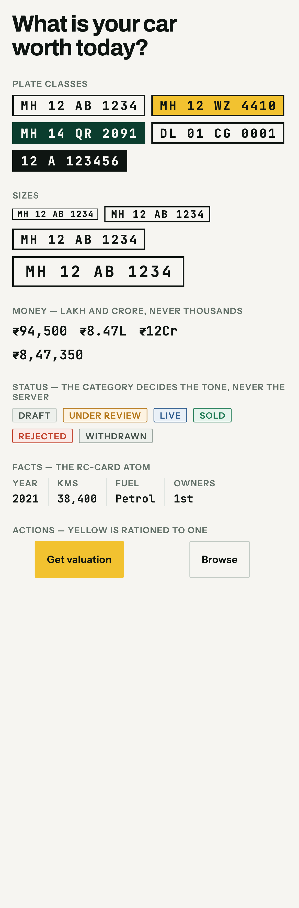

# Screenshots

Captured from the running product against the live API — Postgres, not fixtures. Every plate,
price and facet on these pages came out of the database.

Regenerate:

```bash
pnpm infra:up && pnpm api                 # API on :5180
pnpm dev:all                              # portals on :3100 / :3101 / :3102
node scripts/screenshots.mjs web          # the three portals, desktop + 390dp
mobile/tool/capture_mobile.sh             # the mobile design sheet
```

Desktop shots are full-page at 1600px. The `-mobile` variants are a 390x844 viewport - a common
Indian handset, and narrow enough that a layout which only works on a laptop fails visibly.

---

## Customer portal

`http://localhost:3100`

| Screen | What it shows | Desktop | 390dp |
|---|---|---|---|
| `/` | The plate-input hero | [view](web/customer-portal/home.png) | [phone](web/customer-portal/home-mobile.png) |
| `/buy` | Search with registry-driven facets | [view](web/customer-portal/buy.png) | [phone](web/customer-portal/buy-mobile.png) |
| `/sell` | The sell flow, rendered from the form registry | [view](web/customer-portal/sell.png) | [phone](web/customer-portal/sell-mobile.png) |
| `/attach` | Taxi Attachment Centre | [view](web/customer-portal/attach.png) | [phone](web/customer-portal/attach-mobile.png) |
| `/rent` | Rental — the same shell, a different intent | [view](web/customer-portal/rent.png) | [phone](web/customer-portal/rent-mobile.png) |
| `/lease` | Lease | [view](web/customer-portal/lease.png) | [phone](web/customer-portal/lease-mobile.png) |
| `/login` | OTP, no password | [view](web/customer-portal/login.png) | [phone](web/customer-portal/login-mobile.png) |

## Dealer portal

`http://localhost:3101`

| Screen | What it shows | Desktop | 390dp |
|---|---|---|---|
| `/` | Stock, ageing, payouts | [view](web/dealer-portal/dashboard.png) | [phone](web/dealer-portal/dashboard-mobile.png) |
| `/inventory` | The table a dealer lives in | [view](web/dealer-portal/inventory.png) | [phone](web/dealer-portal/inventory-mobile.png) |
| `/auction` | The floor — the one place yellow is loud | [view](web/dealer-portal/auction.png) | [phone](web/dealer-portal/auction-mobile.png) |
| `/leads` | Pipeline stages from the workflow registry | [view](web/dealer-portal/leads.png) | [phone](web/dealer-portal/leads-mobile.png) |
| `/requirements` | The requirement board | [view](web/dealer-portal/requirements.png) | [phone](web/dealer-portal/requirements-mobile.png) |
| `/wallet` | Ledger-backed balances | [view](web/dealer-portal/wallet.png) | [phone](web/dealer-portal/wallet-mobile.png) |
| `/settings` | Branches, KYC, entitlements | [view](web/dealer-portal/settings.png) | [phone](web/dealer-portal/settings-mobile.png) |

## Admin console

`http://localhost:3102`

| Screen | What it shows | Desktop | 390dp |
|---|---|---|---|
| `/` | Queues first, configuration second | [view](web/admin-console/dashboard.png) | [phone](web/admin-console/dashboard-mobile.png) |
| `/moderation` | Where a listing becomes public | [view](web/admin-console/moderation.png) | [phone](web/admin-console/moderation-mobile.png) |
| `/dealers` | Approval and KYC | [view](web/admin-console/dealers.png) | [phone](web/admin-console/dealers-mobile.png) |
| `/disputes` | Open cases hold escrow | [view](web/admin-console/disputes.png) | [phone](web/admin-console/disputes-mobile.png) |
| `/registry/taxonomy` | The attribute editor | [view](web/admin-console/registry-taxonomy.png) | [phone](web/admin-console/registry-taxonomy-mobile.png) |
| `/registry/forms` | Form builder with a live preview | [view](web/admin-console/registry-forms.png) | [phone](web/admin-console/registry-forms-mobile.png) |
| `/registry/workflows` | States, transitions, publish checks | [view](web/admin-console/registry-workflows.png) | [phone](web/admin-console/registry-workflows-mobile.png) |
| `/registry/pricing` | Commission rules and the live tester | [view](web/admin-console/registry-pricing.png) | [phone](web/admin-console/registry-pricing-mobile.png) |
| `/registry/features` | Modules and flags | [view](web/admin-console/registry-features.png) | [phone](web/admin-console/registry-features-mobile.png) |
| `/registry/i18n` | Translation gaps | [view](web/admin-console/registry-i18n.png) | [phone](web/admin-console/registry-i18n-mobile.png) |
| `/registry/geo` | Serviceable cities | [view](web/admin-console/registry-geo.png) | [phone](web/admin-console/registry-geo-mobile.png) |
| `/registry/notifications` | Event → audience → channel | [view](web/admin-console/registry-notifications.png) | [phone](web/admin-console/registry-notifications-mobile.png) |
| `/system/roles` | Permissions, and their scope | [view](web/admin-console/system-roles.png) | [phone](web/admin-console/system-roles-mobile.png) |
| `/system/audit` | Append-only | [view](web/admin-console/system-audit.png) | [phone](web/admin-console/system-audit-mobile.png) |
| `/system/integrations` | Provider fallback chains | [view](web/admin-console/system-integrations.png) | [phone](web/admin-console/system-integrations-mobile.png) |

---

## Mobile



Rendered by a golden test, not a browser. `flutter build web` cannot compile these apps -
drift's SQLite reaches `dart:ffi`, which does not exist on web - and adding a second WASM storage
path so a screenshot tool has a target would be production code in service of a picture.

The golden turned out to be the better artefact. It is deterministic, it fails the build when the
design moves without anyone meaning it to, and it caught two defects on its first run that a
browser shot never would have:

- **The apps bundled no font assets at all.** The design system named Archivo, Instrument Sans and
  JetBrains Mono; no pubspec declared them, so every one silently fell back to the platform font.
  The Registry typography existed on the web and nowhere else.
- **JetBrains Mono has no rupee glyph.** Every price rendered as a tofu box. Fixed with a font
  fallback chain, which is why `AhText.data` carries one.

---

## Known gaps, visible in these shots

- **No vehicle photography.** The demo seeder creates listings without media, so cards show an
  empty image slot. The slot reserves its aspect ratio, so nothing shifts when images arrive.
- **Plate colour is white everywhere on the web.** `plateClass` is in the API contract and the
  component renders all five classes, but the server does not yet derive it from the vehicle's
  category and fuel type - so the EV green and commercial yellow the mobile sheet shows are not
  yet reaching the portals.
